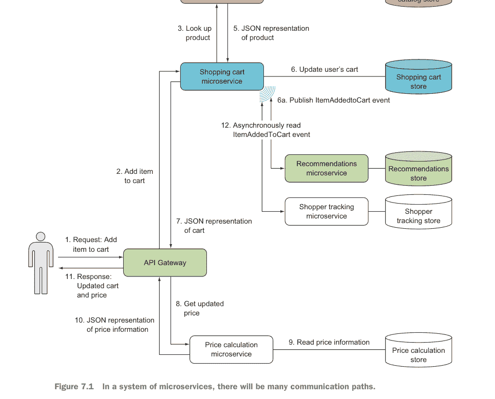
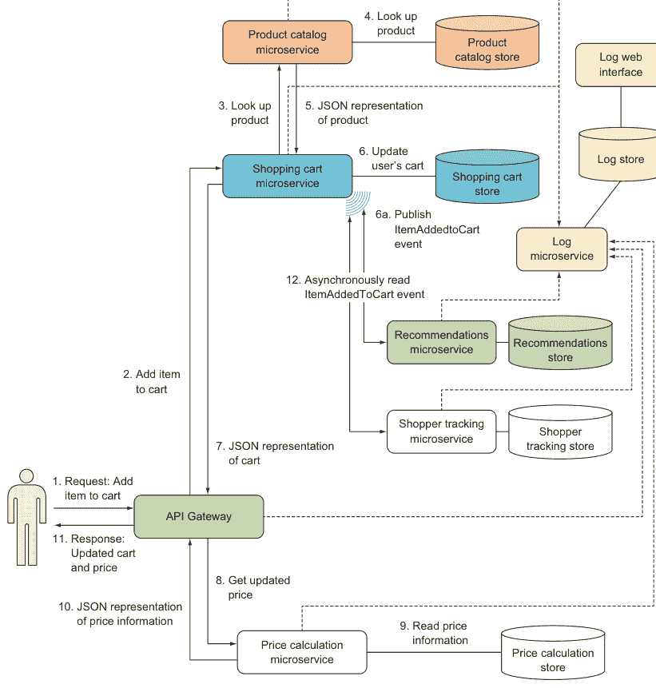
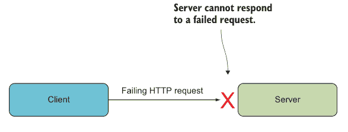
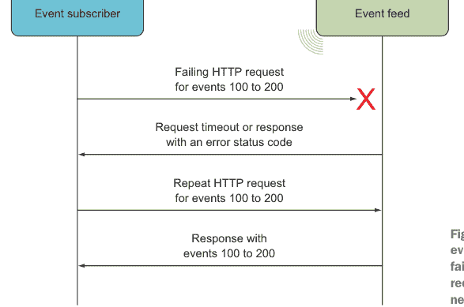
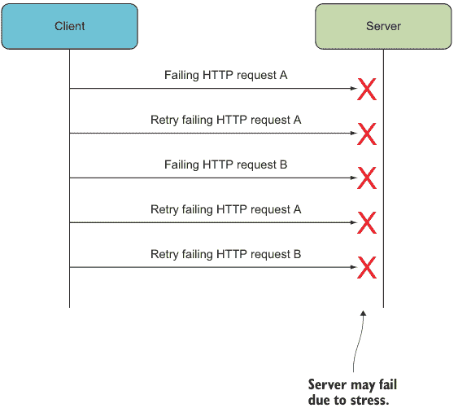
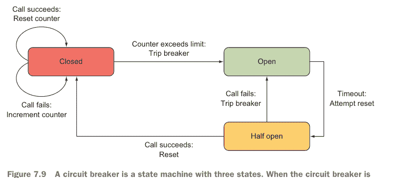
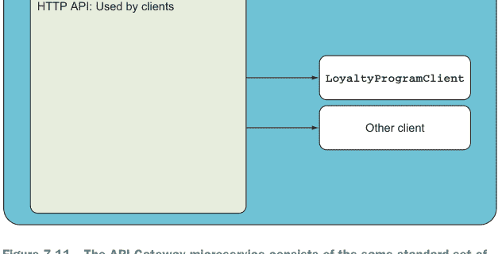

## 故障和错误

我将区分故障和错误这两个术语。故障发生在系统出现问题且问题由系统外部因素引起时。一些典型的故障来源如下：

- 丢失的网络数据包导致通信失败。
- 丢失的连接导致通信失败。
- 硬件故障导致微服务失败。

错误发生在系统无法正常为用户提供服务时。一些典型的错误示例如下：

- 用户看到错误页面。
- 系统挂起且永远不会响应用户操作。
- 系统向用户操作返回错误响应。

错误可能源于故障。另一方面，故障只有在软件无法妥善应对故障时才会成为错误。由此可知，完美的系统会遇到故障但不会出现错误。不幸的是，我们的系统并不完美，我们只能接受错误会发生，但要学会快速应对。

### 7.1 预期故障

在处理任何非平凡的软件系统时，你必须预期故障会发生。硬件可能会失败。软件可能由于例如不可预见的使用或损坏的数据而失败。微服务系统的一个区别因素是微服务之间存在大量通信。图 7.1 重复了第 1 章中显示用户向购物车添加商品时通信的图表。你可以看到，仅仅一个用户操作就会产生相当多的通信——而真实系统很可能有许多并发用户执行许多操作，从而产生大量通信。你必须预期通信有时会失败。两个微服务之间的通信可能不会经常失败，但从整个微服务系统的角度来看，由于通信量很大，通信故障很可能经常发生。

由于你必须预期微服务系统中的部分通信会失败，因此应设计微服务以能够应对这些故障。如第 5 章所述，你可以将微服务之间的协作分为三类：基于查询、基于命令和基于事件的协作。当通信失败时，其影响取决于协作类型以及微服务应对的方式：

- 基于查询的协作——当查询失败时，调用者无法获得所需的信息。如果调用者应对得当，系统仍会运行，但功能会下降。如果调用者应对不当，结果可能是错误。



### Figure 7.1 In a system of microservices, there will be many communication paths.

- **基于命令的协作**——当发送命令失败时，发送方无法知道接收方是否收到了命令。同样，取决于发送方的应对方式，这可能导致错误，也可能导致功能下降。
- **基于事件的协作**——当订阅者轮询事件源但调用失败时，影响是有限的。订阅者稍后会再次轮询事件源，并且假设事件源再次可用，就会收到事件。换句话说，订阅者仍会收到所有事件，但其中一些会被延迟。这对于基于事件的协作来说不应成为问题，因为它本身就是异步的。

以下小节讨论了一些为良好处理故障而准备的重要方法。


# 7.1.1 保持良好的日志

一旦你接受故障不可避免，并且其中一些故障可能不仅会导致终端用户体验下降，还会引发错误，你就必须确保在错误发生时能够理解出了什么问题。这意味着你需要良好的日志，能够追踪系统中发生的事情以及导致错误情况的原因。“发生了什么”通常会跨越多个微服务，这就是为什么你应该引入一个中央日志微服务，如图 7.2 所示；所有其他



图 7.2 中央日志微服务接收来自所有其他微服务的日志消息并将它们存储在数据库或搜索引擎中。日志数据可通过 Web 界面访问。虚线箭头显示微服务向中央日志微服务发送日志消息。

微服务向其发送日志消息，并且在需要时你可以检查和搜索日志。

日志微服务是所有其他微服务使用的中央组件。你需要确保日志出现故障不会导致整个系统崩溃，即当其他微服务无法记录消息时不会导致它们全部失败。因此，向日志发送日志消息必须是解耦的，这样发送消息的微服务就不必等待响应。这种解耦可以通过多种不同的方式实现，具体取决于你在生产环境中的选择。当使用容器时，从日志微服务解耦的标准方式是让其他微服务简单地记录到标准输出，并让 *日志传输* 工具收集这些日志并将其发送到日志微服务。

## 为日志微服务使用现成的解决方案

中央日志微服务并不实现特定系统的业务能力。它是通用技术能力的实现。换句话说，系统 A 中日志微服务的要求与系统 B 中日志微服务的要求并没有太大不同。因此，我建议使用现成的解决方案来实现你的日志微服务。此类别的产品包括 ELK、Datadog、Splunk、Honeycomb 等。这些都是成熟且文档完善的产品，我在这里不会深入介绍如何设置它们，但它们都支持以低耦合的方式从微服务摄取日志。在第 10 章中，我将假设你有一个基于这些产品之一的日志微服务，并向你展示如何向其发送有用的日志消息。

本章后面，我们将通过向 MVC 管道添加处理器来查看如何记录未处理的错误。

### 7.1.2 使用跟踪 ID

要查找与系统中特定操作相关的所有日志消息，你可以使用 *跟踪 ID*。跟踪 ID 是一个标识符，例如当终端用户的请求进入系统时附加到该请求。跟踪 ID 会在源自该终端用户请求的任何通信中从一个微服务传递到另一个微服务。只要其中一个微服务向日志微服务发送日志消息，该消息就应包含跟踪 ID。日志微服务应允许按跟踪 ID 搜索日志消息。在图 7.2 中，API 网关会为每个传入请求创建并分配一个跟踪 ID，并且该跟踪 ID 会随每次微服务到微服务的通信一起传递，包括事件和日志消息。这是一个成熟的模式，可以基于 Open Telemetry（https://opentelemetry.io/）等开放标准实现，其好处是前面提到的许多现成日志产品都支持并理解 Open Telemetry。

注意 第 9 章讨论了如何实现请求日志记录以及如何在通信和日志消息中包含跟踪 ID。

### 7.1.3 *向前滚动 vs. 向后滚动*

当生产环境中出现错误时，你面临如何修复它们的问题。在许多传统系统中，如果部署后不久就开始出现错误，默认响应是回滚到系统的上一个版本。在微服务系统中，默认值可以不同。如第 1 章所述，微服务非常适合持续交付。持续交付意味着微服务频繁部署，并且每次部署都应快速且易于执行。此外，微服务足够小且简单，许多错误修复也很容易。这就带来了 *向前滚动* 而非 *向后滚动* 的可能性。

为什么你会想要默认向前滚动？在某些情况下，向后滚动很复杂——特别是当涉及数据库更改时。当部署更改数据库的新版本时，微服务开始生成适合更新后数据库的数据。一旦该数据进入数据库，它就必须保留在那里，这可能与回滚到早期版本不兼容。在这种情况下，向前滚动可能更容易。

### 7.1.4 *不要传播故障*

有时，微服务周围会发生一些事情，可能扰乱其正常运行。我们在这种情况下说微服务 *处于压力之下*。压力源有很多，包括以下内容：

- 集群中运行微服务数据存储的其中一台机器崩溃了。
- 微服务与其中一个协作方失去了网络连接。
- 微服务接收到异常高的流量。
- 其中一个协作方宕机了。

在所有这些情况下，处于压力下的微服务无法继续按正常方式运行。这并不意味着它已宕机，但必须应对这种情况。

当一个微服务失败时，其协作方会处于压力之下。这意味着协作方也面临失败的风险。虽然微服务正在失败，但其协作方无法查询、发送命令或从失败的微服务轮询事件。如图 7.3 所示，如果协作方失败，更多微服务也会面临失败的风险：故障开始在微服务系统中传播。这种情况可能迅速从一个微服务失败升级为多个微服务失败。

以下是你可以阻止故障传播的一些示例：

- 当一个微服务尝试向另一个此时恰好正在失败的微服务发送命令时，该请求将失败。如果发送方也失败，你就会得到图 7.3 所示的情况，故障在整个系统中传播。为了阻止传播，发送方可以假装命令成功，但实际上将命令存储在失败命令列表中。发送微服务可以定期遍历失败命令列表并尝试再次发送它们。这在所有情况下都不可行，因为命令可能需要立即处理，但在这种方法可行的情况下，它可以阻止一个微服务的故障传播。此方法可以与 *断路器* 结合使用，我们将在本章后面讨论。
- 当一个微服务查询一个正在失败的微服务时，调用方可以使用缓存的响应。在第 6 章中，你看到了如何缓存查询响应并尊重被查询微服务设置的缓存头。如果调用方缓存中有陈旧响应，但获取新响应的查询失败，它可能会决定仍然使用陈旧响应。同样，这在所有情况下都不可行，但在可行的情况下，故障不会传播。
- 由于来自某个客户端的流量激增而处于压力下的 API 网关可以通过不响应该客户端每秒超过一定数量的请求来限制该客户端。请注意，客户端可能因为内部故障而发送异常多的请求。被限制后，客户端将获得降级体验，但仍会收到一些响应。如果没有限制，API 网关可能会对所有客户端变慢或完全失败。此外，由于 API 网关与其他微服务协作，处理所有传入请求会将这些请求的压力推给其他微服务。同样，限制可以阻止客户端的故障传播到其他微服务。

正如这些示例所示，阻止故障传播有多种形式。重要的收获是构建到系统中的保障措施的思想，这些保障措施专门设计用于阻止你预期的各种故障的传播。具体实现取决于你构建的系统的具体情况。构建保障措施可能需要一些努力，但通常是值得的，因为它们为整个系统提供了稳健性。


## 7.2 客户端对健壮性的责任

当两个微服务协作时，就存在客户端和服务器，如图 7.4 所示。客户端是发出 HTTP 请求的微服务，而服务器微服务则处理这些请求。图 7.4 中显示的请求恰好失败了；它可能因服务器故障而失败，也可能因请求根本未到达服务器而失败。一旦请求失败，服务器就无能为力了。服务器无法向失败的请求发送响应；此时请求已经消失。因此，处理请求的责任必须落在客户端身上。换句话说，客户端有责任在请求失败的情况下使协作保持健壮。



图 7.4 微服务之间的所有协作都存在客户端和服务器。客户端向服务器发送 HTTP 请求。客户端有责任处理失败的请求。

当你查看基于事件的协作时，你会看到协作本身就内置了面对请求失败时的某种程度的健壮性。图 7.5 显示了一个微服务中的事件订阅者和另一个微服务中的事件源。正如你在第 4 章中所看到的，事件订阅者会以间隔轮询事件源以获取新事件。这种协作方式意味着，如果获取新事件的请求失败，事件订阅者将在下一次轮询事件时再次请求相同的事件。即使某些请求失败，订阅者也能追上事件源中的事件，因此订阅者对于获取事件的失败请求是健壮的。



图 7.5 如果从事件源请求事件失败，订阅者将在下一次轮询事件时再次请求相同的事件。

你可以看到，对于基于命令和查询的协作来说，健壮性并不容易获得。接下来的两个小节将讨论为基于命令和查询的协作构建健壮性的模式。

### 7.2.1 健壮性模式：重试

在基于命令或查询的协作中，客户端可以选择在请求失败时重试。如果失败请求的原因是暂时的，下一次尝试可能会成功。瞬时故障很常见，其原因包括以下几点：

- 网络拥塞。
- 服务器微服务正在部署中。根据微服务的部署方式，可能存在一个短暂的时间窗口，微服务不可用或变慢——例如，在负载均衡器切换到新版本时。即使服务器仅在部署期间变慢，请求也可能因超时而失败。

重试是一把双刃剑。如果失败的原因不是暂时的，重试请求并无帮助。相反，不加区分地重试会给服务器带来压力，因为它不仅要处理通常的请求量，还要处理重试请求（见图 7.6）。这可能看起来不是什么大问题，但想象一下系统已经处于高负载状态。在正常运行期间，客户端向服务器发送大量请求。如果请求开始失败并且客户端重试所有请求，客户端最终会向服务器发送越来越多的请求。如果失败请求的原因是服务器已经难以跟上收到的请求数量，发送更多请求显然不会有帮助。



**图 7.6** 如果客户端不断重试一个在服务器端持续失败的请求，服务器上的压力会增大，最终可能完全失败。

这种方法显然不适用于所有情况。如果用户正在等待响应，一小时后重试是没有意义的，因为用户早已放弃，因此软件也应更早放弃并给出降级响应。另一方面，如果请求是基于系统自身执行的操作而发起的——例如作为处理事件的一部分——你通常可以等待很长时间。

接下来，我们将讨论另一种使协作健壮的有用模式：断路器模式。然后我们将进入代码并实现快速和慢速两种重试风格。

### 7.2.2 健壮性模式：断路器

断路器模式是对处理失败请求的一种不同思路。（有关断路器及相关模式的进一步阅读，请参阅 Michael T. Nygard 的著作《Release It! Design and Deploy Production-Ready Software》，第 2 版，Pragmatic Programmers，2018 年。）正如你在上一节中所看到的，重试失败的请求可能会加剧问题，给服务器带来压力；因此，你必须限制重试次数。断路器模式沿着这一思路发展。

图 7.8 如果连续多个请求都失败了，下一个请求也可能失败吗？在许多情况下，是的。

断路器模式通过根本不发出请求 E 来解决这种情况，而是假设它会失败。不发出很可能失败的请求可以减轻客户端和服务器的压力：

- 服务器收到的请求更少。
- 客户端不必等待请求失败，而是假设它们会失败，这意味着客户端无需花费资源等待，可以更快地完成自己的工作。

断路器将 HTTP 请求包装在如图 7.9 所示的状态机中。当微服务需要发出 HTTP 请求时，它通过断路器进行。



图 7.9 断路器是一个具有三种状态的状态机。当断路器关闭时，会发出真正的 HTTP 请求。当断路器打开时，不会发出任何请求。断路器有助于避免发出很可能失败的 HTTP 请求。

断路器状态机从关闭状态开始，工作方式如下：

- 当断路器处于关闭状态时，被请求时它会发出真正的 HTTP 请求。如果 HTTP 请求失败，断路器会递增计数器。如果请求成功，断路器会将计数器重置为零。当且仅当该计数器超过预设限制——比如连续五次失败请求——断路器会进入打开状态。
- 当断路器处于打开状态时，它不会发出任何 HTTP 请求。相反，它会立即报错。断路器会在预设时间内保持打开状态——比如 30 秒——然后进入半打开状态。
- 当断路器处于半打开状态时，它在被请求第一次时发出一次 HTTP 请求。之后一次 HTTP 请求后，如果请求成功则进入关闭状态，如果失败则进入打开状态。

这些简单规则的结果是一个状态机，它会在 HTTP 请求很可能失败时停止发出 HTTP 请求。本章后面，我将向你展示如何使用 Polly 在 HTTP 请求周围创建断路器。

## Polly

Polly 是一个用于创建和使用错误处理策略的便捷库。使用 Polly 创建策略是通过流畅 API 以声明方式完成的。创建后，策略可以应用于任何 Func 或 Action，这本质上意味着你可以将策略应用于任何你想要的代码。此外，HttpClient 类与 Polly 集成，使得将错误处理策略应用于 HTTP 请求变得更加容易。

使用 Polly 的三个基本步骤如下：

- 决定处理哪些异常，例如 HttpException。
- 决定使用哪种策略，例如重试策略。
- 将策略应用于一个函数。

与 Polly 工作的入口点是 Policy 类：

```
var retryStrategy =
    Policy
        .Handle<HttpException>()
        .Retry();

retryStrategy.Execute(() => DoHttpRequest());

Step 1: Decide which exceptions to handle.
Step 2: Decide which policy to use.
Step 3: Use the strategy to wrap a function call.
```

Polly 带有许多内置策略，包括重试策略的变体和各种断路器策略。此外，所有策略都提供异步和同步两种风格。

我们将利用 Polly 以及与 HttpClient 的集成，以轻松实现可靠的重试和断路器策略。

API 网关微服务由图 7.11 所示的组件组成。在接下来的两个小节中，我们将聚焦于 LoyaltyProgramClient。



图 7.11 API 网关微服务由你已经多次见过的相同标准组件集组成。


## 7.3.1 **使用 Polly 实现快速重试策略**

如图 7.10 所示，API Gateway 微服务向忠诚度计划微服务发送命令。这里我们只看如何为 register-user 命令添加重试策略，因为为 update-user 命令添加重试策略的代码本质上是相同的。

首先，你需要在 API Gateway 微服务中添加 Polly NuGet 包。向忠诚度计划微服务发送命令的代码位于 API Gateway 中的 LoyaltyProgramClient。你使用 Polly 设置一个使用指数退避的重试策略。Polly 将策略的设置与策略的执行分开；也就是说，Polly 允许你设置不同的策略——例如重试策略——然后稍后在策略下执行一段代码。在重试策略的情况下，这意味着如果代码失败则重试该代码片段。register-user 命令的重试策略设置如下所示。

```csharp
using System;
using Polly;

public class LoyaltyProgramClient
{
    private static readonly IAsyncPolicy<HttpResponseMessage>
        ExponentialRetryPolicy =
            Policy<HttpResponseMessage>
                .Handle<HttpRequestException>()
                .OrTransientHttpStatusCode()
                .WaitAndRetryAsync(
                    3,
                    attempt =>
                        TimeSpan.FromMilliseconds(100 * Math.Pow(2, attempt))
                );
}
```

设置好重试策略后，你就可以用它来包装对忠诚度计划微服务的调用。我们可以直接这样做，也可以通过 HttpClient 与 Polly 的集成来做。首先来看直接使用重试策略与 LoyaltyProgramClient：

```csharp
public async Task<HttpResponseMessage>
    RegisterUser(string name)
{
    var user = new {name, Settings = new { }};
    return await ExponentialRetryPolicy
        .ExecuteAsync(() =>
            this.httpClient.PostAsync("/users/", CreateBody(user)));
}

private static StringContent CreateBody(object user) => ...
```

这就是使用 Polly 设置重试策略并将其包装在一片代码中的简单程度。我们可以通过配置 LoyaltyProgramClient 中使用的 HttpClient 并使用重试策略来实现相同的行为，以稍微不同方式。在此版本中，LoyaltyProgramClient 保持不变。相反，我们将 exponentialRetryPolicy 添加到 Startup 类中，在其中使用它来配置 LoyaltyProgramClient 的 HttpClient，如下所示：

```csharp
public class Startup
{
    private static readonly IAsyncPolicy<HttpResponseMessage>
        ExponentialRetryPolicy =
            Policy<HttpResponseMessage>
                .Handle<HttpRequestException>()
                .OrTransientHttpStatusCode()
                .WaitAndRetryAsync(
                    3,
                    attempt =>
                        TimeSpan.FromMilliseconds(100 * Math.Pow(2, attempt)));

    public void ConfigureServices(IServiceCollection services)
    {
        services.AddHttpClient<LoyaltyProgramClient>()
            .AddPolicyHandler(_ => ExponentialRetryPolicy)
            .ConfigureHttpClient(c => c.BaseAddress = new Uri(host));
        ...
    }
    ...
}
```

重试策略

- 告诉服务集合 LoyaltyProgramClient 包装了一个 HttpClient。
- 将重试策略添加到 HttpClient。
- 向 HttpClient 添加其他配置。

此代码将 LoyaltyProgramClient 注册到服务集合中，这允许 ASP.NET 将 LoyaltyProgramClient 作为依赖项注入到其他类型中。此外，服务集合被指示 LoyaltyProgramClient 需要一个 HttpClient，该 HttpClient 应将 ExponentialRetryPolicy 应用于所有 HTTP 请求。这也实现了我们将用户注册包装在重试策略中的目标。事实上，这做得有点多：由于我们设置 HttpClient 将所有 HTTP 请求包装在重试策略中，重试也适用于 LoyaltyProgramClient 发出的查询。我们将在下一节中修复这个问题，在那里我们为查询添加断路器。

无论你更喜欢直接在 LoyaltyProgramClient 中应用 Polly 策略，还是在将 LoyaltyProgramClient 添加到服务集合时的配置中应用，都取决于个人喜好：你觉得哪个版本更简单？我个人在这两种方式上都没有强烈的偏好——只要我们记得将健壮性模式添加到所有协作中即可。

接下来，你将使用 Polly 创建一个断路器。

## 7.3.2 使用 Polly 实现断路器

现在你将为 API Gateway 微服务对忠诚度计划微服务的查询添加断路器。这次，你将使用 Polly 对断路器策略的内置支持。

### Listing 7.3 Polly 断路器策略

```csharp
private static readonly IAsyncPolicy<HttpResponseMessage>
    CircuitBreakerPolicy =
        Policy<HttpResponseMessage>
            .Handle<HttpRequestException>()
            .OrTransientHttpStatusCode()
            .CircuitBreakerAsync(5, TimeSpan.FromMinutes(1));
```

- 处理与重试策略相同的错误
- 将失败限制设置为 5，将打开状态时间限制设置为 1 分钟

尽管断路器模式看起来可能比重试更复杂，但 Polly 使设置断路器策略同样容易。使用策略的方式无论策略是什么都相同。如果你更喜欢直接在 LoyaltyProgramClient 中使用策略，你可以以我们包装 register-user 命令相同的方式包装查询。另一方面，如果你更喜欢 HttpClient 配置方法，我们扩展 Startup 中的配置，根据 HttpClient 执行的 HTTP 请求类型选择策略。

### Listing 7.4 用断路器包装查询

```csharp
services.AddHttpClient<LoyaltyProgramClient>()
    .AddPolicyHandler(request =>
        request.Method == HttpMethod.Get
            ? CircuitBreakerPolicy
            : ExponentialRetryPolicy)
    .ConfigureHttpClient(c => c.BaseAddress = new Uri(host));
```

- 检查哪个 HTTP 方法。GET 是查询；其他一切都是命令。
- 对查询使用断路器。
- 对命令使用重试。

有了这两个策略，API Gateway 就承担了为与忠诚度计划协作增加健壮性的责任。接下来，我们将转向忠诚度计划微服务。

## 7.3.3 实现慢速重试策略

忠诚度计划微服务订阅来自特价优惠微服务的事件。根据事件，忠诚度计划向通知微服务发送命令，要求其通知用户有关新的特价优惠。如果向通知发送命令失败，你希望重试。由于发送通知不是特别时间关键，你将选择不立即重试；相反，你将在事件订阅者下次轮询新事件时重试。为此，你所要做的就是跟踪上一次成功的事件。

请记住，从第 5 章中，事件订阅者通过定期唤醒并轮询事件源以获取新事件来工作。在每次这样的周期中，下一个事件批被读取并处理。下一个事件批将从上一个成功处理的事件之后的一个事件开始。这意味着所有失败的事件都会被重试。这也意味着一旦一个事件失败，就不妨中止该批的其余部分——反正稍后也会重试。第 5 章中的代码处理一个事件批，并设置为由 Kubernetes 按计划调用，因此我们实际上已经在第 5 章中实现了慢速重试。为了强调慢速重试的工作原理，让我们重申第 5 章中的代码。首先，有一个处理一个事件批的小程序：

### Listing 7.5 单事件订阅周期

```csharp
using System;
using System.IO;
using System.Net.Http;
using System.Net.Http.Headers;
using System.Text.Json;
using System.Threading.Tasks;

var start = await GetStartIdFromDataStore();
var end = 100;
var client = new HttpClient();
client
.DefaultRequestHeaders
.Accept
.Add(new MediaTypeWithQualityHeaderValue("application/json"));
using var resp = await client
.GetAsync(
    new Uri($"http://special-offers:5002/events?start={start}&end={end}"));
await ProcessEvents(await resp.Content.ReadAsStreamAsync());
await SaveStartIdToDataStore(start);

static int GetStartIdFromDataStore() { ... }
static void SaveStartIdToDataStore(int start) { ... }
static void ProcessEvents(string rawEvents) { ... }

public record SpecialOfferEvent(
    long SequenceNumber,
    DateTimeOffset OccurredAt,
    string Name,
    object Content);
```

- 从数据库读取此批的起点。
- 向事件源发送 GET 请求。
- 调用处理此批事件的方法。ProcessEvents 也会更新 start 变量。
- 保存下一批事件的起点。

此程序按计划调用并处理读取一个事件批。一旦读取一批，每个事件必须使用如下代码进行处理。

### Listing 7.6 处理一批事件

```csharp
private async Task ProcessEvents(string rawEvents)
{
    var events = await
        JsonSerializer.DeserializeAsync<SpecialOfferEvent[]>(rawEvents)
        ?? new SpecialOfferEvent[0];
    foreach (var ev in events)
    {
        dynamic eventData = ev.Content;
        if (ShouldSendNotification(eventData))
            await SendNotification(eventData);
        this.start = ev.SequenceNumber + 1;
    }
}
```

所有事件都被假定为成功处理，并且“start”对每个事件都已更新。


```csharp
private bool ShouldSendNotification(dynamic eventData)
{
    // decide if notification should be sent based on business rules
}

private Task SendNotification(dynamic eventData)
{
    // use HttpClient to send command to notification microservice
}
```

事件处理代码的具体实现会因具体情况而异——这正是业务逻辑被实现的地方。

有了这些，一个批次就可以被处理了。最后一步是配置 Kubernetes 以每小时一次的频率调用程序，这通过以下 YAML 完成，该 YAML 在 Kubernetes 中定义了一个 CronJob，每小时调用一次我们的事件消费者。

## Listing 7.7  Kubernetes manifest for the LoyaltyProgram event consumer

```yaml
apiVersion: batch/v1beta1
kind: CronJob
metadata:
  name: loyalty-program-consumer
spec:
  schedule: "*/1 * * * *"
  jobTemplate:
    spec:
      template:
        spec:
          containers:
            - name: loyalty-program
              image: microservicesindotnetregistry1.azurecr.io/loyalty-program:1.0.2
              imagePullPolicy: IfNotPresent
              env:
                - name: STARTUPDLL
                  value: "consumer/EventConsumer.dll"
          restartPolicy: Never
  concurrencyPolicy: Forbid
```

正如你所见，我们已经实现了慢速重试，因为这就是我们的事件消费者工作的方式。

## 7.3.4  Logging all unhandled exceptions

最后，我们将把注意力转向忠诚度计划微服务的 HTTP API。如前所述，你希望对系统中出现的所有错误保持良好的日志记录。这意味着你应该记录微服务控制器中抛出的任何未处理异常。事实上，忠诚度计划微服务已经这样做了。ASP.NET 默认管道的一部分是捕获所有其他未处理的异常并
将其记录到标准输出。要亲眼看到这一点，你可以在 UsersController 中添加一个新端点，该端点只是抛出一个 NotImplementedException：

## Listing 7.8 An endpoint that always throws an exception

```
[HttpGet("fail")]
public IActionResult Fail() => throw new NotImplementedException();
```

然后使用 dotnet run 运行忠诚度计划微服务并调用 https://localhost:5001/users/fail 上的新端点。控制台中的输出将包含由 NotImplementedException 引起的错误日志，类似于以下内容。

## Listing 7.9 Errors are logged to standard out

```
dotnet run
info: Microsoft.Hosting.Lifetime[0]
    Now listening on: https://localhost:5001
info: Microsoft.Hosting.Lifetime[0]
    Now listening on: http://localhost:5000
info: Microsoft.Hosting.Lifetime[0]
    Application started. Press Ctrl+C to shut down.
info: Microsoft.Hosting.Lifetime[0]
    Hosting environment: Development
info: Microsoft.Hosting.Lifetime[0]
    Content root path: C:\Users\chors\Documents\horsdal3\code\Chapter07\
        LoyaltyProgram\LoyaltyProgram
fail: Microsoft.AspNetCore.Server.Kestrel[13]
    Connection id "0HM2KQ4LI56GR", Request id "0HM2KQ4LI56GR:00000001":
        An unhandled exception was thrown by the application.
System.NotImplementedException: The method or operation is not implemented.
    at LoyaltyProgram.Users.UsersController.Fail() in C:\Users\chors\
Documents\horsdal3\code\Chapter07\LoyaltyProgram\LoyaltyProgram\Users\
UsersController.cs:line 13
    at lambda_method(Closure , Object , Object[] )
    at Microsoft.Extensions.Internal.ObjectMethodExecutor.Execute(
Object target, Object[] parameters)
    at Microsoft.AspNetCore.Mvc.Infrastructure.ActionMethodExecutor.
SyncActionResultExecutor.Execute(IActionResultTypeMapper mapper,
ObjectMethodExecutor executor, Object controller, Object[] arguments)
    at Microsoft.AspNetCore.Mvc.Infrastructure.ControllerActionInvoker.
InvokeActionMethodAsync()
    at Microsoft.AspNetCore.Mvc.Infrastructure.ControllerActionInvoker.
Next(State& next, Scope& scope, Object& state, Boolean& isCompleted)
    at Microsoft.AspNetCore.Mvc.Infrastructure.ControllerActionInvoker.
InvokeNextActionFilterAsync()
--- End of stack trace from previous location where exception was thrown ---
    at Microsoft.AspNetCore.Mvc.Infrastructure.ControllerActionInvoker.
Rethrow(ActionExecutedContextSealed context)
    at Microsoft.AspNetCore.Mvc.Infrastructure.ControllerActionInvoker.
Next(State& next, Scope& scope, Object& state, Boolean& isCompleted)
    at Microsoft.AspNetCore.Mvc.Infrastructure.ControllerActionInvoker.
InvokeInnerFilterAsync()
```

Start of the error log

```
--- End of stack trace from previous location where exception was thrown ---
   at Microsoft.AspNetCore.Mvc.Infrastructure.ResourceInvoker.<
      InvokeFilterPipelineAsync>g__Awaited|19_0(ResourceInvoker invoker, Task lastTask, State next, Scope scope, Object state, Boolean isCompleted)
   at Microsoft.AspNetCore.Mvc.Infrastructure.ResourceInvoker.<InvokeAsync>
      g__Awaited|17_0(ResourceInvoker invoker, Task task, IDisposable scope)
   at Microsoft.AspNetCore.Routing.EndpointMiddleware.<Invoke>
      g__AwaitRequestTask|6_0(Endpoint endpoint, Task requestTask,
      ILogger logger)
   at Microsoft.AspNetCore.Server.Kestrel.Core.Internal.Http.HttpProtocol.
      ProcessRequests[TContext](IHttpApplication`1 application)
```

在第 10 章中，我们将回到日志记录并了解如何配置它并使其更有用，但就目前而言，我们很满意所有异常都被记录下来。

## 7.3.5 Deploying to Kubernetes

我们已经在忠诚度计划微服务周围的所有协作中实现了健壮性模式，但我们并没有改变协作风格——查询仍然是查询，命令仍然是命令，事件仍然是事件。此外，微服务之间的依赖关系仍然相同：忠诚度计划微服务仍然订阅来自特价优惠微服务的事件并仍然向通知微服务发送命令。这意味着部署到 Kubernetes 不需要改变，因此与我们在第 5 章中看到的完全相同。

至此，围绕忠诚度计划微服务的协作的健壮性措施的实现已经完成。有了这些相当简单的措施，协作在生产负载下很可能会更加健壮。

## Summary

- 由于微服务之间存在大量通信，你必须预期某些通信会失败。微服务优雅地处理此类故障对于系统的健壮性至关重要。
- 你应该在微服务中设计健壮性，以便故障不会在系统中传播并最终成为错误。
- 协作的客户端负责在出现故障时使通信健壮。
- 你应该拥有良好的日志，并且在需要调查生产问题时易于访问和搜索。中央日志微服务应接收所有日志消息并提供访问权限。
- 使通信健壮的最重要策略是重试和断路器模式。
- Polly 使设置和使用重试策略以及断路器变得容易。
- 默认情况下 ASP.NET 将错误记录到标准输出。现成的日志产品支持从所有微服务收集这些日志并将其集中化。
