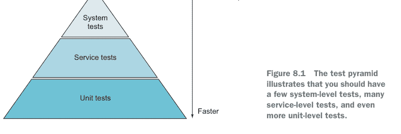
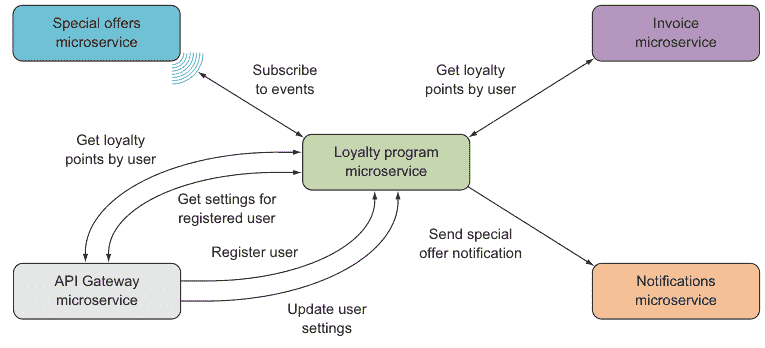
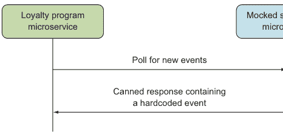
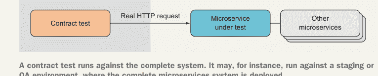
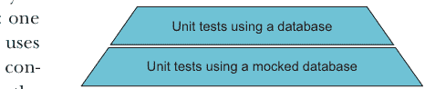
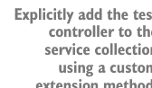
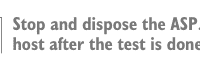
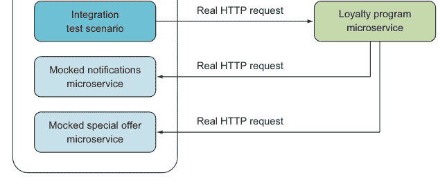

# Writing tests for microservices

- **This chapter covers**
- Writing good automated tests
- Understanding the test pyramid and how it applies to microservices
- Testing microservices from the outside
- Writing fast, in-process tests for endpoints
- Using `Microsoft.AspNetCore.TestHost` for integration and unit tests

到目前为止，我们已经编写了一些微服务并在它们之间设置了协作。实现是好的，但我们还没有为它们编写任何测试。随着我们编写越来越多的微服务，如果没有良好的自动化测试，开发系统将变得难以管理。本章的前半部分，我将讨论你需要为每个单独的微服务测试什么。然后我们将深入代码，首先查看在隔离中测试端点，然后查看如何像从另一个微服务发送请求一样测试完整的微服务，但使用 `Microsoft.AspNetCore.TestHost` 库中的 `TestServer` 在进程内进行测试。


## 8.1 如何以及测试什么

在第 1 章中，你看到了微服务具备的三种特性，使其非常适合持续交付：

- *可单独部署*——只要对微服务进行了任何小的、安全的变化，就能将微服务部署到生产环境。但你如何知道一个变化是安全的？这就是测试以及特别是测试自动化发挥作用的地方。诸如代码评审、静态代码分析、以及为向后兼容设计公共 API 等其他活动，也有助于判断一个变化是否安全，但测试是你信心的主要来源。
- *可替换*——你应该努力在正常的工作节奏中，用另一个功能等价的实现替换微服务的一个实现。同样，测试发挥着重要作用，因为一套良好的测试可以让你评估新的实现是否真的等同于旧的实现。
- *可由小团队维护*——微服务足够小且专注，以至于一个团队可以维护其中几个。一个优点是你能够编写覆盖微服务所有部分的测试。

如果你想快速对变化充满信心，并能够替换实现糟糕的微服务，测试必须快速且可重复。为了使测试快速且可重复，你必须自动化其中很大一部分——这就是本章的重点。

### 8.1.1 测试金字塔：要在微服务系统中测试什么

图 8.1 所示的 *测试金字塔* 是一个你可以用来指导应该编写哪些种类的测试以及每种应该有多少个的工具。你可以在不同的著作中找到测试金字塔的变体；它们都将测试放在不同的层级，其中金字塔顶部的层级范围较广，而底部的测试则较窄。测试金字塔说明你应该力求拥有许多 narrowly focused 的测试（金字塔宽阔底部上的那些）以及只有少数范围较广的测试（狭窄顶部上的那些）。



我在这里使用的测试金字塔版本有三个层级：

- *系统测试（顶层）*——跨越完整的微服务系统并且通常通过 GUI 实现的测试。
- *服务测试（中间层）*——针对一个、且仅一个完整的微服务工作的测试。
- *单元测试（底层）*——测试微服务中一个小功能片段的测试。单元测试在进程中调用被测微服务的代码，通常只涉及微服务的一部分。

请注意，当我使用 *单元测试* 这个术语时，*单元* 指的是一个小功能片段。我定义单元测试的范围不是基于任何特定的代码构造，如类或方法，而是基于功能。当我们稍后查看单元测试的实现时，你会看到单元测试可以轻松跨越微服务的所有层，例如从 MVC 控制器，通过领域对象，或到数据访问类。

尽管测试金字塔告诉你要随着层级的下降而拥有更多的测试，但在每个层级上应该有多少测试是情境性的。它取决于诸如系统规模、系统复杂性以及失败成本等因素。

### 8.1.2 系统级测试：端到端测试完整的微服务系统

金字塔顶部的测试范围非常广，因此用很少的测试就能覆盖大量代码。由于范围如此广，它们也不精确。当系统级测试中断时，问题所在并不立即明确。该测试可能使用整个系统，因此问题可能在任何地方。

一个系统级测试的例子是使用我们在前面章节中谈到的 POS 系统的 Web UI 添加若干项到发票中，应用折扣码，并使用测试信用卡付款。如果该测试通过，它会让你确信发票会被创建，折扣可以被应用，并且你可以接收信用卡付款。在这样的系统测试期间，你可能会断言发票上的应付金额符合预期。如果该断言失败，任何数量的事情都可能导致问题：你可能对一项或多项商品使用了错误的价格，你可能错误地应用了折扣，或者你可能误解了发票数据。换句话说，这种失败可能由至少几台不同的微服务引起。要弄清楚哪个是罪魁祸首，你需要进行调查。

系统级测试失败的具体方式可以给出一些问题所在位置的提示，但通常有大量代码可能存在故障。仅从系统测试来看，甚至无法明确哪个微服务导致了失败。另一方面，当系统级测试通过时，它们会给你相当大的信心。

系统级测试的第二个缺点是它们往往很慢。这再次是它们涉及完整系统的另一面：会发出真实的 HTTP 请求，内容会写入真实的数据存储，并且会轮询真实的事件馈送。



**图 8.2** 忠诚度计划微服务通过三种类型的协作与许多其他微服务协作：事件、查询和命令。

为了隔离测试忠诚度计划，你可以创建其协作者的模拟版本。如图 8.3 所示，当忠诚度计划与模拟的协作方交互时，它会得到硬编码的响应。



**图 8.3** 对于服务级测试，忠诚度计划微服务与协作者的模拟版本交互。模拟的微服务对请求以硬编码响应进行响应。

针对忠诚度计划微服务的服务级测试可以执行以下操作：

1. 发送创建用户的命令。
2. 等待忠诚度计划微服务查询模拟的特价优惠微服务的事件，然后接收关于新特价优惠的硬编码事件。
3. 记录发送到通知微服务的任何命令并断言已发送向新用户关于新特价优惠的通知命令。

当这样的测试通过时，你可以确信忠诚度计划微服务的重要方面是有效的。当它失败时，你知道问题出在忠诚度计划本身。

服务级测试比系统级测试精确得多，因为它们只覆盖单个微服务：如果这样的测试失败，问题应该出在被测微服务内部，前提是测试设置本身没有错误。由于微服务很小——毕竟它们是可替换的——知道问题出在某个微服务内部，比系统级测试提供的要精确得多。

为了调用我们在 MVC 控制器中实现的端点，我们将使用 Microsoft.AspNetCore.TestHost 库。该库让你编写对 ASP.NET 端点进行内存调用的测试。这些调用以与 HTTP 请求完全相同的方式经过 ASP.NET，但不会经过网络栈。对我们控制器中的代码来说，通过 Microsoft.AspNetCore.Mvc.Testing 中的 TestServer 发出的调用看起来与真实的 HTTP 请求完全一样。另一方面，服务级测试仍然相对较慢，因为微服务使用真实数据库，并且它通过 HTTP 与其模拟的协作方交互。

### 契约测试

正如你现在所知，微服务系统中微服务之间存在大量协作。你将协作实现为一个微服务对另一个微服务的请求。如果你不小心，端点的更改可能会破坏调用该端点的微服务。这就是契约测试（https://martinfowler.com/bliki/ContractTest.html）发挥作用的地方。

当系统中的任意两个微服务协作时，发起请求的那个对另一个的行为有一些期望。也就是说，给定一种协作，调用微服务期望被调用微服务实现某个特定的契约。契约测试是一种旨在确定被调用微服务是否实现了调用微服务所期望的契约的测试。

契约测试是从调用者的角度编写的，并且是为了调用微服务的利益而存在：只要契约测试通过，调用者对契约所做的假设仍然有效。因此，契约测试是调用者代码库的一部分。它们不是被测试端点所在代码库的一部分。契约测试不应对它们所测试的微服务的实现方式有任何了解。这就是契约测试与服务级测试的不同之处。对于服务级测试，你通过为被测微服务提供其协作者的模拟来隔离它。你不希望对契约测试这样做，因为契约测试不应了解被测微服务的其他协作方。换句话说，契约测试在完整系统上运行。

由于契约测试是某个微服务的代码库的一部分但测试其他微服务中的内容，并且它们在完整系统上运行，将它们运行在 QA 或 staging 环境中会是一个好主意。此外，最好在每次被测微服务部署时自动运行它们。当契约被破坏时，这强烈表明契约测试所属的微服务与被测微服务之间的协作也被破坏了。




契约测试会针对完整系统运行。例如，它可以针对预发布（staging）或 QA 环境运行，在这些环境中部署了完整的微服务系统。

在实现方面，契约测试看起来有点像你将在本章后面编写的服务级测试。不同之处在于，契约测试在测试金字塔中的层级略高，位于系统级测试和服务级测试之间。契约测试不会设置模拟的协作对象，而服务级测试会；契约测试通过向被测微服务发起真实的 HTTP 请求来工作。

关于服务级测试，我的建议是，你应该为被测微服务提供的所有功能的成功场景编写此类测试。这类测试自然要使用微服务的所有端点，并且依赖微服务中的任何事件订阅。换句话说，它们会覆盖微服务中所有的成功路径。一般来说，我只建议为最重要的失败场景编写服务级测试。再说一次，所需服务级测试的数量以及它们应该覆盖多少失败场景，取决于系统以及该特定系统中失败的代价。

## 8.1.4 单元级测试：从进程内测试端点

测试金字塔底部的测试同样只涉及单个微服务，但它们并不针对整个微服务；它们使用由 Microsoft.AspNetCore.TestHost 库中的 TestServer 创建的 HttpClient，直接在内存中与被测微服务的各个部分交互。

在单元测试级别，我将向你展示两种测试（见图 8.4）：一种使用数据库，另一种使用模拟对象代替数据库。我认为这两种都是单元测试，即使第一种类型使用了数据库，无论它是功能完整的数据库还是内存数据库。有两件事使一个测试成为单元测试：它的范围是一小块功能，并且微服务中的测试代码和生产代码在同一进程中运行。



图 8.4 在单元测试级别，有两种测试：使用数据库的测试和不使用数据库的测试。

单元测试的范围很窄，因此定位很精确：当它失败时，问题就出在少量代码中。窄范围也让你能够编写恰当覆盖失败场景的测试。两种类型的单元测试都比服务级测试更快，当然，模拟数据库的测试比使用数据库的测试更快。

有时，你可能还会编写更细粒度的单元测试，通过实例化领域对象并直接测试它们，从而直接测试微服务中的业务逻辑。对于最细粒度的单元测试应该细到什么程度，我采取务实的做法。我采用由外而内的测试优先工作流：先用 TestServer 调用微服务中的端点来编写测试。我从覆盖端点应完成的主要功能的测试开始，然后逐步添加更详细的测试。只有当通过端点处理程序来测试某个特定细节变得别扭时，我才开始编写更窄的单元测试。例如，要通过端点处理程序调用测试来覆盖业务逻辑中的某个特定情况，可能需要大量设置代码。这就是一个信号，表明应该转为范围更窄的测试——只覆盖业务逻辑中的那些情况。对于这些情况，我会编写直接针对实现该业务逻辑特定部分的代码的测试。

对于忠诚度计划微服务，我们需要单元测试来测试允许我们创建用户的端点，使用多种不同的输入，涵盖可能的有效和无效输入。同样，我们需要从允许我们读取用户的查询端点测试读取存在和不存在的用户。对于微服务中的其他端点，我们也需要类似的测试。忠诚度计划足够简单，我们不需要转向比微服务端点更窄的测试。因此，我稍后展示的单元测试都是通过 TestServer 调用端点处理程序来工作的。

## 8.2 测试库：Microsoft.AspNetCore.TestHost 和 xUnit

在本章中，我们将使用两个新的库：

- `Microsoft.AspNetCore.TestHost`
- `xUnit`

我将对这两个库做简要介绍，然后为我们在前面章节中编写的一些微服务实现测试。

### 8.2.1 认识 Microsoft.AspNetCore.TestHost

`Microsoft.AspNetCore.TestHost` 库是 ASP.NET 的配套库，可以方便地测试端点。借助它，我们可以像在生产代码中配置 Web 主机一样配置 TestHost。TestHost 使用 TestServer，后者可以创建测试用的 HttpClient 对象。由 TestServer 创建的 HttpClient 与我们在生产代码中使用的 HttpClient 相同。它允许我们使用 GetAsync、PostAsync、PutAsync 和 DeleteAsync 等方法来分别调用控制器中的 GET、POST、PUT 和 DELETE 端点。这些调用会经过整个 ASP.NET 管道。这意味着依赖注入照常设置和使用，中间件（我们将在下一章讨论）照常运行，MVC 过滤器照常运行，反序列化和序列化也照常运行。简而言之，对端点来说，这个调用看起来就是一个真实的 HTTP 请求，但它全部发生在进程内，因此比经过网络栈的真实 HTTP 请求要快得多。每个方法的返回值都是 HttpResponseMessage，就像我们通常从 HttpClient 得到的一样，我们可以像平常一样使用它，检查标头、状态和响应正文。

`Microsoft.AspNetCore.TestHost` 库会接入 ASP.NET 应用程序的正常配置中，因此，除了 TestServer 和 HttpClient 之外，它使用 TestHost 创建的一切都与使用真实主机时相同。因此，我们可以进行所有通常的配置，包括但不限于：

- 覆盖依赖注入容器中的注册，例如，用模拟对象代替真实对象
- 向 ASP.NET 管道添加特殊钩子
- 配置日志记录，例如，允许测试检查日志消息的内容

### 8.2.2 认识 xUnit

xUnit（https://xunit.net/）是 .NET 的单元测试工具。它有一个库部分，允许你编写自动化测试，还有一个运行器部分，可以运行这些测试。要用 xUnit 编写测试，你需要创建一个带有 Fact 特性的方法，并在其中编写执行测试的代码。xUnit 运行器会扫描带有 Fact 特性的方法并全部执行它们。此外，xUnit 还提供了在测试中进行断言的 API。如果断言失败，xUnit 运行器会捕获失败并在测试运行完成后报告。xUnit 测试运行器可以通过 dotnet 运行，因此非常适合你在本书中构建的项目。

还有其他与 xUnit 类似的 .NET 单元测试工具，例如 NUnit，它们也适用于我们本章将做的所有工作，所以你可以随意选择自己喜欢的工具。

### 8.2.3 xUnit 与 Microsoft.AspNetCore.TestHost 协同工作

将 Microsoft.AspNetCore.TestHost 和 xUnit 结合起来，你就能为 MVC 控制器中实现的端点编写简洁的测试。在 8.3.1 节中，你将为此类单元测试建立一个项目，并用 dotnet 运行它们；但现在，我想让你先快速了解一下这些测试的样子。下面的测试调用了 TestController 中的 GET 端点，并断言响应状态码是“200 OK”。

### 清单 8.1 使用 xUnit 和 Microsoft.AspNetCore.TestHost 的简单控制器测试

```
namespace LoyaltyProgramUnitTests
{
    using System;
    using System.Net;
    using System.Net.Http;
    using System.Threading.Tasks;
    using Microsoft.AspNetCore.Builder;
    using Microsoft.AspNetCore.Hosting;
    using Microsoft.AspNetCore.Mvc;
    using Microsoft.AspNetCore.TestHost;
    using Microsoft.Extensions.Hosting;
    using Xunit;
```


public class TestController_should : IDisposable
{
    private readonly IHost host;
    private readonly HttpClient sut;

    public class TestController : ControllerBase
    {
        [HttpGet("/")]
        public OkResult Get() => Ok();
    }

    public TestController_should()
    {
        this.host = new HostBuilder()
            .ConfigureWebHost(host =>
            {
                host.ConfigureServices(x =>
                    x.AddControllersByType(typeof(TestController)))
                .Configure(x =>
                {
                    x.UseRouting()
                    .UseEndpoints(opt => opt.MapControllers())
                    .UseTestServer()
                })
                .Start();
            });
        this.sut = this.host.GetTestClient();
    }

    [Fact]
    public async Task respond_ok_to_request_to_root()
    {
        var actual = await this.sut.GetAsync("/");
        Assert.Equal(HttpStatusCode.OK, actual.StatusCode);
    }

    public void Dispose()
    {
        this.host?.Dispose();
        this.sut?.Dispose();
    }
}







关于这个测试，有几点需要注意：

-   测试类 `TestController_should` 实现了 `IDisposable` 接口。xUnit 运行器能识别 `IDisposable`，并在运行 Fact 之后调用 `Dispose` 方法。在 dispose 方法中，host 和 sut 会被释放，从而确保所有资源都被清理干净。如果 host 没有被释放，测试将一直挂起，直到测试运行器超时。
-   在 `TestController_should` 构造函数中，我们像生产代码一样创建了一个 Web 主机。这正是我们可以针对被测端点配置一切的地方。在这个测试中，我们使用了与生产代码类似的设置，只不过我们使用了测试服务器，这可以确保请求在进程内完成。

在配置主机的过程中，我们使用了一个自定义扩展方法 `AddControllersByType`，我接下来会展示这个方法。通过使用 `AddControllersByType`，我们确保主机只拥有一个控制器：`TestController`。因此，该测试可以相当精确地控制主机上哪些端点可用。

## 命名约定

我的测试遵循以下命名约定：

-   我的测试针对一个名为 `sut`（即 *被测系统* system under test）的对象进行操作。在前面的测试中，`sut` 是一个 `HttpClient` 对象，我用它来向端点发出调用。
-   我根据被测对象来命名测试类——在这个示例测试中是 `TestController`——后面再加上 `_should`。
-   我根据正在测试的场景和预期结果来命名 Fact 方法。我用下划线分隔 Fact 方法名称中的单词，并尽量确保它们与外围类名组合后能构成一个句子。例如，在这个测试中，将类名和 Fact 方法名拼接起来并把下划线替换为空格，就得到 “TestController should respond okay to requests to root.”（TestController 应当对根路径的请求返回正常响应）。

你是否喜欢这些约定纯属个人品味问题。我恰好喜欢它们，但它们对于编写好的测试绝非必需。

你可以使用 `dotnet test` 运行前面的测试；它会在内存中执行并给你良好的覆盖率，因为对 `sut.GetAsync("/")` 的调用会执行真实的 ASP.NET 管道，包括 `TestController` 中端点的实现。字符串参数 “/” 是发出假请求的相对 URL。在 8.3.1 节中，我们将介绍如何为这些单元测试建立项目，以及如何用 `dotnet test` 运行它们。

在 `TestController_should` 构造函数中，我们使用了自定义扩展方法 `AddControllersByType`，它的原理是覆盖 MVC 决定哪些类型是控制器的方式。这是通过创建 MVC 的 `ControllerFeatureProvider` 的自定义版本，并用自定义版本替换 MVC 默认的 `ControllerFeatureProvider` 来实现的。MVC 使用 `ControllerFeatureProvider` 来决定哪些类型是控制器，因此，用自定义版本覆盖它后，我们就可以决定 MVC 将哪些类型视为控制器，从而决定哪些端点属于测试范围。下面的清单展示了其实现，其中第一部分是自定义的 `ControllerFeatureProvider`，第二部分是扩展方法。

清单 8.2 控制哪些控制器属于测试范围的扩展方法

namespace LoyaltyProgramUnitTests
{
    using System;
    using System.Linq;
    using System.Reflection;
    using Microsoft.AspNetCore.Mvc.Controllers;
    using Microsoft.Extensions.DependencyInjection;

    public class FixedControllerProvider : ControllerFeatureProvider
    {
        private readonly Type[] controllerTypes;

        public FixedControllerProvider(params Type[] controllerTypes)
        {
            this.controllerTypes = controllerTypes;
        }

        protected override bool IsController(TypeInfo typeInfo)
        {
            return this.controllerTypes.Contains(typeInfo);
        }
    }

    public static class MvcBuilderExtensions
    {
        public static IMvcBuilder AddControllersByType(
            this IServiceCollection services,
            params Type[] controllerTypes)
            =>
            services
                .AddControllers()
                .ConfigureApplicationPartManager(mgr =>
                {
                    mgr.FeatureProviders.Remove(
                        mgr.FeatureProviders.First(f =>
                            f is ControllerFeatureProvider));
                    mgr.FeatureProviders.Add(
                        new FixedControllerProvider(controllerTypes));
                });
    }
}

-   控制器提供程序的自定义实现
-   覆盖用于识别控制器的方法。
-   扩展方法
-   让服务集合感知控制器。
-   访问功能提供程序。
-   移除默认的控制器提供程序功能。
-   添加自定义的控制器提供程序功能。

我们也会在后面的测试中使用这个扩展，把它作为控制测试范围的便捷方式。

在本章剩余部分中，我们将在代码层面工作，为忠诚度计划微服务实现单元测试和服务级测试。当你在第 5 章实现忠诚度计划时，它并没有事件提要，但对于这些示例，你将添加一个可供其他微服务订阅的事件提要。

## 8.3 使用 Microsoft.AspNetCore.TestHost 编写单元测试

在本节中，你将为实现忠诚度计划微服务中的端点编写一些单元测试。在第 5 章中，你看到忠诚度计划有三个命令和查询端点：

-   一个 HTTP GET 端点，URL 形式为 “/users/{userId}”，返回用户的表示形式。
-   一个 HTTP POST 端点，指向 “/users/”，它期望请求正文中包含用户的表示形式，然后将该用户注册到忠诚度计划中。
-   一个 HTTP PUT 端点，URL 形式为 “/users/{userId}”，它期望请求正文中包含用户的表示形式，然后更新一个已注册的用户。

让我们为这些端点编写测试。忠诚度计划微服务还有一个事件提要，你也将为其编写一个测试。你不会为忠诚度计划中的端点和事件提要编写全面的测试——只需足以了解如何针对 MVC 端点编写测试即可。在以下小节中，你将完成以下工作：

-   建立一个测试项目，用于存放忠诚度计划微服务的单元测试。
-   编写使用 Microsoft.AspNetCore.TestHost 来测试忠诚度计划中端点的测试，并让微服务中的代码使用真实数据库。你将编写三个这样的测试，分别针对以下三项功能：
    -   一个尝试读取不存在用户的测试。
    -   一个创建用户并读回该用户的测试。
    -   一个修改用户并读回该用户的测试。
-   编写同样使用 Microsoft.AspNetCore.TestHost 来测试某个端点、但通过在被测端点中注入模拟数据库来限制范围的测试。这些测试将测试微服务中的事件提要。

完成后，你将学会如何针对 MVC 端点编写单元测试——既包括带真实数据库的情况，也包括不带真实数据库的情况。

### 8.3.1 建立单元测试项目

在开始编写测试之前，你需要一个项目来存放它们。为此，请在 LoyaltyProgram 项目旁边创建一个新项目，并将其命名为 LoyaltyProgramUnitTests。你可以使用 IDE 或 dotnet cli 通过命令 `dotnet new xunit -n LoyaltyProgramUnitTests` 创建测试项目。你的解决方案应类似于这样：

```
C:.
  Ch08.sln
  Dockerfile
  loyalty-program.yaml
  EventConsumer
    EventConsumer.csproj
    Program.cs
  LoyaltyProgram
    appsettings.Development.json
```


appsettings.json
LoyaltyProgram.csproj
Program.cs
Startup.cs
EventFeed
EventFeedController.cs
EventStore.cs
Users
LoyaltyProgramSettings.cs
LoyaltyProgramUser.cs
UsersController.cs
LoyaltyProgramUnitTests
LoyaltyProgramUnitTests.csproj
UnitTest1.cs

现在，你可以像下面这样使用 dotnet 运行 UnitTest1.cs 中的小型测试：

```
PS> dotnet test
```

初始测试运行起来后，添加对 Microsoft.AspNetCore.TestHost 的依赖，以便使用 TestServer 和 HttpClient。还要添加对 LoyaltyProgram 的依赖，以便开始测试它。现在，LoyaltyProgramUnitTests.csproj 中的依赖项如下所示：

```
<ItemGroup>
    <PackageReference Include="Microsoft.AspNetCore.TestHost" Version="3.1.8"/>
    <PackageReference Include="Microsoft.NET.Test.Sdk" Version="16.5.0" />
    <PackageReference Include="xunit" Version="2.4.0" />
    <PackageReference Include="xunit.runner.visualstudio" Version="2.4.0" />
    <PackageReference Include="coverlet.collector" Version="1.2.0" />
</ItemGroup>

<ItemGroup>
    <ProjectReference Include="..\LoyaltyProgram\LoyaltyProgram.csproj" />
</ItemGroup>
```

最后一行是对 LoyaltyProgram 项目的引用。现在，我们可以开始编写测试了。

## 8.3.2 使用 TestServer 和 HttpClient 对端点进行单元测试

既然测试项目已经搭建好，你就可以开始向其中添加测试了。你要添加的第一个测试非常简单：给定忠诚度计划微服务中没有已注册用户的情况，用户期望得到状态码为“404 Not Found”的响应。向 LoyaltyProgramUnit-Tests 项目添加一个名为 UsersEndpoints_should.cs 的文件，并将以下代码放入其中。

**清单 8.3 用户端点的第一个测试**
```csharp
namespace LoyaltyProgramUnitTests
{
```
```
using System;
using System.Net;
using System.Net.Http;
using System.Threading.Tasks;
using LoyaltyProgram;
using Microsoft.AspNetCore.Hosting;
using Microsoft.AspNetCore.TestHost;
using Microsoft.Extensions.Hosting;
using Xunit;

public class UsersEndpoints_should : IDisposable
{
    private readonly IHost host;
    private readonly HttpClient sut;    // Remember that sut stands for "system under test."

    public UsersEndpoints_should()
    {
        this.host = new HostBuilder()
            .ConfigureWebHost(x => x
                .UseStartup<Startup>()    // Real LoyaltyProgram startup
                .UseTestServer())         // Use the test server so requests are in process.
            .Start();
        this.sut = this.host.GetTestClient();   // The host uses the test server to create a test HttpClient.
    }

    [Fact]
    public async Task respond_not_found_when_queried_for_unregistered_user()
    {
        var actual = await this.sut.GetAsync("/users/1000");
        Assert.Equal(HttpStatusCode.NotFound, actual.StatusCode);
    }

    public void Dispose()
    {
        this.host?.Dispose();
        this.sut?.Dispose();
    }
}
```

这个测试类最有趣的部分在构造函数中，你在其中创建了一个 host 和一个 HttpClient 对象。当 xUnit 运行时，它会创建 UsersEndpoints_should 的一个实例，然后在该实例上调用带有 Fact 特性的方法。与大多数其他 .NET 测试框架不同，xUnit 会为每个 Fact 方法创建一个全新的清洁实例。

上一个清单中的 host 对象是使用 LoyaltyProgram 中真实的 Startup 类初始化的。这意味着 HttpClient 所调用的 LoyaltyProgram 应用程序，其装配方式与它在真实 Web 服务器上运行并接收真实 HTTP 请求时的装配方式相同。

接下来看一个测试：注册新用户，然后查询该用户以确认其已按预期完成注册。将以下测试添加到 UsersEndpoints_should 类中。

# 清单 8.4 通过 users 端点注册用户的测试

```
[Fact]
public async Task allow_to_register_new_user()
{
    var expected = new LoyaltyProgramUser(
        0,
        "Christian",
        0,
        new LoyaltyProgramSettings());

    var registrationResponse =
        await this.sut.PostAsync(
            "/users",
            new StringContent(
                JsonSerializer.Serialize(expected),
                Encoding.UTF8,
                "application/json"));
    var newUser =
        await JsonSerializer.DeserializeAsync<LoyaltyProgramUser>(
            await registrationResponse.Content.ReadAsStreamAsync(),
            new JsonSerializerOptions
            {
                PropertyNameCaseInsensitive = true
            });

    var actual = await this.sut.GetAsync($"/users/{newUser?.Id}");
    var actualUser =
        JsonSerializer.Deserialize<LoyaltyProgramUser>(
            await actual.Content.ReadAsStringAsync(),
            new JsonSerializerOptions
            {
                PropertyNameCaseInsensitive = true
            });

    Assert.Equal(HttpStatusCode.OK, actual.StatusCode);
    Assert.Equal(expected.Name, actualUser?.Name);
}
```

在这里，你会看到 HttpClient 的另一种用法：我们通过第二个参数向 Post 请求添加请求体。

你要添加的最后一个测试先注册一个用户，然后通过忠诚度计划微服务中的 PUT 端点修改该用户。将以下测试添加到 UsersEndpoints_should 中，如下所示。

# 清单 8.5 通过 users 端点修改用户的测试

```
[Fact]
public async Task allow_modifying_users()
{
    var expected = "jane";
    var user = new LoyaltyProgramUser(
        0, "Christian", 0, new LoyaltyProgramSettings());
```
```
var registrationResponse = await this.sut.PostAsync(
    "/users",
    new StringContent(
        JsonSerializer.Serialize(user),
        Encoding.UTF8,
        "application/json"));
var newUser = await
    JsonSerializer.DeserializeAsync<LoyaltyProgramUser>(
        await registrationResponse.Content.ReadAsStreamAsync(),
        new JsonSerializerOptions
        {
            PropertyNameCaseInsensitive = true
        });

var updatedUser = newUser! with {Name = expected};
var actual = await this.sut.PutAsync($"/users/{newUser.Id}",
    new StringContent(
        JsonSerializer.Serialize(updatedUser),
        Encoding.UTF8,
        "application/json"));
var actualUser = await
    JsonSerializer.DeserializeAsync<LoyaltyProgramUser>(
        await actual.Content.ReadAsStreamAsync(),
        new JsonSerializerOptions
        {
            PropertyNameCaseInsensitive = true
        });

Assert.Equal(HttpStatusCode.OK, actual.StatusCode);
Assert.Equal(expected, actualUser?.Name);
}
```

这段代码与你前面看到的两个测试相比并没有什么新内容，但我还是想把它包含进来，因为它很好地说明了我认为你应该为微服务中的端点编写的那类单元测试：这类单元测试关注端点所提供的行为，而不是孤立地只测试单个端点。

## 8.3.3 向端点注入模拟对象

现在你已经测试了 UsersController 中的端点，接下来我们转向测试 LoyaltyProgram 的事件源（event feed），这是一个依赖 IEventStore 来存储和读取事件的控制器。下面是 IEventStore 接口。

# 清单 8.6 IEventStore 接口

```
public interface IEventStore
{
    Task RaiseEvent(string name, object content);
    Task<IEnumerable<EventFeedEvent>>
        GetEvents(int start, int end);
}
```

你在第 5 章已经见过事件源，但这里我会再重复一遍，以提醒你它的工作方式。

# 清单 8.7 事件源

```
namespace LoyaltyProgram.EventFeed
{
    using System.Linq;
    using System.Threading.Tasks;
    using Microsoft.AspNetCore.Mvc;

    [Route("/events")]
    public class EventFeedController : ControllerBase
    {
        private readonly IEventStore eventStore;

        public EventFeedController(IEventStore eventStore)
        {
            this.eventStore = eventStore;
        }

        [HttpGet("")]
        public async Task<ActionResult<EventFeedEvent[]>>
        GetEvents([FromQuery] int start, [FromQuery] int end)
        {
            if (start < 0 || end < start)
                return BadRequest();

            return
                (await this.eventStore.GetEvents(start, end))
                .ToArray();
        }
    }
}
```

从查询字符串中获取 start 和 end 值

从事件存储中读取从 start 到 end 的事件

如你所见，事件源是一个控制器，它响应发送到 /events 的请求，返回从 IEventStore 中读取的事件。我们想编写一个测试，以检查事件源是否恰好返回来自 IEventStore 的事件。为此，我们需要控制 IEventStore 返回哪些事件。因此，我们将创建 IEventStore 的一个伪实现，并在测试中使用它。

# 清单 8.8 用于测试的 IEventStore 伪实现

```
public class FakeEventStore : IEventStore
{
    public Task RaiseEvent(string name, object content) =>
        throw new System.NotImplementedException();

    public Task<IEnumerable<EventFeedEvent>>
        GetEvents(int start, int end)
    {
        if (start > 100)
            return Task.FromResult(
```


## Listing 8.10 Tests for the event feed, using the fake event store

```
[Fact]
public async Task return_events_when_from_event_store()
{
    var actual = await this.sut.GetAsync("/events?start=0&end=100");

    Assert.Equal(HttpStatusCode.OK, actual.StatusCode);
    var eventFeedEvents = await
        JsonSerializer.DeserializeAsync<IEnumerable<EventFeedEvent>>(
            await actual.Content.ReadAsStreamAsync())
        ?? Enumerable.Empty<EventFeedEvent>();
    Assert.Equal(100, eventFeedEvents.Count());
}
```

向 /events 发出请求，查询字符串为 start=0&end=100

```
[Fact]
public async Task return_empty_response_when_there_are_no_more_events()
{
    var actual = await this.sut.GetAsync("/events?start=200&end=300");

    var eventFeedEvents = await
        JsonSerializer.DeserializeAsync<IEnumerable<EventFeedEvent>>(
            await actual.Content.ReadAsStreamAsync());
    Assert.Empty(eventFeedEvents);
}
```

向 /events 发出请求，查询字符串为 start=200&end=300

现在你已经有了一些单元测试，可以使用 dotnet test 运行它们，就像之前看到的那样。运行后，xUnit 会扫描带有 Fact 方法的类，然后执行每个 Fact 方法。测试的输出显示了运行了多少个测试，有多少错误，有多少测试失败以及有多少被跳过：

```
> dotnet test
Test run for .\LoyaltyProgramUnitTests\bin\Debug\netcoreapp3.1\
    LoyaltyProgramUnitTests.dll (.NETCoreApp,Version=v3.1)
Microsoft (R) Test Execution Command Line Tool Version 16.6.0
Copyright (c) Microsoft Corporation.  All rights reserved.

Starting test execution, please wait...

A total of 1 test files matched the specified pattern.

Test Run Successful.
Total tests: 6
    Passed: 6
Total time: 1.9937 Seconds
```

正如你所见，运行了六个测试，没有一个失败。换句话说，所有测试都通过了。

现在你已经为 EventFeedController 和 UsersController 编写了测试，你已经在为微服务的端点编写单元测试方面迈出了良好的开端。在现实生活中，这些测试是不够的；我会为边界情况和错误场景编写更多测试。但现在你已经知道如何使用 Microsoft.AspNetCore.TestHost 编写这些测试。

## 8.4 Writing service-level tests

让我们继续为整个忠诚度计划微服务编写服务级测试。服务级测试从外部与微服务交互，并为微服务提供其协作者的模拟版本。

忠诚度计划向两个协作者发出请求：特价商品微服务中的事件 feed 和通知微服务的 API。忠诚度计划的服务级测试按以下步骤进行：

- 1. 在与测试相同的进程中设置两个端点：
  - 一个用作模拟的特价商品事件 feed
  - 一个用作模拟的通知端点
- 2. 启动忠诚度计划微服务并配置它使用模拟端点代替真实的协作者。这意味着每当忠诚度计划需要调用其协作者时，它将调用其中一个模拟端点。
- 3. 作为对忠诚度计划端点的请求序列，对忠诚度计划执行一个场景。
- 4. 记录对模拟端点的任何调用。
- 5. 对忠诚度计划的响应以及对模拟端点所做的请求进行断言。

图 8.5 显示了忠诚度计划微服务的服务级测试的运行时设置。



图 8.5 服务级测试对被测微服务的 API 执行一个场景，但配置微服务使用在与测试相同的进程中运行的模拟端点代替真实的协作者。当服务级测试运行时，它会向被测微服务发出请求，被测微服务会根据需要向模拟端点发出真实的 HTTP 请求。测试可以检查被测微服务的响应以及它对模拟端点所做的调用。

你将按照以下步骤创建图 8.5 中的测试设置：

- 1. 为服务级测试创建一个测试项目。
- 2. 为特价商品事件 feed 和通知端点创建模拟端点。
- 3. 在测试服务器中启动忠诚度计划 API。事件使用者将在测试需要时被调用。
- 4. 编写测试代码，对忠诚度计划执行测试场景。

设置就绪后，你将编写一个使用它的测试。

### 8.4.1 Creating a service-level test project

对于服务级测试，你将创建一个新的测试项目，就像你之前创建的单元测试项目一样。也就是说，从 xUnit 项目模板创建项目并添加 Microsoft.AspNetCore.TestHost NuGet 包。就像单元测试项目一样，服务级测试项目位于生产代码旁边，因此你现在在忠诚度计划中有四个文件夹：

- LoyaltyProgram
- EventConsumer
- LoyaltyProgramServiceTests
- LoyaltyProgramUnitTests

这些是构成忠诚度计划微服务的两个项目——MVC 应用程序和事件使用者——以及与微服务配套的测试项目。

### 8.4.2 Creating mocked endpoints

如图 8.5 所示，你需要创建特价商品微服务和通知微服务中忠诚度计划微服务使用的端点的模拟版本。你将通过编写两个简单的 MVC 控制器来实现，每个控制器实现一个返回硬编码响应的端点。列表 8.11 显示了模拟的特价商品事件 feed 端点，列表 8.12 显示了模拟的通知端点。

```
Listing 8.11  Mock event feed returning hardcoded events

namespace LoyaltyProgramServiceTests.Mocks
{
    using Microsoft.AspNetCore.Mvc;

    public class SpecialOffersMock : ControllerBase
    {
        [HttpGet("/specialoffers/events")]
        public ActionResult<object[]> GetEvents(
            [FromQuery] int start,
            [FromQuery] int end)
        {

```
```
```csharp
return new[]
{
    new
    {
        SequenceNumber = 1,
        Name = "baz",
        Content = new
        {
            OfferName = "foo",
            Description = "bar",
            Item = new { ProductName = "name" }
        }
    }
};
```
```

返回硬编码响应

## Listing 8.12  Mock endpoint that records when it was called

```
```csharp
namespace LoyaltyProgramServiceTests.Mocks
{
    using Microsoft.AspNetCore.Mvc;

    public class NotificationsMock : ControllerBase
    {
        public static bool ReceivedNotification = false;

        [HttpPost("/notify")]
        public OkResult Notify()
        {
            ReceivedNotification = true;
            return Ok();
        }
    }
}
```
```

稍后在测试中用于断言

返回硬编码响应

计划是在测试进程中运行这两个控制器。为此，我们将使用你在生产代码中通常使用的 ASP.NET web 主机，并且我们将使服务级测试项目使用 web SDK，通过将 LoyaltyProgramServiceTests.csproj 的第一行更改为引用 Microsoft.NET.Sdk.Web SDK。最后，我们将添加对忠诚度计划中两个生产代码项目的项目引用：MVC 应用程序和事件使用者。LoyaltyProgramServiceTests.csproj 现在应如下所示。

## Listing 8.13  Service-level tests project file

```
```xml
<Project Sdk="Microsoft.NET.Sdk.Web">

  <PropertyGroup>
    <TargetFramework>net5.0</TargetFramework>
    <LangVersion>9</LangVersion>
```
```

使用 web SDK 以允许侦听真实 HTTP 请求。

```
```csharp
public RegisterUserAndGetNotification()
{
    this.serviceMock = new MocksHost(mocksPort);
    this.loyaltyProgramHost = new HostBuilder()
        .ConfigureWebHost(x => x
            .UseStartup<Startup>()
            .UseTestServer())
        .Start();
    this.sut = this.loyaltyProgramHost.GetTestClient();
}

[Fact]
public async Task Scenario()
{
    await RegisterNewUser();
    await RunConsumer();
    AssertNotificationWasSent();
}

private async Task RegisterNewUser()
{
    var actual = await this.sut.PostAsync(
        "/users",
        new StringContent(
            JsonSerializer.Serialize(
                new LoyaltyProgramUser(
                    0, "Chr", 0, new LoyaltyProgramSettings())),
            Encoding.UTF8,
            "application/json"));

    Assert.Equal(HttpStatusCode.Created, actual.StatusCode);
}

private Task RunConsumer() =>
    EventConsumer.ConsumeBatch(
        0,
        100,
        $"http://localhost:{mocksPort}/specialoffers",
        $"http://localhost:{mocksPort}");

private void AssertNotificationWasSent() =>
    Assert.True(NotificationsMock.ReceivedNotification);

public void Dispose()
{
    this.serviceMock?.Dispose();
    this.sut?.Dispose();
    this.loyaltyProgramHost?.Dispose();
}
```

```

这个测试显示了为我们的微服务编写服务级测试是多么相对容易和直接。使用不到 100 行代码，RegisterUserAndGetNotification 涵盖了忠诚度计划中大量代码和功能：


用户注册 API 已覆盖，事件消费者已覆盖，API 与事件消费者之间的交互已覆盖，与特惠和通知微服务的协作也已覆盖。此外，由于 MocksHost 和用于在测试主机中启动忠诚度计划 API 的代码已就位，编写覆盖该微服务更多部分的其他场景也变得相当简单。

你可以在 PowerShell 或 bash 中使用 dotnet test 运行服务级测试，也可以在所选的 IDE 中运行。该测试相对较慢——在我的笔记本电脑上大约 400 毫秒——因此我们需要在服务级测试所提供的覆盖率与信心，以及单元测试所提供的速度与精度之间取得平衡。

## 小结

- 测试金字塔告诉你要有为数不多的测试完整系统的系统级测试，每个微服务要有若干服务级测试，以及每个微服务要有大量单元测试。
- 系统级测试很可能很慢，而且非常不精确。
- 你应该为重要的成功场景编写系统级测试，以便为系统的大部分内容提供一些测试覆盖。
- 服务级测试可能有点慢，但它们比系统级测试更快、更精确。
- 你应该为每个微服务的成功场景和重要失败场景编写服务级测试。这比仅靠系统级测试能为每个微服务增加更多的测试覆盖。
- 你可以将编写服务级测试的过程作为编写契约测试的基础，契约测试用于验证一个微服务对另一个微服务的 API 和行为所做的假设。就测试金字塔而言，契约测试介于系统级测试和服务级测试之间。
- 单元测试很快，而且应保持快速。它们也很精确，因为它们针对的是具体、狭窄的功能片段。
- 你应该同时为成功和失败场景编写单元测试，并用它们覆盖较难通过更高级别测试覆盖的边界情况。
- 我建议对每个微服务采用由外向内（outside-in）的方式：先编写服务级测试，当服务级测试变得不便操作时，再开始编写单元测试。
- Microsoft.AspNetCore.TestHost 库是 ASP.NET 的强大伴侣，让 ASP.NET 应用程序中的端点测试变得更加容易。
- 你可以使用 Microsoft.AspNetCore.TestHost 中的测试主机和 TestServer，通过熟悉的 HttpClient API 来测试端点，从而模拟 HTTP 请求。由 TestServer 创建的 HttpClient 发出的调用，对于端点 MVC 控制器来说与真实 HTTP 请求完全一样。
- 你可以在测试主机中同时使用真实数据存储和模拟数据存储来测试端点。

- 要编写服务级测试：
  - 为被测微服务的协作者编写模拟端点，将其作为 MVC 控制器，并使用 ASP.NET Web 主机在测试进程中托管它们。
  - 在测试主机中启动被测微服务的 API。使用 ASP.NET 的配置 API，将被测微服务配置为调用模拟的协作者。
  - 编写通过测试主机发送请求与被测微服务交互的场景。
  - 在测试需要时，通过直接调用事件消费者来模拟事件消费者的 Cron 调度。
  - 既要对被测微服务的响应做出断言，也要对其向协作者发出的请求做出断言。
- 你可以使用 xUnit 测试框架来编写和运行自动化测试。
- xUnit 可以通过 dotnet 运行，也可以在所选的 IDE 中运行。
