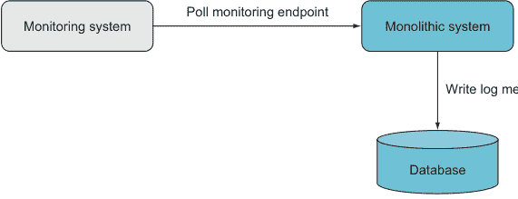
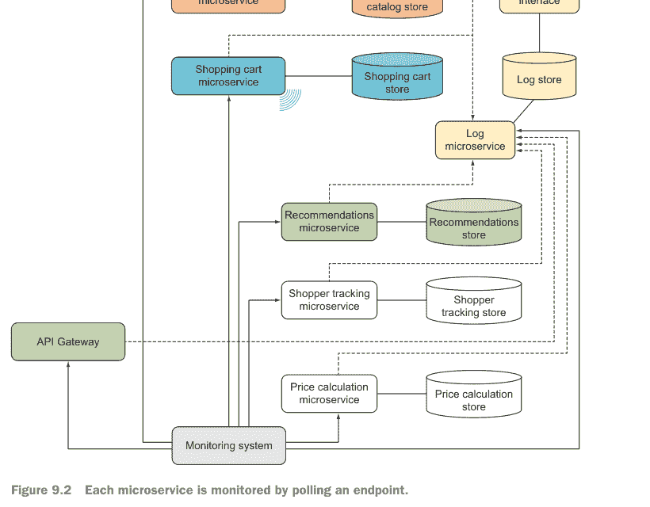
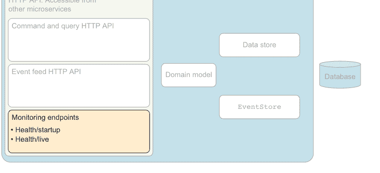
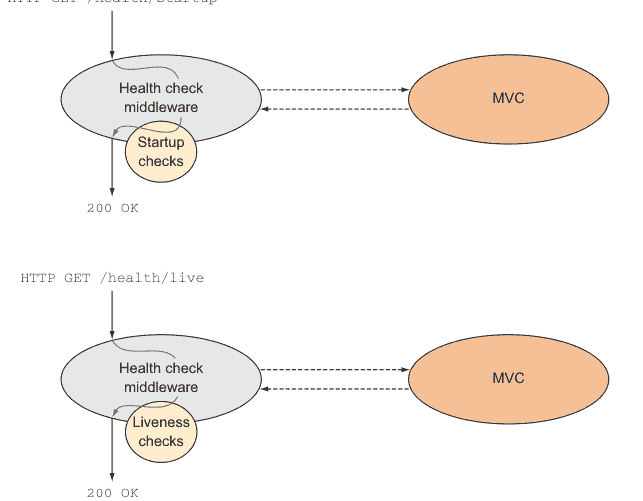
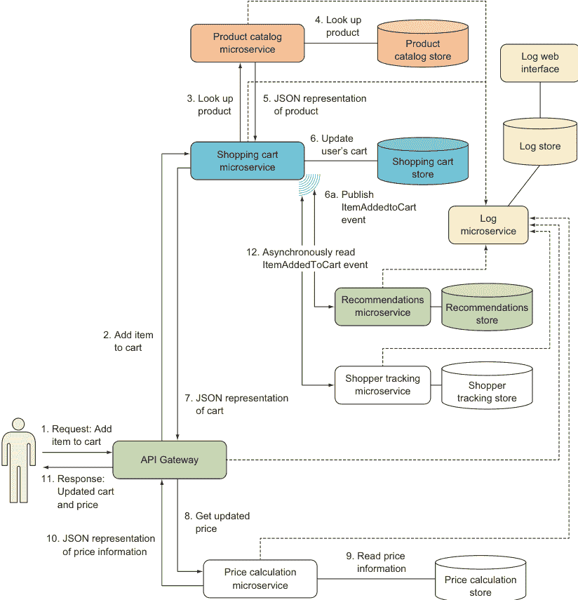
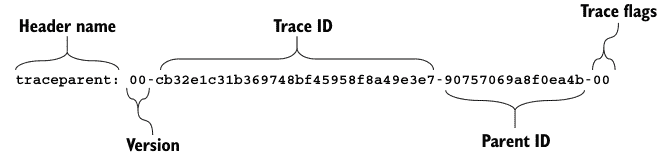
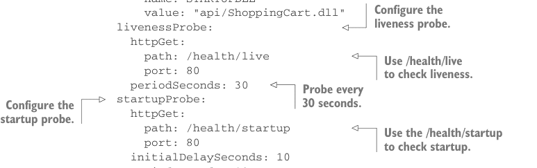

## 横切关注点：监控与日志记录

**本章涵盖**

- 微服务系统中的监控
- 探索结构化日志
- 跨微服务的分布式追踪
- 记录未处理的异常

在本章中，你将开始学习 ASP.NET 如何帮助我们处理一些重要的横切关注点：监控、日志记录和追踪。这三者在所有微服务中都是必需的，并且在让微服务系统易于运维方面发挥着重要作用。一旦你的系统投入生产，你需要知道所有微服务是否都在运行，这就是为什么需要监控它们。此外，正如第 7 章所讨论的，你需要良好的日志记录来诊断系统。

在这里，你将在一个微服务的上下文中配置中间件。然后，在第 11 章中，你将把该配置放入 NuGet 包中，以便在所有微服务中轻松复用。

### 9.1 微服务中的监控需求

当你将任何服务端系统部署到生产环境时，你需要能够检查系统的健康状况。你想知道它是否在运行，是否遇到故障或错误，以及它的性能是否与平时一样好。这对任何系统都适用。对于传统的单体系统，你很可能会设置一些监控并向系统添加日志记录，如图 9.1 所示。日志记录通常出现在代码库中的许多位置——只要有重要的内容需要记录——这些消息通常存储在数据库中。



**图 9.1** 传统上，你会在系统周围设置监控，并向系统代码添加日志记录，以将消息记录到数据库中。

微服务系统的情况也类似。你同样有一个总体需求：从可用性、性能、吞吐量和错误率等方面监控系统的健康状况。区别在于，微服务系统由许多独立运行、独立部署的小部件组成，而你需要监控所有这些小部件。从图 9.2 来看，这似乎很复杂，但如果你遵循一些约定，让微服务很容易实现监控友好，就不必如此。我们稍后会讲到这一点。

为了监控微服务，你需要添加两个由监控系统轮询的端点。它们用来指示微服务何时准备好接收请求。一个端点在启动期间使用，在微服务完全启动并准备好接收请求之前，它应返回失败；一旦就绪，它应返回成功。另一个端点在微服务启动后使用，在微服务因某种原因无法接收请求之前，它应一直返回成功。这两个端点与 Kubernetes 支持监控的方式相契合，我们将在本章后面讨论。

第一个端点——`/health/startup`——检查微服务接收请求所需的一切是否就绪，可能包括检查数据库连接、预热缓存，或以其他方式确保微服务具备所需的一切（图 9.3）。当微服务仍在启动时，该端点会以 503 Service Unavailable 状态码响应，表示微服务尚未准备好接收请求，如下所示：

```http
HTTP/1.1 503 Service Unavailable

Unhealthy
```


图 9.2 每个微服务都通过轮询一个端点来进行监控。



图 9.3 每个微服务应有两个监控端点：一个位于 /health/startup，一个位于 /health/live。监控系统轮询这两个端点。只要两个端点都返回成功响应，监控程序就认为该微服务在线。



当一切正常时，端点会返回一个简单的 200 OK 响应：

```
HTTP/1.1 200 OK
```

第二个端点（位于 /health/live）会检查微服务的内部健康状态，如果一切正常，同样返回 200 OK 状态码。检查微服务内部健康状态的具体内容因微服务而异。

如图 9.4 所示，你可以使用 ASP.NET 自带的健康检查中间件来实现这两个监控端点。



图 9.4 你可以使用 ASP.NET 的健康检查中间件来实现监控端点。

当请求到达 /health/startup 端点时，如果微服务已准备好接收请求，健康检查中间件会返回 200 OK 响应。当请求到达 /health/live 端点时，健康检查中间件会执行一次健康检查，如果检查成功，则返回 200 OK。其他请求会穿过监控中间件，进入 MVC 中后续的管线端点。

ASP.NET 内置了健康检查中间件，我们可以通过添加微服务特有的健康检查来扩展它，以实现这两个监控端点。在本章稍后，我们将实现健康检查，并配置 Kubernetes 使用它们来监控我们的微服务。

## 9.2 **微服务中的日志需求**

除了监控每个单独的微服务外，你还需要发送有关故障、错误、性能以及其他任何需要获取洞察的信息的日志消息。如第 7 章所述，你可以引入一个集中式日志微服务，它接收来自所有其他微服务的日志消息，将其保存（例如保存到搜索引擎中），并通过仪表板和搜索界面提供便捷访问（见图 9.5）。同样，你希望能够轻松地将每个微服务配置为向日志微服务发送日志消息。



**图 9.5** 所有微服务都将日志消息发送到集中式日志微服务。

在整个系统中传播 trace ID，并将其包含在日志消息中，使我们能够跟随（或追踪）请求在系统中的流转。这提供了上下文，让我们能够更好地排查问题。

trace ID 通过使用 traceparent 头在微服务之间传递，该头由 W3C Trace Context 标准¹ 规定，该标准指定了共同构成 traceparent 头的四个字段：版本、trace ID、父 ID 和追踪标志。我们主要关注的是 trace ID 字段，因为它旨在跟随请求在整个系统中流转。父 ID 提供更多本地上下文，并允许在请求流经系统时发生变化。traceparent 头的格式如下：

```
"version"-"trace id"-"parent id"-"trace flags"
```

例如，如果 trace ID 是 cb32e1c31b369748bf45958f8a49e3e7，父 ID 是 90757069a8f0ea4b，则 traceparent 头如下所示：



这意味着从购物车微服务发往商品目录微服务的请求可能如下所示：

```
HTTP GET /products?productIds=[1,2] HTTP/1.1
Accept: application/json
traceparent: 00-cb32e1c31b369748bf45958f8a49e3e7-90757069a8f0ea4b-00
```

这会让商品目录微服务知道 trace ID 是 cb32e1c31b369748bf45958f8a49e3e7，并且所有日志消息中都应包含该 trace ID。

除了在 HTTP 请求中传播 trace ID 外，我们还应该将其包含在事件中。在事件产生时将 trace ID 与事件一起保存，使我们能够在事后追踪事件产生的原因。这同样是一个强大的故障排查工具。

ASP.NET 实现了 Trace Context 标准，因此开箱即用时，ASP.NET 会在传入请求中查找 traceparent 头，并将 trace ID 传播到出站请求（由 HttpClient 发出的请求）。如果传入请求没有 traceparent 头，ASP.NET 会分配一个随机的 trace ID。我们很快就会看到这一点。

### 9.2.2 使用 Serilog 进行结构化日志记录

传统的日志库将日志消息视为简单字符串，可能附带异常，但我们将使用更好的方案：一个名为 Serilog 的结构化日志库。结构化日志的思想是允许日志消息包含结构化数据：日志消息不仅包含一个平铺直叙的消息——比如“出了问题”，还包含对象。

Serilog 在 .NET 格式字符串之上，为日志消息引入了一些额外语法。这些额外语法允许你为参数命名，并控制参数的取值是通过调用 .ToString() 转换为字符串，还是将对象作为整体包含在日志消息中。命名参数用花括号括起来，例如 "{RequestTime}"。你可以在名称前面加上 @ 来告诉 Serilog 将整个值包含在消息中："{@Request}"。与 .NET 格式字符串一样，不带前导 @ 的参数可以添加格式化指令。

例如，你可以将 Serilog 与 .NET 自带的日志器结合使用，发送如下日志消息——假设 log 是配置为使用 Serilog 的 .NET 类型 ILogger 的一个实例：

```
var simplifiedRequest = new
{
    Path = "/foo",
    Method = "GET",
    Protocol = "HTTP",
};

var requestTime = 200;

log.LogInformation(
    "Processed request: {@Request} in {RequestTime:000} ms.",
    simplifiedRequest,
    requestTime);
```

simplifiedRequest 和 requestTime 是构成消息一部分的对象。与其他日志框架一样，Serilog 允许你配置不同的接收器（sink）来写入日志消息。这里要使用的接收器是控制台接收器。当上面的日志消息写入控制台时，simplifiedRequest 和 requestTime 会经过 JSON 序列化并插入到日志消息字符串中。Serilog 还会添加一些元数据，因此写入控制台的消息如下所示：

```
2020-12-03 09:14:33 INF Processed request {"Path":"/foo", "Method":"GET", "Protocol":"HTTP"} in 200 ms.
```

如你所见，这保留了原始日志消息中的所有数据，因为完整的 simplifiedRequest 对象和 requestTime 都被包含在写入控制台的消息中。这很好，但当我们把日志发送到像 Elasticsearch 这样的搜索引擎时，效果会更好。当你这样做时，日志消息中包含的对象（如 simplifiedRequest）会被存储并在搜索引擎中建立索引。这意味着你可以根据消息中对象特定属性的值来搜索日志消息。例如，你可能会搜索包含一个 Path 属性值为 /foo 的 Request 对象的日志消息。之前的消息会被包含，但关于 /bar 请求的日志消息则不会。

保留日志消息中包含数据的结构，意味着日志微服务的 Web 前端能够以结构化方式展示日志消息。最终得到的日志更容易搜索、更方便总览，包含更多数据，并且可以根据需要深入查看。Kibana 就是这样一个前端，它与存储在 Elasticsearch 中的日志配合良好，并提供强大的搜索和可视化工具。

正如你在稍后实现日志记录时所看到的，你可以配置 Serilog，使每条日志消息都包含额外数据。这类额外信息的一个例子是上一节中提到的 traceparent 头中的追踪信息。将追踪信息包含在每条日志消息中，使你能够高效地搜索具有给定 trace ID 的所有日志消息。由于 trace ID 跨服务传播，这让我们能够跟踪（或者说追踪）与特定操作相关的日志消息在系统中的流转（例如，如图 9.6 所示，当客户向购物车添加一件商品，并且有一个传入请求到达 API Gateway，该请求被分配了一个 trace ID 时）。当“添加到购物车”操作流转到其他服务（购物车、商品目录和价格计算微服务）时，trace ID 会跟随该操作。通过搜索分配给该“添加到购物车”操作的 trace ID 的日志消息，你可以看到与该特定购物车添加操作相关的所有日志信息。你可以看到 API Gateway 做了什么、购物车做了什么、商品目录做了什么，以及价格计算微服务做了什么。这在调试生产环境问题时非常强大。

在本章余下的部分，你将实现监控和日志记录。你需要所有微服务都这样做，因此你可以在已经实现的任何一个微服务的上下文中开展工作。我将以购物车微服务为例，并基于第 7 章的代码进行构建，但这段代码同样适用于其他微服务。

## 9.3 实现监控端点

在本节中，你将使用 ASP.NET 的 *健康检查* 支持来实现前面讨论的两个监控端点。这两个端点的行为如下：

- `/health/live`：对每个请求都返回 `200 OK` 状态，表示微服务正在运行且能够处理请求。根据微服务的实现情况，你可能希望在此端点中添加更深层的健康检查。
- `/health/startup`：执行一次基本的健康检查，如果健康检查成功，则返回 `200 OK` 状态。如果健康检查失败，则返回 `503 Service Unavailable`。该健康检查将查询购物车微服务数据库，以确认能否建立数据库连接，因为购物车微服务只要能够查询其数据库，就准备好接收请求了。


实现监控端点的计划如下：

- 1. 将 `/health/live` 端点添加到 ASP.NET 管道中。
- 2. 为购物车数据库创建健康检查。
- 3. 将 `/health/startup` 端点添加到管道中。

让我们开始吧。

## 9.3.1 实现 /health/live 监控端点

为了实现 `/health/live` 端点，我们利用 ASP.NET 的健康检查功能，这使我们能够轻松添加监控端点。首先，我们需要向服务集合添加一个健康检查。接下来，我们将该健康检查连接到 `/health/live` 端点。我们将这个健康检查命名为 LivenessHealthCheck，并通过修改 Startup 中的 ConfigureServices 方法将其添加到服务集合，如下所示。

### 清单 9.1 将 LivenessHealthCheck 添加到服务集合

```
public void ConfigureServices(IServiceCollection services)
{
    services.AddHealthChecks()
        .AddCheck(
            "LivenessHealthCheck",
            () => HealthCheckResult.Healthy(),
            tags: new []{ "liveness"});
    services.AddControllers();
}

// Annotations:
// Add facilities supporting health checks.
// Give the health check a name.
// Add the LivenessHealthCheck.
// Implement the health check to always respond 200 OK.
// Tag the health check to make it easier to find later.
```

这段代码只是向服务集合添加了一个始终响应 200 OK 的健康检查。接下来，我们将通过修改 Startup 中的 Configure 方法，将 `health/live` 作为健康检查添加到 ASP.NET 管道，从而将其连接到 `/health/live` 端点：

```
public void Configure(IApplicationBuilder app, IWebHostEnvironment env)
{
    app.UseHttpsRedirection();
    app.UseHealthChecks("/health/live",
        new HealthCheckOptions
        {
            Predicate = x => x.Tags.Contains("liveness")
        });
    app.UseRouting();
    app.UseEndpoints(endpoints => endpoints.MapControllers());
}

// Annotations:
// Add /health/live as a monitoring endpoint.
// Use all health checks tagged with liveness.
// Configure how to perform the health check for /health/live.
```

这会将 `/health/live` 添加为管道中接受 HTTP GET 请求的端点。当收到对 `/health/live` 的请求时，服务集合中所有标记为“liveness”的健康检查都会被执行，如果全部成功，响应将是 200 OK。在这种情况下，只有一个标记为“liveness”的健康检查，但如果有需要，我们可以添加更多。这提供了一种很好的模块化方式，将不同的健康检查组合到监控端点中。

这就是实现 /health/live 端点所需的全部内容。现在让我们转向 /health/startup 端点，它遵循相同的模式，只是额外添加了一部分。

## 9.3.2 实现 /health/startup 监控端点

有了 liveness 健康检查之后，我们可以转向实现 startup 健康检查。由于我们将在 startup 健康检查中检查微服务是否能访问数据库，因此这会稍微复杂一些。为此，我们将首先在一个实现 ASP.NET 接口 IHealthCheck 的类中实现数据库检查，然后使用该类定义另一个健康检查。下面的清单展示了数据库检查的实现。

### 清单 9.2 实现数据库健康检查的类

```
namespace ShoppingCart
{
    using System.Data.SqlClient;
    using System.Threading;
    using System.Threading.Tasks;
    using Dapper;
    using Microsoft.Extensions.Diagnostics.HealthChecks;

    public class DbHealthCheck : IHealthCheck
    {
        public async Task<HealthCheckResult> CheckHealthAsync(
            HealthCheckContext context,
            CancellationToken cancellationToken)
        {
            await using var conn =
                new SqlConnection("Data Source=localhost;
Initial Catalog=ShoppingCart;
User Id=SA; Password=yourStrong(!)Password");

            var result = await conn.QuerySingleAsync<int>("SELECT 1");
            return result == 1
                ? HealthCheckResult.Healthy()
                : HealthCheckResult.Degraded();
        }
    }
```

这个类实现了 IHealthCheck 接口，该接口只定义了一个方法——CheckHealthAsync——每当健康检查执行时都会调用该方法。CheckHealthAsync 的返回值指示检查是否成功。

`/health/startup` 端点的其余实现与 `/health/live` 端点类似，包括将健康检查添加到服务集合，并在管道的端点中使用它。为了实现这一点，我们将 Startup 类修改为如下所示。

### 清单 9.3 包含两个监控端点的完整 Startup 类

```
public class Startup
{
    public void ConfigureServices(IServiceCollection services)
    {
        services.AddHealthChecks()
            .AddCheck<DbHealthCheck>(
                nameof(DbHealthCheck),
                tags: new [] { "startup" })
            .AddCheck(
                "LivenessHealthCheck",
                () => HealthCheckResult.Healthy(),
                tags: new [] { "liveness" });
        services.AddControllers();
    }

    public void Configure(IApplicationBuilder app, IWebHostEnvironment env)
    {
        app.UseHttpsRedirection();
        app.UseHealthChecks(
            "/health/startup",
            new HealthCheckOptions
            {
                Predicate = x => x.Tags.Contains("startup")
            });
        app.UseHealthChecks(
            "/health/live",
            new HealthCheckOptions
            {
                Predicate = x => x.Tags.Contains("liveness")
            });
        app.UseRouting();
        app.UseEndpoints(endpoints => endpoints.MapControllers());
    }
}

Use the DbHealthCheck class to implement a health check.
Tag the health check with "startup."
Add /health/startup as a health check endpoint.
Use the new health check in /health/startup.
```

完成这些之后，你可以使用 dotnet 运行购物车微服务并测试监控端点。对 `/health/live` 端点的请求如下所示：

```
GET https://localhost:5001/health/live
```

成功的响应如下所示：

```
HTTP/1.1 200 OK
Content-Type: text/plain

Healthy
```

以下是对 `/health/startup` 端点的请求：

```
GET https://localhost:5001/health/startup
```

这是一个成功的响应：

```
HTTP/1.1 200 OK
Content-Type: text/plain

Healthy
```

最后，以下是一个失败的响应：

```
HTTP/1.1 503 Service Unavailable
Content-Type: text/plain

Unhealthy
```

至此，监控端点的实现就完成了。稍后，我们将回到这些端点，看看如何配置 Kubernetes 来使用它们。

## 9.4 *实现结构化日志*

如前所述，结构化日志可以提高日志的价值，主要是使其更易于搜索。在本节中，我们将配置购物车微服务使用 Serilog，使日志输出结构化。要让日志结构化，需要三个小步骤：

- 1. 将 Serilog NuGet 包和一个辅助包添加到购物车微服务中
- 2. 配置 .NET 日志器在底层使用 Serilog
- 3. 将日志输出改为 JSON 格式，这种格式更适合机器处理

完成这三个步骤后，我们的日志就可以被 Kubernetes 日志收集，并发送到你选择的日志产品中。（我不会展示如何发送日志，因为这与你选择的日志产品更相关，每个供应商都提供了设置日志发送所需的文档。）

首先，我们将向购物车微服务添加两个 NuGet 包：

- 1. Serilog.Sinks.ColoredConsole：允许我们在控制台进行结构化日志记录的库
- 2. Serilog.AspNetCore：一个用于将 .NET 日志记录与 Serilog 结合使用的辅助包

一旦这两个包被添加到购物车微服务中，我们就可以使用 Program.cs 中的以下代码配置 .NET 日志器使用 Serilog。

### 清单 9.4 将 Serilog 用作 .NET 日志器的后端

```
namespace ShoppingCart
{
    using Microsoft.AspNetCore.Hosting;
    using Microsoft.Extensions.Hosting;
    using Serilog;
```

...[/content]中。我们已经在开头和结尾加了。

注意不要重复输出原文。我们只输出译文。

最后检查代码块是否完整。特别是第一个代码块，我们原样复制。第二个代码块是PowerShell输出，原样复制。第三个代码块是C#，原样复制。第四个代码块是C#，原样复制。第五个代码块是日志输出，原样复制。第六个代码块是C#，原样复制。第七个代码块是JSON，原样复制。第八个代码块是C#，原样复制。第九个代码块是日志输出，原样复制。注意第九个代码块中的内容很长，我们复制时注意换行和空格。原文中：

```
2020-12-07 11:10:39 f2e604d90da6114a8d4a77daa57a7890 INF Request starting
    HTTP/1.1 POST https://localhost:5001/users/0/items application/json 9
2020-12-07 11:10:39 f2e604d90da6114a8d4a77daa57a7890 INF Executing endpoint
    "ShoppingCart.Users.UsersController.Post (ShoppingCart)"
2020-12-07 11:10:39 f2e604d90da6114a8d4a77daa57a7890 INF Route matched with
    "{action = \"Post\", controller = \"Users\"}". Executing controller action
    with signature "Task<ShoppingCart> Post(Int32, Int32[])" on controller
    "ShoppingCart.Users.UsersController" ("ShoppingCart").
2020-12-07 11:10:39 f2e604d90da6114a8d4a77daa57a7890 INF Successfully added
    products to shopping cart [1, 2], {"userId":123,"items":[{
    "productCatalogueId":1,"productName":"Basic t-shirt","description":
    "a quiet t-shirt","price":{"currency":"eur","amount":40}},
    {"productCatalogueId":2,"productName":"Fancy shirt","description":
    "a loud t-shirt","price":{"currency":"eur","amount":50}}]}
2020-12-07 11:10:39 f2e604d90da6114a8d4a77daa57a7890 INF Executed action
    "ShoppingCart.Users.UsersController.Post (ShoppingCart)" in 45.891ms
2020-12-07 11:10:39 f2e604d90da6114a8d4a77daa57a7890 INF Executed endpoint
    "ShoppingCart.Users.UsersController.Post (ShoppingCart)"
2020-12-07 11:10:39 f2e604d90da6114a8d4a77daa57a7890 INF Request finished
    HTTP/1.1 200 19.3457ms
```

我们原样复制。

注意原文中“Listing 9.7”后面的代码块是：

```
2020-12-03 11:37:08 INF Successfully added products to shopping cart [1, 2], {"userId":123,"items":[{"productCatalogueId":1,"productName":"Basic t-shirt","description":"a quiet t-shirt","price":{"currency":"eur","amount":40}},{ "productCatalogueId":2,"productName":"Fancy shirt","description":"a loud t-shirt","price":{"currency":"eur","amount":50}}]}
```

我们原样复制。

注意原文中“Listing 9.8”后面的代码块是C#，我们原样复制。

注意原文中“Listing 9.9”后面的代码块是C#，我们原样复制。

注意原文中“The JSON-formatted log messages created when we start the shopping cart microservice in production look like this:”后面的代码块是JSON，我们原样复制。

一切就绪。

现在输出。[content]
```csharp
using Serilog.Enrichers.Span;
using Serilog.Formatting.Json;

public class Program
{
    public static void Main(string[] args)
    {
        CreateHostBuilder(args).Build().Run();
    }

    private static IHostBuilder CreateHostBuilder(string[] args) =>
        Host.CreateDefaultBuilder(args)
            .UseSerilog((context, logger) =>
            {
                logger
                    .Enrich.FromLogContext()
                    .WriteTo.ColoredConsole();
            })
            .ConfigureWebHostDefaults(x => x.UseStartup<Startup>());
}
```

这会将 Serilog 集成到 .NET 日志记录器中。如果你运行购物车应用，会注意到启动时的日志输出略有不同，因为 Serilog 格式化日志消息的方式不同：

```
PS > dotnet run
2020-12-03 10:24:34 INF Now listening on: "https://localhost:5001"
2020-12-03 10:24:34 INF Now listening on: "http://localhost:5000"
2020-12-03 10:24:34 INF Application started. Press Ctrl+C to shut down.
2020-12-03 10:24:34 INF Hosting environment: "Development"
2020-12-03 10:24:34 INF Content root path: "C:\\Users\\chors\\Documents\\horsdal3\\code\\Chapter10\\ShoppingCart"
```

这并不特别令人兴奋，但如果我们从购物车中的某个控制器记录一些内容，就能开始看到它的价值。为此，我们可以在 `ShoppingCartController` 中依赖 `ILogger`，并在某个操作方法中使用该日志记录器。.NET 已经将 `ILogger` 注册到服务集合中，因此它会像其他依赖一样被注入到 `ShoppingCartController` 中。要建立依赖，我们只需将 `ILogger` 作为构造函数的一个参数添加，如下所示。

**清单9.5 依赖 ILogger 以便从控制器记录日志**

```csharp
public ShoppingCartController(
    IShoppingCartStore shoppingCartStore,
    IProductCatalogClient productCatalog,
    IEventStore eventStore,
    ILogger<ShoppingCartController> logger)
{
    this.shoppingCartStore = shoppingCartStore;
    this.productCatalog = productCatalog;
    this.eventStore = eventStore;
    this.logger = logger;
}
```

然后，该日志记录器就可以用于例如向购物车添加商品的操作端点，你可以在下面的清单中看到。

**清单9.6 在控制器日志中包含结构化信息**

```csharp
[HttpPost("{userId:int}/items")]
public async Task<ShoppingCart> Post(int userId, [FromBody] int[] productIds)
{
    var shoppingCart = await shoppingCartStore.Get(userId);
    var shoppingCartItems = await this.productCatalog.GetShoppingCartItems(productIds);
    await shoppingCart.AddItems(shoppingCartItems, this.eventStore);
    await this.shoppingCartStore.Save(shoppingCart);

    this.logger.LogInformation(
        "Successfully added products to shopping cart {@productIds}, {@shoppingCart}", productIds, shoppingCart);

    return shoppingCart;
}
```

记录一条结构化消息。

如果我们现在发起一个 HTTP POST 请求来向购物车添加商品，我们将在控制台中看到如下一条日志消息。

**清单9.7 包含购物车的结构化日志消息**

```
2020-12-03 11:37:08 INF Successfully added products to shopping cart [1, 2], {"userId":123,"items":[{"productCatalogueId":1,"productName":"Basic t-shirt","description":"a quiet t-shirt","price":{"currency":"eur","amount":40}},{ "productCatalogueId":2,"productName":"Fancy shirt","description":"a loud t-shirt","price":{"currency":"eur","amount":50}}]}
```

这条日志消息将整个购物车以 JSON 形式包含在内，相比简单的“成功将商品添加到购物车”消息，它为消息提供了更多上下文。这就是结构化日志的优势。

最后一步，我们需要让日志消息在日志传输管道中更易于消费。为此，我们将它们格式化为 JSON 日志。不过，这会让消息对人类阅读变得有点困难，因此我倾向于在开发环境中使用我们目前看到的输出，而在生产环境中使用 JSON 输出，如下面的清单所示。这是通过告诉 Serilog 在环境不是“development”时将控制台输出格式化为 JSON 来实现的。

**清单9.8 在生产环境中使用 JSON 日志**

```csharp
private static IHostBuilder CreateHostBuilder(string[] args) =>
    Host.CreateDefaultBuilder(args)
        .UseSerilog((context, logger) =>
        {
            logger
                .Enrich.FromLogContext();
            if (context.HostingEnvironment.IsDevelopment())
                logger.WriteTo.ColoredConsole();
            else
                logger.WriteTo.Console(new JsonFormatter());
        })
        .ConfigureWebHostDefaults(x => x.UseStartup<Startup>());
```

> **注意** 环境由环境变量 `ASPNETCORE_ENVIRONMENT` 控制。

当我们在生产环境中启动购物车微服务时，生成的 JSON 格式日志消息如下所示：

```json
{"Timestamp":"2020-12-03T12:00:41.5723302+01:00","Level":"Information","MessageTemplate":"Now listening on: {address}","Properties":{"address":"https://localhost:5001","SourceContext":"Microsoft.Hosting.Lifetime"}}
{"Timestamp":"2020-12-03T12:00:41.5803748+01:00","Level":"Information","MessageTemplate":"Now listening on: {address}","Properties":{"address":"http://localhost:5000","SourceContext":"Microsoft.Hosting.Lifetime"}}
{"Timestamp":"2020-12-03T12:00:41.5809434+01:00","Level":"Information","MessageTemplate":"Application started. Press Ctrl+C to shut down.","Properties":{"SourceContext":"Microsoft.Hosting.Lifetime"}}
{"Timestamp":"2020-12-03T12:00:41.5812286+01:00","Level":"Information","MessageTemplate":"Hosting environment: {envName}","Properties":{"envName":"Production","SourceContext":"Microsoft.Hosting.Lifetime"}}
{"Timestamp":"2020-12-03T12:00:41.5815246+01:00","Level":"Information","MessageTemplate":"Content root path: {contentRoot}","Properties":{"contentRoot":"C:\\Users\\chors\\Documents\\horsdal3\\code\\Chapter10\\ShoppingCart","SourceContext":"Microsoft.Hosting.Lifetime"}}
```

既然你已经配置了结构化日志消息，接下来让我们用跟踪信息来丰富它们。

### 9.4.1 向所有日志消息添加跟踪 ID

回顾第7章以及本章前面的内容，如果你能利用日志消息来追踪用户请求在微服务系统中的流转，那么这些日志消息会更有价值。用户请求可能不是由单个微服务处理的。通常，多个微服务会协作完成用户请求。能够跨所有这些协作微服务追踪用户请求是非常有用的——这正是跟踪 ID 所能提供的。如前所述，ASP.NET 实现了跟踪上下文标准，因此 ASP.NET 已经为所有请求分配了跟踪 ID。跟踪 ID 要么从 `traceparent` 头中读取，要么——如果请求上没有 `traceparent` 头——则分配一个随机的跟踪 ID。ASP.NET 将跟踪 ID 和其他跟踪信息存储在 `System.Diagnostics.Activity` 类型中，可以通过 `Activity.Current` 属性访问。我们只需将跟踪 ID 添加到每条日志消息中。我们将使用一个名为 `Serilog.Enrichers.Span` 的便捷包，它与 Serilog 配合使用即可实现这一点。首先，我们将安装 `Serilog.Enrichers.Span`，然后稍微修改 Serilog 的配置，使其如下所示。

**清单9.9 配置 Serilog 以在所有日志消息中包含跟踪信息**

```csharp
private static IHostBuilder CreateHostBuilder(string[] args) =>
    Host.CreateDefaultBuilder(args)
        .UseSerilog((context, logger) =>
        {
            logger
                .Enrich.FromLogContext()
                .Enrich.WithSpan();
            if (context.HostingEnvironment.IsDevelopment())
                logger.WriteTo.ColoredConsole(
                    outputTemplate: @"{Timestamp:yyyy-MM-dd HH:mm:ss}\n{TraceId} {Level:u3} {Message}{NewLine}{Exception}"
                );
            else
                logger.WriteTo.Console(new JsonFormatter());
        })
        .ConfigureWebHostDefaults(x => x.UseStartup<Startup>());
```

上一个清单中重要的新增部分是 `.Enrich.WithSpan();` 这一行，它配置 Serilog 从 `Activity.Current` 读取跟踪信息并将其添加到每条日志消息中。在生产环境使用的 JSON 输出中，默认会包含日志消息上的所有信息。在开发环境使用的文本输出中，我们需要覆盖默认输出格式以添加跟踪 ID，这可以通过向日志记录器配置传入包含跟踪 ID 的输出格式来实现。

现在运行购物车微服务并向其发出请求，会产生带有跟踪信息的日志消息。在开发环境中，看起来像这样：

```
2020-12-07 11:10:39 f2e604d90da6114a8d4a77daa57a7890 INF Request starting
    HTTP/1.1 POST https://localhost:5001/users/0/items application/json 9
2020-12-07 11:10:39 f2e604d90da6114a8d4a77daa57a7890 INF Executing endpoint
    "ShoppingCart.Users.UsersController.Post (ShoppingCart)"
2020-12-07 11:10:39 f2e604d90da6114a8d4a77daa57a7890 INF Route matched with
    "{action = \"Post\", controller = \"Users\"}". Executing controller action
    with signature "Task<ShoppingCart> Post(Int32, Int32[])" on controller
    "ShoppingCart.Users.UsersController" ("ShoppingCart").
2020-12-07 11:10:39 f2e604d90da6114a8d4a77daa57a7890 INF Successfully added
    products to shopping cart [1, 2], {"userId":123,"items":[{
    "productCatalogueId":1,"productName":"Basic t-shirt","description":
    "a quiet t-shirt","price":{"currency":"eur","amount":40}},
    {"productCatalogueId":2,"productName":"Fancy shirt","description":
    "a loud t-shirt","price":{"currency":"eur","amount":50}}]}
2020-12-07 11:10:39 f2e604d90da6114a8d4a77daa57a7890 INF Executed action
    "ShoppingCart.Users.UsersController.Post (ShoppingCart)" in 45.891ms
2020-12-07 11:10:39 f2e604d90da6114a8d4a77daa57a7890 INF Executed endpoint
    "ShoppingCart.Users.UsersController.Post (ShoppingCart)"
2020-12-07 11:10:39 f2e604d90da6114a8d4a77daa57a7890 INF Request finished
    HTTP/1.1 200 19.3457ms
```

所有这些请求都通过跟踪 ID——f2e604d90da6114a8d4a77daa57a7890——关联在一起。使用生产配置的同一请求会产生以下日志输出：


```text
449d-ab84-cb196a437710", "RequestId": "0HM4QJ9RN6M7Q:00000002", "RequestPath": "/users/0/items", "ConnectionId": "0HM4QJ9RN6M7Q", "SpanId": "469950e2392da4db", "TraceId": "7e413f37415aea4d8c4ff04924292ad2", "ParentId": "0000000000000000"})
{"timestamp":"2020-12-07T11:25:49.506975+01:00","Level":"Information","MessageTemplate":"Executed endpoint '{EndpointName}'","Properties":{"EndpointName":"ShoppingCart.Users.UsersController.Post (ShoppingCart)","EventId":{"Id":1,"Name":"ExecutedEndpoint"},"SourceContext":"Microsoft.AspNetCore.Routing.EndpointMiddleware","RequestId":"0HM4QJ9RN6M7Q:00000002","RequestPath":"/users/0/items","ConnectionId":"0HM4QJ9RN6M7Q","SpanId":"469950e2392da4db","TraceId":"7e413f37415aea4d8c4ff04924292ad2","ParentId":"0000000000000000"}}
{"timestamp":"2020-12-07T11:25:49.5124936+01:00","Level":"Information","MessageTemplate":"{HostingRequestFinishedLog:1}","Properties":{"ElapsedMilliseconds":165.5149,"StatusCode":200,"ContentType":null,"ContentLength":0,"Protocol":"HTTP/1.1","Method":"POST","Scheme":"https","Host":"localhost:5001","PathBase":"","Path":"/users/0/items","QueryString":"","HostingRequestFinishedLog":"Request finished HTTP/1.1 POST https://localhost:5001/users/0/items application/json 9 - 200 0 - 165.5149ms","EventId":{"Id":2,"Name":"RequestFinished"},"SourceContext":"Microsoft.AspNetCore.Hosting.Diagnostics","RequestId":"0HM4QJ9RN6M7Q:00000002","RequestPath":"/users/0/items","ConnectionId":"0HM4QJ9RN6M7Q","SpanId":"469950e2392da4db","TraceId":"7e413f37415aea4d8c4ff04924292ad2","ParentId":"0000000000000000"},"Renderings":{"HostingRequestFinishedLog":[{"Format":"1","Rendering":"Request finished HTTP/1.1 POST https://localhost:5001/users/0/items application/json 9 - 200 0 - 165.5149ms"}]}}
```

虽然这些日志对人类来说远不如开发日志易读，但它们确实包含了更多信息，当这些日志被存储在搜索引擎中并以良好的用户界面呈现时，它们会变得非常强大。现在请注意，每条日志消息都包含跟踪 ID：`"TraceId": "7e413f37415aea4d8c4ff04924292ad2"`。

### 9.4.2 跟踪 ID 包含在出站 HTTP 请求中

ASP.NET 不仅会从传入的 traceparent 标头中读取跟踪 ID，还会自动为使用 HttpClient 发出的出站请求添加 traceparent 标头，因此我们无需额外操作即可让出站请求携带包含跟踪 ID 的 traceparent 标头。例如，购物车微服务向产品目录微服务发出的请求已经包含了 traceparent 标头，因此跟踪 ID 会随请求一起发送到产品目录微服务，这意味着我们可以在日志中跨微服务跟踪请求。

### 9.4.3 记录未处理的异常

正如我们之前讨论的，故障时有发生。在这些情况下，重要的是要有能够显示失败如何发生的日志。MVC 会捕获控制器中任何其他未处理的异常，并记录异常消息。与任何其他日志消息一样，这些日志也会包含跟踪 ID。这意味着我们可以追踪是什么导致了未处理的异常。我们可以找到原始用户请求以及沿途生成的所有其他日志消息。

```yaml
template:
  metadata:
    labels:
      app: shopping-cart
  spec:
    containers:
      - name: shopping-cart
        image: shopping-cart
        imagePullPolicy: IfNotPresent
        ports:
          - containerPort: 80
        env:
          - name: STARTUPDLL
            value: "api/ShoppingCart.dll"
        livenessProbe:
          httpGet:
            path: /health/live
            port: 80
          periodSeconds: 30
        startupProbe:
          httpGet:
            path: /health/startup
            port: 80
          initialDelaySeconds: 10
          periodSeconds: 10
---
apiVersion: v1
kind: Service
metadata:
  name: shopping-cart
spec:
  type: LoadBalancer
  ports:
    - name: shopping-cart
      port: 5001
      targetPort: 80
  selector:
    app: shopping-cart
```



现在，当我们运行 `kubectl apply -f shopping-cart.yaml` 重新部署购物车微服务时，Kubernetes 将使用启动探针和存活探针来判断容器的健康状况。我们可以使用 `kubectl get pods` 来测试容器是否按预期运行，输出应显示购物车 Pod 正在运行且未被重启，类似下面这一行：

```text
NAME                          READY   STATUS    RESTARTS   AGE
shopping-cart-54ff7c4846-rvkcc  1/1     Running   0          8m3s
```

> **注意** 如果你的 Kubernetes 集群中没有运行 SQL Server，启动探针将会失败，因为启动健康检查会尝试连接 SQL Server。如果你想看到存活探针成功，你可以在 Kubernetes 集群中部署 SQL Server，或者移除启动探针。

此外，我们可以使用 `kubectl describe deployment.apps/shopping-cart` 检查配置，它会显示探针的配置以及购物车部署的其余配置。

我们还可以预期在日志中看到对监控端点的调用。我们可以使用 `kubectl logs` 从 Kubernetes 获取日志。要获取购物车部署的所有日志，我们可以运行以下命令来打印购物车部署的日志：

```
kubectl logs -f --tail=10 deployment.apps/shopping-cart
```

`-f` 告诉 kubectl 持续跟随日志，因此一旦购物车微服务记录日志，我们就会在控制台中看到它。`--tail=10` 告诉 kubectl 从打印最近的 10 条日志开始。当购物车微服务启动并运行后，部分日志输出看起来像下面这两条来自一次存活探针调用的日志消息：

```text
{"Timestamp":"2020-12-07T13:15:21.1589211+00:00","Level":"Information","MessageTemplate":"{HostingRequestStartingLog:1}","Properties":{"Protocol":"HTTP/1.1","Method":"GET","ContentType":null,"ContentLength":null,"Scheme":"http","Host":"10.1.0.22:80","PathBase":"","Path":"/health/live","QueryString":"","HostingRequestStartingLog":"Request starting HTTP/1.1 GET http://10.1.0.22:80/health/live - -","EventId":{"Id":1,"Name":"RequestStarting"},"SourceContext":"Microsoft.AspNetCore.Hosting.Diagnostics","RequestId":"0HM4QLU8CA00I:00000002","RequestPath":"/health/live","ConnectionId":"0HM4QLU8CA00I","SpanId":"a2c71b41ba089b44","TraceId":"ca68d09e29e61e4d92d363cb3bfa4827","ParentId":"0000000000000000"},"Renderings":{"HostingRequestStartingLog":[{"Format":"1","Rendering":"Request starting HTTP/1.1 GET http://10.1.0.22:80/health/live - -"}]}}
```

```text
{"Timestamp":"2020-12-07T13:15:21.1591769+00:00","Level":"Information","MessageTemplate":"{HostingRequestFinishedLog:1}","Properties":{"ElapsedMilliseconds":0.3009,"StatusCode":200,"ContentType":"text/plain","ContentLength":null,"Protocol":"HTTP/1.1","Method":"GET","Scheme":"http","Host":"10.1.0.22:80","PathBase":"","Path":"/health/live","QueryString":"","HostingRequestFinishedLog":"Request finished HTTP/1.1 GET http://10.1.0.22:80/health/live - - 200 - text/plain 0.3009ms","EventId":{"Id":2,"Name":"RequestFinished"},"SourceContext":"Microsoft.AspNetCore.Hosting.Diagnostics","RequestId":"0HM4QLU8CA00I:00000002","RequestPath":"/health/live","ConnectionId":"0HM4QLU8CA00I","SpanId":"a2c71b41ba089b44","TraceId":"ca68d09e29e61e4d92d363cb3bfa4827","ParentId":"0000000000000000"},"Renderings":{"HostingRequestFinishedLog":[{"Format":"1","Rendering":"Request finished HTTP/1.1 GET http://10.1.0.22:80/health/live - - 200 - text/plain 0.3009ms"}]}}
```

这正是我们从微服务输出这些日志消息的方式；它们是 JSON 格式、结构化的，并且包含跟踪信息。

在本章中，你在购物车微服务中创建了两个监控端点，但它们不依赖于微服务的任何业务逻辑。它们完全可以写在任何其他微服务中。你还配置了 Kubernetes 来使用这些新端点。在其他微服务中，这完全相同。该


本章中你完成的日志记录工作也是如此。所有微服务都一样。在第12章中，你将把购物车中的公共代码提取出来，打包到NuGet包中，以便在许多微服务中复用。

## 小结

- 微服务系统与其他任何服务端系统一样，都需要监控和日志记录。
- 每个微服务都应被监控并发送日志消息。
- 由于系统中的微服务数量众多，设置监控和日志记录需要简单易行。
- 追踪ID使得跨多个微服务追踪请求变得更加容易。
- ASP.NET 实现了追踪上下文标准，因此使用 `traceparent` HTTP 头来传播追踪ID。
- 你可以使用 ASP.NET 的健康检查中间件创建两个监控端点：一个用于启动，一个用于存活。
- 结构化日志是一种在日志消息中包含有价值信息并使这些数据可搜索的好方法。
- Serilog 是一个用于进行结构化日志记录的库。
- ASP.NET 将追踪信息存储在 `Activity.Current` 中。
- 你可以配置 Serilog，使其在所有的日志消息中包含来自 `Activity.Current` 的追踪信息。
- `HttpClient` 会在每个传出 HTTP 请求中包含一个 `traceparent` 头，确保追踪ID被发送到其他微服务。
- Kubernetes 支持健康探针，这与我们的监控端点非常匹配。
- Kubernetes 允许我们轻松访问容器中的日志。
- 为了充分利用日志，所有日志消息都应发送到一个具有良好搜索和可视化能力的中央日志记录微服务。
