## 保护微服务间的通信

### 本章涵盖

- 在微服务系统中应在何处执行用户身份验证和授权
- 决定微服务系统中的信任级别
- 限制微服务间的请求
- 使用 API 网关对用户进行身份验证
- 使用 Kubernetes 网络策略限制微服务间的请求

到目前为止，本书一直忽略了安全性；但对于大多数系统而言，安全性是一个需要认真对待的重要问题。本章讨论如何在微服务系统中解决安全问题。在单体架构中，单体应用完成用户身份验证和授权——毕竟只有单体应用来做这些事情。在微服务系统中，处理大多数用户请求时涉及多个微服务；问题是：哪些微服务负责身份验证，哪些负责授权？你还必须考虑微服务之间可以相互信任多少：

- 如果一个微服务验证了用户，其他微服务能否信任该用户？
- 是否允许所有微服务相互调用？

答案因系统而异。本章的第一部分讨论如何解决这些问题。第二部分概述了对第一个问题的一个可能答案的实现，并展示了对第二个问题的一个完整实现。

## 10.1 微服务的安全问题

安全性几乎对任何服务端系统来说都是一个重要的关注点。它也是一个非常广泛的主题，其中很大部分超出了本书的范围。我们将集中讨论与微服务系统开发者相关的两个安全领域：

- 1. 身份验证和授权
- 2. 如何限制微服务之间的通信

大多数系统都有一些仅供登录用户访问的功能。想想前面章节中讨论的销售点系统。在第4章和第5章中，我们讨论了添加一个忠诚度计划，允许注册用户根据他们的兴趣通过电子邮件接收特别优惠。如果用户对高尔夫感兴趣，他们就会收到关于高尔夫球优惠的通知。如果用户想编辑他们的兴趣——他们可能已经放弃高尔夫转而开始学习绗缝——他们需要登录。否则，一个用户可能会编辑另一个用户的兴趣，导致收到错误的优惠通知。确保用户确实是其所声称的身份是身份验证的问题。决定用户被允许做什么——例如，他们只能编辑自己的兴趣而不能编辑别人的——是授权的问题。

无论你是否使用微服务构建系统，身份验证和授权都可能是你需要关注的问题。不同之处在于，微服务系统的细粒度特性引出了一个问题：哪些微服务处理身份验证和授权？以下两节将讨论这个问题。

## 传输中的数据与静态数据

系统处理数据。这些数据通常对系统至关重要，但往往也对用户至关重要。数据可能是敏感的，例如用户的家庭住址、信用卡号或医疗记录。即使数据不敏感，它也可能对系统很有价值——电子商务网站的产品目录并不敏感，但对背后的业务来说价值巨大。你的系统处理的数据很重要，需要安全地处理。大致来说，我们可以将数据处理分为两类：

- 传输中的数据——当数据从系统的一个部分移动到另一个部分时，它被称为传输中的数据。例如，当协作的微服务通过命令、查询或事件交换数据时，它们交换的数据就是传输中的数据。

* *静态数据*——当数据被存储以供以后使用时，它被称为静态数据。例如，当拥有某条数据的微服务将其存储在数据库中时，该数据就是静态的。

在这两种情况下，确保数据安全都很重要。本章侧重于传输中的数据，因为这是微服务系统与其他架构的系统不同的地方。在微服务系统中保护静态数据的技术与单体或传统SOA系统中的技术相同。

### 10.1.1 在边缘进行用户身份验证

身份验证是关于验证用户是否是其声称的身份。在微服务系统的上下文中，这意味着验证请求是否代表其看似来自的用户发出。让我们看一下图10.1中的示例，它展示了第4章和第5章中销售点系统的一部分——围绕忠诚度计划微服务的部分。

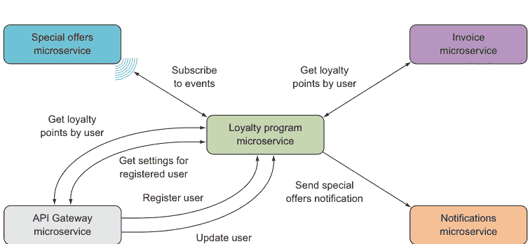

图10.1 销售点系统中的忠诚度计划微服务

如果你在忠诚度计划中添加一个 Web 前端，注册用户可以在其中编辑他们的兴趣——例如，移除他们对高尔夫的兴趣，改为添加绗缝——你会得到类似图10.2的内容。你希望用户只能编辑自己的兴趣，而不是其他人的兴趣。因此，你要求用户登录才能编辑兴趣。在图10.2中，你必须对更新用户设置的请求进行身份验证。明显的身份验证位置是 API 网关微服务，它是从客户端接收更新用户设置请求的微服务。该请求代表某个用户发出，你必须验证

客户端是否被允许代表用户发出请求。你可以通过确保用户已登录来做到这一点。

图10.3向系统添加了一个登录微服务。这个新微服务负责处理登录过程，但 API 网关仍然负责确保只接受来自已登录用户的请求。如果用户尚未登录，则会被重定向到登录页面。登录过程决定用户如何登录，并引导用户完成该过程。用户可以通过各种方式登录，包括以下方式：

- 使用简单的用户名和密码
- 使用多因素身份验证
- 通过外部系统，如活动目录
- 通过社交媒体身份提供商，如 Facebook、Twitter、Google 等

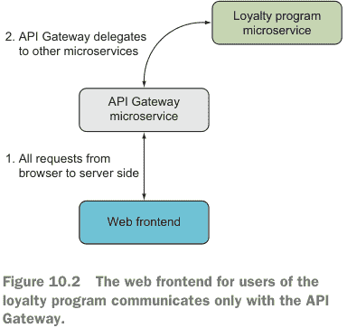

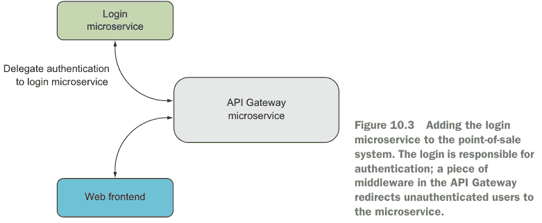

无论采用何种登录机制，登录微服务都会处理登录，并以 API 网关可以验证的访问令牌形式向 API 网关提供用户身份的证明。例如，这可以通过 OpenID Connect 协议实现。

请注意，用户身份验证发生在系统的边缘——也就是说，由接收客户端请求的微服务完成。这是通用模式；用户身份验证在系统的边缘完成。


API Gateway 微服务和登录微服务是实现技术能力的服务的示例。此外，两者都是在许多不同系统中非常相似的技术能力：在领域驱动设计术语中，它们是通用子域的示例——这意味着它们是使用现成产品实现的理想候选者。登录微服务可以由任何身份提供者实现，包括 Azure AD、AWS Cognito、Duende Identity Server 和 Auth0 等产品。同样，API Gateway 可以由 Azure API Management、AWS API Gateway、Traefik 和 Istio 实现。

## 10.1.2 在微服务中授权用户

我们已经确定身份验证是在系统边缘启动的——由 API Gateway 启动。请求经过身份验证后，你就知道用户是谁，但你不知道用户是否被允许发出该请求。那是授权的问题。用户只能更新自己的兴趣。如果客户端代表用户 A 发送请求，试图更新用户 B 的兴趣，系统应拒绝该请求。

在微服务系统中，启动身份验证的边缘微服务——通常不是执行请求所针对的操作的微服务。图 10.4 再次展示了忠诚度计划。API Gateway 微服务接收来自客户端的请求，但忠诚度计划微服务负责跟踪用户兴趣。因此，忠诚度计划更新用户的兴趣。

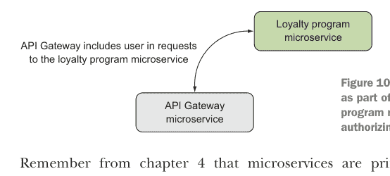

图 10.4 授权应作为业务逻辑的一部分完成；忠诚度计划微服务负责授权对用户设置的更新。

请记住第 4 章中提到的内容，微服务主要按业务能力进行划分——一个业务能力由一个微服务处理。这包括授权，因为授权是该能力业务规则的一部分。这与让忠诚度计划微服务决定用户是否被允许更新兴趣是一致的。为此，用户身份需要在微服务之间传递。在忠诚度计划中，API Gateway 微服务必须在发送给忠诚度计划的请求中包含用户身份。用户身份可以通过多种方式包含在发送给忠诚度计划的请求中，具体取决于你希望 API Gateway 与其他微服务之间信任的程度。如果信任度低，用户身份可以以签名身份令牌的形式传递，忠诚度计划可以验证该令牌；如果信任度更高——用户身份可以以明文形式通过自定义 HTTP 头传递。在这两种情况下，API Gateway 对用户进行身份验证，忠诚度计划根据用户身份对用户进行授权。

## 10.2 实现安全的微服务到微服务通信

在本章的剩余部分，我们将研究围绕忠诚度计划实现安全性的示例。安全需求如下：

- 1. 在 API Gateway 中对用户进行身份验证。
- 2. 允许微服务访问用户身份。
- 3. 限制哪些微服务可以协作。

前两个需求可以通过 API Gateway 来满足。我不会详细介绍这一点，只提到你可以使用 Azure API Management 来实现这一点。第三个需求可以使用 Kubernetes 网络策略来满足，我们接下来将通过示例讨论这一点。

### 10.2.1 在忠诚度计划中访问用户身份

在忠诚度计划微服务中，我们假设 API Gateway 已配置为执行用户身份验证，并且用户身份以身份令牌的形式从 API Gateway 传递到忠诚度计划微服务，如图 10.5 所示

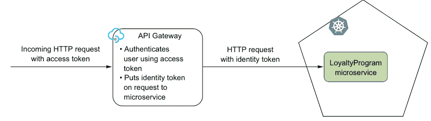

图 10.5 在 Azure API Management 中实现的 API Gateway 对用户进行身份验证，并将身份令牌传递给 Kubernetes 中的忠诚度计划微服务。

在以下各节中，你将学习如何在忠诚度计划中使用身份令牌，通过

- 使用 ASP.NET 身份验证中间件验证令牌
- 在 MVC 控制器中授权

第一步是添加身份验证中间件。我们通过将身份验证添加到服务集合，在 Startup 类中执行此操作。我只在这里概述解决方案，因为细节取决于确切的 API Gateway 配置，这超出了本章的范围。

在忠诚度计划中，我们可以将 Startup 中的 ConfigureServices 方法更改为如下所示。

### Listing 10.1 Configuration to use JWT bearer tokens by default

```
public void ConfigureServices(IServiceCollection services)
{
    services.AddAuthentication(JwtBearerDefaults.AuthenticationScheme)
        .AddJwtBearer(x => x.TokenValidationParameters =
            new TokenValidationParameters
            {
                ValidAudience = ...,
                ValidIssuer = ...,
                IssuerSigningKey = ...,
            });
    services.AddControllers();
}
```

这概述了如何添加中间件，从传入请求的 Authorization 头中读取和验证 JWT。这与配置为在 Authorization 头中以 JWT 形式传递用户身份的 API Gateway 相符。

下一步是通过在 Startup 类中将授权添加到管道，使用户身份可供控制器使用，如下所示。

### Listing 10.2 Using authorization middleware to make identities available to controllers

```
public void Configure(IApplicationBuilder app, IWebHostEnvironment env)
{
    app.UseHttpsRedirection();
    app.UseRouting();
    app.UseAuthorization();
    app.UseEndpoints(endpoints => endpoints.MapControllers());
}
```

这意味着控制器现在可以使用 Authorize 属性要求请求中存在身份令牌，并可以通过 ControllerBase 上的 User 属性访问用户身份。例如，为了保护用于更新现有用户的 PUT 端点，我们可以在 UsersController 中的 UpdateUser 方法上添加 Authorize 属性：

```
[HttpPut("{userId:int}")]
[Authorize(AuthenticationSchemes =
    JwtBearerDefaults.AuthenticationScheme)]
public LoyaltyProgramUser UpdateUser(
    int userId,
    [FromBody] LoyaltyProgramUser user) =>
    return RegisteredUsers[userId] = user;
```

这确保了所有对更新用户的 PUT 端点的请求都有有效的 JWT 令牌。但我们仍然不能确定是否更新了正确的用户，因为简单地使用作为路径一部分传递的用户 ID；如果此用户 ID 与 JWT 中的用户 ID 不同，一个用户就可以更新另一个用户。为了防止这种情况，我们必须

将其与 JWT 中的用户 ID 进行比较。JWT 中的值——或声明——可通过 ControllerBase 类上的 User 属性获得，UsersController 从该类继承。User 属性是一个 ClaimsPrincipal 对象，它有一个包含来自 JWT 的所有声明的声明集合。利用这一知识，我们可以确保用户只能授权更新自己的信息。

### Listing 10.3 Inspecting the claims on the user

```
[HttpPut("{userId:int}")]
[Authorize(AuthenticationSchemes = JwtBearerDefaults.AuthenticationScheme)]
public ActionResult<LoyaltyProgramUser> UpdateUser(
    int userId,
    [FromBody] LoyaltyProgramUser user)
{
    var hasUserId = int.TryParse(
        this.User.Claims.FirstOrDefault(c => c.Type == "userid")?.Value,
        out var userIdFromToken);
    if (!hasUserId || userId != userIdFromToken)
        return Unauthorized();
    return RegisteredUsers[userId] = user;
}
```

在声明集合中找到用户 ID。

将用户 ID 解析为 userIdFromToken。

检查令牌中的用户 ID 是否与路径中的用户 ID 匹配。

如果用户 ID 不匹配，则返回未经授权的响应。

这完成了忠诚度计划中 PUT 端点授权的实现。我们选择了一种解决方案，即 API Gateway 将带有用户身份的 JWT 传递给忠诚度计划微服务。如果信任级别更高，我们可能会选择以明文形式将身份从 API Gateway 发送到忠诚度计划。

有了授权后，我们现在将注意力转向限制哪些微服务被允许通信。

### 10.2.2 限制哪些微服务可以通信

请回顾图 10.1，忠诚度计划的协作者之一是特别优惠微服务。图 10.6 放大了这种协作。

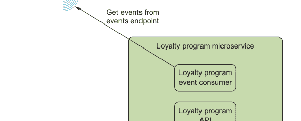

图 10.6 忠诚度计划具有 API 和事件消费者；事件消费者使用特别优惠中的事件端点获取事件。


忠诚度计划部署到 Kubernetes 中包含两个容器：忠诚度计划 API 容器和忠诚度计划事件消费者容器。忠诚度计划事件消费者负责从特价优惠微服务获取并处理事件。因此只有忠诚度计划事件消费者容器需要被允许向特价优惠微服务发起请求。

我们将使用 Kubernetes 中的网络策略来限制对特价优惠的访问，以确保只有忠诚度计划事件消费者被允许调用特价优惠中的端点。忠诚度计划 API 或任何其他微服务都不会被允许调用特价优惠中的端点。如果图 10.1 中未描绘的其他微服务需要访问特价优惠，可以扩展网络策略以有选择地允许此类访问。

## 在 Kubernetes 中启用网络策略

网络策略很不幸地在我们在第 3 章中创建的 Kubernetes 集群中无法工作，因为该集群需要一个支持网络策略的 *网络控制器*。网络控制器无法在集群创建后安装，因此我们必须创建一个新的集群并使用网络控制器。在 AKS 中，我们可以使用名为 *azure* 的网络插件，它将设置一个支持网络策略的网络控制器。为此，我们还需要为 AKS 集群设置一个稍微复杂一些的网络。该章的代码下载包含一个 PowerShell 脚本，用于创建启用了网络控制器和网络策略的 AKS 集群。

Docker Desktop 不支持网络控制器，因此我们无法在其中使用网络策略。此外，在没有网络控制器的 Kubernetes 集群中，网络策略将不起任何作用；它们不会产生任何错误，但也不会限制流量。

在第 5 章中，我们使用此清单文件将特价优惠微服务部署到 Kubernetes。

```
kind: Deployment
apiVersion: apps/v1
metadata:
    name: special-offers
spec:
    replicas: 1
    selector:
        matchLabels:
            app: special-offers
    template:
        metadata:
            labels:
                app: special-offers
        spec:
```

```
```yaml
containers:
  - name: special-offers
    image: your_unique_registry_name.azurecr.io/
      special-offers:1.0.0
    imagePullPolicy: IfNotPresent
    ports:
      - containerPort: 80
---
apiVersion: v1
kind: Service
metadata:
  name: special-offers
spec:
  type: LoadBalancer
  ports:
    - name: special-offers
      port: 5002
      targetPort: 80
  selector:
    app: special-offers
```
```

这会创建一个包含特价优惠容器的 Pod，以及一个在 Kubernetes 外部暴露特价优惠的负载均衡器。我们需要以两种方式更改它，以获得我们想要的对特价优惠微服务的访问限制。首先，我们将更改服务部分，使其不再在 Kubernetes 外部暴露特价优惠。其次，我们将添加一个网络策略。

第一个更改很简单。我们只需要删除行 `type: LoadBalancer`。这意味着我们不再创建负载均衡器，但我们仍会创建服务。

第二个更改——引入网络策略——在清单中添加了另一个部分，指定只有忠诚度计划事件消费者被允许访问特价优惠。`special-offers.yaml` 中的最终特价优惠清单如下所示。

### Listing 10.5 Modified manifest for special offers with a network policy

```
```yaml
kind: Deployment
apiVersion: apps/v1
metadata:
  name: special-offers
spec:
  replicas: 1
  selector:
    matchLabels:
      app: special-offers-pod
  template:
    metadata:
      labels:
        app: special-offers-pod
    spec:
      containers:
```

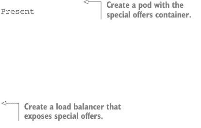

```
- name: special-offers
  image: your_unique_registry_name.azurecr.io/
    special-offers:1.0.0
  imagePullPolicy: IfNotPresent
  ports:
    - containerPort: 80
```

```
---
apiVersion: v1
kind: Service
metadata:
  name: special-offers
spec:
  selector:
    app: special-offers-pod
  ports:
    - port: 5002
      targetPort: 80
```

服务不再是负载均衡器。

```
---
apiVersion: networking.k8s.io/v1
kind: NetworkPolicy
metadata:
  name: special-offers-network-policy
spec:
  podSelector:
    matchLabels:
      app: special-offers-pod
  policyTypes:
  - Ingress
  ingress:
    - from:
        - podSelector:
            matchLabels:
              app: loyalty-program-consumer
```

一个网络策略

网络策略适用于特价优惠 Pod。

该策略控制进入特价优惠 Pod 的流量。

仅允许忠诚度计划消费者。

这将确保只有忠诚度计划事件消费者可以向特价优惠发起调用。网络策略通过定义它适用的 Pod——特价优惠 Pod——以及哪些 Pod 可以调用受策略保护的 Pod 中的容器来工作。策略允许带有标签 app: loyalty-program-consumer 的 Pod 调用特价优惠，但不允许其他 Pod。唯一具有该标签的 Pod 是忠诚度计划事件消费者。

为了确认忠诚度计划事件消费者确实能够向特价优惠发起调用，我们可以使用以下命令检查事件消费者的日志

```
kubectl logs -lapp=loyalty-program-consumer --all-containers
```

这将显示忠诚度计划事件消费者最近几次调用的日志。

至此，安全需求的实现已完成。你已通过依赖 Azure API Management 充当 API 网关并执行身份验证、使用 ASP.NET 对 JWT 的支持、使控制器中的业务逻辑执行授权，以及依赖 Kubernetes 网络策略来限制哪些微服务可以通信，从而满足了这些需求。

## Summary

- 用户应在系统边缘进行身份验证。也就是说，最先接收用户请求的微服务应启动身份验证。
- 授权应在微服务系统中、在拥有请求所针对数据的微服务中进行。原则是授权是属于业务能力的业务规则的一部分。由于微服务——正如你在第 4 章中所见——是围绕业务能力设计的，因此负责业务能力的微服务也应负责与该业务能力相关的任何授权。
- 深度防御的安全原则要求你考虑微服务之间可以接受的信任级别。在某些系统中，微服务信任来自其他微服务的请求可能是可以接受的。在其他系统中，可能不可接受。
- 微服务之间高度信任带来的便利性与较低信任带来的安全性之间存在权衡。
- 你可以引入一个登录微服务，负责所有身份验证，包括终端用户身份验证和一个微服务到另一个微服务的调用身份验证。
- 你使用 Kubernetes 网络策略来控制哪些微服务可以通过配置作用域进行协作，以及哪些微服务接收哪些作用域。
- 你可以使用多种现成的产品来设置登录微服务。
- 你可以使用身份令牌以比将用户 ID 作为明文包含更安全的方式在各处传递用户身份。
- 你可以从传入请求中读取身份令牌并使用其中的声明在控制器操作中执行授权。

这些组件均未解决横切关注点，例如监控、日志记录、处理数据库连接的标准方式、安全等。此外，这些组件都不是实现这些横切关注点的合适位置。为什么？因为图 11.1 中的所有组件都实现了特定于购物车微服务的功能。相比之下，横切关注点并非特定于任何一个微服务。因此，我们需要在图 11.1 中的组件之外实现它们。从另一个角度看购物车，如图 11.2 所示，它通过 Web 服务器接收 HTTP 请求，使用其各种组件处理请求，并向 Web 服务器返回响应，Web 服务器再将其发送回调用方。

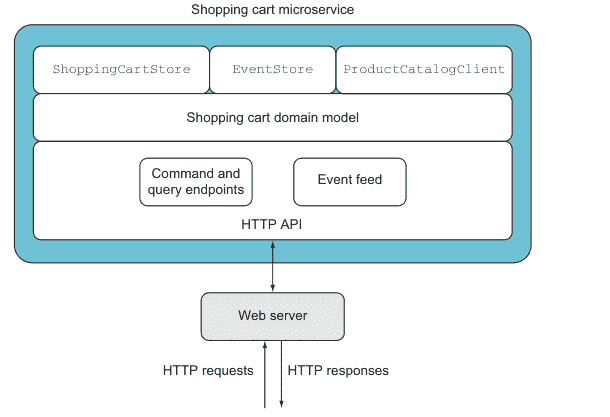

图 11.2 购物车微服务通过 Web 服务器接收 HTTP 请求。

正如我刚才提到的，我们希望将横切关注点的代码与图 11.1 中的组件分开。此外，横切关注点适用于整个微服务。这意味着处理横切关注点的代码的良好位置是在 Web 服务器和我们 MVC 控制器中的端点处理程序之间（见图 11.3）。

Web 服务器和端点处理程序之间的代码片段形成了一条管道：每个请求在到达 MVC 控制器中的端点处理程序之前依次流经管道中的每个部分。同样，端点处理程序的响应也会沿同一管道返回，然后到达 Web 服务器，Web 服务器再将其发送回调用方。在本章中，你将使用 ASP.NET 中间件来实现这样的管道；管道中的每个部分称为中间件。正如你所见


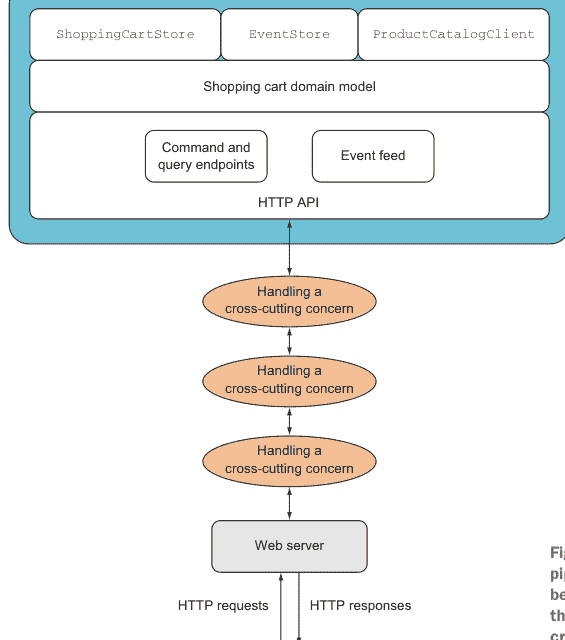

图 11.3 你可以在 Web 服务器和端点处理程序之间使用中间件管道来处理横切关注点。

在之前的章节中，ASP.NET 已经开箱即用地支持了许多横切关注点——例如请求日志记录和监控端点——通常在内部使用中间件。随着你转向更特定于环境的关注点，中间件可能会非常有帮助。本章后面我会介绍如何编写和测试自己的中间件，但在那之前，让我们先看看如何将这些横切关注点收集到一个可复用的微服务平台中。

## 11.3 创建可复用的微服务平台

第 9 章和第 10 章解释了微服务必须在生产环境中成为守规矩的公民。它们需要通过日志记录提供健康状况的洞察，应该允许监控，并且需要遵循你为系统决定的安全标准。因此，创建一个新的微服务不仅仅是创建一个新的、空的 ASP.NET 项目。

这就是为什么我建议构建一个标准的微服务平台，在微服务系统中跨你的基于 ASP.NET 的微服务使用。如图 11.4 所示，

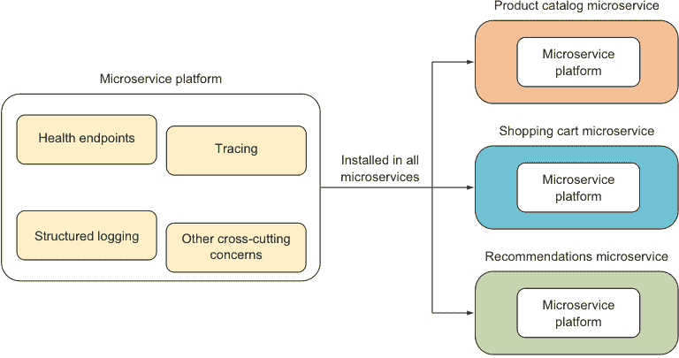

**图 11.4** 微服务平台是一组跨所有微服务的技术关注点的实现集合。平台被安装在——并且成为——每个微服务的一部分。

平台被安装在每个微服务中。本章后面，你将创建一个这样的平台的第一个迭代，包括以下内容：

- 适合 Kubernetes 的监控端点
- 简化结构化日志记录和追踪的日志配置

这些是我为本书选择的平台领域，但它们不一定是你系统微服务平台所需的全部内容。我尝试包含了常见组件。特别是，我认为此类平台应包含监控、追踪和结构化日志部分。它们不必采用本书中使用的确切形式；例如，你可能更喜欢不同的追踪标准或另一个日志框架。根据你为微服务之间安全所选择的方案，你也可能有机会通过将横切安全代码放入平台来使安全更简单。此外，你应考虑包含与你在许多微服务中使用的技术相关的策略——例如，处理数据库连接。

另一面是：你是否应该在微服务平台中包含更多内容？没有一概而论的答案，但你应谨慎添加项目；每次你在平台中包含某项内容，它就会变得更大更重。此外，当你添加所有微服务都预期包含的内容时，如果它们没有运行相同版本的平台会怎样？其他微服务能处理这种情况吗？围绕你的微服务系统的基础设施能处理这种情况吗？如果平台发展成必须在所有微服务中保持同步的东西，但它经常变化，它就会成为严重的瓶颈而不是推动者。首先，平台必须在每个微服务的代码库中更新，然后每个微服务必须部署。如果有许多微服务，那就是大量工作；并且每次创建新微服务时，工作量会更大。

理想情况下，你的微服务平台将恰好包含那些真正横切微服务且可以增量更新的技术关注点——也就是说，在一段时间内一次在一个微服务中更新。这使得创建新微服务的门槛大大降低：你需要对横切技术关注点的详细知识更少，所花费的精力也更少。

## 11.4 使用 NuGet 打包和共享横切代码

### 使用 NuGet 构建你的平台

NuGet 是一种包格式，也是安装这些包的一组工具。直到本书的这一点，你只安装了现有的 NuGet 包；它们都公开在 nuget.org 上的包源中。但 NuGet 不限于安装公开可用的包。正如你在 11.4 节中将看到的，你可以从私有包源安装包。而且你也可以创建自己的 NuGet 包——正如你在 11.4.1 节中也会看到的——并将它们放入你的私有 NuGet 源。

我们现在将注意力转向构建一个可跨微服务复用的小型平台所需的代码。你已经构建了进入这个小型平台的功能，但你是一次在一个微服务中完成的。现在，你将从创建它的微服务中提取代码并将其放入包中，你可以轻松地在新微服务中安装和使用。你将使用 NuGet，因为它能提供易于创建的包，你的微服务可以安装和使用。你已经在微服务中使用了许多 NuGet 包，所以它已是你的工作流程的一部分；可复用微服务平台中的包将完美契合。一旦我们建立了这个小型平台，我们将回到中间件作为工具，让你将更多横切关注点构建到平台中，使其完美契合你的特定系统和组织。你将从以下部分构建平台：

- 第 9 章中的健康检查
- 第 9 章中的追踪
- 第 9 章中的结构化日志记录

如图所示 11.5，平台将由以下 NuGet 包组成：

- `MicroserviceNET.Logging`——结构化日志记录和追踪
- `MicroserviceNET.Monitoring`——健康检查

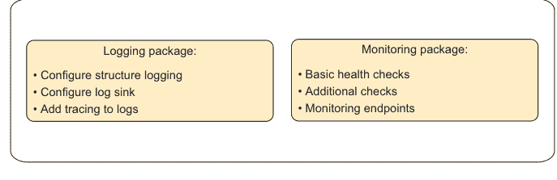

图 11.5 微服务平台包含两个包，每个包包含一些技术横切关注点的代码。

你的微服务只需添加 MicroserviceNET.Platform 包和少量启动代码即可使用和配置微服务平台。创建 NuGet 包来做这件事似乎是过度设计吗？也许。ASP.NET 已经使监控和日志关注点变得相当容易，所以这些包起初不会有太多代码。但这些包只是起点；随着你的系统增长以及你对运维的经验增长，你很可能会发现想要在微服务间标准化的片段和更多细节。你可以，如果对你的特定系统和环境相关，标准化个人身份信息在日志中的脱敏方式；秘密（如数据库凭据）如何处理；事件如何馈送到你的数据湖；输出缓存如何处理；如何连接到数据库、队列和其他技术；等等。 certainly 不需要在所有微服务系统中标准化所有这些内容，但大多数微服务系统都会有自己的需要一些标准化和是微服务平台添加的良好候选的横切关注点列表。在以下各节中，你将创建这两个 NuGet 包中的每一个。

### 11.4.1 创建日志包

在本节中，你将通过执行以下操作创建 MicroserviceNET.Logging NuGet 包：

1. 从购物车微服务中提取第 9 章中创建的结构化日志记录和追踪配置到一个名为 MicroserviceNET.Logging 的类库中。
2. 添加一个便捷方法，使向 ASP.NET 管道添加监控和日志中间件变得容易。
3. 从 MicroserviceNET.Logging 库创建 NuGet 包。

第一步是创建一个 .NET 类库并将其命名为 MicroserviceNET.Logging。你可以用你的 IDE 或 dotnet 来完成。然后，添加日志和追踪


将第 9 章的配置代码以及该代码使用的 NuGet 包迁移到 MicroserviceNET.Logging 库中。我会在这里重复该代码，但有关代码的解释请参考第 9 章。
向 MicroservicesNET.Logging 库添加 NuGet 包 Microsoft.Extensions.Hosting、Serilog.AspNetCore、Serilog.Sinks.ColoredConsole 和 Serilog.Enrichers.Span。然后在 MicroserviceNET.Logging 项目中添加一个 HostBuilderExtensions.cs 文件，并将以下代码放入其中，该代码将 Serilog 配置为记录器并使用跟踪信息丰富所有日志。

## Listing 11.1 Logger configuration from chapter 9

```
namespace MicroserviceNET.Logging
{
    using Microsoft.Extensions.Hosting;
    using Serilog;
    using Serilog.Enrichers.Span;
    using Serilog.Formatting.Json;

    public static class HostBuilderExtensions
    {
        public static IHostBuilder UseLogging(this IHostBuilder builder) =>
            builder.UseSerilog((context, logger) =>
            {
                logger
                    .Enrich.FromLogContext()
                    .Enrich.WithSpan();
                if (context.HostingEnvironment.IsDevelopment())
                    logger.WriteTo.ColoredConsole(
                        outputTemplate: "{Timestamp:yyyy-MM-dd HH:mm:ss} {TraceId} { Level:u3} {Message}{NewLine}{Exception}");
                else
                    logger.WriteTo.Console(new JsonFormatter());
            });
    }
```

这就是 MicroserviceNET.Logging 项目中所需的所有代码。这将日志配置代码从购物车微服务中提取出来，并将其放置在一个方便的扩展方法 UseLogging 中，我们可以从使用该平台的每个微服务的 Program.cs 文件中调用它。

## Listing 11.2 Using UseLogging in a Program.cs

```
using Microsoft.AspNetCore.Hosting;
using Microsoft.Extensions.Hosting;
using MicroserviceNET.Logging

CreateHostBuilder(args).Build().Run();

static IHostBuilder CreateHostBuilder(string[] args) =>
    Host.CreateDefaultBuilder(args)
    .UseLogging()
```

```
```csharp
.ConfigureWebHostDefaults(
    webBuilder => { webBuilder.UseStartup<Startup>(); });
```
```

要从 MicroserviceNET.Logging 库创建 NuGet 包，可以使用 dotnet。转到项目文件夹——即包含 MicroserviceNET.Logging .csproj 文件的文件夹——并运行以下命令：

```
```powershell
PS> dotnet pack --configuration Release
```
```

这将在 bin/Release 中创建一个名为 MicroserviceNET.Logging.1.0.0.nupkg 的 NuGet 包。该包包含编译为程序集的 MicroserviceNET.Logging 项目的代码。此外，该包需要我们在 MicroserviceNET.Logging 中安装的三个 Serilog 包和 Microsoft.Extensions.Hosting 包，这意味着每当此包安装到项目中时，这四个包也会被安装。

该包已准备好安装并在任意数量的微服务中使用。

## 11.4.2 Creating a package with monitoring endpoints

在本节中，我们将以相同的方式创建另一个 NuGet 包。它将包含 Kubernetes 期望的监控端点的健康检查代码。创建新包有三个步骤：

- 创建一个名为 `MicroserviceNET.Monitoring` 的新类库。
- 添加第 9 章中的健康检查代码。
- 使用 `dotnet pack` 构建包。

一旦你创建了一个名为 MicroserviceNET.Monitoring 的新类库，你应该向其中添加这些 NuGet 包，因为它们被健康检查代码使用：

- `Microsoft.Extensions.DependencyInjection`
- `Microsoft.Extensions.Diagnostics.HealthChecks`
- `Microsoft.AspNetCore.Http.Abstractions`
- `Microsoft.AspNetCore.Diagnostics.HealthChecks`

添加健康检查有两个步骤。首先，它们被添加到服务集合中，然后添加到应用程序构建器中。第一部分我们放在 MicroserviceNET.Monitoring 库中的一个新文件 ServiceCollectionExtensions.cs 中。我们从第 9 章的购物车代码中提取添加健康检查到服务集合的代码，并补充了一些添加更多健康检查的便捷方法。

```
```csharp
namespace MicroserviceNET.Monitoring
{
    using Microsoft.Extensions.DependencyInjection;
    using Microsoft.Extensions.Diagnostics.HealthChecks;

    public static class ServiceCollectionExtensions
    {
```
```

```
private const string Liveness = "liveness";
private const string Startup = "startup";

public static IServiceCollection AddBasicHealthChecks(
    this IServiceCollection services)
{
    services.AddHealthChecks()
        .AddCheck("BasicStartupHealthCheck",
            () => HealthCheckResult.Healthy(), tags: new[] {Startup})
        .AddCheck("BasicLivenessHealthCheck",
            () => HealthCheckResult.Healthy(), tags: new[] {Liveness});

    return services;
}

public static IServiceCollection AddAdditionStartupHealthChecks<T>(
    this IServiceCollection services) where T : class, IHealthCheck
{
    services.AddHealthChecks().AddCheck<T>(nameof(T), tags: new[] {
        Startup});
    return services;
}

public static IServiceCollection AddAdditionLivenessHealthChecks<T>(
    this IServiceCollection services) where T : class, IHealthCheck
{
    services.AddHealthChecks().AddCheck<T>(nameof(T), tags: new[] {
        Liveness});
    return services;
}
}
```

添加一个基本的启动检查和一个基本存活检查。

使用 startup 进行标记以便后续使用。

使用 liveness 进行标记以便后续使用。

允许添加更多启动检查。

允许添加更多存活检查。

这只是为启动和存活注册非常基础的——空的——健康检查。检查被标记为 startup 或 liveness，这将在我们将健康检查添加到应用程序构建器时使用。还有两个方法——AddAdditionStartupHealthChecks 和 AddAdditionLivenessHealthChecks——使注册额外的检查变得容易，并将它们添加到启动或存活健康端点。

第二步是将健康检查添加到应用程序构建器。我们向库中添加另一个文件。将其命名为 ApplicationBuilderExtensions 并填入以下代码。

## Listing 11.4 Convenient extension method for adding health endpoints

```
namespace MicroserviceNET.Monitoring
{
    using Microsoft.AspNetCore.Builder;
    using Microsoft.AspNetCore.Diagnostics.HealthChecks;

    public static class ApplicationBuilderExtensions
    {
```

```
public static IApplicationBuilder
UseKubernetesHealthChecks(this IApplicationBuilder app) =>
    app
        .UseHealthChecks("/health/startup",
            new HealthCheckOptions
            {
                Predicate = x => x.Tags.Contains("startup")
            })
        .UseHealthChecks("/health/live",
            new HealthCheckOptions
            {
                Predicate = x => x.Tags.Contains("liveness")
            });
```

添加我们在 Kubernetes 清单中使用的启动端点。

添加所有标记为 startup 的健康检查。

添加我们在 Kubernetes 清单中使用的存活端点。

添加所有标记为 liveness 的健康检查。

健康检查上的标签用于确定它们属于哪个端点。这确保基本健康检查以及任何额外的健康检查都被添加到启动和存活端点。

现在我们准备好使用 dotnet pack 构建 NuGet 包并开始使用 MicroserviceNET.Monitoring 包。它将帮助我们确保使用它的所有微服务都公开相同的监控端点。

不过，在构建 NuGet 包之前，还有一个决定需要做出。在第 9 章中，我们还创建了一个在启动期间运行并检查数据库连接是否可以建立的 DbHealthCheck。如果这与你几乎所有的微服务都相关，你也可以将其添加到 MicroserviceNET.Monitoring 中。如果它只与一些微服务相关，我们就进入了一个灰色地带：如果足够多的微服务使用 SQL Server 数据库，我们可以向我们的微服务平台添加另一个 NuGet 包并将 DbHealthCheck 添加到其中。然后微服务可以引入这个第三个包。

作为提醒，我将重复 DbHealthCheck 的代码，重命名为 MsSqlStartupHealthCheck 以使用法更明确。

## Listing 11.5 Startup health check that uses an SQL Server database

```
namespace MicroserviceNET.Monitoring
{
    using System.Data.SqlClient;
    using System.Net.Http;
    using System.Threading;
    using System.Threading.Tasks;
    using Dapper;
    using Microsoft.Extensions.Diagnostics.HealthChecks;
    using Microsoft.Extensions.Logging;

    public class MsSqlStartupHealthCheck : IHealthCheck
    {
        private readonly HttpClient httpClient;

        public MsSqlStartupHealthCheck(ILoggerFactory logger)
        {
```

新名称表示为 MS SQL server


```
this.httpClient = new HttpClient();
}

public async Task<HealthCheckResult> CheckHealthAsync(
    HealthCheckContext context,
    CancellationToken cancellationToken)
{
    await using var conn = new SqlConnection(...);
    var result = await conn.QuerySingleAsync<int>("SELECT 1");
    return result == 1
        ? HealthCheckResult.Healthy()
        : HealthCheckResult.Degraded();
}
}
```

请注意，`MsSqlStartupHealthCheck` 实现了 `IHealthChecks`，这意味着它可以很好地融入之前创建的 `AddAdditionStartupHealthChecks`。微服务可以使用 `MicroserviceNET.Monitoring` 包和 `MsSqlStartupHealthCheck`。

## 清单 11.6 使用微服务平台注册健康检查

```
public class Startup
{
    public void ConfigureServices(IServiceCollection services)
    {
        services
            .AddBasicHealthChecks()
            .AddAdditionStartupHealthChecks<MsSqlStartupHealthCheck>();
    }
}
```

微服务可以通过利用所创建的应用构建器扩展，在标准化的监控端点中公开这些检查。

## 清单 11.7 添加标准化的监控端点

```
public void Configure(IApplicationBuilder app)
{
    app.UseRouting();
    app.UseKubernetesHealthChecks();
    app.UseEndpoints(endpoints => endpoints.MapControllers());
}
```

我们已经创建了微服务平台的第一版，它有助于标准化我们的微服务日志、追踪和暴露监控端点。要使用该平台，微服务需要安装两个 NuGet 包——`MicroserviceNET.Logging` 和 `MicroserviceNET.Monitoring`——并在 `Program.cs` 中使用宿主构建器扩展来设置日志记录，在 `Startup` 类中使用服务集合和应用构建器上的扩展来设置监控端点。

在开发微服务系统的过程中，你很可能会发现更多适合在平台中实现的横切关注点。其中一些可以很好地融入 ASP.NET 的中间件管道中，这正是下一节的主题。

## 11.5 ASP.NET 管道

我们在第 1 章中简要提到了中间件，但现在我们该仔细看看了。ASP.NET 允许我们放入一些中间件，这些中间件会在每个请求时执行。每个请求依次流经每一部分中间件。这些中间件一起构成了请求流经的管道。

图 11.6 中的设置是一个包含一段中间件的管道。ASP.NET 定义了管道各部分之间通信所用的接口。这是一个所有管道部分都实现的统一接口：每一段中间件都实现该接口。通过拥有一个统一的接口，你可以按需组合管道。你可以向其中添加更多中间件，可以移除部分中间件，也可以调换它们的顺序。因为它们都使用相同的接口，所以可以根据需要重新排列。

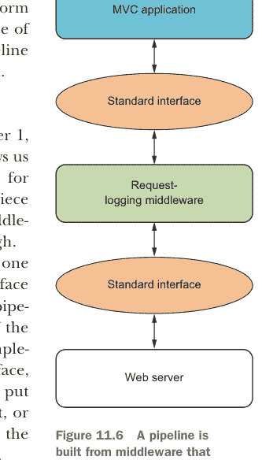

图 11.6 管道由中间件构建而成，这些中间件通过统一的标准化接口进行通信。

当请求和响应通过中间件时，中间件可以读取它们甚至修改它们。中间件之间使用的接口是 ASP.NET 定义的 `RequestDelegate`：

```
public delegate Task RequestDelegate(HttpContext context);
```

这个委托允许中间件检查和修改 `HttpContext`，并且只要中间件知道下一段中间件，就可以将其传递给管道中的下一段中间件，正如 11.3 和 11.6 所示。

`RequestDelegate` 是一种委托类型，我们可以选择用 lambda 函数来实现它，这是一种实现中间件的轻量级方式。不过有一个小复杂点：中间件应该是中间件管道的一部分，因此它需要知道管道中的下一段中间件。我们用一个小间接层来解决：创建一个 lambda，它接收下一段中间件，并返回一个实现 `RequestDelegate` 的 lambda。让我们看一下代码：

```
next =>
  ctx =>
  {
```

下一段中间件

内部 lambda 就是中间件。

```
System.Console.WriteLine("Got request");
return next(ctx);
}
```

让我们分解这段代码。首先，`next` 的类型是 `RequestDelegate`，并且应当是管道中的下一段中间件。其次，`ctx` 的类型是 `HttpContext`。这意味着内部 lambda 接收一个 `HttpContext` 作为参数，并返回一个 `Task`：

```
ctx =>
{
    System.Console.WriteLine("Got request");
    return next(ctx);
}
```

`ctx` 的类型是 `HttpContext`。

`next` 是一个 `RequestDelegate`，因此它返回一个 `Task`。

既然我们已经确定了内部 lambda 实现了 `RequestDelegate`，我们就可以看到外部 lambda 如何用于构建管道。用一段中间件调用外部 lambda，会创建一个包含两段中间件的管道：先是内部 lambda 中的中间件，然后是传入的中间件：

```
RequestDelegate secondMiddleware = ...
var fisrstMiddleware = next =>
    ctx =>
    {
        System.Console.WriteLine("Got request");
        return next(ctx);
    }

RequestDelegate pipeline = firstMiddleware(secondMiddleware);
```

前面清单中的中间件

来自某处的中间件

管道也实现了 `RequestDelegate`。

管道本身也是一个 `RequestDelegate`，这一事实使得构建更长的管道以及组合管道成为可能。在启动期间，ASP.NET 会构建管道，以便在 HTTP 请求到来时准备好处理它们。

`HttpContext` 包含与 HTTP 请求和响应相关的所有内容。在请求侧，这包括所有请求头、请求路径和请求体。同样，在响应侧，`HttpContext` 包括响应头、状态码和响应体。有了所有这些访问权限，中间件可以对 HTTP 请求和响应做任何事情。

`RequestDelegate` 是一个简单的类型，但它实现了一个强大的概念。中间件管道既灵活又强大，我觉得它非常有用。接下来，我将讨论何时使用 ASP.NET 中间件，以及何时使用 MVC 的功能。

### 11.5.1 什么属于中间件？

ASP.NET 为你提供了一种构建中间件管道的方法，每个请求都会流经该管道。管道的不同部分可以响应请求并向响应写入内容。同样，MVC 让你可以处理请求并编写响应。使用 MVC，你主要在控制器的方法中处理请求，但也可以添加在控制器方法之前和之后执行的代码。你可以通过向 MVC 配置添加 MVC 过滤器来实现这一点。但什么该放在哪里？

为了决定在中间件中实现什么，以及在 MVC 过滤器中实现什么，你可以遵循几条简单的经验法则：

- * 处理横切关注点且旨在跨多个微服务使用的代码属于中间件。这些可重用的代码片段应该具有较少的依赖关系，这样它们就不会对使用它们的微服务强制施加太多技术选择。因此，你希望它们独立于 MVC。
- * 处理单个微服务的领域或业务规则的代码属于 MVC 控制器后面的应用程序代码。这类代码不依赖于 HTTP，因此不需要依赖 ASP.NET 或 MVC。将它放在单独组件中——例如领域模型——可以使业务和领域规则的实现保持干净和可读。
- * 以特定端点特有的方式处理 HTTP 请求和响应的代码属于 MVC 控制器。这段代码解释传入的 HTTP 请求，然后将控制权移交给领域模型。同时，这种解释与 HTTP 和端点的细节紧密耦合，使得控制器成为它的合适位置。
- * 处理横切某个微服务内所有端点、但不横切多个微服务的关注点的代码，通常属于中间件，但并不总是如此。关注点越技术性，我越倾向于中间件；关注点中的领域或业务逻辑越多，我越倾向于 MVC 控制器，或者在极少数情况下，使用 MVC 过滤器。

我已经介绍了中间件并讨论了它的用途。现在我们转向编写和测试中间件。

## 11.6 编写中间件

我们将介绍两种编写中间件并将其挂接到 ASP.NET 管道中的方法：

- * 作为 lambda——你已经在前面章节中看到了这种风格，我们将在下一节中在此基础上继续构建
- * 作为具有实现中间件签名的方法的类——在我们再次查看 lambda 风格之后，你将看到这种风格。

这两种风格是等价的，你可以很容易地在它们之间切换。为某段特定中间件选择哪一种，只是品味问题。

### 11.6.1 作为 lambda 的中间件

你已经看到了用 lambda 函数实现的中间件。在本节中，我将向你展示如何在 `Startup.cs` 文件中将基于 lambda 的中间件添加到 ASP.NET 管道中。


这就是你之前见过几次的 lambda 中间件：

```
next =>
ctx =>
{
    System.Console.WriteLine("Got request");
    return next(ctx);
}
```

next 是一个 RequestDelegate。

内部 lambda 是一个 RequestDelegate，它接收一个 HttpContext。

在 Startup.cs 中，我们可以通过调用应用程序生成器上的 Use 方法向管道添加中间件：

```
public class Startup
{
    public void Configure(IApplicationBuilder app)
    {
        app.Use(next => ctx =>
        {
            Console.WriteLine("Got request in lambda middleware");
            return next(ctx);
        })
        ...
    }
}
```

Use 会向管道添加一段中间件。

这就是向管道添加一段中间件所需的全部操作。现在每个传入的请求都会经过我们这段小型中间件。

## 11.6.2 中间件类

将中间件编写为 lambda 函数是可行的，但当中间件更复杂时，就会变得有些困难。在这种情况下，使用类来实现中间件会更好。

要使用类来实现中间件，可以创建一个类，该类包含一个签名是 RequestDelegate 的方法。

**清单 11.8 在类中实现的中间件**

```
public class ConsoleMiddleware
{
    private readonly RequestDelegate next;

    public ConsoleMiddleware(RequestDelegate next)
    {
        this.next = next;
    }

    public Task Invoke(HttpContext ctx)
    {
        Console.WriteLine("Got request in class middleware");
        return this.next(ctx);
    }
}
```

- 在实例化时持有 next
- 具有 RequestDelegate 签名

这种风格的中间件在构造函数中接收下一个中间件，并将其存储在私有变量中，以便可以在实现中间件行为的 Invoke 方法中按需调用。要将这种中间件添加到 ASP.NET 管道中，需要实例化它，然后使用 Invoke 方法作为委托：

```
app.Use(next => new ConsoleMiddleware(next).Invoke());
```

或者，我们可以使用更方便的扩展方法 UseMiddleware，它通过反射查找 Invoke 方法，本质上做了相同的事情：

```
app.UseMiddleware<ConsoleMiddleware>()
```

调用 UseMiddleware 是添加基于类的中间件的首选方式。之所以首选，是因为它更易于阅读，还因为它允许我们使用依赖注入：中间件类构造函数中除 next 之外的任何依赖项都将从服务集合中解析，就像 MVC 控制器中的依赖项一样。这为使用中间件做更多事情打开了大门。

现在你已经知道如何将中间件实现为 lambda 和类。接下来，让我们看看如何测试中间件。

## 11.7 测试中间件和管道

测试 ASP.NET 中间件很简单：为要测试的场景创建一个 HttpContext，然后调用中间件，传入该 HttpContext。

> 注意：如第 8 章所述，你可以从 Visual Studio 或使用 dotnet 创建测试项目。这些项目使用 xUnit，这也是这里使用的测试框架。

有一个小问题需要解决：为了调用中间件，你首先需要为它提供一个 next 值。你可以通过传入一个什么都不做的 RequestDelegate 来解决这个问题：

```
RequestDelegate noOp = _ => Task.CompletedTask;
```


在测试中，你将使用空操作中间件作为桩，提供给被测中间件。

有了这个，你就可以为中间件编写测试了。假设你要测试以下基于类的中间件，它处理从 oldpath 到 newpath 的重定向。

**清单 11.9 一段示例中间件**

```
namespace Middleware
{
    public class RedirectingMiddleware
    {
        private readonly RequestDelegate next;

        public RedirectingMiddleware(RequestDelegate next)
        {
            this.next = next;
        }

        public Task Invoke(HttpContext ctx)
        {
            if (ctx.Request.Path.Value.TrimEnd('/') == "/oldpath")
            {
                ctx.Response.Redirect("/newpath", permanent: true);
                return Task.CompletedTask;
            }

            return this.next(ctx);
        }
    }
}
```

如果请求路径是 oldpath，它会以重定向作为响应。否则，它会调用管道的其余部分。

你可以为这个中间件编写一个测试，以验证 oldpath 确实被重定向到了 newpath。

**清单 11.10 直接调用中间件的测试**

```
namespace MiddlewareTests
{
    using System.Threading.Tasks;
    using Microsoft.AspNetCore.Http;
    using Middleware;
    using Xunit;

    public class RedirectingMiddleware_should
    {
        private readonly RedirectingMiddleware sut;

        public RedirectingMiddleware_should()
        {
            this.sut = new RedirectingMiddleware(_ => Task.CompletedTask);
        }

        [Fact]
        public async Task redirect_oldpath_to_newpath()
        {
            var ctx = new DefaultHttpContext
            {
                Request = {Path = "/oldpath"}
            };

            await this.sut.Invoke(ctx);

            Assert.Equal(StatusCodes.Status301MovedPermanently, ctx.Response.StatusCode);
            Assert.Equal("/newpath", ctx.Response.Headers["Location"]);
        }
    }
}
```

- 使用 no-op 作为 next 创建中间件
- 为此测试设置 HttpContext
- 调用被测中间件
- 对 HttpContext 的内容进行断言

此测试的模式如下：

1. 设置一个模拟你想要测试的场景的 HttpContext 环境。这是使用 DefaultHttpContext 类型完成的。
2. 创建被测中间件，并传入一个 no-op 作为下一个中间件。这会终止管道，因此对被测中间件的 Invoke 调用也会终止。
3. 使用测试开始时设置的 HttpContext 调用中间件。
4. 对 HttpContext 的内容或被测中间件预期处理的其他内容进行断言。例如，如果被测中间件创建了应该是 HttpContext 一部分的响应，因此可以通过 HttpContext.Response 属性访问。

你可以使用相同的模式创建更多测试——针对 oldpath 之外的其他路径。请参见以下示例：

```
[Fact]
public async Task not_redirect_other_paths()
{
    var ctx = new DefaultHttpContext
    {
        Request = {Path = "/otherpath"}
    };

    await this.sut.Invoke(ctx);

    Assert.NotEqual(
        StatusCodes.Status301MovedPermanently,
        ctx.Response.StatusCode);
    Assert.DoesNotContain("Location", ctx.Response.Headers);
}
```

此测试遵循与之前测试完全相同的模式，这通常就是您测试中间件的方式。

要测试由多个中间件组成的较长管道，你可以将一个中间件作为 next 传入另一个中间件来构建管道，就像你将 noop 传入你的中间件一样。管道构建完成后，其余部分就像之前的中间件测试一样。你将中间件组合成一个管道，可以向其传递 HttpContext，并对整个管道运行的结果进行断言。

现在你已经学会了如何编写和测试 ASP.NET 中间件，你可以准备好在项目的特定上下文中使用中间件来处理横切关注点。从一个相当简单的微服务平台开始，涵盖结构化日志、跟踪和监控，你可以在此基础上进一步扩展其他横切关注点。这样，你可以确保继续高效地创建新的微服务，同时处理横切关注点，从运维角度来看，这会让你的工作更轻松。

## 总结

- 因为在微服务系统中，你经常需要构建新的微服务，所以你需要能够快速、轻松地从零开始构建一个新的微服务。
- 为了满足监控、日志记录和安全方面的横切需求，系统中的所有微服务都需要做一些事情。具体要做哪些事情因系统而异。
- 你应该为你的微服务系统开发一个可重用的微服务平台。有了这样的平台，就可以轻松创建新的微服务，这些微服务在日志记录、监控和其他横切关注点方面符合预期行为。
- 一个可重用的微服务平台应该只处理横切的技术关注点。
- 可重用的微服务平台不应该处理领域逻辑，因为这在各个微服务之间是不同的。
- NuGet 是分发微服务平台的一种好格式。
- 你使用 `dotnet pack` 命令来创建 NuGet 包。
- 你可以创建 NuGet 包来实现以下目的：
  - 标准化微服务的监控端点
  - 标准化结构化日志
  - 标准化跟踪
  - 强制执行系统拥有的任何其他技术特定策略
- 你可以从库构建 NuGet 包。
- 你可以在微服务中使用自己的自定义 NuGet 包。
- 你可以利用 ASP.NET 中间件来处理横切关注点。
- 你可以轻松地为 ASP.NET 中间件编写测试。


# 第4部分