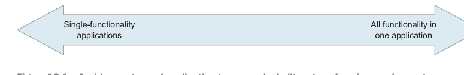
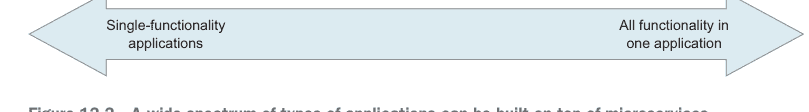
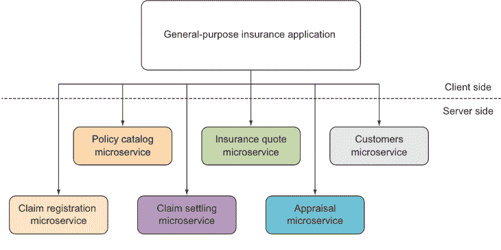
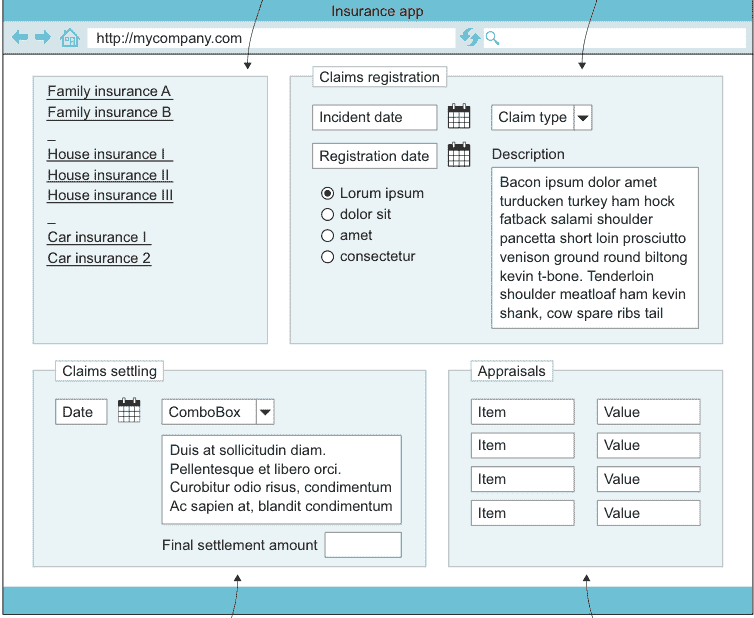
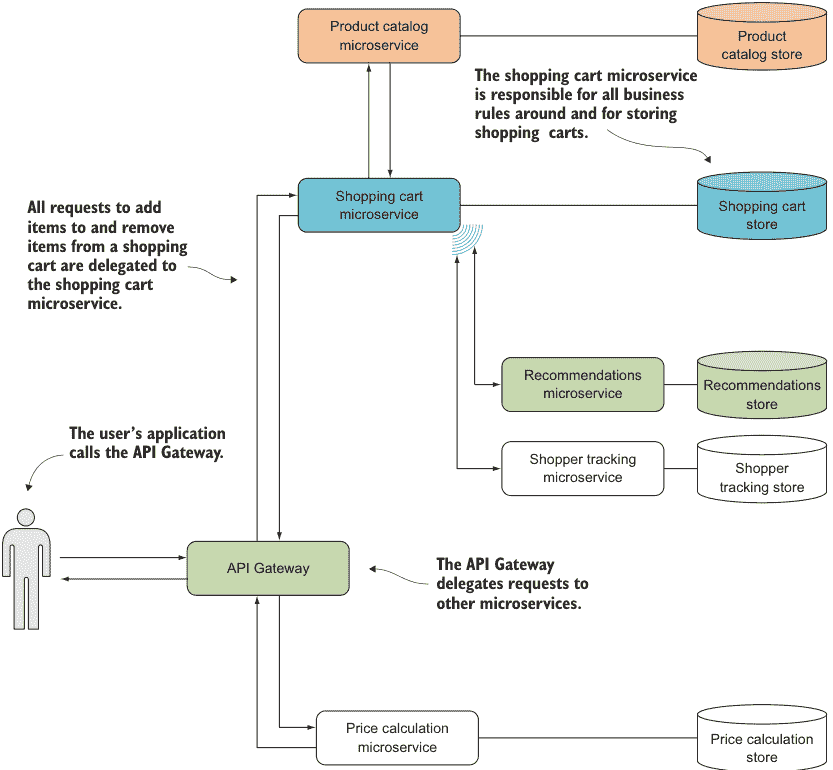
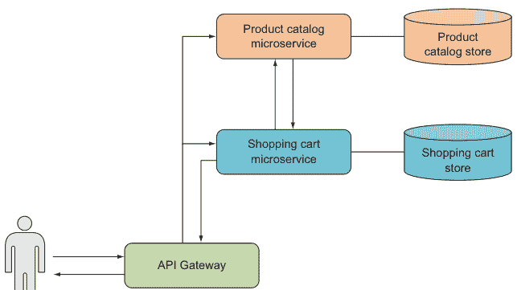
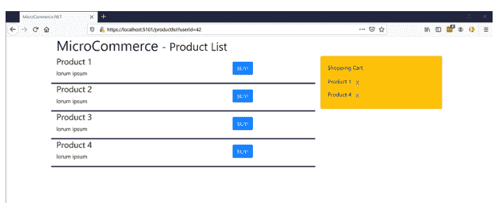
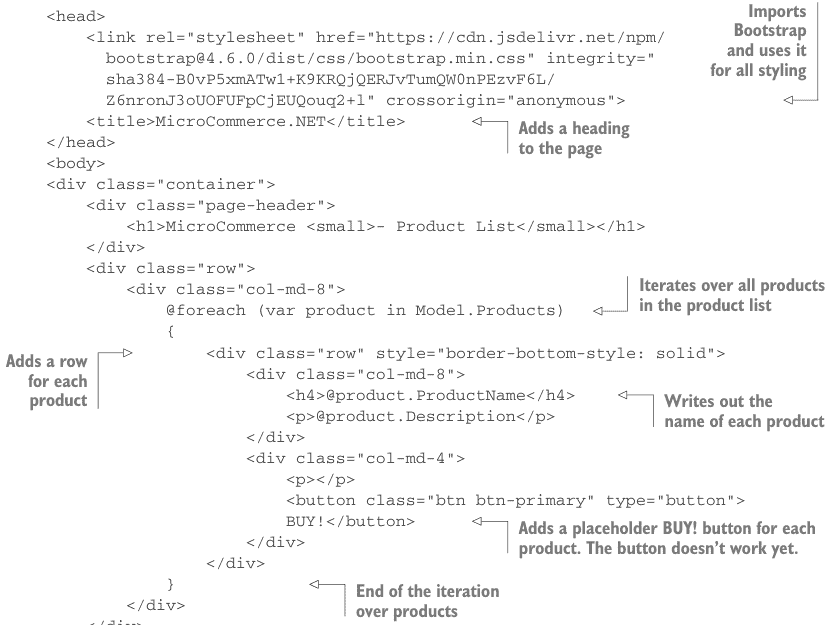
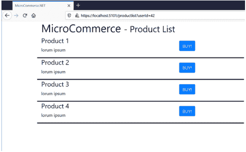
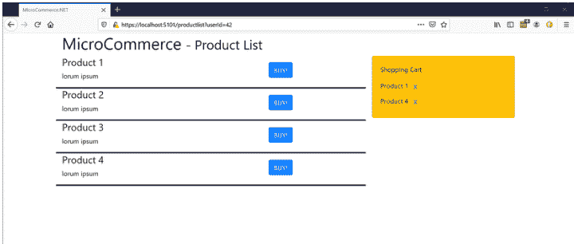

## 构建应用程序

本书的这一部分将为全貌画上点睛之笔：如何为终端用户创建应用程序。你已经学会了如何将系统拆分为微服务，以及如何创建这些微服务。在第12章中，你将在微服务之上添加图形用户界面（GUI），让终端用户能够充分利用其功能。

## 在微服务之上创建应用程序

**本章涵盖**

- 在微服务系统之上构建终端用户应用程序
- 理解复合应用、API网关和后端为前端设计模式
- 在Web应用程序中使用服务端渲染和客户端渲染

到目前为止，我们一直专注于在微服务中实现业务能力，并通过HTTP API暴露这些能力。但终端用户使用的并不是HTTP API，而是Web应用、移动应用、桌面应用、智能电视、VR头显以及设备上其他面向人类界面的应用程序。为了让终端用户能够访问微服务的全部能力，我们需要在微服务之上实现应用程序。本章正是为此而设：我们将从设计单个微服务转向把所有微服务整合到一个支持为终端用户构建应用程序的架构中。

我们将从一次宽泛、非技术性的讨论开始，探讨如何在微服务系统之上构建应用程序。然后，我们将深入介绍三种用于实现应用程序的具体架构模式：复合应用、API网关和后端为前端模式。

## 12.1 微服务系统的终端用户应用程序：一个还是多个？

从用户角度和技术角度来看，构建面向终端用户的应用程序有多种方式。我们将从用户角度出发，探讨一系列在应用程序中向终端用户呈现微服务功能的方法：从提供系统全部功能的通用应用程序，到一组小型专用应用程序，每个应用程序仅提供少数几种能力。这两种功能呈现方式代表了一个范围谱系的两端，如图12.1所示。



图12.1 在微服务系统之上可以构建多种多样的应用程序类型，从通用应用程序到高度专用的应用程序。

在两个极端之间，还存在许多其他构建应用程序的选项，这些应用程序覆盖微服务系统功能的大范围或小范围。特定微服务系统的应用程序应落在谱系的哪个位置，取决于该特定系统的上下文：其终端用户、功能等。

谱系的两端各有优点。接下来两节将对其进行讨论，以便让你体会到微服务系统提供功能的各种方式的广度。决定落在谱系的哪个位置，会影响你的应用程序应如何构建以及应使用哪种设计模式。

### 12.1.1 通用应用程序

微服务系统可以提供大量功能。例如，考虑一个保险公司的业务系统。该系统驱动业务流程，包括销售保单、制定价格和处理客户索赔。用户包括：

- 打电话招揽潜在客户的销售人员
- 根据估算的未来索赔和收入制定保单价格并评估业务风险的精算师
- 评估客户想要投保及客户索赔货物的评估师
- 调查和解决客户索赔的理赔员
- 管理用户和权限的IT人员

你在不同的微服务中实现保险系统的所有不同业务能力，但也可以决定实现一个覆盖所有功能、供所有用户使用的通用应用程序。这可以视为*通用应用程序*。它可以是任何类型的应用程序——例如Web或桌面应用程序。

多种原因可能促使你决定实现一个呈现系统所有功能的通用应用程序。例如，保险系统中的一些用户可能承担不止一种职能，例如同时从事评估工作的理赔员。不同类型用户所需的功能之间也可能存在重叠。

通过管理他们的权限，你仍然可以限制每个用户在通用应用程序中能做什么。但他们都在使用同一个应用程序，而该应用程序提供了系统的所有功能。

### 12.1.2 专用应用程序

在微服务系统之上构建应用程序的另一个选项是构建大量小型专用应用程序。这在某些方面与通用应用程序方法相反：你拥有许多高度专用的应用程序，每个应用程序只呈现整个系统的一小部分功能。继续以保险公司的业务应用程序为例，你可能会有以下独立的专用应用程序：

- 浏览公司提供的保单目录
- 为潜在客户创建报价
- 为客户创建保险保单
- 创建关于当前有效保险保单的报告
- 创建未来索赔成本预测
- 登记和调查索赔
- 评估投保货物
- 处理理赔

采用这种方法，用户必须使用多个应用程序。这乍听起来可能是一种糟糕的用户体验，但真的是这样吗？如果你选择将这些应用程序实现为Web应用，它们可以轻松地相互链接，即使功能分布在许多小应用程序中，也能营造出连贯的体验。而且，“做一件事并把它做好”的理念可以为每项功能带来非常出色的应用程序。例如，Facebook有一款名为Selfies for Messenger的Android应用，它只做一件事：拍自拍并通过Facebook Messenger发送。该应用精简了这一单一功能。

虽然我只提到了通用应用程序和专用应用程序，但这并不是仅有的两种可能性。选项是一个谱系（再次如图12.2所示），从提供系统全部功能的一个大型应用程序，到一长串单一能力应用程序。其他可能性包括：

- 将大型一体化应用程序拆分为两个应用程序，第一个包含管理功能，第二个包含所有其他功能
- 将某些单一能力应用程序合并为稍大的应用程序，覆盖某一类用户所需的所有功能



图12.2 在微服务之上可以构建多种多样的应用程序类型。

就保险公司而言，一种折中方法是按用户类型创建一个应用程序。销售人员将获得一个包含他们所需全部功能的销售应用程序，从寻找线索到签署交易。同样地，精算师、评估师、理赔员和IT人员也会获得适合其使用方式的应用程序。

尽管这种方法避免了大型通用应用程序和海量单一用途应用程序的复杂性，但它也有自己的问题：功能可能会在应用程序之间重复，有些用户承担多个角色，等等。没有一种唯一正确的方法；你需要根据用户体验方面的考虑而非技术方面的考虑，来决定你处于谱系的哪个位置。

现在，让我们转向更技术性的一面，看看在微服务之上构建应用程序的三种技术模式。

## 12.2 在微服务之上构建应用程序的模式

本节讨论复合应用、API网关和后端为前端设计模式。我将逐一解释每种模式，并讨论其优缺点。然后，我会讨论每种模式的适用时机。

### 12.2.1 复合应用：在前端集成

在微服务之上构建应用程序的第一种模式是复合应用。复合应用由来自多个地方（在微服务情况下，来自不同微服务）的功能组成，通过与每个微服务直接通信来实现。在这种模式中，每个微服务既提供功能，也提供该功能的UI。微服务之间可以相互通信来执行任务；复合应用并不关心这一点。


## 图 12.3 上下文

图 12.3 回到了保险示例，其中有一个通用型应用，包含了系统的全部功能。保险系统是使用微服务构建的，因此要通过该应用提供系统的全部功能，应用需要借助许多微服务的业务能力。系统中的微服务数量比图中显示的要多，应用不会直接利用所有这些微服务。应用将这些功能组合成一个应用——因此就有了*复合应用*这一术语。



**图 12.3** 一个复合通用型应用使用许多不同的微服务，每个微服务既提供功能，也为该功能提供 UI。

当你作为复合应用在微服务系统前端构建通用型应用时，微服务既提供功能，也提供伴随这些功能的 UI。因此，应用的 UI 是由来自不同微服务的更小 UI 组成的复合体。图 12.4 展示了保险应用 UI 的示例结构：它由四个部分组成，每个部分都来自一个既提供功能又提供 UI 的微服务。

UI 组合的实现方式取决于构建客户端所用的技术。例如，对于桌面 Windows Presentation Foundation（WPF）应用，你可以使用 Managed Extensibility Framework（MEF；http://mng.bz/6NKA）将组件动态加载到应用中，每个组件都可以有自己的 UI 部分。对于 Web 应用，可以通过将来自微服务的 HTML 片段和 JavaScript 包加载到主应用中，再使用 JavaScript 将它们添加到 DOM 来构建 UI。在这两种情况下，微服务都同时提供功能和 UI。

- 保险单列表来自保单目录微服务。
- 理赔登记表单来自理赔登记微服务。
- 理赔结算表单来自理赔结算微服务。
- 评估表单来自评估微服务。



**图 12.4** 复合应用从不同微服务获取 UI 组件，并将它们组合成一个有凝聚力的复合 UI。

复合应用并不都是通用型应用；它们也可以是较小的应用。例如，如果保险应用按用户类型分别提供应用，那么每个应用都必须提供属于不同业务能力、因而属于不同微服务的功能。因此，每个按用户类型划分的应用都可以构造成一个复合应用。

### 优点

在构建复合应用时，UI 会根据业务能力拆分为更小的部分，就像功能按照业务能力分布在各个微服务中一样。这意味着每个业务能力的 UI 都在该能力代码的附近实现，并与该代码一同部署。由于复合应用从微服务中获取该业务能力的 UI，因此每当微服务 UI 更新时，应用也会随之更新。这意味着通过将系统拆分为小而专注的微服务所获得的敏捷性，也同样适用于应用 UI。

### 缺点

复合应用负责集成整个微服务系统中所实现的所有功能。这可能是一项复杂的任务：一个微服务系统中可能有多个业务能力，而应用的 UI 可能不会按完全相同的界线拆分，导致页面或屏幕包含来自多个不同微服务的 UI，但又需要让最终用户感觉它们像一个单一的屏幕。

这种复杂性可能意味着复合应用需要深入了解微服务的工作方式，特别是它们的 UI 工作方式。如果复合应用开始对微服务的 UI 做过多的假设，它就会对每个微服务的变化很敏感，因此整个应用可能因为单个微服务中的 GUI 变化而崩溃。如果你最终陷入这种情况，就会失去使用复合应用的主要优势之一——敏捷性。

复合应用可以很好地工作——但前提是你能避免进行复杂的集成。

## 12.2.2 API 网关

在微服务之上构建应用的第二种模式是 API 网关。API 网关是一个微服务，具有公开的 HTTP API，覆盖系统全部功能，但本身不实现任何功能。相反，API 网关将所有事情委托给其他微服务。实际上，API 网关就像应用与微服务系统之间的适配器。

当你在采用 API 网关的微服务系统前端构建应用时，应用无需知道系统功能如何在微服务之间拆分，甚至无需知道系统使用了微服务。应用只需要知道一个微服务：API 网关。

在本书中，你已经看到了电子商务系统中购物车的示例，包括 API 网关。图 12.5 展示了一个从应用发送到 API 网关的、向用户购物车添加商品的请求，API 网关将其委托给其他微服务来处理该请求。在这种情况下，API 网关的作用是为应用提供单一入口，从而简化系统接口，使应用不必直接与多个微服务交互。

你可以在 API 网关前端构建任何类型的应用，从使用 API 网关所提供一切功能的通用型应用，到仅使用 API 网关一小部分功能的专业化单能力应用，以及介于两者之间的各种应用。

**图 12.5** API 网关是应用的单一入口。来自应用的任何请求都到达 API 网关，API 网关再将请求委托给微服务系统的其余部分来处理。

### 优点

API 网关模式的主要好处是，它使应用与系统如何分解为微服务的方式很好地解耦，并完全对应用隐藏这一点。在多个应用具有重叠功能，或某些应用由第三方构建的情况下，使用 API 网关模式有助于实现以下目标：

- 保持构建应用的低进入门槛
- 保持公共 API 稳定
- 保持公共 API 向后兼容

### BFF 模式上下文

BFF 的意义在于为构建在其之上的单一应用提供支持。这意味着应用和 BFF 是紧密耦合的：BFF 暴露应用所需的功能，并以尽可能简化应用编写的方式实现这一点。

### 优点

使用 BFF 模式，每个应用都可以使用恰好满足其需求的 API。使用 API 网关时，随着你不断向其中添加越来越多的功能，它可能会变得臃肿。使用 BFF 时，这种风险较小，因为 BFF 不必覆盖系统中的所有内容，只需覆盖它所服务应用所需的功能。

判断何时可以从 BFF 中移除某些内容是比较容易的：当它所服务的应用没有任何活跃版本使用该功能时。相比之下，对于前端有多个应用的 API 网关，只有当任何应用的任何版本都不使用某个功能时，才能将其从 API 网关中移除。总而言之，BFF 提供了一种既能简化应用开发，又能让服务端保持专注且分解良好的方式。

### 缺点

在你有多个应用向最终用户提供相似或重叠功能的情况下——例如同时拥有面向同一类最终用户的 iOS 应用和 Android 应用——BFF 模式会导致多个 BFF 之间出现重复代码。这带来了重复代码常见的缺点：每次对重复部分进行修改时都要重复工作，并且重复部分往往会随着时间推移相互偏离，最终在不同应用中产生略有差异的行为。

BFF 模式可以在将集成负担放在应用上，和创建一个随时间推移可能变得过大的 API 网关之间，取得一个良好的平衡。

## 12.2.4 何时使用每种模式

既然你已经了解了为微服务系统构建最终用户应用的三种模式，那么不可避免的问题是选择哪一种。这三种模式都有价值，也都有用，所以我不会推荐其中任何一种。但当你准备构建应用时，你必须做出选择。我是基于以下问题来做选择的：

- *你希望将多少智能放入应用中？*

对于仅在公司防火墙内、且仅在公司机器上使用的业务应用，你可能会选择构建一个包含大量智能的桌面应用。在这种情况下，复合应用模式显然是合适的选择。

对于面向公众的电子商务应用，它需要在任何浏览器中运行，并且存在有人试图入侵应用的风险，你可能会倾向于避免将智能放入应用中，这使得复合应用模式的吸引力降低。


- *是否有不止一个应用？如果有，这些应用之间有何不同？*

如果你在应用中没有投入太多智能，并且只有一个应用，或者所有应用都提供相似的功能——甚至以相似的方式提供——API 网关可能是一个不错的选择。

如果有多个应用，并且它们提供不同的功能集合，BFF 模式是一个不错的选择。使用 API 网关或使用 BFF，智能位于后端。只要 API 网关保持内聚——也就是说，只要 API 网关公开的所有端点集合在应用应如何使用它们以及它们的结构方面具有一定的一致性——API 网关就能很好地工作。

如果某些端点遵循远程过程调用（RPC）风格，而其他端点遵循表述性状态转移（REST）风格，它们就是不一致的，API 网关代码库中的内聚性可能很低。在这种情况下，你应该考虑 BFF 模式。使用 BFF，你可以让某些应用在一个 BFF 中使用 RPC 风格的 API，而其他应用在另一个 BFF 中使用 REST API，而不会损害内聚性。每个 BFF 可以自行保持内聚和一致，但你不需要在 API 风格方面在 BFF 之间保持一致。

- *系统有多大？*

对于一个功能暴露量很大的大型系统，API 网关可能会变成一个难以管理的代码库，暴露出单体架构的许多缺点。对于大型系统，使用多个 BFF 可能比一个庞大的 API 网关更好。另一方面，如果系统不是很大，API 网关可能比 BFF 更简单。

值得注意的是，你不需要为所有应用做出相同的选择。你可以先使用 API 网关并在其上构建几个应用，但随后决定一个采用创新方法的新应用不适合 API 网关的工作方式，并为该新应用提供一个 BFF。同样，你可能有使用复合应用模式的内部面向应用，同时又有通过 API 网关或 BFF 的外部面向应用。

## 12.2.5 客户端渲染还是服务器端渲染？

我已经讨论了构建微服务应用的三种模式：复合应用、API 网关和 BFF。如果你使用这些模式构建 Web 应用，还有一个问题需要解决：是否使用服务器端或客户端渲染？也就是说，你是否应该在服务器上生成可直接使用的 HTML——例如使用 Razor (http://mng.bz/6m4R) 或 Blazor 服务器端 (http://mng.bz/o8ZD)——还是应该在 JavaScript 应用中渲染 HTML，使用 Angular (https://angular.io/)、Vue.js (https://vuejs.org/)、React (https://reactjs.org/) 或 Blazor 客户端 (http://mng.bz/nrZd) 等众多应用框架之一？

这同样是一个没有明确答案的问题，完全取决于你想要构建的应用。该应用有多动态？它更关心处理数据还是展示和输入数据？应用越动态，其工作流程越是关于处理和操作数据，我就越倾向于客户端渲染；而应用越静态，其工作流程越是关于查看和输入数据，我就越倾向于服务器端渲染。关键点在于，客户端和服务器端渲染之间的选择取决于你想要构建的应用，而不是你选择在服务器端使用微服务架构这一事实。

所有三种模式都支持服务器端和客户端渲染。更进一步，它们支持混合服务器端和客户端渲染，使得应用的某些部分是服务器端渲染的，而其他部分是客户端渲染的。例如，保险系统中的保单目录在大多数情况下是静态的且只读的；将其在服务器端渲染可能更有意义。另一方面，估值计算器是一个更动态的组件，允许用户在保存最终结果之前随意调整参数；它很适合在 JavaScript 应用中进行客户端渲染。这两者可以在同一个应用中共存：

- 如果你构建的是复合应用，它可以同时引入服务器端渲染的保单目录以及估值计算器的 JavaScript 应用。负责保单目录的微服务将提供保单目录的服务器端生成的 UI，而负责估值的微服务将提供估值计算器 JavaScript 应用。
- 如果你使用 API 网关，它可以包含返回 HTML 的端点，也可以包含返回数据——例如 JSON 形式——的端点。它甚至可以包含根据请求中的 Accept 头返回 HTML 或 JSON 数据的端点。因此，应用可以同时包含服务器端渲染的保单目录和客户端渲染的估值计算器。
- 如果你使用 BFF，你同样有让端点返回 HTML、数据或两者兼有的可能性。此外，BFF 还给了你为不同应用做出不同决策的机会：在一个 BFF 中，保单目录可以是服务器端渲染的，但在另一个 BFF 中它可能是客户端渲染的。

Web UI 的服务器端与客户端渲染选择不受服务器端使用微服务这一事实的影响。我们研究过的所有用于在微服务之上构建应用的模式都支持服务器端和客户端渲染。

## 12.3 示例：购物车和产品列表

让我们看一个具体示例，看看在单个应用中实现几项功能所需的代码。此示例使用一种应用模式，并没有详细展示另外两种；它将向你展示如何在应用中整合来自多个微服务的功能，这也是另外两种模式的核心。

本章的其余部分将延续前几章中电子商务网站的购物车示例。首先我会回顾该示例，然后向你展示购物车和产品列表的简单 UI，最后你将实现它们。

在电子商务网站上，用户可以浏览产品并将其添加到购物车。当用户将产品添加到购物车时，会触发图 12.7 所示的过程。会发生许多事情：

- 1. 该商品被添加到购物车中。
- 2. 为购物车内容计算新的总计。
- 3. 推荐和购物者跟踪微服务通过购物车微服务上的事件馈送被通知购物车发生了变化。



**图 12.7** 购物车微服务负责代表用户存储和维护购物车，但 API 网关使该功能（以及其他功能）可供最终用户在 Web 应用中使用。

在以下各节中，你将实现此过程的一部分以及一个简单的产品列表，允许用户将商品添加到购物车。图 12.8 显示了你将实现系统的部分。



图 12.8 此示例侧重于 API 网关、产品目录微服务和购物车微服务。你将基于这三个组件实现应用的一部分。

这足以让用户获得图 12.9 所示的页面，该页面让用户查看产品列表并将它们添加到购物车。当用户将产品添加到购物车时，页面的右侧——显示购物车内容的部分——会更新并显示新的内容。该页面还允许用户从购物车中删除产品。



图 12.9 你将实现的电子商务应用部分显示产品列表，并允许用户将产品添加到购物车或从购物车中移除。


要实现此 UI，你将执行以下步骤：

+   1. 复用第 5 章中的产品目录和购物车微服务。
+   2. 创建一个 API 网关。
+   3. 创建图 12.9 中的产品列表：
+      - 在 API 网关中创建一个用于获取产品列表页面的端点。
+      - 让新的端点从产品目录读取产品列表。
+      - 创建一个包含产品列表的视图并从新的端点返回它。
+   4. 将图 12.9 中的购物车添加到网页：
+      - 让 API 网关从购物车获取购物车的当前状态。
+      - 将购物车添加到网页。
+   5. 在 API 网关中创建用于向购物车添加产品的端点：
+      - 在 API 网关中添加用于向购物车添加产品的 POST 端点。
+      - 从 API 网关调用购物车以添加新产品。
+      - 更新用户看到的视图以反映产品已添加到购物车。
+   6. 在 API 网关中创建用于从购物车移除产品的端点。

你将使用第 5 章中的产品目录微服务和购物车微服务，就像它们在新的 API 网关中一样。你可以在此时将第 11 章中的微服务平台添加到这些微服务中，但为了简洁起见，你将跳过该步骤。你在这两个微服务中唯一要做的就是在同一台开发机器上同时运行时，让它们运行在不同的端口上。你在命令行中指定这些端口。

> 注意 为了使本示例的范围保持可行，我做了一些取巧处理。最明显的是，你不会实现登录系统。相反，你将信任 URL 中的用户 ID。在生产环境中永远不要这样做。在第 10 章中，我们讨论了如何处理安全性总体问题，包括对终端用户进行身份验证，以及你应如何获取用户 ID。

## 12.3.1 创建 API 网关

以你以前多次创建项目的方式为 API 网关创建一个新项目。将新项目命名为 ApiGateway。然后，将你在第 11 章中开发的微服务平台作为 NuGet 包添加到新项目中。项目文件应如下所示。

```
services.AddControllers();
}

public void Configure(IApplicationBuilder app, IWebHostEnvironment env)
{
    app.UseRouting();
    app.UseKubernetesHealthChecks();
    app.UseEndpoints(endpoints => endpoints.MapControllers());
}
}
```

现在你有一个空项目，可以准备实现 API 网关。

## 12.3.2 创建产品列表 GUI

下一步是创建列出产品的应用程序部分。在 API 网关的 ProductList 文件夹中添加一个名为 ProductListController 的新 MVC 控制器，并向该模块添加一个 /productlist 端点。ProductListController 将包含为终端用户提供服务的应用程序的所有端点：它将具有为终端用户提供网页 GUI 的端点，也具有由该网页 GUI 中的 JavaScript 使用的端点。

为了简单起见，首先让我们从一个什么都不做的端点开始。然后你将基于硬编码的产品列表添加 GUI，最后你将从产品目录微服务检索真实的产品列表。

ProductListController 将为终端用户提供网页前端，但首先使用以下始终以空的 501 Not Implemented 响应的端点。

### 代码清单 12.4 API 网关中的占位符端点实现

```
namespace ApiGateway.ProductList
{
    using Microsoft.AspNetCore.Mvc;
    using System.Threading.Tasks;

    public class ProductListController : Controller
    {
        [HttpGet("/productlist")]
        public async Task<IActionResult> ProductList([FromQuery] int userId)
            => StatusCode(501);
    }
}
```

下一步是添加一个显示产品列表的 GUI。到目前为止，你已从所有端点返回数据——例如以 JSON 的形式。现在，你将返回一个 GUI，以使用 Razor 视图引擎生成的服务器端 HTML 的形式返回，该引擎允许我们在服务器端动态生成 HTML。要使用 Razor，你需要在 Startup 类中的 ConfigureServices 方法中稍微改变 MVC 的配置方式。

```
```csharp
public void ConfigureServices(IServiceCollection services)
{
    services.AddBasicHealthChecks();
    services.AddControllersWithViews();
}
```
```

为了让 `/productlist` 端点返回一个视图，按如下所示更改它。它返回一个名为 productlist 的视图，并将硬编码的产品列表作为模型对象传递给视图。

```
```csharp
namespace ApiGateway.ProductList
{
    using Microsoft.AspNetCore.Mvc;
    using System.Threading.Tasks;

    public class ProductListController : Controller
    {
        [HttpGet("/productlist")]
        public async Task<IActionResult> ProductList([FromQuery] int userId)
        {
            var products = new[]
            {
                new Product(1, "T-shirt", "Really nice t-shirt"),
                new Product(2, "Hoodie", "The coolest hoodie ever"),
                new Product(3, "Jeans", "Perfect jeans"),
            };
            return View(new ProductListViewModel(products));
        }
    }

    public record Product(int ProductId,
        string ProductName, string Description);
    public record ProductListViewModel(Product[] Products);
}
```
```

代码清单 12.6 使用了一个你以前从未使用过的 MVC 功能：`View(new ProductListViewModel(products));`。这就是从 MVC 控制器返回视图的方式。参数是一个模型对象，它将被传递给视图并可在渲染视图时使用。按惯例视图的名称等于操作方法名称——本例中为 ProductList。这种约定可以通过向 `View(...)` 传递视图名称作为第一个参数来覆盖，但在这里约定就足够了。

要实现 ProductList 视图，在 ProductList 文件夹中与 ProductListController.cs 旁边创建一个名为 ProductList.cshtml 的新文件。文件扩展名 .cshtml 告诉 ASP.NET 这是一个 Razor 视图。ProductList.cshtml 文件包含一个简单的视图，它遍历模型对象中的产品列表并从产品构建 HTML 列表。为了给页面添加一点结构，你导入了 Bootstrap CSS 框架（http://getbootstrap.com），并在一些地方添加了 Bootstrap CSS 类。

### 代码清单 12.7 简单的产品列表视图

```
```html
@model ApiGateway.ProductList.ProductListViewModel

<!DOCTYPE html>
<html>

<head>
    <link rel="stylesheet" href="https://cdn.jsdelivr.net/npm/bootstrap@4.6.0/dist/css/bootstrap.min.css" integrity="sha384-B0vP5XAtW+1K9RQLQERJvTumQW0nPEZvF6L/Z6nronJ3O0UFPpCjEUQouq2+1" crossorigin="anonymous">
    <title>MicroCommerce.NET</title>
</head>
<body>
<div class="container">
    <div class="page-header">
        <h1>MicroCommerce <small>– Product List</small></h1>
    </div>
    <div class="row">
        <div class="col-md-8">
            @foreach (var product in Model.Products)
            {
                <div class="row" style="border-bottom-style: solid">
                    <div class="col-md-8">
                        <h4>@product.ProductName</h4>
                        <p>@product.Description</p>
                    </div>
                    <div class="col-md-4">
                        <p></p>
                        <button class="btn btn-primary" type="button">
                            BUY!
                        </button>
                    </div>
                </div>
            }
        </div>
    </div>
</div>
</body>
</html>
```
```

如果运行它，将会因运行时错误而失败，因为 ASP.NET 无法找到 ProductList.cshtml 文件。这是因为 ASP.NET 默认期望视图文件位于某些位置，而我们把它放在控制器旁边，这不是 ASP.NET 期望的位置之一。但正如我在前几章中提到的，我喜欢按领域主题对文件进行分组——本例中的产品列表。为此，我们需要在 Startup 类中的 ConfigureService 中添加一些代码。




## Listing 12.8 Configuring ASP.NET to find views in the same folders as controller

```csharp
public void ConfigureServices(IServiceCollection services)
{
    services.AddBasicHealthChecks();
    services.AddControllersWithViews();
    services.Configure<RazorViewEngineOptions>(x =>
        x.ViewLocationFormats.Add("{1}/{0}.cshtml"));
}
```

配置 ASP.NET 在与控制器相同的文件夹中查找视图。

此配置使 ASP.NET 在以控制器命名命名的文件夹中查找以操作命名的视图文件。例如，ProductListController 中的 ProductList 操作返回的视图应位于 ProductList/ProductList.cshtml 中，这正是它的位置。设置完成后，/productlist 端点可以正常工作并返回包含三个硬编码产品的产品列表视图。

此代码渲染了产品列表，但产品是硬编码在 API 网关中的。它们应该从产品目录微服务获取。为此，修改 ProductListController 中的 /productlist 端点以向产品目录发出 HTTP 请求获取产品列表。为此需要一个 HttpClient，因此首先我们在 Startup 中配置它。目前我们假设产品目录运行在 localhost 端口 5001。

## Listing 12.9 Configuring HttpClient for calling the product catalog

```csharp
public void ConfigureServices(IServiceCollection services)
{
    services.AddBasicHealthChecks();
    services.AddControllersWithViews();
    services.Configure<RazorViewEngineOptions>(x =>
        x.ViewLocationFormats.Add("{1}/{0}.cshtml"));
    services.AddHttpClient(
        "ProductCatalogClient",
        client => client.BaseAddress = new Uri("https://localhost:5001"))
        .AddTransientHttpErrorPolicy(p =>
            p.WaitAndRetryAsync(
                3,
                attempt => TimeSpan.FromMilliseconds(100 * Math.Pow(2, attempt))));
}
```

将 HttpClient 指向产品目录。

配置重试策略。

现在我们可以再次转向 ProductListController，并使用刚刚配置的 HttpClient 从产品目录获取产品。

## Listing 12.10 Finished endpoint implementation in the API Gateway

```csharp
namespace ApiGateway.ProductList
{
    using System.Net.Http;
    using System.Net.Http.Json;
    using System.Text.Json;
    using System.Threading.Tasks;
    using Microsoft.AspNetCore.Mvc;

    public class ProductListController : Controller
    {
        private readonly HttpClient productCatalogClient;

        public ProductListController(IHttpClientFactory httpClientFactory)
        {
            this.productCatalogClient =
                httpClientFactory.CreateClient("ProductCatalogClient");
        }

        [HttpGet("/productlist")]
        public async Task<IActionResult> ProductList([FromQuery] int userId)
        {
            var products = await GetProductsFromCatalog();
            return View(new ProductListViewModel(products));
        }

        private async Task<Product[]> GetProductsFromCatalog()
        {
            var response = await
                this.productCatalogClient.GetAsync(
                    "/products?productIds=1,2,3,4");
            response.EnsureSuccessStatusCode();
            var content = await response.Content.ReadAsStreamAsync();
            var products =
                await JsonSerializer.DeserializeAsync<Product[]>(
                    content,
                    new JsonSerializerOptions { PropertyNameCaseInsensitive = true });
            return products;
        }
        ...
    }
}
```

现在产品列表是从产品目录微服务获取的，视图显示了正确的产品（见图 12.10）。



> **Figure 12.10**  当你从产品目录微服务获取产品列表后，你可以在 GUI 中看到它们。

## 12.3.3 Creating the shopping cart GUI

你想要添加的下一个 GUI 部分是购物车的内容。为此，首先扩展 /productlist 端点，使其不仅调用产品目录微服务，还调用购物车微服务，这意味着首先我们向 IServiceCollection 添加另一个 HttpClient，假设购物车运行在 localhost 端口 5201。

## Listing 12.11 Adding shopping cart HttpClient to the service collection

```csharp
public void ConfigureServices(IServiceCollection services)
{
    services.AddBasicHealthChecks();
    services.AddControllersWithViews();
    services.Configure<RazorViewEngineOptions>(x =>
        x.ViewLocationFormats.Add("{1}/{0}.cshtml"));
    services.AddHttpClient(
        "ProductCatalogClient",
        client => client.BaseAddress = new Uri("https://localhost:5001"))
        .AddTransientHttpErrorPolicy(p =>
            p.WaitAndRetryAsync(
                3,
                attempt => TimeSpan.FromMilliseconds(100 * Math.Pow(2, attempt))));
    services.AddHttpClient(
        "ShoppingCartClient",
        client => client.BaseAddress = new Uri("https://localhost:5201"));
}
```

使用新的 HttpClient 获取购物车的内容。

## Listing 12.12 Extending /productlist to fetch the shopping cart

```csharp
namespace ApiGateway.ProductList
{
    using System.Net.Http;
    using System.Net.Http.Json;
    using System.Text.Json;
    using System.Threading.Tasks;
    using Microsoft.AspNetCore.Mvc;

    public class ProductListController : Controller
    {
        private readonly HttpClient productCatalogClient;
        private readonly HttpClient shoppingCartClient;

        public ProductListController(IHttpClientFactory httpClientFactory)
        {
            this.productCatalogClient =
                httpClientFactory.CreateClient("ProductCatalogClient");
            this.shoppingCartClient =
                httpClientFactory.CreateClient("ShoppingCartClient");
        }

        [HttpGet("/productlist")]
        public async Task<IActionResult> ProductList([FromQuery] int userId)
        {
            var products = await GetProductsFromCatalog();
            var cartProducts = await GetProductsFromCart(userId);
            return View(new ProductListViewModel(
                products,
                cartProducts
            ));
        }

        private async Task<Product[]> GetProductsFromCart(int userId)
        {
            var response = await this.shoppingCartClient.GetAsync($"/shoppingcart/{userId}");
            response.EnsureSuccessStatusCode();
            var content = await response.Content.ReadAsStreamAsync();
            var cart = await JsonSerializer.DeserializeAsync<ShoppingCart>(
                content,
                new JsonSerializerOptions {PropertyNameCaseInsensitive = true});
            return cart.Items;
        }

        private async Task<Product[]> GetProductsFromCatalog()
        {
            var response = await this.productCatalogClient.GetAsync("/products?productIds=1,2,3,4");
            response.EnsureSuccessStatusCode();
            var content = await response.Content.ReadAsStreamAsync();
            var products = await JsonSerializer.DeserializeAsync<Product[]>(
                content,
                new JsonSerializerOptions {PropertyNameCaseInsensitive = true});
            return products;
        }
    }

    public record Product(int ProductId, string ProductName, string Description);
    public record ShoppingCart(int UserId, Product[] Items);
    public record ProductListViewModel(
        Product[] Products,
        Product[] CartProducts);
}
```

接下来，扩展视图以在页面右侧渲染购物车内容。

## Listing 12.13 Extending the view to include the shopping cart

```html
@model ApiGateway.ProductList.ProductListViewModel

<!DOCTYPE html>
<html>
<head>
    <link rel="stylesheet" href="https://cdn.jsdelivr.net/npm/bootstrap@4.6.0/dist/css/bootstrap.min.css" integrity="sha384-B0vP5xmATw1+K9KRQj0ERJvTumQW0nPEZvF6L/Z6nronJ3oUOFUPcJEUQouq2+1" crossorigin="anonymous">
    <title>MicroCommerce.NET</title>
</head>
<body>
<div class="container">
    <div class="page-header">
        <h1>MicroCommerce <small>- Product List</small></h1>
    </div>
    <div class="row">
        <div class="col-md-8">
            @foreach (var product in Model.Products)
            {
                <div class="row" style="border-bottom-style: solid">
                    <div class="col-md-8">
                        <h4>@product.ProductName</h4>
                        <p>@product.Description</p>
                    </div>
                    <div class="col-md-4">
                        <p></p>
                        <button class="btn btn-primary" type="button">
                            BUY!
                        </button>
                    </div>
                </div>
            }
        </div>
        <div class="col-md-4">
            <div class="card bg-warning">
                <div class="card-body">
                    <div class="card-title">Shopping Cart</div>
                    @foreach(var product in Model.CartProducts)
                    {
                        <div class="card-text">
                            @product.ProductName
                            <button class="btn btn-link">X</button>
                        </div>
                    }
                </div>
            </div>
        </div>
    </div>
</div>
</body>
</html>
```

- 在右侧添加一列用于购物车
- 遍历购物车中的产品
- 写入每个产品的名称
- 用于从购物车中移除产品的占位按钮

此视图遍历购物车中的产品并全部显示出来。产品列表和购物车都存在时，视图看起来像图 12.11。




Figure 12.11 Now that you’ve built the first part of the application, it can show a list of products and an empty shopping cart.

你已经构建了应用程序的第一部分，现在它可以显示产品列表和一个空的购物车。

You have the complete application GUI but no functionality. The BUY! buttons don’t work, nor do the Xs in the shopping cart. You’ll change this in the next two sections, where you’ll add some behavior to the application.

你拥有完整的应用程序 GUI，但没有任何功能。产品列表中的 BUY! 按钮不起作用，购物车中的 X 也不起作用。你将在接下来的两个小节中改变这一点，在那里你将为应用程序添加一些行为。

## 12.3.4 Letting users add products to the shopping cart

### 12.3.4 让用户将产品添加到购物车

The first piece of behavior you’ll add will make the BUY! button in the product list work. You’ll do two things:

你将添加的第一项行为会使产品列表中的 BUY! 按钮生效。你需要做两件事：

- 1. Add an endpoint to ProductListController that allows the application to add a product to the shopping cart. This endpoint in the API Gateway is thin and delegates to the shopping cart microservice.
- 1. 在 ProductListController 中添加一个端点，允许应用程序将产品添加到购物车。API 网关中的此端点很薄，并委托给购物车微服务。
- 2. Add an OnClick function to the BUY! button that calls the new endpoint in ProductListController.
- 2. 在 BUY! 按钮中添加一个 OnClick 函数，调用 ProductListController 中的新端点。

The following listing shows the endpoint in GatewayModule that lets the application add a product to the shopping cart.

以下列表显示了 GatewayModule 中允许应用程序将产品添加到购物车的端点。

### Listing 12.14 Endpoint to add a product to the shopping cart

### 列表 12.14 添加产品到购物车的端点

```
[HttpPost("/shoppingcart/{userId}")]
public async Task<OkResult> AddToCart(
    int userId,
    [FromBody] int productId)
{
    var response =
        await this.shoppingCartClient.PostAsJsonAsync(
            $"/shoppingcart/{userId}/items",
            new[] { productId });
    response.EnsureSuccessStatusCode();
    return Ok();
}
```

New endpoint
新端点
Reads a product ID from the body of the request
从请求体中读取产品 ID
Uses HttpClient to call shopping cart
使用 HttpClient 调用购物车

This endpoint receives some data—a product ID—in the body of the POST request and delegates it to the shopping cart microservice by sending it an HTTP POST request. The shopping cart—as you’ve seen in earlier chapters—handles adding the product to the shopping cart, storing the updated shopping cart, and raising an event that notifies subscribers about the update.

此端点在 POST 请求的正文中接收一些数据——产品 ID——并通过发送 HTTP POST 请求将其委托给购物车微服务。购物车——正如你在前几章中看到的——处理将产品添加到购物车、存储更新后的购物车，并引发事件通知订阅者更新。

To use this endpoint from the application, you need to add a bit of JavaScript to the view: a function that calls the new endpoint and replaces the current page with the page returned from the endpoint.

要从应用程序使用此端点，你需要在视图中添加一些 JavaScript：一个调用新端点并用端点返回的页面替换当前页面的函数。

### Listing 12.15 Calling the endpoint to add a product to the shopping cart

### 列表 12.15 调用添加产品到购物车的端点

```
async function buy(productId) {
  const params = new URLSearchParams(location.search);
  const rawResponse =
    await fetch('/shoppingcart/' + params.get('userId'), {
      method: 'POST',
      headers: {
        'Accept': 'application/json',
        'Content-Type': 'application/json'
      },
      body: JSON.stringify(productId)
    });
  window.location.reload(true);
}
```

Function that should be used by the BUY button

应由 BUY 按钮使用的函数

Call the new endpoint in the ProductListController.

调用 ProductListController 中的新端点。

Refresh the page.

刷新页面。

This function adds a product to the shopping cart. It should be called whenever the user clicks one of the BUY! buttons, so add an onclick handler to the BUY! button by changing the line in the view that renders the button for each product in the product list, as follows:

此函数将产品添加到购物车。每当用户点击其中一个 BUY! 按钮时都应调用它，因此通过更改视图中为产品列表中的每个产品渲染按钮的那一行，为 BUY! 按钮添加一个 onclick 处理程序，如下所示：

```
<html>
...
  <button class="btn btn-primary" type="button" onclick="buy(@Current.ProductId);">
    BUY!
  </button>
...
</html>
```

Calls the buy function with the product ID for the current product in the iteration over the list of products

使用产品列表迭代中的当前产品的产品 ID 调用 buy 函数

That’s all you need to do to make the BUY! buttons work.

这就是使 BUY! 按钮生效所需做的全部工作。

## 12.3.5 Letting users remove products from the shopping cart

### 12.3.5 让用户从购物车中移除产品

The last bit you need to implement will let users remove products from their shopping cart. Similar to the previous section, that means adding an endpoint to ProductListController and adding an onclick handler to the X buttons in the shopping cart part of the application. Add a DELETE endpoint that again mainly delegates to the shopping cart microservice.

你需要实现的最后一部分将允许用户从购物车中移除产品。与上一节类似，这意味着向 ProductListController 添加一个端点，并在应用程序的购物车部分中的 X 按钮上添加一个 onclick 处理程序。添加一个 DELETE 端点，该端点再次主要委托给购物车微服务。

### Listing 12.16 Endpoint to remove a product from the shopping cart

### 列表 12.16 从购物车中移除产品的端点

```
[HttpDelete("/shoppingcart/{userId}")]
public async Task<OkResult> RemoveFromCart(
    int userId,
    [FromBody] int productId)
{
    var request = new HttpRequestMessage(
        HttpMethod.Delete,
        $"/shoppingcart/{userId}/items");
    request.Content =
        new StringContent(JsonSerializer.Serialize(new[] {productId}));
    var response = await this.shoppingCartClient.SendAsync(request);
    response.EnsureSuccessStatusCode();
    return Ok();
}
```

To use this endpoint, add another JavaScript function to the view, which is very similar to the previous JavaScript function except this one calls the DELETE endpoint.

要使用此端点，请在视图中添加另一个 JavaScript 函数，它与之前的 JavaScript 函数非常相似，只是它调用 DELETE 端点。

### Listing 12.17 Calling the endpoint to remove a product from the shopping cart

### 列表 12.17 调用从购物车中移除产品的端点

```
async function removeFromCart(productId){
    const _params = new URLSearchParams(location.search);
    const rawResponse =
        await fetch('/shoppingcart/' + _params.get('userId'), {
            method: 'DELETE',
            headers: {
                'Accept': 'application/json',
                'Content-Type': 'application/json'
            },
            body: JSON.stringify(productId)
        });
    window.location.reload(true);
}
```

Next, use this JavaScript function from the X button in the shopping cart part of the view:

接下来，从视图的购物车部分中的 X 按钮使用此 JavaScript 函数：

```
<html>
...
<button class="btn btn-link" onclick="removeFromBasket">X</button>
...
</html>
```

With this code in place, the example application works! The user can add products to and remove them from their shopping cart.

有了这段代码，示例应用程序就可以工作了！用户可以向购物车添加产品，也可以从购物车中移除产品。

## Summary

## 摘要

- There's a spectrum of possible kinds of applications to build on top of a microservice system, from general-purpose applications covering all the functionality in the system to small, single-capability applications.
- 可以在微服务系统之上构建的应用程序种类存在一个谱系，从涵盖系统中所有功能的通用应用程序到小型、单一功能应用程序。
- Applications over microservices can be built as composite applications that draw in functionality and GUI components from various microservices and combine them together to form a complete application.
- 基于微服务的应用程序可以构建为复合应用程序，从各种微服务中引入功能和 GUI 组件并将它们组合在一起形成完整的应用程序。
- The composite application pattern allows microservices to stay decoupled, but the composite application itself can become complex.
- 复合应用程序模式允许微服务保持解耦，但复合应用程序本身可能变得复杂。
- Applications over microservices can be built using the API Gateway pattern, which puts one general-purpose API in front of all the microservices. That API Gateway is the only microservice the application uses directly, but it delegates all requests to other microservices in which the business capabilities are implemented.
- 基于微服务的应用程序可以使用 API 网关模式构建，该模式在所有微服务前面放置一个通用 API。 该 API 网关是应用程序直接使用的唯一微服务，但它将所有请求委托给实现业务能力的其他微服务。
- The API Gateway pattern can simplify application development and decouple applications from the server-side architecture.
- API 网关模式可以简化应用程序开发并将应用程序与服务器端架构解耦。
- An API Gateway can grow bigger over time because it needs to expose all functionality. This is especially true if several applications use the API Gateway because it needs to support all scenarios in all applications architecture.
- API 网关随着时间的推移可能会变得更大，因为它需要公开所有功能。如果有多个应用程序使用 API 网关，则尤其如此，因为它需要支持所有应用程序架构中的所有场景。
- Applications over microservices can be built with the backend for frontend (BFF) pattern. A BFF is a microservice that acts like an API Gateway, but for only one application.
- 基于微服务的应用程序可以使用后端为前端（BFF）模式构建。BFF 是一个像 API 网关一样工作的微服务，但仅针对一个应用程序。
- BFFs are less prone to growing bigger than API Gateways are.
- BFF 比 API 网关更不容易变得更大。
- BFFs are tailored to the single application using them and should therefore make that application as simple to implement as possible.
- BFF 是为使用它们的单个应用程序量身定制的，因此应尽可能使该应用程序易于实现。
- When you build web applications over microservices, you’re free to use server-side rendering, client-side rendering, or a mix.
- 当你在微服务之上构建 Web 应用程序时，你可以自由使用服务器端渲染、客户端渲染或混合方式。
- All three patterns—composite application, API Gateway, and BFF—support server-side rendering, client-side rendering, and mixes of the two.
- 所有三种模式——复合应用程序、API 网关和 BFF——都支持服务器端渲染、客户端渲染以及两者的混合。
- The implementation of an API Gateway is very thin: all the endpoints you added to the example API Gateway delegate to other microservices.
- API 网关的实现非常精简：你添加到示例 API 网关中的所有端点都委托给其他微服务。
