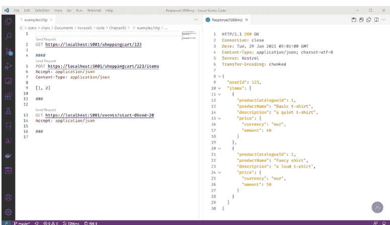
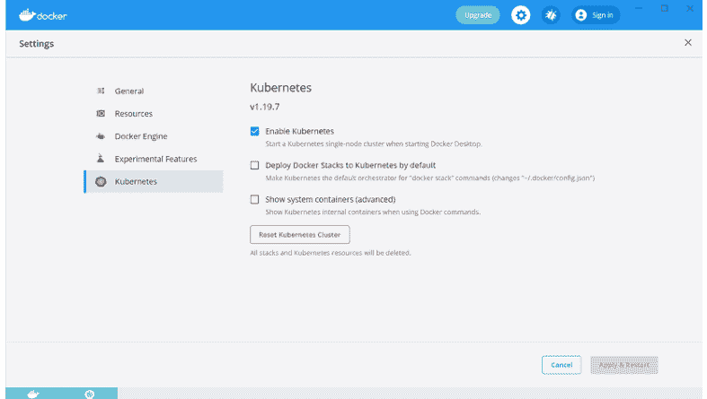
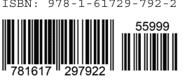

## appendix
## 附录
Development
environment setup

开发
环境设置

This appendix describes how to set up a development environment for working with the code you write throughout this book. The development environment has five parts:

本附录描述了如何设置开发环境，以便在整本书中编写代码。开发环境分为五个部分：

- *An IDE*—You can choose between using Visual Studio 2019 or newer, Visual Studio Code (VS Code for short), or JetBrains Rider. Visual Studio is Windows-only, whereas Visual Studio Code and JetBrains Rider both work on Windows, Mac, and Linux.
- *一个 IDE*——你可以选择使用 Visual Studio 2019 或更新版本、Visual Studio Code（简称 VS Code）或 JetBrains Rider。Visual Studio 仅限 Windows，而 Visual Studio Code 和 JetBrains Rider 都可在 Windows、Mac 和 Linux 上运行。
- *dotnet cli*—You need the dotnet command-line tool to build, create, build, and run .NET projects from the command line.
- *dotnet cli*——你需要 dotnet 命令行工具来从命令行构建、创建、构建和运行 .NET 项目。
- *REST client*—You need a tool for making HTTP requests. There are many such tools, including cURL, Fiddler, and Postman; I tend to use the REST client plug-in for Visual Studio Code, which I find easy to use, works on Windows, Mac, and Linux, and is compatible with the built-in HTTP request tools in JetBrains’ IDEs.
- *REST 客户端*——你需要一个用于发出 HTTP 请求的工具。有许多此类工具，包括 cURL、Fiddler 和 Postman；我倾向于使用 Visual Studio Code 的 REST 客户端插件，我发现它易于使用，可在 Windows、Mac 和 Linux 上运行，并且与 JetBrains IDE 中的内置 HTTP 请求工具兼容。
- *Docker and Kubernetes*—You need Docker installed to be able to build and run containers. Furthermore, you need Kubernetes on top of Docker to be able to work with Kubernetes deployments on the localhost.
- *Docker 和 Kubernetes*——你需要安装 Docker 才能构建和运行容器。此外，你需要在 Docker 之上使用 Kubernetes，以便在本地主机上使用 Kubernetes 部署。
- *Azure cli*—You need the Azure command-line tool to set up a Kubernetes cluster in Azure.
- *Azure cli*——你需要 Azure 命令行工具来在 Azure 中设置 Kubernetes 集群。

I’ll walk you through installing and getting up and running with the development environment in the following sections.

我将在以下各节中指导你安装并开始使用开发环境。

## A.1 Setting up an IDE

## A.1 设置 IDE

There are three IDEs I recommend you use with this book’s code. Which one you choose is a matter of taste; all work fine with everything in the book. I, for one,

我推荐你使用本书代码的三种 IDE。你选择哪一个是个人喜好问题；所有 IDE 都能很好地与书中的内容配合使用。我个人，


输入 dotnet。如果 dotnet CLI 已安装，你会收到 CLI 的帮助文本；如果没有，你会从 Powershell 得到一个错误。要安装 dotnet CLI，请访问 http://dot.net，点击 Download，并按照说明安装 .NET SDK。

## A.3 在 VS Code 中设置 REST 客户端

REST 客户端是一个面向文本的简单 VS Code 扩展，允许你发出 HTTP 请求（见图 A.1）。你在本书中会一直使用此类请求与微服务交互。除了简单之外，REST 客户端还有一个优点：它处理扩展名为 .http 的文本文件，因此很容易通过版本控制共享示例 HTTP 请求。你会在本书的代码下载和 GitHub 仓库中找到此类文件。此外，同样的文件在 Rider 中也能以类似的界面工作。



图 A.1 REST 客户端使用简单的 .http 文件。你可以通过点击 Send Request 发出请求，响应显示在右侧窗格中。

要安装 REST 客户端，请在 VS Code 中转到“扩展”选项卡，搜索 REST client，然后点击 Install。

## A.4 Docker 和 Kubernetes

在本书中，我使用 Docker 将微服务打包为容器，以便部署到生产环境，并使用 Azure 上的 Kubernetes 作为生产环境的示例。为了能够构建 Docker 镜像，你需要安装 Docker。安装了 Docker 之后，你可以运行和调试容器，但为了能像在 Azure 上一样运行容器，你还需要 Kubernetes。

如果你使用 Windows 或 Mac，你将使用 Docker Desktop；如果你使用 Linux，你将根据你的 Linux 发行版使用 .deb 或 .rpm 包。

要安装 Docker，请访问 https://docs.docker.com/engine/install/ 并按照适用于你的平台的说明进行操作。如果你使用 Windows，在安装 Docker Desktop 时应选择使用带有 Linux 容器的 WSL2 后端。Docker 安装完成后，你应该能够从 shell 中调用 docker CLI。

在 Docker 之外，你还需要 Kubernetes。如果你使用 Windows 或 Mac，Docker Desktop 已经捆绑了 Kubernetes，你只需在 Docker Desktop 设置中启用 Kubernetes，如图 A.2 所示。第一次会花费一些时间，因为 Docker Desktop 会下载、安装并启动 Kubernetes。



图 A.2 可以在 Docker Desktop 设置中启用 Kubernetes。

在 Linux 上，你必须单独获取 Kubernetes，并且有很多选择。一个简单的选项是 MicroK8S，你可以按照 https://microk8s.io/ 上的说明进行安装。安装完 MicroK8S 后，你可能想添加这个别名，以便轻松访问 Kubernetes 命令行工具：

```
> snap alias microk8s.kubectl kubectl
```

安装 Kubernetes 后，你应该能够从 shell 中调用 Kubernetes 命令行工具 kubectl。

## A.5 Azure CLI

在本书中，我使用 Azure 建立一个小的 Kubernetes 集群，作为生产环境的示例，将微服务部署到该集群。要跟随操作，你需要一个 Azure 账户和 Azure CLI。

要创建 Azure 账户，请访问 https://azure.microsoft.com/en-us/free/。要获取 Azure CLI，请前往 https://docs.microsoft.com/en-us/cli/azure/install-azure-cli 并按照适用于你的平台的安装说明操作。安装 Azure CLI 后，你可以在 shell 中运行 `az login` 将 CLI 登录到你的 Azure 账户。

现在你已经拥有 IDE、`dotnet` 命令行工具、用于处理 HTTP 请求的工具、Docker、Kubernetes 和 Azure CLI，可以开始编写本书中的所有示例代码了。

## 延伸阅读

## 微服务

Cramon, Jeppe. “微服务：重要的不只是规模，还在于如何使用它们”，第1-5部分。2014-2015. https://cramonblog.wordpress.com/2014/02/25/micro-services-its-not-only-the-size-that-matters-its-also-how-you-use-them-part-1/.

Fowler, Martin. “微服务先决条件.” 2014年8月28日. http://martinfowler.com/bliki/MicroservicePrerequisites.html. “单体优先.” 2015年6月3日. http://martinfowler.com/bliki/MonolithFirst.html.

Lewis, James 和 Martin Fowler. “微服务.” 2014年3月25日. http://martinfowler.com/articles/microservices.html.

Tilkov, Stefan. “不要从单体开始.” 2015年6月9日. http://martinfowler.com/articles/dont-start-monolith.html.

Newman, Sam. 《构建微服务：设计细粒度系统》. O'Reilly Media, 2015. “模式：前端的后端.” 2015年11月18日. http://samnewman.io/patterns/architectural/bff.

## 软件设计与架构概述

Beck, Kent. 《测试驱动开发：示例》. Addison-Wesley Professional: 2002.

Conway, Melvin E. “委员会如何发明？” Datamation (1968年4月). www.melconway.com/research/committees.html.

“纵深防御” 维基百科. https://en.wikipedia.org/wiki/Defense_in_depth_(computing).

Evans, Eric. 《领域驱动设计：软件核心复杂性应对之道》. Addison-Wesley Professional: 2003.

Forsgren, Nicole, Gene Kim 和 Jez Humble. 《加速》. IT Revolution Press: 2018.

Forgren, Nicole, Dustin Smith, Jez Humble 和 Jessie Frazelle. “2018年DevOps加速状态.” https://inthecloud.withgoogle.com/state-of-devops-18/dl-cd.html.

Fowler, Martin. “测试金字塔.” 2012年5月1日. http://martinfowler.com/bliki/TestPyramid.html.

________. “集成契约测试.” 2011年1月12日. http://martinfowler.com/bliki/IntegrationContractTest.html.

________. “控制反转容器和依赖注入模式.” https://martinfowler.com/articles/injection.html.

Freeman, Steve 和 Nat Pryce. 《测试驱动的面向对象软件开发》. Addison-Wesley Professional: 2009.

Hohpe, Gregor 和 Bobby Woolf. *企业集成模式：设计、构建和部署消息传递解决方案.* Addison-Wesley Professional: 2003.

Humble, Jez 和 David Farley. *持续交付：通过构建、测试和部署自动化实现可靠的软件发布.* Addison-Wesley Professional: 2010.

Martin, Robert C. “单一职责原则.” 2014年5月5日. http://mng.bz/RZgU.
“SRP：单一职责原则.” http://mng.bz/zQyz.

Nygard, Michael T. *发布！第二版：设计和部署生产就绪软件.* Pragmatic Programmers: 2018.

Vernon, Vaughn. *实现领域驱动设计.* Addison-Wesley Professional: 2013.

## 使用的技术

- ASP.NET: https://dotnet.microsoft.com/apps/aspnet
- Azure: https://azure.microsoft.com
- Azure Kubernetes Service (AKS): https://azure.microsoft.com/en-us/services/kubernetes-service/
- Dapper: http://mng.bz/7LHZ
- Elasticsearch: https://info.elastic.co/Getting-Started-ES.html
- Event Sourcing: https://www.eventstore.com/
- Kibana: www.elastic.co/products/kibana
- Kubernetes: https://kubernetes.io/
- .NET: https://dotnet.microsoft.com/
- NuGet 文档: http://docs.nuget.org
- OAuth: http://oauth.net/2
- OpenID Connect: http://openid.net/connect
- OpenTelemetry: https://opentelemetry.io/
- Polly 文档: http://www.thepollyproject.org/
- Scrutor: https://github.com/khellang/Scrutor
- Serilog: https://serilog.net
- xUnit: https://xunit.net/

协作（续）
  为忠诚度计划设置项目 112
  类型
    命令和查询 103–106
    事件 107–109
基于命令的协作 158
命令 112–116
命令通信风格 100, 102
复合应用模式 266, 268–269
复合应用 268–271
持续交付 12
ControllerBase 25, 114, 237
ControllerFeatureProvider 187
微服务的成本 14–15
create-aks.ps1 脚本 125
横切
  关注点 244–246
  可复用的微服务平台的构建 248–255
D
Dapper 139
数据格式 109–110
数据所有权和存储
  数据存储 130–131
  实现数据存储 139–154
    准备开发环境 140
    读取和使用缓存头 152–154
    在 HTTP 响应中设置缓存头 151–152
    存储微服务拥有的数据 141–145
    存储微服务触发的事件 145–151
在微服务之间划分数据 131–139
  数据所有权遵循业务能力 132–133
  为了提高速度和稳健性而复制 133–137
  微服务在哪里存储数据 137–139
DefaultHttpContext 类型 261
DELETE 端点 42, 101, 184, 291
DELETE 请求 42, 103
依赖注入 24
部署到 Kubernetes
  AKS（Azure Kubernetes 服务）65–72
  选择生产环境 55–57
  为购物车创建 Kubernetes 部署 62–65
  将购物车微服务放入容器 57–60
  运行购物车容器 60–62
  设置 Kubernetes 本地主机 60–62
开发环境设置 22
Azure CLI 297
Docker 和 Kubernetes 295–296
设置 dotnet 命令行界面 294–295
设置 IDE 293–294
  JetBrains Rider 294
  Visual Studio 294
  Visual Studio Code 294
在 VS Code 中设置 REST 客户端 295
Docker 293, 295–296
  为忠诚度计划的两个部分构建 Docker 容器 123–125
  构建特价优惠微服务的 Docker 容器 122–123
docker build 命令 123
docker CLI 296
docker stop 命令 59
Dockerfile 57–58
dotnet add package dapper 命令 142
dotnet build 58
dotnet cli 189, 293
dotnet 命令 120
dotnet 命令行工具 293–295, 297
dotnet new web -n HelloMicroservices 命令 23
dotnet new web -n ShoppingCart 命令 32
dotnet new xunit -n LoyaltyProgramUnitTests 命令 189
dotnet pack 251, 253
dotnet publish 命令 58
dotnet restore 58
dotnet run 23, 72, 175
dotnet ShoppingCart.dll 命令 58
dotnet test 187, 196, 203
微服务的缺点 14–15
E
支持工作效率 89–90, 98
最终用户应用 266–268
  通用应用 266–267
  专用应用 267–268
端点 23
  注入模拟 193–196
  使用 TestServer 和 HttpClient 进行单元测试 190–193
ENTRYPOINT 123
ETag 标头 134–135
事件订阅源，购物车微服务 48–52
  触发事件 49–50
  简单事件订阅源 51–52
  存储事件 50–51
事件订阅者组件 111


基于事件的合作 158
创建事件订阅者进程 120
实现事件源 117–120
订阅事件源 120–122
EventConsumer 120–121, 126–128
EventFeed 组件 48, 108
EventFeedController 52, 195–196
EventFeedEvent 类型 121
事件 100, 102, 107–109
暴露事件源 107–108
存储由微服务发出的事件 145–151
手动存储事件 146–149
使用 Event Store 数据库系统存储事件 149–151
订阅 108–109
EventStore 31–32, 34, 51, 53, 108, 139, 145–146, 148–151
ExponentialRetryPolicy 171

## F
故障 157–162
避免传播 161–162
故障处理策略，购物车微服务 46–48
日志 159–160
前滚 vs. 回滚 161
跟踪 ID 160
FakeEventStore 195

## G
GET 端点 39, 104, 116, 122, 189
GET 请求 36, 42–44, 46, 48, 65, 103, 108, 120, 216
绿地项目，用于微服务 15–16

## H
健康探针 226
/health/live 端点 215–218, 226
/health/startup 端点 215, 217–219, 226
HTTP 缓存头 134–136
HTTP 端点 23
HTTP GET 34, 39
实现 43–44
带有 的查询 116
HTTP POST 39, 113–116
HTTP 请求 225
HTTP 响应 151–152
HttpClient 43–44, 47, 171–172, 183–185, 190–192, 213, 225, 284, 286
HttpContext 255–256, 259–261
HttpResponseMessage 114

## I
IDE（集成开发环境），设置 293–294
JetBrains Rider 294
Visual Studio 294
Visual Studio Code 294
用户身份 236–238
IDisposable 186
IEventFeed 194
If-None-Match 头 134–135
IHealthChecks 254
ILogger 214, 220
IServiceCollection 37, 195, 286
ItemAddedToCart 事件 19

## J
JetBrains Rider 22, 294

## K
kubectl apply -f shopping-cart.yaml 227
kubectl 命令行 67, 126
kubectl config get-contexts 69
kubectl get all 命令 63, 71
kubectl get nodes 67
kubectl get pods 227
kubectl logs 228
kubectl proxy 命令 64
Kubernetes 21–22, 293, 295–296
部署到 122
AKS（Azure Kubernetes Service） 65–72
选择生产环境 55–57
为购物车创建 Kubernetes 部署 62–65
将购物车微服务放入容器 57–60
运行购物车容器 60–62
设置 Kubernetes 本地主机 60–62
在其中实现日志记录和监控 226–229

## L
库，测试 184–188
Microsoft.AspNetCore.TestHost 184–188
xUnit 185–188
数据局部性 131
日志记录
在 Kubernetes 中实现 226–229
结构化，实现 219–226
向所有日志消息添加跟踪 ID 222–225
记录未处理的异常 225–226

## M
max-age 指令 134–135
微服务模拟 180
MicroserviceNET.Logging 类库 249–251
MicroserviceNET.Logging NuGet 包 254
MicroserviceNET.Monitoring 类库 251
MicroserviceNET.Monitoring 包 248, 253–254
微服务
  .NET 微服务技术栈
    ASP.NET 和 MVC 21
    特征
      由小团队维护 10
      拥有自己的数据存储 9–10
    示例
      向项目添加 ASP.NET MVC 24
      添加带有端点实现的 MVC 控制器 25–26
    关于的延伸阅读 299
    使用原因 14
    处理用户请求 17–21
      完整视图 20–21
      用户请求的主要处理 17–18
      用户请求的副作用 19–20
MicroservicesNET.Logging 库 250
Microsoft.AspNetCore.TestHost 196
  概述 184–185
  与 xUnit 协同工作 185–188
  使用进行单元测试编写 188–196
    向端点注入模拟 193–196
    设置单元测试项目 189–190
    使用 TestServer 和 HttpClient 对端点进行单元测试 190–193
Microsoft.AspNetCore.TestHost NuGet 包 198
Microsoft.Extensions.Hosting 包 251
Microsoft.NET.Sdk.Web SDK 199
中间件 245
  测试 259–261
  编写 257–259
    作为 lambda 的中间件 257–258
    中间件类 258–259
镜像由其他微服务拥有的数据 136–137

MockHost 201
监控
  在 Kubernetes 中实现 226–229
  实现监控端点 215–219
    实现 /health/live 监控端点 216–217
    实现 /health/startup 监控端点 217–219
MsSqlStartupHealthCheck 253–254
多阶段构建 57
MVC 21
  向项目添加 ASP.NET MVC 24
  添加带有端点实现的 MVC 控制器 25–26

## N
.NET 微服务技术栈 21–22
  ASP.NET 和 MVC 21
  Kubernetes 21–22
  设置开发环境 22
网络控制器 239
noOp 261
NotImplementedException 175
NuGet 248–255
  创建日志记录包 249–251
  创建包含监控端点的包 251–255

## O
onclick 处理器 290
数据所有权。参见数据所有权和存储

## P
在微服务之间分区数据 131–139
  为速度和稳健性进行复制 133–137
    使用 HTTP 缓存头控制缓存 134–136
    使用读模型镜像由其他微服务拥有的数据 136–137
  微服务在哪里存储数据 137–139
构建基于微服务的应用程序模式 268–276
  API 网关 271–273
  BFF（后端 for 前端）模式 273–274
  客户端渲染 vs. 服务器端渲染 275–276
  复合应用程序 268–271
  何时使用每种模式 274–275
Polly
  带有断路器 171–172
  高速重试策略 170–171

POS（销售点系统）系统 78
POST 命令 104, 113
POST 端点 33, 101, 112, 122, 189, 279
POST 请求 103–104
ProductCatalogClient 32, 42, 44, 46–48, 153
ProductCatalogController 152
ProductList 操作 284
/productlist 端点 281–282, 284, 286
productlist 视图 282
ProductListController 281, 284, 289–290
PUT 命令 113–116
PUT 端点 101, 112, 122, 189, 192, 237–238
PUT 请求 103–104

## Q
查询 100, 102–106, 112, 116
基于查询的合作 157

## R
读模型 136–137
Receive Stock 微服务 4
RegisterUserAndGetNotification 202
RequestDelegate 255–256, 258–259
资源组 66
REST 客户端 293
重试模式 164–166, 170–171
可重用的微服务平台，构建
  ASP.NET 管道 255–257
  创建新的微服务应该快速且简单 244
  处理横切关注点 244–246
  概述 246–248
  使用 NuGet 打包和共享横切代码 248–255
    创建日志记录包 249–251
    创建包含监控端点的包 251–255
  测试中间件和管道 259–261
  编写中间件 257–259
    作为 lambda 的中间件 257–258
    中间件类 258–259
稳健性
  客户端负责
    断路器模式 166–168
    重试模式 164–166
  故障 157–162
    避免故障传播 161–162
    日志 159–160
    前滚 vs. 回滚 161
    跟踪 ID 160
  实现稳健性模式 168–176
    带有 Polly 的断路器 171–172

部署到 Kubernetes 176
带有 Polly 的高速重试策略 170–171
记录所有未处理的异常 174–176
低速重试策略 172–174
路由表 24
RPC（远程过程调用） 103

## S
微服务范围划定
  业务能力，作为主要驱动因素 76–82
    业务能力的定义 76–77
    良好微服务作为范围划定到业务能力的结果 97
    识别业务能力 77–78
    销售点系统示例 78–82
  范围不清晰，如果怎么办 90–96
    从现有微服务中划分出新微服务 94–96
    计划稍后划分出新微服务 96
    从更大开始 91–94
  支持工作效率，作为第三驱动因素 89–90, 98
  支持技术能力，作为第二驱动因素 83–89
    支持技术能力的示例 83–88
    良好微服务作为范围划定到技术能力的结果 97–98
    识别技术能力 88–89
    技术能力的定义 83
安全性
  认证用户 232–234
  授权用户 234
    实现 236–241
      访问忠诚度计划中的用户身份 236–238
      限制哪些微服务可以通信 238–241
  微服务之间的信任 235
Serilog 213–215
Serilog.Enrichers.Span 222
服务级测试
  概述 180–183
  编写 197–203
    创建模拟端点 198–201
    创建项目 198
    针对被测微服务执行测试场景 201–203
ServiceCollectionExtensions.cs 251
购物车微服务 276–291
  API 网关 279–281
  组件 31–32
  实现 32–52


- 购物车微服务（续）
  - 添加故障处理策略 46–48
  - 面向其他服务的 API 33–42
  - 基础事件流 48–52
  - 创建空项目 32–33
  - 获取产品信息 42–44
  - 解析产品响应 44–46
  - 让用户将产品添加到购物车 289–290
  - 让用户从购物车中移除产品 290–291
  - 概述 29–32
  - 产品列表 GUI 281–285
  - 运行代码 52–53
  - 购物车 GUI 286–289
- ShoppingCart 数据库 31, 141, 146–148
- ShoppingCart 领域模型 34–35
- ShoppingCart 项目 34, 45, 47, 142
- ShoppingCartController 34, 36–39, 41–42, 44, 220
- ShoppingCartStore 组件 31–32, 34
- SpecialOfferEvent 类型 121
- SQL Server 139
- SRP：单一职责原则 6
- 数据存储。参见“数据所有权与存储”
- 流式处理 109
- 订阅事件 107–109
- 支持性技术能力 83
- 系统级测试 179–180
- System.Diagnostics.Activity 类型 222
- System.Net.Http.HttpClient 类型 32
- T
- 技术能力
  - 定义 7, 83
  - 支持性技术能力示例 83–88
    - 与外部产品目录系统集成 83–85
    - 向客户发送通知 85–88
  - 良好微服务：范围限定的结果 97–98
- 测试金字塔 178
- TestController 185, 187
- TestController_should 构造函数 186–187
- TestHost 184–185
- 测试
  - 服务级测试 180–183
  - 系统级测试 179–180
  - 测试库 184–188
    - Microsoft.AspNetCore.TestHost 184–188
    - xUnit 185–188
- 单元级测试 183–184
- 要测试什么 178–179
- 编写服务级测试 197–203
  - 创建模拟端点 198–201
  - 创建项目 198
  - 对被测微服务执行测试场景 201–203
- 使用以下工具编写单元测试
  - Microsoft.AspNetCore.TestHost 188–196
  - 将模拟注入端点 193–196
  - 设置单元测试项目 189–190
  - 使用 TestServer 和 HttpClient 对端点进行单元测试 190–193
- TestServer 177, 182–185, 190
- .ToString() 函数 214
- 跟踪 ID
  - 将其添加到所有日志消息 222–225
  - 包含在出站 HTTP 请求中 225
- traceparent 头 213, 215, 222, 225
- U
- 压力之下 161
- 单元级测试
  - 概述 183–184
  - 使用以下工具编写单元测试
    - Microsoft.AspNetCore.TestHost 188–196
    - 将模拟注入端点 193–196
    - 设置单元测试项目 189–190
    - 使用 TestServer 和 HttpClient 对端点进行单元测试 190–193
- 用户身份 236–238
- 用户请求 17–21
  - 完整图示 20–21
  - 主要处理 17–18
  - 副作用 19–20
- userIdFromToken 238
- UsersController 114, 175, 193, 237–238
- UsersEndpoints_should 191–192
- V
- Visual Studio 22, 294
- Visual Studio Code 22, 294–295
- X
- xUnit
  - 概述 185
  - 与 Microsoft.AspNetCore.TestHost 协同工作 185–188

## MICROSOFT .NET/微服务

### .NET 微服务（第二版）

Christian Horsdal Gammelgaard

微服务架构连接了必须作为一个系统协同工作的独立组件。将 Docker 和 Kubernetes 等新技术与微软熟悉的 ASP.NET 框架和 Azure 云平台集成，使得 .NET 开发者能够高效地创建和管理微服务。

**.NET 微服务（第二版）**教你使用 ASP.NET 和 Azure 服务构建和部署微服务。它简明扼要地阐述了微服务架构，然后引导你完成几个真实项目，例如构建一个电商购物车。在这一全面修订的版本中，你将学习如何界定微服务范围、部署到 Kubernetes，以及监控、日志记录和安全性等运维注意事项。

### 内容提要

- 优化微服务以实现持续交付
- 设计微服务之间基于事件的协作
- 将微服务部署到 Kubernetes
- 在 Azure 中设置 Kubernetes

面向 C# 开发者。无需微服务经验。

**Christian Horsdal Gammelgaard** 是一名独立顾问，拥有 20 多年的项目构建经验，覆盖从大规模微服务系统到小型嵌入式系统的各类项目。

> “清晰呈现了最新的最佳实践。强烈推荐阅读。”
> —David Paccoud，Bioclinica

> “推荐给所有希望踏入微服务世界的开发者和软件架构师。”
> —Emanuele Origgi，Datas

> “这本书是学习微服务以及在 .NET 框架上实现的绝佳指南。”
> —Jeff Smith，Agilify Automation

> “文笔优美、简洁且全面。我手不释卷，绝对推荐。”
> —Tanya Wilke，Sanlam


注册此书印刷版即可免费获得所有电子书格式。
访问 https://www.manning.com/freebook


$59.99 / 加元 $79.99 [含电子书]



