## 第 1 章

## 获取 Azure 解决方案架构师专家认证


Azure 解决方案架构师专家认证是目前可用的其他 Azure 认证中较复杂/高级的认证之一。表 1.1 描述了它们的复杂程度。设想一个组织在 Azure 上创建并运行解决方案。通常，一组 Azure 开发人员助理将根据 Azure 解决方案架构师专家解释和设计的最佳云设计模式来编写代码并测试解决方案。

### 表 1.1 Azure 认证

| 级别 | Azure 认证 | 描述 |
|---|---|---|
| 100 | Azure 管理员助理 | 实现、监控和维护 Microsoft Azure 解决方案，重点关注安全性、网络、计算和存储 |
| 200 | Azure 开发人员助理 | 设计、构建/编码、测试和支持云应用程序和服务 |
| 300 | Azure 解决方案架构师专家 | 精通安全性、网络、计算和存储，能够设计在 Azure 上运行的解决方案的专家 |
| 400 | Azure DevOps 专家 | 精通管理流程、人员和技术的专家，用于持续在 Azure 上交付解决方案 |

Azure 解决方案架构师专家将设计并可能配置 Azure 平台上的安全性、网络、计算和存储。一旦应用程序完成编码和测试，并且平台准备好运行应用程序，Azure DevOps 专家将与所有相关方协作，将应用程序部署到平台。任何进一步的变更都将由 Azure DevOps 专家通过主动让关键利益相关者参与并遵守其流程来管理，并将使用多种可能的技术重新部署。最后，Azure 管理员助理将监控和维护已实现的 Azure 功能，这些功能由 Azure 解决方案架构师专家设计、Azure 开发人员助理开发、Azure DevOps 专家部署。

每个角色对于解决方案在 Azure 平台上运行的整体成功都扮演着重要角色。解决方案可以简单到 Azure Function，也可以复杂到跨多个区域/数据中心的多个虚拟网络运行的混合 Azure VM 规模集。要获得这一更高级别的 Azure 认证，资深 IT 专业人员必须认识到，尽管这些是四个独立的认证，但它们都在解决方案的设计、创建、部署和维护中发挥着各自独特的作用。

现在让我们讨论一下如何走上 Azure 解决方案架构师专家认证之路。

## 认证之旅

正如拉尔夫·沃尔多·爱默生所写：“人生是一场旅程，而不是目的地。”对于获得 Azure 解决方案架构师专家认证的方法来说，也是如此。你在使用和学习 Azure 功能过程中获得的经验才是你目标的真正意义，而不一定是认证本身。IT 专业人员即使不参加考试并获得认证，也可以成为设计 Azure 解决方案的专家。仅仅拥有认证固然值得称赞，但如果没有一路学到的知识和智慧，它又能代表多少价值呢？

与人生不同，人生的目的地可以通过可能无限多的经历和多个方向到达，而通往 Azure 解决方案架构师专家认证的道路则是简单的。以前，要成为经认证的 Azure 解决方案架构师专家，需要参加的考试是 AZ-300 和 AZ-301。正如你在图 1-1 中所看到的，这两门考试已于 2020 年 9 月退役。替代考试是 AZ-303 和 AZ-304。

图 1.1 Azure 解决方案架构师专家认证路径

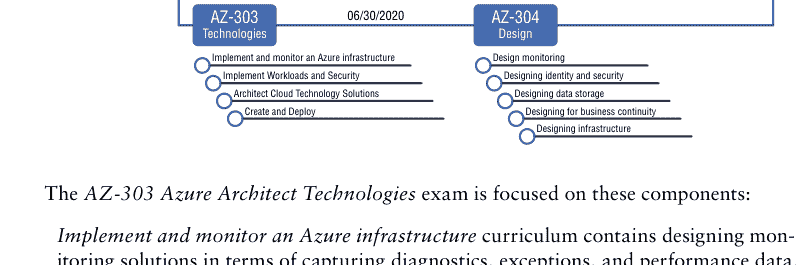

AZ-303 Azure 架构师技术考试侧重于以下内容：

“实现和监控 Azure 基础设施”课程包含设计监控解决方案，涉及捕获诊断、异常和性能数据。使用 Azure Monitor、Log Analytics 和 Application Insights 将提供一个存储和分析这些数据的地方。数据可以从 Azure Active Directory、网络、虚拟机、Azure 应用服务和数据存储产品等来源捕获。如何配置、存储和分析这些数据是你需要了解的内容。


Implementation of management and security solutions curriculum contains designing management solutions using tools like Update Management, Azure Backup, and Azure Migrate. Once your compute, data, and security products are provisioned, you need to know how to configure and support them. Additionally, proper security implementations with Key Vault, RBAC, and network appliances like Azure Firewall, Azure Front Door, and Azure Traffic Manager are also products and use cases you need to know.

Implementation of solutions for apps curriculum contains designing compute workloads using Azure App Service, Azure App Service Web App for Containers, Azure Functions, and Azure Kubernetes Service (AKS). You will need to know when to use these products and the benefits and constraints for choosing them.

Implementation and management of data platforms curriculum contains designing data stores like Azure SQL, Azure Cosmos DB, and Azure SQL managed instances. Each of them store data, and you need to know when to choose which one and how to configure them.

The AZ-304 Azure Architect Design exam is focused on these components:

Design monitoring curriculum contains designing monitoring with Azure Monitor and Azure Sentinel. Keep in mind that cost is always a factor and you need to know how to implement such solutions in the most cost effective manner. How to design and configure a monitoring solution include not only capturing and viewing, but also alerting and taking actions when an identifiable event takes place.

Designing identity and security curriculum contains designing security which is the most important aspect of computing today. Tools like Azure Active Directory (AAD), Azure Policy, and Azure Blueprint are helpful for managing and enforcing authentication. Additionally, concepts like multifactor authentication (MFA), Conditional Access, Single Sign-on (SSO), and Privileged Identity Management (PIM) are must-know concepts, not only what they are and how they are used, but also how to implement and monitor them.

Designing data storage curriculum contains designing the data stores for storing your application or big data. Learning about relational vs. non-relational data stores, Azure Data Factory, Azure Databricks, and Azure Synapse Analytics are necessary to clear this portion of the exam.

Designing for business continuity curriculum contains designing redundancy and failover solutions. Azure Backup and Azure Site Recovery (ASR) are the tools primarily used in this area. Concepts like retention policy, snapshots, and archiving must be known and not only understood, but implemented and monitored.

Designing infrastructure curriculum contains designing your compute, network, storage and messaging requirements. Almost every company has something unique about their IT applications. Knowing the internals of Azure VMs and Azure App Services and choosing which one best fits their requirements is a key knowledge element. Event Hubs or Service Bus are messaging products; why use which one? You need to know this and will learn it in this book. How to effectively implement and monitor all Azure products and features and the use case for each is best known by candidates taking this exam.

- Azure Active Directory, OAuth, and Managed Identity (MI)
- Backup and recovery techniques and Traffic Manager
- SSL/TLS certificates
- Hybrid Connection Manager, Azure VNet, and Azure CDN
- WebJobs
- Autoscaling

> A typical entry point into the Azure platform is based on where the company currently is at regarding its Azure consumption. In addition, the entry point depends on the role of the individual and the type of solution being created or migrated to Azure. This topic was discussed in the introduction, and you’ll learn more at the conclusion of this section.


The point is that using Azure and its many features is necessary to prepare for and ultimately pass the exam. Daily interaction and usage builds depth into many products, which usually results in the horizontal consumption of others.

## Read Azure Articles, Keeping Yourself Current

Once upon a time there was a saying in IT that “things change faster than the internet.” Having been part of that era, I confirm that the rate at which things changed, primarily for the better, was intense. Changes to hardware, changes to operating systems, and changes to products such as Internet Information Services (IIS), as well as the programming capabilities created to run on them, were all happening at once. Keeping up was a challenge, but there was the internet itself to search for ideas, tips, and solutions.

Not much has changed from an intensity perspective since then, but the saying mostly used today is that “we are moving at cloud speed” or “we are moving at the speed of the cloud.” Things are changing very fast still, and it is hard to keep up. The ability to stay current on all Azure features exceeds the capacity of a single human mind. Therefore, tools, teamwork, and logical groupings of information are necessary to have a chance of remaining current and relevant. It is possible to have Azure change notifications pushed directly to your email inbox. As shown in Figure 1.2, on GitHub it is possible to be notified based on specific scenarios.

Table 1.2 describes the scenarios.

**FIGURE 1.2 Possible GitHub notifications**

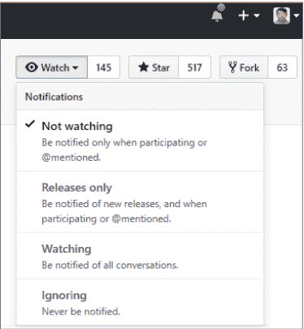

**TABLE 1.2 GitHub Change Notification Types**

| Type | Description |
|------|-------------|
| Not Watching | Be notified only when participating or @mentioned. |
| Releases Only | Be notified of new releases and when participating or @mentioned. |
| Watching | Be notified of all conversations. |
| Ignoring | Never be notified. |

For example, the Azure Functions host is open source and hosted on GitHub here:

```
github.com/Azure/azure-functions-host
```

If you would like to be notified of changes or conversations, then select the type of notification to receive. Additionally, to get notifications when announcements or changes occur to the Azure App Service environment, sign up here:

```
github.com/Azure/app-service-announcements
```

Many Azure features are hosted on GitHub and not only support the ability to be notified of changes but also allow people to contribute to the enhancement of the product.

A list of changes to all Azure features is stored here:

```
azure.microsoft.com/en-us/updates
```

A graphical representation is accessible here:

```
aka.ms/azheatmap
```

Additionally, a list of all Azure products is available here:

```
docs.microsoft.com/en-us/azure/#pivot=products&panel=all
```

Click the product of interest to get a great set of documentation for that specific product. Finally, here is a link to the official Azure blog:

```
azure.microsoft.com/en-us/blog
```

Here you can access and/or integrate an RSS reader to read new posts in your email client, for example. Each of these information sources will help you get into the flow of information required to remain current on Azure.

A final suggestion on how to remain current (or even be a little ahead) is to engage in private previews and in previews of new features being created for Azure. To engage in a private preview, you generally need to attend a Microsoft conference where new features get released, have someone inform you, or watch videos posted on Channel 9 that contain this information, for example. Not all private previews are open to the public, and sometimes joining is possible only through invitation from Microsoft product managers. If you are interested in working with private previews, attend a Microsoft conference to hear about them and ask for instructions on how to become engaged.

After a new feature leaves private preview, it enters the public preview phase, often known as *beta testing*. The feature becomes available on the portal, presented by its name followed by a “(Preview)” tag, similar to that shown in Figure 1.3.

**FIGURE 1.3 Typical Azure feature preview**

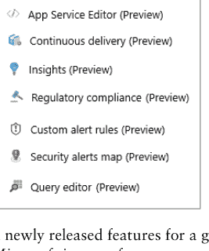

This is a manual way to find newly released features for a given product. It is at this point that it is fully open and Microsoft is eager for customers and users to test and provide feedback if nonintuitive scenarios are found or bugs are experienced. Finally, after testing is considered successful, the feature reaches “Generally Available” status and is fully supported by Microsoft Support. In many cases, products or features in preview are supported, because Microsoft wants you to test them and give feedback. However, a root cause solution for the issue is commonly not provided as part of the request, but a fix will come later.


重要的是 IT 专业人员不仅要紧跟新功能、产品和技术，还要了解已有的东西，并深入探究技术到底是如何工作的，一直到位层面。IT 专业人员需要在正向和反向两个方向学习；否则你可能会错过某个功能最初为何被创建的原因。

## 识别 Azure 产品名称、功能和功能特性

在你眼前经过并储存在潜意识中的产品和功能越多，回答某些类型问题的难度就越低。例如，假设在考试中向你提出以下问题：

- 以下哪些被视为 Azure Storage 产品或功能？（多选。）
- 
- A. Blob Storage
- B. Data Storage
- C. Queue Storage
- D. File Storage

如果你对 Azure Storage 账户有一定经验，你可能会记得 Azure Storage 账户支持多种服务类型。存储服务类型为 Blob、Files、Tables 和 Queue。基于该知识，可以确定选项 A、C 和 D 是正确答案。但你能确定没有名为 Data Storage 的 Azure 产品或功能吗？在考试期间你必须回想是否曾见过、听过或读过关于 Azure Data Storage 产品或功能的信息。你需要对选择正确答案有信心。事实上，在此上下文中并没有名为 Data Storage 的 Azure 产品或功能。你可以查看所有 Azure 产品以确认：

docs.microsoft.com/en-us/azure/#pivot=products&panel=all

继续沿着名称识别的思路，一旦你对存在的 Azure 产品类型积累了足够经验，下一步就是学习它们的作用以及用途。了解产品或功能的功能目的将有助于回答以下问题：

- 以下哪些 Azure 产品提供消息管理能力？（选择三个。）
- 
- A. Service Bus
- B. Event Hub
- C. ExpressRoute
- D. Queue Storage

Service Bus、Event Hub 和 Queue Storage 都是从端点接收消息以供后续处理的产品。ExpressRoute 并不是消息产品；相反，ExpressRoute 允许本地网络通过连接提供商使用专用链路连接到 Azure 云。因此，答案是 A、B 和 D。

总之，需要对绝大多数现有 Azure 产品和功能具备知识和经验。不知道存在哪些产品，就不可能知道它们的作用。知道存在哪些产品以及它们的作用，是获得 Azure Solutions Architect Expert 认证的必要条件。

## 努力对少数产品有深入了解、对许多产品有一定了解、对所有产品有基本了解

到目前为止，*product*（又称 service）和 *feature* 这两个词已被多次使用。它们之间存在细微差别。当使用 *product* 一词时，它指的是像 Azure Virtual Network、Azure App Service、Azure Web Apps 或 Azure SQL 这样的对象。产品是可以购买的；它是你在门户中点击 + Create A Resource 链接后选择的项目，如图 1.4 所示。

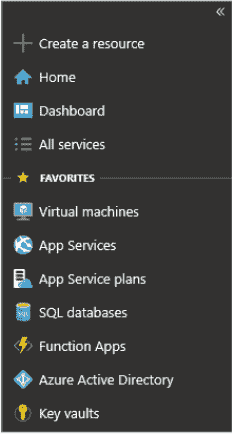

产品也在收藏夹部分中，同样如图 1.4 所示。

*Features* 另一方面，是可以添加到产品的附加的、通常是可选的能力。例如，建议将 Application Insights *feature* 与 Azure App Service Web 应用结合使用。此外，还有一个 Azure Search 功能，可与 Azure SQL 良好配合。备份不是产品，不能单独使用；它是一个绑定到特定产品的功能。并非所有功能都适用于所有产品；某些场景下并不合理，例如为 Event Hub 提供备份功能。其他功能如 Azure Function 的 SSL/TLS 或自定义域功能则非常合理。

从考试角度来看，广泛了解所有 Azure 产品和功能非常重要。以下列表显示了有多少产品属于不同的 Azure 类别：

- Compute (13)
- Networking (13)
- Storage (14)
- Web (7)
- Mobile (6)
- Databases (12)
- Security and identity (19)
- Containers (8)

这是一个需要理解的大量产品/服务数量，而且数量还在不断增长。推荐的做法是挑选几个你最感兴趣的产品（Azure VM、Azure App Service、Azure Functions、Azure Database、Azure Security 等）。然后，根据个人偏好，创建并配置这些产品并深入研究，成为它们的专家。体验这些产品如何相互交互并学习它们可用的所有功能。通过创建和配置 Azure 产品并将其与其他产品和功能集成而获得的知识，能够让你精通少数产品并对其他产品相当熟悉。

我从这里收集了之前的类别列表：
docs.microsoft.com/en-us/azure/#pivot=products&panel=all
该列表包含与 Azure Solutions Architect Expert 考试相关的 Azure 产品。你将在后面的章节中学习如何配置和集成一些 Azure 产品和功能。

不要认为通过 Azure 考试需要将所有产品和功能都了解到位。 然而，在安全、计算、网络和数据库类别中需要深入的知识。这在 Microsoft Certification 网站上的考试大纲中显而易见。

```
docs.microsoft.com/en-us/learn/certifications/exams/az-303
```

```
docs.microsoft.com/en-us/learn/certifications/exams/az-304
```

因此，深入学习少数产品，并对其他众多产品有所了解。你至少会被期望注意到如果一个产品被呈现为 Azure 产品但实际上不是。你就可以将其从可能的正确答案中排除。

接下来，阅读下一节中关于产品和功能的更多内容。这些是强烈建议详细了解的。

## “必知” Azure 功能简介

识别功能名称及其功能可以帮助你通过 Azure Solutions Architect Expert 考试。本节将更详细地讨论一些较为知名且常用的 Azure 产品。书中后面，你将有机会在更完整的场景中创建和使用这些产品以及众多其他 Azure 产品。

### Azure Active Directory 和安全

安全是 IT 解决方案最重要的方面之一。如果你无法管理访问并管理谁在系统上拥有何种权限，那么该解决方案很可能不会有太大价值。Azure 提供了许多产品和功能来帮助从安全角度创建、执行、维护和监控你的功能。

无论你是否意识到，当你开始使用 Azure 产品和功能时，创建的第一个重要产品就是 Azure Active Directory（AAD），有时也称为租户。你第一次设置 Azure 订阅时，会要求提供初始域名。该名称在 Azure 上必须是唯一的，并以 *.onmicrosoft.com 为前缀，其中 * 是创建者提供的唯一名称。租户必须始终发送到 AAD 以请求身份验证。

> Azure Active Directory 也可称为身份即服务。AAD 用于身份验证登录和身份保护。

让我们退一步，快速了解一下 AAD 是如何诞生的。第一个身份验证技术是简单的用户 ID 和密码数据存储。然而，这行不通，因为每个应用程序通常都有自己的数据存储，并且每个应用程序都需要一个账户。随着使用系统数量的增加，获取对应用程序的访问权限的维护和复杂性也随之增加。因此，创建了 Active Directory 概念，用于在中央全局位置存储所有企业用户凭据、用户配置文件和权限。（我们此时讨论的是企业身份验证，而不是私人用户账户。）Active Directory 工作得很好；所有使用集成 Windows 身份验证（IWA）实现的应用程序都可以登录到内网上的任何系统，而无需用户在从一个应用程序移动到下一个应用程序时多次登录。

由于典型企业的规模相对较小，与所有可能访问互联网的用户相比，Active Directory 在内部工作得很好。曾尝试为互联网创建全球身份验证提供商；然而，这些尝试都失败了。

Azure Active Directory 所做的是在 Azure 平台上提供相同的身份验证和授权功能。Azure Active Directory 租户可用于链接和身份验证软件即服务（SaaS）功能，如 Bing、Office 365 或 Dynamics CRM。此外，AAD 可以与本地 Active


通过目录同步，内部网络中的用户可以使用相同的凭据在 Azure 平台上运行的计算资源上进行身份验证。用于此同步的工具称为 Azure AD Connect，下一章将更详细地讨论它。

除了深入了解 AAD 之外，为了增加成功通过考试的概率，还有必要了解以下 Azure 安全功能和技术及其用例：

- Azure AD Connect
- 自定义域名
- RBAC（基于角色的访问控制）
- Key Vault（密钥保管库）
- Azure Active Directory 域服务
- 托管服务标识 (MSI)
- 共享访问签名 (SAS)
- AAD 条件访问策略
- AAD 域服务
- Azure 机密计算
- 多重身份验证
- 单一登录 (SSO)
- 安全中心
- 加密技术、静态数据、传输中数据
- 证书身份验证、SSL/TLS、证书颁发机构 (CA)
- 表单、令牌、OAuth、JWT 和声明身份验证技术

此列表不仅包含 Azure 上可用的产品和功能，还包含用于保护应用程序和资源的技术和模型。参加考试时，了解在给定场景下最适合使用哪种身份验证类型会很有帮助。此外，对这些工具的实际体验可以加深你对每种工具所带来的限制和约束的了解，从而有助于根据给定场景使用特定产品和功能做出良好的设计。更多细节、一些场景和练习将在后面的章节中介绍。

### 网络

使用任意 Azure 基础设施即服务（IaaS）或平台即服务（PaaS）产品，都会作为服务的一部分提供网络基础设施。Azure VM、应用服务或 Azure Functions 会被分配一个 IP 地址（内部和外部），在大多数情况下，该终结点会立即在全球范围内可访问。

请记住以下两个主题：

成本：尽管网络是作为服务提供的，但这并不意味着它是免费的。网络属性，例如公共 IP 地址、入站和出站的全球/区域流量。

与其他 Azure 计算产品相比，IaaS 可能需要更多的支持和维护成本。然而，由于 PaaS 产品存在功能缺失或约束，这些成本可能是合理的。

### Azure 应用服务

Azure 应用服务是微软的 PaaS 产品。这意味着，除了网络基础设施由云提供商负责之外，操作系统及其补丁更新也不再是客户需要担心的问题。Azure 应用服务有四种类型：

- Azure Web 应用/Web 作业
- 用于容器的 Azure 应用服务 Web 应用
- Azure 移动应用
- Azure API 应用

还有一种额外的类型——称为应用服务环境（ASE）的企业级应用。ASE 是仅属于创建它的客户的独立 Azure 应用服务租户。某些功能仅在 ASE 中可用，例如配置密码套件顺序。这个具体示例在公共应用服务租户中是有意义的，因为该租户中运行的所有客户可能都不希望按该顺序配置密码套件。

Azure 应用服务同时提供 Windows 和 Linux 操作系统，并支持绝大多数编程语言，包括微软和开源的编程语言，如 .NET Core、Java、Ruby、Node.js 等。所有类型的 Azure 应用服务都支持内置的自动缩放、负载均衡、与 AAD 和 OAuth 提供程序集成，以及通过与 Git、DevOps（原 Visual Studio Team Services [VSTS]）和 GitHub 集成实现强大的部署能力。

从 Azure Web 应用的角度来看，可以使用这些源代码存储库之一来托管自定义 Web 应用程序，或运行内容管理系统（CMS），如 WordPress、Umbraco、Joomla! 或 Drupal。Web 作业服务用于不需要 HTTP 连接从头到尾保持连接状态的较长时间运行的工作负载。可以将 Web 作业实例视为类似于批处理作业或小型程序，它在后台离线运行，由 cron 调度程序触发；这些称为触发的 Web 作业。Web 作业也可以是连续/AlwaysOn 的。在这种情况下，它们监视某种队列，当消息进入队列时，Web 作业对其执行某些操作。Web 作业还可以配置为单例，或设置为在应用程序的所有实例上运行。

容器允许你将应用程序的所有依赖项添加到一个包中。这包括应用程序/自定义代码、其二进制依赖项以及它运行的操作系统。这使得应用程序可以在许多平台上移植，因为所有依赖项都包含在一个可独立运行且功能完备的包中。

用于容器的 Azure 应用服务 Web 应用支持基于 Windows 和 Linux 的容器化应用程序。使用非容器化 Web 应用时，应用程序在沙箱中运行，这会带来某些限制。例如，写入注册表、访问事件日志、处理 COM 以及如前所述更改默认密码套件的顺序，在 Azure Web 应用沙箱中均不受支持。但是，你可以在用于容器的 Azure 应用服务 Web 应用实例中执行上述所有活动。在许多情况下，用于容器的 Azure 应用服务 Web 应用甚至比 ASE 更灵活。如前所述，作为设计人员和 Azure 架构师，你必须了解应用程序的要求以及你计划迁移所针对的产品的能力。你可以在 Visual Studio 中构建自己的容器，或者使用托管在 Docker Hub、Azure 容器注册表或 GitHub 上的现有容器。

Azure 移动应用曾被称为 Zumo，与 Azure Web 应用类似，但针对移动场景进行了优化。与数据源的简单集成、与多个身份验证提供程序的轻松集成，以及向移动设备发送推送通知的能力，都是 Azure 移动应用上应用程序的一些特定功能。由于移动应用通常在 iOS、Android 和 Windows 等多个操作系统上运行，因此专门创建了一个适用于此场景的跨平台 SDK。自动缩放、监视、负载均衡和其他基本功能在 Azure Web 应用和 Azure 移动应用之间是相同的。

最后，让我们看一下 Azure API 应用。不要将 Azure API 应用与本书后面讨论的 API 管理混淆。Azure API 应用是部署和创建 RESTful API 的最快捷方式。虽然这些应用不需要基础设施管理，但 Azure API 应用内置了对 Swagger 的支持。Azure Web 应用实例通常具有某种 GUI 或界面，供个人以某种方式与应用程序交互。API 应用实例没有可交互的 GUI 或页面；相反，它们是通常交换和处理 JSON 文档的终结点。

以下是 Azure 应用服务环境中需要了解的一些相关产品、功能和概念：

- 克隆
- Application Insights
- 备份
- 自定义域
- 托管标识
- SSL/TLS、应用服务证书
- 纵向扩展与横向扩展
- KUDU/SCM
- 跨域资源共享 (CORS)

Azure 应用服务是进入 Azure 平台的主要入口之一。该产品可以配置为利用几乎所有其他 Azure 产品和功能并与之交互。这是一个经济高效的产品，但请记住应用程序必须在其沙箱中运行；请在此处查看完整的产品列表：

```
github.com/projectkudu/kudu/wiki/Azure-Web-App-sandbox
```

在典型的非无服务器应用程序的单个函数/方法中。重点是，不要用大量工作负载使单个 Azure Function 过载。虽然它可以扩展，但可能无法按预期工作。相反，应将任何大型工作负载分解为较小的工作集，并使用 Durable Functions 模型实现它们。

## API 管理

Azure API 管理（APIM）是一个位于使用者和实际 API 之间的虚拟网关。你可以将 APIM 视为其他 API 前面的代理或网关，它会根据 URL 的参数和签名将请求路由到适当的 API。为什么要部署这个产品？APIM 提供以下好处：

- 可以向外部和内部使用者公开单独的 API
- 向使用者隐藏实际环境，从而减少复杂性和困惑
- 控制使用情况并限制消耗
- 包含监视功能和错误检测
- 可以连接互联网上的任意多个 API，并通过单个终结点公开它们
- 允许基于组的 API 访问控制

以下是 APIM 最有用的场景：

- 集成
- 混合解决方案
- 迁移

从集成的角度来看，假设两家公司已经合并；两家公司都有对其公司成功至关重要的内部和外部 API。再假设这些 API 中的每一个都公开不同的终结点，那么管理、记录以及知道使用哪个 API 和在哪里访问它可能变得比 API 本身更复杂。APIM 可以做的就是公开一个单一终结点，所有 API 都可以在此终结点上访问和管理。这大大简化了所有 API 的使用、管理和维护。

混合解决方案是指公司创建的产品依赖于本地和云中托管的组件。一些客户出于合规或法律原因希望或需要将某些内容或流程保留在内部。APIM 可以用作这些本地托管 API 和云托管 API 之间的网关。APIM 可以配置为在虚拟网络中运行；然后使用 VPN 或 ExpressRoute 配置虚拟网络以访问本地资源。如前所述，APIM 具有可靠的身份验证功能，并且可以直接在门户中相对简单地实现这些功能。

最后，设想一个场景：一家公司有一个 API 应用在 Azure 应用服务计划上运行。该 API 将有一个唯一的终结点供所有使用者访问，以便可以访问其用例。终结点的更改将要求所有使用者更新


他们的代码，这是一个很大的要求，有时甚至是不可能完成的，因此从一开始就避免这种情况是最优的。让 APIM 管理公司解决方案中对 API 的所有请求有助于应对这种情况。如果后端 API 端点需要更改，APIM 端点保持不变。通过 Azure 门户、PowerShell 或 CLI 对路由进行更改将导致迁移到新的 API 端点。

APIM 支持配置多种 API 类型，如表 1.3 所列。

表 1.3 Azure API Management 支持的 API 类型

| 类型 | 描述 |
|---|---|
| OpenAPI | 非语言特定但标准的 REST API 接口 |
| WADL | HTTP 基于 Web 服务的 XML 描述，RESTful |
| WSDL | HTTP 基于 Web 服务的 XML 描述，SOAP |
| Logic app | 可扩展和混合工作流管理，可视化 |
| API app | 使用 Azure App Service 产品托管的 API |
| Functions app | 事件驱动的无服务器计算，通过 Azure App Service 产品 |

以下是在 API 管理上下文中有帮助了解的其他主题：

- CA 证书
- 客户端证书
- OAuth 2.0
- 委派
- 自定义域
- 受管服务标识
- 虚拟网络

APIM 是管理公司和 IT 解决方案之间迁移和集成的有用产品。

## Azure Monitor

将应用程序或由众多应用程序组成的解决方案迁移到云提供商是一项需要考虑很多因素的重大决策。正确估算计算需求、配置安全配置以及将资源组织到可支持的组中只是需要牢记的几项内容。一个重要的考虑因素是如何监控解决方案并确保其在部署后保持可用性和性能。Azure 提供了名为 Azure Monitor 的产品正是为此目的。

Azure Monitor 包括 Log Analytics 和 Application Insights。结合起来，该功能支持对应用程序进行端到端监控，可以识别客户如何使用产品，可以定位瓶颈，甚至可以使用推荐分析器推荐一些操作来改善体验。Azure Monitor 结合了这两个产品的功能；或者，Log Analytics 和 Application Insights 也可以单独使用。

> 功能和术语会随时间变化。如需了解最新的 Azure Monitor 术语，请查看此页面：
> docs.microsoft.com/en-us/azure/azure-monitor/terminology

Log Analytics 将应用程序和诊断日志存储到基于 Azure Data Explorer 的可查询数据源中，Azure Data Explorer 是一种用于记录和存储遥测数据的高度可扩展服务。Log Analytics 部分是创建捕获数据的 workspace 并查询数据源以收集性能、用量和应用程序行为信息的接口。用于提取数据的查询语言称为 KUSTO，它相对简单且文档完善。

下面是一个示例，它扫描名为 Event 的表，该表存储通常在典型 Windows 服务器事件日志中发现的内容。此外，查询仅检索 EventLevelName 值为 Error 且来自一天前的记录。

```
Event
| where EventLevelName == "Error"
| where TimeGenerated > ago(1d)
| summarize count() by Source
```

另一方面，Application Insights 更偏向于指标驱动。它代表在给定时间范围内对一组数据进行图形化计算。计算的结果是一个显示值的图表。例如，如果创建一个图表来按天显示特定产品的可用性，则图表将显示 0% 到 100% 的可用性。Application Insights 提供了出色的图表功能，可在名为 Metrics Explorer 的产品中找到，用于监控 Web 应用程序的可用性、性能和用量。Application Insights 可以监控托管在 Azure 上和本地的应用程序。

除了绘制指标数据外，Application Insights 还可以触发警报，可以使用基于 PerfView 的分析器查找代码执行中的瓶颈，并可以构建应用程序映射，识别不同 Azure 产品之间的依赖关系。

总之，Azure Monitor 是之前产品 Log Analytics 和 Application Insights 的向前名称。了解 Azure Monitor 中包含的功能是一项巨大的资产。从不同产品中提取数据，使用 KUSTO 查询该数据，将数据绘制成图表以定义性能指标，基于捕获的数据发送警报，以及查找构成解决方案的不同产品之间的依赖关系，这些都是影响深远的功能。

### Azure SQL

Azure SQL 是 Microsoft 的数据库即服务（DaaS）产品。它提供数据存储，允许您在无需成为数据库管理员（DBA）的情况下配置和优化数据，并消除了管理数据库运行的服务器的要求。

将数据放入 Azure 平台上的关系数据库需要四个基本活动：

- 创建数据库
- 配置安全
- 迁移数据
- 监控数据库

有两种场景允许在 Azure 平台上使用 SQL Server 数据库：

- Azure SQL Database
- SQL Server on an Azure virtual machine

Azure SQL Database 提供以下选项：

Single Database  单数据库选项是在 Azure SQL Database 实例内运行的数据库，但具有自己的资源，并且可使用 SQL Database 服务器进行管理。单数据库是新应用程序希望从小处着手然后随着使用量增加而扩展的典型切入点。在选择弹性池时，客户将拥有多个数据库，每个数据库都驻留在同一个 Azure SQL Database 服务器上。然而，预测每个数据库所需的容量是未知的或过于复杂。弹性池通过让平台在定义预算内为每个数据库提供性能容量（弹性）来帮助解决该问题。

Elastic Pool  弹性池与单数据库一样，使用数据库事务单元（DTU）定价模型计费，或弹性池的 eDTU。DTU 是 Azure SQL 团队创建的术语，用于衡量读取、写入、CPU 和内存消耗。分配给单个或弹性池的 DTU 数量由所选服务层决定，例如 Basic、Standard 或 Premium。你付得越多，得到的 DTU 越多；就这么简单。

Managed Instance  受管实例的价格不是使用 DTU 模型计算，而是使用基于 vCore 的购买模型。该模型很简单，与本地 SQL Server 数据库的价格计算方式类似。该产品与本地 SQL Server 安装的复制品一样接近，同时仍可获得 DaaS 的好处。


> 关系数据库（RDBMS），如 SQL Server、Oracle 和 Azure SQL，将数据组织成由列和行组成的表。每一行通常都有一个主键，该主键可以是一个或多个其他相关表的外键。可以使用结构化查询语言（SQL）访问这些表中的数据。

在不幸的情况下，如果本地 SQL Server 安装存在依赖项或要求，阻止使用任何 DaaS 产品，Azure 提供了在虚拟机上运行 SQL Server 的选项。在这种情况下，您只需选择配置（SQL Server 和 Windows 版本）并确定许可协议和虚拟机的大小。从那时起，它与您自己的本地 SQL Server 实例在 IaaS 上运行的流程相同。

对于安全，Azure SQL 提供了防火墙设置功能。默认情况下，所有 Azure 资源都通过防火墙，而所有外部 Azure 的其他资源（基于 IP 确定）不允许通过。Azure SQL 数据库不在虚拟网络中，并且具有全局可访问的端点。Azure SQL 目前确实支持连接到虚拟网络，但它并不存在于其中。名为 VNet Service Endpoints 的产品改变了这一点，但截至本文撰写时，它仍处于预览中。全局可访问的端点是一些客户关注的点，VNet Service Endpoints 预计将解决此问题。如果全局端点是阻碍因素，那么选项就是强防火墙设置或可以包含在 VNet 中的 Azure 虚拟机上的 SQL Server。

一旦所需的数据库类型已配置，下一步就是将数据迁移到其中。可用工具基于所选数据库类型。对于单池和弹性池，使用数据迁移助手（DMA）确认源数据库与目标数据库兼容。确认后，导出源数据库，生成 BACPAC 文件。使用 Azure 门户或 SqlPackage 将该文件导入目标数据库。此过程不适用于迁移生产数据库，因为可能会有长时间停机。要移动生产数据库并减少停机时间，请使用数据迁移服务（DMS）。

将数据迁移到受管实例或 Azure 虚拟机上的 SQL Server 实例的过程与本地安装相同。首先使用 DMA 识别并解决任何冲突；然后使用本机 SQL Service 还原功能，通过 BAK 文件将数据迁移到 Azure。

一旦数据库已配置、安全并填充了数据，监控/优化它就是下一步也是最后一步（当然不包括维护）。以下是能够监控 Azure SQL 数据库的众多产品和工具。请注意，监控和调整 Azure 虚拟机上的 SQL Server 实例与本地 SQL Server 和 IaaS 相同（通过 Log Analytics）。

- Query Performance Insights
- Query Store
- XEvents

设置 Azure SQL 数据库快速而简单。连接字符串很容易找到，并且由于端点是全局可访问的，因此从代码中连接到它也同样快速。


请记住，需要对连接数据库的客户端（例如，你的开发工作站）的 IP 地址进行白名单设置。否则，将无法访问。

### Azure Cosmos DB

与属于关系型数据库管理系统的 Azure SQL 不同，Azure Cosmos DB 被归类为 NoSQL 数据库。Cosmos DB 包含由众多 API 公开的数据库、容器和项。在为应用程序选择数据存储时，如果以下场景与数据存储需求相匹配，那么 Azure Cosmos DB 将是最佳选择：

-   使用键/值对
-   需要文档存储能力
-   图数据存储
-   全局复制数据
-   以 JSON 格式提供结果
-   使用 RESTful API 公开数据

MongoDB API 之于 Cosmos DB，就如同 ADO.NET 之于 Azure SQL/SQL Server。Cosmos DB 兼容 Mongo API、Cassandra API、Gremlin API 和 Etcd API。因此，当前使用这些数据库的任何解决方案都可以在无需任何更改的情况下迁移到 Cosmos DB。这使得客户无需重写解决方案即可获得诸如 99.999 SLA 和全球可用性等优势。

从 Azure 预配 Cosmos DB 时，需要选择的一个必需属性是 API，它同时也决定了要实现哪种数据库类型。目前支持的 Cosmos DB 类型如下：

-   核心（SQL）
-   MongoDB
-   Cassandra
-   Azure 表
-   Gremlin（图）

数据库/API 决定了实体类型，称为*容器*；参见表 1.4。

### 表 1.4 Azure Cosmos DB 容器实体

| 数据库/API | Azure Cosmos DB 容器 |
|---|---|
| 核心（SQL） | 集合 |
| MongoDB | 集合 |
| Cassandra | 表 |
| Azure 表 | 表 |
| Gremlin（图） | 图 |

表 1.5 描述了 Azure Cosmos DB 如何指代项。

### 表 1.5 Azure Cosmos DB 项实体

| 数据库/API | Azure Cosmos DB 项 |
|---|---|
| 核心（SQL） | 文档 |
| MongoDB | 文档 |
| Cassandra | 行 |
| Azure 表 | 项 |
| Gremlin（图） | 节点或边 |

实现 Cosmos DB 时存在一些术语上的障碍，但这对所有类型的技术及其相应功能来说都很常见。图 1.5 展示了表 1.5 中列出的数据库帐户、数据库、容器和项实体之间的关系。

本节的要点是，你应该理解在哪些场景下会选择使用 Cosmos DB，以及它与关系型 DBMS 相比有何不同。主要而言，Cosmos DB 通过 RESTful API 公开其数据，以 JSON 格式进行通信，并且默认情况下是平台无关的。

### Azure 存储

没有存储，你能做的事情非常有限。无论是否在云中运行工作负载，这一点都成立。虽然可以将大量内容存储在内存中，但那些内容必定来自某个物理位置。Azure 存储提供了一些有用的功能，用于存储可全球访问、安全、可扩展且持久的内容。

### 图 1.5 数据库帐户关系

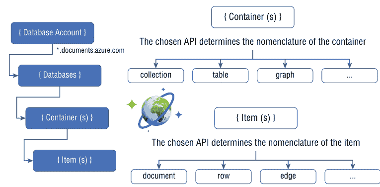

Azure 存储提供四种数据服务，如表 1.6 所述。

### 表 1.6 Azure 存储服务

| 类型 | 描述 |
|---|---|
| Azure Blob 存储 | 适用于二进制和文本数据的可扩展对象存储 |
| Azure 文件存储 | 托管文件共享 |
| Azure 队列存储 | 消息存储和队列 |
| Azure 表存储 | NoSQL 数据存储，现为 Cosmos DB 的一部分 |

要使用 Azure 存储，你必须首先通过 Azure Portal、REST API、CLI 或 ARM 模板创建存储帐户。创建帐户后，在门户中你将看到类似图 1.6 所示的内容。

### 图 1.6 创建存储帐户

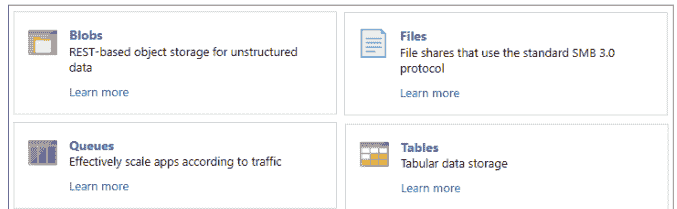

在单个存储帐户中，可以拥有每种服务类型的多个实例。
*Blob* 通常是一个文件，例如，图像、视频或音频文件。这些文件以及任何其他文件类型都可以存储在 Azure Blob 存储中。以下是 Azure Blob 的一些常见用途：

-   支持从网站上传大文件。
-   备份和恢复、归档或灾难恢复。
-   写入日志。

有众多理由支持从网站上的表单上传文件。以 YouTube 为例，它支持上传非常大的文件——这些文件如此之大，以至于为上传建立的 HTTP 连接很可能在数据传输完成之前就超时。在这种情况下，使用 System.Web.UI.WebControls.FileUpload 类并不是一个选项。相反，人们会使用 Microsoft.WindowsAzure.Storage.Blob.CloudBlobClient，并将大文件上传到专门为此目的设计的 Azure 存储 Blob 容器中，而不是直接将其存储在运行应用程序的硬盘上。

对数据库或网站执行备份，并将 IaaS 实例的 VHD 映像作为块 Blob 存储以便快速恢复，也是 Blob 的常见场景。在发生灾难时，从 Blob 中提取数据、内容或映像是一种可行的恢复策略。如果需要将日志暴露给某个其他实体，将日志写入 Blob 文件就非常有意义。例如，访问 IIS 日志通常需要访问服务器，然后手动合并它们。可以配置 Azure App Service 将 IIS 日志写入 Blob 的存储容器。这样，访问/分析它们就会更加高效，因为日志位于单一位置且可全局访问。

在此上下文中，需要了解的重要主题如下：

-   本地冗余存储（LRS）
-   区域冗余存储（ZRS）
-   异地冗余存储（GRS）
-   读取访问异地冗余存储（RA-GRS）
-   静态加密
-   不可变 Blob
-   页 Blob 和块 Blob

Azure 文件存储与我们通常所说的使用服务器消息块（SMB）协议的*文件共享*有些类似。在历史上，在 Windows 资源管理器中，当你右键单击文件夹并选择“共享”时，所有被授予访问权限的人都可以读取、写入和/或删除该目录的内容。然而，这种情况仅限于内网中的用户。诚然，有一些通过 IIS 使用 WebDav 的配置可以从外部访问内部共享。但是，这种配置的配置和维护可能很复杂。Azure 文件简化了这一点，它提供了与上述操作在全球范围内所期望的相同映射能力。

将驱动器映射到 Azure 文件共享在 Windows、Linux 和 macOS 上均受支持，可通过 PowerShell cmdlet `net use`、`sudo mount` 或 `mount_smbfs` 进行配置。Azure 文件共享可通过 `*.file.core.windows.net` 进行全球访问，其中 `*` 是你的存储帐户的名称。最后，微软自身的产品也在使用 Azure 文件；其中一个是 Azure Functions。

Azure 队列存储非常重要，将在本书后面更详细地讨论。在决定消息传递和队列解决方案时，需要考虑很多因素，而且由于微软提供了众多消息传递功能，这并不会变得更简单：

-   Azure 队列存储
-   Azure 事件网格
-   Azure 事件中心
-   Azure 服务总线

每种服务都提供类似的功能，具体来说，就是消息传递/排队能力，但每种服务都有其特定的用例，这也证明了它们存在的合理性。Azure 队列专门设计用于存储消息，例如，一条不超过 64KB 的短字符串，可通过经过身份验证的 HTTP 或 HTTPS 调用进行访问。该消息可以是指向某个文件的（Blob URL）位置，该文件需要由 WebJobs 离线处理，也可以包含要生成的图像大小等详细信息。因此，当你需要存储整个文件时，应使用 Azure Blob；当你需要存储消息时，应使用 Azure 队列。

> **注意** LRS、ZRS 和 GRS 冗余同时适用于 Azure Blob 和 Azure 队列。

如前所述，Azure 表存储现在是 Cosmos DB 的一部分。无论重新分类如何，Azure 表仍然是 NoSQL 数据存储。该数据存储接受经过身份验证的全局访问，最适用于存储海量数据（TB 级），且这些数据不受复杂存储过程、联接或外键的约束。同样，微软通常拥有多种提供类似功能的产品，在这种情况下，就是 Azure SQL 和 Cosmos DB。这两种产品都为特定用例提供了解决方案。

你选择用于存储对象的产品——无论对象是文件（Blob 或文件）、消息还是 NoSQL 实体，并由你所委托的计算能力进行处理——都涉及许多设计考虑因素。深入理解你的业务需求/用例，是决定选择哪种存储解决方案的基础。

## 服务总线

服务总线是上一节关于 Azure 存储时提到的消息传递功能之一。你当然还记得，Azure 存储的四种服务之一是 Azure 队列存储，这自然引出一个问题：为什么既有队列，又有甚至四种消息传递功能？服务总线拥有明确且定义好的独特功能集合。


如果以下内容符合您解决方案的定义要求，那么 Service Bus 就是正确的选择，因为它们目前是 Service Bus 独有的：

- 批量消费消息
- 需要 AMQP 1.0 支持
- 保证 FIFO
- 限制消息大小：大于 64KB 且小于 256KB
- 需要 RBAC 以及对发送方和接收方更强的控制
- 支持高吞吐量和并行处理
- 将队列大小限制在小于 80GB

Service Bus 和 Event Hub 都使用以 sb:// 开头的协议映射到 *.servicebus.windows.net 的主机名。这意味着它们是建立在彼此之上的。表 1.7 总结了消息服务，应有助于在其他 Azure 消息服务中选择 Service Bus。

### 表 1.7 Azure 消息服务

| 类型 | 何时使用 | 目的 |
|---|---|---|
| Service Bus | 金融处理和订单处理 | 高价值消息 |
| Event Grid | 状态变更反应 | 响应式编程 |
| Event Hubs | 数据流和遥测 | 大数据管道 |

Service Bus 可以分为两个不同的实体。

- 队列（本章前面已解释）
- 主题和订阅

在创建 Service Bus 命名空间后，可以选择创建 Service Bus 队列或主题，如图 1.7 所示。

### 图 1.7 创建 Service Bus 队列或主题

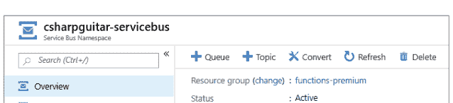

Service Bus 队列中的消息可以由单个消费者处理。消费者可能是一个 Azure Functions 应用或 WebJobs 应用，这是一种一对一的关系。我知道你已经知道主题和订阅提供了什么。你猜对了——它是一种一对多的通信形式。我们在这里谈论的是高容量——大数据、机器学习规模，消息会提供给注册到特定主题的每个订阅。

将消息映射到订阅对于扩展计算资源很有用，以便多个实例/服务/消费者可以在消息到达队列时尽快处理消息。就像一个较旧的产品 Stream Analytics 一样，Service Bus 消息可以使用过滤器进行分析并发送到特定订阅者，该订阅者执行预期、精细或独特微妙的代码序列。Azure 消息功能创建者对许多用例进行了深入思考，并渴望了解您遇到的任何没有预留的用例。选择符合需求或业务要求的那个。

## Site Recovery

即使解决方案已迁移到云中，灾难恢复解决方案仍然是必要的。通常只有在发生意外情况后才会意识到恢复计划的必要性。该计划通常被称为 *业务连续性和灾难恢复 (BCDR) 策略*。一些故障可能是会自行纠正的简单瞬态问题，而另一些则可能导致严重的停机。在最坏的情况下，数据或源代码丢失，有时无法恢复。

不应期望仅仅因为解决方案存在于云中就存在内置冗余和备份。Azure 平台上确实有一些内置冗余——请确定这一点——但这些是为了平台和基础设施的稳定，而不是为了您的应用。问自己这个问题，“微软怎么会知道解决方案的哪些部分应该或不应该备份？” 答案是微软无法知道这一点；客户有太多不同的要求，而备份的存储和冗余的配置是有成本的。备份不是默认提供或免费的。

BCDR 策略的设计由各个订阅实体负责。记住，该策略应专门匹配订阅实体的明确要求，并在其给定的成本限制内运行。为了帮助不仅恢复基于 IaaS 的解决方案，还帮助其迁移和在 Azure 内部和外部的移动，微软提供了一个名为 *Site Recovery* 的产品。请注意，Site Recovery 专注于 IaaS。BCDR 策略的其他非 IaaS 组件将在本书后面讨论。您需要深入了解该产品以通过 Azure 解决方案架构师专家考试。

从恢复角度来看，Site Recovery 在以下场景中保护 IaaS 解决方案：

- Azure VM
- 物理服务器
- VMware 虚拟机
- Hyper-V 虚拟机

从 BCDR 角度来看，使用 Site Recovery 有两种主要配置：

- 作为您本地解决方案和服务器的 BCDR 解决方案
- 作为您 Azure 主机 IaaS 计算工作负载的 BCDR 解决方案

为公司在自有资金和维护的数据中心运行的服务器设置 BCDR 策略是常见做法。这很昂贵，因为虽然服务器在同一数据中心时可以获得一些故障转移支持，但如果整个数据中心发生中断会怎样？关键是，要实施真正的企业 BCDR 策略，您需要两个数据中心，硬件、软件和数据的镜像复制，并且它们必须位于不同区域。公司可以利用 Azure 代替建立第二个数据中心。连接、创建、复制和维护 Azure BCDR 环境可以通过任何安全方式进行，例如 ExpressRoute 或类似图 1.8 所示的 VPN。

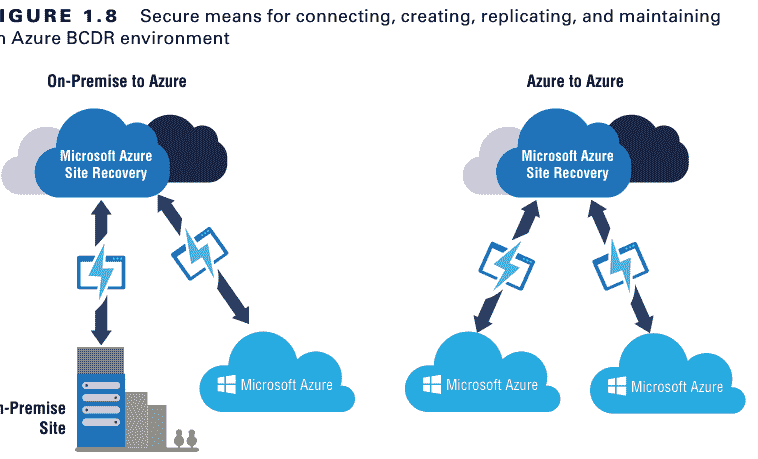

此外，在 Azure 的单个数据中心运行可能会创建一个对自然或数据中心范围中断极度脆弱的高可用性解决方案。因此，通过使用 Site Recovery，您可以构建与两个 Azure 区域分散数据中心之间存在的相同本地到 Azure BCDR 策略。

一个名为 *Site Recovery Deployment Planner (SRDP)* 的工具有助于构建 BCDR 实例的规划部分，或将 IaaS 虚拟机从一个区域迁移到另一个区域。SRDP 对以下属性提供兼容性评估报告，例如：

- 磁盘数量、磁盘大小、IOPS、操作系统版本
- 存储类型、核心数量、虚拟机大小建议
- 估计成本

没有 BCDR 计划的 IT 解决方案不是完整的解决方案，无论解决方案是完全本地托管、是本地到 Azure 的混合解决方案，还是完全托管在 Azure 上。在最后两种场景中，Site Recovery 可以帮助创建 BCDR 计划并协助从 IaaS 到 Azure 的迁移。

#### Azure Bastion

对 Azure IaaS 计算资源之一进行远程连接通常使用 RDP 通过端口 3389 或 SSH 通过端口 22 进行。默认情况下，当您从公司或家中连接到这些机器时，连接会穿越互联网。如果您不希望到机器的连接穿越互联网，您可以改为从 Azure 门户内部使用 Azure Bastion 访问控制台。这样，连接将通过端口 443 从 Azure 门户内部到机器进行。该 Azure 产品使连接到您配置的 Azure 计算更加安全。

## 摘要

本章为获得 Azure 解决方案架构师专家认证的道路提供了起点。请确信，如果您已经对本章涵盖的 Azure 产品感到舒适，您现在需要的只是一些额外的动手实践和一些测试题来将大脑神经元连接到这项 Azure 知识。

下一章将介绍如果您计划将组织迁移到云中应采取的方法，从创建订阅、设置安全和访问开始，然后决定使用哪些计算和存储资源。最后，实现一些管理功能以帮助过渡，例如监控，并不要忘记 BCDR 策略。您将在每个场景中创建、配置和监控，因此准备好让您的双手和大脑动起来。


## 考试要点

**确保你走在正确的 Azure 学习道路上。** Azure 有很多条认证路径。请确保你选择最适合自己职业目标的那条路径。Azure Solutions Architect Expert 认证适合系统管理员或系统架构师，而更偏重开发的人员则可以考虑 Azure Developer 或 Azure DevOps Engineer 认证。

**获取 Azure 实战经验。** 要通过这门考试，你需要拥有平台的实际操作经验。不要指望单靠任何书籍或培训就能过关，你必须花一定时间在平台上实践。如果做到了这一点，那么该项认证对你和其他人而言都会更有价值。

**订阅在线资源，保持知识更新。** Azure 平台在不断变化，你需要每天持续学习才能保持技能不落伍。以下是一些值得定期阅读的热门资源：

```
azure.microsoft.com/en-us/blog
blogs.technet.microsoft.com/blog/tag/azure
docs.microsoft.com/en-us/azure
```

**了解 Azure 中有哪些产品。** 有时候，问题的答案选项中会包含一些并非 Azure 的产品。它们看起来很像 Azure 产品，但实际上不是。了解真正可用的产品有助于你在一些题目中至少排除一个可能的答案。

**你需要深入了解至少一个 Azure 产品，熟练掌握大量产品，并对所有产品略有了解。** 没有人是全知全能的，但你可以在一个或两个 Azure 产品及功能上成为专家。这些产品及功能通常与其他 Azure 功能存在联系或依赖关系，这样一来，你也能学习到一些相关的内部细节。有些产品与功能之间并不直接关联。例如，Azure Cognitive Services 与 Azure VNet 之间就没有直接关系，但至少了解它们各自能提供哪些基本益处仍然是非常有用的。

**重点关注某些产品。** Azure Solutions Architect 考试侧重于 Azure Active Directory、网络、计算（尤其是 IaaS）以及从本地环境迁移到 Azure。请确保你对这些产品及功能及其限制有很好的理解。做到这一点，你就能最大限度地提高通过考试的几率。

## 关键术语

- Azure AD Connect
- Azure 管理员助理
- Azure 数据资源管理器
- Azure 开发人员助理
- Azure DevOps 专家
- Azure 解决方案架构师专家
- 构建和部署应用程序
- 业务连续性和灾难恢复（BCDR）策略
- 配置和部署基础设施
- 数据迁移助手（DMA）
- 数据迁移服务（DMS）
- 设计数据解决方案
- 设计基础设施策略
- 设计连续性和恢复方案
- 设计迁移、部署和集成方案
- 设计安全性和标识方案
- 确定工作负载要求
- 为云而开发
- 错误
- 事件
- 实现安全性和身份验证
- 实现安全性和工作负载
- 指标浏览器
- PerfView
- 平台即服务（PaaS）
- 产品
- Site Recovery
- Site Recovery 部署规划器（SRDP）

## 复习题

许多问题可能有多个正确答案。请选择所有正确的答案选项。

1. 你可以实施以下哪项安全功能来保护 Azure App Service 免受未经授权的互联网访问？（选择两项。）
A. Azure Active Directory
B. 基于角色的访问控制（RBAC）
C. 托管标识
D. 单一登录（SSO）

2. 当选择计算资源来执行你的工作负载时，Azure 有哪些选项？（选择两项。）
A. Azure 虚拟机
B. Azure ExpressRoute
C. Azure Functions
D. API 管理

3. 自定义域可绑定到以下哪些 Azure 产品？（选择所有适用项。）
A. Azure App Service
B. Azure 存储帐户
C. Azure 虚拟机
D. Azure SQL

4. Azure 存储由以下哪些服务类型组成？
A. Blob
B. 队列
C. 文件
D. 仅 A 和 B

5. 你需要决定最具成本效益的 Azure 存储冗余解决方案，并且必须将数据存储在多个数据中心。你会选择以下哪项？
A. LRS
B. ZRS
C. GRS
D. RA-GRS

12. 什么是多重身份验证？
A. 用户 ID 和密码
B. 你知道的信息和你拥有的物品
C. 客户端证书和 PIN 码
D. Windows Hello 企业版

13. 哪个产品最有助于监视 Azure 解决方案的运行状况？
A. Azure Monitor
B. Application Insights
C. Log Analytics
D. 安全中心

14. Azure 虚拟机可使用哪些 Azure 功能？（选择所有适用项。）
A. Azure 自动化
B. 灾难恢复和备份
C. Azure Migrate
D. Azure Site Recovery

15. 判断题：跨源资源共享（CORS）会根据 IP 地址限制网页的呈现访问。
A. 正确
B. 错误

16. 在什么情况下你会使用 Azure API 管理产品？（选择两项。）
A. 一个需要根据消费量进行扩展且不受限制的 API
B. 集成
C. 管理访问权限
D. 一个不会更改的 REST API 终结点

17. 高级管理层要求你在 Azure App Service 上运行工作负载。你需要实现自动缩放。在负载下，你会执行以下哪项操作？
A. 横向扩展
B. 纵向扩展
C. A 和 B 都执行
D. A 和 B 都不执行

18. 一个需要迁移到 Azure 的解决方案要求在全局程序集缓存（GAC）中注册程序集。你会选择哪种 Azure 产品来运行该工作负载？
A. Azure Functions
B. Azure App Service
C. Azure 虚拟机
D. 以上都不是

19. 以下哪些选项描述的是 RESTful API？（选择所有适用项。）
A. 支持跨平台软件
B. 是 Windows Communication Foundation（WCF）库的基础概念
C. 通常使用 JavaScript 对象表示法（JSON）进行通信
D. 由 Cosmos DB 支持

20. 以下哪项描述了 Azure Web App for Containers 实例？（选择两项。）
A. 与 Azure Functions 相比，启动时间可能更慢
B. 与 Azure 文件兼容
C. 目前仅支持 Linux
D. 可以消耗 GPU 资源


# 第

# 2

## 章

# 安全性与标识

# 本章涵盖的 AZ-303 考试目标：

- 实施和监控 Azure 基础设施
  - 实施 Azure Active Directory
  - 实施和管理混合标识
- 实施管理和安全解决方案
  - 管理应用程序的安全性

# 本章涵盖的 AZ-304 考试目标：

- 设计标识与安全
  - 设计身份验证
  - 设计授权
  - 设计应用程序的安全性


安全的第一守则是什么？和搏击俱乐部的第一守则一样。你确实没有任何理由公开讨论你的补丁策略、你正在运行的软件版本，或者公司防火墙上开放的端口/协议。

事实上，别人对你如何保护自己的资产了解得越少，他们就越不可能攻破它。顺便提一句，IIS 默认会在 HTTP 响应中将其版本号作为头变量发送。我个人处理过很多企业想要移除这个信息的案例，ASP.NET 也是如此。永远不要有丝毫怀疑，低估 IT 安全的重要性。安全极为重要，因此它是本书中第一个详细讨论的主题。

保护个人身份数据、保护知识产权以及保护物理资源，都是 IT 组织不可或缺的组成部分。如果没有实施安全策略，企业就会失去诚信和客户的信任。无论是客户还是员工，都不希望自己的身份或私人信息被泄露、盗取，然后被出售。我们目前还不完全清楚，在最近报告的涉及数亿条记录泄露的安全事件中被窃取的数据正在遭遇什么。最好是提前采取一切预防措施，这样你就不必过分担心类似的事情发生在你的公司身上。

除了保护你的解决方案和数据免受外部威胁外，你还需要考虑如何保护或限制员工对内部资产的访问。配置安全策略以限制对你在 Azure 上托管的应用程序的访问、创建计算工作负载，并确保你的数据在任何时候都是安全的，这些内容都将在本章中讨论。完成本章后，你将清楚地理解 Azure Active Directory、基于角色的访问控制（RBAC）、硬件、网络以及 Azure 中可用的其他一些通用安全功能。在准备 Azure Solutions Architect Expert 考试时，你必须理解这些主题。

## Azure Active Directory

我假设你已经有了 Azure 订阅，这意味着你同时也有一个与之配套的 Azure Active Directory（AAD）。你可以在这里获取免费的 Azure 订阅：azure.microsoft.com/en-us/free。登录 Azure 门户时，你会注意到浏览器地址框中会闪现你的 AAD 名称。它类似于 *.onmicrosoft.com，其中 * 是你的 Azure Active Directory 的名称。


默认情况下，AAD 名称是通过一种使用创建订阅者身份的算法生成的。在门户的 Azure Active Directory 边栏选项卡中，有一个“创建目录”链接。我创建了一个自己喜欢的新 AAD，并将订阅重新分配给它。我不喜欢默认给我的那个。AAD 名称用于很多地方，因此能有一个你喜欢的友好名称是很好的。

在 Azure 术语中，AAD 常被称为*目录名*或*租户*。例如，它可以用于管理对众多微软软件即服务（SaaS）产品的访问，如 Office 365 和 Dynamics 365。此外，在应用程序中编写身份验证以使用 Azure Active Directory 或与其他第三方 SaaS 应用程序（如 Salesforce、Box 或 SAP）集成时，Azure AD 租户是必需的。图 2.1 直观地展示了这一点。

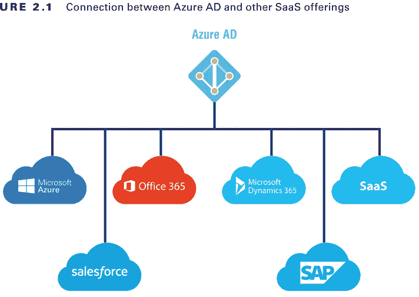

Azure Active Directory 有四个版本。随订阅创建的是免费版。其他版本是基本版、高级 P1 和高级 P2。单点登录（SSO）、AAD Connect 和自助密码重置在所有版本中都可用。请参见表 2.1 了解每个 AAD 版本的核心功能概述。

### 表 2.1 各版本的 Azure Active Directory 功能

| 功能 | 免费版 | 基本版 | 高级 P1 | 高级 P2 |
|---|---|---|---|---|
| 目录对象 | 500,000 | 无限制 | 无限制 | 无限制 |
| SSO | ✓ | ✓ | ✓ | ✓ |
| B2B 协作 | ✓ | ✓ | ✓ | ✓ |
| 自助密码更改 | ✓ | ✓ | ✓ | ✓ |
| AAD Connect | ✓ | ✓ | ✓ | ✓ |
| 自助密码重置 |  | ✓ | ✓ | ✓ |
| 公司品牌 |  | ✓ | ✓ | ✓ |
| 应用程序代理 |  | ✓ | ✓ | ✓ |
| SLA |  | ✓ | ✓ | ✓ |
| 自助密码重置/更改/解锁 |  |  | ✓ | ✓ |
| 本地写回 |  |  | ✓ | ✓ |
| 多重身份验证 |  |  | ✓ | ✓ |
| Connect Health |  |  | ✓ | ✓ |
| 身份管理器 |  |  | ✓ | ✓ |
| 条件访问 |  |  | ✓ | ✓ |
| SharePoint 访问 |  |  | ✓ | ✓ |
| OneDrive for Business 访问 |  |  | ✓ | ✓ |
| 身份保护 |  |  |  | ✓ |

了解不同 AAD 版本中可用的功能非常重要。考试题目可能会要求你针对某个用例场景选择所需的 AAD 版本。在深入讨论其中一些功能之前，让我们先做几个练习。

哪个 Azure 工具可以将本地 Active Directory 中的所有用户与 Azure Active Directory 同步？

- A. Connect Health
- B. AAD Connect
- C. Identity Synchronizer
- D. Active Directory Updater

继续阅读以了解答案。

你应该已经拥有 Azure 订阅、Azure AD 租户，并了解不同的 AAD 版本（免费版、基本版、高级 P1 和高级 P2）。下一步是授予其他人访问该租户的权限。在后面的练习中，将手动向 Azure AD 租户添加用户，而不是使用 AAD Connect 从本地 Active Directory 同步现有用户。如果你使用了 AAD Connect，那么所有身份和组都会自动迁移。请记住，我们仍在讨论 AAD；我们还没有开始讨论基于角色的访问控制，这将在下一节中介绍。

在门户中创建 Azure Active Directory 用户时，有以下三个选项：用户、全局管理员或受限管理员（参见表 2.2）。拥有这些默认角色可以简化权限管理，因为它们包含一个预构建的权限列表，可用作指南。

### 表 2.2 Azure Active Directory 角色

| 目录角色 | 描述 |
|---|---|
| 用户 | 基本用户类型，对大多数目录资源的访问权限有限 |
| 全局管理员 | 最初用于创建 Azure 订阅的凭据是以全局管理员身份创建的。此角色对 Azure Active Directory 中的所有功能拥有完全的管理访问权限。 |
| 受限管理员 | 创建时被添加到特定的非全局管理角色。示例包括应用程序管理员、帮助台管理员、服务管理员，以及大约 30 个其他内置角色。 |

若要添加使用自定义域的用户，必须先将自定义域添加到 Azure AD。如果未完成此操作，则会看到类似于图 2.2 的错误。如果你没有自定义域，也可以使用默认的 Azure AD 租户名称添加用户，例如 user@*.onmicrosoft.com，其中 * 是租户的名称。

### 图 2.2 向 Azure AD 添加用户

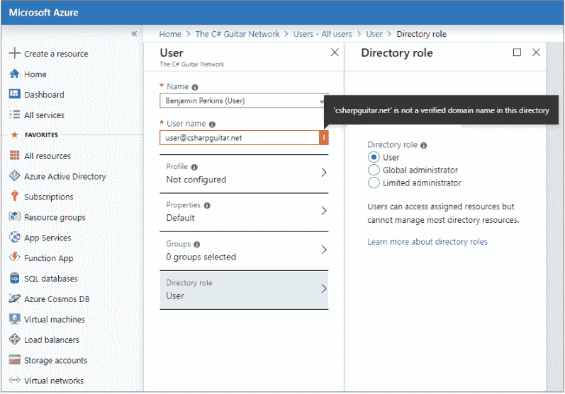

完成以下步骤，将自定义域添加到你的 Azure Active Directory。

### 向 Azure Active Directory 添加自定义域

在练习 2.1 中，你将向你的 Azure Active Directory 添加自定义域。这样做后，你将能够添加以该自定义域作为其身份一部分的用户。

### 练习 2.1 向 AAD 添加自定义域

- 1. 登录 portal.azure.com 上的 Azure 门户。
- 2. 单击 Azure Active Directory 链接，选择“自定义域名”，选择“+ 添加自定义域”，在“自定义域名”文本框中输入你的自定义域，然后单击“添加域”按钮。参见图 2.3。

### 图 2.3 配置自定义域名

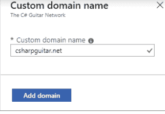

- 3. 登录你的域托管提供商（例如 GoDaddy），并添加用于验证你拥有该域的首选 DNS 记录。（第 3 章介绍了 DNS 和 DNS 记录的相关信息。）参见图 2.4。

### 图 2.4 在 Azure 中验证自定义域名

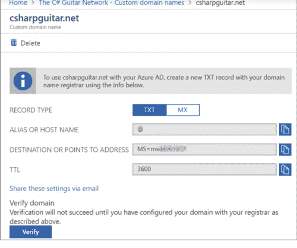

- 4. 添加记录后，单击“验证”按钮。域名系统（DNS）更改的传播可能需要长达 72 小时，但通常需要的时间少得多。在我的场景中，用了不到五分钟。

### 练习 2.1（续）

- 5. 验证完成后，单击“设为主要”按钮，然后选择“是”。请记住，这是一个测试场景；如果你在真实的生产环境中操作，请务必小心。参见图 2.5。

### 图 2.5 已验证的自定义域

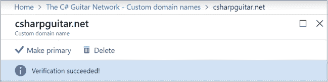

- 6. 导航回 Azure Active Directory 链接。选择“自定义域名”，你将看到标记为“主要”的新自定义域以及默认租户。参见图 2.6。

### 图 2.6 已验证的自定义域

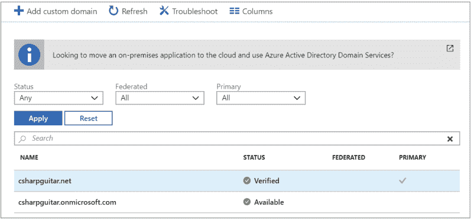

### 练习 2.1（续）

### 图 2.8 添加 Azure AD 用户模板

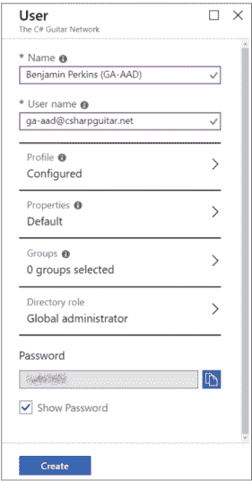

- 3. 请注意，用户列表中现在有两个全局管理员，一个的来源是 Microsoft 账户，另一个是 Azure Active Directory。用于身份验证的身份必须来源于 Azure Active Directory，才能使用和配置众多 Azure 功能。参见图 2.9。

### 图 2.9 Azure AD 用户列表

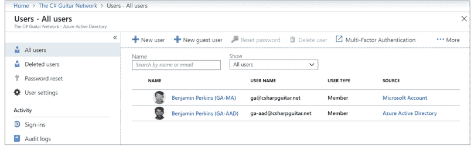

- 4. 再创建三个用户，其目录角色如下：
  - 用户
  - 受限管理员 > 应用程序开发人员
  - 受限管理员 > 云应用程序管理员
- 5. 完成后，用户列表应类似于图 2.10。

### 图 2.10 Azure AD 用户列表

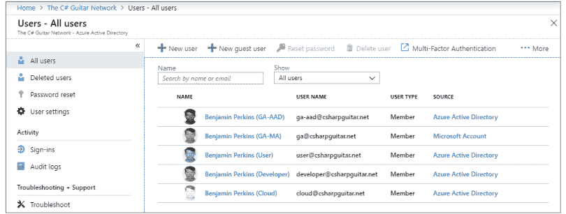

当你使用已创建的用户之一登录时，该账户将无法创建任何 Azure 资源。原因是这些账户未关联到任何订阅。当导航到“订阅”边栏选项卡时，这一点变得很明显，该选项卡列出了与该账户关联的订阅。如果用户单击“+ 添加”按钮，则可以创建自己的订阅，从而允许他们创建 Azure 资源。在练习 2.6 中，你将授予用户对订阅的访问权限。

Azure Active Directory 与 Azure 内部用于专门控制对 Azure 资源访问的安全机制之间存在区别。这种机制称为基于角色的访问控制，将在下一节讨论。这里需要注意的一点是，AAD 是一个可用于跨不同产品对用户进行身份验证的租户，而 RBAC 控制对 Azure 门户内 Azure 资源的访问。在下一节介绍 RBAC 时，你将授予用户对订阅的访问权限，并根据角色和组限制访问。

现在，让我们深入了解其他 Azure Active Directory 产品和功能的详细信息。

## AAD Connect

AAD Connect（如图 2.11 所示）用于在本地 Active Directory 与 Azure Active Directory 之间创建混合身份解决方案。其中一项功能


AAD Connect 是它配置 Azure，以便具有本地 AD 的用户可以访问 Azure 资源。

### FIGURE 2.11 Azure AD Connect wizard

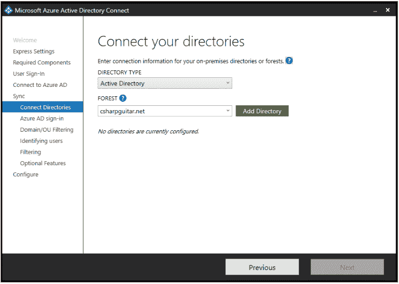

除了支持配置三种登录方案（密码哈希同步、直通身份验证和 ADFS，后续会讨论）之外，AAD Connect 还提供同步帮助。同步支持会将本地 AD 中存在的目录对象（如用户、设备和组）创建到云中。在 Azure 门户中，导航到 Azure Active Directory 刀片并单击 Azure AAD Connect，即可查看 Azure AAD Connect 进程的同步状态。图 2.12 表示成功同步前后的外观。

要完成 Azure AAD Connect 同步，必须使用用于同步的账户是存在于 Azure Active Directory 中的全局管理员。这可能并非如此。最初，如图 2.13 所示，我用来创建订阅的用户其来源等于 Microsoft 账户，而另一个用户的来源等于 Azure Active Directory。

### FIGURE 2.12 Azure AD Connect status

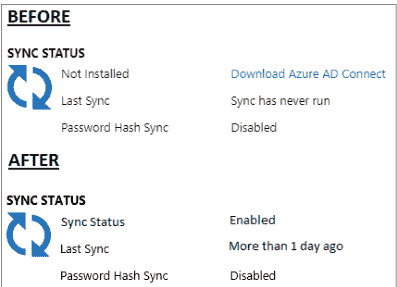

### FIGURE 2.13 AAD versus Microsoft accounts in the Azure Portal

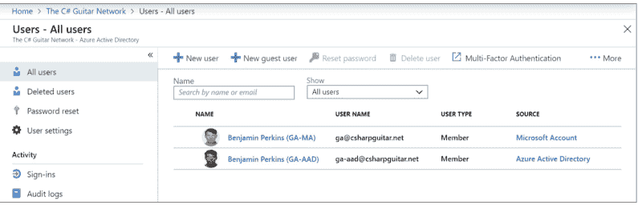

运行 AAD Connect 时必须使用来源为 Azure Active Directory 的账户，并且账户角色必须是全局管理员。

## Connect Health

想象一下，当你同步两个或多个数据存储库时，其中一个或多个可能会出现不同步的情况，即一个存储库中的更新、插入或删除不会立即反映在另一个存储库中，也不会在稍后某个时间点反映，或根本不会反映。瞬时问题或更长时间的停机都可能对数据的连贯性产生一定影响。这不仅适用于 Active Directory，也适用于任何数据存储库。

Azure AAD Connect Health 是一项监控服务，它取代了旧工具如 DirSync 和 Azure AD Sync，并且是一个服务代理，可帮助监控以下等功能的运行状况：

- 与 Azure Active Directory 的同步错误（缺失、过时或重复）。
- 识别尝试 ADFS 登录的恶意行为者 IP。
- 监控并提醒 Azure Active Directory 域服务（后续会讨论）的运行状况问题。
- 基于错误类型配置警报。

Azure AAD Connect Health 可通过门户进行配置，方法是单击 Azure AAD Connect Health 链接。参见图 2.14。

### FIGURE 2.14 Azure AD Connect Health


## Directory Objects

目录对象包括用户、设备和组等项目。请记住，Azure Active Directory 是一个身份提供者或权威机构，是用户身份进行身份验证的位置。身份验证后，应用程序可以利用身份所在的组来授权访问。因此，免费版中 500,000 个对象的限制对于大多数客户来说已经足够。然而，该版本缺少在云中运行安全工作负载所需的许多其他企业功能。比较 Azure Active Directory 功能与本地 Active Directory 部署时，特别是对于服务账户和机器账户，某些差异可能并不明显。例如，如果不实施并配置许多其他 Azure 产品和功能，就无法将 Azure VM 添加到 Azure Active Directory。

## Single Sign-On

如上一章所述，为执行工作所需的所有应用程序都提供用户 ID、密码和配置文件并不是最佳做法。因此，创建了一个名为 Active Directory 的全球内部网功能。该实体包含公司所有用户的身份和组分配。单点登录后（例如登录连接到内部网的工作站），该内部网中的任何其他应用程序都可以在不再次询问的情况下重用这些凭据。同样适用于基于云的资源，这意味着任何使用 AAD 进行身份验证的基于云的应用程序，如果用户已在企业网络中通过身份验证，则不会再次请求凭据。

在 AAD 中实施 SSO 时，有三种值得考虑的混合身份登录方法。

**Password Hash Synchronization** 在此，AAD Connect 将用户密码的哈希的哈希从本地同步到 AAD。然后用户使用与连接到本地应用程序时相同的密码登录 Azure 服务。此方法所需的工作量最少。

**Pass-Through Authentication** 这里有一些公司希望在本地 Active Directory 上对用户进行身份验证以强制遵守特定安全程序和密码策略的场景。此方法需要下载和配置身份验证代理，该代理管理 AAD 与本地 AD 之间的身份验证。

**Active Directory Federation Service (ADFS)** 在此场景中，所有用户身份验证都在本地进行。因此，ADFS 是一组彼此具有信任关系的域。希望与 AAD 建立信任关系的本地域管理员可以将本地环境与 Azure AD 联合。

要访问 Azure 门户中的单点登录功能，请单击 Azure Active Directory 链接并单击 Azure AAD Connect；你将看到当前配置状态，类似于图 2.15。

### FIGURE 2.15 AAD Connect state

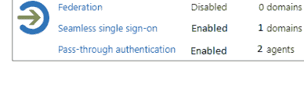

## B2B Collaboration

B2B 协作是一种企业对企业概念，允许一家公司与来自其他企业的访客用户共享服务和应用程序。连接是安全的，并且允许共享方对其自己的企业数据保持控制。如图 2.16 所示，B2B 协作的实施是通过单击 + New Guest User 按钮并邀请个人加入 Azure Active Directory 来完成的。

一旦访客用户被邀请加入，你就可以使用稍后讨论的条件访问功能来控制他们对企业内容的访问。此外，你可以将访客添加到 Azure Active Directory 和基于角色的访问安全角色中。因此，访客账户和 B2B 协作是让个人使用其当前身份进入你的 AAD 的简单方法。还存在一个 Azure AD B2C 功能，用于不同的用例。而 B2B 是为了让个人帮助协作项目或产品，B2C 功能则是为了对通过 B2B 概念创建的产品进行用户身份验证，例如。

### FIGURE 2.16 A list of users in Azure Active Directory

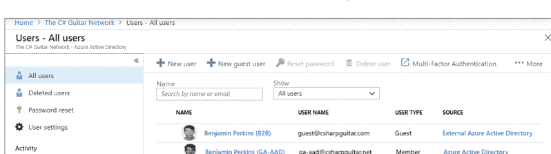

## Self-Service Password

在出现像 Active Directory 这样的全球身份存储库之前，更改、重置和解锁账户为支持团队带来了大量工作。内部开发团队很快就收到了这一反馈，并在其应用程序中内置了更改、重置和解锁密码的自助功能。

在免费版中，唯一支持的功能是更改密码的能力。如果用户主要在 Azure 中，则在此处完成：myapps.microsoft.com。在某些标准使用场景中，自定义安全策略可以提供触发器，要求用户每 30 到 90 天更改一次密码。

重置和解锁账户的功能在免费版中可用；然而，它是自助式的——回到过去。在基础版和高级版中，内置了重置和解锁密码的自助功能。这是进行成本分析的最佳位置。换句话说，将你拥有的账户数量乘以每个用户的成本，并包括用户需要解锁或重置密码的概率。是该金额大于或等于在基础版或高级版中运行 Azure Active Directory 的成本吗？

## Application Proxy

这个功能让我想起了混合连接管理器（HCM），将在下一章中讨论，我们将详细讨论 Azure 网络。相似之处在于，有一个连接器服务，也称为连接管理器，可从 Azure 门户下载，通常安装在客户本地网络中的服务器上。导航到 Azure Active Directory 刀片并单击 Azure Proxy 链接会呈现用于下载连接器的链接，如图 2.17 所示。

### FIGURE 2.17 Application Proxy link

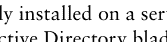


*应用程序代理*允许用户远程访问本地部署的应用程序。如你所知，代理是一种物理或虚拟层，用于暴露一个端点，比如 URL。该 URL 会利用随请求发送的传入数据进行分析，从而将请求发送到另一个端点。从安全角度来看，这样做是有益的，因为应用程序的实际地址不会暴露；从维护角度来看同样有益，因为如果隐藏端点发生变化，只需更新代理，无需更新所有访问该端点的远程客户端。

一旦你在本地数据中心的一台服务器上安装了 Microsoft Azure Active Directory 应用程序代理连接器，你就需要登录 Azure 账户，将承载连接器的服务器与应用程序代理连接起来。使用全局管理员账户登录，并选择 Azure Active Directory 端点作为来源，会导致 "应用程序代理" 边栏选项卡中出现一个条目。然后，你需要配置一个应用程序，提供所要求的信息，如图 2.18 所示。

### 图 2.18 添加应用程序代理

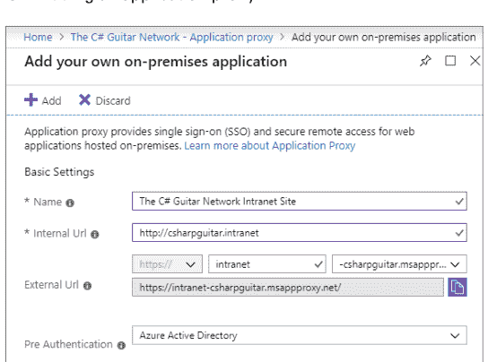

提供配置名称、请求将路由到的内部 URL 以及一个外部端点。根据预身份验证配置，尝试访问外部 URL 的用户在获得对内部 URL 的访问权限之前，必须先通过 AAD 进行身份验证。如图 2.19 所示，在向外部 URL（即应用程序代理服务，其配置类似于前面图 2.18 中所示）发出请求后，凭据会针对你的 Azure Active Directory 进行验证；一旦验证通过，即可授予对内部 URL 的访问权限。

### 图 2.19 应用程序代理流程图

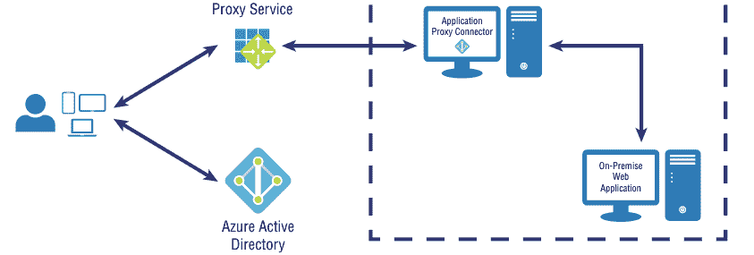

此外，还有一些用例是为了减少不同数据中心之间的延迟。最佳实践是，将员工所需的内容以及客户或合作伙伴想要的内容尽可能放在离他们近的地方。这能显著提升整体体验，因为连接速度更快。只需在任意位置的服务器上安装应用程序代理连接器，尽可能靠近需要信息的人员。然后，为那个特定连接器配置外部端点 URL，并将其交付给那些人。

## 服务级别协议

服务级别协议（SLA）通常描述特定产品在特定时间范围内的可用性保证。通常，当 SLA 被违反时，可根据请求提供该产品价格的部分退款。如前文表 2.1 所示，Azure Active Directory 的免费版没有 SLA。Basic 版和 Premium 版具有相同的 SLA 条款，如表 2.3 所示。

### 表 2.3 Basic 版和 Premium 版 Azure Active Directory 的 SLA

| 每月正常运行时间百分比 | 服务额度 |
|---|---|
| < 99.9% | 25% |
| < 99% | 50% |
| < 95% | 100% |

每月正常运行时间百分比使用以下算法计算：

（用户分钟数 – 停机时间）/ 用户分钟数 × 100

其中，用户分钟数是停机时间与受影响用户数的总和。SLA 很重要，但这并不意味着因为你在使用免费模式，Microsoft 支持团队就会对你置之不理。同时，如果你运行的是具有重大影响的关键任务或业务工作负载，我建议你使用有正常运行时间承诺的版本。这完全是合理的商业考量，而且任何问题都可以在不必首先进行那种对话的情况下得到解决。

## 身份保护

从安全角度来看，一家公司的安全性取决于其最薄弱的员工环节。未经授权访问公司网络通常使用一种称为*网络钓鱼*的方法。通过这些攻击载体进行的访问尝试其复杂程度已经提高到即使是经验丰富的 IT 专业人员有时也会成为受害者的地步。要进入公司网络，只需要一个毫无戒心的受害者双击可执行文件、打开附件或访问一个安装了恶意软件的链接。一些恶意攻击者采取的有趣方法是，他们获得管理访问权限后不会立即采取任何行动。他们会让你忘记自己犯下的错误。但后果不会消失。该漏洞可能被立即利用，也可能保持休眠状态，直到攻击者需要它，或者干脆静待时机，直到利用者抽出时间来对网络进行接触和探测。

这读起来有点吓人，但确实有一些方法可以对此进行防护，例如使用身份保护。即使你忘记了一个已检测到的威胁，甚至识别不出系统中的任何异常行为，但被利用的系统上采取的操作会暴露出某些模式，并且在许多情况下会依循一种可定义的活动模式。这些活动可能包括以下内容：

-   来自匿名 IP 的登录（例如，通过 Tor 访问）
-   在可疑的时间范围内（例如，由于不可能实现的行程时间）尝试从多个位置登录
-   从陌生位置登录
-   从受感染设备登录

以上几点读起来像是常识，但来回发送的大量与身份验证相关的数据可能使攻击难以被发现。这正是 Identity Manager 所提供的功能；它提供的功能可以监控那些已通过身份验证但似乎已被入侵的用户的行为。

### 添加 Azure AD 身份保护

在练习 2.3 中，你将添加 Azure AD 身份保护，以保护企业免受被利用的账户和身份欺骗的攻击。身份保护还提供对现有威胁和漏洞的可见性。

### 练习 2.3

### 添加身份保护

- 1. 在 `portal.azure.com` 登录 Azure 门户。
- 2. 点击“市场”链接，搜索*“Identity Protection”*，然后点击“创建”按钮，如图 2.20 所示。

**图 2.20** 创建 Azure AD 身份保护

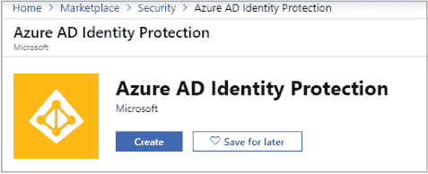

- 3. 选择要将身份保护安装到的目录，例如 The C# Guitar Network，如图 2.21 所示。

**图 2.21** 为 Azure AD 身份保护选择目录

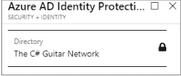

- 4. 点击“创建”按钮，并通过点击链接打开“Azure AD 身份保护”边栏选项卡，如图 2.22 所示。

### 图 2.22 Azure AD 身份保护

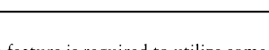

要使用下一节中讨论的某些条件访问策略，需要安装此市场功能。身份保护提供报告功能以及用于创建修正策略的界面。例如，考虑一下，如果我想在登录尝试被标记为“高”风险后创建修正策略，受控的修正措施可以是强制执行多因素身份验证。请继续阅读有关条件访问的内容；然后执行练习 2.4 以创建策略。

## 条件访问

安全，安全，再怎么强调也不为过，其重要性已等同于本主题本身。就在过去一年里，有报告称侵入性入侵尝试的次数增加了近 300%。所以，有很多恶意行为者试图在 IT 解决方案中寻找漏洞并加以利用。例如，勒索软件就是一项利润丰厚的活动。它不像许多安全管理员可能关注的那样，并非专门针对私人数据或公司知识产权（IP）。相反，勒索软件试图阻止对数据本身和互联网协议（IP）的访问。关键在于，恶意行为者非常善于发现利用 IT 漏洞的新方法。因此，安全顾问以及那些希望预防和保护的人们必须提出并实施新的方法来保护他们的资产。


请注意！你可能会实施过多的安全措施，以至于抑制了员工的生产力以及客户对你们产品和服务的访问。请记住，自带设备（BYOD）策略、远程工作人员以及访问你们资源的各种类型的设备都使得工作更加高效。然而，IT 资源的消耗要复杂得多。上述每种情况都需要对安全解决方案的实施给予特别的关注和采用特定的方法。


条件访问是一种有用的方法，也是抵御许多新型安全攻击尝试的一种相当高效的方法。条件访问由在第一因素身份验证完成后实施的策略组成。因此，很有道理的是，*多因素身份验证 (MFA)* 被实施为在初始身份验证之后发生的条件访问策略。除了 MFA 之外，一些常见的条件访问策略如下：

- 设备平台
- 位置
- 登录风险

在公司内部管理 IT 设备资源绝非易事。Microsoft Intune 专门设计用于让这一过程更轻松。使用 Microsoft Intune，可以以很高的概率知道公司内部运行了哪些操作系统，或者至少知道您支持哪些操作系统并允许其访问内部网络。设备平台策略至少可以帮助您防止运行任意数量操作系统的恶意设备获得对内部网络的访问。例如，如果您不想支持 macOS，那么您可以基于该操作系统限制访问。还可以根据设备是否加入域来限制对云应用的访问。Azure 中有一个名为 AAD Connect 的功能，可帮助您将本地加入域的设备与 Azure AD 租户同步，以便实施加入域策略。

> **真实世界场景**
> 
> ### 他们是怎么进来的？
> 
> 就像支持的操作系统或加入域的设备一样，您将知道大多数正常场景，例如员工通常会从何处连接，或他们永远不可能从何处连接。在这种情况下，您可以创建基于位置的条件访问，即如果第一因素身份验证成功，但登录位置来自意外的地点，则可以阻止或强制他们进行额外的身份验证步骤，例如 MFA。
> 
> 请看图 2.23。已创建一个名为 CSHARPGUITAR HQ 的命名位置，其中包含来自该位置的已知有效 IP 地址范围。

### 图 2.23 配置条件访问

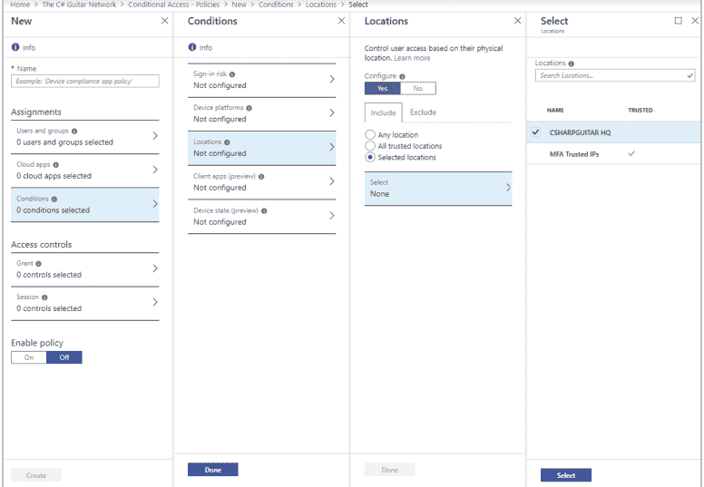

然后就可以根据设备从该位置连接时发生的情况配置条件策略。请注意，同时存在包含和排除选项。这意味着如果我想应用策略以允许对为命名位置 CSHARPGUITAR HQ 配置的 IP 地址范围进行访问，那么我就包含该范围并排除其余部分。

请记住，条件策略发生在第一因素身份验证之后。条件访问策略是安全性的额外层，在这个持续存在安全漏洞的新时代非常有用。

登录风险是一个计算值，会导致分类为高、中或低。AAD 分析每次登录并根据算法确定登录是否可疑。可疑登录可能来自异常位置，如前所述，

或当客户端的 IP 地址被隐藏或匿名时。根据对登录尝试的实时分析，可以应用条件访问策略。完成练习 2.4 以练习实施用于阻止可疑登录的阻止条件策略。

### 创建条件访问策略

在练习 2.4 中，您将创建一个 *条件访问策略*，该策略将阻止所有具有计算值为低的可疑登录的访客用户访问 Azure 管理门户。

创建条件访问策略时需要谨慎。您很容易将自己锁定在外。确保您拥有多个账户，以防将自己锁定在外。有“如果”功能可以检查新策略影响了谁，但这仅在您应用它之后才可用。请小心。

这是一个相当严格的策略；然而，我想确保没有任何访客有任何机会以任何方式滥用其访问权限。为澄清起见，计算风险级别的算法是专有的，属于 AAD 的一部分。您只需配置它即可。

### 练习 2.4

### 创建条件访问策略

1. 登录到 Azure 门户 portal.azure.com。
2. 单击 Azure Active Directory 链接，选择条件访问，选择 + 新策略，并选择用户和组。现在，选择用户和组复选框并选择所有访客账户；结果如图 2.24 所示。

### 练习 2.4（续）

### 图 2.25 配置条件访问策略

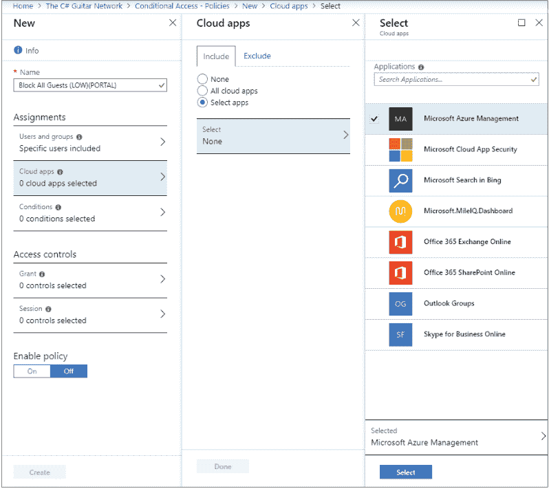

6. 单击选择然后完成。
7. 选择条件 > 登录风险 > 是。选择低复选框。
8. 单击选择然后完成。
9. 选择授予 > 阻止访问，如图 2.26 所示。

### 图 2.26 创建条件访问策略

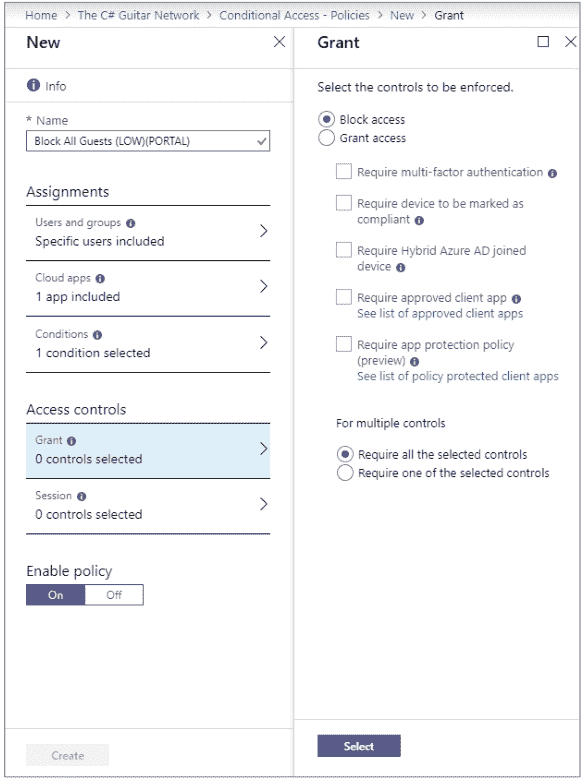

10. 单击选择 › 启用策略 › 开启，然后单击创建按钮。
11. 您将在列表中看到该策略。单击如果按钮以检查策略是否按预期应用。
12. 尝试登录到 Azure 门户，例如使用 Tor 浏览器。您将收到一个错误，看起来像图 2.27。

### 练习 2.4（续）

### 图 2.27 访问策略访问权限违规弹出窗口

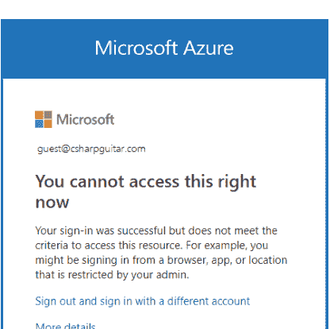

您会回忆起图 2.25 显示了要受限制的云应用。该练习旨在限制对 Azure 门户的访问。这就是您选择 Microsoft Azure 管理的原因。还有一个有趣的可能选择，即 Microsoft 云应用安全。通过创建任何条件访问策略，云应用是必需的值。Microsoft 云应用安全 (MCAS) 是面向企业的一款功能齐全的产品，用于实施对专有云应用的安全。它提供工具和报告，专注于保护敏感数据、保护文件以及发现影子 IT。该功能的实施主要集中于合规细节，这些细节将在第 6 章中更详细地介绍。一旦这些细节确定，就使用条件访问策略应用。策略随后应用于该特定云应用。

## 多因素身份验证

没有人使用相同的用户 ID 和密码不止一次，说没有人。每访问一个应用程序或网站，您总是使用唯一的 ID 和密码，对吧？好吧，也许有些人会这样做。重复使用凭据会使安全性变得更加复杂，因为如果您使用的某个站点或产品被入侵，攻击者可能会尝试在其他网站上使用相同的凭据，例如您的电子邮件或银行账户。事实是，大多数密码只是被哈希并存储在数据库表中。哈希有不同的强度，但在最终，它仍然只是一个哈希。所有哈希都是脆弱的，因为您只需要一台超级计算机、一个彩虹表和时间。最终会找到匹配项，您的密码可以被翻译成明文。

这就是为什么许多安全策略要求员工每 30 到 90 天更改一次密码的原因。最强的哈希密码在最快的超级计算机上需要 30 到 90 天才能被破解，因此为了让员工领先于此，强制执行更改密码的策略。不允许使用前两个到三个密码也是实现更高安全级别的好做法。因此，仅依赖用户 ID 和密码应被视为第一道防线，或在进入下一阶段之前确认的第一级身份验证。

我们已经讨论了一些可以作为第二、第三或第四层身份验证实施的条件访问策略，例如位置或设备的预期操作系统。另一种更受欢迎的访问策略称为多因素身份验证。MFA 通常通过具有以下两项或更多项来实现：

- 你知道的东西
- 你本身的东西
- 你拥有的东西

你知道的东西可以是用户 ID 和密码，但也可以是一组只有你知道的多项选择题。例如，你最喜欢的水果是什么，或你第一辆车的颜色是什么？然而，如今许多这些问题都可能因社交媒体上分享的信息而被泄露，因此仅凭这些关于个人的问题不足以以高置信度证明某人的身份。因此，必须在身份验证过程中包含其他内容。

生物识别，例如，是你本身的东西。指纹、人脸识别和视网膜扫描是仅由单个个体拥有的标识符。没有人有与他人相同的指纹或视网膜模式；它们是唯一的。有些人认为仅有视网膜扫描或指纹就足够了；这可能是真的，但两种形式的识别比一种更好。我看过几部电影，其中生物识别漏洞被暴露，情况并不好看。

最后，你拥有的东西，例如，是移动设备、数字证书或智能卡。如图 2.28 所示，对任何两种方法的验证都是多因素身份验证过程的合法选项。


**图2.28 多因素认证选项的类型**

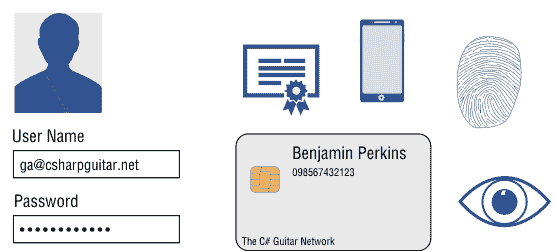

当条件策略根据其分配执行后，访问控制（即允许/拒绝访问或限制用户的会话操作）将被应用。在之前的练习中，采取的操作是阻止登录尝试。相反，可以基于几种不同的标准来允许访问。需要满足其中一项或全部才能继续身份验证：

- 要求多因素认证。
- 要求设备标记为合规。
- 要求使用已加入混合 Azure AD 的设备。
- 要求使用经批准的客户端应用。

如已所述，MFA需要比简单的用户ID/密码组合更多的信息；它还需要你拥有的东西或你本身的特点。表2.4描述了在你的AAD上实现MFA所支持的场景。

**表2.4 支持的MFA身份验证方法**

| 身份验证方法 | 描述 |
| --- | --- |
| 密码 | 此方法始终可用且已启用。 |
| Microsoft Authenticator 应用 | 安装后，应用会收到一条通知，告知有登录尝试。然后用户必须批准该通知。 |
| 短信 | 用户会收到提示，要求输入一个六位代码，该代码以短信形式发送到其移动设备。收到后，输入代码并继续身份验证。 |
| 语音通话 | 用户会接到一个自动电话，语音提供六位代码。输入代码后，身份验证过程继续。 |

执行练习2.5以启用多因素认证。

### 启用多因素认证

事实证明，在之前的练习中创建的条件访问策略过于激进，它锁定了我们的合作伙伴，尽管我们想让该账户通过身份验证。在练习2.5中，你将修改条件访问策略，该策略阻止了所有具有计算风险值为低的可疑登录的来宾用户。只要合作伙伴拥有可以有效接收验证码的移动设备，我们将允许访问，而不是阻止身份验证继续进行。

#### 练习2.5：启用多因素认证

1. 登录 portal.azure.com 上的 Azure 门户。

2. 单击“Azure Active Directory”链接，选择“条件访问”，单击“+ 选择”，然后选择在之前练习中创建的策略，如图2.29所示。在本例中，选择“阻止所有来宾（低）（门户）”。

**图2.29 启用多因素认证**

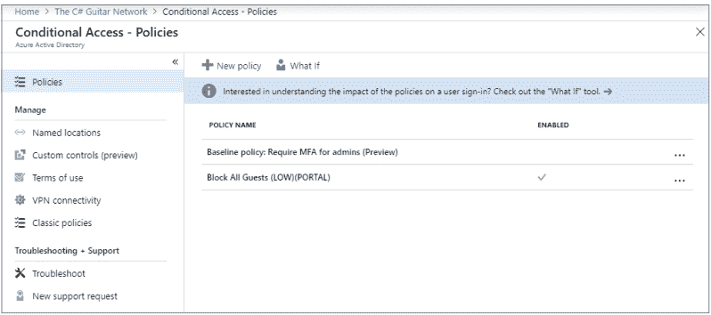

3. 在“访问控制”部分，选择“授予”>“授予访问权限”单选按钮。选中“要求多因素认证”复选框。单击“选择”按钮，然后单击“保存”。参见图2.30。

**图2.30 已启用多因素认证，授予访问权限**

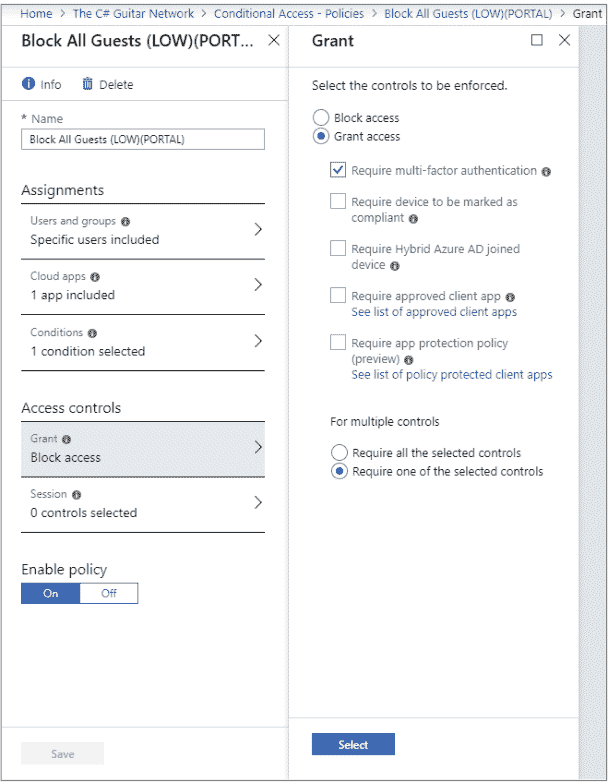

4. 稍等片刻以确保策略生效（只需片刻），然后使用你选择应用条件策略的凭据尝试登录Azure门户。用户应收到如图2.31所示的弹出窗口。

**图2.31 多因素认证弹出窗口**

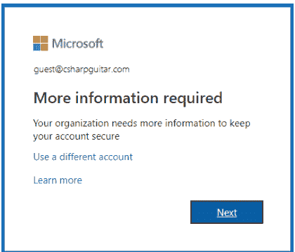

5. 由于这是用户在此策略生效下首次访问AD，他们很可能需要提供一些额外的详细信息。

   a. 对于步骤1屏幕，MFA会请求更多有关如何联系你的信息，如图2.32所示。

**图2.32 多因素认证请求更多信息页面**

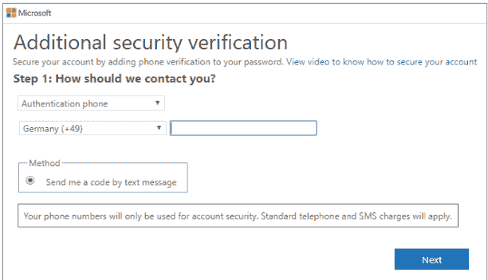

如果你的安全神经正在跳动，你正在思考这种方法存在缺陷的各种不同场景。它有缺陷，也没有缺陷。因为步骤5发生在用户ID/密码（第一因素身份验证步骤）之后，我们可以确信此人身份与声称的一致。如果你想更安全，可以在图2.30所示的屏幕上选中更多复选框，以便所有这些控制与MFA一起强制执行。

   b. 在步骤2屏幕上，选择国家代码，输入电话号码，然后单击“下一步”按钮。步骤2信息框打开并显示消息：“我们已向你的手机发送短信至：#####。”

   c. 在步骤3屏幕上，等待短信发送到你的手机，将其输入文本框，然后单击“验证”按钮。（参见图2.33。）

**图2.33 MFA附加安全信息请求页面**

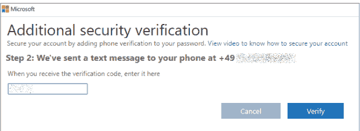

6. 如果验证成功，单击“完成”按钮。用户账户现已配置为使用MFA，如图2.34所示。

**图2.34 MFA安全验证页面**

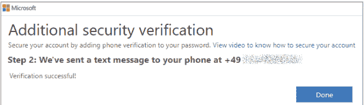

7. 在此场景中，对于此条件访问策略，登录尝试始终触发MFA控制。系统始终提示用户提供验证码，如图2.35所示。

**图2.35 用于输入验证消息的MFA窗口**

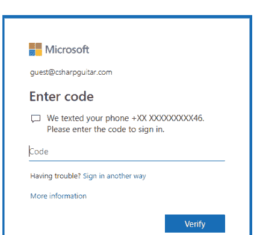

创建和应用条件策略的方法有很多种。这实际上取决于你或安全官员/顾问。

前两个练习的重点在于，安全性与生产力之间需要平衡。最初，条件访问策略过于激进，无论如何都阻止任何来宾。我确实见过在安全管理员离开公司或安全解决方案明显失去控制后实施这种方法的情况。只需锁定所有人，然后根据新策略重新验证他们。这不是一种影响较小的方法，但是……当你知道存在漏洞时，这比什么都不做要好吗？在有数千名员工和合作伙伴的公司中，阻止所有人是不现实的。人力资源成本将高得难以承受。这种方法我永远不会推荐；相反，在最好的情况下，第一次就正确地规划、设计和实施你的策略。

请记住，安全是基础，但你需要让人们工作，不能让安全策略阻止他们工作。如果你的策略确实对生产力产生了负面影响，那么你就是一个糟糕的安全解决方案。在第9章中，我们将讨论监控，你将了解到如何查看安全策略对生产力的影响。此外，你可以使用练习2.4中讨论的“What If”功能来检查策略的影响程度。

## 特权身份管理

向组或个人用户授予对资源的访问权限是标准做法。此措施可防止未经授权的个人获得访问权限，从而可能对公司或客户造成伤害。在某些情况下，仅通过身份验证或授权访问资源可能还不够严格；例如，向用户提供对数据库的读取访问权限，以便该用户分析行为，为产品寻找新功能，或发现由于应用程序中代码路径执行不良而导致的意外行为。也许个人需要与服务器建立远程桌面连接以解决问题，或授予某人访问证书私钥的权限。

在每种情况下，安全管理员都有理由授予访问权限，但问题在于他们需要访问多长时间，因为某些被访问的资源比其他资源更敏感，因此需要一些额外的安全策略。如何实现这一点？如何根据特定资源应用额外的安全级别？解决方案是特权身份管理（PIM）。简单地说，PIM是一种用于控制、管理和监控公司内对高度关键或敏感资源的访问的功能。这是通过基于个人的AAD身份、AAD组分配或通过RBAC（RBAC将在本章后面讨论）向Azure平台上的资源添加身份验证功能来实现的。表2.5显示了通过PIM可用的额外身份验证功能。

**表2.5 特权身份管理身份验证功能**

| 身份验证功能 | 描述 |
| --- | --- |
| 审计历史 | 一份报告，用于分析谁在何时访问了哪个资源，以及访问频率 |
| 通知 | 当组或用户被授予对资源的特权访问时发送通知 |
| 多因素认证 | 额外的身份验证层 |
| 时间限制 | 为特权访问应用开始和结束日期。 |
| 访问审查 | 识别特定用户或组是否仍需要访问权限的报告 |
| 理由 | 为请求的访问创建规则，例如必须随请求一起提供工作项。 |


| Approval | 实现授予特权访问的审批流程。 |
| Just-in-time | 需要时请求访问，并在 JIT 时获得批准。JIT 意味着用户在需要时获得访问权限，并在不再需要访问时被移除。 |

要启用 PIM，您必须导航到 Azure AD Privileged Identity Management 刀片，如图 2.36 所示，并单击 Consent To PIM 链接。

### FIGURE 2.36 Azure AD Privileged Identity Management

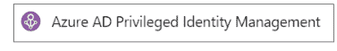

验证是多因素的，就像上一节中配置的那样。一旦验证完成并获得同意，且您的账户已注册，您就可以开始使用该功能为公司的最敏感产品和数据增加额外的安全和控制层。最后，PIM 提供了监控和审查功能，有助于确保您的安全解决方案按预期运行。

## Managed Identities

到目前为止，我们只讨论了与真实存在的人相关联的账户。这些人被逻辑分配到组中，而这些组被授予或拒绝对某些资源的访问。运行应用程序时还有另一种常见场景，从资源拥有身份中受益，例如 Azure App Service、Azure Functions 或 Azure VM 的实例。给定订阅中的大多数 Azure 资源都可以被授予访问任何其他资源的权限，只要这些资源在 Azure Active Directory 中存储了托管标识。

这通常被称为 *credential leaking*。这是指凭据存储在源代码、配置文件或应用程序设置中。这些密码通常用于连接到数据库、连接到第三方应用程序，或可能连接到 REST API。无论如何，任何需要身份验证的资源从其他资源连接都需要将这些凭据存储在某处。对此的原始解决方案是 Azure Key Vault，它将密钥或连接字符串存储在安全、加密的位置。然后使用密钥访问该密钥字符串。

然而，密钥本身也必须存储在某处，这就造成了前面提到的凭据泄露问题，即凭据存储在安全位置，但仍可通过存储在安全性较低位置的密钥访问。最终出现的功能是 Azure 资源的托管标识（MI），正式名称为托管服务标识（MSI）。一旦为给定资源实施 MI，则该特定资源就有权限获取密钥，并且身份验证使用 MI 和 AAD 处理。

在第 7 章中，有一个练习，您将创建 Azure App Service 实例和 Azure Key Vault，配置 MI，并访问其中的密钥。由于我们尚未介绍计算资源的创建（在第 4 章中介绍），因此目前还不足以解释执行这些活动。

## Azure AD Domain Services

Azure Active Directory Domain Services 对于称为 *lift-and-shift* 的场景非常有用。这意味着一家公司拥有本地应用程序工作负载或其他依赖域的资产，希望将 IT 解决方案打包并原样部署到 Azure 平台。然而，考虑一下该工作负载具有轻量级目录访问协议（LDAP）、NT LAN Manager（NTLM）或 Kerberos 要求的情况。正如您应该已经知道的那样，这些功能运行在本地 Active Directory 上，并且在 Azure 平台或 AAD 上不受支持。

有许多变通方法可以在 Azure 上实现这三种功能，例如在 Azure 和本地 AD 之间创建站点到站点连接。其他可能性是使用实际的 Azure 虚拟机创建 AD 域或在云中复制域。这些解决方案是有效的，但需要大量监控和管理，并且可能容易受到延迟和瞬态网络问题的影响。因此，微软创建了 Azure AD Domain Services 作为 lift-and-shift 工作负载的最佳解决方案。

有两个受支持的场景：

- Azure AD Domain Service for hybrid solutions
- Azure AD Domain Services for cloud-only solutions

在混合解决方案中，公司在本地数据中心和 Azure 上都有基础设施资源。公司还要求或希望在本地 AD 和 Azure AD 租户之间同步标识。如图 2.37 所示，资源位于虚拟网络中。（虚拟网络在第 3 章中讨论。）这些资源使用 Azure AD Domain Services 连接到 AAD，然后 AAD 使用前面讨论的 Azure AAD Connect 同步标识。

云端仅解决方案的配置与混合解决方案类似；唯一的区别是 AAD 与本地 AD 之间不会使用 Azure AD Connect 进行同步。

所以，这就是 Azure Active Directory 及其许多附加功能和相关安全与身份产品。如果您对 Azure Active Directory 感兴趣，那么完全可以写一整本书；我知道有几本。如果这个主题对您特别感兴趣，那么请将其作为您深入学习的话题之一。

### FIGURE 2.37 AAD Domain Services flow diagram

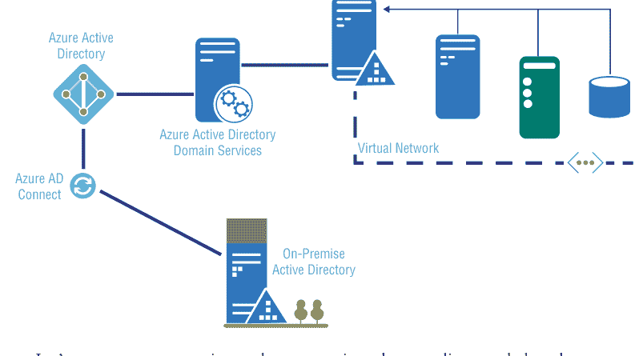

让我们现在把注意力转向下一节，在那里我们讨论基于角色的访问控制。但在此之前，请查看下表，表 2.6，了解 AAD 和 RBAC 之间的差异。

### TABLE 2.6 Differences Between AAD and RBAC

| Azure AD | Azure RBAC |
|---|---|
| 基于角色的信息可通过 Microsoft Graph 和 Azure AD PowerShell 访问。 | 基于角色的信息可通过 Azure 门户、Azure CLI、Azure PowerShell 和 REST 访问。 |
| 不支持自定义角色。 | 支持自定义角色。 |
| 管理对 Azure AD 资源的访问。 | 管理对 Azure 资源的访问。 |
| 范围是 AD 租户角色和组。 | 对资源和工件具有更细粒度的范围能力 |

最重要的是要认识到 Azure AD 的范围大于 Azure，而 RBAC 专门针对通过 Azure 门户可访问的资源。

## Role-Based Access Control

*Role-based access control (RBAC)* 既不是新概念，也不是 Azure 门户中管理资源访问的独特概念。Azure Active Directory 是我们验证希望访问受限资源的个人的凭据的地方。身份验证后，我们可以确定尝试连接到该资源的客户端就是其声称的人。然而，这还不够；不仅必须验证身份和凭据，还必须允许访问所需资源的权限。这种权限检查被称为 *authorization*——指定对资源的访问权限或特权的方法。

已经讨论过 Active Directory（本地版本）如何解决每个应用程序都需要身份权威的问题。随着需要执行任务的应用程序数量增加，为每个应用程序管理配置文件和密码很快变得难以管理。采用相同的身份验证概念并将其应用于授权。在这里，而不是在每个应用程序身份数据库中管理和验证凭据，个人在身份验证后的权限将由每个应用程序管理。可以很容易地理解，随着用户数量的增加，维护这种模型所需的努力过大，很快就会崩溃。

从 *application-bound identity provider databases* 迁移到 Active Directory 的一部分需要将任务映射到身份。例如，如果许多系统提供人力资源、财务、会计或物流数据和功能，问题就变成，谁可以访问什么数据，谁可以执行哪些活动？财务部门的人应该可以看到员工上次请病假的细节吗？人力资源部门的人应该能够批准向第三方供应商支付发票吗？可能不应该，因此需要一种可扩展的方式来授予或拒绝个人对数据、数据上的操作以及具有重大后果的活动的访问权限。

很快就会意识到，按个人授予对数据或操作访问权限无法扩展。也许在非常小的公司中这是可能的；然而，在大型企业中，更可维护的方法是创建 *roles*。Active Directory 支持创建组，AAD 也是如此。然而，AAD 组并不是用于管理对 Azure 资源访问的内容。相反，Azure RBAC 实现是授予用户对 Azure 中资源访问权限的手段。

您将在 Azure 中找到三种常见的 RBAC 角色：Owner、Contributor 和 Reader（见表 2.7）。总共有约 40 个内置 Azure RBAC 角色，此外，还可以创建自定义角色。创建自定义 RBAC 角色将在本节后面讨论。

### TABLE 2.7 Most Common Built-In Azure RBAC Roles

| Name | Permissions (Brief Overview) |
|---|---|
| Owner | 访问所有资源；可以将此权限委托给他人 |
| Contributor | 与 Owner 相同，但不能将此权限委托给他人 |
| Reader | 只能查看现有 Azure 资源；不能创建或委托 |


每个角色都有一组权限。你不需要为个人直接分配权限，而是将权限分配给一个角色，然后将个人添加到该角色中。我们都知道，每个人都会执行许多任务、担任许多角色，而这些都需要访问许多资源。Azure 中的 RBAC 功能正好支持这种场景：可以为单个帐户分配多个角色，从而使其能够执行并完成许多任务。

> 这里需要再次强调 AAD 与 Azure 门户中提供的 RBAC 模型之间的区别。AAD 确实支持组；然而，AAD 可以被视为比 RBAC 更高一层。AAD 可用于在应用程序、工作负载和其他 SaaS 产品中对个人进行身份验证；RBAC 则不能。RBAC 是用于从 Azure 门户内控制对 Azure 平台上资源的访问的功能，而不是控制对 Azure 资源上运行的应用程序或代码的访问。

可以在门户中查看 Azure 中“所有者”RBAC 角色的权限：选择“订阅”，选择一个已登录用户可以访问的 Azure 订阅，然后依次选择“访问控制 (IAM)”›“角色”›“所有者”›“权限”。最后，多次单击“加载更多”链接。你随后就会看到该角色的权限列表，类似于图 2.38 所示。

### 图 2.38 RBAC 权限概览

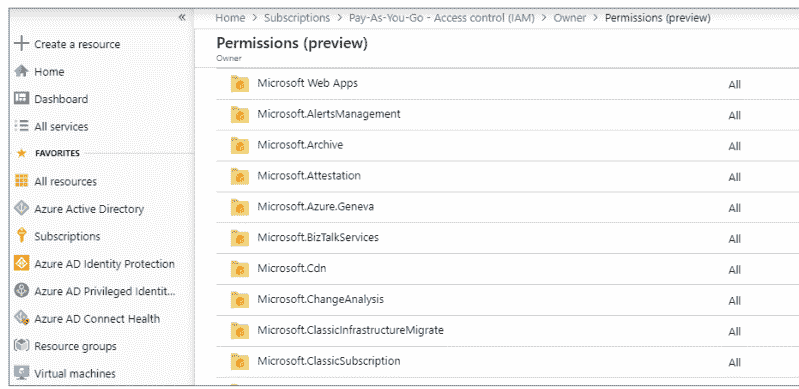

单击某个权限类别（例如 Microsoft Web Apps），你将看到为该角色提供的访问控制（“读取”、“写入”、“删除”和“其他”）。参见图 2.39。单击某个复选标记，即可进一步了解建立该权限时授予的是哪种访问权限。

### 图 2.40 Azure 订阅列表

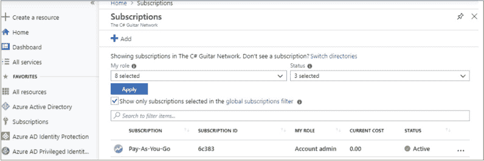

3. 选择“订阅”▸“访问控制 (IAM)”▸“角色分配”。单击“+ 添加”按钮，然后选择“添加角色分配”。你将看到与图 2.41 类似的内容。“+ 添加”按钮还会显示“添加共同管理员”选项。如果你选择添加共同管理员，则不会出现“角色”或“分配访问权限”下拉列表。共同管理员会自动获得与原始管理员相同的访问权限。

### 图 2.41 Azure 订阅详细信息

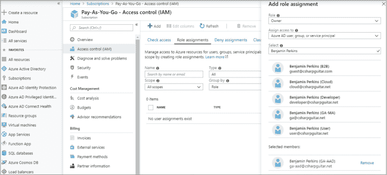

“角色”下拉列表中包含可分配给用户的角色或组。例如，你可能会看到“所有者”、“参与者”或“读取者”。（在本练习后面的内容中，你还会进一步了解分配访问权限的相关知识。）

### 练习 2.6（续）

- 4. 单击“角色”下拉列表，注意可选择的角色有很多。每个角色旁边都有一个信息圆圈，单击可查看有关该角色的更多详细信息。在此场景中，请创建一个“所有者”角色。请参阅表 2.7，确认此角色提供哪些权限。
- 5. 在“分配访问权限”下拉列表中，保留默认值。计划是将此角色授予一个 Azure AD 用户。
- 6. 搜索要添加到“所有者”角色的 Azure AD 用户，然后单击“保存”按钮。
- 7. 使用该帐户登录；此时订阅将可见，并且拥有在该订阅中创建和使用资源的权限。

在完成练习 2.6 的过程中，我们引入了许多概念和大量技术术语。有些概念显而易见、直观易懂，而另一些则不然，并且涉及许多幕后概念。首先要说的是订阅，到目前为止我们已经知道，订阅是用于组织资源和计费的实体。Azure 订阅只是通常称为“作用域”（scope）这一更大层次结构中的一个组成部分。图 2.42 展示了 Azure 中设计的作用域概念。

### 图 2.42 Azure 作用域关系层次结构

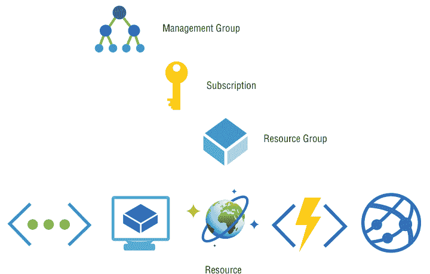

层次结构的顶部是一个称为*管理组*的实体。这个层次结构的最新成员于 2019 年推出。（管理组将在第 6 章中更详细地讨论。它们有助于处理某些企业必须遵循的治理与合规方面的问题。）只能有一个根管理组；不过，子管理组的数量仅受想象力的限制，最多可达 10,000 个，深度可达六级。管理组可以根据组织结构来设计。例如，请考虑以下管理组：

- 根公司组
  - 市场营销
  - 人力资源
  - IT
  - 财务
  - 会计

在每个管理组内，可以存在一个或多个订阅和/或一个或多个组。人力资源管理组可能包含子区域组，而 IT 管理组可能包含生产、测试和开发组。然后，这些组中的每一个都会被分配一个订阅，这有助于管理和估算成本，并提供应用访问控制的一个选项。

> **注意**
>
> 组或角色在层次结构中被授予访问权限的级别越高，其操作可能产生的影响就越大。最佳做法是向角色授予执行所需工作所必需的最低权限。

若要创建管理组，请执行练习 2.7 中描述的步骤。

### 练习 2.7

### 创建管理组

- 1. 登录 Azure 门户：`portal.azure.com`。
- 2. 在页面顶部的搜索框中搜索*管理组*。导航到“管理组”边栏选项卡。
- 3. 如果是创建第一个管理组，请单击“开始使用管理组”按钮进行创建。否则，请单击“+ 添加管理组”。
- 4. 添加管理组 ID，例如：**CSHARPGUITAR-IT**。
- 5. 添加管理组显示名称，例如：**The C# Guitar Network – IT 部门**。
- 6. 单击“保存”按钮。

### 图 2.43 Azure 用户、组、托管标识和服务主体图标

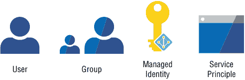

**表 2.8 安全主体**

| 类型 | 说明 |
|---|---|
| 用户 | Azure AD 租户中存在的个人 |
| 组 | Azure AD 租户中的用户集合 |
| 托管标识 | 由 Azure 管理的标识 |
| 服务主体 | 应用程序用于访问 Azure 服务的安全标识 |

*服务主体*与在 Windows 服务器上创建的服务帐户同义。此帐户用于管理计算机之间的权限。服务帐户的一个常见用途是：当公司希望使用 Kerberos 实现 Intranet Web 场时，在 IIS 中使用它。IIS 进程标识的运行上下文必须位于 Active Directory 中。将进程分配给真实用户并非好的做法；相反，该帐户应是一个通用帐户，不与特定人员关联。此外，运行需要访问文件共享上受限制数据的计划任务时，必须使用给定标识运行。只需在服务主体/服务帐户的上下文中运行该任务，并授予该标识访问文件共享的权限。同样，以真实用户身份运行计划任务也不是明智之举。

托管标识与服务主体之间的差异很细微。对于支持托管标识的服务，不再建议使用服务主体。托管标识实际上是“托管服务主体”，它消除了在应用程序配置中存储凭据的需要，而是将证书注入到创建该托管标识的资源中。

### 如何为资源提供权限

如图 2.42 所示，在作用域层次结构的每一级，你都会看到“访问控制 (IAM)”菜单选项；IAM 代表“标识和访问管理”。你可能还记得在练习 2.7 中向用户授予对某个资源的权限时使用过此菜单选项。


subscription. 在 Azure 门户中，打开任意订阅、资源组或资源，你会找到 Access Control (IAM) 链接，该链接提供了授予访问权限的界面。

如前一节所述，可以将访问权限授予范围层次结构中的任何实体，并授予四种安全主体中的任何一种。请自问：是否切实可行在资源级别授予用户访问权限？为什么？为什么不？答案是否定的；这不切实可行，因为维护这种方法所需的精力将与其他所有可能场景相比最大。几乎不可能有单个用户仅需要访问单个 Azure 资源，因此除了将该单个用户添加到所有必要资源之外，还需要将所有用户添加到所有资源。这种方法很快就会失效。

最佳实践方法是，通过角色向用户授予对 Azure 资源的访问权限。图 2.44 将最常见的角色（Owner、Contributor 和 Reader）映射到范围层次结构进行可视化。

**图 2.44 Azure 角色与关系层次结构**

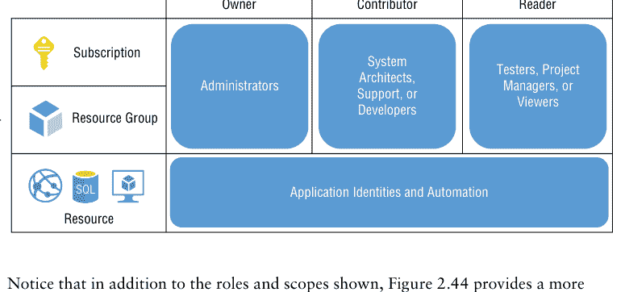

请注意，除了所示的角色和范围外，图 2.44 还提供了一些额外职位名称的更详细可视化，这些职位可能很好地契合已有的 RBAC 角色。无论如何，从组或角色角度授予权限并给予角色所需的最少 Azure 功能访问权限是最有益的。例如，Contributor 角色可能仅需要访问资源组中的特定应用程序，而不需要访问订阅中的所有 Azure 资源。在这种情况下，可能需要额外的角色，例如每个项目或区域一个角色，均具有 Contributor 访问权限。

最后，请注意，将任何角色或用户分配给特定资源的唯一推荐时间是当该身份由应用程序使用时。分配将不会使用用户帐户，而会使用托管标识或安全主体，原因如上所述。

### 如何控制对资源的权限？

现在应该很清楚，权限授予四种安全主体之一，并且这些安全主体应分组到一个角色中。然后该角色在范围层次结构中的三个级别（订阅、资源组和资源）之一被授予权限。问题是，Azure 如何实现 RBAC，以便当有人尝试从门户、CLI、PowerShell 或 REST API 访问 Azure 资源时，身份验证会发生？答案是 Azure 资源管理器（ARM）。如果不理解 Azure 资源管理器，就无法完全理解 Azure 门户中 RBAC 的实现。

ARM 在第 8 章中会更详细地介绍，ARM 是一个 API，通常在部署的上下文中讨论，但 ARM 也可用于审计、标记和控制对 Azure 资源的访问。API 可通过 Azure 门户、Azure PowerShell、REST API 和 Azure CLI 等访问。例如，ARM 提供了逻辑结构化公司工作负载和计算解决方案的手段。这种结构使得能够对资源、资源组、构成整个解决方案的资源，甚至订阅中的所有资源实施访问控制。如图 2.45 所示，ARM 是 RBAC 的核心，没有任何事情发生在 Azure 资源上而不以某种方式流经它。

**图 2.45 Azure 与资源管理器关系**

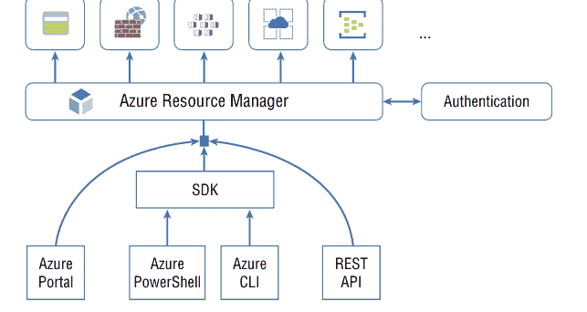

如果你有兴趣立即了解更多关于 ARM 的信息，请跳至第 8 章以获得更深入的介绍。

### 自定义角色

如果大约 40 个内置角色中的一个不匹配你的特定需求会怎样？答案是创建自定义角色。尽管 Azure 中可用的 RBAC 角色的开发人员和设计者已尽最大努力提供尽可能多的角色，但在某些情况下并不能完全匹配你的需求。这就是技术和 Azure 提供的平台的伟大之处。平台提供了创建完全满足你需求所需内容的能力。

自定义角色与内置 Azure 角色一样，可以使用前面讨论的相同范围层次结构和服务主体进行授予。在这方面没有任何不同。然而，默认情况下，并非每个用户都可以创建自定义角色，正如你所预期的那样。相反，只有 Owner 或 User Access Administrator 等用户才会有此特权，因为他们是拥有现有角色概览的人。

创建自定义角色所需的特定操作可以手动分配给自定义角色，如表 2.9 所示。

**表 2.9 创建自定义角色所需的操作**

| 操作 | 类型 |
|---|---|
| `Microsoft.Authorization/roleDefinitions/read` | 查看自定义角色 |
| `Microsoft.Authorization/roleDefinitions/write` | 更新自定义角色 |
| `Microsoft.Authorization/roleDefinitions/write` | 创建/删除自定义角色 |

因此，如果用户需要仅具有创建自定义角色和支持案例的权限，那么这就是创建自定义角色的情况。让我们称该角色为 Security Support Engineer；完成练习 2.8 以创建 Azure RBAC 自定义角色。在开始之前，请注意在 Azure 门户中没有创建自定义角色的能力。这只能在使用 Azure PowerShell、使用 Azure CLI 或直接调用 REST API 时实现。预计你已了解其中一个或多个客户端并可用于此练习。此练习使用 Azure PowerShell。

#### 练习 2.8：创建 RBAC 自定义角色

1. 使用 Login-AzureRmAccount cmdlet 登录到 Azure PowerShell 控制台。输入 `Login-AzureRmAccount` 并输入与使用门户访问 Azure 时相同的凭据。你将被自动提示输入凭据。

2. 仅为有趣，执行 `Get-AzureRmRoleDefinition | FT Name, IsCustom`，它列出所有现有角色以及区分角色是否为自定义或内置的关联标识符（内置为 False，自定义角色为 True）。

3. 如果存在一个内置角色具有新自定义角色所需的大多数权限，请考虑以 JSON 格式导出该角色，然后更新它以包含额外权限。为此，执行 `Get-AzureRmRoleDefinition "Support Request Contributor" | ConvertTo-Json` 并将输出保存到文件。

4. 将内容复制，类似于此处找到的内容，复制到 Notepad 或 Visual Studio 并将文件保存为 `sec-support-eng.json`。

```json
{
  "Name": "Support Request Contributor",
  "Id": "cfd33db0-3dd1-45e3-aa9d-cdbdf3b6f24e",
  "IsCustom": false,
  "Description": "Lets you create and manage Support requests",
  "Actions": [
    "Microsoft.Authorization/*/read",
    "Microsoft.Resources/subscriptions/resourceGroups/read",
    "Microsoft.Support/*"
  ],
  "NotActions": [],
  "DataActions": [],
  "NotDataActions": [],
  "AssignableScopes": [ "/" ]
}
```

5. 修改 `sec-support-eng.json` 并添加表 2.9 中识别的新权限以及 `sec-support-eng.json` 中 `#` 号表示的 Azure 订阅。文件内容应类似于以下内容：

```json
{
  "Name": "Security Support Engineer",
  "Id": null,
  "IsCustom": true,
  "Description": "Create and manage Support requests and Custom RBAC roles",
  "Actions": [
    "Microsoft.Authorization/*/read",
    "Microsoft.Authorization/roleDefinitions/write",
    "Microsoft.Resources/subscriptions/resourceGroups/read",
    "Microsoft.Support/*"
  ],
  "NotActions": [ ],
  "DataActions": [ ],
  "NotDataActions": [ ],
  "AssignableScopes": [ "/subscriptions/######-####-####-####" ]
}
```

6. 执行 `New-AzureRmRoleDefinition -InputFile "C:\ASA\Chapter02\sec-support-eng.json"`。如果成功，输出应类似于图 2.46。

**图 2.46 Azure 自定义角色 PowerShell 输出**

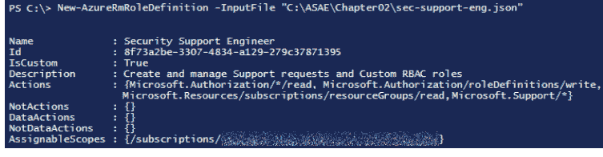

7. 再次执行 `Get-AzureRmRoleDefinition | FT Name, IsCustom`，你应该会看到新创建的自定义角色，并且 IsCustom 属性为 True，正如预期的那样。

8. 登录到 portal.azure.com 上的 Azure 门户。导航到创建自定义角色的订阅，然后单击 Access Control (IAM) 刀片。选择 Roles 并搜索你刚刚创建的自定义角色。在 Azure 门户中，你会注意到类型列中角色的值为 `CustomRole` 而不是默认的 `BuiltInRole` 类型，类似于图 2.47。`CustomRole` 类型标识该角色为自定义；你也可以为角色提供自定义名称，例如 Security Support Engineer。


### 图 2.47 角色列表及刚创建的自定义角色


sec-support-eng.json 脚本的电子版可在此处找到：github.com/benperk/ASA/tree/master/Chapter02

创建自定义角色后，您可以将其分配给范围层次结构中的任何级别。有一个元素在之前的练习中被消耗了——但并不明显。被消耗的元素称为资源提供程序。资源提供程序是 ARM 的一个组成部分，将在第 8 章中更详细地讨论。要查看从安全支持工程师客户角色引用的资源提供程序，请单击图 2.47 中显示的自定义角色。选择权限，显示的刀片会列出资源提供程序；单击每个以查看并选择您需要的类型。

RBAC 是一个重要且关键的概念，需要理解、适当设计、部署和管理。您授予订阅、资源组或资源的用户的权限可能会产生重大的财务影响。但除财务影响外，您公司的知识产权和客户数据也面临风险。必须细致地管理此事，定期进行审查，并在认为必要时进行修改。

## 硬件和网络安全

到目前为止所涵盖的对本地门户和 Azure 门户的身份验证和授权提供了门户访问和资源访问，但不提供计算访问（进入实际资源）。创建 Azure 资源并不会立即授予对任何实际资源的访问权限；为此还有额外的身份。大多数创建的计算资源通常都有一个全局端点。世界上任何人都可以设想对计算资源进行 ping（或访问），这取决于您如何保护它。

请理解，您有责任处理代码内部的漏洞以及来自 Azure 端点的漏洞。与其他云提供商一样，Azure 仅负责其软件和基础设施的安全性；它提供的选项是为了提高安全性，也许是为了填补一些不易修复的漏洞。云托管提供商专注于保护平台。没有任何云提供商能够知道您的代码或客户使用的软件包中存在哪些漏洞。这由客户负责。此外，如果您部署已知存在攻击向量且风险过高或更改/更新成本过高的旧版遗留应用程序，则必须接受该风险。最后，当您部署到云时，如果您的团队具备技能且不会增加延迟，添加一些额外的安全层其实并不是一个坏主意。

Azure 提供了一些产品和功能，可以帮助提高各类客户的安全水平。表 2.10 简要描述了其中许多功能。每个功能都将在本文中更详细地讨论，并在后面的章节中更详细地介绍。

表 2.10 其他 Azure 安全功能

| Azure 产品 | 描述 |
|---|---|
| Microsoft Trust Center | 收集安全和合规信息的位置 |
| Security Center | 用于分析 Azure 工作负载并查找漏洞的功能 |
| Azure Network Security | 用于捍卫网络完整性的控制、设备和设施的集合 |
| Application Gateway/WAF | 可以负载均衡或限制对后端端点访问的公共端点 |
| Azure DDoS Protection | 实时流量监控，可捕获 DDoS 攻击并采取行动 |
| Azure Confidential Computing | 用于保护静态数据、传输中数据和正在处理的数据的手段 |

这些附加功能按应采取的研究、设计和部署顺序呈现。首先进行安全的研究和设计，然后是网络，然后是计算，最后是您的应用程序代码和依赖资源。

## Microsoft Trust Center

Microsoft Trust Center 是了解安全合规性的位置。什么是安全合规，为什么合规很重要，成为合规意味着什么，如果我的 Azure 产品不合规会怎样？所有这些答案都可以在 Microsoft Trust Center 找到，并在第 6 章中进行了详细讨论。

```
www.microsoft.com/en-us/trustcenter/default.aspx
```

## Security Center

Security Center 是一个功能齐全的 Azure 产品，可帮助支持安全策略的实施和维护。这是在以下支持 Security Center 概念的背景下完成的：

- Policy and compliance
- Resource security hygiene
- Advanced cloud defense
- Threat protection

Security Center 是 Azure 门户中的一项服务。登录并搜索 Security Center，然后单击链接。它看起来像图 2.48。

### 图 2.48 Security Center 图标


Security Center 有两个层级：免费版和标准版。免费版就是这样——没有相关成本，但正如您可能想象的那样，其功能比标准版少。费用基于消费和/或使用时间的组合。请参阅表 2.11，了解层级差异的一些详细信息。

单击 Security Center 链接会打开 Security Center 刀片，提供链接订阅中所有资源的概览。预期会类似于图 2.49。
让我们更详细地查看 Security Center 的每个主要组件。

### 表 2.11 Azure Security Center 层级差异

| 资源类型 | 免费层级 | 标准层级 |
|---|---|---|
| Virtual machine | ✓ | ✓ |
| App service | ✓ | ✓ |
| IoT devices |  | ✓ |
| Azure Blob storage |  | ✓ |
| MySQL |  | ✓ |
| PostgreSQL |  | ✓ |
| SQL database |  | ✓ |

### 图 2.49 Security Center 概览门户刀片


## Policy and Compliance

Security Center 中大部分的策略和合规功能都在第 6 章中介绍。此标题下找到的链接提供了对之前在图 2.49 中显示的概览刀片上所呈现内容的更详细视图。信息包括与该功能一起使用的订阅覆盖范围、监管合规性和安全策略，这些将在本章后面详细讨论。

Secure Score 功能很有趣，因为特定的操作，例如启用 MFA、启用高级数据安全或应用 JIT 网络访问，都有相关价值。实施的安全合规建议越多，得分越高。Secure Score 刀片为订阅中的所有资源提供总体得分，以及按类别（如计算、数据、存储、网络和身份）的细分。

总可能分数和当前分数的计算是 Security Center 的主要优势之一。订阅中的所有受支持资源都会不断使用算法进行审查，将当前配置与建议数据库进行比较。如果发现差异或策略或程序应用缺失，则不会授予分数，但会在资源建议列表中标识，并在实施时列出可获得的分数。建议报告可在下一组功能中找到。

## Resource Security Hygiene

此类别按订阅以及按资源类型提供总体安全相关建议列表。例如，单击 Recommendations 链接，您将获得所有建议的列表、实施它们的得分、受影响的资源数量（按类型）和每个建议的严重程度。图 2.50 显示了输出。

### 图 2.50 Security Center 建议


单击特定建议会打开一个新刀片，描述它并提供一些一般信息、威胁是什么以及如何补救。其他


资源类型如 Compute & Apps、Networking、IoT Hubs、Data & Storage 以及 Identity & Access 会列出针对这些类型资源的特定建议。最后，Security Solutions 功能允许集成第三方工具、非 Azure 资源和下一代安全功能。

## Advanced Cloud Defense

在云中，公司为计算资源付费。有时所需的计算能力很大，成本可能非常高昂。在 IaaS 部署中，你可以远程连接到一台 VM，检查机器上正在运行的内容可以降低你的成本。在 IaaS 场景中，你无论如何都要为所有消耗的计算付费，所以对此不必太担心。然而，请考虑 PaaS 或无服务器计算，在这种情况下你无法访问运行代码的 VM。你如何确定只有你的应用程序在机器上运行？

从成本角度来看，计算消耗确实会产生一定影响，但与安全角度相比影响不大。在不知所有者的情况下在机器上运行是恶意软件的工作方式；恶意软件在未经许可的情况下 somehow 在机器上执行。它不会使用太多计算资源以便保持隐蔽，但恶意软件仍可能造成一些损害，并将敏感数据或知识产权暴露给恶意行为者。防止此类事情发生的办法是配置一些自适应应用程序控制。这些控制类似于防火墙上的白名单，只有在列表中明确标识的 IP 地址才会被放行。自适应应用程序控制是允许在 Azure 平台上任何给定计算资源上运行的进程列表。此控制可防止任何意外的进程，无论敌友，在未经特定允许的情况下在你的计算资源上运行。当然，这要求你明确知道从应用程序角度来看需要哪些进程。平台进程默认会被列入白名单。

JIT 访问已经提到过；它也是高级云防御能力，其概念是在需要时并且仅在特定时间内向资源提供访问权限，在本例中为 VM。请求应与定义访问需求的工作项相关联，然后进行审查和批准。一旦时间范围过去，对资源的访问将被撤销。

文件完整性监控（FIM）提供了监控自上次扫描以来文件、应用程序软件或注册表设置更改的能力。FIM 需要 Security Center 的 Standard 层，并提供按类型划分的更改数量报告（文件、注册表等），以及所采取的操作是更新、添加还是删除。平台无法确定更改是有意还是无意；然而，与某些类型的恶意攻击相关联的一些模式是可以识别的。这些异常也会显示在 FIM 报告的输出中。

## Threat Protection

回顾本章前面你创建条件访问策略的部分，其中一个属性是验证尝试登录的风险级别。风险级别的计算只是一个作为 Azure Active Directory 提供的服务。可以将 Microsoft Threat Protection 视为相同的方式。

微软处于一个独特的位置，可以从许多产品和服务中捕获遥测数据，这带来了巨大的机会。这些遥测数据包含对微软自身产品以及在其上实施的客户产品的失败和潜在成功的利用。

随着遥测数据的收集不断增长，利用机器学习和 AI，针对许多不同类型的场景，模式、行为和异常开始浮现。这里的场景是某个恶意行为者采取了一些与历史上被认为构成威胁或看起来具有恶意意图的模式相匹配的行动。捕获这些遥测数据、从中学习、呈现其细节并对其存在发出警报的能力，是配置和使用此 Azure 产品的好处。

> 一个专注于使用 AI 监控和响应云上安全问题的产品是 Azure Sentinel。 在此处查看：
> azure.microsoft.com/en-us/services/azure-sentinel

Microsoft Threat Protection 的内部机制是微软的专有技术；然而，以下三点值得深入研究：

- Types of threats
- Threat intelligence
- Detecting threats

你可能遇到的威胁的数量和种类仅受试图执行它们的恶意行为者的想象力以及所使用的工具和资源的限制。然而，有一些常见的行为与潜在的恶意活动相关，可能值得发出警报并进行后续跟进。以下是一些例子：

- Brute force
- Botnet
- DDoS
- Malicious software

威胁的类型太多，无法提及每一个可能存在的威胁；这在日常生活中是如此，而不仅仅是关于技术和 Azure。许多威胁特定于被利用的资源类型。针对 Windows 的攻击向量与 IIS、Linux、Azure Blob Storage 或数据库不同。只要记住 Threat Protection 功能可以帮助识别它们，但要覆盖所有威胁需要一名安全专家和一本专注于安全的书籍。

话虽如此，正是收集威胁情报的行为使此功能如此宝贵。当被利用时，产生的海量遥测数据最有用于将实际利用与实施它的操作联系起来。我们期望正常的操作行为发生在给定的活动范围内。当发生超出该范围的事情时，该活动可以被记录，你可以收到警报。这些边界由通过遥测收集的情报设定，与之前尝试或成功的攻击中学习到的行为进行比较。以下是一些有时与被认为可疑的事件相关联的示例操作：

- Clearing event logs
- Creating or modifying a firewall rule
- Attempting suspicious connections on known default ports
- Deleting files

当 Security Center 产品为 Azure 订阅中的资源启用时，你可以检测这些威胁。我预计微软会对 Azure 平台启用类似的能力，但由于进入和离开客户 Azure 资源上的遥测数据包含敏感和专有信息，数据默认不会被捕获。客户需要同意收集此数据，以便检测和调查威胁。微软尊重客户的隐私——对此毫无疑问！

## Azure Network Security

Azure Networking 的内部机制在下一章第 3 章中讨论；然而，由于这是安全章节，这里介绍一些网络安全概念是有意义的。诸如隔离、连接性流量过滤和路由等概念需要安全相关的知识，以及对实际功能的了解。

从隔离角度来看，Azure Networking 提供了 *virtual networks* 的概念。虚拟网络模拟了用户在自己的本地网络中会有的网络场景，利用私有 IP 地址、实施访问控制策略并定义子网。这些选项将包含 Azure 资源的虚拟网络与运行在 Azure 平台上的所有其他资源隔离开来。虽然默认情况下启用了出站互联网连接，但任何源连接到虚拟网络内的产品和功能的能力都需要明确的允许和配置。

要过滤入站和出站虚拟网络流量，请配置 *network security groups (NSGs)* 功能。实时在虚拟网络边缘识别 IP 地址、端口号和协议对于允许或拒绝流量离开或进入非常有用。NSG 提供了此拒绝或允许规则的功能。最后，路由表对于安全很重要，以确保所有进入和离开虚拟网络的通信都通过单个网络设备进行。这减少了维护多个 NSG 的工作，并降低了未经授权的设备进入或退出虚拟网络子网的可能性。

## Application Gateway/WAF

再次，Azure Networking 在第 3 章中有详细介绍，但 Application Gateway 提供了保护运行在 Azure 平台上的应用程序的能力。The


应用程序网关是一种网络安全设备，除了负载均衡、管理会话粘性和 URL 重路由功能外，还提供 Web 应用防火墙（WAF）。

Web 应用是最易受攻击的端点之一。原因很简单：它们对任何能够连接互联网的人或物都是全球可用的。要跟上已知漏洞和补丁以防止这些漏洞，可能是一项艰巨的任务，具体取决于应用程序的规模或应用程序的数量。不仅存在平台层面的漏洞，也存在应用层面的漏洞。例如，SQL 注入、XSS、常见错误配置，或来自机器人和爬虫的探测，都属于应用层漏洞。

可以实现 Web 应用防火墙（WAF）来帮助检测和防止此类应用弱点。在第 3 章中有一个练习，在应用程序网关设备上配置了 WAF。目前，只需认识到 WAF 上的恶意活动检测和阻止是通过应用规则集与配置来实现的。支持的规则集包括 CRS 3.0、CRS 2.2.9 和 OWASP CRS 3.0；每个规则集的内容不在本书范围内，但在其他地方有完整文档。一旦确定了要应用到 WAF 的规则集，就需要确定需求是检测并记录尝试，还是在观察到事件发生时阻止请求通过 WAF。

## Azure DDoS 防护

分布式拒绝服务（DDoS）攻击是指某个来源消耗了应用程序拥有的所有可用资源，从而阻止其他客户端或客户访问。该产品在 Azure 上有两个层级：基础版和标准版。默认情况下，DDoS 防护会自动启用，并持续实时监控流量。如果识别到攻击，Microsoft 用于保护其在线服务的相同防御能力将应用于在 Azure 上运行的客户。在标准层级中，附加功能包括诊断和攻击指标报告、攻击发生时的解决方案详细信息，以及咨询 DDoS 专家的授权。这是一个很大的优势，但在大多数情况下和用途中，这种保护是免费的。

## Azure 机密计算

将极其敏感的数据迁移到云端历来是客户最常讨论的问题之一。这是一个合理的担忧，并且通过两个概念的发展得到了认真对待：

-   静态数据加密
-   传输中数据加密

这两种技术都有助于确保数据安全。到目前为止，安全主题主要集中在防止恶意行为者或恶意代码访问 Azure 上托管的资源。假设这种情况发生，恶意行为者获得了访问权限

## 使用中的数据

前两种加密方法（静态数据和传输中数据）一直是 Azure 的一部分，也是任何希望在这些场景中确保数据安全的组织的一部分。然而，存在一个缺失的漏洞级别。缺失的组件是更低的一个级别；考虑一下，数据在加密和解密过程中的某个时刻是未加密的。想象一个在 Windows 上运行的进程，其中进程是可执行文件（EXE）。这个进程可能将加密密钥存储在内存中，并且它在处理器或缓存中时以加密或未加密状态存储数据。假设恶意行为者已经进入 VM，并能够执行一些恶意代码来访问分配给该进程的内存，那么它就可以定位并捕获密钥，或者在数据未加密时访问数据并将其存储在某个远程或本地位置以供日后检索。

这是 Azure 机密计算（ACC）的用例之一，它专注于使用中数据的加密。ACC 有两种实现方式，有助于在此场景中保护数据；它们是硬件版本和软件版本，如图 2.51 所示。这两种实现都称为可信执行环境（TEE）。硬件 TEE 在 VM 上现有的一部分可用内存和处理器周围创建一个受保护的容器，称为飞地。这需要使用支持 Intel SGX 的硬件。能够在该内存或处理器位置运行的代码必须经过专门授权。如果这听起来很熟悉，它类似于安全中心产品中的自适应应用程序控制。Microsoft 确实经常重用其创建的产品，并将它们引入到更易于消费的附加产品或产品中。

图 2.51 可信执行环境


运行 TEE 的软件飞地在虚拟机监控程序级别创建，称为基于虚拟化的安全性。软件飞地的概念与硬件类似；然而，不是在硬件级别进行配置，虚拟机监控程序基本上创建一个虚拟内存分区，该分区与主机上的其他内存隔离，包括任何可以访问该机器的管理员。

另一个适合 ACC 的引人入胜的场景是组合多个数据源的能力。一个值得注意的例子来自医疗保健行业。医院拥有大量患者数据；然而，这些数据包含个人身份（PI）数据，不能与其他实体、其他医院或研究机构共享。这是合理的，因为数据保护和患者隐私受法律监管。来自单一医院的数据创建了一个有效的机器学习（ML）模型，该模型已被证明能提供有价值的发现。然而，如果数据在许多其他医院之间共享，那么这些模型将产生更大的发现，因为 ML 是由数据驱动的。

当来自多个实体的数据被上传时，数据可以/应该使用私钥在客户端进行加密。ML 可以使用密钥解密，并通过在飞地中运行分析来产生结果。结果是积极的，因为通过 ML 模型运行来自多个实体的数据集，与在单个数据集上运行相同的 ML 模型相比，提高了某些疾病的预测能力。

Azure 机密计算可作为 Marketplace 产品提供，名为 Confidential Compute VM Deployment，如图 2.52 所示。

### 图 2.52 机密计算 VM 部署


这是一个令人兴奋的领域，我期待未来会有许多进步。

## Azure 安全产品和技术

本节介绍 Azure 中一些与安全相关但不属于 AAD、RBAC、网络或计算的功能。这些产品和技术要么是特定于应用程序的，要么是特定于 Azure 产品的，要么是在幕后进行的流程。在第 7 章中，将更详细地讨论其中一些配置，该章涵盖云开发。

## 共享访问签名

共享访问签名（SAS）用于控制对 Blob、文件、表和队列存储容器的访问。当创建 Azure 存储帐户（我们将在第 5 章讨论）并且客户端尝试连接到存储容器时，最佳实践是生成 SAS 密钥（也称为令牌），而不是使用存储帐户的访问密钥。您不希望共享访问密钥，因为它就像 Azure 存储帐户中所有容器的根密码。访问密钥类似于以下内容，看起来非常像令牌：

```
alwgiDojznGEZoY+9Ivrt+Wmr1MsI9V0+qtEB8+RLL+88jk7cNnurEb3wWpvLdJxf7y
7vpeP60QufpNRKQA==
```

例如，在多个客户端将上传 Blob 的场景中，向每个客户端提供根密码是不安全的，因为如果其中一个客户端被入侵，那么所有客户端都需要重置或更新新密钥。这不是一个最佳或可维护的场景。相反，您可以公开一个 API 供客户端进行身份验证，然后接收一个 SAS 密钥，该密钥允许 API 对特定存储容器执行 CRUD 操作。生成 SAS 密钥的 API 确实需要访问密钥来为客户端生成 SAS 密钥。为此，需要 Azure 存储帐户的连接字符串。此连接字符串类似于以下内容：

```
DefaultEndpointsProtocol=https;AccountName=<name>;AccountKey=<key>;EndpointSuffix=core.windows.net
```

到目前为止，已经多次提到密钥，可以肯定的是，这些密钥必须存储在安全且受限的位置。存储密钥、连接字符串和其他机密的方法是通过使用名为 Azure Key Vault 的 Azure 功能来实现的，接下来将讨论该功能。

## Azure Key Vault

Azure Key Vault 是一个存储机密的产品。几乎任何应用程序运行所需、需要保护、提供对敏感数据的访问或不能在任何时候任何地方以明文形式存储的内容，都可以存储在 Azure Key Vault 中。诸如令牌、证书（.pfx）、密码和加密密钥之类的项目可以加密并存储在保管库中。要访问 Key Vault 中存储的任何项目，您必须首先通过身份验证。

Azure Key Vault 支持以下先前讨论过的身份验证功能：

-   服务主体
-   托管标识

知道 Key Vault 中存储的机密只能使用不利用任何硬编码元数据的身份验证方法访问，它是解决常见问题的可靠方案。例如，当两个系统想要相互通信并使用密钥时，在通过互联网发送密钥之前对其进行加密是明智的。如果未加密，则可能被看到并简单地添加到请求中以允许未经授权的访问。当然，在大多数情况下，通信使用 SSL/TLS 处理；然而，在某些场景中，这种额外的安全级别是合理的。

完成练习 2.9，在 Azure Key Vault 中创建密钥和机密。在后续章节中，密钥和机密都将可访问，并用于在两个实体之间加密/解密秘密消息，以及使用连接字符串连接到存储帐户。


### EXERCISE 2.9

#### Creating an Azure Key Vault

- 1. Log in to the Azure Portal at portal.azure.com.
- 2. Click + Create Resource (top left) and select Key Vault › Create.
- 3. Give the Key Vault a name, select the subscription to place it in, and then select that location.
- 4. If you have not already created a resource group (this will be done in Chapter 3 when we begin creating Azure resources), then click the Create New link and create a new one. Remember when RBAC was discussed that a resource group is one of the locations in the scope hierarchy to which service principals can be granted access. It is important to provide a name for the resource group that reflects what is contained within it. Select the resource group into which the key vault will be created.
- 5. Leave the pricing tier, access policies, and virtual network access at the defaults, and click the Create button.
- 6. Select the Key Vault, click the Keys link, and then click + Generate/import.
- 7. Set Options to Generate, enter the name, leave the other entries at the defaults, and then click Create.
- 8. Select Secrets › + Generate/Import.
- 9. Leave Upload Options set to Manual, enter a name, and add a value like the following string: `DefaultEndpointsProtocol=https;AccountName=<name>;AccountKey=<key>;EndpointSuffix=core.windows.net`
- 10. In the Content Type text box, enter This is an Azure Storage Account, leave the other options at the defaults, and then click the Create button.
- 11. Finally, click the Access Policies link to see who or what has access to the Key Vault.

```
DefaultEndpointsProtocol=https;AccountName=<name>;AccountKey=<key>;EndpointSuffix=core.windows.net
```

> This is not a valid connection string; it will be updated in a later chapter.

Both the key and the secret are now in a secure location accessible only to the service principals identified in the portal. This is a secure location and can be trusted.

## Easy Auth

Easy Auth is a managed IIS custom module that contains built-in authentication and authorization capabilities. This feature can be utilized from either Azure App Services or Azure Functions and is not enabled by default. The Easy Auth module is subscribed to the authentication event in the IIS execution pipeline; when the event is fired, the request is handed over to this module for continued execution. Once the Easy Auth code is executed successfully, the request is placed back into the pipeline and continues down the pipeline into the execution of your application code. If the authentication fails, then a 401 HTTP status code is returned to the client.

Figure 2.53 shows the authentication providers supported by Easy Auth.

**FIGURE 2.53 A list of authentication providers**


Microsoft, Facebook, Google, and Twitter all use the OAuth tokens for the management of their authentication provider, while Azure Active Directory utilizes the classes and methods contained within the Microsoft.Identity namespace. This feature is a quick and simple way of protecting an instance of Azure App Service or Azure Functions from unauthenticated access. Keep in mind, however, the designers and developers must manually create an authorization model, like RBAC, and implement it into the security layer of the application.

Notice also in Figure 2.53 the existence of an advanced setting named Token Store. Tokens are granted by an authentication provider; as a developer, if I choose to trust that authentication provider and the validation of the token is successful, then I can allow access to my protected resource. Tokens stored in the token store can be used in the same manner as managed identities or service accounts. Instead of the request coming from an actual user, the request is sent on behalf of someone or something else. This something else needs to have a valid token and can be stored in the token store and retrieved using code in real time.

Tokens typically have a life span of 60 days. Therefore, those stored in a token store must be refreshed from time to time. Each authentication provider has their own design and requirements for refreshing a token. It’s similar to sending a GET request to /.auth/refresh when the status result from an authentication request results in an expired token error.

In Chapter 4, you will configure Easy Auth as part of creating an Azure App Service instance, and the contents of an authentication request and response are described and presented in Chapter 7.

## Summary

In this chapter, we covered the most important step when migrating to the Azure platform: security. The fact that Azure Active Directory (AAD) is the feature that authenticates the access to the portal, via Azure PowerShell or Azure CLI, should be clear. AAD additionally provides an API that can be consumed from code running on the Azure platform to provide authentication into the application. Authorization is handled by role-based access control that protects the Azure resources within a subscription based on role and scope.

There are threat prevention, networking, compute, and additional Azure products and features that increase the level of security from a platform and application perspective such as WAF, Confidential Computing, Easy Auth, and NSGs. Combined, Azure provides all the necessary capabilities to run the most sensitive, private compute executions, house sensitive data, and comply with the most stringent security policies and restrictions.

## Exam Essentials

Understand Azure Active Directory. Know how to configure the most common features within AAD to pass the Azure Solutions Architect Expert exam. The most common have been discussed in this chapter. Understand that AAD provides security around the Azure Portal and is used to authenticate users. AAD also authenticates when calling a REST API, executing Azure PowerShell cmdlets, or running Azure CLI commands on Azure resources. AAD can be configured to authenticate for other Azure SaaS resources such as Office 365 or Dynamics Online.

Understand role-based access control. RBAC is an authorization model that exists within the Azure Portal. It comes with more than 40 built-in roles that are useful for granting permissions on create, read, update, and delete (CRUD) operations for Azure resources. Individuals are added to a role, and then that role is granted permission to an Azure resource at either the subscription, resource group, or resource level. RBAC also supports custom roles if one of the built-in roles does not meet your needs.

**Know AAD Connect.** Have a good understanding about what this feature is used for. This is a tool that mid to large companies will use to migrate an on-premise Active Directory to Azure Active Directory. Additionally, this tool can keep profiles and permissions synchronized in case a hybrid solution is implemented. It supports password synchronization between instances that helps support SSO.

**Understand conditional access.** This feature is a second-level security feature, meaning it is triggered after a client has provided credentials, such as a user ID and password, that are authenticated successfully. The feature can be configured to check the location of the access, which platform or OS the client is on, and a risk assessment performed on the access request. If either of those second-level security checks fails, then the client is not allowed to access the resource.

**Understand multifactor authentication.** This feature is becoming more mainstream every day. This also happens after an initial authentication is successful, which is based on something the client knows. The second factor is something the client has or is, such as a retinal scan or a phone that can be sent a number to provide to the authentication provider.

## Review Questions

- 1. What features does Azure Active Directory provide? (Choose all that apply.)
    - A. Authentication
    - B. Authorization
    - C. Retinal scan capabilities
    - D. Synchronization with on-site Active Directory
- 2. What is true about data-at-rest encryption?
    - A. Data stored in memory cache is encrypted.
    - B. Streamed content is encrypted.
    - C. Data stored in a database is encrypted.
    - D. Archived data is encrypted.
    - E. Both A and D
- 3. Which of the following role-based access controls are free?
    - A. Custom roles
    - B. Built-in roles
    - C. Both
    - D. Neither
- 4. What does AAD Connect do?
    - A. Authenticates Active Directory service principals
    - B. Exposes a REST API for querying AAD profile details
    - C. Synchronizes passwords between on-premise and AAD
    - D. Both B and C
- 5. Conditional access can be configured for which of the following scenarios?
    - A. Location of login attempt
    - B. To require a client certificate
    - C. Both A and B
    - D. Neither A nor B
- 6. Which permission is required to create a custom RBAC role?
    - A. Microsoft.Authorization/roleDefinition/read
    - B. Microsoft.Authorization/roleDefinition/write
    - C. Microsoft.Authorization/*/write
    - D. Microsoft.Authorization/roleDefinition/*


- 7. Azure 门户中保护 Azure 资源免受未经授权访问的底层几乎不可见的特性是什么？
  - A. Azure 资源管理器 (ARM)
  - B. 基于角色的访问控制 (RBAC)
  - C. Azure 服务管理器 (ASM)
  - D. 即时 (JIT) 访问
- 8. 关于数据使用中加密，以下哪项是错误的？
  - A. 它在存储在内存中时加密所有数据。
  - B. 它在 CPU 中执行时加密数据。
  - C. A 和 B 均正确
- 9. 你可以在以下哪些 Azure 产品上使用 SAS 密钥进行用户身份验证？
  - A. Azure 消息存储容器
  - B. Azure Functions
  - C. Azure Blob 存储容器
  - D. Azure Cosmos DB
  - E. A 和 C 均正确
- 10. 以下哪些内容可以存储在 Azure Key Vault 中？
  - A. 一个机密
  - B. 一个密钥
  - C. 一个 .pfx 文件
  - D. 以上所有
  - E. 仅 A 和 B


