## 第 3 章：网络

### 本章涵盖的 EXAM AZ-303 目标：

- 实现和监控 Azure 基础设施
  - 实现云基础设施监控
- 实现管理和安全解决方案
  - 实现负载均衡和网络安全

### 本章涵盖的 EXAM AZ-304 目标：

- 设计监控
  - 设计成本优化
- 设计基础设施
  - 设计网络解决方案


将 IT 解决方案迁移到云中需要许多步骤，其发生顺序值得关注。客户通常不会将网络视为首要切入点。客户或公司也不会首先考虑安全。但安全是第一步，也是最重要的一步，其次才是网络。安全必须涵盖你运行的 Azure 产品、功能和解决方案的各个方面。网络拓扑一旦创建，只能存在于你所创建的安全范围内。

网络和网络已经存在很长时间，有些早在 1950 年代就已出现。在那些早期日子里，连接节点之间共享数据和资源主要限于政府和少数几个（也许是五个）大型组织。直到 1990 年代，其他计算机的连接能力才成为主流。换句话说，个人不再需要计算机博士学位来配置局域网 (LAN)。

1990 年代还出现了万维网 (WWW) 这一术语的首次记录。万维网需要网络连接，并且使用与网络首次出现时相同的技术。今天，数十亿客户端设备使用的 www 主机名前缀、社交媒体应用和视频流仍然使用该基本网络原理（以 TCP/IP 为连接基础）。对这些网络（即内联网和互联网）的连接以及支持它的资源经常被错误地认为是简单的。通过网络提供的服务无疑是计算的预期默认功能，必须在无需人工干预的情况下运行。网络被忽视是因为这一技术层是看不见的，但人们期望它像连接到网络的设备一样正常工作。

在我们开始深入探讨 Azure 网络产品和功能之前，有三个高层次的网络概念需要解释。

- Microsoft 的全球网络
- 混合 Azure 网络
- Azure 虚拟网络服务

要获得 Azure 解决方案架构师认证，你必须理解这些概念、它们的差异以及其用例。

### Microsoft 的全球网络

Microsoft 在全球 50 多个地点设有数据中心，并且可供 140 多个国家/地区访问，如图 3.1 所示。这些数据中心被称为区域，它们通过 Microsoft 的全球广域网 (WAN) 相互连接。这些数据中心能够托管需要电子邮件、物联网、视频流、搜索、存储和云功能的应用。不仅这些数据中心托管 Azure 云平台，它们还容纳其他 Microsoft SaaS 产品，如 OneDrive、Xbox、Office 365 和 Bing。这意味着当你在 Azure 上运行时，你获得的基础设施与 Microsoft 用于运行其自身产品的相同。

托管在不同区域的资源之间的连接以及它们之间发送的流量仍保留在 WAN 内部。例如，如果你在美国东部数据中心有一个主数据库并将数据同步到另一个数据库实例，例如在北欧，则在跨大西洋传输的数据不会通过公共互联网传输。这是经常被忽视的安全优势，它基本上是免费提供的，而且不是小型云公司可以为客户提供的优势。

响应能力至关重要，将 Azure 云尽可能靠近公司及其客户是云平台和在线服务提供商的预期。数据在 WAN 中传输的速度接近光速；数据传输的路径决定了延迟。跳数，可使用名为 tracert 的工具找到，标识请求从客户端到服务器或从服务器到服务器经过多少硬件设备。有关 tracert 的更多详细信息，请查看此网页：

```
docs.microsoft.com/en-us/windows-server/administration/windows-commands/tracert
```

请求流经的跳数和设备会影响延迟和感知响应能力。这些请求在 WAN 内的路由方式将在本章后面的“网络流量路由”部分中更详细地讨论。

随着云基础设施的成熟，人们发现仅靠现有的基于硬件的路由能力已无法满足客户的需求。Microsoft 作为一家软件公司（好吧，也许不再是 100%），设计了一种云优化的、基于软件的架构来管理其 WAN。该架构被称为 *软件驱动* WAN (SWAN)。

SWAN 是一种优化跨数据中心网络容量利用率的系统。其概念基于将网络流量从一个网络段/交换机重定向到当前具有可用带宽的网络段。我们都知道，网络过度利用会导致延迟，但这种过度利用局限于某个段，而非整个网络拓扑。保持网络流量高效需要定期分析和维护，因为在其中运行的资源利用率也在发生变化。SWAN 会监控瞬时网络拥塞，并在容量足以满足需求的地方重新路由流量。

### 混合网络概述

整个“混合 Azure 网络”部分将在本章后面更详细地介绍混合网络，但现在值得先介绍一下该主题。每当使用 *混合* 一词时，通常是在两种相似实体的组合为单一、通常更高效的对象的上下文中。例如，有混合动力汽车，它们利用传统上与汽车相关的组件，但动力来源发生了变化——用电代替燃烧。同样，也有混合计算模型，它们结合了位于不同网络边界（如本地和云）内的计算和数据资源。那么，混合网络将两个独立的网络拓扑组合成一个，从而产生其协同效益。

创建与 Azure 的混合网络带来的几个实际好处是能够访问现代化功能并增加带宽。创建数据中心及其运行的架构无可争议地是难以想象的昂贵，而且这只是建造的费用。维护它还需要另一笔资金。一旦做出投资并随着时间的推移，原本配置的基础设施组件的技术进步就会出现，这可能证明更换它们是合理的。此外，数据中心的空间可能不足以满足需求，因此你需要更多增长空间。更换或重新配置数据中心既昂贵又可能造成中断，所以为什么不将网络组合起来，形成一个混合网络呢？图 3.2 显示了一个通用混合网络的示例。


### 图 3.2 Azure 混合网络示例

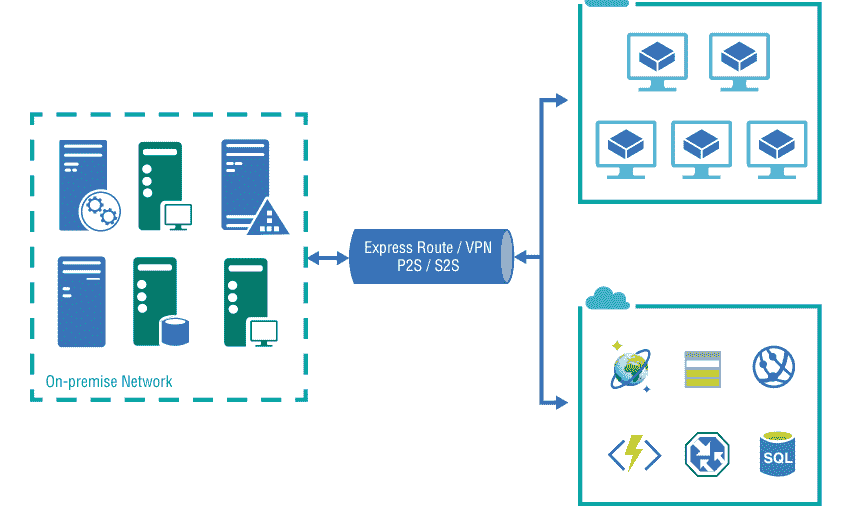

从带宽角度来看，数据中心通常会通过电信公司向互联网骨干网提供企业级网络连接。即使是电信公司的网络设备和容量也会承受压力并需要更新。本地数据中心所有者可以定期审查与第三方签订的合同，并在需要时要求更好的弹性。请记住，使用 Express Route、VPN 或点对点服务将本地数据中心连接到 Azure 数据中心的连接是由第三方公司管理的。然而，流向互联网的出站流量和 Microsoft 数据中心之间的连接则由 Microsoft 管理。这意味着它速度快、高效，最重要的是由 Microsoft 支持，这是一件好事！

### Azure 虚拟网络

所有 Azure 资源都位于 Microsoft Azure 网络中，如前所述。另一方面，并非每个 Azure 资源都存在于 Azure 虚拟网络中。诸如 SQL Azure、Azure 存储容器和 Azure App Service 等 Azure 产品在 Microsoft 网络中运行，但不在 Azure 虚拟网络中。图 3.3 表示了这种场景，其中 Azure 虚拟机（IaaS、Azure VM）位于 Azure 虚拟网络中，而其他产品则不在其中。

### 图 3.3 Azure 虚拟机嵌入在 Microsoft Azure 网络中

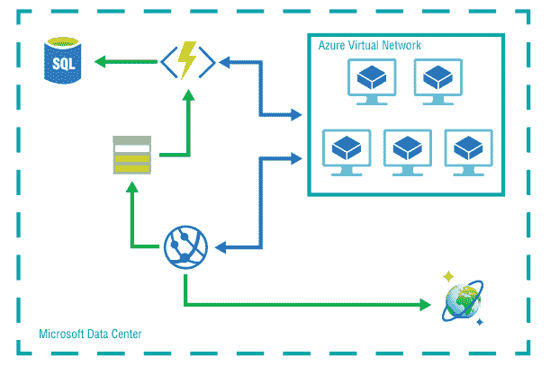

其他产品位于 Microsoft 网络中，可通过全球端点从互联网上的任何地方访问。Azure VM 可通过互联网访问，但并非没有进行特定的配置来允许访问，通常是在创建时进行。此外，Microsoft 网络中的产品可以连接到 VNet 内的其他 Azure 产品和功能，但同样不是默认的——VNet 必须允许该特定连接。最后，VNet 内的所有产品默认可以相互连接。下一节提供 VNets 的详细信息。

关键要点是，并非所有 Azure 产品都在 VNet 中运行或需要 VNet，也不需要与托管在其中的资源进行通信。迁移到 Azure 的解决方案可能也不需要与本地源通信，而是可以完全在 Azure 上运行，而不是混合解决方案。表 3.1 列出了一些场景。

### 表 3.1 需要 VNet 的场景

| 前端 | 后端/数据源 | 需要 VNet |
|---|---|---|
| Azure App Service | SQL Azure | 否 |
| Azure VM | 受管 Azure SQL | 是 |
| 本地 | 在 Azure 中 | 是/否 |
| 在 Azure 中 | 本地 | 是/否 |

如果您在 Azure App Service 上运行一个网站并连接到 SQL Azure 数据库，则不需要 VNet。两个产品都在 Microsoft 网络中运行。如果您在 Azure 虚拟机上运行一个网站，需要连接到在 VM 上运行的受管 Azure SQL 实例，则这些产品必须在 VNet 中运行。如果设计要求本地服务器，例如从 Azure 中的数据源处理数据，则同样需要 VNet。最后，如果前端，无论是表示层还是计算能力，都在 Azure 中运行并连接到安全的本地数据源，则确实需要 VNet。简单来说，混合网络需要 VNet，Azure 虚拟机也是如此。

从 Azure 解决方案架构师专家的角度来看，您应该了解哪些场景需要 VNet，是否有 VNet 的替代方案（如本章后面讨论的 Hybrid Connection Manager），以及哪些功能仅存在于 Microsoft 网络中。

### Azure 虚拟网络

Azure VNet 是 Microsoft 网络内部的隔离且安全的网络单元。Microsoft 网络基础设施是 Azure IaaS 和 PaaS 云服务的基础。使 IaaS 服务具有价值的一个核心特征是云提供商负责网络基础设施；PaaS 甚至 SaaS 也是如此。将另一个网络放置在云提供商内部的过程可以被视为在网络中放置网络，其中云提供商的网络拥有实际的硬件和网络设备，而客户的是“虚拟”网络，主要在抽象的软件层上运行，模拟网络设备。

这个隔离且安全的网络单元（又名 VNet）由一个或多个子网组成，其中子网是一种用于分割或创建 VNet 内资源运行边界的技术。具体来说，用于分割的技术基于无类别域间路由（CIDR）格式指定的唯一 IP 地址范围，例如 10.0.0.0/24。最后，VNet 及其包含的子网被配置为在某个区域中运行，该区域与前面描述的数据中心同义。让我们更仔细地了解一下区域和一些关键的 VNet 功能；然后我们将深入探讨在 Azure 上运行 VNet 和子网的网络方面。

### 区域

在第 1 章中，我们提到了部署或迁移到 Azure 时需要考虑的三大因素，其中之一是位置。客户可以选择超过 50 个位置来部署其应用程序。那么，您应该在哪个区域创建 VNet，以及在决定时需要考虑哪些因素？

好吧，请注意区域和 VNet 之间的以下考虑因素：

- VNet 及其内部的资源必须存在于同一区域。
- 添加到 VNet 的资源还必须存在于同一订阅中。
- 不同区域和不同订阅中的 VNet 可以通过对等互连或 VPN 相互连接。
- 托管在 Azure 上的应用程序需要多少弹性？是否值得使用可用性区域？
- 托管在 Azure 上的应用程序的消费者是否在 Azure 区域附近？
- 应用程序是否有任何法律、合规性和主权方面的考虑？

前三点相对清晰，即存在于北欧区域的 Azure VM 不能添加到位于西美国区域/数据中心的 VNet 中，无论它们是否在同一订阅中。然而，通过稍后讨论的对等互连或 VPN，不同 VNet 内的资源可以相互连接，无论区域或订阅如何。后者更有意义，因为 VNet 中的资源可以配置为连接到本地非 Azure 企业内网，该网络不在 Azure 数据中心，也肯定不在 Azure 订阅中。因此，您可以得出结论，只要安全规则允许，VNet 可以连接到任何其他网络。

其余几点需要更详细的解释，从可用性区域开始。区域与数据中心的类比已经被多次提及，但在某些情况下，一个区域内有多个数据中心。因此，虽然该类比是正确的，但有点限制。单个区域内拥有多个数据中心的原因是为了在发生灾难性数据中心范围故障时提供冗余。这类故障通常由天气、电力中断、网络中断或其他严重且完全不可预测的场景引起。Azure 区域中的多个数据中心可能在同一条街、同一城镇或不同城镇，但它们足够接近以用于冗余并被视为同一区域。

话虽如此，如图 3.4 所示，可用性区域是客户资源在同一区域的一个或多个 Azure 数据中心中的实例。这些可用性区域提供冗余和高可用性功能，以防止区域或数据中心角度可能出现的任何单点故障。问题是，您在 Azure 上运行的应用程序是否需要这种级别的冗余？该服务有相关成本：复制和额外冗余级别不是免费的。这是一个根据具体情况回答的问题，因为它取决于应用程序本身的关键性。


### 图 3.4 Azure 区域中的可用性区域

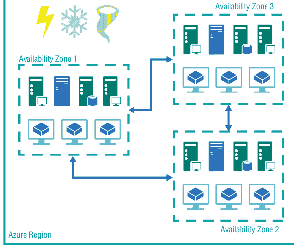

最后，并非所有 Azure 区域都提供可用性区域，而且提供可用性区域的区域也并非支持所有 Azure 产品和功能。因此，你必须了解迁移到 Azure 平台的工作负载是否需要可用性区域，还必须了解需要哪些产品和功能，然后选择部署位置。将这份列表以书面形式列出来并不明智，因为它可能并且确实会以相对较快的速度发生变化。有关支持可用性区域的区域及其支持产品的简要汇总，请参阅表 3.2。

### 表 3.2 区域、可用性区域和产品

|  | Central US | East US | North Europe | Southeast Asia |
|---|---|---|---|---|
| 虚拟机 | ✓ | ✓ | ✓ | ✓ |
| 托管磁盘 | ✓ | ✓ | ✓ | ✓ |
| Azure VPN 网关 | ✓ | × | ✓ | ✓ |
| Azure ExpressRoute | ✓ | × | ✓ | ✓ |
| Azure 负载均衡器 | ✓ | ✓ | ✓ | ✓ |
| Azure Cosmos DB | × | × | × | ✓ |

此列表在此处在线更新：

```
docs.microsoft.com/en-us/azure/availability-zones/az-overview#services-support-by-region
```

请注意，表 3.2 显示 Azure VPN 网关和 ExpressRoute 在美国东部区域不受支持；换句话说，这些产品在可用性区域中不受支持。这意味着如果美国东部的一个可用性区域发生意外中断，而你配置了其中一种产品，那么你将受到影响。请看下面的问题，它将测试你关于如何测试 Azure 区域之间延迟的知识。

你可以使用哪种 Azure 工具来测量某个区域与特定位置之间的网络延迟？

- A. Network Logger
- B. Network Watcher
- C. Wireshark
- D. Network Monitor

答案是 Network Watcher，你将在练习 3.1 中使用它。没有名为 Network Logger 的产品，至少不是 Azure 的产品。Wireshark 和 Network Monitor 都可以用来监视网络流量，但两者都不是测量 Azure 区域与特定位置之间延迟的最佳选择。

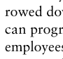

> 第 1 章介绍了 Azure 存储。我们将在第 5 章更深入地探讨该产品。还记得 LRS、ZRS、GRS 和 RA-GRS 这些术语吗？这些选项不仅对 Azure 存储至关重要，而且是提供可用性区域所提供功能的基础。这些冗余选项是必须了解的概念。

一旦你考虑了应用程序需要多高的冗余度，并缩小了提供所有必需产品和功能的 Azure 区域范围，就可以进入下一步：找到离你的客户或员工最近的区域。请记住，客户无法容忍延迟或性能不佳的应用程序。他们也许以后会再来，或者干脆转向竞争对手，再也不回来。从员工的角度来看，如果必须使用延迟高的应用程序来完成工作，这种缓慢会导致极大的挫败感和生产力损失。

如果工作负载供内部使用，回答这个问题可能很简单。Azure 区域的位置只需选择离公司所在地最近的区域即可。随着公司所在位置数量的增加，情况会变得复杂一些，并在某个时刻扩展到全球。那么问题来了：如果应用程序面向客户，客户主要位于何处？是只有一个或少数几个位置，还是客户群遍布全球？这些问题需要由公司来回答。下面的练习有助于为做出此类关键决策提供输入。

在练习 3.1 中，你将在 Central US 区域（位于爱荷华州）托管工作负载。Central US 支持可用性区域，并且可在其中运行的所有 Azure 产品和功能也都受支持，但 Azure Cosmos DB 除外。在不久的将来，你预计将在德国和日本设立公司办事处，并希望测试来自这些位置的延迟（参见图 3.5）。

### 图 3.5 测试从 Central US 区域到其他区域和全球位置的连接

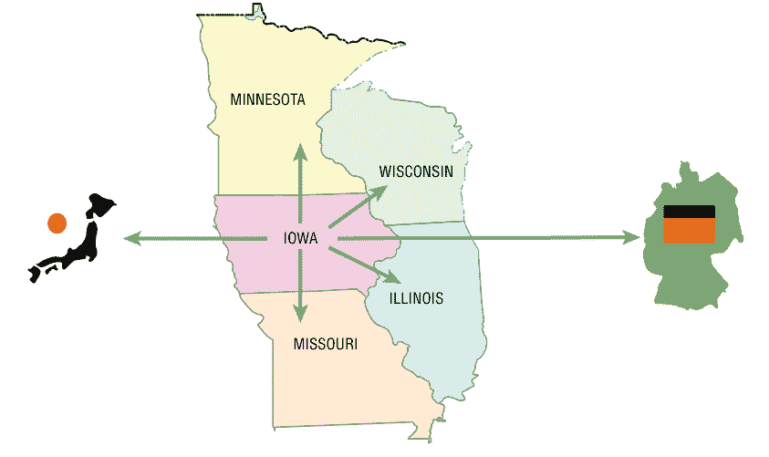

要测试这三个位置之间的延迟，请完成练习 3.1。目前没有用于执行此活动的 Azure 门户界面；相反，你将使用 PowerShell。

### 练习 3.1

### 测试从某个区域到其他州和国家的网络延迟

- 1. 如果尚未安装新的 Az PowerShell cmdlet，请以管理员身份打开 Windows PowerShell ISE 后运行以下命令。Windows 机器上默认安装了 PowerShell。

```
Install-Module -Name Az -AllowClobber -Force
```

### 练习 3.1（续）

- 2. 安装 PowerShell 后，使用 Connect-AzAccount cmdlet 登录。键入 Connect-AzAccount 并按 Enter。系统将自动提示你输入凭据。像通过门户访问 Azure 时一样输入凭据。

- 3. 完成身份验证后，请确保你处于所需的 Azure 订阅上下文中。这仅在你拥有多个 Azure 订阅时相关。执行以下 cmdlet 以设置 Azure 订阅。将你的订阅作为 SubscriptionId 的值。

```
$subscription = Get-AzSubscription -SubscriptionId "########-####-######".
Set-AzContext $subscription
```

- 4. 通过执行以下 cmdlet 创建一个资源组来放置 Azure 资源。位置为 Central US，因为我们将在此放置 Network Watcher 实例。资源组及其中的资源不需要位于同一区域；但是，从维护的角度来看，这样做是合理的。（DM1 是 Central US 区域的内部命名。）

```
New-AzResourceGroup -Name CSHARP GUITAR-DM1-RG -Location centralus
```

资源组已在第 2 章中提到过，从那一章中你知道资源组是可以授予访问权限的资源组。适当地命名资源组非常重要，这样你无需逐一检查即可知道其内容的目的。在本书中，我将向多个资源组添加资源；但是，它们将遵循标准的命名约定。这有助于我删除它们，因为一旦完成练习，我就不再需要这些资源。

- 5. 接下来，创建 Network Watcher 实例。

```
New-AzNetworkWatcher -Name NetworkWatcherCentralUS \
    -ResourceGroupName CSHARP GUITAR-DM1-RG \
    -Location centralus
```

- 6. Network Watcher 实例已创建完毕，可以执行一些测试了。首先，生成 Central US 区域与明尼苏达州之间的可达性报告。执行以下命令：

```
Get-AzNetworkWatcherReachabilityReport \
    -NetworkWatcherName NetworkWatcherCentralUS \
    -ResourceGroupName CSHARP GUITAR-DM1-RG \
    -Location "Central US" \
    -Country "United States" \
    -State "minnesota" \
    -StartTime "2019-05-25" \
    -EndTime "2019-05-30"
```

- 7. 输出可能类似于以下内容。报告的开始时间和结束时间跨越五天。最大时间为 30 天，且仅存在滚动 30 天期间的数据。

```
AggregationLevel  : State
ProviderLocation  :
{
  "Country": "United States",
  "State": "minnesota"
}
ReachabilityReport :
[
{
  "Provider": "Comcast Cable Communications, LLC - ASN 7922",
  "AzureLocation": "Central US",
  "Latencies": [
    {
      "TimeStamp": "2019-05-29T00:00:00Z",
      "Score": 96
    },
    {
      "TimeStamp": "2019-05-28T00:00:00Z",
      "Score": 94
    },
    {
      "TimeStamp": "2019-05-27T00:00:00Z",
      "Score": 98
    },
    {
      "TimeStamp": "2019-05-26T00:00:00Z",
      "Score": 98
    },
    {
      "TimeStamp": "2019-05-25T00:00:00Z",
      "Score": 98
    }]
}
]
```


### EXERCISE 3.1 (continued)

8. Score 值是一个从 1 到 100 的范围，其中 1 为最差（可能意味着存在中断），100 为完美且很少能达到。从该报告来看，28 日的延迟似乎不尽如人意，但与前一天相比仍然可以接受，而前一天接近完美。由于中部美国区域与测试位置非常接近，我们预期延迟为零或相对延迟极小。接下来，看看从德国的情况如何。

9. 执行以下命令并查看结果：

```
Get-AzNetworkWatcherReachabilityReport `
  -NetworkWatcherName NetworkWatcherCentralUS `
  -ResourceGroupName CSHARPGUITAR-DM1-RG `
  -Location "Central US" `
  -Country "Germany" `
  -State "bavaria" `
  -StartTime "2019-05-25" `
  -EndTime "2019-05-30"
```

10. 中部美国与德国之间的可达性报告输出结果如预期所示，得分为 93 到 94 分，考虑到位置与国家之间的距离，这仍然是可以接受的。尝试在国内进行以下可达性报告，结果得分会好得多，我执行时得分为 98 和 99：

```
Get-AzNetworkWatcherReachabilityReport `
  -NetworkWatcherName NetworkWatcherCentralUS `
  -ResourceGroupName CSHARPGUITAR-DM1-RG `
  -Location "Germany Central" `
  -Country "Germany" `
  -State "bavaria" `
  -StartTime "2019-05-25" `
  -EndTime "2019-05-30"
```

11. 测试发生在德国中部区域与国家本身之间。如果一家公司开始从德国的客户或员工那里获得大量消耗，那么将该工作负载部署得更靠近他们可能就合理了。

12. 要生成受支持的位置、国家、州和城市列表，请执行此 cmdlet：

```
Get-AzNetworkWatcherReachabilityProvidersList `
  -NetworkWatcherName NetworkWatcherCentralUS `
  -ResourceGroupName CSHARPGUITAR-DM1-RG
```

你可以在 GitHub 上找到本练习使用的名为 NetworkWatcher.ps1 的 PowerShell 脚本。

github.com/benperk/ASA/tree/master/Chapter03/Ch03Ex01

有一些技术可以用来改善延迟，例如 *内容分发网络 (CDN)* 或 *流量管理器*，将在后面讨论。这两者都是在另一个区域部署应用程序并配置随之而来的任何所需复制所需投资的潜在替代方案。但就目前而言，我们就此打住，认识到为你的初始 Azure 工作负载选择区域与你的客户、员工或消费者使用其中功能的位置有关。

在将第一个或下一个资源部署到 Azure 时，最后一个最常见的决策点是确定应用程序是否必须遵守任何法律法规和数据驻留要求。某些配置可能会触发数据在区域之间复制，而某些区域仅允许在该区域开展业务的政府或公司在那里存储数据。此外，还有三个区域完全与其他 Azure 区域隔离。

如果为 blob 或表存储配置了全局冗余存储 (GRS)，则该数据将被复制到另一个区域。你的应用程序存储或捕获的数据是否有任何隐私限制或法律问题？如果你不知道，那么在配置 GRS 之前应弄清楚这一点。你还应该了解所有在配置时出于冗余原因执行此类复制的 Azure 产品。这里要说明的一点是，使得复制稍微更容易接受。记住我将区域比作数据中心，并且一个区域可以有多个数据中心来支持可用性区域。那些数据中心彼此位于同一区域。*地理* 是另一个适用于此的概念，如图 3.6 所示。

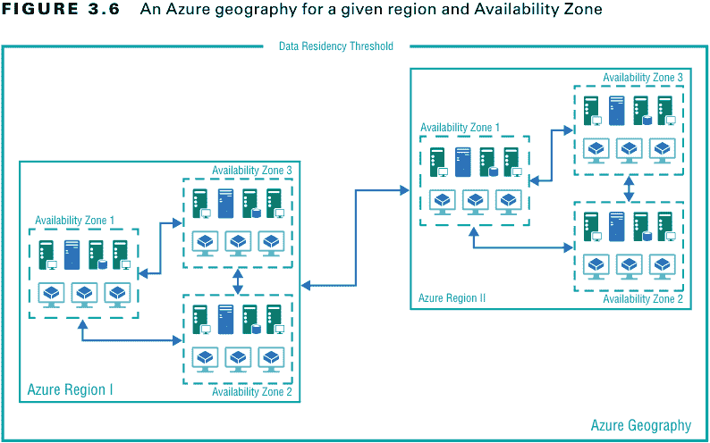

你可以看到多个区域包含在地理中，并且每个区域包含两个或多个可用性区域。任何为了避免区域范围的灾难性事件而复制到另一个区域的数据仍将在数据驻留阈值内，并且除非配置为这样做，否则不会离开地理。

如果你仔细查看某个国家/地区的区域，你会发现很少只有一个。表 3.3 显示有四个已确定的地理包含至少两个区域。这不是完整列表；每个地理还有更多区域。这里的基本要点是，当为特定区域复制数据以实现冗余时，数据仍保留在地理中，这在大多数情况下解决了任何驻留和冗余问题。

**TABLE 3.3 Azure Geographies and Compliance**

| Geography | Region | Sovereign | Available To |
|---|---|---|---|
| Americas | North Central US<br>South Central US | No | All |
| Europe | Germany Central<br>Germany Northeast | Yes | Germany only |
| Asia Pacific | Australia Central<br>Australia East | No | Australia only |
| Middle East/Africa | UAE Central<br>UAE East | No | All |

请记住，某些 Azure 产品会将数据从一个区域复制到地理之外的另一个区域。例如，LUIS、Azure 机器学习，或经常处于 beta 或预览的产品和功能就是这样处理的。这些产品之所以有意义，是因为生成的数据用于改进产品本身。你作为 Azure 解决方案专家，需要知道这些事情，联系你的法务部门，并提出隐私相关的问题。

最后，在表 3.3 中，注意 Sovereign 和 Available To 列。主权区域意味着它未连接到全球 Microsoft Azure 网络，并且没有任何数据从该区域移动到任何其他区域。此好处主要针对希望对数据及其支持方式施加更高限制和控制的政府组织。目前，美国、德国和中国是唯一拥有主权云 Azure 实施的国家。Available To 列仅意味着当你在门户中时，它知道你的业务位置，因为你在创建 Azure 订阅时提供了该信息。如果你的业务位置不在例如德国或澳大利亚，当你尝试创建 Azure 资源时，这些区域将不会显示为可选择选项。如果你尝试通过 PowerShell、REST API 或任何其他受支持客户端使用这些区域，将会抛出错误。

可以配置订阅范围的 Azure Policy 实例来限制 VNet 和其他资源可以配置的位置。这可以防止意外地将任何资源放置到不符合客户、国家或公司要求的区域。Azure Policy 将在第 6 章中更详细地讨论。此外，第 6 章还讨论了 Microsoft Trust Center，它提供了大量关于合规性和政策制定的信息。如果你急于想了解更多关于这些主题的信息，请跳到前面看一下。如果不是，请继续阅读以了解更多关于一些关键 Azure 虚拟网络功能和能力的信息。

### Key Features and Capabilities

在上一节中，我们简要介绍了资源位置如何影响或限制其包含在 VNet 中的情况。我们还简要介绍了在 Azure 上运行的 VNet 之间的连接，以及这些 VNet 与可能存在于本地的前端或后端资源的连接。在本节中，我将更详细地讨论这一领域，首先介绍一些关键的 VNet 优势，然后以网络中过滤和路由流量的一些内容作为结尾。

本节涵盖以下领域：

- Connecting with other Azure resources
- Connecting with other Azure VNets
- Connecting with the internet
- Connecting with on-premise resources
- Filtering network traffic
- Routing network traffic

Azure 产品和功能这两个术语一直是定义特定时间范围内 Azure 实体范围的常用表达。例如，Azure 产品 SQL Azure、Azure VM 和 Azure App Service 都有可计算的价格。绑定到产品的功能通常不收费。例如 EasyAuth、网络安全组 (NSG) 和网络接口就是这种情况。 going forward，使用术语 Azure 资源涵盖所有 Azure 产品和功能。你可能现在已经能够区分计算价格和不收费的情况了。

#### Some Key Azure VNet Features and Capabilities

毫不奇怪，使用 VNet 的主要原因是将一组 Azure 资源隔离到一个分段组中，其中隔离以 VNet 的形式出现，分段则以其中的子网形式出现。当创建 VNet 时，如你在练习 3.2 中将要做的那样，需要提供 VNet 的地址范围。此值的典型起始值为 10.0.0.0/16，它提供的 IP 地址范围从 10.0.0.0 到


10.0.255.255，总共包含65,535个唯一地址。创建子网时，还必须选择其地址范围，例如可能是10.0.0.0/24。所有这些都将在本章后面的“VNets和子网”部分中介绍。重点是子网的IP地址范围位于VNet的IP地址范围之内。Azure资源被添加到子网中，并由此实现分段。每个VNet可以有多个子网。

VNet中包含的Azure资源可能需要与子网外部的资源通信。Azure VNet提供了许多用于安全连接到子网外部资源的选项。子网内的Azure资源可以通过以下功能进行连接，所有这些都将在本章后面详细讨论：

- VNet到VNet
- VNet到本地
  - 站点到站点（VPN网关）
  - ExpressRoute
- VNet到不在VNet中的Azure资源
  - 直接使用全局端点
  - 使用子网委派和服务端点
- VNet到互联网

如果配置允许访问，那么在已做出允许访问的配置的情况下，任何主流或半主流场景都不会阻止Azure VNet内的资源与可通过互联网访问的其他网络进行连接。

当确定需要与另一个位置的资源进行连接时，可能希望使用主机名而不是IP地址。在这种情况下，Azure提供了两个选项。第一种是使用Azure提供的名称解析服务。应该已经了解，DNS是将主机名转换为IP地址的服务。没有DNS，就不会有域名，访问网站将需要客户端知道IP地址，这并不友好。但是，如果对DNS的工作原理不清楚，可以在“使用Azure DNS”部分中快速了解。Azure平台还提供了在VNet内的Azure VM上创建、配置和管理自己的DNS实例的能力。

从安全角度来看，这至关重要，*网络安全组（NSG）* 使用NSG控制进出每个子网的流量（入站和出站）。

### 对于Azure VM，NSG默认绑定在哪里？

默认情况下，NSG绑定到Azure VM的网卡。建议更改此默认设置，将NSG绑定到子网。你可以在本章后面的练习3.9中看到如何执行此操作。

NSG可以根据协议、端口和特定IP地址限制流量。这是管理子网内资源访问权限的一种严格且安全的方式。出站流量也可以受到控制。出站请求源自子网中的某个IP地址，并且它将通过放置在其他位置的任何限制；因此，确保流量通过预期协议和预期端口流动也是必要的。这将在“网络安全”部分更详细地介绍。

一旦VNet配置完成，你可以高枕无忧，因为知道它正受到微软的监控和支持。要完全理解这种复杂性，你需要从Azure（或任何其他云托管公司）的角度来看待它。任何实体都无法预测客户创建VNet是为了好玩、测试，还是作为一个完整的、数据密集型、带宽渴求的怪物。从这个角度来看，微软从三个方面为你提供了保障。首先，网络会监控带宽，并根据你的工作负载需求进行扩展。其次，如果你的工作负载位于数据中心内其他客户所在的区域，而他们开始消耗大量网络容量，这种情况会得到处理。最后，网络会从健康状态角度持续监控，当基于遥测的阈值被突破时，网络会自动修复。

### 与其他Azure资源连接

回想一下图3.3，一些Azure资源必须驻留在VNet中，一些可以存在于VNet中，而其他Azure资源不能存在于VNet中或默认不在其中。表3.4提供了哪些Azure资源可以/不可以部署到Azure VNet中的紧凑视图。由于此列表会频繁更改，请在互联网上搜索最新信息。表3.4包含在参加Azure解决方案架构师专家考试时最可能涉及的项目。

#### 表3.4 Azure资源VNet支持

| 类型 | Azure资源 | 可部署到VNet |
|---|---|---|
| Web | Azure应用服务 | × |
| 计算 | Azure VM | ✓ |
| 网络 | Azure应用程序网关（Web应用程序防火墙） | ✓ |
| Web | Azure逻辑应用 | ✓ |
| 安全 | Azure密钥保管库 | × |
| 数据 | SQL Azure | × |
| Web | API管理 | ✓ |
| 网络 | Azure防火墙 | ✓ |

#### 表3.4 Azure资源VNet支持（续）

| 类型 | Azure资源 | 可部署到VNet |
|---|---|---|
| 容器 | Azure Kubernetes服务（AKS） | ✓ |
| 数据 | Azure Cosmos DB | × |
| Web | 应用服务环境 | ✓ |
| 存储 | Azure存储 | × |
| 数据 | 托管Azure SQL | ✓ |
| 消息传递 | Azure事件中心 | × |

这并不意味着这些Azure资源仅仅因为一个存在于VNet中而另一个不存在，就无法相互连接。这意味着如果有此需求，则需要采取额外的操作才能实现。以常见的场景为例：一个带有SQL Server数据库后端的Web应用程序。如图3.7所示，可以设计多种部署方案。

- 应用服务Web应用和托管Azure SQL实例
- Azure VM和托管Azure SQL实例
- Azure VM和本地后端数据源
- 应用服务Web应用和本地后端数据源
- 应用服务Web应用和SQL Azure

如表3.4所列，应用服务实例不存在于VNet中，而托管Azure SQL实例存在于VNet中。回想第1章，托管Azure SQL实例是在Azure VM上运行的完整版SQL Server DBMS。由于Azure VM必须运行在VNet内，因此托管Azure SQL实例也必须如此。第1章还提到，Azure应用服务实例在沙箱中运行。这意味着不支持生成子进程或写入Windows注册表等操作。如果你的Web应用程序需要应用服务实例不支持的功能，那么一种选择是将其运行在Azure VM上。Azure VM可以连接到托管Azure SQL实例或本地后端数据源。也可以将Azure应用服务实例连接到本地数据源以及不在VNet中的Azure SQL数据库。

### 图3.7 不同的Web应用程序/数据库解决方案

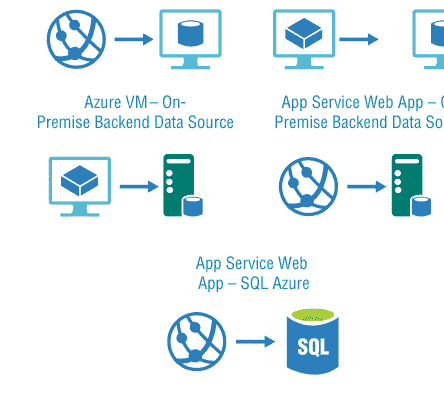

每个解决方案都必须经过深思熟虑，并根据哪种解决方案最符合应用程序要求来做出决定。关于运行不在VNet中的Azure资源，一个重要点是该资源会暴露一个全局端点，这意味着它可以通过互联网访问，并且路由可能不同。此外，还会出现一些额外的安全问题。确实，路由是不同的；然而，微软的网络基础设施足够智能，可以确定所请求的资源是否为Azure资源。如果是，流量会经过更多跳数，但仍保留在微软骨干网上。此外，让内部或高敏感网站的端点全局可识别，并不是每个客户都希望的。尽管可以采取措施保护端点，例如使用WAF或IP限制，但为什么要无缘无故地暴露该攻击向量呢？在很多情况下，这是一个危险信号，对许多客户来说会立即构成障碍。

一种解决方案可以是内部负载均衡器应用服务环境（ILB ASE），或者使用Azure VM运行Web应用程序，并通过NSG限制访问。但这还不是全部；还有另一个更新的功能，称为虚拟网络服务端点。在详细讨论服务端点之前，让我们做一个练习。在练习3.2中，你将创建一个空的Azure VNet并启用服务端点。


### EXERCISE 3.2
### 创建 Azure 虚拟网络并启用服务终结点

- 1. 登录到 Azure 门户 portal.azure.com。
- 2. 在屏幕左上角单击 + Create Resource，搜索 *Virtual Network*，然后单击 Create 按钮。
- 3. 为 VNet 指定一个名称（例如，CSHARPGUITAR-VNET-A），选择订阅并选择资源组。我计划将这些资源放置在北欧（代码 DB3）；因此，资源组名称将为 CSHARPGUITAR-DB3-RG。还记得有关可以将哪些资源添加到 VNet 的限制吗？只有同一资源组中的资源才能添加到 VNet。因此，如果将来某个时候你想将 Azure VM 添加到此 VNet，它必须在同一资源组中创建。
- 4. 选择位置，选择 VNet 将驻留的区域，考虑将其放置在资源组所在的位置，保持其余选项为默认值，然后单击 Create 按钮。
- 5. 导航到 Virtual Networks 刀片并选择你刚刚创建的 VNet。
- 6. 单击 Service Endpoints 链接，单击 + Add，展开 Service 下拉列表，选择 Microsoft.Web，展开 Subnets 下拉列表，勾选 Select All，最后单击 Add。
- 7. 保存成功后，会呈现类似图 3.8 所示的内容。我为我的子网提供了一个特定的名称（csharp），而不是接受默认值。

> 在第 2 章中我们介绍了资源提供程序；请注意 Service 下拉列表中的选项是资源提供程序（例如，Microsoft.Web）。在第 8 章中，我们将在 ARM 的上下文中广泛介绍资源提供程序。

#### FIGURE 3.8   为 Azure VNet 配置的服务终结点

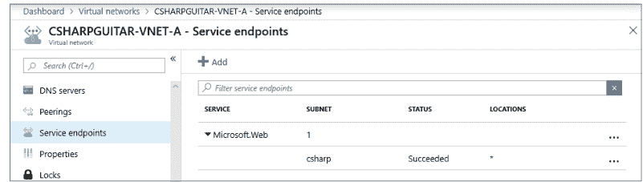

在下一节中我们讨论子网，但你不可能没有注意到 VNet 的必填字段之一是 CIDR 子网地址范围。一般来说，Azure 中子网的默认地址范围是 10.0.0.0/24，这意味着可用的 IP 地址范围是从 10.0.0.0 到 10.0.0.255。这一范围的 IP 地址通常被称为虚拟网络私有地址空间。这些 IP 地址提供了识别 VNet 内资源的一种额外方式。作为管理员，你知道哪些 Azure 资源存在于哪个 VNet 中以及它们的 IP 地址范围，因此可以基于该范围内的资源创建限制。

在练习 3.2 中，你选择了 Microsoft.Web，这意味着 VNet 将委托支持 Azure App Service，因为 Azure App Service 实例绑定到该资源提供程序。还有许多其他资源提供程序，如 Microsoft.EventHub、Microsoft.KeyVault、Microsoft.AzureCosmosDB 和 Microsoft.Sql。服务终结点之所以如此强大，是因为一旦你在未部署到 Azure VNet 的 Azure 资源上配置了它，那么只有来自子网的 IP 地址（即私有 IP 地址）才会被允许连接到该资源。这在图 3.9 中显示。

#### FIGURE 3.9 使用服务终结点在 VNet 与 Azure 资源之间的连接性

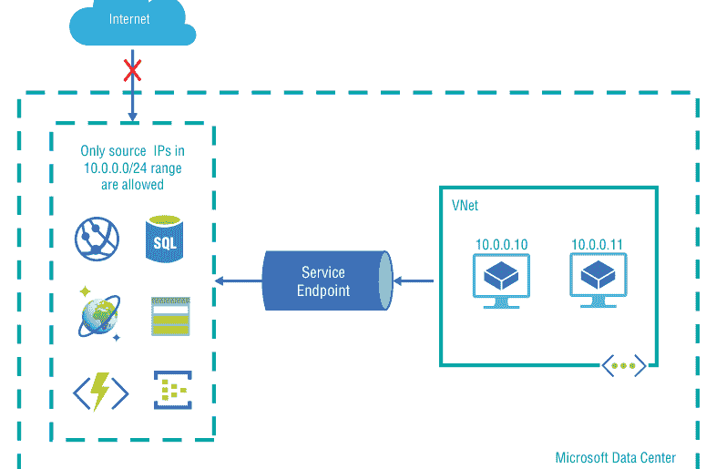

此外，不允许来自互联网的访问，因为 IP 地址也不会在该范围内。我想强调“来自配置的 VNet”这一说法。问题是，

“Azure 上是否可能存在多个 VNet 具有相同的私有 IP 地址范围 10.0.0.0/24？” 答案是肯定的。然而，到目前为止，你只为默认子网启用了服务终结点；你尚未配置 Azure 资源。配置中的一个步骤需要选择存在于该订阅中的订阅、虚拟网络和子网。那是一个紧密且安全的配置。

### 连接到其他 Azure VNet

在同一区域内连接两个 VNet 被称为 VNet 对等连接。即使没有 VNet 对等连接，也可以通过为其内的 Azure 资源提供公共 IP 地址来连接资源。这有一个缺点，因为连接将通过互联网进行，或者至少在两个资源之间的跳数会比 VNet 对等时更多。具体来说，这意味着当两个或多个 VNet 进行对等时，它们之间的流量仍保留在 Microsoft 网络内部，并且可以使用私有 IP 地址。对于托管在不同 Azure 区域的 Azure VNet 也是如此。

连接存在于不同 Azure 区域的 Azure VNet 被称为全球 VNet 对等连接。好处同样是 VNet 之间的流量仍保留在 Microsoft 主干网上，并使用私有 IP 地址。此外，你会期望由于流量仍保留在 Microsoft 主干网上且不经过互联网，延迟会很低并且所需的带宽会存在。确实如此。

带宽和延迟是在多个区域运行大型应用程序时至关重要的因素。其中许多应用程序需要从全球源同步数据到更靠近客户或员工的区域实例。通过 Microsoft 主干网而不是互联网执行这种数据移动会更快且更具容错性。

### 连接到互联网

默认情况下，包含在 VNet 中的 Azure 资源的出站连接可以连接到互联网上的任何其他资源。例如，如果一家公司公开了一个 REST API，而 VNet 内的应用程序需要访问它，则从基础设施角度来看无需任何配置即可实现。这可以通过查看默认 NSG 来可视化，如图 3.10 所示。请注意，出站安全规则名为 AllowInternetOutBound，允许所有端口和所有协议的流量从所有源访问互联网。这是默认值，因此不会出于任何原因限制出站流量。

入站情况则相反。请注意，图 3.10 中也没有 AllowInternetInbound 规则或任何类似规则。这意味着默认情况下无法将入站连接连接到 VNet 内的资源。也不可能简单地创建入站规则以允许互联网流量，因为默认情况下 Azure VNet 没有公共端点。有两个 Azure 产品在此上下文中发挥作用。

- 公共 IP 地址
- Azure 负载均衡器

#### FIGURE 3.10  默认入站和出站安全规则

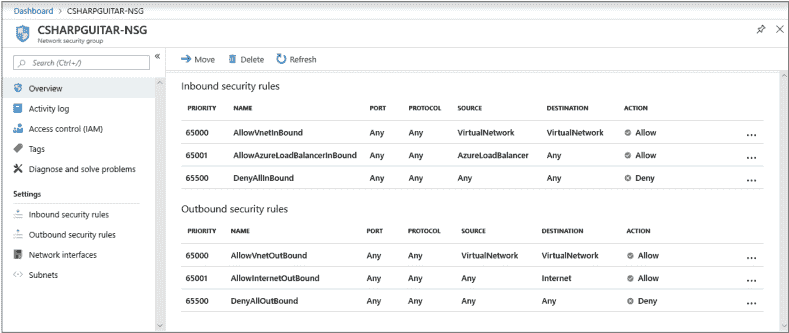

公共 IP 地址就是这样；它是一种使 VNet 内的资源可供通过任何其他方式连接到互联网的资源访问的方法。公共 IP 地址可以创建以使 VNet 托管的资源公开，并且它具有自己的可配置设置。例如，IP 地址应该是 IPv4 还是 IPv6，地址应该是动态还是静态，或是否跨可用性区域运行？此外，公共资源将路由到哪种类型的资源——虚拟机、应用程序网关或负载均衡器？

尽管可以将公共 IP 地址直接路由到 Azure NIC，但你可能考虑将其链接到 Azure 负载均衡器。使用 Azure 负载均衡器的两个主要原因是更好地管理入站和出站互联网连接。从入站角度来看，将公共 IP 地址映射到特定资源是有风险的，因为它将成为单点故障。此外，如果有任何客户端直接链接到该 IP 地址并且 IP 地址发生变化，则这些客户端将停止运行。Azure 负载均衡器可以充当代理，并可配置为将请求路由到特定 IP 地址到 VNet 中的一个或多个其他资源。

出站场景要复杂得多，并在后面的“连接到互联网”部分中详细介绍。它归结为你希望出站 IP 地址是什么。在 IP 地址直接绑定到资源的场景中，当入站和出站 IP 地址没有区别时，这被称为 *instance-level public IP (ILPIP)* 地址。然而，这不是最有效的配置，因为每个订阅可消耗的 IP 地址数量存在成本和限制。更进一步，工作负载可能会遇到 *source network address translation (SNAT)* 耗尽，这意味着没有更多临时端口可用于 PAT。当你改用 Azure 负载均衡器时，它采用 *port address translation (PAT)*，将私有 IP 地址隐藏在单个公共 IP 地址后面。存在一些出站 IP 地址的重用；它不是一对一映射。


最后一种场景是出站 IP 地址没有意义。在此场景中，出站 IP 地址不可配置，也不计入任何订阅限制，但可能会因多种原因多次变化。提醒一句：如果选择最后一种场景，虽然最具成本效益，但无法通过白名单或任何可靠的限制方式来限制对这些资源的访问。

### 与本地资源连接

前面展示的图 3.2 完整地展示了 Azure 与本地资源之间的连接。可以使用以下方式之一将 Azure VNet 配置为连接到本地数据中心：

**ExpressRoute** *ExpressRoute* 实例是 Azure VNet 与本地网络之间唯一不经过互联网的连接。该连接是私有的，由 ExpressRoute 合作伙伴直接管理。这种连接场景主要预留给具有较大工作负载的大型企业。与其他方案相比，该解决方案相对昂贵，因此建议提前使用 Azure 计算器查看价格。请参阅 azure.microsoft.com/en-us/pricing/calculator。

**点到站点连接（VPN）** 另一方面，*点到站点（P2S）* 连接是一种廉价的解决方案，可将任何受支持的 Azure 资源连接到另一个网络中的现有资源。如果你刚刚开始，或者是一名希望试运行的开发者，可以从这里开始。P2S 通常使用基于 Azure Relay 的 *混合连接管理器（HCM）* 实现，或者你也可以直接使用 Azure Relay 本身。P2S 通过计算机与虚拟网络或本地网络之间的加密隧道发送流量。图 3.11 说明了 P2S 连接可以实现以下连接：从 VNet 内部连接到本地服务器、从 Azure 应用服务/Azure 函数连接到本地服务器，以及从 Azure 应用服务/Azure 函数连接到 VNet 内的服务器。

**站点到站点连接（VPN）** 与 P2S 类似，通过 *站点到站点（S2S）* 连接的流量在穿越互联网的加密隧道内发送。主要区别在于，连接发生在 Azure VPN 网关和本地 VPN 设备之间。

对于一家刚开始使用 Azure 但又不希望其流量经过互联网的公司，你会推荐哪种 Azure 到本地的连接？

+   A. 站点到站点（Site-to-site）
+   B. ExpressRoute
+   C. 点到点（Point-to-point）
+   D. 点到站点（Point-to-site）
+   E. B 和 C 都对

答案是站点到站点。当流量不能穿越互联网时，ExpressRoute 是唯一提供这种能力的解决方案。

### 图 3.11 点到站点连接的网络流

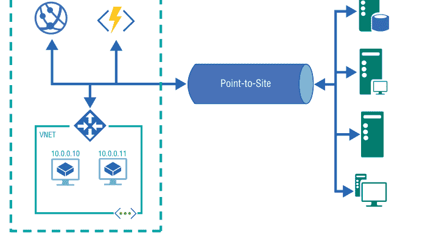

### 网络流量过滤

在 Azure（很可能也包括本地环境）上过滤流量最常见或最常用的方式是使用 NSG（又称安全规则）。如图 3.10 所示，NSG 根据一组安全规则限制（过滤）入站和出站流量。另一个有助于过滤网络流量的 Azure 功能是应用程序安全组（ASG）。ASG 能够将一组 Azure VM 分组，并专门为该组定义 NSG。以图 3.12 为例。请注意，所有三个 Azure VM 都位于同一子网中；其中两个与名为 CSHARP-ASG 的 ASG 关联，一个与名为 GUITAR-ASG 的 ASG 关联。

再看图 3.10，注意“目标（Destination）”列。稍后当你创建 NSG 和 ASG 时，你将发现“目标”支持的值包括任意（Any）、IP 地址（IP Addresses）、虚拟网络（VirtualNetwork），当然还有应用程序安全组（Application Security Group）。与任何 NSG 一样，当向该目标发送请求时，规则会被应用。例如，你想允许两个 ASG 上的入站互联网流量，但对于 CSHARP-ASG 中的 Azure VM，只支持 HTTPS（端口 443）。在这种情况下，当目标是 CSHARP-ASG 时，NSG 会拒绝 HTTP（端口 80）。该安全规则不适用于 GUITAR-ASG 中的 Azure VM。

#### 适用于应用服务、Azure 存储等资源的 NSG 和 ASG

许多未部署到 Azure VNet 中的 Azure 资源确实具有基于 IP 地址范围或已配置的服务终结点来限制访问的能力。在 Azure 门户中，这些能力可作为资源的一项功能找到。

### 图 3.12 应用程序安全组如何过滤网络流量

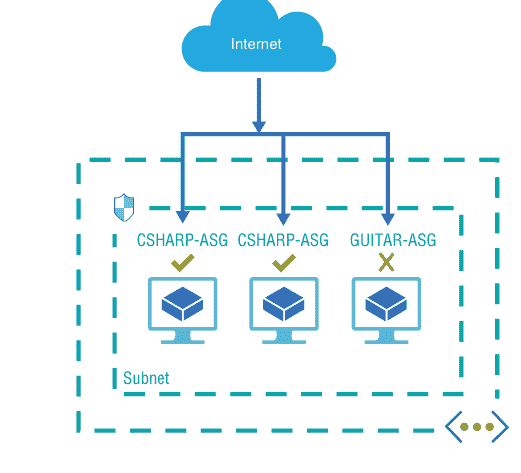

当使用 Azure 的 IT 专业人员讨论 NSG 和 ASG 时，这些对话通常发生在 Azure VNet 和 Azure VM 等 Azure 资源的上下文中。这是因为目前你不能为存在于 VNet 之外的 Azure 资源配置 NSG 或 ASG。Azure 没有提供全局能力来为 Azure 应用服务、Azure 存储或 Azure 事件中心配置 NSG 或 ASG。例如，没有任何界面或实现可以为这些 Azure 产品应用和执行 NSG 或 ASG 配置。相反，客户可以部署诸如 Azure 应用程序网关 Web 应用程序防火墙之类的网络设备，或者采用 Azure 市场中提供的第三方解决方案。例如，Barracuda、FortiGate、Cisco ASA 或 Kemp（仅举几例）可能会很有用。

### 网络流量路由

本章已经多次提到关键术语“跳（hop）”。简单来说，每当在两台联网机器之间传输的数据包经过一个节点时，就会发生一次跳。节点被视为服务器，它也连接到网络，并帮助将数据包送到其目标位置。基于这个定义，很容易想象：跳数越少，数据包传递得越快。

考虑给你隔壁邻居寄送一份邀请函。因为你认识路，你只需走出门，把信放进他们的邮箱。想象一下，你还想邀请住在镇上不同位置的几位朋友。你知道他们都住在哪里，但去每个位置的最佳路线你并不知道，不过你知道最近的邮箱在哪里。最后，考虑需要给一位很久未见、住在另一个州的家人寄邀请函。你有一个地址，但并不真正知道他们住在哪里。在上述每种场景中，路由表（routing table）的概念都适用。路由表存储到达最终目的地的下一跳（next hop）。参见图 3.13 中的 Azure 默认系统路由表示例。

在第一种场景中，邀请函确实可以通过邮局寄送，但那样就不是最佳路线。路由表在你脑中，你选择用跳数最少（本例中为零跳）的路线将邀请函送到邻居手中。在第二种场景中，通过邮寄发送邀请函是合理的。你脑海中存储的路由表知道将邀请函放在哪里（邮箱里），但之后，你对投递邀请函所走的路线一无所知。邀请函随后会到达一个邮件分拣节点。每个节点都会根据该节点路由表中存储的内容，知道将邀请函传递到下一跳。

第三个示例也存在类似的情况。由于最终目的地更远，你可以预期邀请函的投递会涉及更多跳数和更多节点。请注意，一个节点只知道自己下一步将数据包发送到哪里；这样可以使路由表保持较小。节点并不了解数据包端到端的完整路由。Azure 网络内部的数据路由也遵循类似的原理。当出站请求保持在 Azure 平台内部时，如你所知，路由保持在 Microsoft 骨干网上，不会进入互联网。来自 Azure 资源的出站流量如果确实穿越了互联网，则会使用由多个互联网服务提供商管理的节点和路由。总之，源和目标之间的数据路由并不是 Azure 独有的。网络通常被视为一种基于 TCP/IP 的低层过程，普遍用于支持节点连接和数据传输。Azure 在此基础上提供了许多产品，但你会发现，适用于 Azure 的网络概念同样适用于所有一般网络。

本节剩余部分将更详细地介绍 Azure 如何路由源自 Azure VNet 的出站网络流量。路由决策基于目标 IP 地址，并结合路由表中根据最长地址前缀进行算法匹配所得到的路由。为了进一步解释这一点，假设路由表中有两条路由：一条是 10.0.0.0/16，另一条是 10.0.0.0/8。如果出站 IP 地址是 10.0.0.4，那么选中的路由将是 10.0.0.0/16。查看表 3.5，很明显 10.0.0.4 同时属于两条路由，但 10.0.0.0/16 具有更长的前缀，因此被选中。最稳妥的做法是添加一条 10.0.0.0/24 路由，这可能会减少跳数；然而目前该路由并不存在。再次参见图 3.13。

#### 表 3.5 CIDR 到 IPv4 的转换

| CIDR 范围 | 起始 IP | 结束 IP | 总主机数 |
|---|---|---|---|
| 10.0.0.0/24 | 10.0.0.0 | 10.0.0.255 | 256 |
| 10.0.0.0/16 | 10.0.0.0 | 10.0.255.255 | 65536 |
| 10.0.0.0/8 | 10.0.0.0 | 10.255.255.255 | 16777216 |


前缀基于位掩码，其中 IP 地址中的四个八位组各自转换为位，并且选择的路由映射条目是与 CIDR 范围重叠最多的条目。/8 表示前八位相同，而 /16 表示前 16 位相等。要更深入地了解这一复杂领域，现在是创建 Azure VM 的时候了。虽然我们在下一章会详细介绍计算，但如果没有 VM 就很难提供好的示例。在练习 3.3 中，你将创建一个 Azure VM 用于分析其周围构建的网络基础设施。

### Azure 资源具有关联成本

到目前为止，这是你将创建的第一个具有直接成本的 Azure 资源。即使你从未使用它，在完成步骤 12 后也会产生费用。请注意这一点，因为随着我们推进，我们将创建具有成本的资源。我不会每次都通知你。在每个练习结束时，你可以考虑删除资源组；然而，从现在开始的示例很可能会相互构建并调用之前练习中创建的资源。

### EXERCISE 3.3

#### 创建 Azure 虚拟机

- 1. 登录到 portal.azure.com 上的 Azure 门户。
- 2. 在门户顶部搜索资源、服务和文档框中输入 Virtual Machine。选择 Virtual Machines + Add。
- 3. 在 Basics 选项卡上，选择要放置 Azure VM 的订阅和资源组（例如，CSHARPGUITAR-DB3-RG）。
- 4. 为 Azure 虚拟机提供一个名称（例如，CSHARPGUITAR-VM）。请记住 VM 名称限制为 15 个字符。
- 5. 选择区域；它可以与资源组的区域相同，但不必相同。
- 6. 将可用性选项保持为默认值并选择 Windows Server 2019 Data-center 作为映像。保持大小为默认值。
- 7. 输入用户名和密码并确认密码。
- 8. 选择 Allow Selected Ports 单选按钮并启用所有端口：HTTP、HTTPS、SSH 和 RDP。
- 9. 指定你尚未拥有许可证；如果你有，则选择 Yes。单击 Next: Disks 按钮。
- 10. 保持默认值并单击 Next: Networking 按钮。
- 11. 选择你在练习 3.2 中创建的 VNet 和相应的子网（例如，CSHARPGUITAR-VNET-A 和 csharp）。
- 12. 将其他所有内容保持为默认值并单击 Review + Create 按钮。随意浏览其他选项卡；然而，目前不需要其他配置。当你完成探索后，单击 Create 按钮。
- 13. 部署成功完成后，你可以通过执行以下 PowerShell cmdlet 查看默认系统路由表。输出将类似于图 3.13 所示的内容，但 -NetworkInterfaceName 的值在每种情况下都不同。

```
Get-AzEffectiveRouteTable -NetworkInterfaceName csharpguitar-vm810 \
    -ResourceGroupName CSHARPGUITAR-DB3-RG | Format-Table
```

#### FIGURE 3.13 PowerShell cmdlet output of the System route table

| Name | DisableBgpRoutePropagation | State | Source | AddressPrefix | NextHopType | NextHopIpAddress |
|---|---|---|---|---|---|---|
|  | False | Active | Default | {10.0.0.0/16} | VnetLocal | {} |
|  | False | Active | Default | {0.0.0.0/0} | Internet | {} |
|  | False | Active | Default | {10.0.0.0/8} | None | {} |
|  | False | Active | Default | {100.64.0.0/10} | None | {} |
|  | False | Active | Default | {192.168.0.0/16} | None | {} |
|  | False | Active | Default | {13.64.73.110/32...} | VirtualNetworkServiceEndpoint | {} |

请注意在图 3.13 中存在名为 NextHopType 和 NextHopIpAddress 的列。一旦目标 IP 地址找到路由的最佳匹配，NextHopIpAddress 就定义了下一步将数据包发送到哪里。可以更新路由以使其针对特定应用程序进行优化。如何做到这一点最好放在专门介绍网络的书籍中。然而，有一点需要说明，那就是当对路由表进行添加后可能与传出请求同样匹配时会发生什么。例如，如果添加了一个地址前缀为 10.0.0.0/8 且 NextHopType 设置为 VirtualAppliance 的额外路由会怎样？在图 3.13 中，你可以看到 10.0.0.0/8 的路由已经存在。答案是 Azure 会将用户定义的路由 (UDRs) 识别为比默认系统路由表中的路由具有更高的相关性。UDRs 在此后被多次提及，因此如果该术语尚不清晰，很快就会清楚。


### 0.0.0.0/0 地址前缀

此路由前缀默认添加到 Azure 的路由表中。它将目标 IP 地址不在 10.0.0.0/16 范围内的所有流量路由到互联网。可以通过检查该地址前缀路由表上的 NextHopType 来确认。

表 3.6 更详细地描述了图 3.13 中显示的每个 NextHopType 值。与 VnetLocal NextHopType 关联的地址前缀是 10.0.0.0/16，即默认 VNet 的地址范围。任何目标 IP 地址在该范围内的请求都将保留在 VNet 内。

#### TABLE 3.6 NextHopType Details

| Next Hop Type | Description |
|---|---|
| VnetLocal | Routes traffic within the VNet |
| Internet | Routes traffic to the internet |
| None | Traffic is dropped |
| VirtualNetworkServiceEndpoint | Routes to public IP addresses of service endpoint |

任何目标 IP 地址在 10.0.0.0/8、100.64.0.0/16 和 192.168.0.0/18 地址范围之外的请求都将被丢弃并响应类似“connection dropped”的错误。任何目标 IP 地址在全部四个地址前缀（10.0.0.0/16、10.0.0.0/8、100.64.0.0/16 或 192.168.0.0/18）之外的请求都将被路由到互联网。最后，VirtualNetworkServiceEndpoint 不是默认创建的；它是在完成练习 3.2 时部分配置服务端点期间添加到路由表的。一旦稍后完成配置，目标 IP 地址在关联地址前缀内的请求将路由到该服务终结点。

与网络路由总体相比，Azure 网络中的数据路由并不特别独特，除了存在客户服务的巨大骨干网之外。关于 VNets 和子网还有很多需要做和学习的内容，所以继续阅读。

### VNets and Subnets

阿尔伯特·爱因斯坦曾经说过，“有条理的人只是太懒得去寻找他们想要的东西。” 就像管理组、订阅和资源组的关联层级结构一样，VNet 和子网为 Azure 资源的组织提供了类似的能力，保持结构化和可维护。VNet 及其内部的子网提供了远不止简单组织的许多更多好处和复杂的技术概念。这一概念和对资源的深思熟虑部署不应该被忽视。与资源组甚至订阅一样，明智的做法是将其内容限制为构成 IT 解决方案的资源。VNets 和子网也是如此，你希望将其内容限制在设计的上下文中，以便其内容直观。

我可以向你保证，如果你想通过 Azure Solutions Architect Expert 考试，你需要深入了解 VNets。最好的方法是通过创建、配置和使用产品及其功能来实现。现在所有初步网络主题都已完成，是时候更深入地研究 VNets 了。本节将涵盖以下内容：

- - Additional networking concepts and tools
- - Azure networking patterns
- - Azure networking limits
- - VNet to VNet
- - Site-to-site (S2S) overview
- - VNet-to-Azure resources
- - VNet to internet

一旦你阅读、理解并完成本节中的练习，你对 Azure 虚拟网络的掌握将处于良好状态。

### Additional Networking Concepts and Tools

这里涵盖了四个主题。初次阅读时它们可能看起来有点脱节，但我向你保证它们都相关，并且是必须理解的网络主题。如果网络领域是你特别感兴趣的，并且你有强烈的愿望将其推向极限，掌握 IPv6、SNAT 和端口耗尽、65535 和网络路由等主题。

到目前为止讨论的所有 IP 地址都采用 IPv4 结构，这是最常见的格式。IPv4 地址长 32 位，分为四个 8 位八位组。例如，环回网络接口 IPv4 地址 127.0.0.1，乍一看是四个用点分隔的整数，称为点分十进制表示法。将其转换为位，你会得到图 3.14 所示的二进制结果。

#### FIGURE 3.14 Dot decimal IPv4 address in binary

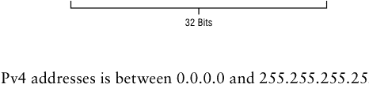

IPv4 地址的范围在 0.0.0.0 到 255.255.255.255 之间。为什么？当你将整数转换为二进制时，就会变得清晰。0.0.0.0 和 255.255.255.255 的二进制值分别如图所示，图 3.15 表明该范围包含所有可能的 32 位值。因此 IPv4 地址的最大范围为 4,294,967,296，即 2³²。


FIGURE 3.15 IPv4 address in binary from 0 to 255

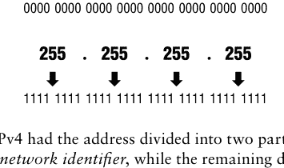

IPv4 的初始设计将地址分为两部分。地址的前三位数字构成网络标识符，而剩余的数字称为主机标识符。主机标识符用于在由网络标识符标识的给定网络内唯一区分设备。最初，前几位数字（即网络标识符）总共有 256 个可能的唯一网络（0000 0000 到 1111 1111，或 2⁸），这很快被发现是不够的。回想起来，认为只需要 256 个全球网络的需求现在是不可想象的。解决方案是创建五类 IP 地址（A 类到 E 类）；其中三类在表 3.7 中描述。

TABLE 3.7 IPv4 Classful Definitions

| Class | Total Networks | Network Addresses | Start | End | CIDR |
|---|---|---|---|---|---|
| Class A | 128 (2⁷) | 16,777,216 (2²⁴) | 0.0.0.0 | 127.0.0.0 | /8 |
| Class B | 16,384 (2¹⁴) | 65,536 (2¹⁶) | 128.0.0.0 | 191.255.0.0 | /16 |
| Class C | 2,097,152 (2²¹) | 256 (2⁸) | 192.0.0.0 | 223.255.255.0 | /24 |

三个 IPv4 地址类（A、B 和 C）被归类为单播地址，即发送方和接收方之间的一对一连接。这是 Azure Solutions Architect Expert 考试中最常见且最相关的场景。其他分类是广播（一对多）和多播（多对多）。这些分类定义有效地增加了全球网络总数并增加了可能的互联网 IP 地址数量。请注意，我们这里讨论的是公共 IP 地址，在其下方可以存在子网，并且可以包含私有 IP 地址。这些子网由于未暴露于全球，可以实现任何期望的 IP 值或范围。

#### What’s So Special About 127.0.0.1?

127.0.0.1 IPv4 地址通常被称为环回地址。该 IP 地址通常映射到主机名 localhost，可以称为 home。这在访问你当前登录的机器上托管的网站时很有用。例如，http://localhost 访问当前登录机器上托管的网站。localhost 的 IPv6 地址是 ::1。正如他们所说，“There’s no place like 127.0.0.1。”

即使有了这一改进，公共 IP 地址耗尽的问题仍然存在。许多从互联网号码分配机构（IANA）获得 C 类 IP 地址的公司用完了网络地址。C 类 IP 地址范围仅限于 256。请求 B 类地址的公司，其地址规模呈指数级增长，其中许多 65,536 个地址未被利用。这一变化将可能的全球网络数量从 256 增加到接近 16,500，这仍然是一个限制性的数字。最新版本（1998 年）的互联网协议（IP），希望成为避免 IP 地址耗尽的解决方案，是 IPv6。

IPv6 已在众多 Azure 产品上得到支持，例如 Azure Load Balancer、NSGs、在 VNet 中（预览版），以及路由到 Azure VM。支持 IPv6 需要一些配置；然而，支持 IPv6 地址的能力是存在的。例如，Azure App Service Web 应用、Azure Functions 和实例级公共 IP（ILIPs）不支持 IPv6。

如前所述，IPv4 地址范围受限于 32 位，即 2³² 的地址空间。相比之下，IPv6 受限于 128 位，提供 2¹²⁸ 的地址范围。那是一个庞大的数字，看起来像这样，是 340 不可数：

340,282,366,920,938,463,463,374,607,431,768,211,456

IPv6 地址结构为八组，由冒号分隔，以十六进制格式表示。它看起来像图 3.16 所示。

FIGURE 3.16 An example of an IPv6 address and its hexadecimal conversion

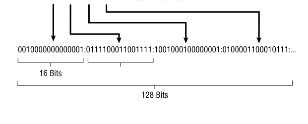

IPv6 地址最常见于创建物联网（IoT）基础设施和基于移动性的解决方案时实施。这些类型的解决方案最适合处理病毒式事件或并发连接的 IoT 设备呈指数级增长。 在这些场景中，IP 地址的数量很容易超过 B 类 IPv4 范围（65,535）。请记住，版本 6 中的 IP 地址数量远大于版本 4，并且版本 6 是前面提到的两种场景最可靠的解决方案。最后，当 IPv4 的原始创建者在 32 位范围基础上设计它时，那个数字可能令人难以置信，没有人会想到会有如此多依赖 IP 地址的设备。我想知道 IPv6 是否也会如此。没有人知道未来，但一个具有 2¹²⁸ 范围 IP 地址的解决方案似乎是合乎逻辑的下一步。我不会去弄清楚那个数字是多少！

接下来要讨论的概念是源网络地址转换（SNAT）、网络地址转换（NAT）、端口地址转换（PAT）以及临时端口，因为它们在讨论 Azure 网络拓扑时都很相关。还记得你在练习 3.2 中创建 VNet 时吗？VNet 和子网使用的地址范围是 10.0.0.*，这些地址在互联网上不可访问（它们是私有的）。NAT，如图 3.17 所示，将私有 IP 地址转换为公共 IP 地址。路由器/NAT 设备同时具有私有 IP 地址和公共 IP 地址；公共 IP 地址由互联网服务提供商提供。NAT 技术擅长将内部网络或 VNet 的私有 IP 地址隐藏在互联网之外。然而，NAT 通常是私有和公共 IP 地址之间的一对一映射。

FIGURE 3.17 An example of NAT IP address translation

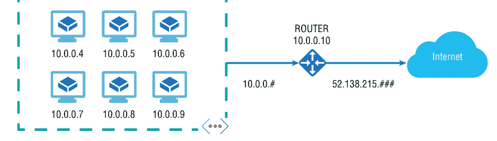

随着 IPv4 地址数量开始达到耗尽状态，PAT 的概念被引入。PAT 实现私有和公共 IP 地址之间的一对多映射，通常被称为 IP 伪装。考虑一下客户端和服务器之间发送的每个 IP 数据包都具有源地址和目标 IP 地址。

#### What Is a Router?

大多数在家中拥有互联网连接的人也有一台路由器。路由器是连接到互联网的设备。你的路由器常见 IP 地址是 192.168.1.1；只需打开浏览器并输入即可。该路由器具有内部 IP 地址，如上所述，并且可能有用于管理可以连接到路由器的所有设备的软件。如今，路由器也是暴露 WiFi 信号的设备。你的路由器也具有公共 IP 地址；如果没有它，响应你请求的服务器将无法将请求的信息返回给你。

私有 IP 地址（源）将具有例如 10.0.0.4 的源地址，并路由到某个公共 IP 地址，如 51.140.49.239（Azure 门户），这是目标地址。源 IP 地址被转换为路由器 52.138.215.### 的公共 IP 地址，然后将请求转发到目标。这在发送外出数据包时似乎很容易，但如何将答案返回给私有 10.0.0.4 地址呢？这不仅仅是这样。路由器如何知道来自 51.140.49.239 的响应，其目标地址现在是 52.138.215.### 需要定向到 10.0.0.4？答案是通过深入研究 *socket* 找到的。

socket 是 IP 地址和端口号的组合。更具体地说，它具有源 IP 地址、源端口、目标 IP 地址和目标端口，并且每一方（源和目标）都有 65,535 个可用端口，即 2¹⁶ − 1。我们将这些端口称为 *ephemeral ports*。对于每个 TCP/IP 会话，将分配一个临时端口，并在通信期间随每个数据包发送。路由器利用 socket 的详细信息来确定将响应发送到何处。netstat 工具对于监控特定机器上的连接很有用。从 CMD 控制台执行 netstat，你将看到类似图 3.18 的内容。该 netstat 命令是在练习 3.3 中创建的 Azure VM 上执行的。

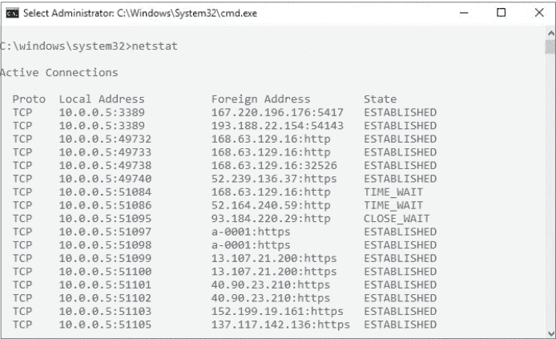

最后，SNAT 是指 IP 地址在穿越路由器时进行转换的术语。你已读到在将私有 IP 地址转换为公共 IP 地址并返回时执行此操作。你可以将其视为 *destination network address translation (DNAT)* 的对应物，后者管理目标 IP 地址转换。你可能想知道这对 Azure 来说是否重要。答案是，是的。你可能会认为当你创建 Azure VM 时，你会获得全部 65,535 个端口，但事实并非如此。如果没有适当的规划和理解，你可能会遇到端口耗尽。


部署 Azure 虚拟机最常见的场景是练习 3.3 中使用的场景。在该场景中，虚拟机默认会分配一个实例级 IP。在这种情况下，你可以在默认范围内获得所有预期的临时端口（参见图 3.19）。

### 图 3.19 来自 Azure 虚拟机的 netsh 默认动态端口范围输出

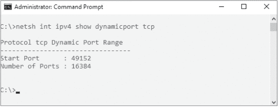

在 Azure 虚拟机上执行以下命令，以获取图 3.19 所示的输出：

```
netsh int ipv4 show dynamicport tcp
```

可以创建一个没有 ILIP 的 Azure 虚拟机，而是将公共 IP 地址映射到可用性集。（我将在下一章讨论这些内容。）这种方法通常用于保护虚拟机，使其无法从互联网单独访问，而是通过负载均衡器等另一个网络设备进行暴露。在该场景中，你的 SNAT 端口是根据可用性集中虚拟机池的大小来分配的。表 3.8 显示了这些默认的 SNAT 端口分配。

### 表 3.8 每个虚拟机池大小的 SNAT 分配

| 每个 IP 地址的 SNAT 端口数 | 池中的虚拟机数量 |
|---|---|
| 1024 | 1 到 50 |
| 512 | 51 到 100 |
| 256 | 101 到 200 |
| 128 | 201 到 400 |
| 64 | 401 到 800 |
| 32 | 801 到 1000 |

表 3.8 适用于 Azure 虚拟机没有自己的 ILIP，而是与池中的其他虚拟机共享一个出站 IP 地址的情况。要确定你的虚拟机是否有 ILIP，请导航到门户中该虚拟机的“网络”边栏选项卡。你会看到类似图 3.20 所示的内容。注意 NIC 公共 IP 地址。

### 图 3.20 Azure 门户中 NIC 公共 IP 地址的视图

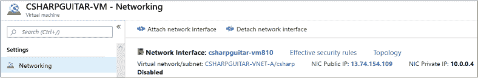

请注意，所有与互联网建立出站连接的 Azure 功能都会在某种程度上依赖于 TCP/IP、PAT、SNAT 或临时端口。请务必认识到，这不是 Azure 的限制；而是 TCP/IP 和网络运行方式。对于 Azure 解决方案架构师专家考试，你不需要了解这种程度的细节；然而，一名优秀的 Azure 解决方案架构师专家应该对此有所了解。他们应该知道在哪些场景中可以获得全部 65,535 个地址，或者只是其中一部分。Azure 解决方案架构师专家还需要知道如何排查问题并提供一些优化。更多内容将在第 7 章中介绍。

如果你没有注意到，2¹⁶ − 1（即 65,535）在网络讨论中经常被提到，因此我想提请注意该数字与网络相关的领域。“减一”是因为计数从零开始。65,535 如下：

- 默认的 TCP 接收窗口缓冲区大小
- TCP 和 UDP 端口的上限
- 16 位二进制可表示的最大数
- 每个 VNet 的最大私有 IP 地址数量
- 每个订阅的最大 NIC 数量
- 具有 /16 CIDR 前缀的 IP 地址数量

65,535 是计算机科学中常见的数字；只要记住该数字周围有一些限制即可。如果在排查问题时看到这个数字，能够回答或评论一下也很酷：“你知道吗，65,535 就是 2¹⁶？”

> **TCP 和 UDP**
> 
> Azure 虚拟机支持 TCP 和 UDP。UDP 是一种最适合视频等媒体流传输的传输协议。UDP 不介意丢失一些数据包，这些数据包可能会导致视频出现轻微波动。使用 TCP 进行视频流传输并不明智，因为丢失的数据包会被重新传输，导致视频在等待数据包时卡顿。对于需要更准确数据传输的场景，TCP 是最佳选择。

如前所述，同一 VNet 内创建的所有资源都会自动相互连接。只要 NSG 支持接收请求所采用的协议和端口，这一点就成立。为了验证这一点，请完成练习 3.4。在这里，你将在现有 VNet 中创建一个子网，向其中添加一台 Azure 虚拟机，并测试它们之间的连接。

### 练习 3.4

### 测试子网之间的连接

- 1. 登录 Azure 门户（portal.azure.com）。
- 2. 在门户顶部的搜索框中，输入 Virtual Network，然后点击 Virtual Networks。
- 3. 点击你在练习 3.2 中创建的 VNet（例如 CSHARPGUITAR-VNET-A），然后选择 Subnets + Subnet。
- 4. 添加一个子网（例如，Name = guitar），保留所有默认设置，然后点击 OK。注意 CIDR 地址范围为 10.0.1.0/24，而练习 3.2 中创建的子网（例如，csharp）为 10.0.0.0/24。
- 5. 向这个新子网中添加一台 Azure 虚拟机。在门户顶部的搜索框中输入 Virtual Machines，然后选择 Virtual Machines + Add。
- 6. 在“基本信息”选项卡中，选择要放置 Azure 虚拟机的订阅和资源组（例如 CSHARPGUITAR-DB3-RG）。该资源组必须与练习 3.2 中创建的资源组相同。
- 7. 为 Azure 虚拟机提供一个名称（例如 CSHARPGUITAR-V1；虚拟机名称的长度限制为 15 个字符）。
- 8. 选择区域；该区域应与资源组所在的区域相同，但并非必须。
- 9. 将可用性选项保留为默认值，选择 Windows Server 2019 Datacenter 作为映像，并将大小保留为默认值。
- 10. 输入用户名和密码，然后确认密码。
- 11. 选择“允许所选端口”单选按钮，并启用所有端口：HTTP、HTTPS、SSH 和 RDP。
- 12. 指明你是否拥有许可证，然后点击“下一步：磁盘”按钮。
- 13. 保留默认设置，然后点击“下一步：网络”按钮。
- 14. 选择你在练习 3.2 中创建的虚拟网络以及本练习前面创建的子网（例如 CSHARPGUITAR-VNET-A 和 guitar）。
- 15. 将所有其他设置保留为默认值，然后点击“查看 + 创建”按钮。你也可以浏览其他选项卡；但此时不需要进行其他配置。点击“创建”按钮。

### 练习 3.4（续）

21. 还有一个名为 psping 的工具，可以快速检查 Azure 虚拟机之间的连接。尝试执行以下命令以确认连接：

```
psping <Private IP address>:80
psping <VM Name>:80
```

22. 请注意，ping 因其使用的协议而无法工作；ICMP 被禁用。现在你应当确信，此处创建的 Azure 虚拟机（绑定到某个子网，例如 guitar）可以访问另一个子网中的虚拟机。

### 表 3.9 网络工具

| 工具 | 位置 |
|---|---|
| curl | curl.haxx.se/download.html |
| psping | docs.microsoft.com/en-us/sysinternals/downloads/psping |
| tcpping | github.com/benperk/ASA/tree/master/tools |
| nameresolver | github.com/benperk/ASA/tree/master/tools |

如果你在使用 curl 或 psping 测试连接时遇到问题，请尝试使用你在练习 3.1 中创建的 Network Watcher（网络观察程序）实例。完成练习 3.5，以测试 Network Watcher 提供的 IP Flow Verify（IP 流验证）和下一跃点功能。

### 练习 3.5

### 使用 Network Watcher 排查子网之间的连接问题

- 1. 登录 Azure 门户（portal.azure.com）。
- 2. 在门户顶部的搜索框中输入 Network Watcher，然后从下拉列表中点击 Network Watcher。现在，点击 IP Flow Verify。
- 3. 输入以下内容：
  - a. 对于订阅，输入包含练习 3.4 中创建的 Azure 虚拟机的订阅。
  - b. 输入资源组（例如 CSHARPGUITAR-DB3-RG）。
  - c. 输入虚拟机（例如 CSHARPGUITAR-V1）。
- d. 输入网络接口。它应默认为绑定到该 Azure 虚拟机的接口。
- e. 对于本地 IP 地址，输入 CSHARPGUITAR-V1 的私有 IP 地址，例如 10.0.1.4。
- f. 对于本地端口，输入 5555。
- g. 对于远程 IP 地址，输入 10.0.0.4，这是练习 3.3 中创建的 Azure 虚拟机（例如 CSHARPGUITAR-VM）的私有 IP 地址。
- h. 远程端口应为 NSG 中允许入站的端口；请尝试端口 22，即 SSH 端口。数据包详细信息部分应与图 3.23 类似。

### 图 3.23 允许或拒绝 Azure 虚拟机之间请求的已识别 NSG

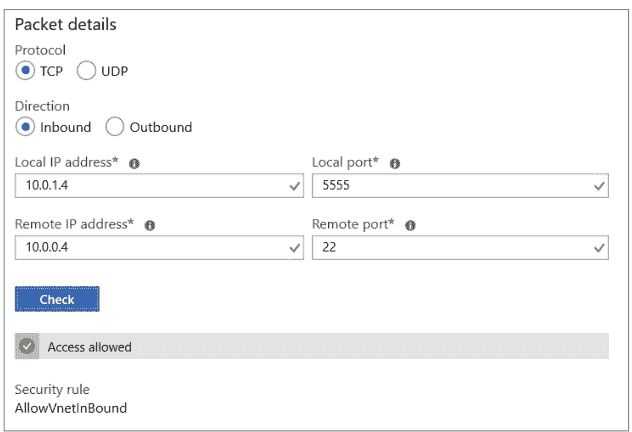

4. IP Flow Verify 的结果将识别允许或阻止请求的 NSG 规则。然后，你可以采取措施添加或修改导致失败的规则。

5. 点击“下一跃点”链接并输入以下内容：

- a. 对于订阅，输入包含练习 3.4 中创建的 Azure 虚拟机的订阅。
- b. 输入资源组（例如 CSHARPGUITAR-DB3-RG）。
- c. 输入虚拟机（例如 CSHARPGUITAR-V1）。


### 练习 3.5（续）

d. 输入网络接口。它应该默认为绑定到 Azure VM 的那个接口。
e. 对于源 IP 地址，输入 CSHARPGUITAR-VM1 的私有 IP 地址，例如 10.0.1.4。
f. 对于本地端口，输入 5555。
g. 对于目标 IP 地址，输入 10.0.0.4，这是练习 3.3 中创建的 Azure VM（例如 CSHARPGUITAR-VM）的私有 IP 地址。

6. 单击“下一跃点”按钮。请注意，如图 3.24 所示，输出显示了用于路由请求的下一跃点类型。然后你可以确认给定下一跃点类型的地址前缀是否符合预期。如果不是，你可以添加用户定义路由。

#### 图 3.24 下一跃点类型用于将请求从源 IP 地址路由到目标 IP 地址

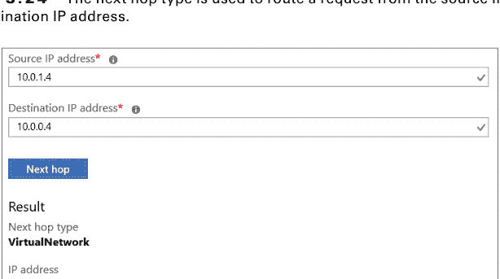

在本章后面以及本书的许多地方，你将了解更多关于路由、网络和 Azure VM 的内容。

### Azure 网络模式

客户通常会实现一些相当常见的 Azure 网络模式。以下是最常用模式的简短列表：

- 隔离
- 混合网络
- DMZ
- 中心辐射型

隔离网络模式类似于练习 3.2 中创建的网络。如图 3.17 所示，它是最简单的网络实现形式。它只是一个与互联网连接的单个 VNet。随着工作负载的消耗和部署的增加，它可能会遇到限制。Azure 网络限制将在下一节讨论，但请记住，这种网络模式通常是客户的起点。了解其他模式将有助于你在设计时考虑到这种增长。

混合网络，如本章前面所讨论的，可以通过查看图 3.2 来形象化。简单来说，这是本地计算或数据资源与 Azure VNet 中包含的相同或类似资源之间的连接。（混合连接将在本章后面讨论，并将涵盖有关强制隧道的一些额外细节。）

隔离区（DMZ）是一种为已部署的工作负载增加一层安全性的方法。如图 3.25 所示，请注意，在这种模式中，Azure VM 不再具有公共 IP 地址。它们无法从互联网或本地直接访问。要使 Azure VM 可从其他网络（如本地网络）访问，需要在其前面配置 VPN 网关、应用程序网关（Web 应用程序防火墙 [WAF]）或负载均衡器。这些网络硬件组件通常被称为*网络虚拟设备（NVA）*。NVA 可以对其后端配置的 Azure VM 限制和路由流量。

中心辐射型模式是 DMZ 的一种变体，其路由可以跨越多个订阅、VNet、DMZ 和/或工作负载。如图 3.26 所示，互联网流量已被路由到特定的 WAF。与来自本地端点的连接相比，通过互联网连接时可能需要应用不同的 NSG 集。然后，从 WAF 开始，表示有三个不同的 VNet。每个 VNet 都可以有自己的订阅。在另一种场景中，这些 VNet 可能为所部署的解决方案扮演特定角色。

将 VNet 拆分到不同订阅的一个原因是成本分离。生产、测试和开发环境可能需要分别监控用量、数据存储和成本。假设上图中的 VNet 就代表了这一点。这种模式还可以提供隔离视角。三个环境——生产、测试和开发——可以完全相互隔离。重要的是，对测试环境进行的任何性能测试都不会影响生产系统。有许多不同的模式、设计和方案。这实际上取决于你的应用程序对安全性和必要能力的要求。关键是要记住，你创建的第一个默认 VNet 很可能不是最终解决方案。请考虑所有选项，并且不要故意实施任何可能限制你增长的模式。你可以通过在设计时考虑应用程序的长期模式，并据此构建 VNet 和周边基础设施来实现这一点。

#### 图 3.25 Azure DMZ 网络模式

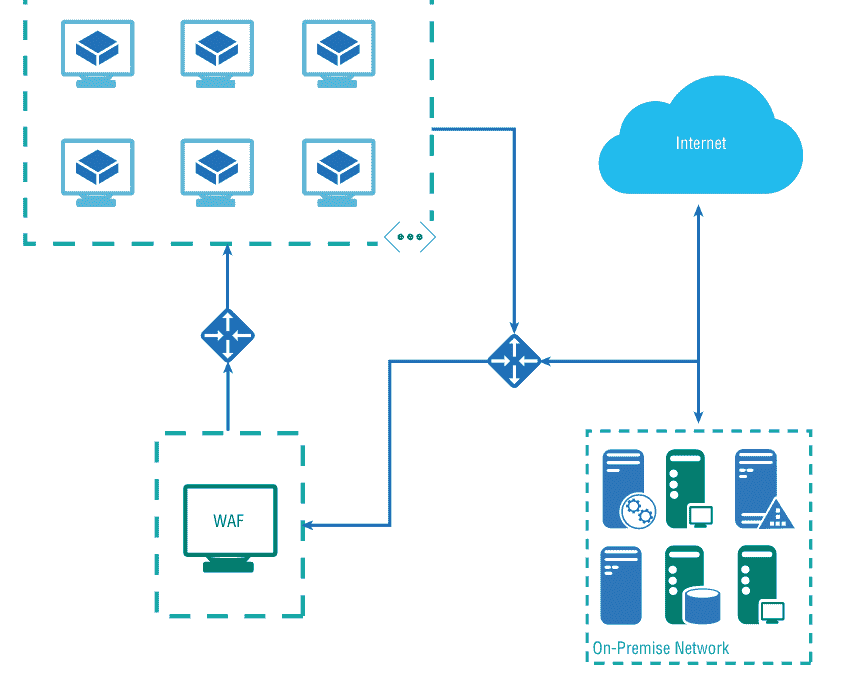

#### 图 3.26 Azure 中心辐射型网络模式

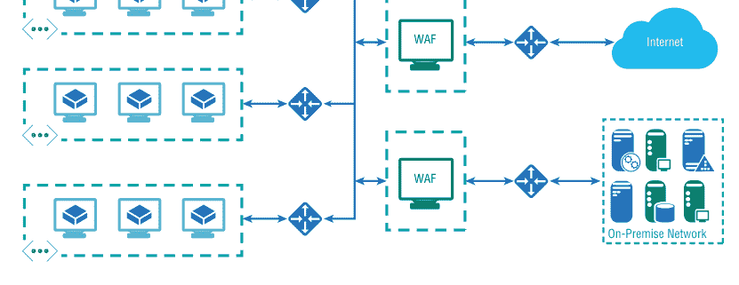

### Azure 网络限制

有时，人们会误以为云等同于无限的容量和带宽。抱有这种看法的人会很快发现，在任何计算环境中，无限的容量和带宽都是不现实的。云提供了巨大的容量和带宽，以及非常快速的横向和纵向扩展时间，但计算能力（硬件）和带宽并不是无限的。表 3.10 描述了 Azure 网络上下文中每个区域和每个 Azure 订阅的部分限制。

#### 表 3.10 Azure 网络限制

| 类别 | 资源 | 默认限制 |
|---|---|---|
| 网络 | VNet | 1,000 |
| 网络 | 每个 VNet 的子网 | 3,000 |
| 网络 | 每个 VNet 的私有 IP 地址 | 65,536 |
| 网络 | 网络安全组 | 5,000 |
| 网络 | 用户定义路由表 | 200 |
| 公共 IP 地址 | 动态 | 1,000 |
| 公共 IP 地址 | 静态 | 1,000 |
| 负载均衡器 | 负载均衡器 | 1,000 |
| ExpressRoute | 线路 | 10 |
| 应用程序网关 | 网关 | 1,000 |
| 流量管理器 | 配置文件 | 200 |
| Azure 防火墙 | 数据吞吐量 | 30 Gbps |

这些限制大多是默认值，如果需求更多，可以通过支持工单来提高。默认设置是为了保护应用程序，防止其消耗所有资源，从而可能间接影响同一区域中的其他客户；这通常被称为“吵闹邻居”。表 3.10 中提供的列表是一个摘要。还有更多默认限制。这些限制经常变化，通常是为了提高客户利益。

```
docs.microsoft.com/en-us/azure/azure-subscription-service-limits#networking-limits
```

在接下来的章节中，将有许多练习可以增加你对网络主题的了解。最好的学习方式是配置和使用这些产品和功能。

### VNet 到 VNet 集成

在练习 3.6 中，你将在不同区域和资源组中创建第二个 VNet。这被称为对等互连。实际上，当 VNet 在不同区域中相互连接时，称为全局 VNet 对等互连。当 VNet 存在于同一区域中时，它只是 VNet 对等互连。请记住，如练习 3.2 中所述，只有与 VNet 位于同一资源组中的资源才能存在于其中。练习 3.2 中创建的资源组名为 CSHARPGUITAR-DB3-RG，它位于北欧区域。该资源组中包含的资源的摘要如下。这些是此处创建的新 VNet 将连接到的资源：

- **VNet：** CSHARPGUITAR-VNET-A
- **子网：** CSHARP (10.0.0.0/24)
- **Azure VM：** CSHARPGUITAR-VM
- **区域：** 北欧 (DB3)

尽管 VNet 也可以位于另一个订阅中，但在这种情况下，两个 VNet 将位于同一订阅中，但存在于不同的区域和资源组中。

在开始练习之前，有一点需要讨论。在练习 3.2 中创建第一个 VNet 时，门户逻辑提供了 VNet 的地址空间和子网的地址范围。这些默认值对你来说足够吗？你是否需要 VNet 拥有超过 65,536 个地址、子网拥有约 256 个地址？即使你知道所需数量，如何计算最佳 CIDR？嗯，还记得我们在第 2 章讨论条件访问策略吗？我特别提到，你需要了解客户或员工使用哪些操作系统，以及他们通常用于访问的位置，才能有效创建策略。你的解决方案需要多少个 IP 地址并不是 Azure 或 Microsoft 可以预见的，因此你需要知道这些问题的答案，就像你需要知道访问控制策略要求一样。你可以在下面找到一张表，显示每个 CIDR 前缀可用的 IP 地址数量：

```
en.wikipedia.org/wiki/Classless_Inter-Domain_Routing
```

请记住，Azure 需要四到五个 IP 地址来管理每个子网的基础设施，但这仅在你创建非常小的子网时才重要。计算每个 CIDR 前缀存在多少个 IP 地址的数学公式是 2 的（地址长度减去前缀长度）次方。对于 IPv4，地址长度始终为 32。例如，如果前缀是 /29，则公式为 2^(32−29) = 2^3 = 8 个地址。在练习 3.6 中，使用了默认范围和空间，但请记住要询问或至少考虑这些是否足够。请注意，你只能通过删除 VNet 或在 VNet 为空时更改地址数量。

### 练习 3.6

#### 配置全局 VNet 对等互连

1. 登录位于 portal.azure.com 的 Azure 门户。
2. 在门户顶部的搜索框中，输入“资源组”，从下拉列表中单击“资源组”，然后点击“+ 添加”。
3. 选择所需的订阅，并提供不同的资源组名称。在此示例中，我创建的资源组名为 CSHARPGUITAR-SN1-RG。SN1 是美国中南部地区的代号。你可以根据需要命名资源组；但是，请确保它不与前面练习中创建的 VNet 位于同一区域。
4. 在门户顶部的搜索文本框中，输入“虚拟网络”，在下拉列表中单击“虚拟网络”，然后选择“+ 添加”。
5. 为 VNet 名称输入 CSHARPGUITAR-VNET-B。记下 VNet 的默认地址空间（10.1.0.0/16）和子网的默认地址范围（10.1.0.0/24）。按照步骤 3 选择订阅和资源组，将子网名称设置为 csharp，保留默认值，然后点击“创建”按钮。


### EXERCISE 3.6 (continued)

#### Global VNet Peering

回忆一下，当你创建第一个 VNet 时，VNet 的默认地址空间为 10.0.0.0/16，而 CSHARPGUITAR-VNET-B 的默认值为 10.1.0.0/16。为什么门户决定在 VNets 之间默认使用不同的默认地址空间？完全可以让两个的地址范围相同。但是，如果两个 VNet 中的地址空间相同，则它们将无法进行对等。设置对等时子网 IP 地址不能有重叠。门户通过为同一订阅中的 VNet 默认使用另一个空间并发出警告来帮助防止这种情况发生。但是，这并不会被阻止，你可以让它们重叠，但这样对等将无法成功。

- 6. 在门户顶部搜索文本框中输入 Virtual Machines，单击下拉列表中的 Virtual Machines，然后单击 + Add。
- 7. 选择所需的订阅和资源组（与步骤 3 中所做的相同）。
- 8. 为 Azure VM 提供名称（例如，CSHARPGUITAR-V2），选择区域（例如，South Central US），从 Image 下拉列表中选择 Windows Server 2019 Datacenter，并提供用户名和密码。
- 9. 选择 Allow Select Ports 单选按钮并启用所有可用端口，例如 HTTP (80)、HTTPS (443)、SSH (22) 和 RDP (3389)。
- 单击 Next : Disks : Networking，将 Virtual Network 设置为 CSHARPGUITAR-VNET-B，将子网设置为 csharp，保持其余组件为默认值，单击 Review + Create 按钮，然后单击 Create 按钮。
- 10. 部署完成后，快速检查路由表的內容。执行以下 PowerShell cmdlet，你应该会得到如图 3.27 所示的输出。该输出也与之前 CSHARPGUITAR-VM 的图 3.13 所示类似。

```
Get-AzEffectiveRouteTable -NetworkInterfaceName csharpguitar-v2713 `
-ResourceGroupName CSHARPGUITAR-SN1-RG | Format-Table
```

#### FIGURE 3.27 PowerShell cmdlet output of the system route table

| Name | DisableBgpRoutePropagation | State | Source | AddressPrefix | NextHopType | NextHopIpAddress |
|------|-----------------------------|-------|--------|---------------|-------------|-------------------|
|      | False | Active | Default | {10.1.0.0/16} | VnetLocal | {} |
|      | False | Active | Default | {0.0.0.0/0} | Internet | {} |
|      | False | Active | Default | {10.0.0.0/8} | None | {} |
|      | False | Active | Default | {100.64.0.0/10} | None | {} |
|      | False | Active | Default | {192.168.0.0/16} | None | {} |

11. 使用 Remote Desktop Connect (RDP) 应用程序通过远程桌面连接到 CSHARPGUITAR-V2 并执行以下 curl 命令，只是为了确保连接不起作用。回想一下图 3.21 和图 3.22 中 Exercise 3.4 的内容，该 curl 代码是从 CSHARPGUITAR-VM 到 CSHARPGUITAR-V1。在此场景中，你正在测试 CSHARPGUITAR-V2 与 CSHARPGUITAR-V1 之间的连接。参见图 3.28。

```
curl -G <Public IP address>:80
curl -G <Private IP address>:80
```

#### FIGURE 3.28 Using curl to test Azure VM accessibility

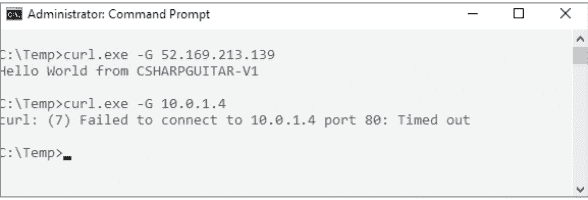

12. 如预期，使用 curl 对公网 IP 地址进行操作有效，但对私有 IP 地址无效。记住 CSHARPGUITAR-V2 位于美国德克萨斯州圣安东尼奥，而 CSHARPGUITAR-V1 位于爱尔兰都柏林。让我们将 VNets 进行对等，以便私有 IP 地址能够工作。导航到 CSHARPGUITAR-VNET-B，单击 Peerings，然后单击 + Add。

13. 为对等提供一个名称（例如，CSHARPGUITAR-PEER-B2A）。在 Virtual Network 下拉列表中，选择 CSHARPGUITAR-VNET-A，然后在另一方向命名对等（例如，CSHARPGUITAR-PEER-A2B）。保持其余默认值并单击 OK 按钮。

14. 配置完成后，再次访问 CSHARPGUITAR-V2 并使用 curl。参见图 3.29。

#### FIGURE 3.29 Using curl to test Azure VM accessibility

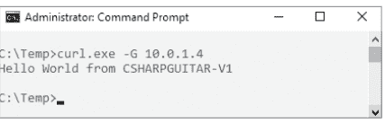

15. 执行与步骤 10 相同的 PowerShell cmdlet，你会注意到路由表中添加了一条路由（图 3.30）。

### EXERCISE 3.6 (continued)

#### FIGURE 3.30 PowerShell cmdlet output of the system route table

Name DisableBgpRoutePropagation State Source AddressPrefix NextHopType NextHopIpAddress
---- -------------------------- ----- ------ ------------- ----------- ---------------
False Active Default {10.1.0.0/16} VnetLocal {}
False Active Default {0.0.0.0/0} Internet {}
False Active Default {10.0.0.0/8} None {}
False Active Default {100.64.0.0/10} None {}
False Active Default {192.168.0.0/16} None {}
False Active Default {10.0.0.0/16} VNetGlobalPeering {}

16. 执行相同的 PowerShell cmdlet；但是在 CSHARPGUITAR-V1 的网络接口上执行。图 3.31 显示了输出。

```
Get-AzEffectiveRouteTable -NetworkInterfaceName csharpguitar-v1434 \
-ResourceGroupName CSHARPGUITAR-DB3-RG | Format-Table
```

#### FIGURE 3.31 PowerShell cmdlet output of the system route table

Name DisableBgpRoutePropagation State Source AddressPrefix NextHopType NextHopIpAddress
---- -------------------------- ----- ------ ------------- ----------- ---------------
False Active Default {10.0.0.0/16} VnetLocal {}
False Active Default {0.0.0.0/0} Internet {}
False Active Default {10.0.0.0/8} None {}
False Active Default {100.64.0.0/10} None {}
False Active Default {192.168.0.0/16} None {}
False Active Default {10.1.0.0/16} VNetGlobalPeering {}

做得好！现在可以从托管在美国中南部和北欧的服务器通过 Microsoft 全球网络进行通信。对等配置时存在三个应更详细介绍的设置。

- Allow Virtual Network Access
- Allow Forwarded Traffic
- Allow Gateway Transit

Allow Virtual Network Access 默认启用，如图 3.32 所示，可为 VNET-A 与 VNET-B 之间的双向流量配置。在此配置中，如果将来需要不允许单向或双向的流量，则可以禁用该通道。这比以后删除并重新创建要容易。

Allow Forwarded Traffic 与支持来自虚拟网络中网络设备但不源自虚拟网络本身的流量有关。此场景与网络设计以及流量如何在解决方案中路由密切相关。简单地说，如果你有 VNET-A、VNET-B 和 VNET-C，并且并非全部都已对等，但其中一个有对等的网络设备，则如果配置为这样，流量可以通过该设备路由。

#### FIGURE 3.32 Additional Azure peering configuration options

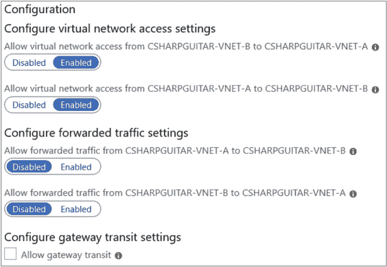

对于 Allow Gateway Transit，我们尚未详细讨论过，与本地连接有关。VPN 网关或 ExpressRoute 的实现可能需要允许网关流量。通过启用它们，流量将被允许在网关与对等的 VNets 之间流动。

### Site-to-Site Overview

“Azure Relay/Hybrid Connection Manager” 部分对 S2S 连接的内部结构进行了更详细的介绍。在此上下文中，S2S 表示 Azure 中的 VNet 或一系列 VNets（取决于模式）与 Azure 以外的某个网络之间的连接。如图 3.33 所示，连接通过网关子网和 VPN 隧道进行管理。

#### FIGURE 3.33 Site-to-site configuration

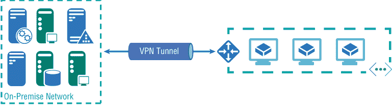

成功配置 S2S 连接需要执行许多步骤；完成此活动所需的大多数 Azure 组件尚未讨论，例如创建网关子网、可选的 Azure DNS 和 VPN 网关。更复杂的部分之一是由于高度依赖本地端点，因此从 Azure 到本地 VPN 端点的配置和连接。你可以在后面的“Azure Relay/Hybrid Azure Networking”部分和第 6 章中找到有关 S2S 的更多讨论。到那时，制作此配置所需的所有组件都将被涵盖。

### VNet to Azure Resources

并非所有 Azure 资源都存在于 Azure VNet 中。正如你所知，创建 Azure VM 时，设置的一部分是选择它将被放置的 VNet 实例。这在创建例如 Azure Function 实例、Azure App Service 实例或 Azure SQL 数据库时并非如此。这三种 Azure 产品都公开了一个全局可访问的端点，例如 *.azurewebsites.net，其中 * 是 Azure Function 或 Azure App Service 实例的名称，并且可供能够进行 HTTP 调用的任何客户端访问。

Azure SQL 数据库的端点为 *.database.windows.net，其中 * 是托管数据库的 Azure SQL 服务器的名称。为了证明可以从 Azure VM 连接到 Azure SQL 数据库，请完成练习 3.7。练习中不会详细介绍一些先决条件，如创建 Azure SQL 数据库的创建。Azure SQL 数据库的创建将在第 5 章中详细介绍。此外，还有许多来源可以详细提供此活动；例如，其中之一是：docs.microsoft.com/en-us/azure/sql-database/sql-database-single-database-get-started

创建 Azure SQL 数据库时，请务必选择 Allow Azure Services To Access Server 复选框。这将确保没有 IP 限制会阻止来自内部 Azure 资源 的连接。从 Azure VM 的角度来看，你需要安装三个实用程序。表 3.11 描述了它们是什么以及在哪里可以找到它们。

#### TABLE 3.11 Database Networking Tools

| Utility | Location |
|---|---|
| 2017 C++ redistributable | aka.ms/vs/16/release/vc_redist.x64.exe |
| ODBC Driver 17 SQL | www.microsoft.com/en-us/download/details.aspx?id=56567 |
| SQLCMD | docs.microsoft.com/en-us/sql/tools/sqlcmd-utility |

一旦实用程序成功安装在 Azure VM 上，请执行练习 3.7。


### 练习 3.7

#### 从 Azure 虚拟机连接 Azure SQL

- 1. 通过远程桌面连接到已安装表 3.11 中所标识实用程序的 Azure 虚拟机。

- 2. 打开命令提示符并输入以下内容，也在图 3.34 中进行了可视化。`sqlcmd` 默认安装在 `C:\Program Files\Microsoft SQL Server\Client SDK\ODBC\170\Tools\Binn`。导航至该位置运行 `sqlcmd`，或将路径添加到环境变量中，如我所做，这允许从任何位置执行。请务必将 `<uid>` 和 `<password>` 替换为您的凭据。

  ```
  sqlcmd -S *.database.windows.net -d <dbname> -U <uid> -P <password>
  select database_id, is_read_only, compatibility_level from sys.databases
  go
  ```

**图 3.34** 从 Azure 虚拟机连接 Azure SQL

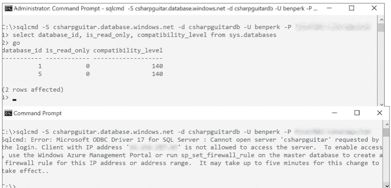

- 3. 从 Azure 虚拟机成功执行 SELECT 查询证实连接成功。

- 4. 图 3.34 中的第二个命令提示符输出是从我的本地工作站运行的。请记住，在创建 Azure SQL 数据库时，您需要允许 Azure 服务访问数据库。由于我的工作站的 IP 地址不是 Azure 服务，因此连接请求被拒绝。要使其工作，客户端 IP 地址需要在数据库上进行白名单设置。您将在第 5 章中了解更多关于此的信息。

Azure SQL 数据库实例的终结点是公开的，但它们并非简单地对数据库连接开放；需要凭据。Azure App Service 的情况类似；然而，由于 App Service 实例是客户通常在上面运行互联网应用程序的位置，因此默认情况下没有实施 IP 限制。这是可能的；Azure App Service 具有添加白名单或黑名单 IP 地址列表的功能。请还记住，在 Azure 资源之间建立连接时，无论它们是否有全局终结点，流量都会在 Microsoft 全球网络内部路由。

尝试从同一 Azure 虚拟机和非 Azure 的工作站使用 curl 访问 Azure Web 应用，如下所示：

```
curl -G csharpguitar.azurewebsites.net/api/values
```

输出应类似于以下内容：

```
["csharp","guitar"]
```

在练习 3.8 中，让我们为 Azure Web 应用配置服务终结点，以便其终结点仅可从 VNet 内部访问。回想一下图 3.13 和练习 3.2，在您创建 VNet 时，您还从服务终结点下拉菜单中启用了 Microsoft.Web。这向当时绑定到 Azure 虚拟机的表添加了一条路由。您可能考虑在启用服务终结点之前运行 PowerShell cmdlet 并检查路由表，然后在启用后再次检查，只是为了养成习惯并确认配置按预期工作。

### 练习 3.8

#### 为 Azure Web 应用配置服务终结点

- 1. 从 Azure 网络之外的任何工作站或客户端使用 curl，如图 3.35 所示。这是为了确保访问未受限制，以便您在启用服务终结点后将访问尝试进行比较。

  `curl -G csharpguitar-se.azurewebsites.net/api/values`

**图 3.35** 从 Azure 虚拟机连接到 Azure Web 应用

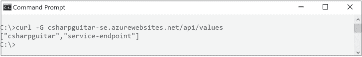

- 2. 登录到 Azure 门户 `portal.azure.com`。

- 3. 按照以下说明创建 Azure App Service，并将 Azure Web 应用放置在与要配置服务终结点的 Azure 虚拟机和 VNet 相同的资源组中。

  `docs.microsoft.com/en-us/azure/app-service/`

- 4. 导航到为本练习创建的 Azure Web 应用。选择 **Networking** > **Access Restrictions**。配置 **Access Restrictions** 并单击 **+ Add rule**。

- 5. 添加名称（例如，`ALLOW CSHARPGUITAR VNET A GUITAR`）；然后选择 **Allow**，将优先级设置为 300，并提供描述。从 **Type** 下拉列表中选择 **Virtual Network**，选择订阅，选择虚拟网络（例如，`CSHARPGUITAR-VNET-A`），从 **Subnet** 下拉列表中选择 `guitar`，然后单击 **Add Rule** 按钮。注意显示 Microsoft.Web 服务终结点将在所选子网（guitar）上启用的消息。

- 6. 导航到子网详细信息，您将看到它确实已被选中。此外，检查有效路由，您将看到添加了 *VirtualNetworkServiceEndpoint* 下一跳类型。

- 7. 执行与步骤 1 相同的 curl；您现在应该会收到 403 – Forbidden HTTP 状态响应。使用 RDP 通过远程桌面连接到 `CSHARPGUITAR-VNET-A` 和子网 `guitar` 内的 Azure 虚拟机并执行相同的步骤，请求将成功。

运行在 csharpguitar、csharpguitar-se 和 Azure Web 应用上的源代码是 ASP.NET Core 2.2 Web API 的默认版本；说明可以在以下网站找到：

docs.microsoft.com/en-us/aspnet/core/tutorials/first-web-api

如有需要，可对默认的 `ValuesController.cs` 进行少量更改以自定义它。

第 8 章将更详细地解释如何将 API 部署到 Azure App Service 平台。服务终结点，如图 3.36 所示，是一种在子网上授予众多 Azure 产品入站网络流量的方式，同时拒绝从互联网访问这些终结点。

这对于保护具有全局终结点的 Azure 功能而言，是一个有用的额外安全层。我特别使用了入站来指出，仅因为 VNet 支持入站流量的连接，并不意味着使用私有 IP 地址的出站流量会自动配置。例如，使用 curl 测试的 Azure 虚拟机具有 10.0.1.4 的私有 IP 地址；出站流量是到现在受保护的全局终结点。然而，该 Azure Web 应用将无法使用 10.0.1.4 访问 Azure 虚拟机。如果 NSG 设置为允许，则 Azure 虚拟机的公共 IP 地址是可访问的。支持服务终结点的众多终结点各自设置了自己的配置要求和细微差异，但目的在每种情况下都是相同的，即防止全局终结点上的入站互联网流量。

另一个术语，子网委派，可以在配置服务终结点的同一刀片上找到。子网委派允许在子网中创建特定于服务的资源。例如，*Microsoft.Batch/batchAccounts* 资源。此资源具有读取、写入和删除等特权。当您将该资源委派给子网时，Azure Batch 产品将在子网内的资源上拥有这些权限。

**图 3.36** 服务终结点的可视化

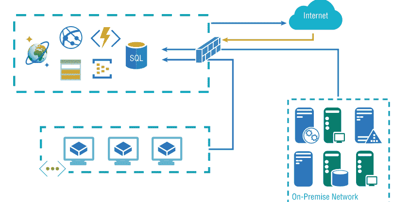

### VNet 到 Internet

出站互联网连接默认启用，您无需执行任何操作即可打开它。使用 NSG 可以限制某些端口和协议，该 NSG 已讨论过并将在下一节中详细阐述。测试连接最简单的方法是在 www.bing.com 或 www.stackoverflow.com 等网站上使用 curl。或者打开浏览器并导航到 URL。
回想一下 CIDR 前缀为 0.0.0.0/0 的路由表，其定义下一跳为互联网。当目标 IP 地址不属于其他任何路由时，就会匹配此路由。请求会从 Microsoft 全球网络路由到互联网骨干。现在您应该了解 Azure VNet 和子网。剩余部分涵盖安全、DNS、混合网络以及一些其他通用网络产品和功能。请继续阅读。

### 网络安全

关于 Azure 上可用的网络安全功能已经提出了一些观点。例如，我们谈到了网络安全组（NSG）、应用程序安全组（ASG）、网络过滤、网络虚拟设备（NVA）和服务终结点。在本节中，我们将更深入地了解与 Azure 相关的网络安全；具体如下：

- 使用 NSG、ASG 和 NVA 进行流量过滤
- Azure Application Gateway/WAF


- Azure 防火墙
- IP 限制
- 网络映射和拓扑

开始之前，请回答以下问题：

以下哪些被视为 Azure 网络模式？

- A. 混合
- B. 中心辐射
- C. DMZ
- D. 以上全部
- E. B 和 C

答案是所有这些都可以实现到 Azure 网络架构中。

### 使用 NSG、ASG 和 NVA 进行流量过滤

当我读到“filter”这个词时，我的第一反应是咖啡。这有点老派了，因为现在豆子已经磨好，咖啡是在这些超现代的机械化设备中无需滤纸就制作出来的。但很多人可能还能联想到咖啡机中放置的棕色滤纸，然后是一些已经磨好的咖啡豆，热水流过它们，冲泡出令人满意的成果。对网络流量的过滤也可以这样说，只是屏障不再是棕色滤纸，而是 NSG、ASG 或 NVA。

NSG 在图 3.10 中已提前介绍过。表 3.12 描述了 NSG 的属性。请注意，每个 Azure 订阅最多限制 5,000 个 NSG。

#### 表 3.12 NSG 属性描述

| 属性 | 描述 |
|---|---|
| 优先级 | 规则应用的顺序。规则 #1 在规则 #2 之前处理，并在首次匹配后停止处理。 |
| 名称 | NSG 的名称；必须唯一。 |
| 端口 | 可以是单个端口或端口范围 |
| 协议 | TCP、UDP 或 Any |
| 源 | 私有 IP CIDR 范围、特定 IP(s)、服务标签或 ASG |
| 目标 | 私有 IP CIDR 范围、特定 IP(s)、服务标签或 ASG |
| 操作 | 允许或拒绝 |

表 3.12 相对清晰，除了源和目标属性需要进一步解释。回顾 SNAT 和 PAT 的讨论可知，IP地址是有限资源，需要进行转换以尽可能保留资源。这就是为什么在指定 Azure 资源时，NSG 的源和目标属性基于私有 IP 地址而不是公网地址。SNAT 在入站源 IP 地址与 NSG 保护的资源交互之前发生。出站流量同样在 SNAT 交互发生之前与 NSG 交互。“交互”发生在 tcp.sys 层级，在离开物理硬件之前。公网 IP 地址和公网 IP 地址范围是受支持的。只是当你为 Azure 资源配置 NSG 时，建议使用其私有 IP 地址。

源下拉列表中提供的另一个选项是服务标签。服务标签是一组绑定到特定 Azure 产品 IP 地址的分组。例如，本章后面讨论的 Azure Traffic Manager (ATM) 可以探测一组服务器以收集健康状态。这些请求是对特定 Azure VM 的入站请求。需要允许这些 IP 地址建立连接。不是让客户创建支持 ATM 的 NSG，微软将通过服务标签管理这些 IP 地址。Azure 架构师无需担心这些 NSG 的维护。请参阅图 3.37 以了解入站和出站规则的可视化。

#### 图 3.37 服务终结点可视化

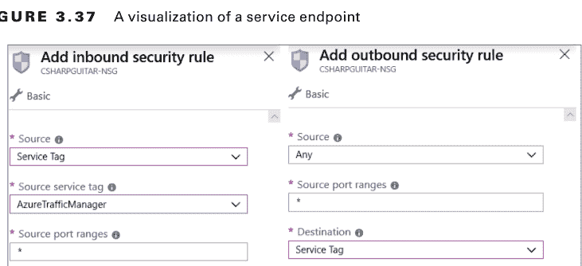

出站 NSG 的类似场景也适用，例如，Azure VM 需要连接到 Azure Storage 容器。不是为该容器专门创建 NSG 并可能需要管理 IP 地址的任何更改，而是从目标服务标签下拉列表中选择 Storage。可以进一步将其限制为特定区域的存储容器。例如，可以从目标服务标签下拉列表中选择 Storage.SouthCentralUS，以便通过 NSG 允许所有 Azure Storage 相关 IP 地址。表 3.13

总结了服务标签支持的不同 Azure 产品。该表还提供了服务标签的预期实现，指出应为出站还是入站 NSG。

#### 表 3.13 服务标签和 Azure 产品

| Azure 产品 | 区域支持 | 入站或出站 |
|---|---|---|
| Azure 负载均衡器 | × | 入站 |
| Azure Active Directory | × | 出站 |
| 存储 | ✓ | 出站 |
| Internet | × | 两者 |
| SQL | ✓ | 出站 |
| Azure Key Vault | ✓ | 出站 |
| Azure Cosmos DB | ✓ | 出站 |
| API 管理 | × | 两者 |
| App Service | ✓ | 出站 |
| 网关管理器 | × | 入站 |

能够选择 Azure 产品而不是尝试根据 IP 地址确定需要哪种入站或出站限制，增加了很大的价值。在这方面，服务标签有助于减少维护和支持工作。让我们做一个练习并实现一个最佳实践推荐的 NSG 配置。在练习 3.9 中，你将把 NSG 绑定到子网而不是绑定到特定 Azure VM 的网络接口。

### 练习 3.9

#### 将 NSG 绑定到子网

- 1. 登录到 Azure 门户 portal.azure.com。
- 2. 在门户顶部的搜索框中输入 Application security groups，点击下拉菜单中的 Application Security Groups，然后点击 + Add。
- 3. 选择所需的订阅，选择资源组（例如，CSHARPGUITAR-DB3-RG），提供名称（例如，CSHARPGUITAR-ASG），选择所需区域（例如，North Europe），点击 Review + Create 按钮，然后点击 Create 按钮。

网络虚拟设备（NVA）及其实现是高度复杂的企业级架构设备。NVA 是一个通用术语，在描述 DMZ 时可以使用。例如，DMZ 通常被描述为在边缘服务器组前面有一个面向互联网的 NVA，并在这些服务器后面还有另一个 NVA 执行额外的过滤层。也许面向互联网的 NVA 只支持 HTTP 协议，而后端 NVA 不支持。DMZ 中存在两个 NVA 位置的事实使得两者之间的位置对恶意行为者来说是未知的，这令人困惑。DMZ 及其依赖和支持组件的设计特定于应用程序的依赖关系和要求，因此只能在图 3.39 中作为基本默认场景进行说明。

#### 图 3.39 企业 NVA VNet 架构图

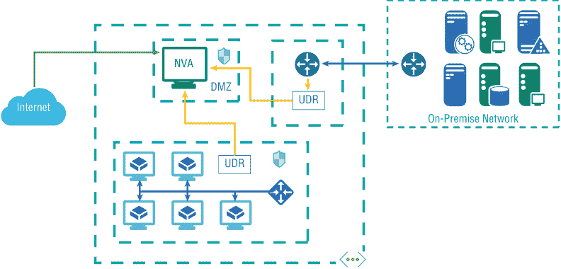

从图 3.39 中需要记住的一点是，来自本地和互联网的流量流经 DMZ，在那里流量可以被大量审查和控制。这样可以提高 DMZ 后方资源的保护级别。这个概念也 commonly 称为 *强制隧道*。名称与动作相符，因为所有流量都被强制通过 NVA 隧道，在到达两个防火墙（即 NSG）后面的任何资源之前。图 3.39 中尚未讨论过的一个项目是 *用户定义路由 (UDR)*。UDR 是放置在 VNet 路由表中的自定义路由。这些 UDR 将包含到网关、快速路由或连接不同网络的 VPN 的路由。关于 UDR 的更多内容仍将到来。

### 应用网关/WAF

应用网关提供的功能比 *Web 应用防火墙 (WAF)* 更多；然而在本节中仅讨论该产品的 WAF 部分。其他可用功能将在本章后面详细介绍。当你开始在应用层，即编码或配置层面，为基于 Web 的应用程序处理安全时，不久你就会问自己：“有没有更好的方法？”这是因为从应用角度来看，你的重点是代码以及保持所有实例的安全补丁为最新。对于较小的实现，这可能并不困难，对于 PaaS，你无需担心这些补丁。然而，从 Azure VM 角度来看，这些都是合理的担忧。在这两种情况下，在你的应用代码中发现漏洞是一项重要但值得的任务。

| 应用网关类型 |
|---|
| 有三种不同的应用网关类型：Small、Medium 和 Large。每个都有不同的成本和相关功能集。WAF 仅在 Medium 和 Large 中可用。 |

对“有没有更好的方法？”这个问题的回答之一是在已知漏洞到达实际 VM 之前放置一些保护措施。这就是 Azure Application Gateway (WAF) 可以提供帮助的地方。WAF 可以防止一些众所周知的漏洞，例如以下：

- 跨站脚本 (XSS) 攻击
- 机器人、扫描器和爬虫
- SQL 注入攻击
- HTTP 响应拆分
- HTTP 请求走私

这些保护是通过应用基于 CRS 或 OWASP 的规则集实现的，这在第 2 章中已讨论过。复习该内容以了解有关 CRS 的更多信息。当新的漏洞出现时，对它们的保护会自动添加到规则集中并应用于 WAF，无需系统管理员操作。Application Gateway WAF 在 OSI 模型的第 7 层，即应用层执行此保护。表 3.14 总结了 OSI 模型。


### 表 3.14 OSI 模型

| Level | Layer | Description |
|---|---|---|
| 7 | Application | 高级 API 和资源共享 |
| 6 | Presentation | 字符编码、压缩、加密/解密 |
| 5 | Session | 管理两个节点之间往返通信 |
| 4 | Transport | 管理两点之间数据的传输 |
| 3 | Network | 控制寻址、路由和流量控制 |
| 2 | Data link | 物理层数据传输 |
| 1 | Physical | 物理介质上的物理传输 |

WAF 的 OSI 层级之所以重要，是因为只有在触及到该特定层级的传输时，才允许某些功能。例如，在 OSI 1–4 层级无法执行基于 URL 的路由或 SSL 终止，因为数据在当时处于无法触及的状态。只有在 OSI 7 层级才能进行这两种活动。Azure 还有后面讨论的其他防火墙选项；在那之前，请查看图 3.40，以更好地了解使用 Application Gateway WAF 保护配置为后端池的 Azure VM 的 VNet 架构。

### 图 3.40 Application Gateway Web 应用防火墙图

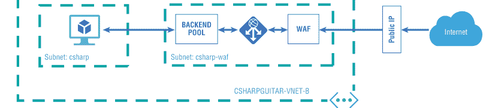

### 图 3.41 Basics 选项卡，Application Gateway 创建

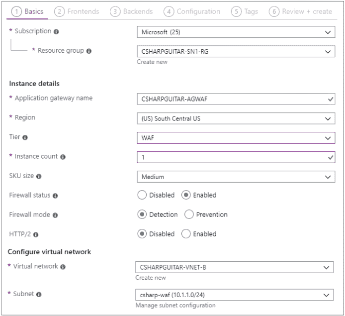

### 图 3.42 Configuration 选项卡，Application Gateway 创建

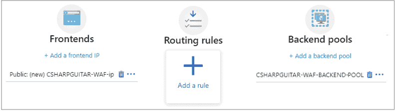

### 练习 3.10（续）

8. 单击 + Add A Rule 按钮，输入规则名称（例如，CSHARPGUITAR-WAF-HTTP80），输入侦听器名称（例如，CSHARPGUITAR-LISTENER），从 Frontend IP 下拉列表中选择 Public，选择 Backend Targets 选项卡，从 Backend Target 下拉列表中选择 CSHARPGUITAR-WAF-BACKEND-POOL，单击 HTTP Setting 下拉列表下的 Create New 链接，为设置提供名称（例如，CSHARPGUITAR-HTTP-SETTING），然后单击 Add 按钮。

9. 单击 Next: Tags 按钮，单击 Next: Review + Create 按钮，然后单击 Create 按钮。

10. 创建完成后，打开 CSHARPGUITAR-AGWAF 的 Application Gateway 刀片，复制其 IP 地址并将其放入浏览器中，尝试连接。如果后端池中的 VM 未安装 IIS，请使用 RDP 建立远程桌面连接并执行以下 PowerShell cmdlet：

```
Install-WindowsFeature -name Web-Server -IncludeManagementTools
remove-item C:\inetpub\wwwroot\iisstart.htm
Add-Content -Path "C:\inetpub\wwwroot\iisstart.htm" `
    -Value $("Hello from " + $env:computername)
```

11. 对 WAF 公共 IP 地址的请求将路由到配置为后端池的 Azure VM，并返回 “Hello from CSHARPGUITAR-V2” 字符串。

还有一个需要进一步讨论的配置——防火墙模式。你可能在练习 3.10 第 5 步的 Basics 选项卡上注意到它。防火墙模式有两个选项：Detection 和 Prevention。正如名称所示，选择检测时，如果访问匹配与恶意入侵相似的模式（例如，Web 表单中的一些 JavaScript），则会记录日志。请求可以流经并被处理。我假设如果应用程序出于某种原因设计成预期提交匹配恶意模式，则会希望这样做。其他时候，你希望让坏行为者认为自己未被检测到，但稍后回来对付他们。最后，也许正在遭受攻击的应用程序对已知漏洞有足够的抵抗力。正如你所见，允许流量通过的原因确实还有很多。

另一方面，预防不会让被标记为恶意的请求/提交通过 WAF。相反，客户端会收到 HTTPS 状态码 403 – Forbidden。尝试仍会被记录以供后续审查和分析，但坏行为者会立即被告知其被拒绝或未能造成潜在危害的尝试。第 9 章包含更多监控细节。Azure 还提供另一种防火墙产品，称为 Azure Firewall；继续阅读以了解它。

### 图 3.43 Azure Firewall 规则集合

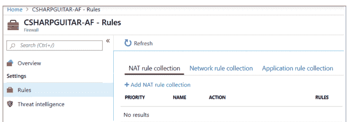

规则的应用顺序如下：

- 1. NAT 规则
- 2. 网络规则
- 3. 应用规则

一旦在任何集合中的任何规则匹配，请求将被允许或拒绝，且不再处理其他规则。

最后，Azure Firewall 的成本明显高于 Azure Gateway WAF。成本会发生变化，也许金额值得仅在 AF 中可用的额外功能。无论如何，请注意价格，但如果功能仅存在于 AF 中，例如维护会话，而你的应用程序需要它，那么你必须采用这种方法。

### IP 限制

从网络角度保护应用程序有很多种方法，对吧？到目前为止，这些保护解决方案都放置在设备上，无论是虚拟还是物理，该设备不运行实际应用程序。解决方案也不直接运行在数据库或其他 Azure 产品上。IP 限制最常见的是在承载受保护资源的计算硬件上实现。以 Internet Information Services（IIS）为例，它是一种在 Windows 服务器上运行并托管某种 Web 应用程序的 Web 服务。IIS 提供了两种 IP 限制：IP Security 和 Dynamic IP Restrictions（DIPRs）。

IP Security 功能是典型的 IP 地址白名单和黑名单。如果客户端的 IP 地址存在于白名单中，则请求会得到响应；否则，请求将被拒绝。如果源 IP 地址在黑名单上，则请求将被阻止，其他请求则允许。这种实现如果白名单/黑名单中的 IP 地址频繁更改，维护成本会很高。IP Security 功能也不太适合防止恶意活动，因为一旦源 IP 地址被列入黑名单，更改源 IP 地址就不是问题。IP Security 功能最适合在你知道将被包含或排除的 IP 地址，并且列表保持静态时使用。另一方面，DIPRs 非常适合处理恶意攻击。DIPR 可以配置为基于来自同一源 IP 地址的并发请求数量或一段时间内的总请求数来阻止。一旦源 IP 地址超过任何设定的阈值，未来连接将在配置的时间范围内被拒绝。

从 Azure 角度来看，运行 IIS 的 Azure VM 将具有前面讨论的功能，并且直接在 VM 本身实现。其他 Azure 产品提供类似功能，例如 Azure App Services、Azure SQL 和 Azure Storage。在 Azure App Services 上，图 3.44 中显示的属性看起来类似于 NSG；然而，这些规则由 Azure App Service 产品直接管理。

### 图 3.44 Azure App Service 的 IP 限制

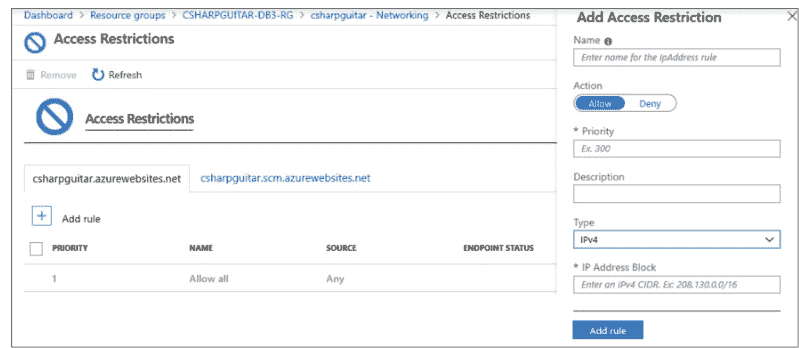

如图所示 3.45，在门户中直接在 SQL Azure 数据库刀片上为 SQL Azure 数据库设置防火墙/IP 限制。注意，门户会识别你连接的客户端的 IP 地址，并让你单击按钮将其添加，这在开发模式下很容易。

在门户中的 Azure SQL 刀片上，还可以允许在 Azure 虚拟网络（VNet）中运行的资源访问。另一个直接在产品本身支持限制访问的 Azure 产品是 Azure Storage 账户，如图 3.46 所示。

在从 Azure Storage 账户页面导航到防火墙和虚拟网络刀片后，你再次看到配置 VNet 访问和特定 IP 地址范围的能力。随着时间的推移，越来越多的 Azure 产品将支持这种配置。重要的是要认识到，Azure 架构师需要以可支持性为出发点进行设计，并且配置 NSG、Azure Firewall、WAF 和 IP 限制可能会导致一些非常复杂的故障排除场景。想象一下


一个端点的 IP 地址发生了变化。需要更改哪条规则，以及需要更改为什么？你明白了——现在我提到了它，要获得一张图示，下一个章节中讨论了一个很酷的功能，叫做网络映射。

**图 3.45** SQL Azure 的 IP 限制

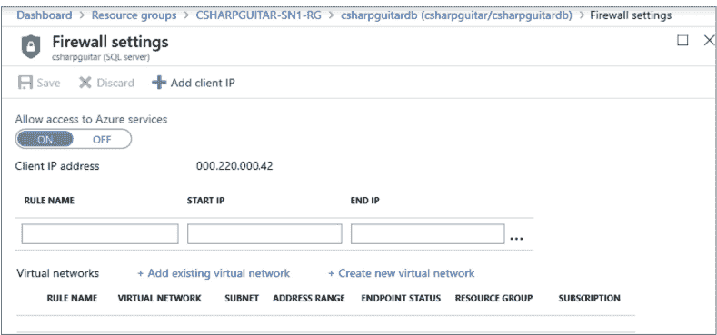

**图 3.46** Azure 存储账户的 IP 限制

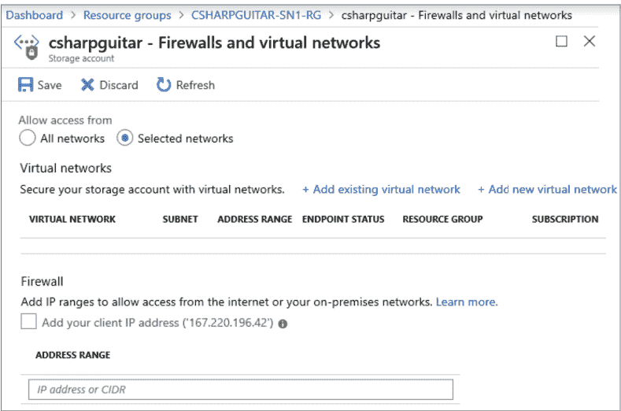

### 网络映射和拓扑

有两项很酷的功能可以帮助客户很好地概览其网络拓扑。第一个叫做 *网络映射*，可通过第 2 章中讨论的安全中心访问。只需导航到安全中心，点击导航菜单上的 Networking，然后在 Networking 刀片上点击 Network Map。如图 3.47 所示，VNet、子网以及其中 Azure VM 之间的连通性会显示出来。

**图 3.47** 安全中心网络映射拓扑

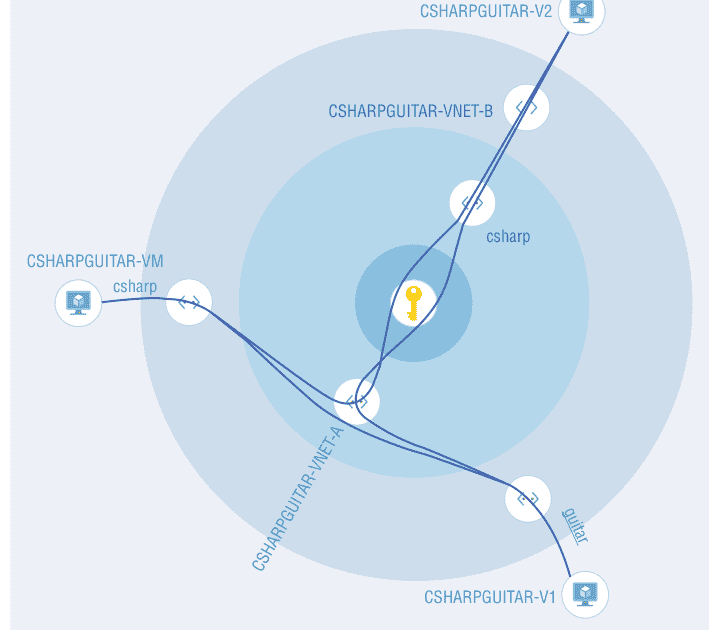

它们之间流动的线条显示了所选 Azure 订阅中所有资源之间的允许流量。Azure 订阅由图像中央的键表示。如果有一个 Azure VM 无法与其他 VM 建立连接，此映射将有助于可视化原因。

使用 Network Watcher 还可以获得给定资源组内网络拓扑的另一种有用的可视化。导航到此功能，从导航菜单中选择 Topology，并选择订阅和资源组。图 3.48 显示了资源组 CSHARPGUITAR-DB3-RG 中资源的网络拓扑的图形表示。

**图 3.48** Network Watcher 拓扑视图

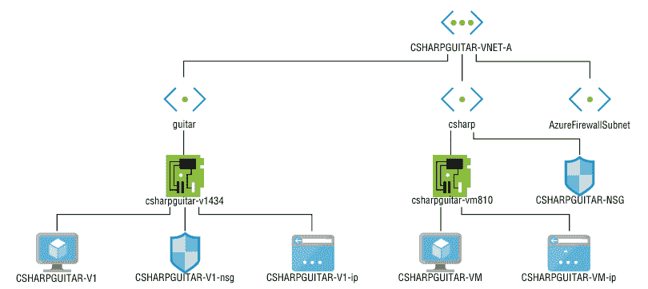

如图所示，为 NSG 分配的最佳实践是将其分配给子网，而不是分配给与 Azure 虚拟机链接的网络接口。在图 3.48 中，可以看到对于子网 csharp，NSG 已绑定到子网，但对于 guitar 子网则不是如此。这是一张有助于找到可能需要优化或重新配置的区域的图像。

### 使用 Azure DNS

域名系统（DNS）在最简单的意义上是将易于识别的友好域名转换为数字 IP 地址。在 DNS 出现之前以及互联网出现之前，DNS 今天所执行的功能就应用于连接到网络的每台计算机。如果你查看你的 C:\Windows\System32\drivers\etc 目录，会有一个名为 hosts 的文件。该文件包含友好名称与路由到的 IP 地址之间的映射。可以想象，这既不是可扩展的也不是安全的管理域名映射的方式。今天该文件中的配置仍然适用，可以用来将例如 www.bing.com 路由到任何期望的 IP 地址，但请记住，这仅适用于具有该 hosts 文件配置的计算机。

**图 3.49** 使用 nslookup 查看 CNAME 和 A 记录 DNS 配置

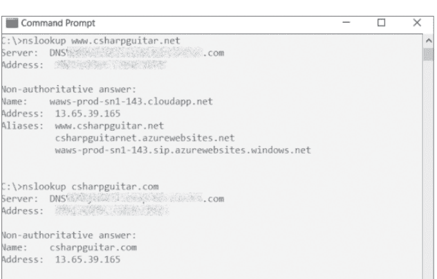

输出还识别了 DNS 服务器以及解析 DNS 查询的 DNS 服务器的 IP 地址。知道 DNS 服务器的 IP 地址是有帮助的，因为有很多不同的服务器可以提供此服务。有时服务器上的数据会不同步。考虑需要更改托管 csharpguitar.com 的网站的 IP 地址。你可以想象，很多 DNS 服务器需要更新；整个互联网上的每个名称服务器都需要更新，时间滞后可能长达 48 小时。

在执行更新的上下文中，有两个具体主题需要更多关注。第一个是 A 记录与 CNAME 以及生存时间（TTL）。正如刚才提到的，更改在互联网上复制可能需要长达 48 小时，因此当你有一个绑定到静态 IP 地址的 A 记录并且该 IP 地址需要紧急更改时，你可能会出现停机。基于云的 IP 地址有时会更改的声誉，如果域名绑定的网站的 IP 地址意外更改，你就会宕机。这就是为什么使用 CNAME 要冗余得多。它绑定到一个别名；如果别名的 IP 地址更改，没有问题，因为域名仍然指向别名。注意这一点。

更改复制可能需要长达 48 小时的原因是存在不同层的 DNS 服务器。为了保持该数据库稳定，帮助管理负载的其他 DNS 服务器从官方源获取并在其他服务器上缓存值。当你配置 DNS 记录时，该配置的一部分是 TTL 值。TTL 值是记录在缓存中存储的时间长度，然后尝试更新。请记住，时间框架越短，对权威服务器和名称服务器的负载就越大，所以保持平衡，互联网运行得更快。

无法使用 Azure DNS 购买域名；名为 App Service Domains 的服务是购买域名的地方。Azure DNS 用于作为记录托管有关域的信息。如果你确实选择从 Microsoft 购买域名，使用 App Service Domains，流程会创建所谓的 DNS 区域。

#### Azure 公共 DNS

DNS 区域与拥有公共 DNS 同义。通常，DNS 记录的管理是使用域名提供商提供的门户执行的，例如 GoDaddy。DNS 区域支持将该功能迁移到 Azure 门户。好处是你少了一个需要访问的门户，少了一组需要执行任务的个人资料和凭据。

这就是前面提到的两个 DNS 记录在 Azure 中发挥作用的地方：NS 和 SOA。将 DNS 管理迁移到 Azure 门户需要在 DNS 记录中输入 NS 条目。托管提供商通常提供一组四个名称服务器；然而，如果你想将其迁移到 Azure，那么 Azure 会为你提供名称服务器，并且域名托管公司处的名称服务器记录需要使用 Azure 的名称服务器进行更新。此外，必须在 DNS 区域中添加 NS 记录。当创建 NS 记录时，SOA 记录类型也会自动插入。起始授权记录（SOA）通知域的维护将不再在父域托管公司进行；相反，它被委托给 SOA 记录中标识的授权方。

#### Azure 私有 DNS

私有 DNS 托管是一项功能，允许为托管在 VNet 中的 Azure VM 配置 DNS 条目，以便使用域名访问。这与练习 3.11 中执行的操作有两种不同之处。首先，Azure VM 的域名是公开可访问的；世界上任何具有互联网访问权限的人都可以访问该端点。

另一个区别是提供的域名以 azure.com 结尾，这不是你自己的。与 Azure VM 绑定的自定义域名可以是类似 private.csharpguitar.net 的名称。然后任何绑定到此的 Azure VM 都可以使用 csharpguitar-v1.private.csharpguitar.net 访问。请记住，此域名使用内部私有 DNS 解析，仅适用于 VNet 内的服务器。

在混合场景中，你可能需要对 DNS 服务器进行自定义修改，这使用刚刚回顾的程序是不可能的。下一节介绍如何实现类似的场景。

#### VNet 中的专用 DNS 服务器

Azure 确实支持在 VNet 中创建和托管自定义 DNS 服务器。当你想使用友好名称而不是 IP 地址连接到本地存在的资源时，这很有帮助，反之亦然。这也是在不同 VNet 之间执行相同操作的手段。如图 3.51 所示，本地执行的 DNS 查询可以路由到托管在 VNet 中的 Azure VM 并跨多个 VNet。


### 图 3.51 专用 Azure DNS 服务器

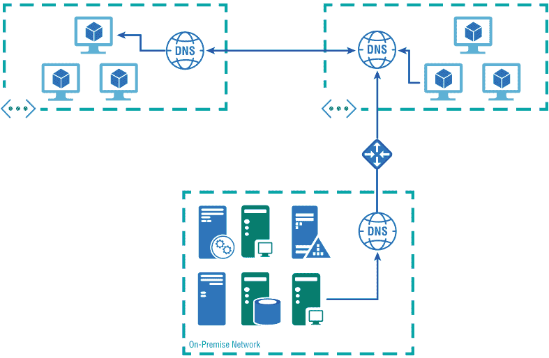

此场景较为复杂，需要大量的配置、设计和维护工作。只有大型企业才需要实施此类场景。尽管如此，了解该功能的存在仍然很有帮助。该功能可在 VNet 边栏选项卡中启用，你希望 DNS 服务器在该 VNet 中生效。界面大致如图 3.52 所示。

### 图 3.52 专用 Azure DNS 服务器配置

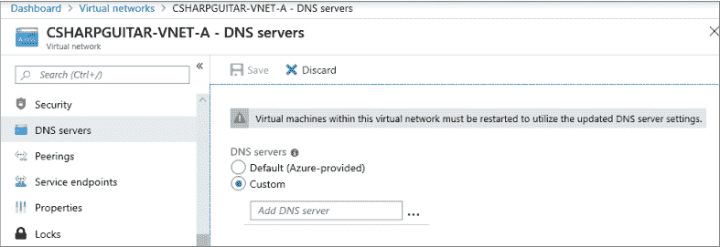

如果这是一个选定的实施需求，则需要在“添加 DNS 服务器”文本框中指定 DNS 服务器软件以及该服务器的配置。如图 3.52 所示，VNet 中的 Azure VM 需要重启才能识别 DNS 服务器设置。

### 混合 Azure 网络

混合网络已在多种语境中描述过，本章引言部分也包含了关于混合网络的详细说明。总而言之，混合 Azure 网络是两种网络的组合，最常见的是本地网络和使用 Azure 虚拟网络托管在 Azure 上的网络。混合 Azure 网络的两个基本优势是：增加了可用的数据中心容量，以及能够以合理的价格升级基础设施的复杂程度。

配置混合网络连接的方法有很多，例如站点到站点、点到站点以及混合连接管理器（HCM）。HCM 使用 Azure Relay 在 Azure 应用服务和任何可访问的端点之间创建安全连接。你将在后面的练习中配置 HCM，但就目前而言，只需要知道它是一个在 Azure 与本地资源之间建立简单安全连接的有用工具。在“VNet 和子网”部分已经提到了许多其他连接选项。此外，第 6 章还会介绍更多内容。

在继续之前，这里有一个问题问你：

判断正误：在 VNet 和本地网络之间创建连接时，必须使用自定义 DNS。

答案是错误。只有在连接使用友好名称而非 IP 地址来与 VNet 和本地网络之间的服务器连接时，才需要自定义 DNS。

在本节中，将更详细地讨论其他混合 Azure 网络主题：

- ExpressRoute
- 站点到站点（S2S）VPN 网关
- 强制隧道

### ExpressRoute

ExpressRoute 是在 Azure 与本地网络之间进行连接而无需经过互联网的唯一方式。所有其他连接方式都需要经过互联网。ExpressRoute 的一个优点是内置冗余。该冗余通过 ExpressRoute 线路实现，每条线路包含到两台 Microsoft Enterprise Edge（MSEE）路由器的连接。这些路由器支持第 3 层连接并实现边界网关

### 图 3.54 跨地域的 ExpressRoute 网络

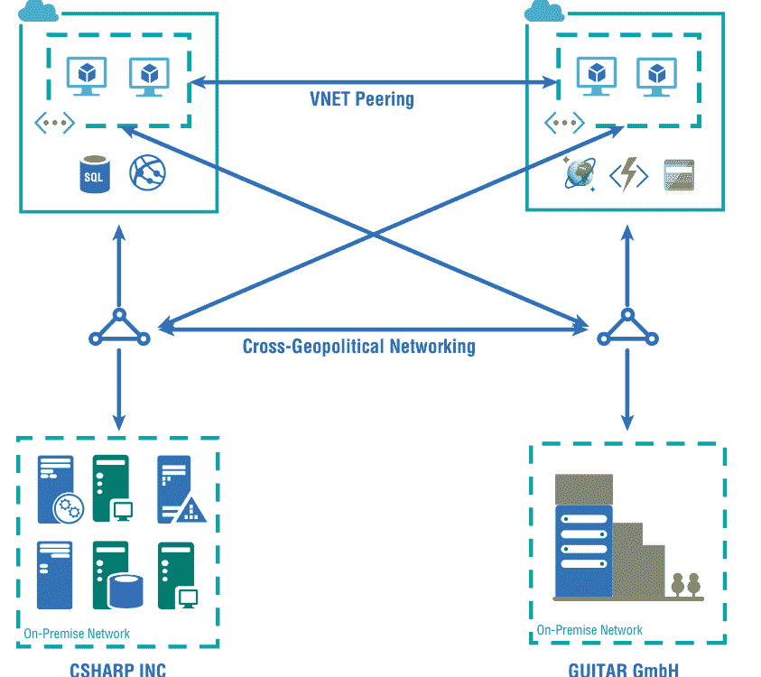

### 站点到站点 VPN 网关

如果你需要回顾一下 S2S 拓扑图是什么样的，请参考图 3.33。该图展示了本地网络通过安全隧道连接到 VPN 网关，再进入 Azure VNet 的过程。你可能还记得练习 3.6 中执行的 VNet 到 VNet 配置。S2S 与 VNet 到 VNet 配置（VNet 对等）之间的一个区别是，连接两个 VNet 不需要 VPN 网关。这让人不禁要问，VPN 网关具体是什么，它在 S2S 中扮演什么角色。这些问题的答案将在下文中展开。

要成功配置 S2S 连接，有两个部分在 Azure 中不可用。第一部分是 VPN 设备，它需要公开一个可访问互联网的 IP 地址，允许流量进出本地网络。第二部分当然是本地网络本身。这两个部分相对独特，这一点从受支持的 VPN 设备列表可以看出，请参阅以下列表：

```
docs.microsoft.com/en-us/azure/vpn-gateway/vpn-gateway-about-vpn-devices
```

有些 VPN 不受支持。有些 VPN 设备存在兼容性问题，可以通过一些底层配置和在本地 VPN 上执行的配置脚本来解决。要为此构建一个完整的实践场景比较困难，因此这里只讨论创建 S2S 所需的步骤，而不进行完整的演练。

在 Azure VNet 和本地 VNet 之间配置 S2S 连接需要七个步骤。

- 1. 创建虚拟网络。
- 2. 指定 DNS 服务器。
- 3. 创建网关子网。
- 4. 创建 VPN 网关。
- 5. 创建本地网络网关。
- 6. 配置 VPN 设备。
- 7. 创建 VPN 连接。

#### 创建虚拟网络

可以肯定的是，如果没有 VNet，就无法在 VNet 和本地网络之间建立连接。在练习 3.2 中，创建了一个名为 CSHARPGUITAR-VNET-A 的 VNet。随后在练习 3.6 中执行全球 VNet 对等时，创建了 CSHARPGUITAR-VNET-B。可以肯定地说，如果已完成这两个练习，你就知道如何创建虚拟网络了。

#### 指定 DNS 服务器

在上一节“VNet 中的专用 DNS 服务器”中，讨论了专用 DNS 服务器的用途。此外，图 3.52 以图形方式展示了如何将 DNS 服务器配置到 VNet 中。VNet 中是否存在专用 DNS 服务器是可选的；当希望通过友好主机名而不是 IP 地址访问本地服务器时，可以添加该服务器。使用 DNS 服务的默认选项是“默认（Azure 提供）”DNS 服务器。

如果专用 DNS 服务器名称无法按预期解析，请确保在 DNS 服务器之后重启该 VNet 中的 Azure VM。一个名为 nameresolver 的工具可以显示 Azure VM 正在使用哪个 DNS 服务器来执行主机名到 IP 地址的转换。将 nameresolver 程序复制到 Azure VM，然后执行以下命令：

```
nameresolver CSHARPGUITAR-V1.
```

图 3.55 展示了上述代码行的输出，其中 CSHARPGUITAR-V1 是 VNet 中 Azure VM 的名称。

### 图 3.55 确定哪个 DNS 正在解析主机名

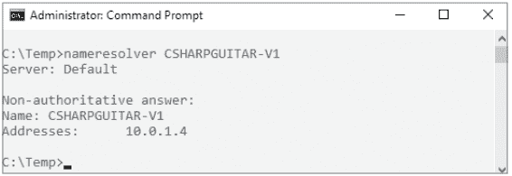

请注意，“服务器”的值为“默认”，这表示“默认（Azure 提供）”DNS 服务器是将 DNS 名称解析为 IP 地址的服务器。如果配置了专用 DNS 服务器，你应看到该 DNS 服务器的名称。

#### 创建网关子网

每次创建 VNet 时，也会同时创建一个默认子网。例如，创建 Azure 防火墙实例时，它必须位于名为 AzureFirewallSubnet 的子网中。创建 VPN 网关也是如此。VPN 网关必须创建为网关子网（而不是普通子网），并命名为 GatewaySubnet。你可能还记得之前的练习，在创建子网时，你导航到“虚拟网络”边栏选项卡，选择“子网”，然后选择“+ 子网”。在这种情况下，如图 3.56 所示，你需要改为选择“+ 网关子网”。

### 图 3.56 添加网关子网

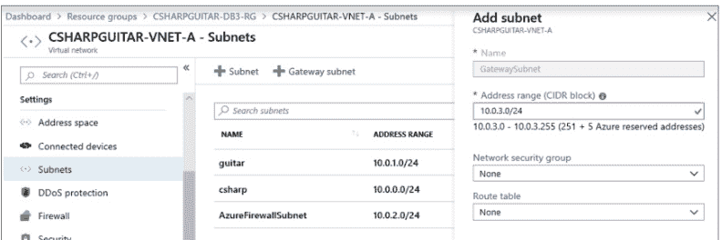

请注意，子网名称呈灰色，无法修改。子网是由地址范围（例如 10.0.3.0/24）定义的容器，这些地址范围分配给位于其中的服务器。但为什么需要这个子网，它的作用是什么，如何帮助在 VNet 和本地网络之间建立连接？请阅读下一节来寻找答案。简单提示一下，VPN 网关需要物理或虚拟硬件才能工作。

#### 创建 VPN 网关

创建网关子网是为了容纳负责在 Azure 和本地网络之间路由数据传输的 Azure VM。基本上，它们存放着管理数据流动所需的路由表，这一点你现在肯定已经知道了。放入此子网的 Azure VM 不可访问或不可配置；它们由 Azure 平台管理和维护。

本书不会实施完整的 S2S 配置，但让我们先创建一个 VPN 网关，看看它是如何操作的，也许还能了解一些更有趣的事实。（你需要一个物理本地 VPN 设备才能完成练习 3.12。）

### 练习 3.12

#### 创建 Azure VPN 网关

- 1. 登录 Azure 门户：portal.azure.com。
- 2. 导航到现有 VNet（例如 CSHARPGUITAR-VNET-A），从导航菜单中选择“子网”，单击“+ 网关子网”，保留所有默认设置，然后单击“确定”按钮。
- 3. 在搜索框（可以在门户顶部找到）中输入“虚拟网络网关”，在下拉列表中单击“虚拟网络网关”，然后点击“+ 添加”。
- 4. 选择所需的订阅，提供名称（CSHARPGUITAR-DB3-VPNGW-A），并选择区域（该区域应与步骤 2 中创建网关子网的 VNet 所在位置相同）。
- 5. 从 SKU 下拉列表中选择“Basic”，然后从下拉列表中选择“虚拟网络”，下拉列表应已填充步骤 2 中选择的 VNet。
- 6. 创建新的公共 IP 地址，并为该地址提供名称（例如 CSHARPGUITAR-DB3-VPNGW-A-IP）。在“基本信息”选项卡（类似于图 3.57 所示）上，单击“查看 + 创建”按钮，然后点击“创建”按钮。


### 练习 3.12（续）

#### 图 3.57 VPN 网关基本配置

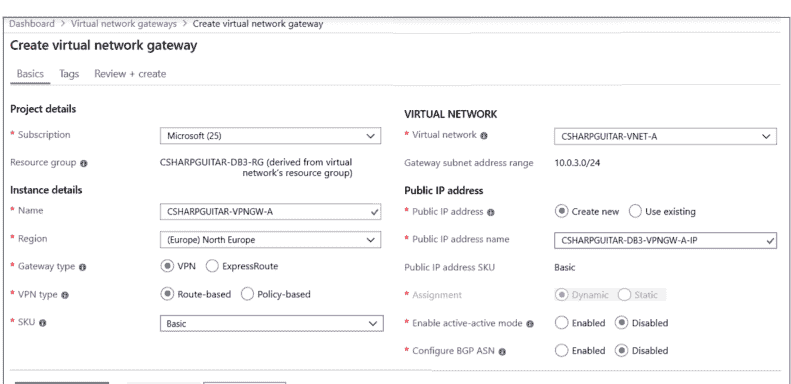

还有一些选项保留了默认设置。现在让我们进一步讨论它们，从网关类型开始。可以正确地认为，ExpressRoute 的配置也需要一个类型为 ExpressRoute 的 VPN 网关。当选中 ExpressRoute 单选按钮时，SKU 类型列表会变为该类型可用的选项。练习 3.12 的场景是 VPN，因此默认值仍然是 VPN。SKU 下拉列表中可用的选项涉及价格、隧道数量、连接数量和冗余。表 3.16 总结了这些限制。

#### 表 3.16 VPN 网关 SKU 类型

| SKU | 隧道/连接 | 吞吐量 | 区域冗余 |
|---|---|---|---|
| Basic | 10/128 | 100 Mbps | x |
| VpnGw1 | 30/128 到 250 | 650 Mbps | x |
| VpnGw3 | 30/128 到 1000 | 1.25 Gbps | x |
| VpnGw1AZ | 30/128 到 250 | 650 Mbps | ✓ |
| VpnGw3AZ | 30/128 到 1000 | 1.25 Gbps | ✓ |

SKU 的限制和定价经常变化，因此这里仅提供摘要。可以预期，SKU 的容量和冗余越多，价格越高。这就是在练习 3.12 中选择基本 SKU 的原因——只是为了在练习期间避免任何价格冲击。你对所需 SKU 的需求将因公司而异。但请记住，无法从 Basic 扩展到更高等级的 SKU。不过，可以从 VpnGw1 扩展到 VpnGw2/3，或从 VpnGw1AZ 扩展到 VpnGw2/3AZ，因此在实际应用中，除非你确定将来不需要扩展，或者你只是想测试产品，否则应避免使用 Basic。

下一组单选按钮是基于路由和基于策略。此配置决定 VPN 将如何决定是否允许 IP 流量通过 VPN 隧道。如果选择了基于路由的 VPN，则由路由表（驻留在 GatewaySubnet 中虚拟机上的路由表）决定是否允许流量。如果路由存在，则允许流量进入；否则不允许。基于策略的 VPN 不使用路由表；基于策略的 VPN 仅限于 Basic VPN SKU。这是一种旧式配置，需要特殊硬件和额外配置。

分配这一组单选按钮，即动态和静态，适用于公共 IP 地址，其名称即含义。要分配静态公共 IP 地址，需要选择 VpnGw1/2/3AZ 的 SKU。此外，当选择这三个 SKU 中的任何一个时，会出现一个下拉框，其中包含 VPN 网关所需的区域冗余类型。区域冗余已在前面本章以及第 1 章中讨论过；在第 5 章和第 9 章中还会讨论。这里适用相同的冗余概念。选择取决于连接必须达到的可靠性程度。这是特定于解决方案的，并且涉及重大的成本考虑。最后，通过启用主动-主动模式，VPN 网关会被分配第二个公共 IP 地址。这除了提供区域冗余能力之外，还提供了一定程度的冗余。对于关键任务 IT 解决方案，避免单点故障的冗余是有意义的，而配置 VPN 网关的主动-主动模式正是为了实现这一点。

恭喜你成功配置了 VPN 网关；这并不难！其余步骤在 Azure 之外进行，并在完成 S2S 连接后测试连接性。

### 创建本地网络网关

名为本地网络网关的 Azure 功能需要进行配置，以便从 Azure 到本地网络建立 S2S 连接。此配置最重要的要求是本地 VPN 网关的 IP 地址以及本地网络中存在的 CIDR 地址范围。该 IP 地址与下一步中配置的设备相关联。该 IP 地址是公共 IP 地址，任何连接到互联网的设备都可以访问它。CIDR 地址范围不能相互重叠。到目前为止，练习中使用的地址范围为 10.0.0.0/24、10.0.1.0/24、10.0.2.0/24、10.0.3.0/24、10.1.0.0/24 和 10.1.1.0/24。本地地址范围不应与任何这些现有范围重叠；例如，本地地址范围 10.0.0.0/24 会重叠，其他示例也会重叠。但请记住，在此示例中始终使用默认值。这些 CIDR 范围可以配置为任何私有 IP 地址范围。

### 配置你的 VPN 设备

这是 100% 在 Azure 平台之外进行配置的地方，其配置对于进行 S2S 配置的公司来说是独一无二的。以下是一些有用的文档：

- VPN 设备列表：
  docs.microsoft.com/en-us/azure/vpn-gateway/vpn-gateway-about-vpn-devices
- 加密 VPN 要求：
  docs.microsoft.com/en-us/azure/vpn-gateway/vpn-gateway-about-compliance-crypto
- 已知兼容性问题：
  docs.microsoft.com/en-us/azure/vpn-gateway/vpn-gateway-about-vpn-devices#known

网上还有更多有用的文档、示例和脚本。此外，如果你遇到困难需要建议，可以向 Microsoft 开立支持案例，这将帮助你成功。别忘了这个选项。

### 创建 VPN 连接

VPN 连接是在前面的练习 3.12（即 CSHARP GUITAR-VPNGW-A）中创建的 VPN 网关之上创建的。导航到该 VPN 网关，点击导航菜单中的“连接”选项，然后点击“+ 添加”。图 3.58 所示的边栏选项卡提供了输入创建所需信息的模板。

图 3.58 S2S VPN 连接

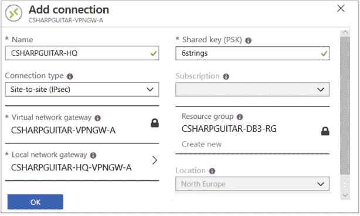

“连接类型”下拉列表包含 VNet 到 VNet、ExpressRoute 和站点到站点。我们在这里配置的是站点到站点连接。本地网络网关包含本地公共 IP 地址和本地网络内的地址范围。有一个共享密钥，它就像密码或令牌，必须与配置本地 VPN 时设置的值匹配。单击“确定”按钮后（见图 3.58），系统会验证该密钥，并测试两个 VPN 之间的连接性。在给定虚拟网络网关的“连接”边栏选项卡上，会显示连接列表及其状态。如果状态显示“已连接”，则配置成功。

可以像在练习 3.6 中设置 VNet 对等时测试连接性那样，以类似的方式测试连接性。登录 VNet 上的 Azure VM。如果服务器正在运行可以响应 HTTP 请求的 Web 服务，你可以尝试使用私有 IP 地址 curl 到本地网络中的服务器。

```
curl -G <Private IP address>:80
```

如果响应成功，那么任务完成！这实际上并不复杂；最困难的部分是让两个公共 VPN 设备之间的连接正常工作。只有在 VPN 的细节未知时才会变得复杂。在执行此操作时，确保所有掌握相关知识的人都在场讨论此实现，并且如果出现问题，务必尽早联系 Microsoft。

### 强制隧道

强制隧道可能有不止一种含义。前面提到它时，是在 DMZ 的上下文中（见图 3.59）。在这种上下文中，强制隧道是将 Azure VNet 中旨在访问互联网托管资源的流量，通过 S2S 连接路由到本地网络的过程。一旦流量进入本地网络，它就可以流出到互联网。这种路由的一个原因是出于审计和检查的需要。图 3.59 展示了这种强制隧道的应用。

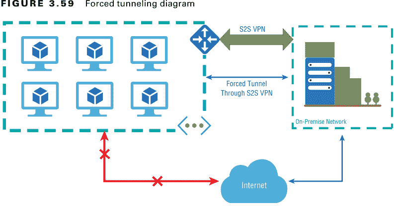


强制隧道的工作原理是通过配置用户定义的路由表条目来实现的。回顾一下图3.13。默认情况下，任何与现有路由都不匹配的目标IP地址都会默认使用0.0.0.0/0地址前缀，并被分配一个Internet类型的NextHopType。这意味着即使在配置了S2S连接和VPN网关之后，托管在VNet中的Azure VM发往互联网的流量也会直接进入互联网。要强制该流量通过VPN网关，必须将S2S连接的0.0.0.0/0的-NextHopType设置为VirtualNetworkGateway。

当前没有Azure门户界面可以执行此操作。设置NextHopType值的推荐方法是使用PowerShell。以下PowerShell脚本将强制隧道添加到S2S VPN网关：

```powershell
New-AzRouteTable -Name "CSHARPGUITAR-DB3-ROUTE-TABLE" \
    -ResourceGroupName "CSHARPGUITAR-DB3-RG" \
    -Location "North Europe"

$rt = Get-AzRouteTable -Name "CSHARPGUITAR-DB3-ROUTE-TABLE" \
    -ResourceGroupName "CSHARPGUITAR-DB3-RG"

Add-AzRouteConfig -Name "ForcedTunnelRoute" \
    -AddressPrefix "0.0.0.0/0" \
    -NextHopType VirtualNetworkGateway \
    -RouteTable $rt

Set-AzRouteTable -RouteTable $rt

$vnet = Get-AzVirtualNetwork -Name "CSHARPGUITAR-VNet-A" \
    -ResourceGroupName "CSHARPGUITAR-DB3-RG"

Set-AzVirtualNetworkSubnetConfig -Name "csharp" -VirtualNetwork $vnet \
    -AddressPrefix "10.0.0.0/24" \
    -RouteTable $rt

Set-AzVirtualNetwork -VirtualNetwork $vnet
```

你可以在这里找到这个PowerShell脚本：

github.com/benperk/ASA/blob/master/Chapter03/ForcedTunnelRoute.ps1

无法更改Azure提供的默认路由规则。要实现任何更改，都需要创建新的路由表，并在其中添加、更新或删除路由。这就是前面的PowerShell脚本所做的。一旦创建了名为CSHARPGUITAR-DB3-ROUTE-TABLE的路由表，它就会绑定到csharp子网，该子网位于CSHARPGUITAR-VNET-A虚拟网络中。请记住，Source值等于User的路由在具有相同前缀的默认创建路由中优先级更高。这里就是这种情况，因为在为VirtualNetworkGateway添加前面的路由后，会有两条AddressPrefix值为0.0.0.0/0的路由。

执行以下PowerShell cmdlet以查看添加了实现强制隧道的路由后的有效路由：

```powershell
Get-AzEffectiveRouteTable -NetworkInterfaceName csharpguitar-vm810 `
-ResourceGroupName CSHARPGUITAR-DB3-RG | Format-Table
```

图3.60提供了该cmdlet的输出。

**图3.60 强制隧道路由表示例**

| 名称 | DisableBgpRoutePropagation | 状态 | 来源 | 地址前缀 | 下一跳类型 | 下一跳IP地址 |
|---|---|---|---|---|---|---|
|  | False | 活动 | 默认 | {10.0.0.0/16} | VnetLocal | {} |
| ForcedTunnelRoute | False | 活动 | VirtualNetworkGateway | {10.5.0.0/24} | VirtualNetworkGateway | {40.115.104.24} |
|  | False | 活动 | VirtualNetworkGateway | {0.0.0.0/0} | VirtualNetworkGateway | {} |
|  | False | 无效 | 默认 | {0.0.0.0/0} | Internet | {} |
|  | False | 活动 | 默认 | {10.1.0.0/16} | VnetGlobalPeering | {} |

最后，请注意PowerShell脚本中提供了应用强制隧道的子网。回顾一下，CSHARPGUITAR-VNET-A有两个子网：csharp和guitar。该脚本仅将强制隧道路由应用于csharp子网，因此也应用于该子网中的所有Azure VM。它并未应用于guitar子网。这意味着，尽管VPN网关绑定到CSHARPGUITAR-VNET-A，但路由是应用于子网的，guitar子网中的Azure VM的互联网流量将直接路由到互联网。它们不会通过S2S连接经本地网络进行强制隧道。

### 其他Azure网络产品

本章其余部分介绍一些之前讨论中未涉及的网络产品。这些是类似网络的产品，但在讨论网络时并不总是被提及。此处涵盖的其他网络组件如下：

- Azure应用程序网关（非WAF）
- Azure负载均衡器
- Azure Front Door
- Azure内容分发网络
- 流量管理器
- Azure中继/混合连接管理器

第一个产品是应用程序网关，之前已经讨论过；但只讨论了它的WAF部分。应用程序网关除了WAF之外还提供更多功能。

#### 应用程序网关

自20世纪90年代末以来，将Web应用程序运行在某种网络负载均衡设备后面的多台服务器上已成为常态。这种架构配置被称为*Web服务器场*。从冗余的角度来看，让多台服务器运行相同的应用程序是很有意义的。这样就不会有单点故障。自20世纪90年代以来，这些网络负载均衡设备已经变得复杂得多，其功能也已不仅仅是简单地将流量引导到其后面配置的一组服务器的设备。

应用程序网关产品中的Web应用程序防火墙功能是世界级的。它提供的网络功能主要聚焦于OSI第7层，这意味着它可以基于HTTP请求中包含的属性（如请求头值和请求的资源路径）做出路由决策。这提供了超越其他网络设备（仅限于套接字中的内容，即源IP、源端口、目标IP、目标端口）的额外功能。

除了WAF之外，应用程序网关虚拟设备还可以充当负载均衡器、SSL终止点和重定向器，以及许多其他功能。其中许多附加功能将在后面更详细地讨论。如果你还没有完成练习3.10，建议现在完成。以下内容期望你对应用程序网关是什么以及如何配置它有所了解。

#### SSL终止

*安全套接字层（SSL）*是使用HTTPS协议加密客户端和服务器之间数据传输的旧名称。如今，*传输层安全性（TLS）*才是正确的术语。它加密方式与SSL相同，但更安全。SSL是最常用的术语；继续使用它可能也没问题，因为人们会知道你在说什么，但SSL的时代已经过去了。客户端和服务器之间的数据加密/解密在资源利用方面确实有一些开销。在两者之间的某个位置，可能有一个设备被配置为终止安全连接，这将消除加密/解密，从而带来更快的事务处理和更少的资源消耗。

这种安全连接的终止称为*SSL终止*或*SSL卸载*，通常发生在网关、智能防火墙或前端服务器等边缘设备上。所谓边缘设备，我指的是位于网络入口点的网络设备；传输进入网络后，就不再需要加密了。假设网络是安全的，因此基础设施不需要承担在安全隧道内部通信时SSL解密所带来的额外性能损失和开销。除了性能提升之外，安全连接的终止和请求内容的解密还提供了更智能地路由请求的机会。诸如请求头、URL、Cookie等属性可用于路由规则和逻辑。

应用程序网关同时提供SSL终止和端到端SSL加密的能力。一些客户或应用程序可能要求端到端加密。具有高度敏感范围或传输高度敏感数据的应用程序，在合规性要求下可能需要这种加密类型。应用程序网关真正令人称奇的一点是，即使采用端到端加密，仍然可以访问请求属性。应用程序网关在请求到达时仍然会终止SSL会话；但在将出站流量发送到后端池之前，会再次对其进行加密。回想练习3.10中你创建了一个后端池（例如CSHARPGUITAR-WAF-BACKEND-POOL）并向其中添加了一个Azure VM（例如CSHARPGUITAR-V2）。在练习3.13中，使用之前在练习3.10中创建的应用程序网关（例如CSHARPGUITAR-SN1-AGWAF）配置SSL终止。

#### 练习3.13：在应用程序网关中配置SSL终止

1. 登录Azure门户（portal.azure.com）。
2. 导航到现有的应用程序网关（例如CSHARPGUITAR-SN1-AGWAF），从导航菜单中选择“侦听器”，单击“+基础”，这将显示“添加基础侦听器”边栏选项卡。
3. 输入名称（例如CSHARPGUITAR-LISTENER-HTTPS），为前端端口名称输入port_443，输入443作为端口，并选择HTTPS协议。
4. 上传从github.com/benperk/ASA/tree/master/Chapter03/Ch03Ex12下载的csharpguiternet.pfx证书。或者使用New-SelfSignedCertificate PowerShell cmdlet创建自己的证书。
5. 提供名称（例如CSHARPGUITARNET），输入密码Csh@rPguitarN3t，然后点击OK按钮。该表单应类似于图3.61。
6. 接下来添加HTTP设置。从导航菜单中点击“HTTP设置”。点击“+添加”。提供一个名称（例如CSHARPGUITAR-HTTPS-SETTING）。选择HTTPS作为协议。提供证书名称（例如CSHARPGUITAR-HTTPS-CER）。选择CER证书并从github.com/benperk/ASA/tree/master/Chapter03/Ch03Ex12下载测试CER。其余保持默认，然后点击OK按钮。


### EXERCISE 3.13 (continued)

#### FIGURE 3.61 Application Gateway SSL termination template


7. Add a rule by selecting the Rules menu option. Select + Basic to provide a name (for example, CSHARPGUITAR-RULE-HTTP443). Select the listener created in step 3. Select the backend pool from Exercise 3.10, then select the HTTP setting created in step 6, and finally click the OK button.

8. Open a browser and access the Application Gateway virtual appliance’s public IP address prefixed with HTTPS://. You should get an error because the certificate wasn’t created by a trusted certificate authority; it is only a test certificate. Proceed to the site. The output for the request should resemble Figure 3.62.

someone placing an order. An annual report would run long because there exists more data to process than a daily report. Reporting systems are known to be slow sometimes.

#### FIGURE 3.63 Hosting multiple sites flow diagram


A customer placing an order expects the transaction to be very fast with little to no visible latency. If an architect for some reason hosts both types of requests on the same server or groups of servers, the resource consumption that happens with a reporting request may negatively impact the response time of an order. This is not optimal. URL path-based redirection is something that can help in that scenario. Figure 3.64 illustrates a request that contains report in the URL. The request is sent to a pool of Azure VMs that respond to reporting requests. Those VMs can have a higher stock-keeping unit (SKU) ratio, have a more optimal SKU with more memory, or require more CPU of the hosted reporting service.

Alternatively, when the request contains transaction in the URL, it in turn is routed to a separate pool. Those Azure VMs are dedicated to processing the transaction fast and furious so the customer has a great experience and returns later to make more purchases. The requests are sent to separate pools based on the URL. This improves the overall

performance of the IT solution by separating requests that could impact each other and instead running them on separate machines. Perform Exercise 3.14 to configure URL-based routing.

#### FIGURE 3.64 URL path redirection request flow diagram


### EXERCISE 3.14

#### Configuring URL Routing on Application Gateway

- 1. Log in to the Azure Portal at portal.azure.com.
- 2. Create a new Windows Server 2019 Azure VM (for example, CSHARPGUITAR-V3) in the same resource group as the Application Gateway virtual machine used up to this point. Be sure to enable inbound ports 80 and 3389. Once created, make a remote desktop connection using RDP and run the following PowerShell script:

```
Install-WindowsFeature -name Web-Server -IncludeManagementTools
New-Item -ItemType Directory -Force -Path "C:\inetpub\wwwroot\report"
Add-Content -Path "C:\inetpub\wwwroot\report\iisstart.htm" `
    -Value $("Hello from the report directory on " `
    + $env:computername)
```

- 3. Open a browser, enter the public IP address of the new Azure VM, and include the report path in the request. The request should resemble something similar to that found at <public IP>/report/.
- 4. Navigate to an existing Application Gateway virtual machine (for example, CSHARPGUITAR-SN1-AGWAF), select Backend Pools, select + Add, provide a name for the pool (for example, CSHARPGUITAR-REPORT-BACKEND-POOL), select Virtual Machine from the drop-down, select the Azure VM created in step 2 and its associated network interface, and then click the Add button.
- 5. Once the save completes, select Listeners from the navigation menu, click + Basic, provide a name (for example, CSHARPGUITAR-LISTENER-REPORT), provide a front-end port name (for example, port_8080), set the port to 8080, leave all other settings at the defaults, and then click the OK button.
- 6. Select Rules from the navigation menu, click + Path-based, and provide a name (for example, CSHARPGUITAR-REPORT-RULE).
- 7. The listener created in step 5 should be preselected; if it’s not, select it. Select the backend pool created in Exercise 3.10 (for example, CSHARPGUITAR-WAF-BACKEND-POOL) as the default backend pool and then select a default HTTP settings value (for example, CSHARPGUITAR-HTTP-SETTING).
- 8. Next, provide a name (for example, REPORT) and path (for example, /report/*), select the backend pool (for example, CSHARPGUITAR-REPORT-BACKEND-POOL), select the HTTP setting (for example, CSHARPGUITAR-HTTP-SETTING), and then click the OK button. The final rule should resemble that shown in Figure 3.65.

#### FIGURE 3.65 URL path redirection Application Gateway rule


### EXERCISE 3.14 (continued)

9. Enter the following URLs into a browser:

```
<application gateway Public IP>
```

```
<application gateway Public IP>:8080/report/
```

You can find the Application Gateway virtual machine’s public IP on the Overview blade associated to the frontend public IP address attribute. Figure 3.66 shows the output of those URL requests.

#### FIGURE 3.66 URL path redirection output


Note that the more rules, listeners, and settings you have, the more likely it is to get them to conflict. If you are working on the previous exercise and it is not working, consider removing the existing Application Gateway completely (we are in testing mode) and perform Exercise 3.13 from scratch. Notice also that in Figure 3.65 there are default settings for the rule (specifically the default backend pool, but also default HTTP settings). This means if the value entered for the path doesn’t exist in the request, then the request is routed to the group/pool/setting of Azure VMs. This means that if the request included a /transaction/* in the requested URL that the request would be sent to the CSHARPGUITAR-WAF-BACKEND-POOL because there is no rule that matches. If you would like to check that out, then you need to add the transaction directory to the Azure VMs that exist in the pool (for example, CSHARPGUITAR-V2); otherwise, a 404.0 Not Found error is rendered. To achieve this, make a remote desktop connection using RDP to the server and execute the following PowerShell script:

```
New-Item -ItemType Directory -Force -Path "C:\inetpub\wwwroot\transaction"
Add-Content -Path "C:\inetpub\wwwroot\transaction\iisstart.htm" `
    -Value $("Hello from the transaction directory on " `
    + $env:computername)
```

Once executed on the Azure VM in the default backend pool, a request to either of the following URLs would be routed to the Azure VM on that backend pool (for example, CSHARPGUITAR-V2).

```
<application gateway Public IP>/transaction/
<application gateway Public IP>:8080/transaction/
```

As you begin to use this feature more, it becomes clear there are some constraints, in that it is possible to have only one listener per port, which is why port 8080 was used. Each rule must be linked to a unique listener. Figure 3.67 illustrates the hierarchy of dependencies (listener, port, HTTP settings) and the overall request pipeline.

#### FIGURE 3.67 Application Gateway configuration hierarchy


### Azure Load Balancer

Having a web application running on multiple dedicated servers or VMs is a common scenario. This design provides redundancy in case one of the servers experiences a transient or fatal system issue. There also could be an application error or resource exhaustion on one server, so having others fill the void in those situations is a good design decision. A load balancer is a network device that is placed in front of all those servers before routing the request to a particular server in the backend pool of VMs. The load balancer exposes a single public IP address and then manages the routing of the request to one of the backend servers.

### OSI Layers and Their Association to Network Appliances

> Azure Firewall runs on OSI layer 3, Application Gateway and Azure Front Door both run on OSI layer 7, and Azure Load Balancer runs on layer 4. The choice of network appliance depends on the application requirements.


在上一节中，你阅读了有关 Application Gateway 的类似功能。Application Gateway 确实提供了许多功能和特性，并且是此类似场景下的有效选择。之所以为类似场景提供多种产品，只是因为这些场景仅是相似的；某些设计或在 Azure 上运行的一些应用程序需要额外的或不同的功能，而不是将所有功能都放入一个产品中，于是创建了许多产品。必须了解迁移到 Azure 的应用程序的需求，以及哪种 Azure 产品能提供最适合满足这些需求的工具集。Azure Load Balancer 提供了一些独特的功能，将在本节的剩余部分进行讨论。

- 公共负载均衡器
- 内部负载均衡器
- 健康探测
- 出站连接

Azure Load Balancer 有两个 SKU 可用，Standard 和 Basic。对于任何新实现，建议使用 Standard SKU。它是两者中最安全、最稳健、最可扩展的。可用性区域、内部负载均衡器、出站安全规则的配置以及 SLA 仅在 Standard SKU 中可用。

### 公共负载均衡器

在创建 Azure Load Balancer 实例期间，必须选择它是内部还是公共。选择公共负载均衡器将为客户端生成一个公共 IP 地址，以便连接到后端池中配置的服务器。图 3.68 说明了从客户端到 Azure VM 池中服务器的请求流。


内部和公共负载均衡器默认都会将流量平均路由到配置到后端池的 Azure VM。这通常被称为轮询。使用由源 IP、源端口、目标 IP、目标端口和协议组成的五元组哈希，负载均衡器将请求路由到整个传输会话期间的同一台 Azure VM。任何哈希值的更改都会导致请求被发送到不同的服务器。如果需要在客户端和服务器之间维护会话，这可能是一个问题。如果是这种情况，则 Azure Load Balancer 确实支持此功能，使用名为源 IP 亲和性模式的功能。此模式使用源 IP、目标 IP 和/或协议的哈希版本，将请求路由到会话生命周期内的同一台 Azure VM。

### 内部负载均衡器

内部负载均衡器（ILB）将没有公共 IP 地址，而是配置到现有的虚拟网络中。如图 3.69 所示，流量在 Azure VM 组之间进行负载均衡，并且这些 VM 到 VNet 中其他服务器的连接性使用 ILB 进行管理。

FIGURE 3.69 Internal load balancer flow


ILB 可以管理对一组数据库服务器、REST API 或其他需要这种额外安全性和弹性的资源类型的访问。

### 健康探测

健康探测是一种监控后端池中配置的 Azure VM 状态的功能。有三种探测类型，TCP、HTTP 和 HTTPS。（HTTPS 仅在 Standard SKU 中可用。）TCP 探测将在配置的

大多数这些功能仅凭名称就能理解，其中许多已经讨论过。其中一些可能不太清楚，需要进一步解释。

### 多站点托管

类似于练习 3.13 中使用 Application Gateway 配置的基于 URL 的路由、URL 重定向和基于 URL 的重定向，多站点托管是一种根据请求的 URL 将请求路由到不同后端池的功能。此功能的主要区别在于，与 Front Door 关联的域名配置是在正在配置的产品刀片上执行的。多个域名和子域名可以直接在 Front Door 门户刀片上托管和配置。对这些域的请求将直接路由到 Front Door。

### 自定义域和证书管理

为了支持多站点托管功能，Front Door 需要支持自定义域。除了自定义域之外，还支持用于通过 HTTPS 通信的 SSL 证书。这两种功能的配置已内置于门户中，也可使用 PowerShell 使用。

### 应用层安全

应用层安全与 Web 应用防火墙同义。Front Door 中包含的 WAF 主要关注发生在第 7 层的攻击，例如 SQL 注入、跨站脚本（XSS）和会话劫持。这类漏洞通常使用 HTTP 和 HTTPS 协议发生。关于 Azure Firewall、Application Gateway（WAF）和 Azure Front Door（WAF）的概念是相同的。会创建一个决定是否阻止或检测利用尝试的策略。如果这没有引起共鸣，请回顾练习 3.10。创建策略后，会应用一组规则（通常是会阻止 OWASP Top 10 列表中列出的已知漏洞的规则）。当你将这些配置应用到网络设备时，你可以睡得更安心一些，知道你的应用程序尽可能安全。

最后一个可用的功能与后端池有关。迄今为止，只能将 VNet 中的 Azure VM 配置到后端池。Azure Front Door 还支持 App Service、Azure Functions、Azure Storage 等产品。此功能允许更多控制并提供更多配置机会。将 WAF 放置在 Azure Functions 实例前面或将特定主机名定向到 Azure Storage 容器就是可以想到的选项。

### Azure 内容分发网络

内容分发网络（CDN）用于将内容尽可能靠近需要访问它的客户端。Azure 在全球各地设有数据中心。这对最接近区域位置的用户来说性能更好。然而，通过将内容物理托管在更靠近客户或员工的位置，可以实现显著的改进。在练习 3.1 中，你使用 Network Watcher 测量了两个位置之间的延迟。现在可能是个不错的时间回顾一下，以了解你的客户可能期望的延迟，以及使用 CDN 后站点响应速度可能快多少。

要了解有关 Azure 内容分发网络的更多信息，请执行以下练习。第 4 章“计算”介绍了创建本练习所需的 App Service Web 应用。如果您不熟悉该流程，请考虑跳过练习 3.15。完成第 4 章后，再回来完成此练习。

### EXERCISE 3.15

#### 为 Azure App Service 配置 CDN

1. 登录到 Azure 门户 portal.azure.com。
2. 创建一个 Azure App Service Web 应用（例如，csharpguitar）。有关更多详细信息，请参阅第 4 章或按照 docs.microsoft.com/en-us/azure/app-service 上的在线说明进行操作。
3. 单击导航刀片中的 Networking 链接，然后单击为您的应用配置 Azure CDN。
4. 在 New Endpoint 部分，创建一个新的端点（例如，CSHARPGUITAR-CDN-ENDPOINT）。选择定价层（例如，Standard Microsoft）和 CDN 端点名称（例如，CSHARPGUITAR），然后单击 Create 按钮。

这很容易，因为所有魔术都在幕后发生。在此场景中，配置自定义域（例如，www.csharpguitar.com）是最理想的。在此过程中，你将自定义域绑定到 azureedge.net 域，以便对自定义域发出的请求从 CDN 响应。这在后台基于全球 120 多个点对点（POP）位置工作。这些 POP 具有边缘服务器，其中缓存了你想要交付给请求者的内容。对站点域的请求会被路由到最近的边缘服务器以生成响应。预计会更快，因为内容更近。如果内容很大，例如视频、音频文件或任何包含数兆字节的内容，差异可能非常显著。

Azure CDN 提供的一些额外功能如下：

- CDN 缓存规则
- 地理过滤
- 文件压缩
- 动态站点加速


### CDN 缓存规则

管理内容缓存的方式以及何时更新，是 CDN 的一个重要方面。如果源服务器（即实际生产内容和应用程序的归属服务器）发生任何更改，则边缘服务器上的内容也必须进行更新。默认的 CDN 设置会使缓存内容在创建时根据所选的定价层而每两到七天过期一次。（在练习 3.15 中，所选定价层为 Standard Microsoft，其每两天过期一次缓存。）

### 地理过滤

可能存在某些国家或地区，您不希望在这些地区存储您的内容。当您设置 CDN 并将其指向源时，随着请求的开始流入，内容会被缓存。地理过滤可用于防止 Azure CDN 根据国家代码缓存内容。

### 文件压缩

压缩文件仅意味着在传输时文件会更小，从而实现更快的传输时间。如果一个文件未压缩为 30MB，但压缩后为 15MB，那么压缩后肯定会实现更快的下载时间。在 Azure CDN 上下文中，实现文件压缩有两种方法。第一种是在将内容缓存到边缘服务器之前，简单地在源服务器上实现文件压缩。这会将压缩后的文件从源传递到边缘服务器。另一种方法称为即时压缩，其中文件压缩可在 Azure CDN 上进行配置。在门户中 CDN 刀片下有一个名为 Compression 的导航项。压缩基于 MIME 类型，该类型对所提供文件的种类进行分类（例如，text/xml、text/css、application/json 或 application/javascript）。默认情况下已启用压缩；但是，如果您的内容 MIME 类型不在列表中，可能需要进行一些配置。

### 动态站点加速

缓存内容对于加速静态内容的交付是有效的。静态内容意味着它不会更改。这并不总是可以接受的，因为许多应用程序会生成基于请求正文中发布的信息或基于请求标头中发送的信息而唯一的内容。这种场景并不适合 CDN。可以进行一些增强以改善动态内容的交付。这是一种名为动态站点加速的产品，其附带额外费用。它使用诸如路由和 TCP 优化以及预取等新功能。这里最重要的收获是，CDN 对于静态内容最优化，如果您的站点主要是动态的，那么使用它可能不会获得很大的改进。

### 流量管理器

与 Azure CDN 类似，Azure 流量管理器将请求路由到相对于请求客户端的最接近的位置。这被称为地理路由方法。除了地理路由方法外，ATM 还提供众多其他功能，例如性能路由方法，该方法监控端点并将请求重定向到仅健康的服务器。ATM 还可以将请求路由到未托管在 Azure 中的资源。在这种情况下，请考虑您已经成功在本地运行了一个应用程序。经验法则是，如果它没有坏，就不要修它，这意味着让它继续工作，而不是采取可能导致停机的操作。但是，如果该本地应用程序配置在 Azure 流量管理器中，您将能够通过在 Azure 中托管额外的弹性容量来管理流量突发。等待突发而拥有额外容量的成本在经济上并不划算，但在发生时能够扩展和收缩是云最有益的方面之一。

如果意图是将本地迁移到 Azure，则可以实现加权路由方法。这意味着将部分流量路由到托管在本地的一个版本的应用程序，同时将其他流量路由到 Azure 版本。一旦您确信 Azure 上的应用程序运行完美，请禁用本地端点。如果有任何场景需要再次使用本地版本，例如灾难恢复场景，那么这是一个快速而简单的配置，可以再次快速运行。

如果这些场景在您的应用程序需求的上下文中很有意义，请考虑这些选项。不要忽视 Application Gateway 和 Azure 负载均衡器具有类似功能这一事实。考虑每个产品的各种选项，并根据设计需求和成本做出最明智的决策。

### Azure Relay/混合连接管理器

Azure Relay 是一种产品，它提供从 Azure 到本地网络的一对一或点对点连接。连接到本地网络不需要任何防火墙配置、VPN 网关或修改。其开箱即用的原因在于，它使用通常已为其他应用程序配置和支持的端口和协议。它们是端口 80 和 443 以及协议 HTTP/HTTPS 和 WS/WSS，后者为 Web Sockets。

其工作原理是 Azure Relay 建立在服务总线全局端点之上（服务总线在第 6 章中更详细地解释）。此全局端点，其 URL 类似于 csharp-guitar.servicebus.windows.net，受 SAS 密钥保护，该密钥在第 2 章中讨论过。在门户中 Azure Relay 刀片上有一个创建混合连接的位置；例如将其命名为 csharp-guitar。结果是一个连接字符串，其外观类似于以下内容：

```
Endpoint=sb://*.servicebus.windows.net/;SharedAccessKeyName=accsKey;
    SharedAccessKey=..
```

然后此连接字符串在代码中用于在客户端和服务器之间建立连接桥。图 3.70 说明了客户端和服务器之间的流程。

#### 图 3.70 Azure Relay 和混合连接流程图


请注意，Azure VM 与本地网络之间的连接性并不是唯一可以建立这种连接的计算资源。此外，Azure Functions 和 Azure App Service 可以通过混合连接配置为使用 Azure Relay。

缺少的一块是代码。客户端和服务器都需要自定义代码来管理与端点的身份验证和连接。使用 Microsoft.Azure.Relay NuGet 包，可以配置连接。解释如何进行编码超出了本书的范围，并且对于 Azure 解决方案架构师专家考试来说并不是必需的。然而，了解此功能存在及其用途将是有益的。

在此场景中效果很好的用例在图 3.70 中进行了说明，您可以看到前端存在于 Azure 中，后端在本地网络中。前端是一个 App Service Web 应用，它公开了一个用于下订单的界面，而订单的数据源存储在本地数据库中。在营销活动期间扩展前端，然后在商品售出后缩减规模，使用这种架构效果很好。将所有数据存储在云中一直是一些公司的压力点，这可能是一个解决方案。

还有一个名为混合连接管理器的功能，它与 App Service 直接相关。您将在下一章找到此配置的练习；在那之前，如果您有一个 App Service Web 应用，请单击 Networking 导航菜单项，您将在网络功能列表中看到 Hybrid Connections。如果您单击它，您将获得下载连接管理器的链接。连接管理器是服务器端应用程序，如果您想使用来自 Azure VM 的连接，则需要对其进行编码。Microsoft 创建了自己的功能，使用 Azure Relay 使点对点连接变得简单。App Service 与本地网络中服务器之间混合连接配置的最重要方面是其简单和快速。

## 关键术语

- Application security groups (ASGs)
- Availability Zones
- Azure Firewall (AF)
- Azure Traffic Manager (ATM)
- Azure Virtual Network (VNet)
- Border Gateway Protocol (BGP)
- Classless Inter-Domain Routing (CIDR)
- Content Delivery Network (CDN)
- Curl
- Destination network address translation (DNAT)
- DNS zone
- Domain Name System (DNS)
- dot-decimal notation
- Dynamic IP restrictions (DIPRs)
- Ephemeral ports
- ExpressRoute
- ExpressRoute circuits
- forced tunneling
- Fully qualified domain names (FQDNs)
- Geographies
- Global VNet peering
- Hop
- Hops
- host identifier
- Hybrid Connection Manager (HCM)
- Instance-level public IP (ILPIP)
- Internal load balancer (ILB)
- Internet Assigned Number Authority (IANA)
- Internet Information Services (IIS)
- IP masquerading
- Local area network (LAN)
- localhost


- 回环地址
- Microsoft 企业级边缘 (MSEE) 路由器
- Microsoft.Batch/batchAccounts
- netstat
- 网络地址转换 (NAT)
- 网络标识符
- 网络安全组 (NSG)
- 网络虚拟设备 (NVA)
- Network Watcher
- 节点
- 对等互连
- 存在点 (POP)
- 点到站点 (P2S)
- 端口地址转换 (PAT)
- psping
- 路由表
- 安全套接层 (SSL)
- 安全规则
- 服务标签
- 站点到站点 (S2S)
- 套接字
- 源网络地址转换 (SNAT)
- 起始授权 (SOA)
- 生存时间 (TTL)
- tracert
- 流量管理器
- 传输层安全 (TLS)
- 用户定义路由 (UDR)
- 虚拟网络私有地址空间
- 虚拟网络服务终结点
- VirtualNetworkServiceEndpoint
- VNet 对等互连
- Web 应用防火墙 (WAF)
- 广域网 (WAN)
- 万维网 (WWW)
- www

## 摘要

在本章中，我们涵盖了很多内容，包括 VNet、Microsoft 全球网络、SNAT、混合网络、TCP/IP、CIDR、VNet 对等互连、强制隧道、防火墙、NSG、WAF、IP 限制、DNS、ExpressRoute、CDN 等等。这些主题介绍了复杂<|message|> 产品、选项和功能。能够理解并应用这些内容，将对你通往 Azure 解决方案架构师专家认证的道路产生巨大影响。

网络是一个迷人的主题，因为它触及计算、互联网以及当然 Azure 的各个方面。毋庸置疑，有人可以把整个 IT 职业生涯都专注于网络及其技术和概念。因此，请将本章视为网络的简要概述；还有更多内容，足以填满几卷专门论述 TCP/IP、防火墙和网络安全的书籍。

本章的基本意图是让你对 Azure 网络功能有足够的了解，以便你有很大机会通过 Azure 解决方案架构师专家考试。本章的内容超过了通过考试所需的信息量。如果你对该 IT 领域感兴趣，那么就深入研究它。

## 考试要点

**了解 Azure 虚拟网络。** Azure 虚拟网络是 Azure 平台上网络的焦点。了解 CIDR、子网和 VPN 连接是迁移到 Azure 时的基本关注点和必备专业知识。在部署之前知道如何最优地设计你的网络需求是成功的关键，同时还要了解 VNet 必须运行的限制和约束。

**了解网络安全。** 如上一章所述，安全是 IT 解决方案最重要的要素。这同样适用于网络安全。在学习了 NSG、WAF、防火墙和 IP 限制之后，你已经很好地掌握了这一主题。防火墙和 WAF 在 OSI 模型的不同层上工作，从而提供不同类型的类似安全功能。应用程序会有不同类型的安全需求；然而，没有任何应用程序应易受已知漏洞的攻击。因此，在所有努力中，默认应用你所了解的网络安全知识，并在必要时寻求专业建议。

**了解 Azure DNS。** Azure DNS 默认提供给 Azure 虚拟机，以便在域名使用时可以解析域名。可以配置私有 DNS 服务器，这在配置站点到站点连接时很有用。这将允许 VNet 中托管的资源在连接到本地网络中存在的服务器时使用友好名称。此外，了解 DNS 记录类型如 CNAME、A 和 TXT 很有用，尤其是因为它们在 IP 地址更改时可能对应用程序产生不同的影响。

**了解混合 Azure 网络。** 将两个网络连接起来以获得单独不存在的协同效应是混合的结果。使用 VPN 网关或 ExpressRoute 连接 VNet 和本地网络是实现混合网络的途径。ExpressRoute 不会将任何流量发送到互联网，而通过 VPN 网关的流量会。VPN 是一个安全隧道；然而，它仍然通过公共互联网路由。将 Azure VNet 的所有出站互联网流量通过本地网络传输被称为强制隧道。这有助于监控和控制托管在 Azure VNet 中的资源的流量。

### 了解 Azure 网络产品

Azure 有许多网络产品，它们都有特定的用例和功能集。了解每个产品的功能，并了解应用程序的需求，对于做出使用哪个产品的决定至关重要。这很重要，因为许多产品具有重叠的功能，但也包含其他产品中没有的独特功能。例如，Azure 负载均衡器、应用网关和 Azure 流量管理器都具有将流量路由到后端池资源组的能力；然而，它们各有不同。

7. 如果你想在防火墙级别维护 TCP 会话，必须实现哪个 Azure 产品？
A. 应用网关
B. 负载均衡器
C. Azure 防火墙
D. Azure 流量管理器

8. 以下哪项不是 Azure 支持的网络设计模式？
A. 点到点
B. 站点到站点
C. 前端到后端
D. 点到站点

9. 以下哪项不是配置混合站点到站点连接的要求？
A. VNet
B. 网关子网
C. DNS
D. VPN

10. 以下哪项不能根据请求中发送的信息将 Web 请求路由到后端池中的特定服务器？
A. Azure 内容分发网络 (CDN)
B. Azure 负载均衡器
C. Azure Front Door
D. Azure 应用网关


公司或开发人员通过计算机将应用程序暴露给消费者或员工。计算机通常被可视化为放在你面前桌子或桌子上的工作站或笔记本电脑。然而，我在这里所指的计算机是数据中心中的服务器，其唯一目的是提供服务而不是消费服务。这很清楚，对吧？但是，由于服务器在应用程序的存在中扮演着如此重要的角色，计算产品经常被错误地选为进入和设计 Azure 的第一个切入点。计算，即托管模型，并不是生产工作负载的最优入口点。正如你所知，在计算之前需要考虑安全和网络组件。

在创建 Azure 计算资源之前就开始（在其他两个步骤安全和网络之前）可能会导致成长的痛苦或使你的应用程序容易受到恶意行为者的攻击。例如，你是否将子网做得太小以容纳计划放入其中的资源数量，或者你是否控制谁可以在你的订阅中创建 Azure 资源？你是否需要将本地 Active Directory 与 Azure 同步以在云中托管的计算资源上运行受限应用程序？你需要将计算资源放置到哪个区域？这些只是可能被跳过直接进入计算而被忽视的问题，需要答案。

我绝不是试图说服你低估计算的重要性。计算是魔术发生的地方，应被视为你的 IT 解决方案的核心。没有它，就没有地方运行你的程序编写的服务。没有计算，就不需要网络也没有任何安全实现。你甚至可以从数据库角度论证计算的重要性。拥有数据是很好的，公司有很多数据，但如果没有计算机来捕获、解释、操作和呈现它，数据有什么价值呢？重点是计算是一个可以实现影响并最快展示进展的地方，这使其成为一个有利的切入点。然而，这样做会展示短期思维和缺乏结构化规划。因此，建议你遵循迄今为止讨论的过程（首先是安全，然后是网络，然后是计算）。这样做，你的解决方案成功迁移或创建到 Azure 的几率将大大提高。

> “卓越绝非偶然。它始终是高远意图、真诚努力和智能执行的成果；它代表了众多替代方案中的明智选择——选择，而不是偶然，决定你的命运。”
> 
> —亚里士多德


尽管亚里士多德在那句话中指的是生活，但同样的原则也可以应用于选择 Azure 计算产品；选择很多，而做出错误的选择，就像在生活中一样，可能会产生不良后果。不幸的是，此时在 Azure 上迁移或创建新解决方案并没有变得更容易。计算只是迈向你最终目标——Azure 精通——所需的技术能力中的下一个层次。选择你需要的 Azure 计算资源、需要多少、花费多少，以及如何将你的应用程序配置为在上面运行，可能是一个巨大的挑战。但怀着良好的意愿和真诚的努力，这是可能的。

### 计算概述（托管模型）

本章解释了 Azure 计算的细节，它与托管模型同义。为了确保你知道 *托管模型* 的含义，请查看本章涵盖的考试目标。其中几个例子是 Azure VM、Service Fabric、App Services 和 Azure Functions 都是托管模型。每种计算产品都有特定的优势、用例和限制，需要明确，以便为创建或迁移到 Azure 的工作负载选择最佳产品。每种托管模型的细节将在其专门章节中更详细地讨论。在此之前，让我们关注两个关键要素：云服务模型以及如何选择正确的托管模型。

### 云服务模型

如果您现在正在准备 Azure 解决方案架构师专家考试，我希望您已经了解这些云模型；然而，复习一下也不会有坏处。您会将它们称为 IaaS、CaaS、PaaS 和 FaaS。云服务模型还有许多其他“-aaS”缩写；然而，以上列出的在 Azure 上下文中是最常见的。请参阅图 4.1 以获得它们的视觉表示，并继续阅读以了解其描述。

*基础设施即服务（IaaS）* 是最早的云服务模型之一，如果不是第一个的话。这种模型最类似于长期建立的本地架构，其中软件应用程序在独立服务器或虚拟服务器上执行。服务器正在运行操作系统并连接到网络。如图 4.1 所示，云提供商（即 Microsoft）负责硬件及其虚拟化，而操作系统（Windows 或 Linux）由客户负责。客户的职责包括，例如，更新操作系统版本和安装安全补丁。客户对这种模型有很大的控制和自由，但随之而来的是更大的责任。Microsoft 仅承诺提供所选择的计算能力（CPU 和内存）并确保其具有网络连接。所有其他活动都由客户负责。Azure 虚拟机，后面会更详细地讨论，是 Microsoft 的 IaaS 解决方案。

#### 图 4.1 云服务模型及其职责


容器即服务（CaaS）是 Azure 上较新的云服务模型之一。CaaS 提供了 IaaS 中可用的所有好处，但您不再需要维护操作系统的责任。这在图 4.1 中以操作系统框现在与硬件和虚拟化框为相同色调的方式可视化。一个流行的容器化产品是 Docker，它允许将软件、依赖库和配置捆绑到单个包中。然后该包可以部署到并在容器托管模型上运行。Azure Kubernetes Service（AKS）、Azure 容器实例、Azure Service Fabric 和 Web App for Containers 都提供在 Azure 上运行容器化包的服务，所有这些都将在后面讨论。

平台即服务（PaaS）是面向只想专注于应用程序而不必担心硬件、网络、操作系统或运行时的客户的解决方案。此解决方案附带一些限制，具体涉及运行时。运行时是应用程序依赖的代码库，例如 .NET Framework、.NET Core、Java、PHP 或 Python。对运行时的依赖在开发期间定义。例如，如果您的应用程序以 Python 3.7.4 为目标，但该运行时在 PaaS 托管模型上不可用，则您的应用程序将无法运行。对于 .NET Core 2.2 也是如此。如果您在开发期间以 2.2 为目标，但该运行时尚未在平台上，则它也不会运行。在 PaaS 平台上运行时不允许更改运行时。还有其他限制，例如更改或删除操作系统级配置。这是不允许的，因为它们可能会造成损坏，并且由于您不负责操作系统，因此您无法对其进行更改。

请注意图 4.1 右侧的阴影比例单位框。标题 IaaS、CaaS、PaaS 和 FaaS 下方具有相似阴影的框象征了在执行时应用缩放规则（或手动缩放）的位置。缩放是标准的 PaaS 功能，但也可以使用 IaaS 中的虚拟机规模集实现。当执行缩放命令时，您的应用程序的重复实例将被上线供用户使用。复制是从虚拟化级别向上进行的，其中 PaaS 运行的 VM 将具有相同的规范。例如，如果选择了四个 CPU 和 7GB 内存（单实例 PaaS 生产工作负载的常见大小），则操作系统及其所有补丁、运行时、容器和应用程序代码将被缩放，使所有实例相同。

自动缩放或缩放到目前为止尚未详细讨论，但概念已被提及。再次强调，从计算角度来看，缩放是云中存在的最有价值和最具成本效益的解决方案，因为它优化了利用率，从而降低了计算能力的总体成本。Azure App Service 和 Cloud Services（已弃用）等产品是 Microsoft 的 PaaS 解决方案。

最后要描述的云服务模型是函数即服务（FaaS）。FaaS 最常被称为无服务器计算，并通过名为 Azure Functions 的产品提供。与前面讨论的云服务模型不同，FaaS 不需要创建计算实例。创建 Azure VM 或 Azure App Service 实例时，每个服务都需要选择一个 SKU，该 SKU 描述了 CPU 数量、内存量和存储容量。在 FaaS 上下文中，这不是必需的；相反，您只需创建 Azure Function 并将代码部署到它即可。然后平台负责确保有足够的计算容量来执行代码。这仅仅意味着缩放由您来完成。存在一些限制，例如 Azure Function 可以运行的时间长度，以及您可以获得分配的容量限制。两者限制和其他需要注意的限制将在本章后面更详细地介绍。

### 如何选择正确的托管模型

购买合适的 Azure 计算产品并使其正常工作在很大程度上取决于了解您自己的应用程序需求。您的代码能否成功使用 Azure Functions（FaaS）运行，还是您的解决方案需要只有 Azure VM（IaaS）才有的选项？你可能在想，“我很了解我的应用程序。我知道它的依赖关系，但我不知道哪些在每个 Azure 计算产品上受支持，哪些不受支持。我该如何开始？”由于 Azure 计算选项 sheer 数量众多，我可以理解这一点；这可能是一个令人不知所措的情况，也是极大不确定性的原因。

您可能不确定使用哪种计算选项的一个原因是您尚未完成阅读本章。做出明智决策所需了解的所有细节都包含在本章中。但要开始，请查看图 4.2 中提供的决策图。该图仅用于帮助您入门并缩小


将可能选项的数量减少到更易于管理的程度。注意图中展示了七种可能的计算选项；如果它能帮你将选项数量减少到两三个，那就可视为一件好事。

**图 4.2 计算选择决策树**


我们一起走一遍决策树，从创建新应用程序或迁移现有应用程序的选择开始（讨论中的粗体字对应图 4.2 中的步骤）。对于 Azure 解决方案架构师专家考试来说，理解现有解决方案向 Azure 的迁移最为重要，所以我们专门关注这条路径。因此，“创建新应用”的答案是“否”。下一个决策点是“迁移”。这可能有点令人困惑，因为你当然是在迁移，但这里要回答的问题是，你是否计划对该解决方案进行任何云优化。云优化将在后面的“Azure 计算最佳实践”一节中讨论。但目前，决策在于：你是打算直接迁移（又称重新托管），还是进行一些优化，让程序在云架构上表现得更好？

假设你选择直接迁移且不进行云优化（即非云优化），那么推荐的选项会立即减少到三个 Azure 计算产品。

- Azure Container Instances
- Azure Virtual Machines
- Azure App Service

你的解决方案能在容器中运行吗？能否被容器化？如果可以，那么为你的应用程序代码选用 Azure 计算产品，并前往 Azure Container Instances。如果不可以，该产品是 Web 应用程序还是 Web API？如果是，那么 Azure 计算的最佳选择将是 Azure App Service。如果要迁移到 Azure 的代码不是基于 Web/Internet 的，那么你最好的选择是 Azure VM。

### Web 应用程序、Web API 和其他应用程序类型

Web 应用程序通常是使用 HTTP 协议在客户端浏览器中执行的代码。这里常用的一些编程语言包括 ASP.NET、PHP 和 Node.js。Web API 也通过 HTTP 协议触发，但它们通常返回 JSON 文档，并且没有用户界面（无 GUI）。其他应用程序类型是后台任务，它们可以按计划频率处理数据，或者是持续运行的服务，检查队列中是否存在项目，如果存在则进行处理。

现在回到决策树，之前我们在“是否进行云优化”处选择了“否”；这一次请选择“是”，表示“云优化”。注意，选择对现有应用程序进行云优化会增加可用计算选项的数量。这是一个好的决策，因为许多支持最先进技术云能力的 Azure 计算产品都需要对代码进行调整才能正常运行；仅仅简单的直接迁移不足以获得最先进的技术优势。在许多情况下，这些经过云优化的其他计算选项更具成本效益。最后，正如你将在第 7 章“为云开发”中学到的，云中有一些你必须了解的具体技术概念。这些概念对于只有本地创建和维护 IT 解决方案经验的人来说，可能不是直观明显的。

接下来回答关于 HPC 的问题。高性能计算（HPC），又称大计算，是一种使用大量 CPU、GPU 和内存来执行其功能的 IT 解决方案。这类工作负载通常用于金融、基因组学和天气建模。这些过程所需的计算能力是巨大的。如果你的应用程序属于 HPC 类别，那么 Azure Batch 是你开始研究和分析的起点。如果不是，你的应用程序可以在无服务器上下文中运行吗？Azure Functions 是微软的无服务器计算产品。Azure Batch（HPC）和 Azure Functions 之间的主要区别在于处理所需的规模。由 Azure Batch 作业触发的程序可以小而紧凑，但运行所需的计算能力很可能会消耗比 Azure Function 可提供的更多的 CPU 和内存。Azure Functions 同样应该小而紧凑。其 CPU 和内存需求更为主流，也可以很大，只是不能过于庞大。在这两种情况下，HPC 和无服务器都会为你动态缩放，以便程序成功完成；不同之处在于缩放规模。随着你阅读本章，这会变得更加清晰。别担心。

实际上，所有 Azure 计算产品在幕后都运行在 Azure VM 上。Azure App Services、Azure Batch/HPC、Azure Functions、Azure 容器、Service Fabric 和 Azure Kubernetes 服务（AKS）都运行在 Azure 虚拟机上。其余三个计算选项主要关注（但不限于）部署、维护和故障转移任务。这些能力通常被称为容器化工作负载的编排。我甚至敢自信地说，大多数传统企业应用程序如果不进行大量的应用程序重新设计和 IT 员工培训投资，就无法简单地被容器化和编排。容器化、编排和维护这些概念在十多年前还不存在。话虽如此，如果应用程序无法从完整编排中受益，那么 Azure Container Instances 是一个推荐的解决方案入口。Service Fabric 专注于微软技术栈（.NET 和 Windows），而 AKS 专注于开源技术栈（PHP、Python、Node.js 和 Linux）。


### 操作系统

Microsoft Azure 的所有计算产品都支持 Windows 和 Linux 操作系统。如果还有少数计算产品仅支持 Windows，请放心，Linux 支持正在路上。

决策树旨在作为一个起点。我希望在阅读了前面的内容并查看流程图之后，事情不会像你最初想象的那样令人不知所措。在我们更深入地介绍具体的 Azure 计算产品之前，请先看看下面两节，其中包含你在开始采购 Azure 计算资源时需要考虑的一些通用信息。

### 架构风格、原则与模式

围绕 Azure 计算产品的决策过程需要你对应用程序的技术需求有扎实的理解。熟练掌握应用程序的风格和架构模式也是一项额外必要条件。应用程序的风格对组合架构模式及其定义的用例有很大的影响。在这里，*用例*指的是提供应用程序目标的服务。以下项目符号简要概述了本节中讨论的三个主题：

- **风格：** 大计算、大数据、事件驱动、微服务、分层、Web-队列-工作者
- **原则：** 自愈、冗余、扩展、数据存储
- **模式：** 断路器、网关守卫、重试、分片

之前围绕决策树流程的讨论涉及 HPC 与 Azure Functions 的对比。在那里，我将 HPC 与其大计算风格联系起来。大计算风格是一种相当标准的架构模式。通常，会有一个调度器（如 Azure Batch），它还会协调已配置的 Azure VM 工作线程池上的任务（见图 4.3）。

**图 4.3 使用 Azure Batch 的 HPC 示意图**


这些任务通常在彼此之间没有依赖关系时并行运行，或者在多个任务需要按顺序在同一资源上运行时耦合在一起。也许这里的用例是蒙特卡洛模拟的数值计算。关键在于，在这种应用程序风格下，大计算架构模式大多数时候会在一定程度上模仿图 4.3。如果你为该风格实现了不同的模式，则可能会遇到可用性或性能问题，因为采用了错误的方法。接下来以 Azure Functions 为例，它是事件驱动的。这种风格会有一个事件生产者、事件摄取以及一个或多个事件消费者，如图 4.4 所示。


**图 4.4 事件驱动架构图**


事件生产者可以是众多物联网设备，它们测量湿度并更新服务总线消息队列。服务总线提供事件摄取服务。然后，湿度读数被消费或处理，并存储到数据库中，例如由 Azure Function（即事件消费者）完成。每种风格都有推荐或常见的架构模式，每种模式将在第 7 章中详细讨论。请记住，应用程序运行的架构也有最佳实践的设计原则和模式。这意味着在任何情况下，都必须了解应使用哪种计算产品，知道其工作原理，然后按照该托管模型的最佳实践模式来构建应用程序；详细信息请参阅第 7 章。

仅简要提及 Azure 设计原则，有一条原则非常突出，值得在此处及后文再次提及。该原则称为“为自愈而设计”。自愈意味着当服务器被识别为不健康时，平台（此处指 Azure）会采取措施使其恢复健康。在许多情况下，这涉及重启虚拟机。在云环境中，有一个术语叫“超大规模”，这意味着容量的增加和移除速度太快、规模太大，其复杂性超出了人类能力的范围。微软不可能雇佣足够多且具备合适技能的人来管理如今 Azure 云中存在的所有服务器；这必须自动化。

应用程序的健康状况并非云提供商的责任；但是，不健康的应用程序可能导致主机（即虚拟机）变得不健康。例如，当发生内存泄漏、存储容量被 100% 占用或出现致命的蓝屏死机（BSOD）时，服务器和应用程序将无法再使用。需要采取某些措施让应用程序重新上线，而这种措施不能是手动操作。该措施称为“自动修复”或“自愈”。这引出一个结论：在编写代码时，应用程序必须能够在发生故障时承受自愈过程。

处理自愈的一种云设计模式称为“重试”，如图 4.5 所示。假设出于某种原因，Azure App Service 正在连接的 VM 被判定为不健康，并且正在对网站执行回收操作。

**图 4.5 重试云设计模式图**


如果站点流量很高，那么在回收期间，对 VM 的请求很可能会失败。在应用程序代码中，你必须处理异常并对刚刚失败的请求执行重试。这确实取决于应用程序的场景和需求。例如，对于请求文档的客户端，直接返回异常消息可能是可以接受的，而在下订单时返回异常则不太合适。前面几句话现在应该能澄清我之前的评论：你必须了解云中存在的特定技术概念，这些概念对于仅具有本地创建和维护 IT 解决方案经验的人来说可能并不直观。当然，在本地运行应用程序时也会发生异常，但大多数本地应用程序都有支持团队，可以通过 RDP 连接到机器并手动纠正问题。但在云环境中并非总是如此；规模实在太大，手动操作无法成为常态。因此，恢复由平台自动执行，而不是手动操作。所有风格、原则和模式都将在第 7 章详细讨论；如果你现在就想了解更多，可以跳到后面继续学习。

### Azure 计算最佳实践

第 7 章深入介绍了云最佳实践、风格、原则和模式。然而，此时对这些概念的了解是必要的，因为每一个概念都会影响你决定部署或创建应用程序所用的 Azure 计算产品。从最佳实践的角度来看，一些决策点同样基于应用程序的需求。对于利用和暴露 API 的应用程序，以及作为后台作业的应用程序，都有最佳实践建议。此外，还存在关于实现自动缩放、监控和诊断、缓存以及如何从瞬时故障中最佳恢复的最佳实践指南。

从 API 最佳实践的角度来看，如果应用程序要实现表述性状态转移（REST）API，则最适合支持客户端和消费者。REST API 是以 JSON 文档形式期望并发送响应的端点。还有许多其他技术也支持这种互联网 API 能力，例如电子数据交换（EDI）、XML 文档、Tuxedo、简单对象访问协议（SOAP）和 Windows Communication Foundation（WCF）框架。这些技术都可以工作，但当你的需求是使用 HTTP 协议暴露 API 时，最佳实践建议是使用 REST API 架构风格。

从后台作业的角度来看，选项数量与后台作业运行的场景一样多。后台作业是在没有用户界面的计算机上运行的程序，通常处理数据并交付处理结果。关于后台处理，有两个主要场景需要讨论：如何触发它以及在哪里运行它。触发指的是程序如何启动。如前所述，没有带按钮的界面可以点击来告诉程序运行。相反，后台进程可以按一定间隔调度运行，或在事件发生时触发。按固定间隔运行相对简单；CRON 是此场景中最常见的调度器。另一种场景则更依赖于事件类型和需求。事件在某种程度上等同于消息，所有 Azure 消息产品都在第 6 章中讨论。这些产品有很多，每个都有其最佳场景、用例和软件开发工具包（SDK）。简而言之，后台进程会挂钩到某种队列，消息会发送到该队列（记住图 4.4 中的事件驱动图）。当收到消息时，挂钩被触发，调用后台作业，然后执行其中包含的代码。使用哪个托管环境也起着重要作用，因为许多 Azure 计算产品都可以用于运行 API 和后台作业。Azure App Service WebJobs 和 Azure VM 非常适合运行后台作业和支持 API。Azure Batch 和 Azure Kubernetes Service（AKS）也可用于运行后台作业，但 Azure Batch 并不像你想象的那样用于托管 API。读完本章后，你就会清楚哪种模型适合哪种应用程序风格；但是，你需要知道应用程序实现了哪些模式，然后针对该模式搜索最佳实践模式。

如果你打算实现自动缩放、任何自定义监控或诊断功能或缓存，这里有一些很好的示例说明如何操作。同样，这些将在第 7 章讨论。对瞬时故障的描述及其在云中发生的预期值得进行一些初步讨论。从本地角度来看，瞬时错误或由网络虚拟设备挂起、内存故障或硬盘崩溃引起的任何错误都是不期望发生的。这是因为这些硬件组件具有标志性品质，预期具有高水平的稳定性（你需要为此支付溢价）。在超大规模云架构的背景下，硬件更像是一种商品。这意味着当其发生故障时，它会被替换，旧的则被丢弃。这没问题，但这些故障可能导致所谓的“瞬时事件”，即发生并在短时间内自愈的事件。这种情况在本地运行时不常遇到，但在云环境中必须进行编码处理，因为它可能并且将会更频繁地发生。作为设计的一部分，应用程序必须能够优雅地从短暂、随机、不可重现的停机时刻中恢复。

总之，每个最佳实践示例都绑定到云服务模型、托管模型、风格、原则和模式，这些要么被实现到你的应用程序中，要么是其所需的。图 4.6 展示了一个维恩图，以直观地表示这些概念之间的关系。


容器通常被称为运行时。在容器中运行应用程序代码有以下几个好处：

- 容器是可移植的。
- 容器是轻量级的。
- 容器是灵活的。
- 容器是可扩展的。

从可移植性的角度来看，容器让开发人员或发布经理确信容器中的代码可以在任何地方运行，无论是在本地开发环境、企业本地物理服务器，还是在云中。它可以在任何地方运行，而无需进行任何配置或代码更改，因为它没有系统依赖。容器是轻量级的，因为它复用主机的操作系统；无需随容器一起部署操作系统。它是灵活的，因为各种程序——无论大小、简单或复杂——都可以在容器中运行。它们是可扩展的，这意味着当使用量增加时，可以增加同时运行容器的服务器数量，以提供更多的计算能力。

当容器包部署到 ACI 时，它会获得一个面向公众的 IP 地址和域名，其扩展名为 *<region>.azurecontainer.io，其中 * 是 ACI 容器的名称，该名称在给定区域中必须唯一。区域（详见第3章）是 ACI 将安装到的地理位置。这会在容器创建期间选择。区域例如 northeurope 或 southcentralus。请记住，ACI 尚不可用于所有 Azure 区域；不过，全球部署正在进行中，短期内将达到全球规模。

ACI 支持在 Windows 或 Linux 上运行的容器。容器概念主要针对开源社区，因此主要是 Linux，所以你会发现 Linux 映像支持的功能数量目前多于 Windows。表4.1列出了 ACI 当前支持的 Windows 基础映像。

### 表4.1 ACI 支持的 Windows 映像

| 服务器版本 | 版本 | 版本号 |
|---|---|---|
| Windows Server 2016 | Nano Server | 10.0.14393.* |
| Windows Server 2016 | Server Core | 10.0.14393.* |
| Windows Server 2019 | Nano Server | 10.0.17763.* |
| Windows Server 2019 | Server Core | 10.0.17763.* |
| Windows Server 2019 | Windows | 10.0.17763.* |

关于 Linux，其版本和发行版众多。当我写“众多”时，我的意思是真得很多。实际上，版本和发行版的数量可能是无限的，因为 Linux 操作系统是开源的，如果我有意为之，我可以创建自己的 Linux 版本和发行版，并且它可以在 ACI 平台上运行。因此，没有哪个表可以定义哪些 Linux 映像可以在 ACI 上运行。不过请放心，主流的 Linux 版本都可以在 Azure 容器实例平台上按预期部署和运行。

### 操作系统虚拟化、容器和映像

如果你和我一样，职业生涯大部分时间都在微软的 Windows 和 .NET Framework 世界中度过，那么映像和容器的概念可能有点神秘。这很常见，因为正如我之前所写，这个概念主要局限于开源社区，而微软直到最近才积极参与其中。虽然有许多产品提供操作系统级虚拟化，但最常见的是 Docker。Docker 软件问世不到十年，在考虑“云速度”时，这似乎是很长一段时间，但实际上并非如此。Docker 在 2013 年成为公开可用的开源产品，直到 2016 年才在同年发布的 Windows Server 2016 中获得支持。基于此，我相信你会同意容器是一个相对较新的概念，尤其是从 Windows 的角度来看。不过请放心，这一领域正在快速发展，并将成为必备技能，尤其是对于 Azure 解决方案架构师专家而言。

让我们更详细地了解一下什么是操作系统级虚拟化。看一下图4.7，它比较了虚拟机与容器。我们还没有详细讨论 Azure 虚拟机；那将在下一节中介绍。不过，我希望阅读本书的任何人都对虚拟机有相当的了解。你在前一章中应该也创建了一些 Azure 虚拟机。


另一方面，容器是映像运行时的一个实例。当映像部署到例如 Azure 容器实例（主机）时，最初它只会消耗某种存储提供程序（如硬盘驱动器）上的空间。在这种状态下，它仍然是一个映像。一旦映像被实例化、访问或运行，并加载到内存中，它就变成了容器。容器成为一个进程，包含运行时和应用程序代码，用于响应请求、消息或 webhook。总之，容器是主机上映像的活动实例，而映像则是等待使用的代码、库和运行时的包。

### 容器组和多容器

容器组，顾名思义，是一组容器。那么什么是容器？你能在不向前或向后阅读的情况下回答这个问题吗？容器是一个实例化的映像，或者是一个加载到内存中准备执行并实现其预期目的的映像。因此，容器组是在主机上运行的一组映像，准备执行某些工作。

可以有多个容器组，但目前只有在 Linux 容器中运行时，才能在单个容器组中拥有多个容器。这意味着当你把容器组视为在虚拟机上运行的单元，把容器视为在虚拟机上运行的进程时，你可以在同一个进程中运行多个容器。如果你了解 IIS，一个类似的场景是在同一个应用程序池中运行多个网站，前提是应用程序池映射到单个进程。参见图4.9。

图4.9 单个容器组中多个容器的表示


### 图4.11 如何确认 BIOS 级虚拟化已启用

4. 从以下网站安装 Docker：
https://www.docker.com/products/container-runtime

向下滚动，单击“Download Docker Engine”按钮，然后根据工作站上运行的操作系统选择版本。在此示例中，因为我运行的是 Windows，所以下载适用于 Windows 的 Docker Desktop。你需要一个 Docker 帐户才能下载这个免费软件。

5. 下载后，双击 Docker Desktop Installer。接受 Windows 上的默认选项。必须启用 Hyper-V 和容器功能。如果系统提示，请安装它们并重新启动。

### 练习4.1（续）

6. 在 PowerShell 中输入以下命令，然后以管理员身份运行：

```
docker --version
docker run hello-world
docker images
```

这些命令的结果应类似于图4.12。

### 图4.12 从 PowerShell 运行 Docker


第一次运行 docker run hello-world 时，你可能会收到一个异常，因为 hello-world 映像尚未下载。Docker 会在第一次为你下载它，然后为你运行它。

就这样——你的工作站已经准备好创建映像并运行 Docker 容器了。

正如练习4.1中所提到的，现存的诸如 Linux、Windows 和 iOS 等操作系统的多样性，会使得针对每一种系统都执行这些步骤变得过于重复。一般来说，你只需要在工作站上安装并运行 Git 和 Docker；我相信，通过以 Windows 为重点的练习中提供的详细信息，这是可以实现的。

较新的工作站默认启用 BIOS 级虚拟化；较旧的则不会。访问计算机 BIOS 的方式取决于机器制造商。虽然在启动时按 F12 或 F2 很常见，但这并不是标准操作，BIOS 系统内的导航也不是标准操作，因为它同样是由制造商创建的。

在继续创建 Docker 映像并在本地 Docker 容器中运行它之前，请查看这些重要限制。在选择于 ACI 中运行应用程序时，应理解这些限制。


### Docker 对象

Docker 对象包括镜像和容器，这些已经讨论过了。简而言之，镜像是包含如何创建容器指令的模板。而容器是镜像的可运行实例，容器通过 Docker 客户端 `docker run` 执行，该命令向守护进程发送请求以启动一个容器实例。

最后，还有两个主题需要讨论：Dockerfile 和容器的运行时。在下一个练习中，你将创建一个 Dockerfile 并在 Linux 容器中运行它。以下是你将在练习 4.2 中创建的 Dockerfile 示例：

```
FROM http://mcr.microsoft.com/dotnet/core/aspnet:2.2
WORKDIR /app
COPY ./publish .
EXPOSE 80
EXPOSE 443
ENTRYPOINT ["dotnet", "csharpguitar-aci.dll"]
```

`FROM` 指令指定基础镜像，本例中是 `aspnet:2.2`。这样，你无需从头开始手动安装运行此类应用所需的所有包。如果应用需要额外或基本的包，你可以使用 `RUN` 指令后跟包名。`WORKDIR` 是工作目录的缩写。一旦定义，它就成为其他指令操作的参考点。例如，`COPY` 指令的入口点是 `/app` 目录。`EXPOSE` 是一个重要指令，因为它告知用户应用将监听的端口。80 和 443 端口是运行 Web 应用的常见端口。`ENTRYPOINT` 类似于控制台应用程序的 `Main()` 方法。该指令通知 Docker 构建在镜像被实例化为容器后，在哪里以及如何与镜像交互。

适用于 Windows 的 Docker Desktop 支持两种容器类型：Windows 和 Linux。在工作站上安装 Docker 后，会出现一个白色徽章，看起来像一只背上驮着一些集装箱的鲸鱼，类似于图 4.13 所示。

#### 图 4.13 Docker 容器操作系统


如果你点击该徽章，会显示一个菜单，其中包含运行 `docker build` 命令时将获得的容器类型。如果你看到“Switch To Windows Containers”菜单项，则表示你处于 Linux 模式。如果你看到“Switch To Windows Containers”菜单项，则表示你处于 Windows 模式。下一个练习中你将使用的示例程序是一个可以在 Windows 和 Linux 上运行的 ASP.NET Core Web API。我们将在下一个练习中使用 Linux，所以请确保设置正确。在练习 4.2 中，你将创建一个本地 Git 仓库，下载托管在 GitHub 上的 ASP.NET Core Web API，创建一个 Docker 镜像，并在 Linux Docker 容器中运行它。

### 练习 4.2

### 构建 Docker 镜像并运行容器

- 1. 通过在 PowerShell（以管理员身份运行）中执行以下命令来创建本地 Git 仓库。结果应类似于图 4.14。

```
git init csharpguitar-aci
cd csharpguitar-aci
```

#### 图 4.14 创建本地 Git 仓库


- 2. 使用以下命令从 GitHub 下载一个小的 ASP.NET Core 2.2 Web API。请在一行内输入该命令。

```
git svn clone https://github.com/benperk/ASA.git/trunk/Chapter04/Ch04Ex02/csharpguitar-aci -r HEAD
```

- 3. 从 https://dotnet.microsoft.com/download/dotnet-core/2.2 下载 Runtime & Hosting Bundle 并安装 .NET Core 2.2 运行时。接受默认设置并执行以下命令。输出应类似于图 4.15 所示。

```
dotnet --version
```

#### 图 4.15 如何检查 .NET Core 的版本


### 练习 4.2（续）

4. 通过导航到 .csproj 文件所在位置，还原、构建并发布你在步骤 2 中下载的 ASP.NET Core Web API。注意图 4.16 中包含的路径。完成后，执行以下命令：

```
dotnet restore
dotnet publish -o ./publish
```

#### 图 4.16 还原和发布 ASP.NET Core 应用程序

```
PS C:\csharpguitar-aci\csharpguitar-aci\csharpguitar-aci> dotnet restore
PS C:\csharpguitar-aci\csharpguitar-aci\csharpguitar-aci> dotnet publish -o ./publish
```

5. 要在本地运行 .NET Core ASP.NET Web API，请导航到 publish 目录并执行以下命令：

```
dotnet .\csharpguitar-aci.dll
```

6. 打开浏览器并导航到上一条命令输出中显示的位置（类似于 http://localhost:5000）。如果出现安全警告，请忽略它。单击“Click Here”链接。注意渲染出的图像包含 WINDOWS。在 PowerShell 中，按 Ctrl+C 停止应用程序。

7. 在 Windows 资源管理器中，导航到 .csproj 文件所在位置，与步骤 4 中列出的位置相同。创建一个名为 Dockerfile 且没有文件扩展名的文件。将以下内容输入到 Dockerfile 中，然后保存并关闭文件：

```
FROM http://mcr.microsoft.com/dotnet/core/aspnet:2.2
WORKDIR /app
COPY ./publish .
EXPOSE 80
EXPOSE 443
ENTRYPOINT ["dotnet", "csharpguitar-aci.dll"]
```

8. 在 PowerShell 中，导航到 .csproj 和 Dockerfile 文件所在位置。通过执行以下命令创建该 ASP.NET Core Web API 的 Docker 镜像。注意命令末尾有一个有意的句点。

```
docker build -t csharpguitar-aci .
```

9. 要在本地 Docker 容器中运行该 Docker 镜像，请执行以下命令：

```
docker run -p 8000:80 csharpguitar-aci
```

现在，在浏览器中输入 http://localhost:8000。

10. 单击“Click Here”链接，注意图像现在显示的是 LINUX 而不是 WINDOWS。这是因为 Docker 默认配置为运行 Linux 容器。

既然 ACR 已经清楚了，让我们动手实践，使用你创建的镜像或我公开发布在 Docker Hub 上的镜像（参见练习 4.4）创建一个 Azure 容器实例。

### 练习 4.4

### 创建 Azure 容器实例

- 1. 登录位于 portal.azure.com 的 Azure 门户。单击浏览器左上角的“+ 创建资源”。单击“容器”，然后单击“容器实例”。
- 2. 选择订阅和资源组，输入容器名称（例如 csharpguitar-aci），然后选择区域。如果你跳过了练习 4.1 到练习 4.3，请直接跳到步骤 3。否则，选择“专用”单选按钮，并输入你在练习 4.3 中创建的镜像名称（例如 csharpguitar.azurecr.io/csharpguitar-aci:v1）。使用练习 4.3 中通过 `docker login` 命令设置的用户名和密码登录该镜像。登录服务器是注册表名称后附加 azurecr.io，类似于 csharpguitar.azurecr.io。请记住，登录服务器、用户名和密码都可以在 ACR 访问密钥边栏选项卡中找到。
- 3. 如果你已完成练习 4.1、练习 4.2 和练习 4.3，请跳过此步骤。将镜像类型保留为“公共”，并输入 benperk/csharpguitar-aci 作为镜像名称。该镜像是托管在 Docker Hub 上的公共 Docker 镜像。
- 4. 将操作系统类型保留为 Linux，大小保留为默认值，然后单击“下一步: 网络”按钮。添加一个 DNS 标签（例如 csharpguitar）。请注意，DNS 标签将附加你之前选择的区域和 azurecontainer.io。单击“查看 + 创建”按钮，然后单击“创建”按钮。可以随意查看其余选项卡，但保留默认值。
- 5. 在浏览器中输入公共 URL，例如：csharpguitar.westeurope.azurecontainer.io。

在查看 Azure 门户中可用于 ACI 的选项时，我发现一件有趣的事情：选项并不多。除了在第 3 章中讨论过的托管标识支持之外，没有其他值得讨论的选项。也许这是一个处于扩展模式的产品，或者是一个不需要任何额外功能的产品。这意味着镜像通常完全打包，不需要其他功能，因为你必须在部署镜像之前考虑所有必要的选项。目前，如果容器内运行的应用程序遇到一些意外行为，例如异常或性能问题，由于该产品相对较新，你在故障排除和查找根本原因时会遇到一些问题。（也许只是我这么觉得！）尽管如此，整个概念曾是一个黑匣子。现在对我来说，并且我希望对你来说，它不再是一个谜，一切都已澄清。实际上，我发现创建它相对简单，

在 Linux 容器中测试、部署和使用一个简单的 Docker 镜像。这话从一位微软员工嘴里说出来，分量不轻。来自开源社区的人会觉得这更容易；这就是我的观点。

### 编排

我经常发现，当单词或概念在技术中使用时，其含义与在不同语境中使用时的含义是吻合的。例如，C# 中继承的概念可以应用到现实生活中，即从父母那里继承各种特征和特质。发色、眼睛颜色和身高都是从父母那里继承的；在 C# 中继承类时也是如此。

当我想到“编排”这个词时，脑海中首先浮现的是音乐。在音乐语境中，管弦乐队是一组演奏者，他们齐声演奏各种乐器，如弦乐、木管、铜管或打击乐。管弦乐队有一位指挥，他负责指挥或组织乐队的各个组成部分。可以说，指挥者负责整个乐队的表演。当你将同样的模型应用到容器概念时，这个模型似乎非常契合。技术中的编排概念，就是指对不同容器（演奏者）的管理（指挥者），这些容器演奏不同的乐器（Windows 或 Linux 容器和镜像）。容器化编排的传统方面如下：

- 健康监控
- 网络
- 伸缩
- 调度
- 同步应用程序升级

在我们开始讨论这些活动之前，需要再次说明，ACI 是运行较小工作负载的地方，最适合让某些东西快速部署和运行。ACI 不提供任何编排功能。当你创建 ACI 实例时，请记住你选择了它将运行的 Azure VM 的大小。这样做，你的应用程序就被绑定到该大小，并且没有自动化方式来编排该容器或该容器的多个实例。Azure 为此类编排提供的产品是 Azure Kubernetes 服务（AKS）和 Service Fabric。请参阅图 4.2，你会看到这两个产品（位于决策树底部）是根据编排的必要性触发的。关键在于，ACI 是在 Azure 上使用容器的入口，但如果你需要更强的控制和可管理性选项，那么你可能很快就会超出 ACI 的范围。在本章后面介绍 AKS 和 Service Fabric 时，我会再多谈一些编排的内容，但上述列表中的活动适用于这些产品，而不是 ACI。这似乎是介绍这个主题的好地方。

健康监控不需要太多解释。当编排器配置为执行此操作时，会运行一个服务来 ping 容器，以确保它们仍然在线并响应。如果它们没有响应或以意外方式响应，编排器将移除并替换或重启容器。从网络的角度来看，你可能会遇到不同容器需要相互通信的场景。如果某个容器或运行容器的宿主机变得不健康，并且容器的 IP 地址或位置发生变化，会发生什么？这正是编排器网络能力的职责所在——具体来说，就是维护和更新容器列表及其位置和元数据详细信息。与部署到 ACI 并绑定到所选大小的单个实例不同，使用编排器可以让你根据需要增加容器实例的数量及其运行的硬件。当然，当需求放缓时，你可以减少消耗，这非常经济高效。调度是解释和理解起来最复杂的活动，所以如果你懂了，那你真是太厉害了！但话说回来，调度就是调度，我们都有自己的日程安排，对吧？看看图 4.18。

### 图 4.18 容器化编排中调度器工作原理示意图


假设你有大量主机（在此上下文中等同于虚拟机），并且想要再部署一些容器实例。你是否知道当前已部署的主机上是否有现有容量，还是需要一台新主机？如果没有一些帮助，这似乎是一个很难获取的信息。这个帮助来自调度器。假设只有一个名为 csharpguitar 的镜像实例在容器中运行，你请求再部署两个该实例，以及两个 csharpguitar-aci 容器镜像实例。调度器会从数据源中了解当前配置，并按需执行部署，无论部署是需要新主机，还是现有主机有足够容量来运行它们；这就是调度器能做的事情。最后，应用程序升级的同步管理着新容器版本发布的部署。其他附加功能包括避免停机，以及在出现问题时能够回滚部署。

Azure 容器实例和 Docker 是新兴概念，但在 Azure 上发展迅速。目前它们的消费率是增长最快的之一。至此，你应该已经很好地理解了什么是 ACI、什么是 Docker，以及什么是编排。我们稍后还会再讨论编排，但现在让我们继续学习 Azure 虚拟机。

### Azure 虚拟机

Azure 虚拟机是微软的 IaaS 产品。Azure VM 是迄今为止最受欢迎、使用最广泛的 Azure 服务。这可以归因于这样一个事实：Azure VM 在 PaaS、FaaS 或 CaaS 服务可用之前就已存在。几年前，任何想要使用 Azure 计算资源的公司或个人都只有一个选择，那就是 Azure VM。即使在云消费的早期阶段，不再需要管理硬件和网络基础设施所带来的节省也是巨大的。回想图 4.1，当你选择使用 IaaS 时，网络、硬件和实例的虚拟化都由云提供商拥有。另外，回想图 4.2，如果你的工作负载没有针对云进行优化，如果你不需要或不希望容器化，并且工作负载具有相对复杂性，那么 Azure VM 就是开始探索和使用的地方。但“相对复杂性”是什么意思？这主要意味着，如果你需要对程序运行的操作系统进行一定控制，例如，你需要更改注册表、应用程序实例化子进程，或者应用程序需要安装某些第三方程序集，那么它就无法在 PaaS 上运行。它无法在 PaaS 上运行，因为你使用该云模型时无法控制操作系统。此外，如果你想迁移一个包含多个层的整个应用程序基础架构，例如 Web 层、应用程序层、数据库层和身份验证层，每一层都运行在自己的机器上，那么这就属于“相对复杂”，最适合放在一组 Azure VM 中。图 4.19 展示了这种架构。

如果有人问你什么是虚拟机，你能回答吗？用你自己的话说，什么是虚拟机？用我的话来说，虚拟机是运行在物理硬件上的模拟服务器，它被授予访问物理服务器上实际存在的 CPU、内存和存储的权限。一台物理服务器上可以运行许多虚拟机。例如，一台拥有 32 个 CPU、128GB 内存和 200GB 存储空间的物理服务器

### 图 4.20 带有 NIC 和硬盘驱动器的 Azure VM 外观


OS 磁盘是包含创建 VM 时选择的预装操作系统的磁盘，例如 Ubuntu、Red Hat、Debian、Windows Server 或 Windows 10。OS 磁盘最大容量为 2,048GB。数据磁盘是存储应用程序数据的磁盘，例如缓存、审计日志、配置设置，或存储在文件或数据库管理系统（DBMS）中的数据。可附加到 Azure VM 的数据磁盘数量取决于 VM 的大小和预期的每秒输入/输出操作数（IOPS）。在本章后面你会了解更多相关信息，但简而言之，我们讨论的数量可能达到数千，最大容量为 16,384GB，这是相当大的——实际上非常巨大。这些数字经常增加，所以请查阅 Azure 文档以获取当前的最大值。

临时磁盘是用于存储交换文件和页面文件的位置。这类文件存在于内存管理的上下文中，用于将内存从 RAM 中卸载。要认识到这个磁盘的存在及其预期用途，但除非有特定原因需要更改，否则尽量别去动它。我使用 diskmgmt.msc 检查过，临时存储驱动器映射到 D:/，大小为 7GB；在 Linux 上，该磁盘位于 /dev/sdb。请注意，此磁盘是临时的，你应该预期存储在驱动器上的任何内容都可能在更新、重新部署或维护期间被删除，所以再次强调，除非有特定需求，否则不要使用或更改它。

托管磁盘有以下类型：标准 HDD、标准 SSD 和高级 SSD。在硬盘驱动器（HDD）和固态驱动器（SSD）之间进行选择，取决于速度、寿命、可靠性和成本。SSD 是最新的，在所有方面都将优于 HDD，但成本更高。选择哪种磁盘类型以及多少个附加数据磁盘，取决于应用程序的需求。

既然我们已经讨论了 VM 的基础知识以及相关产品和功能，接下来让我们创建几个 VM，并进一步深入了解细节。


### 创建Azure虚拟机

在创建和预配Azure VM之前，您需要考虑一些事项，例如其位置、大小、配额限制和操作系统。如前一章所述，如果应用程序将存储客户或个人数据，则应从隐私角度分析放置工作负载的位置。有些法律规定了其管理的法律要求。了解区域法律、地域概念以及哪些数据可能被发送到地域之外的其他区域，都是所需的信息，这些内容已在上一章中介绍过。此外，您必须确认运行应用程序所需的所有产品也存在于同一区域。例如，您的应用程序是否需要区域冗余或Cosmos DB？如果需要，那么您需要确保这些产品位于您放置Azure VM的区域中。

正如您所预期的那样，Azure VM的可用大小（也称为VM系列）种类繁多。要列出给定区域中可用的VM大小，您可以执行以下PowerShell命令，例如：`Get-AzVMSize -Location "SouthCentralUS"`。VM大小（即CPU数量和内存量）在很大程度上受应用程序要求的影响。此外，根据所选操作系统（例如Windows或Linux），也有不同的大小可用。由于确定所有可能的客户使用场景并不现实，因此大小和配额限制将在稍后更详细地讨论Windows和Linux Azure VM时再进行说明。但是，存在可同时应用于Windows和Linux VM的不同Azure VM类别；有关分类的更多详细信息，请查看表4.2。关于*实例前缀*的含义还有更多内容，请继续阅读。

**表4.2** Azure虚拟机类别

| 类型 | 实例前缀 | 说明 |
| --- | --- | --- |
| 计算优化 | F | 适合中型应用程序的批处理 |
| 通用目的 | B, D, A, DC | 最适合开发、测试和小型应用程序 |
| GPU | NV, NC, ND | 最适合视频编辑和图形处理 |
| 高性能计算 | H | 具有高网络吞吐量的强大CPU |
| 内存优化 | E, M, D, DS | 是内存分析和关系数据库的理想选择 |
| 标准 | A | 小型VM，不用于生产，仅用于测试 |
| 存储优化 | L | 适用于需要高磁盘I/O以及大数据或SQL数据库的应用程序 |

还要认识到，部署和创建Azure VM的方法有很多种。您可能还记得创建第一个VM时，有一个步骤是决定从下拉列表中使用哪个OS映像。在该下拉列表中，大约有十个最常见的映像，如Windows和Linux，其中一些已经提到过。但是，正如您将在练习4.5中体验到的，该下拉列表下方还有一个链接，指向数百个可供选择的公共和私有映像。这些其他映像存在于一个称为Azure Marketplace的地方，这是企业托管其软件产品以供Azure客户使用的位置。微软像任何其他公司一样，将其软件产品放置在Azure Marketplace中。要了解有关Azure Marketplace的更多信息，请访问 https://azuremarketplace.microsoft.com。

#### Azure Bastion

此Azure功能是新增的，用于从门户内对Azure虚拟机进行远程连接。某些组织可能由于安全合规法规而无法启用端口3389或22，这些端口提供通过远程桌面（RDP）或SSH连接到计算机的能力。此外，当从本地客户端连接到云托管服务器时，这些连接将跨越互联网进行，这对某些企业来说可能不够安全。通过使用Azure Bastion连接到云托管服务器，您只需打开端口443，并且连接保持在安全的Azure网络基础设施内。在此处了解更多关于Azure Bastion的信息：

docs.microsoft.com/en-us/azure/bastion/bastion-create-host-portal

#### 使用映像

Azure VM上下文中的映像类似于上一节讨论的容器上下文中的映像定义。映像是定义其运行环境要求的模板。从Azure VM的角度来看，最大的区别在于操作系统是映像定义的一部分。如果您需要复习一下区别，请查看图4.7。

有许多工具可以帮助您创建用于部署到Azure VM的映像，例如，Azure VM Image Builder、系统准备工具（SYSPREP）、Disk2VHD、快照，以及从VMware、VirtualBox、已创建的Azure VM或Hyper-V（VHD）中从门户导出。我们现在不会详细讨论所有这些工具和选项，但其中一个有趣的是快照。我们已经讨论了一些关于托管磁盘的内容，特别是OS磁盘。可以创建该磁盘的快照，然后在门户中导航到该磁盘，您会在“概述”选项卡上找到一个按钮，允许您导出它，然后从该快照创建VM；在本地虚拟化软件中也有类似的功能。

创建现有Azure VM映像的最简单方法在练习4.6中描述。您应在预配的VM完成并准备好共享和生产使用后执行此操作。在以下练习中，您将从上一个练习中创建的VM创建一个映像，并使用它部署一个新的VM。

#### 练习4.5：创建Azure Windows Server Core VM

1. 登录到 https://portal.azure.com 的Azure门户，点击浏览器左上角的“+创建资源”。点击“计算”。点击“虚拟机”。

2. 选择订阅，然后选择资源组（例如，CSHARP GUITAR-SN1-RG）。然后输入虚拟机名称（例如，CSHARP GUITAR-SC），选择区域（例如，美国中南部），并在“映像”下拉列表下，选择“浏览所有公共和私有映像”链接。

3. 从列表中选择“开发人员工具”（浏览一些其他选项以了解可用内容），选择“[Smalldisk] Windows Server 2019 Datacenter Server Core”，输入用户名和密码，选择“允许选定端口”单选按钮，并允许HTTP（80）、HTTPS（443）和RDP（3389）。点击“下一步：磁盘”按钮。

4. 保留默认值，点击“下一步：网络”按钮，然后选择上一章中创建的VNET（例如，CSHARP GUITAR-VNET-B）或创建一个新的。选择子网（例如，csharp），其余保留默认值。点击“查看 + 创建”按钮，然后点击“创建”按钮。

5. 预配完成后，通过点击“概述”边栏上的“连接”按钮，通过RDP连接到VM。在命令控制台输入 `powershell`，然后输入以下PowerShell命令：

    ```
    Install-WindowsFeature -name Web-Server -IncludeManagementTools
    remove-item C:\inetpub\wwwroot\iisstart.htm
    Add-Content -Path "C:\inetpub\wwwroot\iisstart.htm" `
        -Value $("Hello from " + $env:computername)
    ```

6. 从您的工作站将公共IP输入浏览器中，您应该会收到一条消息，显示来自服务器名称的问候。

在上一个练习中，您使用公共Azure映像创建了一个Azure虚拟机，并浏览了其他可用的映像。

#### 练习4.6：创建Azure VM自定义映像

1. 通过RDP或Bastion连接到您在上一练习中创建的VM，并运行 `C:\Windows\System32\Sysprep\sysprep.exe`。输入图4.21中显示的设置。不要重启VM；它将自动关闭。

    **图4.21** 如何使用Sysprep准备Azure VM进行映像处理

    

2. 登录到 portal.azure.com 的Azure门户，然后点击您在上一个练习中创建的虚拟机（例如，CSHARPGUITAR-SC）。在“概述”边栏上，选择“捕获”链接，这将打开“创建映像”边栏。

3. 为映像提供一个名称（例如，CSHARPGUITAR-SC-IMAGE）并选中该复选框。这将删除现有VM。提供将从中获取映像的VM（例如，CSHARPGUITAR-SC）。最后一步是一个保护步骤，以确保您理解创建此映像会导致VM被解除分配并可选删除，这正是您点击复选框时决定要做的事情。现在，点击“创建”按钮。

4. 完成后，点击浏览器左上角的“+创建资源”。点击“计算”，然后点击“虚拟机”。

5. 选择订阅，选择您在其中创建映像的资源组（例如，CSHARPGUITAR-SN1-RG），输入新的虚拟机名称（例如，CSHARPGUITAR-SI），并选择区域，该区域应与资源组区域相同（例如，美国中南部）。点击“映像”下拉列表下方的“浏览所有公共和私有映像”链接。


6. 在浏览器窗口顶部选择“我的项目”选项卡，你将看到刚刚创建的映像。选择它并输入用户名和密码。选择“允许所选端口”单选按钮，然后启用 HTTP（80）、HTTPS（443）和 RDP（3389）。单击“查看 + 创建”按钮，查看详细信息，特别是“网络”部分。单击“创建”按钮。如果你在上一个练习中使用了相同的资源组和订阅，则网络值默认为，例如，VNET = CSHARPGUITAR-VNET-B 和子网 = csharp。

7. 部署完成后，获取该 VM 的公共 IP 地址并通过浏览器导航到它。

现在你有一个映像，如我在练习 4.6 中创建的示例那样，响应为“Hello from CSHARPGUITAR-SC”。你可以在创建冗余和故障转移解决方案时多次使用你创建的此映像。该映像也可用于虚拟机规模集（VMSS），这将在本章后面更详细地讨论。现在让我们转换思路，更多地了解一下可用于 Azure VM 的两种最受欢迎的操作系统：Windows 和 Linux。Azure 解决方案架构师专家必须掌握 Azure 上支持的每个操作系统的哪个版本。还要知道，操作系统受订阅、CPU、IOPS、RAM 和可用存储的限制。你可以预期考试中会出现有关此方面的问题。例如，以下哪种类型的 VM 无法部署到 Azure？

### Windows

Windows Server 操作系统是运行企业级工作负载最常用的软件产品之一。在本节和后面专门针对 Linux Azure VM 的部分中，我们将重点介绍受支持的操作系统版本、这些操作系统版本的推荐 VM 大小子集，以及针对操作系统和版本特定的一些配额限制。回想一下练习 4.5，你从 Azure Marketplace 中选择了 Windows Server 2019 Datacenter Server Core 的预构建映像。查看通过门户从 Azure Marketplace 可用的以下 10 个受支持的 Windows 映像：

- Windows Server 2008 R2 SP1
- Windows Server 2012 Datacenter
- Windows Server 2012 R2 Datacenter
- Windows Server 2016 Datacenter
- Windows Server 2016 Datacenter - Server Core
- Windows Server 2016 Datacenter - with Containers
- Windows Server 2019 Datacenter
- Windows Server 2019 Datacenter Server Core
- Windows Server 2019 Datacenter Server Core /w Containers
- Windows Server 2019 Datacenter with Containers

Azure VM 的推荐大小基于其中每个操作系统版本。推荐是根据前面在表 4.2 中介绍的类别排列的。因此，了解你的应用程序属于哪个类别非常重要。表 4.3 提供了基于所选工作负载类别的推荐 Azure VM 大小列表。实例/系列列中的值，在我的示例中为 DS1V2，表示许多计算组件的分组，例如 CPU 速度、CPU 与内存比率、临时存储范围、最大数据磁盘、IOPS 和网络带宽吞吐量。每个系列中这些组件之间的比率不同，因此具有预期的目标应用程序类别。你可以在以下位置找到每个 Windows OS Azure VM 的具体信息：

```
docs.microsoft.com/en-us/azure/virtual-machines/windows/sizes-memory.
```

作为 Azure 解决方案架构师专家，你应该能够在给出部署到 Azure VM 的工作负载规范时推荐类别和 VM 系列。

#### TABLE 4.3 Windows Versions to Azure VM Size Recommendation

| Windows Version | Category | Instance/Series |
|---|---|---|
| 2008 R2 SP1 | General Purpose | DS1V2, DS2V2, D2SV3, D1V2, D1, DS1, DS2 |
| 2012 Datacenter |  |  |
| 2012 R2 Datacenter | Memory Optimized | DS11V2, E2SV3, DS11 |
| 2016 Datacenter * | General Purpose | DS1V2, DS2V2, D4SV3, D1V2, D1, DS1, DS2 |
| 2019 Datacenter * | Memory Optimized | DS11V2, E2SV3, DS11 |

如果你看到星号（*），它表示该 Windows 版本的所有变体。如“迁移 Azure 虚拟机”部分后面所述，可以将你自己的本地 VM 迁移到 Azure 平台。这意味着几乎任何可以导出并转换为虚拟硬盘（VHD）格式的操作系统及其配置都可以部署到 Azure VM。听起来比实际操作容易一些。当然，你可以部署运行 Windows Server 2003 的 VM；但是，一些功能例如集群故障转移、Azure VM 代理或 VM 扩展将无法工作或不受支持。一些在 Azure 上不受支持的其他常见 Windows Server 功能包括在以下列表中：

- Wireless LAN Service
- SNMP Services
- Dynamic Host Configuration Protocol (DHCP)
- Storage manager for SAN
- Hyper-V
- DirectAccess
- Network Load Balancing
- BitLocker Drive Encryption
- RRAS
- Rights Management Services
- Peer Name Resolution Protocol
- Windows Deployment Services

限制和配额的主要原因是防止意外消耗资源导致高额、意外的费用。大多数限制被认为是软限制，这意味着如果需要更多，可以通过联系 Microsoft 并请求更多来获得更多。这些限制通常绑定到订阅或区域。我见过许多客户创建多个订阅或部署到多个区域以绕过软限制，而不是意识到该限制是为了保护，可以增加。联系 Microsoft 增加软限制将使你在 Azure 上管理工作负载更直观。将资源移动到其他订阅或区域，而这些资源都是同一解决方案的一部分，会使管理变得更困难。然而，确实存在一些硬限制，几乎所有客户都必须遵守。这些数字很大，大多数公司都不需要（或负担不起）这么多。它们也不总是记录在案。这是因为如果硬限制没有硬编码到产品中，那么如果业务案例合理，限制甚至可以超过记录的限制。表 4.4 描述了一些与 Azure VM 相关的订阅限制。

#### TABLE 4.4 Azure VM Limits

| Azure Resource | Soft/Default Limit | Hard/Max Limit |
|---|---|---|
| Virtual machines | 25,000 per region | Contact Microsoft |
| Virtual networks | 100 per region | 1000 per region |
| Managed disks | 50,000 per region | Contact Microsoft |
| Storage accounts | 250 per region | Contact Microsoft |
| Virtual machine cores | 30 per region | Contact Microsoft |

还请注意，这些限制经常变化。表 4.4 中列出的限制以及大多数数值和关系限制在 Azure 解决方案架构师专家考试创建时就已存在。学习这些将帮助你回答考试中关于此主题的任何问题。通过关系匹配，我指的是表 4.3，其中显示了操作系统版本、类别和 VM 大小之间的链接。

表 4.4 中每区域 30 个核心的限制指的是特定场景，其中限制适用于特定实例/系列类型。例如，你不能在同一区域拥有超过 30 个核心的系列 A 和 D VM。此外，Dv2 和 F 系列 VM 在同一区域也有 30 个核心的限制。你可以在同一区域拥有 10 个 A1 核心和 20 个 D1 核心，总计 30 个。你也可以在同一区域拥有 30 个 D1 核心和 30 个 F1 核心，因为实例/系列在限制逻辑中没有被分组在一起。这在使用 IaaS 时是一个重要点；然而，我不期望 Azure 解决方案架构师专家考试会出现这样的问题，所以在你成为不仅是认证的 Azure 解决方案架构师专家，而且成为资深且高度胜任的专家时，请记住这一点。

### Linux

Linux 正在迅速成为运行中小型工作负载最常用的操作系统。Microsoft 通过提供将其简单实现到 Azure 平台的手段来帮助支持这种增长。正如你已经构建了 Azure VM，你知道这有多容易。与你之前构建 Windows VM 的练习不同之处在于，你会从下拉框中选择 Linux 映像而不是 Windows 映像。其他步骤相同；没有明显的尝试使部署 Windows VM 比 Linux 更容易。映像默认为 Ubuntu 映像。目前 Azure Marketplace 中有六种 Linux 操作系统发行版。

- Ubuntu Server
- Red Hat Enterprise 7
- Container Linux by CoreOS
- Clear Linux OS
- SUSE Linux Enterprise
- Debian

表 4.5 列出了每个发行版在 Azure Marketplace 中可用的映像。

#### TABLE 4.5 Azure Marketplace Linux Versions

| Linux OS | Linux Version |
|---|---|
| Ubuntu Server | 14.04 LTS, 16.04 LTS, 18.04 LTS |
| Red Hat Enterprise | 7.2, 7.3, 7.6 |
| CoreOS | Alpha, Beta, Stable 7.5 |


| Linux 操作系统 | Linux 版本 |
|---|---|
| Clear Linux OS | 基础版、容器、机器学习 |
| SUSE Linux Enterprise | 15、12 SP4 |
| Debian | 8、9 |

在 Linux 上下文中，有一个概念被称为*官方认可的镜像*或*认可的发行版*。如前所述，你可以使用任何操作系统和配置构建任何机器，并尝试将其部署到 Azure。这里的关键词是*尝试*。可能的配置如此之多，以至于目前要实现 100% 的覆盖是不可想象的。我曾尝试部署一个未经官方认可的 Linux 操作系统，但没有成功。当你部署并遇到某种问题时，你往往会求助于串行控制台。串行控制台允许你与 VM 建立硬件连接，而不是使用需要网络连接的 SSH。默认情况下，串行控制台监听一个名为 tty0 的虚拟控制台。而我当时部署的 Linux 镜像被配置为监听 tty1，因此我无法连接。我只是偶然发现了这一点，但这就是你不使用认可或推荐的镜像时会发生的情况。可能会出现许多“一次性情况”，延误你的部署，甚至更糟，完全阻止部署。因此，最谨慎的做法是让你的应用程序以 Azure 市场中的镜像之一为目标；不过，还有一些被认为官方认可和推荐的 Linux 发行版并不存在于 Azure 市场中。它们列在表 4.6 中。

### 表 4.6 其他受认可的 Linux 发行版

| Linux 操作系统 | Linux 版本 |
|---|---|
| CentOS | 6.3, 7.0 |
| CoreOS | 494.4 |
| Debian | 7.9, 8.2 |
| Oracle Linux | 6.4, 7.0 |
| Red Hat Enterprise | 6.7, 7.1, 8.0 |
| SUSE Linux Enterprise | 适用于 SAP 的 SLES、11 SP4、12 SP1 |
| openSUSE | Leap, 42.2 |
| Ubuntu | 12.04 |

与 Windows 机器一样，VM 大小的建议基于类别和操作系统版本。请参阅表 4.7 中按 Linux 操作系统发行版给出的 VM 大小建议。若要更详细地了解 Linux VM 实例的详细信息，请查看 https://docs.microsoft.com/en-us/azure/virtual-machines/linux/sizes-memory。随着计算资源分配量的增加，成本也会增加；因此，选择合适的大小非常重要。

### 表 4.7 Linux 版本到 Azure VM 大小的建议

| Linux 版本 | 类别 | 实例/系列 |
|---|---|---|
| Ubuntu CoreOS | 通用型 | DS1V2, DS2V2, D2SV3, D4SV3, D1V2, D1, DS1, DS2 |
|  | 内存优化型 | DS11V2, E2SV3, DS11 |
| Red Hat Enterprise | 通用型 | DS2V2, D2SV3, D4SV3, D2V2, D2V3, D2, DS2 |
| Clear Linux OS | 通用型 | D1, D3, DS3, DS4 |
| SUSE Linux Enterprise | 通用型 | DS1V2, DS2V2, D1V2, D1, Ds1, DS2 |
|  | 内存优化型 | DS11V2, DS11 |

没有专门针对运行 Linux 的 Azure VM 的限制或配额；它们与前面表 4.4 中涵盖的相同。Microsoft 完全支持 Linux，并且没有任何政策或做法会故意限制该操作系统。

### Azure VM 扩展

扩展是小型程序或自动化活动，有助于执行部署后任务、安全性、监控和自动化部署。如果你在之前创建 Azure VM 的练习中感到好奇，那里有一个名为“高级”的选项卡，该选项卡上有一个区域允许你选择扩展。在练习中，我通常会跳过这些选项卡，但你可能会查看它们并想知道所有这些功能是什么。请考虑访问门户并模拟创建新的 Azure VM。首先，请注意，在选择基于 Linux 或 Windows 的 VM 时，可安装扩展的列表也不同。区域在扩展列表中起作用，所以这又是一个例子，说明在承诺使用某个区域之前，需要了解每个区域中可用的功能。

对于 Windows，有一些不错的扩展，例如 PowerShell 期望状态配置扩展，它有助于执行部署后活动，确保 VM 在每种情况下都以相同的方式配置。一旦你的工作负载变得相当复杂并需要自动化部署（下一节将更详细地讨论），这一点就很重要。还有反恶意软件、云安全和其他与安全相关的代理，可以作为扩展部署、配置并在你的 Azure VM 上运行。当你创建初始 Azure VM 时，你需要配置所有这些特定于环境的功能，然后捕获你的镜像，供以后的自动化或手动部署使用。

Microsoft 提供了许多监控功能；但是，它也通过此扩展功能完全支持其他公司提供更具体的监控功能。一些可安装的第三方监控产品包括 Datadog、APM Insight 和 Dynatrace。第 9 章将更详细地介绍监控，但将重点介绍基于 Azure 平台的功能，而不是 IaaS 中的第三方扩展。如果你有兴趣了解有关这些扩展的更多信息，请查看此在线文档：

```
docs.microsoft.com/en-us/azure/virtual-machines/extensions/overview.
```

### 自动化部署

第 8 章将介绍部署和迁移，重点介绍 ARM 和代码部署（又称内容部署）。你已经知道，部署应用程序有很多方法，而且需要部署许多组件才能使其工作。如果这些部署任务中的任何部分可以自动化，就会减少所需的工作量。回想之前的许多练习，在 Azure VM 预配完成后，你被要求通过 RDP 或 Bastion 连接到服务器，并使用一些 PowerShell cmdlet 手动安装 IIS。如果你只需要部署一台或两台需要 IIS 的服务器，这是一种可接受的方法；但是，如果要部署 50 台或 100 台，那么这种方法真的不值得考虑。手动登录 50 多台服务器并逐一进行手动配置是不现实的。练习 4.6 是一种类似的方法，可以达到同样的效果：创建一个镜像，并将其用作所有未来部署的基线。使用自动化脚本是另一个可选方案，当你使用 PowerShell 部署 Azure VM 时，它也很有用。在某些情况下，这两种功能的组合甚至可以带来巨大的价值。

自定义镜像和自动化部署脚本都有用的一个示例场景是：没有公共镜像安装有运行脚本所需的实用程序。例如，如果你想要运行 Az PowerShell cmdlet，那么镜像必须预先安装这些 cmdlet 才能执行。目前，这需要首先运行以下 PowerShell 安装命令；你可能还记得上一章中的这个命令。

```
Install-Module -Name Az -AllowClobber -Scope AllUsers
```

如前一节所述，在 Azure VM 创建边栏选项卡的“高级”选项卡上有一个名为“扩展”的选项。单击“选择要安装的扩展”会打开一个窗口，让你选择要安装的扩展。用于执行自定义脚本的扩展分别称为“Custom Script Extension for Windows”和“Custom Script for Linux”。构建 Windows 操作系统 VM 时，你可以将以下 PowerShell cmdlet 保存到例如名为 iis.ps1 的文件中，并在门户中配置 Azure VM 的构建属性时上传该文件。

```
Set-AzVMExtension `
    -ExtensionName IIS `
    -Publisher Microsoft.Compute `
    -ExtensionType CustomScriptExtension `
    -TypeHandlerVersion 1.4 `
    -SettingString '{"commandToExecute":"Add-WindowsFeature `
        -name Web-Server -IncludeManagementTools"}'
```

然后，一旦创建了 Azure VM，就会使用扩展安装 IIS。你还可以使用扩展安装例如 SQL Server 和 .NET Framework。从 Linux VM 的角度来看，除了扩展之外，“高级”选项卡上还有一项功能，可以实现 cloud-init 脚本，这些脚本可以配置用户和安全，并安装软件包。客户和开发人员在此工具中的创造力各不相同，而 Azure 的奇妙之处在于它提供了一个实现这种创造力的平台。我意识到本节有点抽象。我只是指出此功能是在将应用程序部署到 Azure VM 时可以追求和考虑的一个选项。

现在，你应该对如何创建 Azure VM（无论是 Windows 还是 Linux）有了很好的理解。如果被问到，你还应该知道这些操作系统的哪些版本是受认可的，以及尝试部署不受认可的镜像可能意味着什么。你还应该了解 VM 的不同类别/系列的含义，例如内存优化型和通用型。给定一个表，其中列出了不同 VM 及其操作系统、CPU 要求和内存要求，你需要知道哪些 VM 受 Azure 认可，以及所请求的资源是否超出任何配额或资源限制。

### Azure 专用主机

当你预配 Azure 虚拟机时，你会从主机上运行的现有虚拟机池中获得计算资源。可用的计算容量池通常由所有 Azure 客户共享。不过，请放心，在解除分配之后，不会有任何内容或配置残留。虚拟机在放回可用资源池之前会被完全清理。如果你希望或需要让所有虚拟机都在自己的主机（即物理机）上运行，并且该主机不是从共享计算资源池中解除分配或预配而来的，那么你可以选择 Azure 专用主机。访问此站点以了解有关此产品/服务的更多信息：

docs.microsoft.com/en-us/azure/virtual-machines/windows/dedicated-hosts.

Azure 专用主机的成本高于在共享托管环境中运行的成本。这是因为你需要为主机上所有可用的计算能力付费，而不仅仅是主机已消耗的计算能力。使用 Azure 专用主机的一个优势是能够控制任何可能产生影响的基础设施变更


your provisioned resource such as infrastructure or networking kinds of changes. Azure dedicated hosts are not available with VM scale sets.

### 管理 Azure 虚拟机

在 Azure 虚拟机部署完成后，就是支持阶段了。你应该已经对创建 Azure 虚拟机有扎实的了解。现在是时候学习在创建之后可以执行的一些活动了。这并不一定意味着 Azure 虚拟机已投入生产并被积极使用；更确切地说，这意味着你可能会遇到其中一个或多个需要重建、重新配置或重新设计的场景。本节将重点介绍网络、维护、成本和规模、存储、托管磁盘、灾难恢复和备份活动。

### 网络

如果你按照上一章的内容进行操作，那么你从 Azure 网络角度来看是合格的。即使你没有完成上一章，以下网络提示在某些时候也可能会派上用场。这些 PowerShell cmdlet 的重点是提供有关网络配置的见解。如果需要找出异常行为或短暂中断的原因，这很有帮助。同样可以通过门户获取相同的信息，但在某些情况下，通过运行一些 PowerShell cmdlet 可以更好地获得整体情况。在运行 PowerShell cmdlet 之前，请记住你必须先进行身份验证，然后将焦点设置到特定的 Azure 订阅，如以下代码片段所示。从现在开始，我将假定你知道此步骤，并且不会再提及它。

```
Connect-AzAccount
$subscription = Get-AzSubscription -SubscriptionId "#####-####-##########"
Set-AzContext $subscription
```

下面是一个 PowerShell cmdlet 的示例。它列出给定资源组中的所有网络安全组（NSG）。然后遍历所有 NSG 并输出 NSG 名称、规则的方向、规则名称和入站端口。这有助于快速了解资源组中所有不同的 NSG 规则。输出可能类似于图 4.22。

```
$NSG = Get-AzNetworkSecurityGroup -ResourceGroupName <Resource Group Name>
foreach($nsg in $NSG)
{
    $securityRules = $nsg.SecurityRules
    foreach($rule in $securityRules)
    {
        $nsg.Name + ": " + $rule.Direction + " - " + $rule.Name + " - " `
            + $rule.DestinationPortRange
    }
}
```

#### 图 4.22 按资源组显示的 NSG 详细信息的 PowerShell 输出

```
PS C:\> $NSG = Get-AzNetworkSecurityGroup -ResourceGroupName CSHARPGUITAR-SN1-RG
foreach($nsg in $NSG)
{
    $securityRules = $nsg.SecurityRules
    foreach($rule in $securityRules)
    {
        $nsg.Name + ": " + $rule.Direction + " - " + $rule.Name + " - " +
        + $rule.DestinationPortRange
    }
}
CSHARPGUITAR-V1-NSG: Inbound - HTTP - 80
CSHARPGUITAR-V1-NSG: Inbound - HTTPS - 443
CSHARPGUITAR-V1-NSG: Inbound - RDP - 3389
CSHARPGUITAR-V2-NSG: Inbound - HTTPS - 443
CSHARPGUITAR-VM-NSG: Inbound - RDP - 3389
PS C:\>
```

以下是一些其他有用的 PowerShell cmdlet：

- Get-AzVirtualNetworks
- Get-AzVirtualNetworkSubnetConfig
- Get-AzNetworkInterface

有很多，但这些是最有用的。它们需要在图 4.22 之前显示的代码片段类似的自定义。这些 PowerShell cmdlet 的输出通常是包含网络、子网和网络接口所有详细信息的庞大 JSON 格式文档。大部分信息是不必要的，可以通过一些创造性的 PowerShell 脚本来过滤掉。它是一个功能强大的工具，可供你使用大量开源 cmdlet。

### 维护

无法避免；一旦你将工作负载部署到 Azure VM，就不能只是走开并忘记它。就像汽车或你的花园/院子一样，它需要持续的关注。你需要了解的一些细节包括但不限于以下领域：

- 启动、停止和删除
- 资源锁
- 调整大小
- 管理 Windows 更新
- 查看启动诊断

在下一节中，我们将更详细地介绍停止和启动虚拟机，但在这种云服务模型中，最理想的做法是关闭你不需要的虚拟机。实现这一点的方法有很多；一种简单的方法是执行 PowerShell cmdlet `Stop-AzVM –ResourceGroupName <name> –Name <VM Name> –Force` 来停止虚拟机，或使用 `Start-AzVM –ResourceGroupName <name> –Name <VM Name>` 来启动虚拟机。停止和启动虚拟机也可以通过 Azure 门户或通过 RDP、Bastion 或 SSH 会话直接在虚拟机上实现。也可以使用 `Remove-AzVM –ResourceGroupName <name> –Name <VM Name>` 来删除虚拟机。Remove-AzVM cmdlet 如果虚拟机在你的解决方案中执行关键功能，可能会产生重大影响。RBAC 控制可用于根据个人或组限制此类活动。如果你想确保无论如何，没有人被允许删除资源或任何资源组，无论 RBAC 限制如何，那么有一个名为 *资源锁* 的功能可以处理该要求。要测试资源锁，请完成练习 4.7。

### 练习 4.7

#### 创建和测试资源锁

- 1. 登录到 Azure 门户 portal.azure.com 并导航到你之前创建的 Azure VM（例如练习 4.5 中的）。如果你愿意，可以为本次练习创建一个新的 VM。单击导航栏中的 Lock 链接以打开 Locks 刀片。按 + Add 按钮，这将打开一个类似于图 4.23 所示的窗口。

**图 4.23** 向 Azure VM 添加资源锁


- 2. 输入一个名称（例如 CSHARPGUITAR-VM-NO-DELETE），并将 Lock type 设置为 Delete。在锁下输入一条说明以防止删除此关键任务 VM。现在，单击 OK 按钮。

#### 练习 4.7（续）

3. 打开一个 PowerShell 会话并尝试通过执行以下 cmdlet 删除你刚刚锁定的 VM。你应该会收到类似于 cmdlet 之后的错误。

```
Remove-AzVM -ResourceGroupName <Name> -Name <VM Name>
```

```
Remove-AzVM : The scope 'CSHARPGUITAR-VM' cannot perform delete operation because following scope(s) are locked:
Please remove the lock and try again.
ErrorCode: ScopeLocked
StatusCode: 409
ReasonPhrase: Conflict
```

你可能已经注意到在图 4.23 中，+ Add 按钮旁边有指向资源组和订阅的链接。在此上下文中，在 VM 刀片上，你只能对给定的资源，即 Azure VM 添加锁。但是，单击其他链接将显示该资源组和订阅中存在的锁列表。如果你想对资源组或订阅应用锁，你需要导航到该资源的刀片并单击该资源上的 Lock 链接。正如你所期望的，对父级放置的锁将应用于子级，即对资源组的锁将应用于其中的所有资源。此外，如果父级和子级都有锁，则最严格的锁将被应用。例如，图 4.23 中的下拉列表不仅包括 Delete，还包括 Read-Only。如果在资源组上放置了只读锁，而在资源组内的 Azure VM 上放置了删除锁，则删除锁将被尊重，因为它更严格。参考第 2 章，我们在其中讨论了作用域，如果你需要有关管理组、订阅、资源组和资源层次结构的复习，因为此概念也适用于此处讨论的作用域模型。

从只读角度来看，这里的意思是资源修改为只读，而不是对资源的操作。两个例子，如果在 VM 上放置了只读锁，则大小、磁盘、配置或自动关闭计划无法更改。但是，如果有人通过 RDP 或 SSH 连接到 VM，该人将能够更改和/或从 VM 本身中删除内容。假设 VM 上有一个托管 SQL Server 实例，数据库中的数据是可以更改的，而只读设置仅适用于通过门户或其他受支持客户端对 VM 本身进行的更改。

下一个与维护相关的活动与调整大小有关。任何有财务头脑的人都希望花费完成工作所需的确切金额——不多也不少。在选择 Azure VM 时也是如此，因为成本直接与大小相关，即你获得的计算量。从小开始然后再增长是


这是一个不错的选择，因为调整大小并不复杂。当你创建 Azure VM 时，会选择一个默认大小（例如 D2SV3），但其下方有一个链接可让你更改大小。如果你决定保留该大小，后来发现需要更多计算能力，Azure VM 导航栏中有一个名为 size 的链接。点击该链接会打开 Size 刀片，并显示现有大小以及其他选项列表，如图 4.24 所示。

#### FIGURE 4.24 Listing different Azure VM sizes


只需选择所需大小，然后点击 Resize 按钮，Azure VM 就会按比例扩展到该大小。请注意，更改大小会导致应用程序重启，这可以预期，因为与 VM 关联的计算能力配置是一项重大更改。也可以使用 PowerShell 进行相同的更改。执行以下 cmdlet 并查看图 4.25 中的输出：

```
Get-AzVMSize -ResourceGroupName "<RG-NAME>" -VMName "<VM-NAME>"
$vm = Get-AzVM -ResourceGroupName "RG-NAME" -VMName "<VM-NAME>"
$vm.HardwareProfile.VmSize = "Standard_DS3_v2"
Update-AzVM -VM $vm -ResourceGroupName "<RG-NAME>"
```

第一个 PowerShell cmdlet 列出该区域中该 Azure VM 可用的所有可能 VM 大小。这有助于了解你拥有的选项以及稍后在决定大小后所需的命名法。Azure 门户中的选项限制更严格；使用 PowerShell 你会得到一个未经过滤的列表。PowerShell 脚本的下一行将 VM 获取到 PowerShell 对象中，设置 VmSize 并更新它。等待一段时间后，在该 VM 上运行的工作负载将被按比例扩展到新分配的计算系列。额外测试一下，将你在练习 4.7 中创建的资源锁更新为只读，然后尝试刚才讨论的相同更新过程。它会失败，因为 VM 的配置选项此时为只读，无法更改。

#### FIGURE 4.25 Resizing an Azure VM using PowerShell


让我们稍微转换一下思路，考虑更新的问题。当你选择 IaaS 时，你拥有的主要责任之一是管理操作系统。这意味着你需要安排和管理安全补丁、错误修复和热修复（即从 Windows 角度来看 KB 补丁）。有一个名为 Update Management 的产品可以帮助你完成此操作。Update Management 与 Log Analytics 协同使用，Log Analytics 在第 9 章中讨论。一旦你配置了 Update Management，它将对目标 VM 进行分析，并提供有关任何缺失更新的详细信息。这适用于 Windows 和 CentOS、Red Hat、SUSE 以及 Ubuntu Linux VM。如果发现缺少更新，Update Management 的功能中还有一个附加功能，允许你安排更新部署。更新可以安排为一次性运行或定期运行，并且你可以配置更新应用后是否重启。那是一个重要的选项，即是否允许重启。我在 IT 职业生涯早期，安装操作系统补丁存在一些高风险。多次补丁根本无法安装并导致服务器崩溃，或者补丁安装后重启后从未恢复。在这两种情况下，我们唯一的选项就是重建整个服务器，这部分相对容易。安装、配置和测试新构建的应用程序才是困难的部分。我非常感激现在可以节省我许多小时、深夜和周末的镜像、备份和部署槽。我的经验是，指出选择重启选项和自动化操作系统补丁安装需要考虑回滚或故障排除场景。Azure VM 还有另一个名为 boot diagnostics 的功能，如果在更新安装后 VM 无法恢复，或者由于某种原因在重启后 VM 挂起，该功能可以帮助你。

### Setting a Resource Lock to Read-Only on a VM

在前两段中我讨论了资源锁，在练习 4.7 中你创建了一个类型为 Delete 的资源锁。我还讨论了只读锁类型并转向了更新管理。事实证明，当 VM 上存在只读锁时，你无法配置更新管理。我遇到了一些错误，花了一些时间才弄明白发生了什么。在 Azure 上很容易感到迷失。继续前进，继续学习。

为了避免你的头脑过度混乱，对你的订阅和资源组中正在发生的事情进行概述可以帮助提供一些清晰度。这些监控主题将在第 6 章中更详细地介绍，我们在那里介绍合规性主题，并在第 9 章中介绍监控时进行介绍。然而，Azure VM 导航菜单上的 Inventory 链接可让你在 VM 上启用更改跟踪。一旦配置完成，你可以概览软件、文件、Windows 注册表和 Windows 服务添加、更改或删除的情况。对于 Linux VM，软件、文件和 Linux 守护进程的更改将被监控。我相信你会同意，了解机器上发生的事情对于维护和支持是有帮助的。如果某些东西停止工作，你可以查看 Inventory 刀片，检查是否有任何更改，而无需 RDP 或 SSH 到 VM 并手动查看。

最后，如果你还记得你多次创建 Azure VM 的经历，在 Management 选项卡上有一个名为 Boot Diagnostics 的功能。它默认启用并存储一些有用的信息。其中一个有用的信息是它会捕获屏幕截图，可能是 BSOD，或者对于 Linux 可能会显示一些文本，就像你在本地运行并直接连接到机器时在监视器上通常看到的那样。还有一个 Serial log，它提供一些可能有帮助的日志，其中包含错误和异常，可能导致根本原因和修复。另一个有用的工具是 Serial console，它提供对 VM 的 COM1 串行连接。我之前提到过 tty0；那是我在部署一个不受祝福的 Azure VM 映像时失败时工作的地方。我当时使用 boot diagnostics 和 Serial console（我无法连接）试图让 Azure VM 工作。这两个功能对于维护和故障排除工作都很有用。

### Costs and Sizes

选择合适的计算大小很重要，因为 Azure VM 的成本是固定的，不像运行按用量计费的 Azure Function。例如。你既不要太多，也不要太少，但从一开始就精确命中大小可能具有挑战性。如果你决定从小开始，然后随着进展进行增加或减少，这是一个好计划。图 4.25 中显示的 Azure VM 调整大小功能可以帮助你采用这种方法。此外，在 VM 未使用时启动和停止 VM

### Creating and Managing a Linux VM Using Azure CLI

- 1. 登录到 Azure 门户 https://portal.azure.com 并点击浏览器左上角的 + Create A Resource。接下来，点击 Compute 然后点击 Virtual Machine。
- 2. 选择订阅和资源组（例如 CSHARPGUITAR-SN1-RG）。输入虚拟机名称（例如 CSHARPGUITAR-LX），然后选择区域（例如 South Central US）。从 Image 下拉列表中选择 Ubuntu Server 18.04 LTS。点击 Password 单选按钮并输入用户名和密码。选择 Allow Selected Ports 单选按钮并允许 HTTP（80）、HTTPS（443）和 SSH（22）。点击 Next: Disks 按钮。
- 3. 保留默认值并点击 Next: Networking 按钮。选择上一章中创建的虚拟网络（我使用的是 CSHARPGUITAR-VNET-B）或创建一个新的。选择子网（我的为 csharp）并点击 + Next: Management 按钮。在 Auto-shutdown 部分选择 On 单选按钮，设置关机时间，设置时区，如果需要，启用关机前通知选项。
- 4. 保留其余默认设置，点击 Review + Create 按钮，然后点击 Create 按钮。
- 5. 完成后，打开浏览器并输入此互联网地址：shell.azure.com。输入你的凭据，然后执行以下 Azure CLI 命令：

```
az vm get-instance-view --name <VMName> --resource-group <Name>
    --query instanceView.statuses[1] --output table

az vm stop --resource-group <Name> --name <VMName>

az vm get-instance-view --name <VMName> --resource-group <Name>
    --query instanceView.statuses[1] --output table

az vm deallocate --resource-group <Name> --name <VMName>

az vm get-instance-view --name <VMName> --resource-group <Name>
    --query instanceView.statuses[1] --output table
```

结果应类似于图 4.26 所示。


# EXERCISE 4.8 （续）

#### FIGURE 4.26    使用 Azure CLI 更改 Linux VM 的电源状态


你可以将 Azure CLI 安装到工作站上并像 PowerShell 一样远程使用它，但我想向你展示这个 Azure Cloud Shell 功能。我喜欢它的一个优点是，我不必不断执行 Connect-AzAccount 来登录。我在首次访问该站点时会被提示输入凭据。你可能注意到的另一个体验是，az vm stop 不会像 Stop-AzVM 那样释放 VM；你必须改用 az vm deallocate。这是一个需要注意的重要点，并且在执行 az vm stop 时会提到。然而，如果你将其作为自动化脚本运行，也许就会被忽略。

当一切结束，你不再需要分配的 Azure 计算能力时，你可以简单地删除资源组，其所有内容都会被删除。当你在测试或开发时，将所有资源分组到一个资源组中是一个很好的理由。让用于某个项目或应用程序的所有资源都在一起，这样你就知道配置的资源属于什么。我们将在第 6 章讨论一个称为标签的概念，它提供了类似的功能，但现在，请将所有相关的 Azure 资源放入一个资源组中，完成后，在 PowerShell 中运行 Remove-AzResourceGroup -Name <Name> -Force 或使用 Azure CLI 运行 az group delete --name <Name> --no-wait --yes。

最后，当你完成项目并且资源可以被删除时，你可以查看账单。账单包括下载包含资源使用情况每日明细和相关费用的 CSV 文件的能力。这不仅在事后有用，也可用于检查是否有任何资源在没有任何实际目的的情况下消耗 Azure 计算。你可以随后将其删除。要获取该报告，请导航到订阅刀片并选择所需的订阅。在计费部分，选择发票，这会显示下载使用量 + 费用报告的选项，类似于图 4.27 所示。

#### FIGURE 4.27 从 Azure 门户下载 Azure 消费费用


重要的是要关注成本，不仅是从 Azure VM 的角度，而且是从订阅范围的角度。我旁边坐着一些在订阅和计费团队工作的 Microsoft 员工，我听到客户因账单感到震惊并试图为此辩解，因为他们没想到会花费那么多。我没有机会听到或看到结果，但我不认为费用会 100% 被免除。所以，小心并密切关注这一点。

### Managed Disk Storage

托管磁盘是一个虚拟硬盘 (VHD)，无论你是否知道，你已经创建了许多这样的磁盘。每次你创建 Azure VM 时，你都会使用磁盘选项卡，在那里你可以从下拉列表中选择操作系统磁盘类型、添加一个或多个数据磁盘的选项，以及高级部分。Azure 托管磁盘并不是使用例如小型计算机系统接口 (SCSI) 或集成驱动电子设备 (IDE) 标准将硬盘连接到物理服务器的物理磁盘。相反，托管磁盘是 Azure 容器存储账户中页面 blob 的构造。如果你碰巧不知道 blob 是什么，可以把它看作是一个文件（例如 DOCX、PHP、VHD 或 PNG），其中包含文本、源代码或图像等内容。与其将文件内容保存到数据库中，例如，你会将整个文件作为 blob 类型存储。数据和存储概念将在第 5 章中介绍，所以我们现在不会深入探讨该主题。只需知道硬盘实际上是一个 VHD，其内部工作原理可以留给 Azure 平台，并作为平台提供的服务的一部分接受即可。

托管磁盘的替代方案称为临时磁盘，可在创建 VM 期间在磁盘选项卡上找到。展开高级内容即可看到创建它的选项。如图 4.28 所示，临时驱动连接到本地虚拟机 (VM)，而不是抽象的页面 blob。选择这种驱动有特定的用例；首先，临时磁盘是免费的，而托管磁盘不是。如果你的工作负载需要重置或重新映像，它们也表现更好，这是有道理的，因为磁盘物理连接到 VM。此外，如果你的工作负载是无状态的，你可能考虑使用临时磁盘。考虑到托管和临时磁盘，这意味着你的 VM 可以频繁启动、关闭和重新映像，而不会对应用程序或你的客户产生影响。如果是这种情况，那么临时驱动类型可能是一个选项。大多数用例最适合托管磁盘。

#### FIGURE 4.28 高级选项可选择临时驱动而不是托管


托管磁盘具有 99.999% 的可用性阈值，并且你目前可以在每个订阅每个区域创建多达 50,000 个磁盘。五九是通过将磁盘上的数据复制到三个不同的实例来实现的。所有三个磁盘都需要在发生中断之前同时失败，这不太可能。托管磁盘与 VMSS 深度集成，后者将在后面讨论，并提供针对数据中心内部段故障影响的保护（你将在本章后面了解更多）。托管磁盘支持可用性区域，这些在上一章中已介绍，并且可以加密。还记得第 2 章中的静态加密吗？表 4.9 提供了有关托管磁盘类型的更多详细信息。

#### TABLE 4.9 Managed Disk Types

| Offering | Premium SSD | Standard SSD | Standard HDD |
|---|---|---|---|
| Disk Type | SSD | SSD | HDD |
| Maximum Size | 32,767GB | 32,767GB | 32,767GB |
| Maximum IOPS | 20,000 | 6,000 | 2,000 |
| Max Throughput | 900 MB/s | 750 MB/s | 500 MB/s |
| Usage | 高性能生产 | Web 服务器、开发和测试 | 备份、非关键 |

表中的托管磁盘类型应该对你很熟悉；它们是创建 Azure VM 时在门户的磁盘选项卡上操作系统磁盘类型的下拉列表中的选项。顺便说一下，注意磁盘的最大大小为 32,767GB，即 2^15。还有一种 Ultra Disk 类型，目前仅限于少数几个区域，其最大大小为 65,536，即我在上一章中特别提到的数字 2^16。当我看到类似的东西时，它让我觉得背后确实经过了深思熟虑。让我们回到主题；到目前为止，我们只向 VM 添加了一个操作系统磁盘，这导致了如图 4.29 所示的磁盘配置。这是在通过 RDP 连接到 VM 并运行 diskmgmt.msc 后显示的。

#### FIGURE 4.29 Azure VM 上的默认磁盘配置


在练习 4.9 中，你将向 Azure VM 添加一个数据磁盘。如果你对 VM 可用的不同磁盘类型不明确，请再次参考图 4.20。

### EXERCISE 4.9

### Creating and Managing a Linux VM Using Azure CLI

- 1. 登录到 Azure 门户 portal.azure.com 并导航到你之前完成的虚拟机。点击导航菜单中的 Disks，然后点击 + Add Data Disk 按钮。你将看到绑定到 VM 的操作系统磁盘。
- 2. 在其下方你将看到数据磁盘。点击下拉菜单，点击 Create Disk 链接，并输入一个名称（我在示例中使用了 CSHARPGUITAR-VM-DD1）。保留默认值并点击 Create 按钮。
- 3. 分配完成后，焦点返回到 VM 的 Disks 刀片。点击 Disks 刀片顶部的 Save 按钮。

再次在 VM 上运行 diskmgmt.msc，你将看到磁盘已被添加。参见图 4.30 作为示例。PowerShell cmdlet 如 Get-AzDisk 或 Azure CLI 命令 az vm disk 也可提供有关绑定到 VM 的磁盘细节的见解。如有需要，请自行尝试其中之一。


### Exercise 4.9 (continued)

**Figure 4.30** A data disk added to the default disk configuration on an Azure VM


在创建数据磁盘时，你可能注意到存储类型选项旁边有一个下拉菜单。该下拉菜单包含三个选项；我们选择了 None，因为它是默认值，这意味着我们只需要一个空白磁盘。还有一个选项是从存储 blob 构建磁盘，这在前面提到过。这意味着你可以制作任何 VM 的 VHD，将其存储在 blob 容器中，然后将其引用为托管磁盘的源。这很酷，你将在下一章中了解更多相关内容。最后一个选项是快照。

想想现实世界中的快照是什么。当你给某物拍照时，被摄对象的状态会被冻结在时间中并且不会改变。与你在练习 4.6 中创建的自定义 VM 映像类似，托管磁盘快照是磁盘在某一时间点的内容的副本，可用作备份或作为构建另一台相同的 VM 用于故障排除的手段。如果你导航到其中一个你创建的托管磁盘，你会注意到在所选磁盘的概览刀片顶部有 + Create Snapshot 链接。在你创建快照后，如果再次执行练习 4.9 并将存储类型选择为 Snapshot 而不是 None，那么你在下拉菜单中创建的快照就会列出。

### Backup, Redeploy, and Reset Password

有一整章，第 9 章，涵盖了监控和恢复，因此这里只讨论一些基本概念。如果你还记得第 1 章和第 2 章的内容，我们已经讨论过 Azure Site Recovery。我们将再次结合 Azure VM 备份功能进行比较，但真正的深入介绍在第 9 章。本节涵盖的具体主题在以下列表中提供：

- Backup and redeploy
- Azure Backup versus Azure Site Recovery
- Resetting the password

备份数据和软件的全部目的在于保护你的知识产权和业务。我无法引用任何具体事件，但想象一下你有一个包含 10 万行代码的程序，其成本相当于 200 万小时的劳动。想象一下它访问和分析的数据也在同一台服务器上，并且是一组在过去 10 年中捕获的值。想象一下源代码和数据都没有备份。那是一个可怕的想法。如果服务器崩溃并且你无法获得任何数据或代码会怎样。如果发生这种情况，那么业务就会消失。这是一个可以避免的情况，只要你简单地备份即可。前一节讨论的另一个影响较小的场景是操作系统更新后需要重新启动时可能发生的情况。当你配置更新管理来安装更新时，你可能会考虑在计划的修补过程前几个小时或一天安排一次备份。Azure VM 刀片的导航菜单中有一个 Backup 链接，允许你基于配置的策略安排备份。策略可以基于每日或每周频率。一旦配置完成，备份刀片顶部有一个链接，允许你手动备份。在后台，备份会创建并存储一个快照，可稍后用于配置新的 Azure VM。

Redeploy 导航菜单项与你最初认为的有点不同。这很容易被误解为用于使用快照或备份重建 VM 的功能。然而，当你点击该菜单项时，很快就会明白，与恢复不同，该功能将应用程序移动到新主机。这个概念很有趣，因为它之所以可能，是因为托管磁盘并非物理连接到 VM。因此，可以将这些磁盘附加到另一台 VM 并几乎实时启动它，这很惊人。当你重新部署时就会发生这种情况，并且这种模型与 VMSS、PaaS 和 FaaS 一起使用。请注意，对于临时磁盘，这种重新部署操作是不可能的，因为磁盘是附加的，但正如前面提到的，重映像速度更快。你只需要确定哪种方式最适合你的特定用例。

因为没有备份或没有备份而导致业务损失的场景应该会让 Azure 解决方案架构师专家感到毛骨悚然。如果我反思本书中提出的模型（安全、网络、计算），我认为下一个考虑因素将是*业务连续性和灾难恢复 (BCDR)* 计划，在第 1 章中提到过。这就引出了 Azure Backup 与 Azure Site Recovery 的比较。从备份（Azure Backup）角度来看，你的上下文是单一且细粒度的。你备份一个 VM 然后从该备份恢复时，你考虑的是文件、机器状态或特定文件夹。你可以在实践中看到这一点，当你点击 VM 的 Backup 导航项与点击 Disaster Recovery 导航菜单项时。灾难恢复菜单项是进入 Azure Site Recovery 的入口点。Azure Site Recovery 在旧术语中是*灾难恢复 (DR)*。DR 意味着发生了大事，机器上的所有东西都永久丢失，并且数据中心很可能停机数小时。BCDR 计划或应急计划建立在 Azure Site Recovery 之上；如果急需了解更多，请跳转到第 9 章。

### Migrating Azure Virtual Machines

迁移在第 8 章中有详细介绍，但在 VM 上下文中提及一下也值得。VM 是最常见的迁移到 Azure 的云服务模型。这要么是因为，正如我提到的，它是 Azure 的第一个产品，要么它是企业部署其现有应用程序的切入点，这些应用程序需要虚拟网络并且具有多层计算需求。如果不知道我所说的多层是什么意思，请参考图 4.19。在本节中，我们将简要介绍以下迁移主题：

- Migrate from on-premise
- Change regions, zones, subscriptions, or resource groups

#### Migrate from On-Premise

首先，明智的做法是了解迁移意味着什么。假设你有一个网站运行在由 Hyper-V 构建的虚拟机上。Hyper-V 是微软的虚拟化产品，提供与 VMware 相同的功能。该网站也可能运行在物理服务器上，其中没有虚拟化软件。迁移意味着你希望将工作负载从一个地方，通常是在本地数据中心，移动到 Azure VM。你希望有一个自动化流程来实现这一点。它应该是一个避免手动重建和重新配置服务器和应用程序的自动化流程，如果可以的话，就是一个简单的剪切粘贴场景。有一些高级功能可以帮助简化迁移，但不幸的是它们并不像剪切粘贴那么简单。然而，它与准备本地机器以生成适当的配置和数据文件，然后打包它们并部署到磁盘上一样简单，该磁盘可用于 Azure VM 的配置。该过程在第 8 章中介绍。现在只需知道一些工具被称为 Azure Site Recovery 和 Azure Migrate；更手动的工具包括 AzCopy、Disk2VHD、SYSPREP、Microsoft Virtual Machine Converter (MVMC)、Hyper-V 和 VMware。

Azure Site Recovery 和 Azure Migrate 是你在使用具有多层和多台机器的大型企业解决方案时将使用的工具。这种场景就是迁移的服务器数量太多，以至于甚至无法考虑手动配置。其他提到的工具适用于较小的迁移项目，其中大部分工作可以通过执行手动任务来完成，并且由一个人或一个小型团队执行。

#### Change Resource Groups, Subscriptions, Regions, or Zones

如果发现你已将 VM 工作负载放置在错误的资源组、订阅或区域会怎样？也许，如果你在部署周期的早期就意识到这一点，简单的删除和重新创建不会产生任何影响，而且这是移动工作负载最简单、最干净的方法。然而，如果你在 VM 上执行了大量配置后才意识到这一点，或者现在有其他资源依赖于给定的 VM，重新创建该 VM 实际上不是一个选项。这不是一个选项，因为影响会太大。将 VM 移动到另一个资源组实际上很容易。正如你回忆的那样，一个


资源组只是一个逻辑分组；它没有任何物理实体。在 Azure 门户的“概览”刀片上，会显示 VM 所关联的资源组。在“资源组”一词之后，直接有一个名为 Change 的链接。只需单击它即可更改。订阅也是如此，如图 4.31 所示。

#### FIGURE 4.31 Azure Portal view of changing resource group or subscription


这里有三点需要指出，如图 4.31 所示。首先，虽然资源组已更改，但其物理位置并未改变。VM 位于 CSHARPGUITAR-SN1-RG（美国中南部），我将其更改为 CSHARPGUITAR-DB3-RG（北欧），但 VM 的物理位置并未改变。这在某种程度上是有道理的，因为可能存在全球性的 IT 解决方案，我希望将不同区域的工作负载放在同一个资源组中，因为它们是整体解决方案的一部分。然而，资源组的名称已不再合理。第二点是只有 VM 被移动，而 VM 的组件不仅仅是主机。例如，如果你启用了启动诊断，VM 将有一个存储账户，还有网络接口，可能还有 NSG，以及静态公共 IP 地址和磁盘。你希望移动所有组件，而不是让它们分离。你很快就会失去对它们的监管。我希望你越来越意识到组织资源的重要性，以及 Azure 中有一些很好的功能可以实现这一点。最后，VM 的名称不能已存在于要移动到的资源组中。资源组中的唯一键是名称 + 资源类型，这意味着只要资源类型不同，你就可以将所有内容命名相同。Azure SQL 实例、VM、Cosmos DB、存储账户和 Azure VM 都可以命名为 CSHARPGUITAR，因为它们是不同类型的资源。

现在我们来讨论更困难的场景，即你实际上想要将工作负载从一个区域或区域物理移动。关于这种移动，本章要提及两点；你不能从任何区域移动到任何区域，并且 Azure Site Recovery 是实现这种移动的推荐工具。在上一章中，我们讨论了 Azure 网络，并提供了地理的概念。好吧，这就是你能够物理移动 Azure VM 的限制。其中一个原因与运行在你的 VM 上的数据或知识产权的主权有关。它在某种程度上是一个保护屏障，以防止你错误地将受限数据移动到存在被禁止风险的位置。你从上一章知道，地理通常位于世界同一区域。例如，西欧和北欧位于同一地理区域，在这两个区域之间移动时违反《通用数据保护条例》（GDPR）的风险可能小于移动到欧洲以外的任何其他区域。例如，在美国中南部、美国中西部和美国中北部之间移动也是受支持的。你将在第 8 章中了解更多关于此以及 Azure Site Recovery 的内容。

我们还在上一章讨论了什么是可用性区域。简单来说，这意味着微软会为你提供保障，你的所有计算不会运行在单个数据中心。对于给定的区域，有多个数据中心，要么在街对面，要么在城里另一边，但你的数据和工作负载会复制到两者中，确保即使整个数据中心发生灾难性事件，你的解决方案仍然可用。如果你还记得练习 4.5，在 Azure VM 创建过程的“基本”选项卡上，有一个名为“可用性选项”的下拉列表。在练习到目前为止，该值保持为默认值，因为基础设施冗余会产生相关成本，当时还不准备讨论它。然而，如果你返回并查看下拉列表的内容，你会发现可用性区域和可用性集。两者都在下一节中有所涉及；但是，如果在创建没有基础设施冗余的 VM 后，你决定需要它，那么你可以使用 Azure Site Recovery 将其移动到区域中。

### Availability Sets and VM Scale Sets

可用性非常重要。如果你将工作负载部署到 Azure 平台，然后应用程序的不可用时间比本地多，就会提出一些严重问题。在第 2 章中，我们讨论了 SLA 是什么，它将在第 9 章中再次提及，但从 Azure VM 的角度来看，我们会稍微提及一下，因为它与手头的主题有关。基本上，如果你只部署单个 VM，其可用性 SLA 承诺为 99.9%，这相当于每月允许停机约 45 分钟。这够好吗？这取决于在 VM 上运行的代码的关键性。如果你需要更多，那么你必须采取一些行动，在可用性集和可用性区域之间增加冗余。

正如你所知，当你选择 IaaS 时，云提供商负责管理硬件和基础设施。这些组件有时会遇到瞬时中断或需要维护。如果你只有一个 VM 实例，那么如果硬件或基础设施更新需要重新启动或阻止流量传输到或离开你的 VM 的组件，就会出现停机时间。例如，硬件驱动程序更新或内存模块故障。如果你创建多个 VM 实例，微软实现了两个概念来帮助在瞬时或维护活动期间管理中断，称为故障域和更新域。当你将 VM 放入这些域中时，SLA 提高到 99.95%，这允许每月约 20 分钟，比在单个 VM 上运行时的停机时间少一半。额外的实例会产生成本，但域功能没有成本。如果你进一步将多个域实例放置到多个区域中，那么 SLA 提高到 99.99%，每月停机时间非常低，为 4.5 分钟。同样，成本更高，但成本可能根据 VM 上运行的工作负载而证明合理。你可能会问自己，我们是否讨论过这些域？答案是否定的，但到本章结束时，你将创建一些域并向其中添加一些 VM。你当然应该知道什么是可用性区域，因为它在上一章中讨论过。你稍后也会将 VM 添加到可用性区域。

### Availability Sets vs. Scale Sets

在第 3 章中，我提到将更详细地介绍可用性集。将在接下来的段落中进行。此外，现在将规模集纳入此讨论也很好。它们读起来相似，说起来也相似；有些人甚至可能认为它们相同，但它们并不相同。可用性集就像 DR 环境或主备架构配置。虚拟机规模集是一组配置相同的 VM。两者都有一个共同点，即它们受益于故障域和更新域。参见图 4.32 的说明。


故障域是共享同一网络交换机和电源的 VM 的分组。更新域是一组在维护活动执行后可以同时重新启动的 VM。这意味着明智的做法是将不应同时重新启动的 VM 放置到不同的更新域中。平台足够智能，可以在尽力而为的基础上将主 VM 和辅助 VM 放置到不同的更新域中。对于可用性集和 VMSS，你都有故障域功能，可用性集最多有三个，VMSS 默认有五个。每个故障域中创建了五个更新域。最后，请注意，故障域或更新域都不会防止由应用程序或操作系统异常引起的停机。让我们现在对这两个 Azure 产品进行更详细的手工说明。


### 可用性集

如前所述，可用性集对于灾难恢复环境或主/备环境最为有用。从灾难恢复或故障转移的角度来看，假设你有一个Web场，它是一个运行在许多不同服务器上的互联网/内网应用程序，位于某种负载均衡设备后面。让许多服务器运行该应用程序的原因是为了冗余。如果你只有一台服务器，而它宕机了，那么你的业务也就中断了。因此，要有多个服务器，每个服务器都充当另一个服务器的灾难恢复或故障转移实例。当出现断电或暂时性网络问题时，问题就来了。故障域将防止你的服务器依赖于同一电源和网络交换机。创建虚拟机时，你选择要将其放入的可用性集，平台决定将其放入哪个故障域。

可用性集中的每个虚拟机都有唯一名称，并且每个虚拟机都可以配置并添加到应用程序网关或负载均衡器。此外，如果你运行的是托管SQL Server实例，则需要在发生中断时拥有数据库的辅助副本，同样，两者都位于单独的可用性集中。最后，如果你要对虚拟机进行更新、安装补丁或执行操作系统升级，你不应该对所有机器同时执行操作，然后同时重新启动它们。实际上，在整个过程中安装更新并保持可用性和弹性是一个繁琐的过程。这不是一项小任务。但最简单的方式是，先在一台机器上安装补丁并测试确保一切正常，然后再处理其他机器。从数据库的角度来看，你可能希望在升级后故障转移到备用数据库，使其成为主数据库，然后升级主数据库，而主数据库则成为辅助数据库。更新域的概念旨在帮助在Azure硬件和基础设施更新期间保持可用性，而不是操作系统或应用程序升级。在练习4.10中创建可用性集时，你可以选择故障域数量（从1到3）和更新域数量（从1到20）。图4.33模拟了五个虚拟机在三个故障域中组织成五个更新域的情况。

图4.33 具有三个故障域和五个更新域的可用性集


在图4.34中，请注意，放入可用性集的两个已创建虚拟机中，一个位于故障域0、更新域0，而另一个位于故障域1、更新域1。这意味着，例如，我可以拥有一个主数据库和一个辅助数据库，或者在负载均衡器后面运行相同应用程序的两台Web服务器，同时它们彼此高度隔离。另外，回想一下练习4.10中的步骤3，下拉菜单允许在可用性集或可用性区域之间进行选择。当你选择“可用性区域”时，可用性集将复制到每个区域中，这就像冗余中的冗余。你可以在单个数据中心内实现来自域的冗余，并将其复制到区域内的其他数据中心（区域）。太棒了！最后，每个区域、每个订阅最多允许2000个可用性集，每个可用性集最多200个虚拟机。这是一个很大的数字，但也许你的业务会因为其高性能和高可用性而腾飞，你需要这么多。希望如此。

### 虚拟机规模集

如前所述，规模集是VM的相同实例，可以根据流量和负载进行横向扩展。VMSS提供冗余能力，但使用场景与可用性集不同。VMSS的一个好处不是主/备或灾难恢复场景，而是根据负载自动横向扩展更多VM实例。如图4.35所示，VM实例的最小和最大缩放数量可以设置为0到1,000；默认设置是最小1个，最大10个。当你完成练习4.11时，你将在实践中看到该图像。从自动缩放的角度来看，默认设置是当所有实例的平均CPU百分比大于75%时进行横向扩展。发生这种情况时，平台将创建另一个VM实例，最多10个。如果之后正在运行的VM上的CPU消耗低于平均25%，则实例数量将减少一个，直到只剩下一个。创建VMSS后可以更改此缩放规则。


要了解更多关于VMSS的知识，请在练习4.11中创建一个。但在继续之前，你需要一个应用程序网关（练习3.10）或负载均衡器。这两者都在前一章中讨论过。对于练习4.11，我们使用应用程序网关，因为我们在前一章中演示了如何创建一个。

#### 练习4.11：创建和配置虚拟机规模集

- 1. 登录Azure门户（https://portal.azure.com）。然后点击“+ 创建资源”。在搜索框中输入“虚拟机规模集”，按Enter键。点击“创建”按钮。
- 2. 为VMSS命名（例如，CSHARPGUITARVSS），并通过单击“浏览所有公共和私有映像”链接选择操作系统磁盘映像。单击“我的项目”选项卡，选择你在练习4.6中创建的自定义映像（例如，CSHARPGUITAR-SC-IMAGE）。选择要将VMSS放入的订阅，选择资源组和区域，从“可用性区域”下拉列表中选择区域1、区域2和区域3，并添加用户名和密码。
- 3. 将实例数设置为3（每个区域一个），选择大小（例如，保留默认建议），启用自动缩放，并保留默认值。
- 4. 在网络部分，选择“应用程序网关”单选按钮，并选择应用程序网关所在的资源组。（它应该与你正在创建的VMSS相同。）选择“允许所选端口”单选按钮，勾选HTTP（80）、HTTPS（443）和RDP（3389），然后点击“创建”按钮。
- 5. 部署完成后，导航到“应用程序网关”边栏选项卡。单击导航菜单中的“后端池”链接。注意已添加默认后端池。单击该后端池。注意后端目标已填充目标类型为VMSS和目标，即你在步骤4中创建的VMSS的名称。

请记住，成功配置应用程序网关需要前端IP配置、侦听器、规则和后端池设置全部对齐。如果需要提醒如何操作，请参阅第3章。

- 6. 在浏览器中输入应用程序网关的IP地址，映像（例如，CSHARPGUITAR-SC-IMAGE）的输出将呈现到浏览器中。

在练习4.11中，我们没有为将驻留在VMSS池中的实例创建公共IP地址。每个实例的公共IP地址单选按钮保持默认的“关闭”状态，因为所有VM都将驻留在应用程序网关后面，无法从互联网直接访问。接下来，如果你单击“实例”导航菜单项，它将列出已创建的三个VM实例。单击其中一个实例，在“概述”边栏选项卡上你将看到其位置，其中也包括它所在的区域。根据说明，由于你选择了所有三个区域，每个VM都放在不同的区域中，从而提供最大的冗余。另请注意，在幕后，故障域和更新域的概念也在发挥作用，并且随着VM数量的增加，可实现更高水平的弹性。

在“缩放”菜单项上，你可以修改最初创建的自动缩放配置，或手动缩放到静态实例数。这些决策与许多其他决策一样，取决于应用程序的要求。“存储”菜单项很有趣，也是VMSS的好处之一。请记住，你在创建VMSS时选择了自定义映像。这意味着创建的三个VM中的每一个都使用了相同的映像。因此，所有三个VM的内容和配置都是相同的，使得将映像的新实例部署到VMSS中快速简便，并且不会因错误配置的VM而出错。在这种服务存在之前，服务器必须手动构建，并且经常出现池中的某个服务器与其他服务器行为不同的情况。很难找出是哪一个，有时也无法找出其行为异常的原因，因此我们只能从头重建并希望下次能正确。在接近每个VMSS的最大VM数量（1,000个实例，其中600个可以基于同一映像）的环境中，这种手动场景是不可能的。这是每个区域、每个订阅。在这种规模下，所有实例必须相同，这正是VMSS对其中所有VM实例使用单个基础映像所实现的。最后，如果你决定需要更大的VM大小，请单击“大小”菜单选项并缩放到更大的大小，没有问题。

### 托管磁盘

你可能想知道Azure VM主机对其附加的磁盘（如OS磁盘、数据磁盘和临时磁盘）的依赖关系，你可能还记得图4.20。如前所述，附加到Azure VM的托管磁盘的内容作为页 blob 存储在Azure存储容器中。存储将在第5章中介绍；然而，与存储相关的概念，如LRS、ZRS和GRS，已经在前面提到过，并且与此相关。要了解它们为何相关，请从 https://shell.azure.com/ 执行以下Azure CLI命令：

```
az disk show --ids <disk-id> --resource-group <name>
```

注意输出中的`"sku": { "name": "Premium_LRS" }`，并从冗余角度快速评估其含义。LRS意味着磁盘虽然被复制三次，但在本地区域内是冗余的，并且在数据中心内具有域冗余，但在数据中心之外则没有。VMSS也是如此。要确认这一点，请导航到VMSS边栏选项卡上的“实例”菜单项，你可以在其中找到VMSS实例的名称和数字InstanceId。要查看附加到VMSS实例的磁盘详细信息，请运行以下PowerShell cmdlet。请务必将`<name>`变量中的内容替换为你的特定/唯一值。

```
(Get-AzVmssVm -ResourceGroupName <name> -VMScaleSetName <name> -InstanceId <#>).StorageProfile.OsDisk.ManagedDisk.StorageAccountType
```


该 cmdlet 会输出磁盘存储的账户类型，在本例中为 Standard_LRS，这意味着本地冗余存储（LRS）。这里的关键点很简单，即你知道这一点，并且你知道你的解决方案的依赖关系也会影响解决方案的可用性。考虑到可用性集在故障域和更新域之间是本地冗余的，你也可以选择将 VM 部署到可用性区域，并获得除域功能之外的 ZRS 依赖性。最后，之前运行的 Get-AzVmssVm PowerShell cmdlet 是针对单个托管磁盘上的单个 VM。记住在练习 4.11 中你创建了一个跨三个区域的 VM；因此，如果你在三个托管磁盘上都运行该命令，它仍然会显示 Standard_LRS，但每个磁盘都位于不同的区域。

### 保护 Azure 虚拟机

第 2 章涵盖了安全，但并未专门针对 Azure 虚拟机的上下文。让我们现在再讨论一下。需要额外讨论的安全方面有三个。

- 谁可以通过门户或客户端访问 VM？
- 谁可以使用 SSH 或 RDP 访问 VM？
- 谁可以访问在 VM 上运行的应用程序？

Azure 门户、Azure PowerShell、Azure CLI 和 REST API 都提供了强大的管理功能。你已经知道限制谁可以做什么的方法是通过 RBAC 以及 VM 门户刀片上的访问控制（IAM）菜单项。确定在资源层次结构中的哪个级别对哪个资源谁可以做什么需要思考、设计和维护。我是说，点击一下按钮，VM 就可以被删除。这可能没那么糟糕，考虑到你现在对映像和托管磁盘的工作方式的了解。VM 可以相对快速地恢复，但如果磁盘或映像被删除了怎么办……不小心？你需要防止这种情况发生。而你应该已经知道如何做到这一点。

当你创建 VM 时，流程的一部分是创建管理员用户名和密码。你需要保护它们并有意识地决定谁获得凭据。不要共享管理员凭据，而是创建具有最小权限集的特定帐户，使用即时访问策略并使用 VM 刀片上门户中的连接监视菜单链接监视连接活动。Microsoft 不会代表你备份磁盘的内容，但你可以这样做，并且建议这样做。Microsoft 只允许你按自己的意愿使用已配置的资源，同时保持其高度可用。一旦有人怀着恶意意图进入服务器，如果他们拥有凭据，那么你就无法做太多来防止事故或不受欢迎的行为。删除文件、替换文件、运行某些恶意软件或植入漏洞都是你在运行工作负载时必须注意的事情。如果你认为 VM 的凭据已被泄露，则 VM 刀片上有一个重置密码菜单项。如果你不小心忘记了密码，这也有帮助，有时这种情况会发生，因为你从未写下它们，因为那是不允许的。还有一个安全菜单选项，它是进入 Azure 安全中心（ASC）的入口。ASC 有助于监控本段中讨论的活动。

从应用程序角度来看，这在很大程度上取决于你选择的身份提供者和其实现方式。然而，你可以添加诸如网络安全组、强制 TLS 1.2 和 HTTPS 的 Azure 策略，以及可能的托管标识等保护措施。所有这些应用程序级安全技术都有助于保护在 VM 上运行的应用程序。我们在第 2 章中也介绍过最后一个技术，那就是数据静态加密的概念。如果托管磁盘的内容需要加密，例如存储非常敏感的数据、知识产权或运行应用程序的代码，则这很重要。要加密托管磁盘，请完成练习 4.12。

### 练习 4.12

#### 加密托管磁盘

- 1. 记住在练习 2.9 中你创建了 Azure Key Vault 密钥？完成本练习时你需要再次使用它。打开一个 Azure PowerShell 会话并执行以下 cmdlet。输出应类似于图 4.36。
  
  ```
  Get-AzVmDiskEncryptionStatus -ResourceGroupName <name> -VMName <name>
  ```

#### 图 4.36 使用 PowerShell 检查托管磁盘的加密状态


- 2. 注意 OsVolumeEncrypted 状态设置为 NotEncrypted。执行以下 Azure PowerShell cmdlet 来加密操作系统驱动器：
  
  ```
  $KeyVault = Get-AzKeyVault -VaultName <name> -ResourceGroupName <name>
  $DAR = Get-AzKeyVaultKey -VaultName <name> -Name <name>
  
  Set-AzVmDiskEncryptionExtension -ResourceGroupName <name> \
      -VMName <name> -DiskEncryptionKeyVaultUrl $KeyVault.VaultUri \
      -DiskEncryptionKeyVaultId $KeyVault.ResourceId \
      -KeyEncryptionKeyVaultId $KeyVault.ResourceId \
      -KeyEncryptionKeyUrl $DAR.Id -SkipVmBackup -VolumeType All
  ```

- 3. 在提示时，阅读有关潜在重启和加密可能持续时间的警告消息。输入 Y 然后按 Enter 加密驱动器。加密完成后，执行以下 cmdlet 检查 OsVolumeEncrypted 状态。注意值现在为 Encrypted，如图 4.37 所示。
  
  ```
  Get-AzVmDiskEncryptionStatus -ResourceGroupName <name> -VMName <name>
  ```

#### 图 4.37 使用 PowerShell 检查托管磁盘的加密状态

```
PS Azure:\> Get-AzVmDiskEncryptionStatus -ResourceGroupName CSHARP GUITAR-SN1-RG -VMName CSHARP GUITAR-A2
OsVolumeEncrypted          : Encrypted
DataVolumesEncrypted       : NotEncrypted
OsVolumeEncryptionSettings :
ProgressMessage            : No Encryption extension or metadata found on the VM
```

4. 加密托管磁盘也可以通过 Azure 门户完成。登录到 portal.azure.com 上的 Azure 门户。导航到附加了需要加密磁盘的 VM 并单击磁盘菜单项。单击磁盘刀片上的加密项并从“要加密的磁盘”下拉列表中选择你的操作系统和数据磁盘。输入 Key Vault。 （如果它存在于同一个资源组中，则应预先填充。）输入密钥和版本，然后单击加密刀片顶部的保存链接。执行以下 cmdlet。输出应与图 4.38 所示相似。

```
Get-AzVmDiskEncryptionStatus -ResourceGroupName <name> -VMName <name>
```

#### 图 4.38 使用 PowerShell 检查托管磁盘的加密状态

```
PS Azure:\> Get-AzVmDiskEncryptionStatus -ResourceGroupName CSHARP GUITAR-SN1-RG -VMName CSHARP GUITAR-A2
OsVolumeEncrypted          : Encrypted
DataVolumesEncrypted       : Encrypted
OsVolumeEncryptionSettings :
ProgressMessage            : No Encryption extension or metadata found on the VM
```

就这样。阅读本节后，你现在对 Azure VM 有了深入的了解。你应该有信心，无论是参加会议还是参加 Azure 解决方案架构师专家考试，你的知识都已准备就绪。为了确保，回答以下问题，然后继续学习其他 Azure 计算产品。

将本地服务器或 VM 迁移到 Azure 虚拟机的最佳工具是什么？

- Azure Migrate
- SYSPREP
- AzCopy
- Azure Site Recovery

答案是 Azure Site Recovery，它不仅有助于规划和从灾难中恢复，还可用于将本地工作负载迁移到 Azure VM。SYSPREP 和 AzCopy 不适用于迁移 VM，而 Azure Migrate 更侧重于规划迁移而不是实际执行迁移。

### Azure 应用服务

Azure 应用服务是 Microsoft 的 PaaS 产品。此产品组合提供 Web 应用、API 应用、移动应用、容器 Web 应用（Linux）、应用服务环境和 Azure WebJobs。PaaS 将操作系统维护的责任从客户身上移除。在第 3 章中，我提到了沙箱的概念，Microsoft PaaS 产品在其中运行。沙箱限制了你和你的代码可以执行的操作。例如，不写入注册表、无法访问事件日志、不进行进程外 COM 以及无法访问 User32/GDI32 是最常见的有影响的限制之一。GitHub 上对此限制的完整列表位于此特定位置：

```
github.com/projectkudu/kudu/wiki/Azure-Web-App-sandbox
```

此外，受支持的框架运行时版本（例如 .NET、PHP、Python、Node 等）、第三方驱动程序、密码套件、注册表编辑或根证书均由云服务提供商驱动。这意味着，例如，如果你想定位 .NET Core 3.0 或 Python 3.8 而平台上没有运行时，则无法使用它。当你决定在 PaaS 产品上运行工作负载时，你通过将 OS 的责任委托出去获得了价值，例如修补、安全性和 OS 升级。然而，当涉及到进行自定义环境配置和定位包含最新技术的运行时新版本时，你会失去一些灵活性。

Azure 应用服务有多种定价层级和大小，这两种属性的组合称为应用服务计划（ASP）。从定价层级角度来看，有六个不同的选项，每个选项都有不同的配套功能。免费版和共享版是最经济实惠的选项，适用于测试和学习；你不应在上面运行任何生产工作负载，因为这两个层级都没有 SLA，并且有一些严格的计量容量限制。例如，在免费计划上运行，你的进程每天最多可消耗 60 分钟的 CPU 分钟，在共享计划上为 240 分钟。这可能足以满足一些小型测试站点，但正如前面提到的，它不适用于生产工作负载。其他四个层级是基本版、标准版、高级版和隔离版。隔离版也称为应用服务环境（ASE），稍后会讨论。基本版、标准版和高级版中提供的一些功能在表 4.10 中列出。

#### 表 4.10 基本、标准和高级层级

| Feature | Basic | Standard | Premium |
|---|---|---|---|
| Disk space | 10 GB | 50 GB | 250GB |
| Max instances | Up to 3 | Up to 10 | Up to 20 |
| Deployment slots | X | ✓ | ✓ |
| Cloning | X | X | ✓ |
| VNET Integration | X | ✓ | ✓ |


| 功能 | Basic | Standard | Premium |
|---|---|---|---|
| 自动缩放 | X | ✓ | ✓ |
| 备份/恢复 | X | ✓ | ✓ |
| 流量管理器 | X | ✓ | ✓ |
| 应用数量 | Unlimited | Unlimited | Unlimited |

表 4.10 中讨论的任何层级都在所谓的 *专用模式* 中执行。这意味着应用程序在自己的 VM 上运行，并且与其它客户隔离。在 Free 和 Shared 模式下并非如此。除了每个层级可用的不同功能限制外，它们还分为三种尺寸：Small、Medium 和 Large。Basic 和 Standard VM 目前运行在 A 系列上，其中：

- **Small:** 1 CPU with 1.75GB RAM
- **Medium:** 2 CPU with 3.5GB RAM
- **Large:** 4 CPU with 7GB RAM

Premium 层级则运行在 Dv2 系列 VM 上，并提供以下分配的计算资源。

- **Small:** 1 CPU with 3.5GB RAM
- **Medium:** 2 CPU with 7GB RAM
- **Large:** 4 CPU with 14GB RAM

我之所以指出尺寸，是因为基于所选 VM 尺寸存在限制，这是一个重要因素。这很重要，因为有一些经常出现的糟糕编码模式会导致 App Service 上运行的应用程序出现问题。这些模式将在第 7 章中讨论。具体的限制是并发出站连接数。出站连接的总体数量没有限制；限制和关键词在这里是 *concurrent*。换句话说，应用程序当前持有多少个打开的、在作用域内的连接？限制为 Small、Medium 和 Large 分别为每实例 1,920、3,968 和 8,064。每个实例意味着如果你有两台 Medium 实例，你可以拥有总共 7,936 个出站连接，即 2 × 3968。

回顾表 4.10 中涵盖的一些选项。让我们更详细地讨论它们，具体是以下选项：

- Max instances
- Autoscale
- Number of apps
- Deployment slots
- Cloning

文档中最大实例数可以在你的工作负载运行在 Premium 计划中并且需要超过 20 个时增加。实例也刚刚在并发出站连接数方面被提及。实例是一个运行你的应用程序工作负载的专用 VM，即 ASP。你可以使用 Autoscale 规则增加和减少实例数量，如之前针对 IaaS Azure VM 所讨论的，或者你可以手动执行扩展或缩减。使用 App Services 实现这种可扩展性的技术也类似于 VMSS，其中镜像存储在中央位置，并在需要时从中构建新实例。与 Azure App Service 的不同之处在于，镜像被应用程序源代码及其配置所取代，这些配置存储在 Azure Storage 容器中，并在向池中添加新实例时使用。镜像是不必要的，因为你运行在 PaaS 上，并且所有 VM 上的操作系统配置都相同。

回顾表 4.10，ASP 每个 ASP 的应用数量是 unlimited。没有什么真正是 unlimited 的；它只是意味着对其没有代码限制，就像 Free（10）和 Shared（100）那样。例如，每次你创建一个 web 应用时，你实际上是在 ASP 内部为其创建一个将在自己的进程中运行的网站。每个网站都有自己的主机名，例如 *.azurewebsites.net，你已经知道了，因为你在之前的章节中已经创建了一些。限制不在于应用数量，而在于你的应用程序所需的计算资源量加上每个定价层级的实例数量。如果你能让 1,000 个网站运行在一个 1 CPU、1.75GB RAM 的机器上并且保持响应，那很好，但我认为不太可能。你需要更好地判断哪些应用需要多少计算资源，然后在不同的 App Service Plan 和实例之间进行平衡。这很好地引出了部署槽，即在同一 ASP 上的应用的测试实例。当你在 ASP 上为给定应用创建一个槽时，你实际上是创建了一个新的进程来运行该相同应用的新版本。在第 9 章中，我们将介绍部署，但在这里可以安全地写下，直接部署到生产环境是有风险的。部署到部署槽可以避免这种情况。

例如，假设你的 web 应用名称是 csharpguitar.azurewebsites.net，并且你创建了一个名为 test 的部署槽。将会创建一个新的 web 应用，名为 csharpguitar-test.azurewebsites.net。然后你可以将 csharpguitar web 应用的新版本部署到 test 站点并进行测试。一旦你确定一切正常，你可以执行所谓的槽交换。这意味着测试站点成为生产环境，而生产环境成为测试环境。这是通过切换对主机名发出的请求由哪个进程响应的方式实现的。两个进程和主机名都保持存活，但在执行槽交换后，新请求开始流向新版本。最后，克隆，这就像备份一样，是一个很酷的功能。它在调试和尝试找到问题的根本原因时也很[content]
| 功能 | Basic | Standard | Premium |
|---|---|---|---|
| 自动缩放 | X | ✓ | ✓ |
| 备份/恢复 | X | ✓ | ✓ |
| 流量管理器 | X | ✓ | ✓ |
| 应用数量 | Unlimited | Unlimited | Unlimited |

表 4.10 中讨论的任何层级都在所谓的 *专用模式* 中执行。这意味着应用程序在自己的 VM 上运行，并且与其它客户隔离。在 Free 和 Shared 模式下并非如此。除了每个层级可用的不同功能限制外，它们还分为三种尺寸：Small、Medium 和 Large。Basic 和 Standard VM 目前运行在 A 系列上，其中：

- **Small:** 1 CPU with 1.75GB RAM
- **Medium:** 2 CPU with 3.5GB RAM
- **Large:** 4 CPU with 7GB RAM

Premium 层级则运行在 Dv2 系列 VM 上，并提供以下分配的计算资源。

- **Small:** 1 CPU with 3.5GB RAM
- **Medium:** 2 CPU with 7GB RAM
- **Large:** 4 CPU with 14GB RAM

我之所以指出尺寸，是因为基于所选 VM 尺寸存在限制，这是一个重要因素。这很重要，因为有一些经常出现的糟糕编码模式会导致 App Service 上运行的应用程序出现问题。这些模式将在第 7 章中讨论。具体的限制是并发出站连接数。出站连接的总体数量没有限制；限制和关键词在这里是 *concurrent*。换句话说，应用程序当前持有多少个打开的、在作用域内的连接？限制为 Small、Medium 和 Large 分别为每实例 1,920、3,968 和 8,064。每个实例意味着如果你有两台 Medium 实例，你可以拥有总共 7,936 个出站连接，即 2 × 3968。

回顾表 4.10 中涵盖的一些选项。让我们更详细地讨论它们，具体是以下选项：

- Max instances
- Autoscale
- Number of apps
- Deployment slots
- Cloning

文档中最大实例数可以在你的工作负载运行在 Premium 计划中并且需要超过 20 个时增加。实例也刚刚在并发出站连接数方面被提及。实例是一个运行你的应用程序工作负载的专用 VM，即 ASP。你可以使用 Autoscale 规则增加和减少实例数量，如之前针对 IaaS Azure VM 所讨论的，或者你可以手动执行扩展或缩减。使用 App Services 实现这种可扩展性的技术也类似于 VMSS，其中镜像存储在中央位置，并在需要时从中构建新实例。与 Azure App Service 的不同之处在于，镜像被应用程序源代码及其配置所取代，这些配置存储在 Azure Storage 容器中，并在向池中添加新实例时使用。镜像是不必要的，因为你运行在 PaaS 上，并且所有 VM 上的操作系统配置都相同。

回顾表 4.10，ASP 每个 ASP 的应用数量是 unlimited。没有什么真正是 unlimited 的；它只是意味着对其没有代码限制，就像 Free（10）和 Shared（100）那样。例如，每次你创建一个 web 应用时，你实际上是在 ASP 内部为其创建一个将在自己的进程中运行的网站。每个网站都有自己的主机名，例如 *.azurewebsites.net，你已经知道了，因为你在之前的章节中已经创建了一些。限制不在于应用数量，而在于你的应用程序所需的计算资源量加上每个定价层级的实例数量。如果你能让 1,000 个网站运行在一个 1 CPU、1.75GB RAM 的机器上并且保持响应，那很好，但我认为不太可能。你需要更好地判断哪些应用需要多少计算资源，然后在不同的 App Service Plans 和实例之间进行平衡。这很好地引出了部署槽，即在同一 ASP 上的应用的测试实例。当你在 ASP 上为给定应用创建一个槽时，你实际上是创建了一个新的进程来运行该相同应用的新版本。在第 9 章中，我们将介绍部署，但在这里可以安全地写下，直接部署到生产环境是有风险的。部署到部署槽可以避免这种情况。

例如，假设你的 web 应用名称是 csharpguitar.azurewebsites.net，并且你创建了一个名为 test 的部署槽。将会创建一个新的 web 应用，名为 csharpguitar-test.azurewebsites.net。然后你可以将 csharpguitar web 应用的新版本部署到 test 站点并进行测试。一旦你确定一切正常，你可以执行所谓的槽交换。这意味着测试站点成为生产环境，而生产环境成为测试环境。这是通过切换对主机名发出的请求由哪个进程响应的方式实现的。两个进程和主机名都保持存活，但在执行槽交换后，新请求开始流向新版本。最后，克隆，这就像备份一样，是一个很酷的功能。它在调试和尝试找到问题的根本原因时也很


在练习4.14中，你将配置混合连接管理器（HCM）以连接到VNET中的IaaS Azure虚拟机。除了使用Azure虚拟机，你也可以使用本地计算机。这是一种将Web应用连接到本地计算机或虚拟网络中的Azure虚拟机的简单方法。HCM使用的端口通常是允许互联网流量的开放端口，因此在大多数情况下，此配置可以快速生效。

### 练习4.14

#### 在Azure应用服务上配置HCM

- 1. 登录Azure门户（portal.azure.com），然后导航到现有的应用服务Web应用。选择“纵向扩展”导航菜单项，将服务扩展至标准层级。选择“生产”选项卡，然后选择S1。纵向扩展完成后，单击导航栏上的“网络”菜单项，然后选择“混合连接”。单击“+ 添加混合连接”，然后选择“新建混合连接”。
- 2. 输入混合连接名称（例如，CSHARPGUITAR-HCM）、终结点主机（例如，CSHARPGUITAR-VM）和终结点端口（例如，80）。创建或选择服务总线命名空间。最终设置应类似于图4.40所示。单击“确定”按钮。创建连接后，单击该连接。连接将显示在“混合连接”边栏选项卡中。记下网关连接字符串，然后通过单击“下载连接管理器”链接下载连接管理器。

#### 图4.40 混合连接的配置设置


### 练习4.14（续）

3. 访问KUDU（应用服务的管理控制台），然后选择“高级工具”导航菜单选项。选择“转到”链接，然后在KUDU控制台顶部中间选择“调试控制台”。现在选择CMD。

4. 在控制台窗口中，尝试使用以下代码片段对CSHARPGUITAR-VM执行CURL：

```
curl http://<终结点主机>
```

请注意，CSHARPGUITAR-VM是终结点主机，如图4.40所示。该请求应失败。此步骤确认它默认情况下无法连接。还需要更多步骤才能完成HCM的配置。

5. 将你在步骤2中下载的连接管理器复制并安装到要通过HCM连接的服务器或虚拟机（例如CSHARPGUITAR-VM）上。安装完成后，打开“混合连接管理器”用户界面，单击“手动输入”按钮。输入在步骤2中查看的网关连接字符串，如下所示，然后点击“添加”。片刻后，“混合连接管理器”用户界面应类似于图4.41所示。

```
Endpoint=
sb://csharpguitar-hcm.servicebus.windows.net/;
SharedAccessKeyName=defaultListener;
SharedAccessKey=aHYWXFD&hellip;kw2ULr+T6w=;
EntityPath=csharpguitar-hcm
```

#### 图4.41 混合连接的服务器端HCM配置


6. 导航回Azure应用服务“网络”边栏选项卡，对于给定的应用服务应用，你会看到“混合连接”边栏选项卡上显示相同的内容；见图4.42。

#### 图4.42 使用HCM在应用服务与IaaS Azure虚拟机之间建立成功连接


7. 尝试执行步骤4中的相同CURL命令，请求将成功返回。输出类似于图4.43。

```
curl http://<终结点主机>
```

#### 图4.43 使用HCM在应用服务与IaaS Azure虚拟机之间成功建立的curl连接

```
Kudu Remote Execution Console
Type 'exit' then hit 'enter' to get a new CMD process.
Type 'cls' to clear the console

D:\home>curl http://CSHARPGUITAR-VM
    Hello from csharpguitar-vm

D:\home>
```

总而言之，Azure应用服务Web应用是使用Microsoft的PaaS云服务运行互联网应用程序的场所。它的入门门槛较低，你可以以非常快的速度进行部署、扩展和使用。还有两个与Web应用运行在相同PaaS平台上的产品，它们是API应用和移动应用。下面对它们进行简要说明。

### API应用

API应用（不要与上一章讨论的API管理混淆）是一种产品，它与Web API的关系比与Web应用的关系更密切。简而言之，API是一种接口，它公开一个或多个可从其他应用程序或使用者调用的方法；API没有图形用户界面（GUI）。API应用完全支持跨域资源共享（CORS）和Swagger。

当你创建API应用时，所遵循的流程与创建常规Web应用时相同。区别在于，“Web应用”边栏选项卡上有一个名为“API定义”的导航项，用于配置和实现Swagger。Swagger具有许多功能，但其显著特点是使发现和调用API应用变得容易。如你所知，调用API的困难之一在于试图弄清楚它公开的所有方法的名称、它们所需的参数以及与API通信所需的身份验证协议类型。Swagger在配置后即可提供此信息，并大大简化了其使用过程。还有一个名为“CORS”的导航菜单项，用于标识允许的来源。CORS是一项安全功能，它确保当代码（例如JavaScript）在浏览器中运行时，代码中的任何出站调用都被允许。有些情况下，恶意脚本被注入到客户端JavaScript中，从而下载一些恶意软件片段。CORS的实现正是为了防范此类注入。

### 移动应用

几年前，移动应用还是独立的产品；如今它与Web应用和API应用运行在同一个平台上。它很快将被淘汰，但由于其历史意义，仍值得提及。当Microsoft进军移动世界时，移动应用是其核心部分。它原本计划成为发布到Microsoft Store的所有应用的后端。嗯，我们都知道结果如何，这就是为什么我们看到“隧道尽头没有光”。无论如何，你可以像创建应用服务一样创建移动应用，并在导航菜单中查看“易表”和“易API”。这两者都可以快速轻松地为移动应用设置后端数据库或依赖的API。我预计该功能将被移除，但我相信它会在未来几年以另一种形式卷土重来。这种行为相当常见（即先淘汰某个功能，然后以新外观和营销活动将其重新带回）。

### 用于容器的Web应用（Linux）

是的，你可以在PaaS上运行Linux。Web应用运行的Linux版本是Ubuntu Server 18.04 LTS。然而，这并不是一个障碍，因为你也可以在容器中运行Web应用，这样你就可以选择目标操作系统。要创建面向Linux的Web应用，你需要像之前一样开始，特别注意“Web应用”创建边栏选项卡上的“发布”、“运行时堆栈”和“操作系统”属性。图4.44显示了这一点。

#### 图4.44 创建Linux Azure应用服务Web应用


第一个属性是“发布”，它提供代码或Docker容器的选项。如果你选择“代码”，这意味着你将获得一台虚拟机，然后将应用程序代码部署到该虚拟机。另一个选项是“Docker容器”，你应该已经是这方面的专家了，因为本章已经介绍过。如果你选择“Docker容器”，“运行时”下拉列表将消失，你唯一的选择是在Linux和Windows之间选择。选择Docker容器将分配一台虚拟机来运行你在本地创建的或从Docker Hub等下载的容器。

“运行时堆栈”下拉列表的内容是受支持的、通俗地说就是公共语言运行时（CLR）的列表。运行时是不同编程语言中的框架和库及其不同版本，它们在平台上可供应用程序使用。这样的运行时有很多；表4.11显示了一些支持的运行时。如需最新列表，请查看https://docs.microsoft.com/en-us/azure/app-service/containers/app-service-linux-intro#languages。

#### 表4.11 受支持的开源语言

| 语言 | 版本 |
|---|---|
| .NET Core | 1.0, 1.1, 2.0, 2.1, 2.2 |
| ASP.NET | 3.5, 4.7 |
| Java | 8, 11, SE, Tomcat 9, 8.5 |
| Node | 4.x, 6.x, 8.x, 10.x |
| PHP | 5.6, 7.x |
| Python | 2.7, 3.6, 3.7 |
| Ruby | 2.x |


如果某个运行时版本或整个编程语言不受支持，那么你可以简单地创建一个 Docker 容器，在 PaaS 上运行该工作负载。你可能会注意到一个有趣的场景：例如，当你从“运行时堆栈”下拉列表中选择 Node 或 PHP 时，“操作系统”选择会自动变为 Linux。即使你可以在 Windows 操作系统上运行 Node 和 PHP，门户也会引导你选择 Linux。.NET Core 也有类似行为。虽然它可以在 Linux 上运行，但选中它时，默认的操作系统却是 Windows。

关于用于容器的 Web 应用，我还有最后一点要说，这一点很重要。在本节开头，我提到了沙箱限制了你在使用 Azure 应用服务运行应用程序时可以执行的配置。对于用于容器的 Web 应用，情况已不再如此。无论你在 Windows 还是 Linux 上运行应用程序，你都可以创建一个 Docker 容器并将其部署到 Azure 应用服务环境中。在 Docker 容器内，你可以进行任何你想要的修改——注册表更改、密码套件重新排序，等等。正如我在容器一节中提到的，对大多数人来说最大的障碍是这项功能比较新，许多人因为它的年轻而不愿使用它。然而，对于在 IT 解决方案中承担较低关键任务角色的较小工作负载，你应该尝试一下。是时候开始学习这项功能了，而最好的学习方式就是使用、维护并排除它的故障。

### 应用服务环境

应用服务环境（又称隔离层）是整个 Azure 应用服务功能在一个虚拟网络内的实例，仅对单个实体可访问。在基本、标准和高级等其他层级（即多租户环境）中运行时，虽然你的虚拟机是专用的，但还有其他客户使用一些提供应用服务产品的共享资源。例如，在基本、标准或高级层级中，负责负载均衡并将请求定向到正确的 Web 应用或 Web 应用的多个实例之一的前端是共享资源。如果你不想或不能与其他租户共享资源，那么你可以选择隔离层，并独享所有共享资源。在基本、标准或高级层级中，你永远不会共享运行应用程序的虚拟机；它们是专门为你准备的。

在 ASE 中运行有两个其他层级不具备的好处。首先，你可以实现内部负载均衡器（ILB），这将防止从互联网直接访问 ASE。在 ILB 的上下文中，IP 地址和互联网端点（即 *.azurewebsites.net）不会全局可访问，需要网关 VPN 连接才能允许访问。此外，ASE 允许对密码套件进行排序。密码套件是用于加密客户端和服务器之间 TLS 连接的加密算法。它们以特定顺序添加到操作系统中，客户端和服务器同意使用的就是第一个匹配项。有时客户出于多种原因想要使用更强或不同的密码。ASE 允许重新排序；其他层级则不允许。表 4.12 显示了 ASE 隔离层的功能限制。

这也意味着 WebJob 是全局可访问的。当提到 KUDU 并且你通过“高级工具”菜单项访问它时，你可能已经注意到你被路由到的 URL。它是 Web 应用的名称，后跟 .scm.azurewebsites.net。如果你添加 /api/triggeredwebjobs/<WebJobName>/run 并访问该 URL，那么 WebJob 将从 WebJob API 手动触发。最后一个示例可能类似于下面这样，其中 * 是你的 Web 应用的名称：

```
https://*.scm.azurewebsites.net/api/triggeredwebjobs/Exception002/run
```

顺便提一下，这个 API 是构建 Azure Functions 的基础技术之一。Azure Functions 将在后面讨论，你将简要了解计时器触发的 Azure Function；只需注意，WebJob SDK 是 Azure Functions 的基本组件，如果没有深入的技术审查，它可能被识别出来，也可能不会被识别出来。

另一种类型的 WebJob 是持续运行的 WebJob。这对于你在后台近乎实时地处理订单或执行报告的场景非常有用。捕获客户订单是你总是希望使其变得容易的事情，这就是为什么你希望在单击“下订单”按钮时尽可能少做操作。也许只需将订单详细信息放入队列中。换句话说，做一个简单的评估，然后简单插入到数据源中。然后你可以让 WebJob 持续监视该队列，并在离线状态下处理订单。如果有任何错误，通知管理员进行更正并重新处理。订单重新处理后，WebJob 可以向客户发送电子邮件通知。另一个场景是运行大型报告。许多报告需要很长时间处理，实时运行可能会导致超时且得不到任何结果。同样，你可以将查询参数保存在 WebJob 正在监视的队列中，然后它可以处理这些参数。批处理或离线进程通常比具有内置超时机制的真实时 Web 请求运行时间更长。报告完成后，输出链接会通过电子邮件发送给用户。很简单。

要在 Azure 应用服务上运行持续 WebJob，需要进行一项配置。你必须启用一个名为“Always On”的功能。有一种机制会通过关闭 20 分钟内未被使用的网站来节约资源。你可以通过启用“Always On”来禁用此关闭功能，该功能位于 Azure 应用服务的“配置”菜单项中。另一点值得考虑的是，如果你的 Azure 应用服务运行多个实例，会发生什么情况。WebJob 是否会在每个实例上持续运行？答案是默认情况下确实如此。但是，你可以通过创建一个名为 settings.job 的文件并将其放置在 WebJob 所在目录的根目录中，将 WebJob 配置为单例。settings.job 文件的内容如下：

```
{ 'is_singleton': true }
```

如果你不是手动创建 settings.job 文件，而是使用“+ 添加”按钮从门户配置 WebJob，如图 4.46 所示，那么当你选择“连续”作为类型时，你可以从下拉列表中选择“多实例”或“单实例”，如图 4.47 所示。

#### 图 4.47 添加连续或触发的 WebJob


图 4.47 还展示了当选择“触发”时“+ 添加功能”的外观。

### Azure Batch 和 HPC

在上一节中，我们提到了批处理作业。所以，此时你应该对它们有所了解。然而，在这种情况下，我认为我们讨论的是最多 20 到 30 个核心，也许 7GB 到 14GB 的内存，用于串行执行特定任务。现在让我向你介绍 Azure Batch，它为你提供了大规模并行运行进程的工具。Azure Batch 允许你连接跨多个*图形处理单元（GPU）*的数千个计算实例，与仅使用 CPU 的架构相比，这些实例提供低延迟和极其强大的处理能力。动态图像渲染、使用 GPU 进行视觉模拟、大数据科学和工程场景等任务，是使用 Azure Batch 和高性能计算概念运行的工作负载的几个例子。这些工作负载可以在 Windows 或 Linux 上运行，使用 R、Node、PHP、Ruby、Python、Java 和 .NET 等编码语言。

有许多 HPC 模型，其中两种可以最佳地配合 Azure Batch；它们是 InfiniBand 和*远程直接内存访问（RDMA）*。如图 4.48 所示，InfiniBand 架构提供了一种类似度量的结构，将巨大的（我的意思是巨大的）计算能力组合在一起。计算能力可以来自 CPU、GPU 和 XMC 处理器的混合。

使用 Azure Batch，RDMA 架构如图 4.49 所示，展示了节点池之间的内存共享。

请注意，跨节点对内存的访问是如何通过以太网连接进行的。InfiniBand 和 RDMA 都支持所谓的*云爆发*。如果你还记得前一章，我们讨论了混合网络的概念，该混合模型的一个用途是在必要时处理额外流量或意外增长。有一个类似的


model that allows you to cloud burst from an on-premise HPC architecture to Azure if you happen to run out of or want more compute power. The connectivity works via both ExpressRoute and a VPN Gateway connection. Finally, let’s not fail to mention that if you want a super computer, Azure offers you the ability to get a dedicated cray computer placed into one of your private virtual networks so you can crunch and crack those weak encryption algorithms in less than two months. You might be tempted to do that just for fun, but there isn’t even a price I could find for that, so if costs matter, then you might want to just consider this as something cool and for NASA or other government organizations to consume.

#### FIGURE 4.48 InfiniBand architecture


#### FIGURE 4.49 RDMA architecture


Let’s start off with creating an Azure Batch account in Exercise 4.15.

### EXERCISE 4.15

#### Creating an Azure Batch Account and Running a Parallel Monte Carlo Simulation with R

- 1. Log in to the Azure Portal at `portal.azure.com` and click the + Create A Resource link at the top left of the browser window. Click Compute and then Batch Service. Select the subscription into which you want to add the Azure Batch account. Then select a resource group, enter an account name, and select the location.
- 2. Click the Advanced tab and leave the pool allocation mode as the default. Click the Review + Create button and click the Create button.
- 3. The Monte Carlo simulation instructions are found at `docs.microsoft.com/en-us/azure/batch/tutorial-r-doazureparallel`.

Before you attempt the online simulation, let’s cover a few things. First, what is the difference between the Batch service and Subscription service that you saw on the Advanced tab? For most cases, you would use the default Batch service, which makes the most of what is going on with compute provisioning behind the scenes. In general, it simplifies the consumption and execution of workloads by handling the server pools for you. If you want to have more control over the server pools or utilize *Azure Reserved VM Instance*, choose the Subscription service. Next, take a look at Figure 4.50 to see more about how Azure Batch and HPC works.

- 1. Upload the code and data input files into storage.
- 2. The tasks, jobs, and the pool of compute nodes are created.
- 3. Azure Batch downloads the application code and data to use for computation.
- 4. The application is monitoring pool and tasks.
- 5. The computation completes, and the output is loaded in storage.
- 6. The application retrieves the output files for conclusion.

An application is the code and data that you are tasking Azure Batch to process. In Exercise 4.15, the source and data are accessible on GitHub and used in the Azure Portal when creating the application within the Azure Batch blade. The pool, as shown in Figure 4.50, is the group of compute nodes. Recall from earlier where you read about InfiniBand and RDMA. You would have noticed that the difference in those models is based on one having massive compute processing power and the other offering massive amounts of memory. Prior to creating your pool, you need to consider which kind of model your HPC workload requires. Consider Figure 4.51.

#### FIGURE 4.50 How Azure Batch and HPC work


#### FIGURE 4.51 Ratios between CPU, RAM, and GPU


Figure 4.51 symbolizes the different kinds of HPC, where some workloads perform computational activities that require large CPU power for simulations and analytics, while other data analysis programs parse large databases that have been loaded into memory, requiring lots of RAM. If the workload processes images for gaming or real-time images

generation, then the workload would need large amounts of GPUs. There could also be a scenario where you would need a solution that could benefit from both CPU and GPU with a smaller amount of RAM. As shown in Figure 4.52, there are a large variety of options when choosing the kind of VM nodes to place into your pool.

#### FIGURE 4.52 Choosing a VM node for the HPC pool


When you run your workload, you do not have to worry about the amount of resources in the pool. When you create the pool in the portal, there is a scale section where you can create a customized scale algorithm to scale out and in with. When I think about VMSS and try to compare it with Azure Batch, a difference is that I do not need a base image, and it looks like there are VMs with much higher resource power in the selection list. I would think that it boils down to the reason you need the compute power. If you are doing intensive graphics simulations or Big Data analysis, then use Azure Batch. If you are running an enterprise web application or other workload type, then use VMSS or even App Services. Also, in Figure 4.50 there were tasks and a job, which is where you specifically specify what method or activity in the application is run in which pool.

### Storage

Storage is covered in detail in the next chapter. As you can imagine, images, movies, Big Data, and other kinds of files that get processed by Azure Batch will likely be huge. The space required to store them and the latency you get when retrieving them is an important aspect when implementing a workload using the Azure product. Azure-supported storage products include VMs that are storage optimized (for example, the Ls series), if your workload will store large amounts of data on the physical VM. Also, blob, table, and queue Azure storage containers and Azure files all can be utilized for storing the input and output for your Azure Batch HPC workloads. Let’s not forget about a DBMS like SQL Server or Oracle, which can be used to store and retrieve data in such scenarios.

### Marketplace

Access the Azure Portal, and in the search textbox at the top of the browser enter Marketplace. Then do a search for HPC, which will result in numerous preconfigured HPC

When I spoke to one of my technical friends about serverless, the first question was about the latency of going from 0 to 100, meaning, how long does it take for the Scale Controller to get hardware provisioned, the Azure Function configured, and the function executed? I won’t try to pretend that there is no latency, but that would only happen on the first invocation, and it will remain warm for 20 minutes before it times out (using a dedicated or premium hosting plan, you can avoid this timeout and keep the instances warm). The internals of how it all works is proprietary and won’t be shared, but there are some steps you can take if you want to improve the cold start of an Azure Function.

There are two ways to make the initial Azure Function invocation faster. The first one is to deploy your code in something called a run from package. This requires basically that you publish your code in a ZIP file. When you “zip” a file or a group of files, it compresses them and makes them smaller. As you would then imagine, when the code is being deployed to the VM, it happens faster than if you have many files in an uncompressed form. The run from package is enabled using an App Setting that you will set in a later exercise, and it has much more impact when running in the consumption hosting plan than when in dedicated. The reason for running faster in dedicated is because the VM that is provisioned to run the Azure Function code doesn’t get rebuilt after 20 minutes, which means the code is copied once. Take note that since the zip capability discussed here is the Windows variety (in contrast to .7z, .tar, .war, etc.), it means that this feature is only supported on Windows. The second way to reduce latency with the first Azure Function Invocation after a shutdown is to not let it shut down in the first place. Implementing the second approach requires you to run on a dedicated or premium hosting plan instead of consumption. When running in dedicated or premium mode, there is a general configuration setting named Always On, which, as the name implies, keeps the Azure Function warm by disabling the 20-minute timeout threshold.


### Efficient Use of Compute and Networking Capacity

Recall from the previous chapter when you read about the software-driven wide area network (SWAN) and that it uses spare capacity in one network to help resolve transmission pressure in other networking areas. Azure Functions operates in a similar manner whereby the compute comes from locations where there is extra capacity. It is not cost effective for a cloud service company like Microsoft to have compute power sitting around idle, waiting to be used, especially when you remember that Azure Functions is mostly free. That is how they end up being free because the compute comes from capacity that is effectively already paid for but isn’t being used by other Azure compute products.

The remainder of this section will discuss hosting plans, triggers and bindings, runtime versions, and supported languages.


### 托管计划

在第 1 章中，我介绍了两种托管计划：消耗计划和专用计划。还有另一种计划，它不会出现在 Azure 解决方案架构师专家考试中，因为它目前处于预览阶段；它被称为高级计划。我将在下文中包含高级计划，但请记住，考试中不需要掌握它。消耗托管计划被认为是无服务器模型，当你使用其他任何计划运行时，你运行的是 Azure 函数，但会有一台虚拟机或一组虚拟机主动预配并绑定到工作负载。专用计划和高级计划都有固定成本，但两者之间的主要区别在于是否存在缩放控制器。在专用计划中，你使用的是前面讨论过的 Azure 应用服务所具有的缩放功能。该缩放可以使用该产品的功能进行自动化，但你需要自行管理，也可以手动横向扩展和缩减。然而，在消耗计划和高级计划中，缩放控制器会基于众多知识产权算法和概念来管理计算资源的横向扩展和缩减。表 4.13 列出了基于托管计划的附加限制和差异。请注意，专用托管计划通常被称为应用服务计划。

表 4.13 托管计划限制

| 功能 | 消耗 | 专用 | 高级 |
|---|---|---|---|
| 存储 | 1 GB | 50 到 100GB | 250GB |
| 每个计划的最大应用数 | 100 | 无限 | 100 |
| 最大内存 | 1.5 GB | 1.75 到 14GB | 3.5 到 14GB |
| 默认超时 | 5 分钟 | 30 | 30 |
| 最大超时 | 10 分钟 | 无限 | 无限 |
| 最大实例数 | 200 | 10 到 20 | 20 |

从存储角度来看，请注意，在消耗模式下运行时，系统会为你分配 1GB 的存储空间，你可以在其中存储运行和管理应用程序所需的文件（源代码、配置、日志等）。此外，在消耗模式下运行的 Azure 函数的内容会放置在 Azure 文件中，这是该模式独有的。在专用或高级模式下运行时，你的内容存储在 Azure Blob 容器中。这两种存储产品将在下一章中讨论，但它们有所不同；随着时间推移，人们发现 Azure 文件与 Azure Functions 配合使用时，在需要从存储源检索的文件较少时性能更好，这就是“从包运行”功能的由来。专用模式的存储限制差异（即 50 到 1000GB，如表 4.13 所示）之所以存在，是因为你需要选择不同层级的虚拟机来在该模式下运行，例如小型、中型和大型，每种类型都有自己的一组限制。内存量也是如此，每个层级都有特定的分配量；对于内存，这也适用于高级模式。消耗模式下的 Azure 函数的函数应用限制为 1.5GB；如果需要更多内存，你可以改用其他计划之一来获得更多的分配内存。

“每个计划的最大应用数”意味着，由于计划等同于一个进程（EXE），你可以在虚拟机上运行 100 个到无限数量的函数应用。请记住，每个函数应用可以有多个函数。另外，请记住，没有什么真正是无限的，但确实有大量的计算资源可供你调用。要意识到，在消耗模式下你将在单处理器上运行，那么你真的会把需要大规模计算的工作负载放在那里吗？如果是这种情况，你会考虑其他托管计划或计算产品。最大并发实例数（其中实例指运行 Azure 函数的虚拟机数量）也因托管计划而受到限制。那里有强大的计算能力；考虑一下高级计划，最多 20 个 EP3 层级虚拟机，非常强大。最后，Azure 函数的执行有超时时间。对于 Azure 函数，有两个 JSON 配置文件：function.json 和 host.json。function.json 文件是你在函数应用中为给定函数配置绑定和触发器的地方；你将在下一节中了解更多关于触发器和绑定的内容。host.json 配置文件包含应用于函数应用中所有函数的选项，其中之一是 functionTimeout。它类似于下面的内容：

```json
{
  "functionTimeout": "00:05:00"
}
```

默认设置为每次函数调用 5 分钟，调用原则上等同于执行。对于消耗模式，值可以为 1 秒到 10 分钟。对于专用和高级模式，默认值为 30 分钟。将属性设置为 −1 意味着函数将运行到完成。你可能会同意 30 分钟对于单个方法的运行来说是很长的时间，但这并非闻所未闻；然而，我认为将限制设置为无限是一个危险的设置，因为你是根据使用量付费的，而且如果某些东西卡住或循环运行了大约一周直到你收到账单怎么办？哎呀。请记住，如果你消耗了计算能力，即使是无意的，你也要为此付费。

### 触发器和绑定

当你想到一个常规程序时，会有一个 main() 方法作为程序的入口点。从那里开始，所有的 if/then/else 语句都会被评估，选定代码块中的代码会被执行。在 Azure 函数上下文中，如果没有

### 表 4.14 Azure Functions 支持的绑定

| 类型 | 触发器 | 输入 | 输出 |
|---|---|---|---|
| 计时器 | ✓ | X | X |
| 服务总线 | ✓ | X | ✓ |
| 队列存储 | ✓ | X | ✓ |
| Blob 存储 | ✓ | ✓ | ✓ |
| Cosmos DB | ✓ | ✓ | ✓ |
| 事件网格 | ✓ | X | X |
| 事件中心 | ✓ | X | ✓ |
| HTTP | ✓ | X | ✓ |

如果将图像或文件上传到 blob 容器，并且有一个 Azure 函数绑定到该容器，那么 Azure 函数就会被触发。HTTP 触发器也是如此；当它被调用时，其中的代码就会执行。让我们更详细地看一下 blob 和 HTTP 触发器，特别是绑定元数据。如果文件被添加到 blob 容器中，当你的代码需要对那个文件执行某些操作时，你认为哪些信息是重要的？它的名称、文件的位置，或许还有文件的大小，这些都很重要。所有这些细节以及更多信息都可以在 run() 方法中访问，具体定义如下面的 blob 存储绑定示例所示：

```
{
  "bindings": [
    {
      "name": "myBlob",
      "type": "blobTrigger",
      "direction": "in",
      "path": "samples-workitems/{name}",
      "connection": "AzureWebJobsStorage"
    }
  ],
  "disabled": false
}
```

name 属性映射到一个名为 myBlob 的元素，该元素从 blob 存储传递给 Azure 函数，类型为 System.IO.Stream。System.IO.Stream

其他 HTTP 触发器设置，请查看以下在线文档：https://docs.microsoft.com/en-us/azure/azure-functions/functions-host-json#http。
通过完成练习 4.16，创建一个由 HTTP 请求触发的 Azure 函数。

### 练习 4.16

### 创建和使用 Azure 函数

- 1. 登录位于 portal.azure.com 的 Azure 门户，然后点击浏览器窗口左上角的“+ 创建资源”链接。点击“计算”，然后点击“函数应用”，并选择你要将 Azure 函数添加到的订阅。选择一个资源组，输入函数应用名称（例如 csharpguitar-azf）。从下拉菜单中选择“.NET Core”作为运行时堆栈，然后选择一个区域。
- 2. 点击“下一步: 托管”按钮，选择一个存储帐户，或通过点击下拉菜单下方的“创建新”链接创建一个新存储帐户。选择“Windows”作为操作系统，选择“消耗”作为计划类型，然后点击“下一步: 监视”按钮。
- 3. 选择“否”以禁用 Application Insights，然后点击“查看 + 创建”按钮。查看摘要，然后按“创建”按钮。
- 4. 创建完成后，导航到它，点击“+ 新建函数”按钮。选择“门户中”作为开发环境，然后点击“继续”按钮。点击“Webhook + API 函数”类型，然后点击“创建”按钮。点击“</> 获取函数 URL”链接，然后点击 URL 旁边的“复制”链接复制该链接。你应该会看到类似于图 4.54 的内容。

# 图 4.54   Azure 函数概览


+   5. 在本地工作站打开一个 CMD 窗口并输入以下 curl 命令作为单行。（此处命令行被拆分以提高可读性。）

```
```bash
curl https://<functionName>.azurewebsites.net/api/HttpTrigger1?code=xcEFmx...
-d "{\"name\":\"Benjamin\"}"
```
```

输出将与图 4.55 所示类似。


**图 4.55** 使用 curl 消费 HTTP 触发的 Azure Function

+   6. 为确认来自包的运行功能，点击函数名称添加一个应用设置。点击 Configuration 链接并点击 + New Application Setting 链接。输入 **WEBSITE_RUN_FROM_PACKAGE** 作为名称，输入 **1** 作为值，点击 OK 按钮，最后点击 Save 按钮。

你可以通过在浏览器中 IDE 右侧选择 Test 项目然后按下 Run 按钮，从门户内部测试 Azure Function。

我将指出在创建 Azure Function 过程中所做决策的一些要点。首先，并非所有运行时堆栈都支持在门户中开发。例如，Python 和 Java 都要求你在本地开发然后部署；因此练习选择了 .NET Core，因为示例稍微简单一些。你也选择不启用 Application Insights。这是一个有价值的工具，而且由于这只是一个示例，因此未启用。如果你在开发 Azure Function 来运行某些实时工作负载，那么 Application Insights 绝对是推荐的。Application Insights 将在第 9 章中更详细地讨论，但请记住，Microsoft（即 FaaS 提供）不会记录你的应用程序错误。云托管提供商主要关注平台。你作为应用程序的所有者需要在代码中编写异常处理程序，而你将这些异常写入的位置就是 Application Insights。最后，虽然练习是通过门户创建的 Azure Function，但该场景更多是为了让你上手并了解一些功能。对于更复杂的场景，建议使用 Visual Studio、Visual Studio Code、IntelliJ、Eclipse 或其他开源 IDE 在本地开发和测试。

### 运行时版本

运行时是在内存中支持代码的集合，有助于管理和执行在其内部运行的自定义应用程序。运行时是什么之前已经提到过，因此此处不需要更深入的介绍。从 Azure Functions 角度来看，运行时有三个版本：版本 1、版本 2 和版本 3。版本 1 和版本 2 之间的差异相当显著，而且如果要创建新函数，务必选择最新版本。Azure Functions 的版本 1 针对 .NET Framework，该框架不支持跨平台执行。这意味着你受限于 Windows 以及完整的 .NET Framework 库。这不一定是坏事；它只是不是最新的东西。版本 2 针对 .NET Core 2.x 且跨平台。.NET Core 已被证明性能更好且占用更小。此外，在版本 1 中，可以在同一个 Function 应用中包含用 C# 编写的函数和用 JavaScript 编写的函数。这种情况在版本 2 中不再受支持。Function 应用内的所有函数必须使用相同的运行时堆栈。

要查看你的 Azure Function 目标运行时，从门户中的 Overview 刀片点击 Function App Setting。当刀片呈现时，你会看到与图 4.56 类似的内容。

图 4.56 Azure Function 运行时版本的视图


此时，Azure Function 运行时版本 3 处于预览状态；然而，它正快速向全球可用（GA）推进。版本 3 针对 .NET Core 3.x。请注意版本 ~1、~2 和 ~3 前面的波浪号。这通知平台当发布更新的运行时版本时，运行的代码将自动针对该新版本。如图 4.56 所示，有一个特定的运行时版本 2.0.12858.0。如果将来有更新的版本你的代码无法支持，那么你可以使用通过门户 Configuration 刀片可访问的 FUNCTIONS_WORKER_RUNTIME 应用设置参数将函数固定到特定运行时版本。

### 支持的编程语言

所选的运行时版本很重要，因为它将决定 Azure Function 运行的操作系统以及你可以用其编写代码的语言。如前所述，版本 1 针对完整的 .NET Framework 版本，该版本不是跨平台的，因此只能在 Windows 操作系统上运行。然而，版本 2

以及任何未来版本都针对 .NET Core，该核心是跨平台的，因此可以在 Windows 或 Linux 上运行。

从语言角度来看，C#、JavaScript（Node）和 F# 在 Azure Function 运行时所有受支持的版本中都受支持。Java、PowerShell、Python 和 TypeScript 在版本 2 及更高版本中受支持。随着时间的推移，很可能正在进行支持更多语言的工作。请参阅表 4.15，了解 Azure Function 运行时版本支持的语言概览。

#### 表 4.15 Azure Function 支持的语言

| Language | 1.x | 2.x | 3.x |
|---|---|---|---|
| C# | .NET Framework 4.7 | .NET Core 2.2 | .NET Core 3.x |
| JavaScript | Node 6 | Node 8 and 10 | Node 8 and 10 |
| F# | .NET Framework 4.7 | .NET Core 2.2 | .NET Core 3.x |
| Java | X | Java 8 | Java 8 |
| PowerShell | X | PowerShell Core 6 | PowerShell Core 6 |
| Python | X | Python 3.6 | Python 3.6 |
| TypeScript | X | ✓ | ✓ |

截至撰写本章时，版本 3 处于预览状态，且 3.x 列中的所有语言也都被视为预览。此外，在版本 1 的上下文中，还有许多其他语言被视为“实验性”。我使用过去时是因为这些语言将保持“实验性”，永远不会成为 Azure Functions v1 的完全受支持的开发语言。这些语言是 Bash、Batch 和 PHP。

以下哪些运行时堆栈可用于在 Linux 上运行 Azure Function？

-   A. JavaScript
-   B. .NET Core
-   C. Python
-   D. .NET Framework

答案是 A、B 和 C，因为 .NET Framework 不是跨平台的，因此无法在 Linux 操作系统上运行。

每个服务（安全、订购、物流等）都有一组可执行代码，这些代码可能重叠、重用或组合逻辑并共享库。对单体应用程序任何部分的更改都会对在多个层中托管的所有服务产生影响。

从 Azure Function 角度来看，你可能会认识到与微服务术语的一些相似之处，即 Azure Function 执行的工作单元将比在这些多层上运行的 IT 解决方案要小得多。你可以考虑为给定 Function 应用中的每个服务实现一个 Function。该场景是有效的，只要 Functions 的数量可管理并且可以在沙箱中运行。然而，没有编排器可以运行大量可能相互依赖的 Azure Functions，而且你只能扩展 Function 应用而非特定的 Functions。这就是 Service Fabric 和微服务填补的空白。Service Fabric 是一个编排器，有助于高效执行和管理大量小型隔离程序。例如，参见图 4.58，其中不是用绑定到 VM 的专用层或在 Function 应用内运行这些功能，每个服务都可以独立扩展和管理。

### 图 4.58 微服务架构


独立扩展/管理微服务是一个有趣的概念。在单体代码库中，你有许多方法执行许多不同的事情，它不会花费


long to find where the bottlenecks are. A common place is performing database *create, insert, update, delete (CRUD)* or select operations. The fact that all your code runs within the same process, a single slow-running, CPU- or memory-intensive procedure can have significant impact on the other methods running in the same process. There is no simple way to give that specific method more compute power; instead, you need to give compute to the entire tier. The group of services running in the process increases the compute by scaling up to a larger VM. This is not the most cost-effective or stable approach, because the need for extra compute power likely happens in bursts for a single service, and when the burst goes away, you have extra compute sitting idle generating costs. What if by scaling up, the application tier results in greater load on the database tier, again with more scaling until you finally get it right for that burst? The effort to get it right is not a simple one, and contemplating scaling back down and doing it all over again, when the next burst occurs, is often a hard pill to take. With microservices, you can scale more precisely as it is the service that scales and not a tier. Service Fabric handles the scaling; it monitors for health and helps with the deployment of changes.

### Clusters and Nodes

There was mention of a node in Chapter 3 within the context of network traffic routing. It was described as a server that is connected to a network that helps route a packet of data to its intended location. A node is a virtual or physical server, and a cluster is a tightly connected group of nodes. Nodes in clusters typically operate with the same operating system, have the same hardware specifications like CPU and memory, and are connected through a high-speed LAN. A cluster in the context of Service Fabric as you would expect isn’t concerned about routing networking data packets. Instead, the cluster is concerned with running one or more specific microservices. If you look back at Figure 4.58, connected to each microservice there is a cluster containing three nodes. In reality, the number of nodes for a given cluster can scale into the thousands, and the scaling can be programmatically or manually performed. Recognize that the Service Fabric platform runs on VMSS. That’s right, this is another example of an Azure product (i.e., Service Fabric) built on top of another Azure product (VMSS). This means everything you have learned about VMSS in this chapter can be applied here. For example, you know that VMSS scales out using a base image consisting of the operating system and application. Additionally, with that scale out, the concepts of fault domains and update domains are applied. Understanding that, the confidence in the stability and redundancy of the architecture and infrastructure behind Service Fabric should be high.

Recognize that there are durability tiers in regard to the durability of Service Fabric components. They are Gold, Silver, and Bronze. Each of those tiers, as with many of the Azure products, has benefits, different limits, and a different set of capabilities and costs. You might assume that you can choose any series of VMs as your nodes, but this is not true; it is dependent on the tier. The same goes for storing the state. (State management, which is discussed later, is only supported in Silver and Gold.) It is recommended for production workloads that you use either Silver or Gold, because with Bronze, the scheduling

of updates and reboots is not respected. The speed in which scaling happens is also dependent on the tier and will scale interestingly slower with Silver or Gold. This is because in those tiers, data safety is prioritized over speed and conversely so in regard to Bronze.

It is the responsibility of the orchestrator to properly deallocate and allocate microservices from or to nodes in the given cluster. This is a complicated activity considering that there can be a different set of microservices on each node. For example, a security and a logistic management service can coexist on the same node. To then properly deallocate a node, Service Fabric must know the state of all other nodes in the cluster so that when moving a service from one node to another, there is no risk of then overloading the new one. All of that scaling logic is happening behind the scenes using the orchestration logic within Service Fabric. When to scale is most commonly based on the consumption of the services or based on the resource usage on the node. There is a concept called _logical load metrics_ that allows you to create custom service consumption-based metrics used for scaling. This kind of metric is concerned with elements such as connection count over a given time frame, the responsiveness of the application, or the number of times the application has been running. Based on counters maintained in those custom metrics, it is possible to scale out or in based on your defined thresholds. Another technique that is the most common scaling method is where you scale in or out using usage metrics such as CPU and memory. How all this works together can be better understood by reading more about the Service Fabric architecture, which is coming up next.

### Architecture

The Service Fabric orchestration architecture is built upon a layered subsystem of components. Each subsystem component plays a role in making the microservice applications available, fault tolerant, manageable, scalable, and testable. Each component that makes up Service Fabric is shown in Figure 4.59 and discussed in more detail in the following text.


#### Activation and Hosting
The activation and hosting component is responsible for managing the lifecycle of the application running on each node. It knows which service or services are running on each node, and by interacting with the reliability component

it can also determine whether the application is healthy and take appropriate action if not. An appropriate action would be to move the service to another node, move all the services to another node, and/or deallocate the node from the cluster.

#### Reliability
The reliability component consists of three mechanisms, starting with a replicator that ensures changes are applied to all services on all nodes. A failover manager that monitors when nodes are added and removed from the cluster then can adjust the load to distribute it evenly on the additional or remaining nodes, and finally a resource manager ensures nodes are replicated across fault domains and that the contents within them remain operational.

#### Communication
The communication component helps resolve service names to a location on any given node in the cluster. As services, aka microservices, can be hosted on multiple nodes, knowing where they are and how to locate them is quite an important feature; consider this as a DNS or naming service within the cluster.

#### Federation
The federation component is the heart of the Service Fabric product that provides the overview or the entry point for making decisions that need to know the current state of the microservice and nodes running in the cluster. Examples include how many nodes are there, how many of each microservice is running on each node, and what is the health status of each node.

#### Management
The lifecycle management of the Service Fabric cluster is managed by the, you guessed it, management component. This component interacts with many of the other components for gathering statistics on health, placements, and versioning. In addition, this is where the application binaries are placed and referenced when new services need provisioning.

#### Transport
The transport component manages the communication between the Service Fabric components and the nodes in the cluster as well as between the nodes and the consumers of the microservices running upon them.

#### Testing
Finally, the testing component provides a set of tools for simulating failovers, scaling, and deployments without having negative impact on the live application.

### Best-Practice Scenarios

There are three areas that I will offer some guidance on regarding Service Fabric.

- Stateless and stateful
- Scaling vertically and horizontally
- Application logging

The HTTP protocol is stateless by design. This means that when an HTTP request is made to a web server, all the required information to respond exists within, for example, the header and/or body. Once the request is responded to, the web server does not


关于它，几乎记不住什么，甚至可能什么都记不住。下次你发出请求时，所有为了再次成功完成请求而需要的信息都必须从客户端发送。另一方面，有状态应用可以设想在服务器上存储一些关于客户端和请求的详细信息，这样每个请求就不必携带那么多详细信息。以一个不需要状态的应用为例，比如返回日期时间或执行某种数学计算（如计算器）的 API。在大多数情况下，这两个例子都不需要存储客户端之前对日期时间的请求或之前的计算信息。另一方面，对于那些提供需要多个步骤才能完成或需要知道发送请求的客户端身份的功能的应用，则需要支持维护状态。在线完成订单通常需要多个步骤，这些步骤需要点击按钮向 Web 服务器发送请求。其中每个请求都需要知道你在订单流程中的位置，以及你是谁。大多数网站将该信息存储在 Web 服务器上（例如订单详细信息和身份令牌），因为这样更快——订单详细信息不必每次都发送——而且更安全，因为只需来回发送一个小的、有时效性的加密身份令牌，而无需在每个请求中重新进行身份验证。

Service Fabric 同时支持无状态和有状态方案。创建无状态微服务时无需额外步骤。然而，当应用程序需要有状态时，可靠性组件就在这里发挥了另一个重要作用。（回想图 4.59。）在 Service Fabric 中实现无状态功能需要编写代码。可靠性组件公开了一组服务 API，可用于创建 StateManager，用来管理和存储你的应用程序需要存储以供后续引用的信息。由于该技术的实现基于代码，并且不是 Azure 解决方案架构师专家考试需要掌握的内容，因此这里不再详细讨论。但你必须理解的一个重要细节是，存储在 StateManager 中的数据仅存在于请求发送到的节点上。在缩放和故障转移场景中，认识到这一点很重要。来自客户端的请求必须始终路由到同一节点，如果该节点因任何原因消失，存储在该节点上用于给定会话的数据也会随之消失。你需要针对这些场景编写代码。

你应该理解纵向扩展和横向扩展的含义。纵向扩展意味着你选择从具有 32GB RAM 的 1 CPU 虚拟机扩展到具有 64GB RAM 的 4 CPU 虚拟机。横向扩展意味着当你拥有一台具有 64GB RAM 的 4 CPU 虚拟机时，你添加一台规格相同的额外虚拟机来运行相同的应用程序。在 Service Fabric 的上下文中，这些术语分别称为垂直缩放和水平缩放。纵向扩展等同于垂直缩放，横向扩展等同于水平缩放。建议使用 Azure 资源管理器（ARM）模板进行缩放，这将在第 8 章中讨论；或使用 AzureClient，更详细的讨论见此处：[docs.microsoft.com/en-us/dotnet/api/overview/azure/service-fabric](https://docs.microsoft.com/en-us/dotnet/api/overview/azure/service-fabric)。

通过门户或任何其他界面手动垂直或水平缩放 VMSS，会绕过 Service Fabric 组件，并可能使管理组件与集群的整体状态失去同步。不建议这样做。

多年前，我在微软从事支持工作时，学到了一个关于缩放的教训。在本章前面，我讨论了应用服务环境（ASE），这是一种私有的 PaaS Azure 产品。我通过惨痛的经历认识到，ASE 在缩放时的行为与我之前多次经历的不同。通常，当你垂直缩放（向上/向下）时，它会在相对较短的时间内完成；它影响很大。你会丢失状态，但重新运行所需的时间通常与物理服务器正常重启所需的时间相同。我学到的是，对于版本 1 的 ASE 环境，情况并非如此；扩展 ASE（V1）所需的时间要长得多。我非常习惯于使用这种虚拟重启（垂直缩放）作为解决停机、挂起或行为异常应用程序的快速方法，以至于我在不加思索的情况下过于频繁地使用它。我的意思是，缩放时要小心。影响可能而且有时确实会更大，具体取决于你对其执行该操作的产品。然而，要认识到——正如前面已经说过很多次，也许到现在已经太多了——从计算的角度来看，能够向上、向下、向内和向外扩展计算能力，是云中现有最具价值、最具变革性的能力。

最后，实施某种日志记录策略非常重要。云托管提供商没有人力来监控和解决平台上运行的所有异常；相反，他们只关注平台本身。默认情况下，平台提供的、面向应用的日志记录功能有限。通常，当异常发生时，它会呈现给客户端，或显示在虚拟机的事件查看器中。但是，如果应用程序本身（以代码形式）没有实现任何形式的日志记录，则错误发生的场景通常是未知的，而且很可能永远无法查明。Microsoft 提供并推荐了 Application Insights SDK、EventSource 和 ASP.NET Core Logging 等工具，用于 Service Fabric 微服务部署。你可以在第 9 章中了解更多信息。

Application Insights 和 Log Analytics 这两个以前独立的功能已捆绑到一个名为 Azure Monitor 的单一产品中。你会经常读到 Application Insights，但请记住它已捆绑到 Azure Monitor 中。EventSource 类位于 .NET Framework 中可用的 System.Diagnostics.Tracing 命名空间中。你需要在运行于 Service Fabric 上的微服务代码中实现该类。实现的一部分需要在 web.config 文件中进行配置，该文件标识日志文件的写入位置以及是否启用日志记录。建议你保持日志记录关闭，除非有理由将其打开。日志可能会快速增长并变得很大，然后对性能产生一些负面影响。要注意这一点。最后，EventSource 依赖于 .NET Framework，而 .NET Framework 不能在 Linux 上运行。如果你的目标是在 Linux 上运行 ASP.NET Core 应用程序，那么你可以考虑使用 ASP.NET Core Logging 插桩。日志记录功能通过 Microsoft.Extensions.Logging 命名空间公开，该命名空间公开了 ILogger 接口来实现日志捕获，但同样，这需要设计、编码和配置。应用程序日志记录是解决生产环境 bug 的基本方面。如果你想提高在 Azure 上运行的 IT 解决方案成功的可能性，那么应用程序日志记录是必不可少的，这就是为什么第 9 章有一半内容直接聚焦于此。

### Azure 集成

在 Service Fabric 上运行微服务或 Web 应用程序时，通常还会使用和配置其他 Azure 产品。例如，当你创建集群和集群中的节点时，需要在集群之间对请求进行负载均衡，并且还需要将这些端点暴露给将要使用它们的客户端和客户。图 4.60 显示了客户会实现的常见架构场景。


请注意，负载均衡器可用于在 Service Fabric 集群中托管的节点和微服务之间平衡请求。如你在上一章中所学，负载均衡器可以配置为仅支持来自特定本地网络的连接，也可以全局公开。微服务 API 的公开也是如此，例如物流、订购和计费服务。API 管理可以解释请求中的路径，并将请求重定向到特定的计算后端池。当 Service Fabric 的位置详细信息发生变化时（例如迁移到新的区域、虚拟网络或子网，其端点可能获得新的 IP 地址），这很有帮助。这些后端更改可以对连接到公开端点的客户端隐藏，因为可以更新 API 管理配置，将其路由到新位置


根据需要配置 Service Fabric 集群。关键在于，仅仅部署一个 Service Fabric 实例并不能让你立即运行起来。在此产品变得可用之前，需要进行编码和一些重要的配置。实施的门槛有点高，需要一些熟练的 IT 专业人员来部署和支持它。然而，对于面向 .NET Framework 的大型微服务工作负载而言，这已被证明是一个不错的选择。

### Azure Kubernetes Service

从原则上讲，Service Fabric 和 Azure Kubernetes Service (AKS) 提供了类似的功能。两者之间的区别，或者说你会选择其中一个而不是另一个的原因，归结为两点：开源与 .NET Framework（图 4.2）和中级复杂性与高复杂性。在阅读上一节关于 Service Fabric 的内容时，并没有提到 Docker、Azure Container Instance (ACI) 或 Azure Container Registry (ACR) 等。例如。AKS 专门设计用于使用 Docker 文件格式或 ACR 创建的容器的消费。AKS 不仅从头开始使用开源技术开发，而且专门设计用于运行开源应用程序。Service Fabric 可以运行开源代码并提供 Linux 作为运行它们的操作系统；然而其最初的目标是 .NET Framework 开发堆栈。此外，AKS 启动和运行起来稍微不那么复杂。入门门槛要求较低。就 Service Fabric 而言，工作负载的编排需要编码。就 AKS 而言，工作负载的默认部署和管理不需要编码。这两个编排器都专注于微服务的容器化；然而，每个都针对特定类型的应用程序（开源与 .NET Framework）。每个的先决条件和维护活动的复杂程度都不同。图 4.61 说明了 AKS 概念，这将在本节中讨论。

该说明不仅描述了 AKS 组件（如集群主节点），还描述了它与 Azure DevSpaces、Azure DevOps、Azure Monitor 以及 Docker Hub 和 ACR 等容器存储库的紧密集成。让我们先简要讨论 Kubernetes 与 AKS 以及 Azure 上在此之前存在的内容。

### Kubernetes vs. AKS

Kubernetes 本身就是一个用于自动化部署、扩展和管理应用程序的完整系统。如果你愿意，可以将 Kubernetes 本身部署到 Azure 平台上并使用 Kubernetes 产品，而无需触及 AKS。AKS 提供的就是免费运行集群主节点（Kubernetes 控制平面）的基础设施。你将在图 4.61 中看到集群主节点。只有运行你的应用程序的集群中的节点才会产生费用，因此仅使用 AKS，你就能获得一些免费的计算资源，否则会产生账单。集群主节点具体如何架构是平台特定的，你不需要太担心；然而，花一些时间介绍构成集群主节点的各个组件是值得的。集群主节点组件如下：

- The APIs
- etcd
- The scheduler
- The controller

#### FIGURE 4.61 An end-to-end illustration of Azure Kubernetes Services


API 服务器使用 JSON over HTTP REST 连接到内部 Kubernetes API，该 API 读取/写入 etcd 数据存储以配置集群中节点上的工作负载和容器。etcd 数据存储是集群当前状态存储的位置。假设你在集群中的多个节点上运行了大量 pod，并且你想用新版本的容器镜像更新它们。pod 有多少实例以及在哪个节点上运行，所有这些都存储在 etcd 中，有助于找到更新需要推出到哪里。此外，了解你有多少节点实例在扩展时是有帮助的。调度器也发挥着重要作用，如果你有多个实例，则不希望同时对所有实例进行更改。调度器将确保它们一个接一个地更新，从而实现最高可用性。控制器是维护集群期望状态与当前状态之间的引擎。假设你请求手动扩展到运行特定 pod 的特定节点的五个实例；请求将发送到 API 服务器。控制器将通过 etcd 了解当前存在多少实例，确定还需要添加多少实例，然后承担将它们全部预配、配置并接受流量的责任。然后，一旦实际集群状态与期望状态匹配，就会更新 etcd。如果实现非常庞大，这里可能会有很多事情发生。AKS 为你免费提供集群主节点计算和接口。

开发者由一个名为 Azure Dev Spaces 的服务提供，你稍后会看到并使用它。我想在这里简要向你介绍的最后一个概念是 GitHub 和 Azure DevOps。这两个产品都设计用于应用程序源代码的管理和存储。记住在练习 4.2 中，使用 Azure Container Instance (ACI) 时，你从 GitHub 获取了一些源代码来创建在该容器中运行的应用程序。Azure DevOps 存在相同的一组功能，如图 4.61 中所示，其中展示了源代码存储库和 Azure Dev Pipeline。有关 Azure DevOps 的更多内容将在第 8 章中讨论部署的细节。如有需要，请在那里阅读更多内容。

要了解有关 AKS 的更多信息并使用 Azure Dev Spaces，请完成练习 4.17，在其中你将使用 Azure CLI 创建一个 Azure Kubernetes Service 集群，然后使用 Visual Studio 将 ASP .NET Core Web 应用程序部署到该集群。对于此示例，我使用了 Visual Studio Community 2019（16.2.4），可免费从此处下载：

```
visualstudio.microsoft.com/downloads/
```

### EXERCISE 4.17

### Creating an AKS Cluster and Deploying an ASP.NET Core Web Application

- 1. Log in to Azure Shell at https://shell.azure.com and enter the following command, replacing <name> with your resource group and ASK cluster name. Note that the line is broken for clarity; please enter each command on a single line, one after the other. See Figure 4.62, which illustrates a summarized example.

```
az aks create --resource-group <name> --name <name>
  --node-count 1 --enable-addons monitoring --generate-ssh-keys

az aks get-credentials --resource-group <name> --name <name>

kubectl get nodes
```

#### FIGURE 4.62 AKS Azure CLI commands


- 2. After the commands complete, log in to the Azure Portal at https://portal.azure.com. Navigate to the Azure Kubernetes Services blade, select the AKS cluster that you just created, click Node Pools, and view the nodepool1. Click the Dev Spaces link on the navigation menu, toggle the switch to Yes to enable it, and then click Save.

### EXERCISE 4.17 (continued)

- 3. Open Visual Studio 2019 and create an ASP.NET Core Web Application, walking through the creation wizard. Select the project shown in Figure 4.63.

#### FIGURE 4.63 Selecting the ASP.NET Core Web Application Visual Studio project


- 4. Create a .NET Core/ASP.NET Core Web Application, similar to that shown in Figure 4.64.

#### FIGURE 4.64 Creating the .NET Core/ASP.NET Core Web Application Visual Studio project


- 5. Click Azure Dev Spaces, as shown in Figure 4.65.


- 6. When the Azure Dev Spaces window pops up, select the identity, the subscription, and the AKS cluster created in step 1. Keep the other defaults. Check the Public Accessible check box and then click the OK button. Open the Output window in Visual Studio to watch the progress.

- 7. Once built and deployed, the public IP address will be found in the Visual Studio Output window and will look similar to that shown in Figure 4.66. Access the URL in a browser.


- 8. Navigate back to Azure Cloud Shell and enter the following command to view additional information about the application running on the AKS cluster:

```
```bash
kubectl get service azure-vote-front --watch
```
```

Figure 4.67 illustrates the command and the potential output.


# EXERCISE 4.17（续）

FIGURE 4.67 使用 Kubernetes 命令行工具 kubectl 在 AKS 集群上检查应用程序

```
PS Azure:\> kubectl get service csharpguitar-aks --watch
NAME              TYPE        CLUSTER-IP     EXTERNAL-IP   PORT(S)   AGE
csharpguitar-aks  ClusterIP   10.0.248.6              80/TCP    15m
```

+   9. 一旦你完成练习，或者任何练习，你可能会考虑删除你创建的资源以便将成本降至最低。

没那么难，但要意识到练习只是触及了表面，还有很多内容。 如果还没有的话，将会有一些书籍专门写这方面的内容。 为了更详细地解释你刚刚做了什么，我从 Azure CLI 命令开始。 第一个，az aks create，是创建 AKS 集群的命令。 第二个，az aks get-credentials，检索并存储了 AKS 集群的凭据，这样我就可以使用 kubectl 捕获信息并对集群执行其他管理工作。 Kubernetes 命令行工具 kubectl 在使用 Azure Shell 时默认已安装。 我决定使用 Azure Shell 的原因是为了避免在我的工作站上安装 Azure CLI 和 kubectl 的复杂性。 现在你已经创建了一个 AKS 集群，开发了一个应用程序并将其部署到集群中，请继续阅读以了解有关维护和扩展 AKS 集群的一些信息。

### 维护和扩展

由于你知道 VMSS 在 AKS 后台使用，并且你了解与 IaaS 相关的角色和职责，你会认识到你必须管理任何操作系统升级、操作系统修补、Kubernetes 版本，当然还有运行在节点上的应用程序。 这里不会介绍具体执行这些更新的细节； 相反，只会解释概念。 当 Kubernetes 更新启动时，它会使用隔离和驱逐的概念进行滚动。 这是为了最大限度地减少更新对 IT 解决方案可能造成的影响。 从集群主控的控制器触发的第一个操作是对其中一个节点进行隔离并将其作为升级目标。 在节点被识别后会有一个等待期，以便在该节点上运行的任何请求可以完成； 这被认为是驱逐。 一旦节点不再被使用，升级就会进行。 完成后，控制器会将节点放回池中并取出另一个节点； 该过程重复进行，直到所有节点都升级完毕。 可以仅升级集群中的一个节点，也可以升级整个节点集群。 在 Azure 门户的 AKS 刀片中，你会找到一个名为 Upgrade 的导航链接，它将升级整个集群。 单击 AKS 刀片上的 Node pools 链接，你会找到升级每个节点的选项。 升级在 AKS 集群上运行的应用程序有许多可用选项； 你可以手动执行，也可以选择通过单击 AKS 刀片上的 Deployment Center 导航菜单项找到的任何部署选项。 Azure DevOps Repos、GitHub、Bitbucket Cloud 和 External Git 都是选项（如下图 4.61 所示）。 每个都实现了 CI/CD，这在管理、开发、测试和部署应用程序代码时非常有帮助（更多内容请参见第 8 章）。 对于升级你为 AKS 提供的操作系统版本，你可以找到在创建 AKS 集群时创建的 VMSS 实例。 在 Azure 门户中打开虚拟机规模集并导航到该刀片； 名称应以 aks- 为前缀。 在 VMSS 刀片上，单击 Instances，然后单击该实例。 升级运行你的 AKS 集群的实例的过程与你对任何其他 VMSS 实现所做的过程相同。

扩展有两种方法：手动或自动。 手动扩展不应该在运行实时生产应用程序时考虑。 这种扩展能力在测试期间最有用，你可以在其中了解你的应用程序对扩展的响应。 你可以从 Pod 或节点角度进行扩展。 要手动扩展 Pod，你可以使用 Kubernetes 命令行 kubectl。 首先使用它获取 Pod 列表以查看你拥有的内容； 然后一旦你识别出 Pod，就将该 Pod 扩展到例如五个副本或实例。

```
kubectl get pods
kubectl scale --replicas=5 <podName>
```

要手动将节点扩展到例如三个实例，你可以从 Azure Cloud Shell 或配置了 Azure CLI 的工作站执行以下 Azure CLI 命令：

```
az aks scale --resource-group <name> --name <name> --node-count 3
```

从自动扩展的角度来看，Kubernetes 提供了一项名为 Horizontal Pod Autoscale（HPA）的服务，它监控资源需求并在需要时扩展副本/实例的数量。 该服务可与 AKS 配合使用，但需要一个名为 Metrics Service 的可选组件，适用于 Kubernetes 1.8+。 HPA 每 30 秒检查一次从 API 服务器公开的 Metric API，后者是集群主控的一部分。 如果指标阈值已被突破，则扩展由控制器管理。 要检查扩展指标，你可以使用 Kubernetes 命令行 kubectl 使用以下命令进行检查：

```
kubectl get hpa
```

要设置指标阈值，如果前一个命令没有返回任何配置，请使用以下命令：

```
kubectl autoscale deployment <podName> --cpu-percent=70 --min=2 --max=15
```

此命令将在所有现有 Pod 的平均 CPU 超过 70% 时添加一个 Pod。 规则将增加到最多 15 个 Pod 的最大值，并且当 Pod 的 CPU 使用率低于 70% 时，自动扩展器将逐一减少到最少两个实例。

此外，你还可以自动扩展节点（Pod 运行的 VM）。 尽管 Azure 门户中存在一些扩展 AKS 集群中 VM 数量的功能（毕竟它是一个 VMSS 产品），但不建议这样做，因为这会使 AKS 集群控制器和 etcd 不同步。 你可以使用 PowerShell、Azure CLI 或受支持的客户端扩展 VMSS。 这也不建议。 建议始终使用 Azure CLI Kubernetes 组件进行配置扩展或手动扩展，该组件通过 Azure CLI 访问，并且始终以 aks 为后缀，例如 az aks。 以下脚本是扩展节点的示例：

```
az aks update --resource-group <name> --name <name> \
  --update-cluster-autoscaler --min-count 2 --max-count 15
```

使用推荐的 Azure CLI Kubernetes 组件后，AKS 集群将被设置为最少两个节点，最大 15 个。 你可能会问自己，阈值是什么？ 实际上，HPA 和一个名为 *Cluster autoscaler* 的节点扩展服务是并行使用的。 集群自动扩展器将检查为 Pod 设置的相同指标，每 10 秒检查一次，而 HPA 对 Pod 的检查为 30 秒。 使用类似的技术，HPA 通过根据指标增加 Pod 数量来操作。 集群自动扩展器将专注于节点（即 VM）并相应地调整它们以满足 Pod 的需求。 你必须运行 Kubernetes 版本 1.10.x 才能获得此集群自动扩展功能。

这里涵盖的最后一个主题将处理突发。 我在混合网络和 HPC 方面多次提到突发概念。 运行 AKS 时也提供该功能。 在某些场景中，当发生快速突发时，调度程序和控制器将它们推出时，新 Pod 的配置可能会有延迟； 请求的容量增加简单地处于等待状态，直到它们被添加到集群中。 当突发是意外的并且节点和 Pod 的数量超过配置的上限时，不允许进一步扩展节点。 处理这种突发更好的方法是使用 *virtual nodes* 和我们的朋友 ACI。 虚拟节点及其配置到 AKS 是一个高级功能，这里仅供你参考。 你可以在这里找到更多详细信息：

docs.microsoft.com/en-us/azure/aks/concepts-scale

### 云服务

云服务是微软的第一个 PaaS 解决方案。 当时，云服务提供了一些不错的功能，比如功能强大的自动扩展功能。 云服务的问题在于入门门槛很高。 要将应用程序部署到云服务，应用程序需要重新配置以在该环境中运行。 这意味着现有的 ASP.NET 和 ASP.NET MVC 应用程序不能简单地部署到云服务并从中运行。 应用程序代码需要迁移到云服务项目中


Visual Studio，对于较小的应用程序来说是*可以接受的*，但从现有的本地 Web 应用程序迁移到 Cloud Services 始终没有一个良好的迁移流程。许多客户仍然使用此服务，但请注意该产品正在弃用，除非有正当的业务理由，否则不应将任何工作负载迁移到它。没有必要更详细地讨论这个 Azure 产品，但值得一提的是，因为在某个时期它是微软唯一的 PaaS，而且它很好。它现在已经被更好的 Azure 产品和功能所取代。

### Windows Virtual Desktop

这个词 *virtual* 在本书中出现了很多次，对吧？例如虚拟网络、虚拟机，现在是 Virtual Desktop。你现在应该已经了解了 *virtual* 在计算上下文中的含义。你应该不会怀疑在虚拟背后存在物理层，因为如果没有真实存在的元素之间的某种实际连接，就不会存在任何东西。所以，当谈到 Windows Virtual Desktop 时，你不应该很难做出有根据的猜测，对吧？现在花一点时间来正式化你的定义，然后继续阅读。试试这个额外的思维练习，猜猜公司为什么会实施或想要这样的东西。

要回答第一个问题，*virtual* 意味着分配给处理工作负载的计算资源是从更大的物理计算资源池中分配的。但为什么公司想要以虚拟机的形式运行一堆 Windows 桌面呢？第二个问题的答案有两个方面。第一个是客户端/服务器，另一个是成本。从客户端/服务器的角度来看，在互联网/内联网之前，最大的事情是使用例如 Windows Forms 创建 GUI（桌面）应用程序，这些应用程序具有非常复杂的客户端业务逻辑。这种设计原则肯定存在于 *Model-View-Controller*（MVC）之前，甚至早于将表示层和业务逻辑分离的概念进入任何设计导向的讨论之前。所指的计算时代是 1990 年代。如果你还记得引言中我提到 2013 年是公司开始迁移到云的时间。现在我也呼吁重写或重新架构所有非基于云的应用程序。你应该能以有限的努力认识到技术发展的速度有多快，以及为什么可能仍有许多 1990 年代的程序过于关键且复杂，无法尝试这样的升级或根本性修改。这主要是因为编写它们的人早已不在，因为没人愿意查看旧代码，或者因为做出更改所需的努力对大多数部门或人员来说太大了。

解决方案就是创建一个具有成本效益的 lift-and-shift 解决方案，以保持代码和流程模型完整。这意味着 Windows Virtual Desktop。如果你考虑运行客户端/服务器解决方案所涉及的成本，其中之一当然是服务器端，本章的全部内容都是关于服务器端计算能力的配置和配置。也有一些关于其冗余的提示以及如何控制其相关成本。等式的另一方是客户端。那些需要消费

容器和镜像正获得大量关注，可以帮助简化部署到 IaaS 和 PaaS 架构，以及将应用程序转换为作为微服务或 AKS 编排解决方案运行。Docker 是创建容器的领先技术。Azure VM 拥有庞大的 VM 类型目录，其中系列针对 CPU、GPU、内存或高存储工作负载。你可以运行 Windows 操作系统和几乎任何版本的 Linux，并且请记住，当你想将本地工作负载迁移到 Azure VM 时，首选工具是 Azure Migrate。还请回忆一下 availability sets 和 VM Scale Sets 名称的相似性，这并不意味着它们提供类似的功能。可用性集与区域、故障域和更新域有关，并且通常与分层单体架构模型一起实现。VMSS 是一个 VM 池，使用相同的镜像进行配置。

Azure App Services 和 Azure Functions 为运行 Web 应用程序、Web API 和无服务器工作负载提供了出色的平台。作为 PaaS，它们都消除了操作系统和第三方运行时的维护。这种损失也可能意味着你的应用程序无法在平台上运行，但在此情况下，你可以选择在容器中运行或迁移到 IaaS。不要忘记 WebJobs，它运行批处理作业，以及 Azure Batch，它也在星系级规模上运行批处理。

最后，你了解了 Service Fabric 和 Azure Kubernetes Service（AKS），它们专注于微服务和容器化。Service Fabric 可以支持容器和一些开源；然而，其主要优势是运行和管理基于 .NET 的微服务。AKS 是一个针对 Linux 上的容器化开源应用程序的强大开源编排器。

## Key Terms

- App Service Environment (ASE)
- App Service Plan (ASP)
- Azure Container Registry (ACR)
- Azure Container Storage
- Azure Marketplace
- Azure Reserved VM Instance
- batch jobs
- Blue Screen of Death (BSOD)
- Business Continuity and Disaster Recovery (BCDR)
- Horizontal Pod Autoscale (HPA)
- hyper-scale
- Infrastructure as a service (IaaS)
- Input/Output operations per second (IOPS)
- Integrated Drive Electronics (IDE)
- Internal Load Balancer (ILB)
- lift and shift (aka rehost)
- Microsoft Distributed Transaction Coordinator (MSDTC)
- Microsoft Message Queuing (MSMQ)

|  |  |
|---|---|
| Cloud Bursting | Microsoft Virtual Machine Converter (MVMC) |
| Cloud Optimized | Model-View-Controller (MVC) |
| Cluster autoscaler | Orchestration |
| Command Line Interface (CLI) | OS level virtualization |
| Common Language Runtimes (CLR) | Page Blob |
| Compute | Platform as a service (PaaS) |
| Container as a service (CaaS) | Remote Direct Memory Access (RDMA) |
| Containerized | Representational state transfer (REST) |
| Create, Insert, Update, Delete (CRUD) | Resource lock |
| Cross-Origin Resource Sharing (CORS) | runtime |
| Database Management System (DBMS) | Service Oriented Architecture (SOA) |
| Disaster Recovery (DR) | Simple Object Application Protocol (SOAP) |
| Docker | Small Computer System Interface (SCSI) |
| Electronic Data Interchange (EDI) | Software Development Kits (SDK) |
| ephemeral disk | update domains |
| fault domains | Virtual Hard Disk (VHD) |
| Functions as a service (FaaS) | Virtual Machine Scale Sets (VMSS) |
| Global Availability (GA) | virtual nodes |
| Graphical Processing Units (GPU) | Web API |
| Graphical User Interface (GUI) | Web Application |
| High Performance Computing (HPC) | Windows Communication Foundation (WCF) |
|  | Windows Subsystem for Linux (WSL) |

## Exam Essentials

Understand Azure Virtual Machines and scale sets. Azure Virtual Machines is the most utilized compute product consumed in Azure. This is also the most important area in compute to completely understand when it comes to the Azure Solutions Architecture Expert

exam. Knowing how to migrate, move, and create them, their limits, and the blessed (aka supported by Microsoft) images are must-know concepts.

**Understand Azure Container Instances.** Containers are the new thing, and you need to get up to speed with them. This means not only regarding open source technologies, but from a Windows and Azure perspective. Docker is the driver of this concept, but Azure Container Instances, the Azure Container Registry, and AKS are products that prove Microsoft is serious about this.

**Understand App Services and Azure Functions.** The PaaS and FaaS cloud services are great for getting your foot into cloud computing. App Services are for running web applications and web APIs, while Azure Functions are for small but rapid processing of messages that arrive in a work queue.

**Understand Azure Batch and high-performance computing.** You know about WebJobs and what a batch job is, but Azure Batch and HPC are at another level. Machine learning, AI, Big Data, gaming, and visual rendering are all the aspects of compute that require great CPU, GPU, memory, and storage resources. Compute power is what governments need and use; for example, supercomputers are also products available to Microsoft Azure customers.

**Understand the orchestrators Service Fabric and AKS.** Running large-scale .NET-based microservices and open source containerized application images are some of the newer kind of architectural patterns. Using these orchestrators allow an administrator to properly scale, patch, and monitor large-scale workloads using this new architectural design pattern.


## 复习问题

1. 以下哪些云服务模型允许客户控制运行时？（多选。）
A. IaaS
B. FaaS
C. CaaS
D. PaaS

2. 考虑到计算成本和维护要求，你会选择哪种 Azure 计算产品来托管 Web API？
A. Azure VM
B. Azure Function
C. Azure App Service
D. Azure Batch

3. 以下哪些 Azure 计算产品支持容器化？（多选。）
A. Azure Container Instances
B. Azure App Services
C. Azure Container Registry
D. Azure Functions

4. VM 和容器有什么区别？
A. 只有 VM 被分配专用计算资源；容器会根据负载自动扩展。
B. 容器可以同时水平和垂直扩展，而 VM 只能水平扩展。
C. 在部署容器镜像后，原本分配的计算资源在不重建和重新部署的情况下无法更改。
D. 创建 Azure 容器时，必须针对 Windows 或 Linux 操作系统。

5. 以下哪些操作不会释放 Azure VM？（多选。）
A. az vm stop
B. Stop-AzVM
C. 从 RDP 连接注销
D. 对 VM 所在的资源组执行 Remove-AzResourceGroup

6. 关于 Azure 虚拟机规模集（VMSS）以下说法正确的是？
A. VMSS 在任何给定时间只能部署到两个可用区。
B. VMSS 架构旨在运行包含前端层、中间层以及数据库或后端层的分层应用程序。

### 12. 以下哪些代表在 Azure 虚拟机上运行工作负载的用例？（多选。）

- A. 在 Azure 上创建 BCDR 部署
- B. 非云优化的、整体迁移
- C. 基于内容的 Web 应用程序托管
- D. 高性能计算批处理

### 13. 以下哪些代表在 Azure App Services 上运行工作负载的用例？（多选。）

- A. 你的网站需要第三方工具包。
- B. 一个公开相对复杂 REST API 的网站
- C. 一个不需要操作系统级配置的网站
- D. 一个未容器化的网站

### 14. 以下哪些代表在 App Service Web App for Containers 上运行工作负载的用例？（多选。）

- A. 你想利用现有的 Docker 容器。
- B. 网站目前运行在 Linux 上。
- C. 你想在 Windows 上运行 PHP 或 Node。
- D. 你的网站需要第三方工具包。

### 15. 以下哪些代表在 Azure Functions 上运行工作负载的用例？

- A. 代码需要大量 CPU 和内存。
- B. 管理成本至关重要。
- C. 你的代码有较长的启动/预热时间。
- D. 基于内容的 Web 应用程序托管

### 16. 真或假？Azure Container Instances（ACI）需要部署 Azure VM，而 Azure Kubernetes Service（AKS）不需要。

- A. 真
- B. 假

### 17. 关于 Azure Container Instances（ACI）以下哪些是正确的？（多选。）

- A. 与 Docker 概念和功能紧密对齐
- B. 仅支持 Windows 操作系统
- C. 最适合小型到中型工作负载
- D. 与 Azure Kubernetes Service（AKS）相比具有可比的编排功能

18. 关于 Azure Kubernetes Service（AKS）以下哪些是正确的？（多选。）
A. AKS 提供与 Service Fabric 相似的功能。
B. AKS 仅支持可在 Linux 上运行的应用程序。
C. JSON 语法主要用于配置 AKS。
D. 你可以将 Visual Studio 和 Azure DevOps 集成到你的 AKS 开发和部署流程中。

19. 关于 Azure Container Registry（ACR）以下哪一项是正确的？
A. ACR 和 Docker Hub 具有相同的目的。
B. ACR 容器是私有的，需要用户 ID 和密码才能访问和部署。
C. 你只能将包含在 ACR 中的镜像部署到 ACR 本身部署的 Azure 区域。
D. A 和 B 均正确

20. 关于 Windows Virtual Desktop 以下哪些是正确的？（多选。）
A. 你必须从物理机连接到 Windows Virtual Desktop。
B. 实现 Windows Virtual Desktop 解决方案需要 Azure 虚拟网络（VNet）。
C. 你可以从物理机或 VM 连接到 Windows Virtual Desktop。
D. Windows Virtual Desktop 通过优化计算资源的使用来降低成本。

## Chapter
5


