## Data and Storage

EXAM AZ-303 OBJECTIVES COVERED IN THIS CHAPTER:

- Implement and Monitor an Azure Infrastructure
  - Implement storage accounts
- Implement and Manage Data Platforms
  - Implement NoSQL databases
  - Implement Azure SQL databases

EXAM AZ-304 OBJECTIVES COVERED IN THIS CHAPTER:

- Design Data Storage
  - Design a solution for databases
  - Design data integration


在前三章中，你学习了如果计划参加 Azure Solutions Architect Expert 考试所需的重要经验和知识的核心概念。它们分别是安全、网络和计算，按此顺序。这些领域在你开始项目并将工作负载部署到 Azure 平台时需要花费最多的时间。没有计算，就没有运行应用程序的地方。没有网络，就无法访问运行应用程序的计算。没有安全，网络和计算都容易受到恶意行为者的攻击，他们可能会对你、你的客户或你的员工实施某种恶意行为。在第 7 章，我将讨论更多关于在你的计算上运行的应用程序；然而，首先我想谈谈数据。我选择在应用程序之前讨论数据，因为数据在 Azure Solutions Architect Expert 考试中的权重比编码或设计应用程序更大。这两个方面（数据和应用程序）都是基础且高度相互依赖的，因为你不能没有其中一个而存在。

姑且认为你此时已经有一个应用程序。应用程序是一段代码、用 C# 编写的全功能企业解决方案、批处理作业或 Web API。在每种情况下，代码在绝大多数情况下都会以某种方式与数据交互。该代码片段可能在 Azure Function 中运行，处理输入到 blob 存储账户的消息，或是为销售、维修和服务吉他的合作伙伴提供的企业订单履行能力。批处理作业可用于做许多事情，正如你在上一章学到的那样，例如作为大数据机器学习算法的一部分分析 PB 级数据，或做一些小事，例如每 15 分钟将值 1 更新为 0。最后，使用 REST 通信的 Web API 通常接收包含一些客户端生成数据的 JSON 文档，例如需要存储的订单更新。在每种情况下，处理数据——无论是存储、检索还是由应用程序接收，无论如何存储、在何处存储以及如何保护它——都是应用程序、安全、网络和计算的目的。没有数据，就无法通过执行应用程序代码得出结论。数据的关键性最终由夏洛克·福尔摩斯进一步证实，他说：

> “在没有数据之前就进行理论化是一个致命的错误。无形中，人们开始扭曲事实以适应理论，而不是使理论适应事实。”

在本章中，你将学习 Azure 数据存储（数据库）、其他 Azure 存储功能、如何防止数据丢失以及如何防止其被不当访问。面对所有这些选项，你再次面临一些决策。你需要 Azure SQL、Azure Cosmo DB、表存储、Azure Files 还是队列存储？你需要什么样冗余：LRS、ZRS、GRS？有哪些迁移选项可用？


在数据上下文中，Azure 有哪些存储选项？阅读完本章后，这些以及许多其他问题都将得到解答。让我们先从 Azure 平台所构建的两种基本数据架构的概述开始：传统的 RDBMS 和大数据。

### RDBMS、OLTP、OLAP 和 ETL

我曾经使用过的第一个数据库就是我自己写的。那东西按今天的标准根本不能算数据库，但我所做的是实例化一组带有硬编码数据集的字符串。我想某种程度上那就像一个内存数据结构，我的代码后来对其进行分析和操作。想想那几乎是 40 年前的事，挺酷的。它永远无法扩展，也不是现在现实的解决方案，因为没有一个人能手动向程序或平面文件添加如此多的数据。平面文件存在于数据操作早期阶段，它们是文本文件，例如程序会打开、读取然后处理其内容。随着人们越来越难以知道内容数据是如何组织或分类的，以及平面文件中的数据之间是否存在任何逻辑关联，问题就开始出现了。这促使行业朝着创建关系数据库管理系统（RDBMS）概念的方向发展。简单地处理文件（数据库本质上就是这样），而文件既没有标识数据元素含义的列，也没有识别数据之间关系的能力，导致了误解并得出错误结论。RDBMS 通过使用表、列以及列和表之间的关系映射来提供数据的管理。它旨在解决之前数据管理方法中出现的问题。图 5.1 说明了 RDBMS 数据解决方案的典型实现。

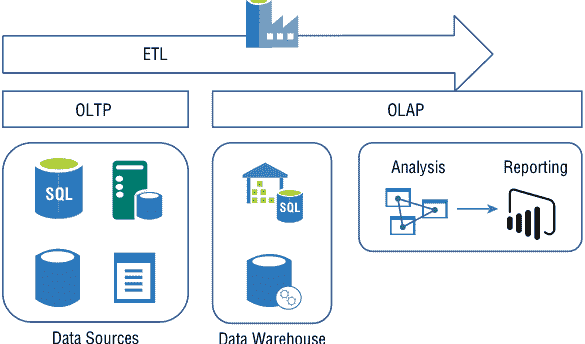

从 *在线事务处理（OLTP）* 开始，你可以看到数据最常见存储的位置来自于某种外部系统的交互。例如，在线下单或从 ATM 取款都会导致在事务关系数据库上发生插入、检索和/或更新。相比之下，你还看到 *在线分析处理（OLAP）* 组件，其重点是将来自多个来源的相当大量的数据存储到单一位置，例如数据仓库。数据仓库通过例如 *Azure Analysis Services* 进行访问和处理，后者创建可用于使用例如 Power BI 呈现人类可读报告的数据模型。最后，数据在 OLTP 和 OLAP 之间流动的过程被称为 *提取、转换、加载（ETL）*，在 Azure 中可通过使用 *Azure Data Factory (ADF)* 实现。图 5.1 说明了一个相当复杂的 RDBMS 数据架构解决方案，如果你的目标是 Azure 并且工作负载需要这种解决方案类型，你会追求这种方案。原则上，这些就是组件，它们可以根据众多其他模式进行设计和部署。

### 大数据/NoSQL

RDBMS 在其设计用途的场景中运行良好，并且继续运行，例如管理事务。然而，像大数据和机器学习这样新概念对传统 RDBMS 解决方案造成了压力。两个这样的例子是 RDBMS 解决方案假设数据之间存在关系，以及进行模式更改通常需要本体论讨论，这会减慢变化速度。

使用结构化与非结构化在 RDBMS 和大数据之间建立类比是可能的。这本身就解释了大数据对 RDBMS 解决方案造成的首个压力。存储在大数据中的数据种类繁多，包括从小说内容到达拉斯当前温度的一切。在我撰写大数据时，我尝试应用我的 RDBMS 设计技能来思考如何做到这一点。脑中只浮现出丑陋的解决方案。如果数据没有结构，如何使用它？如何从中学习任何东西？Azure Analysis Services（前面提到并在图 5.1 中可视化）有助于使此类数据变得有意义。

想象一下你在大型企业工作，公司所做的一切都映射到你的 RDBMS 模式。假设你想为公司创建一个新功能或服务，但这需要更改数据库模式。为此所需的会议和对话会使部署时间增加数天、数周甚至数月。另一方面，大数据存储没有结构，因此你可以按需创建结构，编码应用程序，然后上线。

NoSQL 是你在大数据上下文中经常会听到的术语。如图 5.2 所示，存储在 NoSQL 数据库中的数据不是结构化的，非关系示例缺乏表内数据之间的关系。使用 NoSQL 模型存储的数据是通过将给定实体完整地存储在一行上实现的。你可以看到 Fender 吉他的所有型号都存储在 key = 1 的单行上。这可能看起来不是最有效的数据结构，考虑到 NoSQL（非关系）数据库模型。许多 NoSQL 数据库模型缺乏触发器、存储过程和连接功能。要使用关系数据库获取所有 Fender 型号的列表，你需要在 Guitars 和 Models 表之间使用主键和外键执行连接。

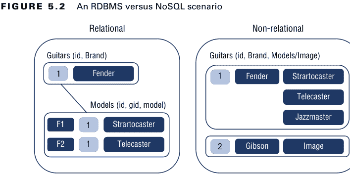

无论 perceived inefficiency 如何，NoSQL 结构在数据量大到巨大时扩展性非常好——扩展得如此之好，以至于 Facebook、LinkedIn 和 Google 等公司都使用 NoSQL 数据库结构来存储和访问其数据。如你所知，这些公司通过分析其服务收集的数据并从中学习来赚钱。因为存储、分析和轻松访问数据对其业务运营至关重要，所以它们本质上偏爱最有效和高效的数据存储技术。

### 选择正确的数据存储解决方案

如果将工作负载迁移到 Azure，应用程序的正确数据存储可能已经决定。然而，如果你有机会将一个全新项目部署到 Azure，那么你必须了解应用程序的要求才能选择合适的存储解决方案。回顾第 2 章，你需要知道客户端将从何处访问你的应用程序，以便实施条件访问策略。在第 3 章你了解到你需要知道子网中将存在多少资源，以便识别正确的 CIDR 前缀。最后，在第 4 章，你了解到你需要知道应用程序是 CPU、内存还是存储密集型，这将决定选择的 Azure VM 系列。这里同样适用。以下哪种数据存储最适合你即将构建的应用程序？

- 文档数据库
- 图数据库
- 键/值对
- 对象存储
- RDBMS
- 搜索引擎数据库
- 数据分析/数据仓库
- 共享文件

以下各节涵盖了这些数据库模型的意图和用途。此外，还提供了为每种特定模型设计的 Azure Data Store 或 Azure Storage 产品。稍后在本章中将对其中许多产品提供更深入的介绍。以下内容的目的是为你提供了解可用的 Azure Data Store 和 Azure Storage 产品以及它们 intended 用于哪个数据模型的知识。

### 文档数据库

文档数据库是通常以以下一种或多种格式存储数据的数据库：XML、JSON 或 YAML。文档数据库中的一行由两列组成：键和文档。如图 5.3 所示，键是唯一的，提供直接检索文档的手段，使应用程序能够解析和处理它。文档数据库的一个强大功能是你可以查询文档本身的内容。你可以查询所有 OriginalOwner 为 csharpguitar 的文档。

存储在文档列中的内容相对较小，通常以集合、列表或标量项的形式存在。文档通常包含整个实体的所有数据，可以具有唯一的模式。什么是实体取决于应用程序的要求。图 5.3 中你看到的两个实体，一个定义吉他，另一个定义编程语言。那些实体是否提供了关于吉他和 C# 的所有细节？没有，但就我的目的而言，它们包含我需要的内容。尽管文档的结构（模式）看起来相似，但它们具有不同的属性，因此是唯一的。旨在满足需要文档数据库的应用程序需求的 Azure 产品是 Azure Cosmos DB，本章后面将对其进行更详细的描述。


FIGURE 5.3 A document database table

| Key | Document |
|-----|----------|
| 1618 | { "GuitarID": 1, "Description": [ { "Brand": "Fender", "Model": "Stratocaster", "Year": 1956, "Color": "Sunburst", "Condition": "Mint", "Accessories": "Case,Strings,Picks" } ], "OriginalOwner": "csharpguitar" } |
| 6174 | { "LanguageID": 1, "Description": [ { "Name": "C#", "Pronunciation": "see sharp", "Year": 2000, "TargetOS": "Windows", "Crossplatform": true, "CurrentVersion": 8.0 } ], "DevelopedBy": "Microsoft" } |

### Key/Value Pairs

如果快速查看图 5.4，你会注意到表的结构看起来与文档数据库类似。文档数据库和键/值存储每行都由两列组成；然而，两者之间存在一些显著差异。第一个是预期存储的数据大小，其中键/值存储期望该大小是巨大的，而在文档数据库的上下文中则并非如此。接下来，键/值存储不支持聚合，这意味着数据无法通过查询找到。你只能使用键的值从存储中检索数据，而不能在选择查询中对 Value 列添加 WHERE 子句。

最后，你会注意到在图 5.4 中，值可以存储为逗号分隔的字符串数组，例如。当我第一次看到这一点时，我想起了我第一次数据库经历的闪回，当时我手动将所有数据加载到程序中，然后将其加载到内存中，从那里我对其进行操作，或者我应该说，与其玩耍。潜意识中，我还注意到键/值存储结构映射到 C# 字典非常好。例如，图 5.4 中的第一行应使用以下代码加载到内存中：

```
var guitar = new Dictionary<string, Tuple<string, string, string, string>>()
```

FIGURE 5.4 A key value store

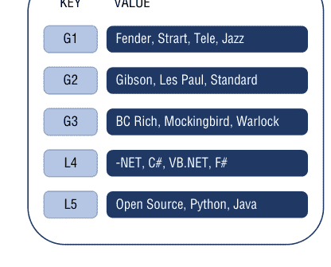

重点是，数据作为存储到键/值表中的结构与程序化结构模式有着似乎非常紧密的绑定。因此，性能和可扩展性似乎也根植于彼此，即在设计层面紧密绑定。这在文档数据库中并非如此，因为值是一个实体，其在检索后需要进行类型转换和解析。键/值对的常见用例场景是数据缓存。这就是为什么你会看到与 Azure 产品 Azure Cache for Redis 相关的许多数据缓存提及，后者将在后面讨论。Azure Cosmos DB 也提供键/值存储功能，Azure Table Storage 也是如此。当你阅读涵盖 Azure Cache for Redis、Azure Cosmos DB 和 Azure Table Storage 的部分时，选择其中一个的理由可能会变得更清晰。总结来说，选择键/值存储与文档数据库的理由基于预期大小、对值进行查询的能力以及速度。

### Graph Databases

节点和边是关于图数据库存储需要了解的两个术语。节点可以被视为一个实体，就像实体是存储在文档数据库中的值一样，以 JSON 文档的形式存在。该节点中包含的信息由定义它的所有数据组成。边是定义节点之间关系的内容。这里再次，节点和边是你在众多上下文中读到的常见词。

可能已经显而易见的是，当术语重叠如此之多时，技术场景会变得复杂。然而，从概念上讲，节点这个术语很好地融入到其他场景中，因为节点就像一个端点，或者正如我已经写过的，它是一个定义明确的实体，具有某种定义的目的。采用与节点相同的方法，边是连接节点的网络基础设施。边是路由和虚拟网络设备（VNA），它们定义并在节点之间建立连接。

如果你有一组节点，例如虚拟机，每个节点都会有一些属性，这些属性共同定义了它作为唯一实体的身份。该组中的虚拟机会有一些由边定义的相互关系。以下查询将返回所有虚拟机 csharpguitar 连接到的数据库：

```
MATCH (az:vm)-[CONNECTED-WITH]-(database)
WHERE az.name = 'csharpguitar'
RETURN az, database
```

对于节点之间关系复杂、动态且快速变化的场景，这种数据存储可能提供你最好的解决方案。想象一下前一个场景中，虚拟机在、向上、向下和向外扩展，并且数据库也是弹性的，实时扩展。那可以被视为一个动态场景，如果你想对它进行一些实时报告，你可能需要一个图数据库存储。Azure Cosmos DB 是通过 Gremlin API 提供图数据库功能的产品，用于创建实体并对其执行查询操作。虚拟机示例仅用作帮助你可视化的示例。虚拟机可以被视为节点，但图数据库上下文中的节点是逻辑的，而不是物理的。

### Object Storage

二进制大对象（BLOB）存储，也称为对象存储，是由存储在数据库系统中的二进制数据集合组成的一个实体。Blob 在上一章中已在托管磁盘、Azure Batch、Azure Apps 和 Azure Functions 的上下文中讨论过，所有这些都使用 Azure Blob Storage 容器来提供其服务。这种存储类型针对存储和检索二进制对象进行了优化，例如图像、视频和 VHD 等。使用此类型存储的每个实体通常由实际数据、唯一键以及一些元数据组成，例如 blob 类型、大小、上次修改时间戳等。稍后在“Azure Storage”部分中，blob 存储将得到更详细的讨论。什么是对象存储现在很清楚了，也许细节还不够清楚，但那些内容稍后会提供，所以继续阅读。Azure Blob Storage 是将满足你对象存储需求的产品。

### Relational Database Management System

Azure 提供众多 RDBMS 产品，例如 Azure SQL Database、Azure Database for MariaDB、Azure Database for PostgreSQL 和 Azure Database for MySQL。每个都提供在 RDBMS 中常见的功能，例如 SQL 查询功能、连接、存储过程和触发器。如图 5.2 所示，关系数据库由一个或多个（通常更多）具有行和列的表组成。

行上的列或一组列用于唯一标识数据行，被称为主键。此键可用于在两个或多个表之间创建关系。一个表上的主键用作另一个表上的外键，并用于在它们之间进行连接。图 5.2 说明了 Guitars 表上的主键 = 1 是 Models 表上的外键。Models 表上的主键是 F1 和 1 的组合，或主键和外键的组合。

关于关系数据库结构有很多书籍，因为它们已经存在了几十年。然而，有几个概念我想讨论：原子性、一致性、隔离性、持久性（ACID）；事务；规范化；和模式。当数据存储在 RDBMS 上时，它以事务的形式发生。为了在现实世界中可视化事务，请考虑财务交易。财务交易通常包含属性，例如协议、买方、卖方、付款以及货物或服务的转移。在数据库上下文中，如果事务由 ACID 属性组成，则保证事务。ACID 是一个缩写，以原子性开头，这意味着事务作为一个单一单元执行，要么完全成功，要么完全失败。一致性保证数据不会损坏，例如具有外键但在父表中没有匹配的行。隔离是管理数据在插入表后何时可读和可修改的概念。在高容量应用程序中，这是严重考虑的问题，其中脏读和幻读等概念很常见。最后，持久性确保即使出现异常或可能停电，事务也能提交。如果事务是持久的，一旦数据提交，它将保持提交状态。这是一个专业领域，如果你以后涉足此领域，请考虑咨询数据库管理员（DBA）以获取指导。关于此领域有很多书籍，因此如果它引起你的兴趣，请通过其他书籍和资源进一步探索。这本身就是一个职业。

如果你做过数据库工作，你可能会知道一些概念，如第一范式、第二范式和第三范式。它们都是数据库规范化的模型。规范化的指导原则是减少在彼此之间存在关系的表中数据的重复。例如，再次查看图 5.2 并假设不是拥有 Models 表，你可以将所有数据保存到 Guitars 表中。那将导致 Fender 在两行中被写入；它是重复的数据，可以通过创建 Models 表、添加外键并创建关系来删除并变得更高效。模式是 RDBMS 中表及其关系的结构或蓝图。如图 5.5 所示，数据库模式通常以文本形式表示的表和列表示，关系通过连接两个或多个表之间的线来定义。

FIGURE 5.5 A database schema

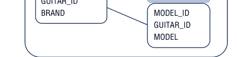


到目前为止，数据存储的表结构是每行两列，其中一列名为 Key，另一列名为 Value。在这种情况下，检索数据的客户端需要事先知道它要检索的内容，以便能够解析和解释数据。情况并非如此，原因在于设计良好的 RDBMS 中，表及其内部的列都有直观的名称，这些名称可以在运行时或设计时用于代码中，以确定其目的和含义。

RDBMS 数据库场景最适用于报表、会计、库存和订单管理。任何你希望拥有明确定义的数据及其与其他表数据的关系都适合这种数据存储场景。

# 搜索引擎数据库

当你最初读到这种存储类型的标题时，你可能立刻想到了 Bing——好吧，大概率是 Google。确实，这种数据存储针对的是为搜索引擎提供支持的场景，正如名称所暗示的那样。然而，这种类型的存储还有其他用途。其中一种场景是当你需要存储和索引大量数据，同时还能从这种存储类型中快速响应查询匹配时。但你大概希望所有存储系统都能做到这一点，对吧？除了响应迅速之外，当你的数据库所做的全部就是根据一段文本字符串响应数据时，这就是应该关注的正确方向。想想在传统的 RDBMS 中使用列和行来实现这种方法。你将如何为此类事务制定 SQL 查询？需要有一个用于搜索文本字符串的列，而该列会很宽。RDBMS 根本无法很好地满足这种需求。

我记得几年前我搜索过 *How search engines work*，并在亚马逊上偶然发现了一本 100 页的书，售价数百美元，讨论了搜索背后的科学算法。这又是另一个值得深入研究和职业投入的迷人领域。取而代之的是，我发现了一种名为 Lucene 的技术。由于我非常喜欢 C#，我转向了 Lucene.NET。在那里我学到了我所知道的关于搜索的知识。这是一个有趣的领域。在我使用 Lucene.NET 的工作中，我了解到当你使用一段文本字符串进行搜索时，会得到许多需要使用某种算法或一组算法进行排序的结果。这些算法高度保密，在许多情况下也颇具争议。如今，有了 *Language Understanding Intelligent Service (LUIS)* 的帮助，Azure 认知服务可以接收一些词语并解释其意图。不仅可以根据文本获得结果，还可以尝试理解词语的含义，然后进一步调整查询。

最后，还有一种场景，即你将搜索数据库和搜索引擎逻辑置于更传统的结构之前。你需要创建并填充搜索数据库，其中包含可搜索字段，这些字段链接到从后端传统结构化或非 *search engine optimized (SEO)* 数据库中获取真正预期结果集的手段。Azure Search 是在道路通向那里时可以帮助你的产品。请注意，当你查找它时，你会发现 *cognitive* 和 *artificial intelligence (AI)* 这两个词在同一空间中使用。这是当今 IT 行业的一个活跃领域。

# 数据分析/数据仓库

数据仓库，又称 *enterprise data warehouse (EDW)*，是一个中央数据存储，接收来自许多不同来源的数据，然后用于报表和数据分析。对数据的分析通常是为了识别业务趋势，例如客户满意度、售出单位数或营销支出。从分析中获得的信息用于预测未来事件，这有助于在为未来类似事件做准备时规划资源分配。例如，黑色星期五以高销售额著称，因此了解去年售出了多少产品是有益的，这样你就能确保有足够的库存。此外，你可能会想知道一年与下一年相比在该产品上花费了多少营销费用，然后比较其对销售的影响。可以假设营销支出越多，销售越多，但事实可能并非如此；你可以通过数据发现这一点。

数据仓库是指数据存储的位置，而数据分析是你用于辅助决策制定的过程。这可能会让你问自己，“什么是数据分析？” 数据仓库和数据分析都是数据分析的组成部分，数据分析还包括用于获得对公司运营的可见性水平的技术和工具，这有助于做出决策，最常见的是关于人力和资本资源分配的决策。

存在于数据仓库中的数据可以是历史数据或接近实时的数据，但在大多数情况下，数据来自多个来源，并且格式多种多样。这意味着将数据移入 EDW 的过程的一部分需要对数据进行一些修改，以便之后可以将其与其他来源的数据组合进行分析。为了在 Azure 上从设计角度实现这一点，有两种数据仓库模式（星型和雪花型）被设计为能够很好地协同工作。图 5.6 说明了星型模式，其中中心是包含所有维度表键的 FACT 表。分析算法将从事实表开始，并使用其中的数据访问其他表以收集更多详细信息并执行进一步分析。图 5.6 如果你发挥一点想象力，也很像一颗星星。

# FIGURE 5.6 A database warehouse star schema

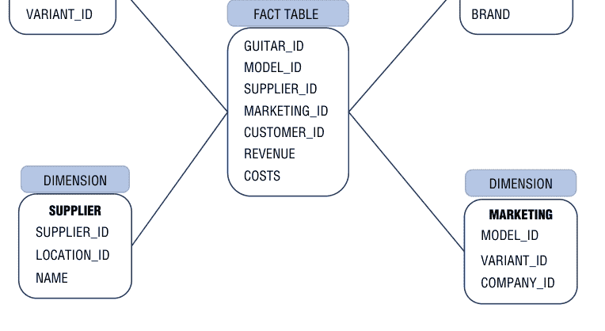

雪花模式是建立在星型模式之上或向外扩展的，如图 5.7 所示。它只是一个更复杂的模式，具有更多维度，可提供更多有助于预测和规划的见解和细节。

# FIGURE 5.7 A database warehouse snowflake schema

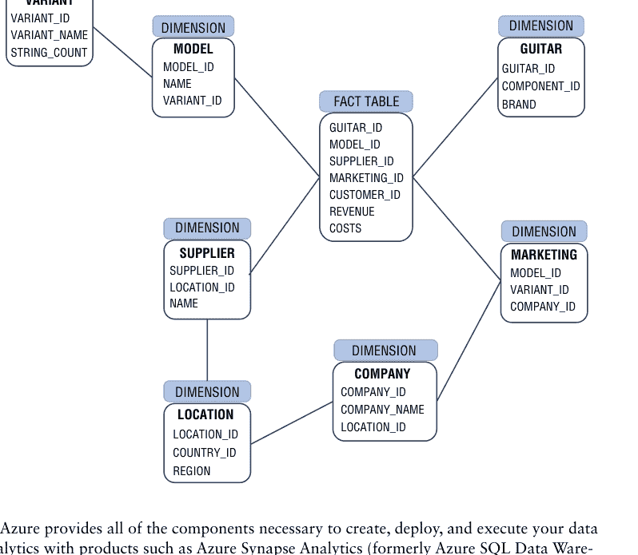

Azure 提供了创建、部署和执行数据分析所需的所有组件，例如 Azure Synapse Analytics（前身为 Azure SQL Data Warehouse）、Azure Data Factory (ADF)、Azure Data Lake Store (ADLS)、Azure Data Lake 和 Azure Analysis Services。下一节将对每个产品进行总结。请记住，对于考试，你可能需要知道每个产品在数据分析上下文中发挥的作用。其内部工作原理、如何构建数据仓库结构以及如何查询它们并不在考试范围内。

### Azure Synapse Analytics

图 5.2 说明了数据结构中的两个重要方面；关系型和非关系型。数据存储从关系型向非关系型转变可归因于源自互联网和社交媒体消费的数据的创建和收集。关系模型在这种场景下根本行不通，需要创建一个新模型及其支持工具。再次查看图 5.1，其中显示了传统关系型数据解决方案的流程。特别注意数据仓库部分，并认识到对于非关系型数据，Azure Data Lake 是实现非关系型数据捕获的相同或可比结果的产品。图 5.8 说明了非关系型或大数据模型的 数据流。

# FIGURE 5.8 A traditional nonrelational data flow diagram and Big Data pipeline

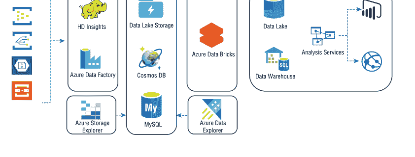

非关系型数据流始于端点，来自这些端点的各种结构和含义的数据以多种形式进入摄取过程。与 OLTP 过程相比，数据的摄取必须响应极快、极其灵活且高度可用。这些摄取端点通常不存储任何数据，因为那样会太迟缓；相反，这些端点将数据排队并可能进行清理，以备存储和分析。一旦数据被摄取到大数据管道中，它就会被存储到任意数量的系统中，例如 Data Lake Storage、Azure Cosmos DB 或 Azure Database for MySQL。名为 Azure Data Bricks 的 Azure 产品有助于探索数据，以便找到见解并一旦找到就将其存储在 Data Lake 中以进行额外分析和展示。上述每个 Azure 产品将在后面更详细地介绍；首先，请查看表 5.1，了解数据仓库与数据湖之间的比较。


### 表 5.1 数据湖与数据仓库的区别

|  | 数据仓库 | 数据湖 |
|---|---|---|
| 便利性 | 复杂、成本高、难以修改 | 易于访问、成本高效、易于修改 |
| 数据访问 | 写入时定义模式 | 读取时定义模式 |
| 使用者 | 业务专业人员 | 数据科学家 |
| 数据结构 | 受管、关系型 | 原始、非关系型 |
| 安全性 | 成熟 | 正在成熟 |
| 访问方法 | SQL | NoSQL |
| 扩展性 | 横向 | 纵向 |

Azure Synapse Analytics（原 Azure SQL 数据仓库）是一款能够同时管理数据仓库和数据湖数据集的产品。理解数据仓库与数据湖之间的区别非常重要，同时还需要了解大数据管道（见图 5.8）的示意，并将其与传统关系数据模型（见图 5.1）进行对比。有关该产品的更详细信息，请查看以下链接中的内容：

```
docs.microsoft.com/en-us/azure/sql-data-warehouse
```

在继续之前，让我们先讨论表 5.1 中各项内容的含义，从“便利性”开始。创建数据关系后，其他程序或数据源会随着时间的推移对这些关系建立依赖。此时对数据关系进行更改，需要分析对下游依赖系统的影响。这是企业数据仓库（EDW）中的常见场景，但在数据湖场景中却并非如此，因为数据湖中的数据几乎没有或完全没有结构。存储非结构化数据的一个好处是，数据源的配置速度会快得多。如果构建或重用关系数据库并将数据存入其中，设计其结构所需的时间将远远超过非结构化方法。试想，无需创建数据库结构和插入数据的代码，而是将数据拿到 Azure 上，放进 JSON 文档中，然后直接存入 Azure Cosmos DB。这一概念引出了表 5.1 中的下一行，即“写入时定义模式”和“读取时定义模式”。请记住，模式就是数据的形状、形式和关系。从 RDBMS 或 EDW 的角度来看，写入时定义模式要求在数据写入之前先创建数据源的模式。读取时定义模式则期望在读取数据时应用数据的结构。考虑到这一点，你应该很快意识到，读取时定义模式正是能够以非结构化方式在数据源中存储数据的基础。

EDW 与数据湖之间的另一个区别在于谁会使用所存储的数据。希望基于销售数据、客户位置和营销成本来使用企业数据的企业，通常使用 EDW。这些使用者是业务专业人员，他们利用数据预测未来趋势。这并不是说 EDW 不能用于大数据管道，只是与结构化程度较低的 NoSQL 方法相比，它不被认为是最有效的。使用大数据和存储在数据湖中的数据的人，是数据科学家，他们面对大量非结构化数据，任务是从中找出规律。最后，从扩展角度来看，扩展非结构化数据的典型模式是横向扩展。横向扩展意味着在不同地理区域创建相同数据源的额外相同实例，以便更靠近使用数据的客户端。相反，纵向扩展则是在给定的单个服务器上增加计算和存储容量（CPU 和 RAM）。

下面我们详细看看图 5.8 中展示的每个 Azure 产品。

### Azure 数据工厂（ADF）

非关系数据模型和大数据管道侧重于从许多来源、许多不同端点中摄取海量数据。摄取服务可能从一些端点接收数据，这些端点可能来自 Twitter 或 Facebook 等社交媒体公司；来自 Azure 消息产品（如 Event Hub、Event Grid、存储队列和 Blob）；或来自 IoT 设备。Azure 数据工厂（ADF）是数据生成器与数据存储之间的连接器。假设你正在创建一个新的 ADF 管道，其中有两个基本元素：连接和触发器。配置连接部分时，你通过提供端点和凭据来确定信息将来自的数据源。然后配置触发器部分，以指示收到数据后如何处理。你还会注意到图 5.8 中提到了 HD Insights。请注意，ADF 旨在管理关系数据结构，而基于 Hadoop、Spark、Kafka 等的 HD Insight 则更针对非关系、NoSQL 和开源解决方案。

### Azure 数据湖存储（ADLS）

最新版本的 Azure 数据湖存储（ADLS）构建于 Azure Blob 存储之上。ADLS 针对以任意格式存储大量数据进行分析和报告进行了优化。数据可以以任意格式存储这一事实表明，ADLS 支持非关系数据模型中的半结构化和非结构化存储概念。从 ADLS 检索数据时采用读取时定义模式，因为 ADLS 不要求预定义模式。在很多方面，以这种方式存储数据只是收集数据，并不真正知道打算如何处理它。存储数据是为了确保不会遗漏任何信息；之后，当你有一个问题需要通过对收集的数据进行分析来得到答案时，你会庆幸自己当初收集了这些数据。人们常说，大数据和机器学习是为了回答尚未被提出的问题而构建的。

ADF 和 HD Insights 可以将收集到的数据放入众多存储产品中。Azure Cosmos DB 和 Azure Database for MySQL 是稍后讨论的两个。还有许多其他存储产品可以用来在 Azure 上存储数据，包括开源和闭源产品。例如，你可以将数据转换为文件，直接存储到 Azure Blob 容器或构建在 Hadoop 上的 Apache HBase NoSQL 数据库中。不要忘记，对关系数据进行数据分析也是可行的。如果数据是关系型的，那么你当然可以将其存储在 SQL Server 数据库或其他 RDBMS 中，并在数据被净化后，将其推进到 Azure 数据仓库产品中进行报告。

### Azure Databricks

该产品涉及不同的主题，并触及 AI、ML 和数据科学等概念。Azure Databricks 提供了一个数据接口，帮助你从数据中找到问题的答案。你可以使用 AI 来收集关于数据元素意图的一些见解，而无需尝试转换其含义。你可以使用 ML 功能最终定义算法和流程，以便在数据中识别出智能之后，程序可以遵循这些算法和流程。这个新行业有很多内容，我不会假装自己是专家。有效理解和解释这一概念可能需要数据科学博士学位。这是一个有趣且正在 IT 行业中获得发展的领域。

### Azure 数据湖

数据准备好并记录了搜索和学习结果后，数据会存储在 Azure 数据湖或 Azure 数据仓库中，用于最终分析、得出结论和展示。将数据放入 Azure 数据湖还是数据仓库的主要区别取决于所存储和分析的数据的大小或数量。Azure 数据湖适用于处理 PB 级数据的场景。EDW 则小得多且结构性强得多，因此更容易分析和提供。由于存储在 Azure 数据湖中的数据量预计会以相对较快的速度变化，因此扩展是 Azure 产品的一大组成部分。此外，存储在 Azure 数据湖中的数据可以是任何形式——视频、Blob、文档或半结构化数据源。

### Azure Analysis Services

该产品是 Azure 的 PaaS 产品，将数据（无论是关系型还是非关系型）重构或解释为语义数据模型（SDM）。SDM 是将数据建模并转换为更现代化模型的数据，旨在捕获那些可能无法通过传统方法实现的数据含义。这是一个 PaaS 产品，这意味着它背后有一些计算能力，因为数据需要经过分析、操作、重新格式化并存储，然后才能作为 SDM 运行。与许多其他 Azure 产品一样，它有多个层级：开发人员版、基本版和标准版。每个层级都有不同的功能以及对应的 CPU 和内存分配。


当数据结构最初创建时，数据中必然包含某种逻辑含义，这些含义体现在列、表和关系中。语义数据模型试图提供一个概念性数据结构，然后可以轻松地提供给例如 Power BI 报表，如图 5.9 所示。

### FIGURE 5.9 The formation of a semantic data model

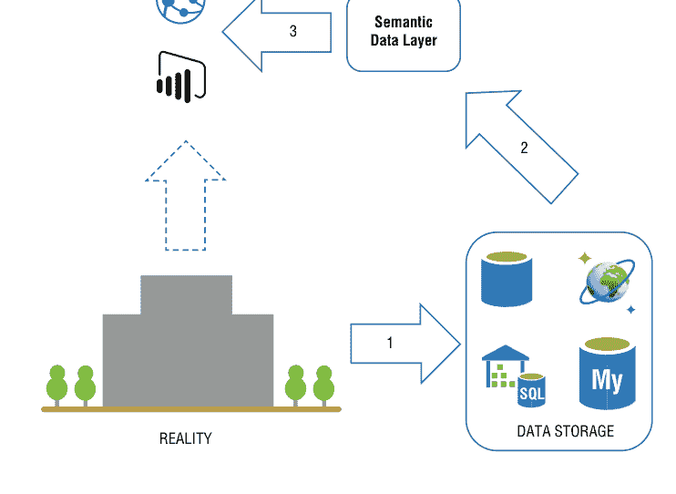

假设你有一些描述一家公司或一组公司的数据。你很可能拥有包含员工、地点、使命和库存的数据。这些数据存储在某种存储中，试图展示或产生该公司的说明。在大数据环境中，数据源中可能存在其他表，未结构化或没有定义的关系，但间接具有某种概念性联系。假设其中一家公司的使命是“赋能地球上每一个人、每一个组织实现更多”。Analysis Services 可能能够理解该使命声明的含义，并在寻找具有相似使命的其他公司时使用该含义。这种发现将被形式化为一个 SDM，通过这样做，它提供了更可行的查询源和可视化这些结果。

### Azure Data Explorer (ADX) and Azure Storage Explorer

一旦数据被放置到数据存储中，无论是否结构化，一种名为 *Azure Data Explorer (ADX)* 的工具可以帮助你浏览和分析它。这种强大的工具提供了一个查询接口，用于查询存储在例如 Data Lake 和 Azure Monitor 上的数据。Azure Monitor 在第 9 章中讨论。ADX 由 Microsoft 内部使用。我个人使用 Azure Functions 分析客户问题。ADX 为我提供了进入我们的日志系统 Kusto 的接口，我可以在那里几乎实时地查询日志，以了解产品发生了什么。我们正在“吃自己的狗粮”，正如所说。另一方面，Azure Storage Explorer 提供了一个用于遍历众多 Azure 存储产品的接口，例如容器、共享、队列和表，所有这些都将在后面讨论。Azure Storage Explorer 类似于图 5.10 所示。

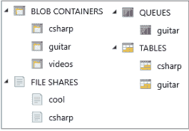

对于每个 Azure 存储产品，你首先为想要的选项创建存储帐户，例如容器、共享、队列或表。然后，在帐户内创建容器。帐户是你可以配置防火墙规则、日志记录和区域冗余的位置，而容器则提供更有限的配置集，例如大小和访问策略。你可以使用 PowerShell、Azure CLI、.NET、Java、Python 和 Node.js 来管理和配置 Azure 存储。

### Shared Files

共享文件一直是使用计算机的重要组成部分。无论是 `.zip`、`.gif` 还是 `.docx`，在创建或接收此类文件后，通常希望与他人共享它们。此外，你可能有许多台计算机需要访问这些文件。存在一种文件共享的概念，它只是一个在网络上可用的服务器。它具有大量的存储容量，并以文件的形式共享内容。文件存储在构成逻辑目录结构的文件夹中。

在 Windows 资源管理器中，例如，有一个名为映射网络驱动器的菜单项，然后提示你输入服务器名称和共享名称。格式可能很熟悉，类似于 \\server\share。当所有需要访问文件的机器都在同一网络或受信任的网络上，并且用于连接到共享的身份具有访问权限时，这很有效。

如今有更好的解决方案，例如 Microsoft Teams 或 SharePoint，用于存储可被众多人同时并行修改的共享文件。文件共享并不是实时更新共享文件所需的活跃协作的主要选项。文件共享解决方案更适用于存储可能需要在以后参考的文件，并且更新发生在非计划的时间间隔内。想想你可能有大量很少使用或引用的文件，但由于某种原因你无法删除它们。也许是旧的简历、旧信件、奖项或证书？图片另一方面，虽然不常查看但很珍贵。你不希望它们只在一台计算机上，因为如果它崩溃，从硬盘上获取数据是昂贵的，如果可能的话。将其放在文件共享上是一个不错的替代方案，也许是像 OneDrive 或 Microsoft Azure 文件存储产品 Azure Files 这样的东西。

Azure Files 与所有其他 Windows 文件服务器共享技术一样，基于 Server Message Block (SMB) 协议。它提供 LRS、ZRS、GRS、RA GRS 和 GZRS 冗余；大量的存储容量；同步功能；静态数据加密；以及一个暴露的 HTTPS API，允许文件管理自定义。冗余将在本章后面的“区域复制”部分中描述。如果你现在想获取详细信息，可以跳到前面。欲了解有关 Azure Files 的更多信息，请完成练习 5.1，在其中你将创建一个存储帐户，然后创建和配置一个 Azure Files 文件共享。

### EXERCISE 5.1

#### Creating and Configuring Azure Files

- 1. 登录到 Azure 门户 https://portal.azure.com 并单击浏览器左上角的菜单按钮。单击 + 创建资源，单击存储，然后单击存储帐户。
- 2. 选择要创建存储帐户的订阅和资源组，输入存储帐户名称（我使用了 csharpguitar），输入位置（应与资源组位置相同，但不是必需的），并从复制下拉菜单中选择本地冗余存储（LRS）。将所有剩余选项保留为默认值。单击查看 + 创建按钮，然后单击创建按钮。
- 3. 一旦配置完成，导航到存储帐户的概述刀片。在刀片中央你将看到类似于图 5.11 的内容。单击文件共享链接，单击 + 文件共享按钮，输入名称（例如，guitar），输入配额（例如，1），然后单击创建按钮。

#### FIGURE 5.11 A portion of the storage account overview blade

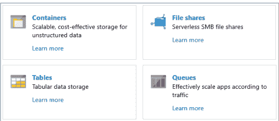

- 4. 打开 Azure PowerShell 并输入以下 PowerShell cmdlet：

```
Test-NetConnection -ComputerName <name>.file.core.windows.net -Port 445
```

如果端口 445 被你的公司或私有防火墙阻止，则之前的 PowerShell cmdlet 将无法工作。用你在步骤 2 中创建的存储帐户名称替换 <name>。PowerShell cmdlet 的输出可能类似于图 5.12。

#### FIGURE 5.12 The output of a PowerShell cmdlet testing file share connectivity

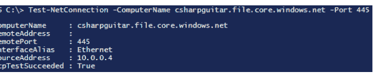

- 5. 单击你刚刚创建的文件共享，单击连接按钮，查看按操作系统提供的示例脚本，并选择你想要的操作系统脚本。
- 6. 如果你在步骤 4 中运行的 PowerShell cmdlet 成功，输入以下内容以挂载/映射驱动器：

```
cmd.exe /C "cmdkey /add:'<name>.file.core.windows.net' /user:'Azure\<name>' /pass:'<password>'"
New-PSDrive -Name Z -PSProvider FileSystem -Root "\\<name>.file.core.windows.net\<shareName>" -Persist
```

### EXERCISE 5.1 (continued)

用你在步骤 2 中之前创建的存储帐户名称替换 <name>，用你在步骤 5 中单击连接按钮后向你展示的脚本中的值替换 <password>。用你在步骤 3 中创建的文件共享名称替换 <shareName>。图 5.13 说明了成功的结果以及挂载/映射的驱动器在 Windows 资源管理器中的外观。

#### FIGURE 5.13 The output of a PowerShell cmdlet mounting an Azure File Share and how it looks in Windows Explorer

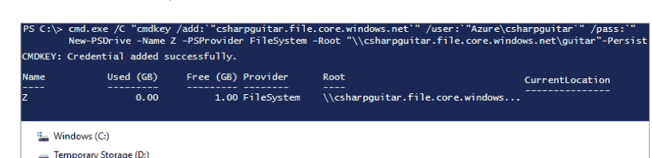

再次强调，将资源放置在与资源组位置相关的逻辑位置的重要性很重要。存在将位于不同区域的 Azure 产品放置到同一资源组中的场景是有意义的。例如，Azure Traffic Manager (ATM) 是全局的，意味着它不受特定位置的约束。那该把它放在哪里呢？重点是，在配置资源时，以逻辑方式对它们进行分组。分组并不总是按位置；它可以按产品或 IT 解决方案基础。保持组织有序，因为它使支持更容易并降低成本。

在进入下一节之前，请查看表 5.2，以获得有关在许多不同场景中应选择哪种数据存储技术的更好见解。你需要了解应用程序的要求，然后利用你在前文中学到的知识，你可能更能决定哪种数据存储最适合满足这些要求。该表提供了先前提供的信息的另一种视图。

### TABLE 5.2 Comparing Data Storage

|  | Document DB | Key/Value | Object Storage | RDBMS | EDW | Shared Files |
|---|---|---|---|---|---|---|
| Non- or semi-relational | ✓ | ✓ | ✓ | × | × | ✓ |
| Relational | × | × | × | ✓ | ✓ | × |
| Aggregation | × | × | × | ✓ | ✓ | × |


|  | Document DB | Key/Value | Object Storage | RDBMS | EDW | Shared Files |
|---|---|---|---|---|---|---|
| 开源 | ✓ | × | × | × | × | × |
| 大数据 | ✓ | × | × | × | ✓ | × |
| OLAP | × | × | × | ✓ | ✓ | × |
| OLTP | × | ✓ | × | ✓ | × | × |
| 文件存储 | × | × | ✓ | × | × | ✓ |
| 垂直扩展 | × | ✓ | ✓ | ✓ | ✓ | ✓ |
| 水平扩展 | ✓ | × | × | × | × | × |
| 静态加密 | ✓ | ✓ | ✓ | × | ✓ | ✓ |

#### 聚合

请记住，聚合意味着你可以在数据源上运行类似 SQL 的查询语句。像 Azure SQL 这样的 RDBMS 是关系型的，因此由于表之间的关系，它非常符合该标准。虽然你也可以使用 Azure Cosmos DB 对文档数据库运行类似查询的命令，但这些查询通常是在从数据存储中检索到的文档上运行，而不是在数据存储本身上运行。你将在本章后面在创建 Azure Cosmos DB 后进行此操作。

#### 开源

表格项目“开源”表示相关数据存储最受欢迎，专门为使用开源软件编写的应用程序设计，或通常实现与该方法最搭配的概念。

#### 垂直扩展和水平扩展

垂直与水平扩展的区别在于数据存储是设计为扩展到多个实例，还是扩展到更强大的单个实例。虽然所有数据存储产品都支持垂直扩展，但通过水平扩展到更接近用户的区域，与简单地扩展到更强大的 VM 相比，你可能会获得更大的改进。

现在你已经了解了绝大多数可能的数据存储类型、其用例以及其优缺点，请继续阅读以更深入地了解一些 Azure 数据存储和 Azure 存储产品的具体细节。

### Azure 数据存储

在本节中，你将了解众多 Azure 数据存储产品。Azure SQL Database 和 Azure Cosmos DB 将深入介绍，而其他不太流行但值得提及的数据存储，如表存储、MySQL 和 PostgreSQL 也会讨论。除了这些 Azure 数据存储外，以下内容也将涵盖：

- Azure Data Store 与 Azure Storage
- 数据库即服务 (DaaS)
- 数据分区
- 数据集
- Azure Database Migration Service

在会议上被问到或在与客户或客户通电话时，能够随时查阅某些术语的定义是一个很好的做法。其中一个问题是，数据存储和数据存储之间有什么区别？它们不是同一回事吗？嗯，有点是。它们是相同的，因为它们都存储数据。区别在于数据的结构或形式。通过比较 Azure 数据存储产品和 Azure 存储产品彼此之间可以最简单地理解。例如，比较 Azure SQL 和 Azure Blob Storage。前者 Azure SQL，你可以简单地称之为数据库。这意味着它有一些包含列和行的表，并且可以使用类似 SQL 的命令进行查询。Azure Blob Storage 用于存储 .gif、.docx、.vhd 或 .pfx 等文件，你会使用文件名而不是文件内容中的内容来查询存储。另一种说法是，你会将原始数据存储在数据存储中，而将文件存储在数据存储中。

在第 4 章中，你阅读了有关不同云服务模型（如 IaaS、CaaS、PaaS 和 FaaS）的知识。数据库即服务 (DaaS) 是这种云提供的常见缩写。其他变体包括缩写 DBaaS。请注意，DaaS 展开后可以表示数据即服务。另一个变体表示桌面即服务 (DaaS)，即第 4 章中讨论的 Windows Virtual Desktop 提供的服务。该 DaaS 服务负责按需存储和交付数据。如果你将其与提供按需 CPU 和内存的计算云服务模型进行比较，可以使用类似的类比。并不是数据为你的消费而生成，而是计算资源、数据存储和存储被提供用于存储、处理、管理和分析、消费和报告你、你的客户、你的业务交易、设备或你的应用程序产生的数据。所有存储、处理和消费是如何发生的，现在可能对你来说很清楚了，本章开头提供的内容；如果不是，请再读一遍。提供存储、处理和消费的那种产品和功能就是 Azure 提供的 DaaS。

如果你是架构师或开发人员，你可能对为性能、可扩展性和可用性调整应用程序有许多想法。从架构角度来看，你应该确保连接到数据库的客户端尽可能靠近数据源。如果你正在调整 Web 应用，那么你希望确保 Web 层和数据层位于同一地理区域。如果 Web 层位于美国中南部，而数据库位于北欧，则不会获得最优性能。从开发人员角度来看，你可能会更好地投影查询。在这里，你会删除任何 SELECT * FROM TABLE 并将 * 替换为你真正需要的确切数据，而不是返回所有数据。作为替代方案，你可以将查询移至数据层并调用存储过程。如果你想调整数据库本身，当然最好聘请像 DBA 这样的专家，他们与安全专家和网络管理员一样，是值得从事的职业，因为每个专业都需要大量的经验才能精通。然而，一位世界级的 Azure 解决方案架构师专家至少会对数据库直接采取一些行动有几个想法。其中一个概念称为 *数据分区*，有三种形式：水平（又称分片）、垂直和功能。图 5.14 说明了水平数据分区。

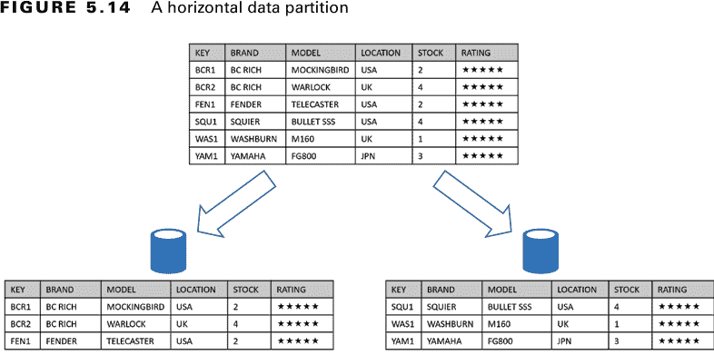

正如你可能从图 5.14 中推断出的那样，水平数据分区的实现是基于主键对表进行拆分或分片。可以有多个分片。这一切都取决于表中存储了多少数据。目的是减少单个表中的数据量，以期提高性能并减少争用。例如，以 A–G 开头的吉他可以存储在一个分片中，而 H–Z 存储在另一个分片中。你可能会注意到 A–G 是八个字母，而 H–Z 是十九个字母，这可能看起来不平衡。原因是我知道关于吉他，我知道以 A–G 开头的吉他型号比以 H–Z 开头的多得多，最终，这种数据分布更有可能保持平衡。重点是你应该咨询专家，因为分片不是设计为可以更改的，并且需要从一开始就适当设计，因为这里的重要方面是平衡分片之间的查询数量。分离并不总是简单地沿着字母表中间或数字的中点进行。拆分数据通常还基于性能、潜在的争用或最频繁访问的数据集。请求经常访问的数据的程序比访问休眠数据的程序更有可能出现延迟。这是因为所有进程都在线程上工作，它们必须管理对共享资源（如数据）的访问。虽然这发生得很快，但在高负载下可能会出现争用，请求排队，从而降低性能并增加延迟。通过实施水平数据分区，这两者都可以得到优化。图 5.15 显示了另一种模型，垂直数据分区。

#### 图 5.15 一个垂直数据分区

| KEY | BRAND | MODEL | LOCATION | STOCK | RATING |
|---|---|---|---|---|---|
| BCR1 | BC RICH | MOCKINGBIRD | USA | 2 | ★★★★★ |
| BCR2 | BC RICH | WARLOCK | UK | 4 | ★★★★★ |
| FEN1 | FENDER | TELECASTER | USA | 2 | ★★★★★ |
| SQU1 | SQUIER | BULLET SSS | USA | 4 | ★★★★★ |
| WAS1 | WASHBURN | M160 | UK | 1 | ★★★★★ |
| YAM1 | YAMAHA | FG800 | JPN | 3 | ★★★★★ |

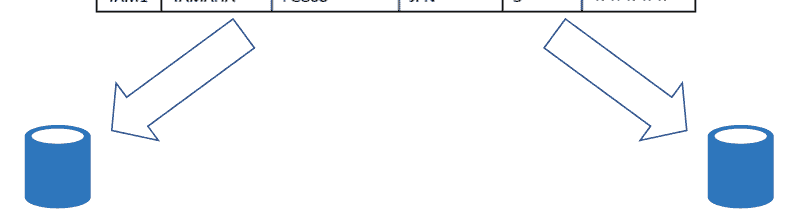

| KEY | BRAND | STOCK |
|---|---|---|
| BCR1 | BC RICH | 2 |
| BCR2 | BC RICH | 4 |
| FEN1 | FENDER | 2 |
| SQU1 | SQUIER | 4 |
| WAS1 | WASHBURN | 1 |
| YAM1 | YAMAHA | 3 |

| KEY | MODEL | LOCATION | RATING |
|---|---|---|---|
| BCR1 | MOCKINGBIRD | USA | ★★★★★ |
| BCR2 | WARLOCK | UK | ★★★★★ |
| FEN1 | TELECASTER | USA | ★★★★★ |
| SQU1 | BULLET SSS | USA | ★★★★★ |
| WAS1 | M160 | UK | ★★★★★ |
| YAM1 | FG800 | JPN | ★★★★★ |

虽然水平数据分区侧重于在分片之间平衡查询，但垂直数据分区侧重于根据查询更频繁的数据和查询不那么频繁的数据在表之间拆分数据。记住我最近使用了技术术语投影，这意味着通过只检索你需要的数据来优化数据查询。我说我是从消费者的角度来处理的。在这里，通过垂直数据分区，你可以作为提供者提供相同的投影。有许多数据库分析工具可以提供哪些表被查询最多的洞察力。此外，这些工具还可以提供访问最多的列甚至行。那种信息对于创建垂直数据分区将非常有用。


partition. 在图 5.15 所示的案例中，查询吉他品牌及其库存数量的次数多于查询吉他型号、位置和评分。因此，数据结构按如下方式创建。正如所提及，这取决于你的应用程序所做的事情。在项目的开始阶段，可能无法得知数据结构中哪一部分会获得最多的访问，因此这可能是应用程序变得更加成熟后的一项调优练习。

最后，顾名思义，功能性数据分区会根据其中包含的内容，将一组表拆分到不同的数据源中。例如，考虑一个包含 GUITAR 和 PROGRAMMING_LANGUAGE 表的数据库。那些表仅凭名称就可能具有不同的功能，并且可能受益于基于其功能拆分到不同数据源。 这是一个简单的例子，但你一定能明白其要点。另一个例子是将报表功能与订单录入功能分开。总之，许多 Azure 数据存储和存储产品都可以从一种或多种这些数据分区模型中受益。随着你的阅读，你会看到任何关于最优数据分区的建议都会参考本节。

我在前几段提到了数据集，但没有跟进描述。数据集是一个关系型数据库概念。你在非关系型或半结构化数据上下文中不会经常听到“数据集”这个词。这是因为数据集直接与表相关，或与从多个相关表中检索出的数据集合相关，这些数据形成了一个对计算机运行代码有用的逻辑单元。当你思考数据时，将其可视化为存储在原始文本文件中。该原始文本文件有一个 DBMS 来管理该数据并响应查询。 所谓管理，我的意思是它知道文件中包含的数据中存在哪些关系。当你对包含多个表之间连接的数据库执行查询时，它返回的结果与数据库中存在的任何表都不相似。此结果必须作为实体存储，而该实体就是数据集。此外，数据集通常包含诸如行数之类的属性。该数据集公开了供查询引擎如 LINQ、DataTable 和 DataView 类解析的接口。

在你深入了解 Azure 数据存储产品细节之前，最后一个需要讨论的话题是 Azure Database Migration Service（DMS）。DMS 又名 ADMS，在后面会更详细地介绍，并在第 8 章中再次介绍，但由于这可能在 Azure Solutions Architect Expert 考试中出现，需要被多次提及。 由于 DMS 是一个专注于移动数据的工具，将其介绍在这里似乎很合适。DMS 是将一个或多个本地数据存储迁移到 Azure 数据平台产品的推荐 Azure 工具。数据迁移中需要考虑的一些重要部分是确定源和目标，以及数据库在迁移期间是在线还是离线。很明显，如果你有一个本地 SQL Server 数据库，你的目标将是 Azure SQL。 但是，如果你的源是 Oracle 数据库或 MongoDB 呢？在 Azure 上你会选择哪个数据库作为目标？此外，一些数据库非常庞大，可能需要超过 24 小时才能将所有数据从源移动到目标。你的数据库能离线这么久吗，还是需要保持在线供使用？迁移完成后，如果数据库在移动期间保持在线并接受 CRUD 操作，你如何使数据保持同步？所有这些问题都会在后面得到解答，但对于生产数据存储而言，推荐使用的工具是 Azure Database Migration Service。

### Azure SQL Database

十年前左右，你可以选择的主流数据存储其实只有两种。一种是 Microsoft Access，另一种是 Oracle。Microsoft Access 不可扩展，因此仅适用于小型应用。如果你需要大型数据存储，你唯一的选项就是 Oracle。还有其他选择，但为了便于讨论，这里只提到这两种，因为它们至今仍然相关。SQL Server 的首次发布是在 1989 年。需要一些年头才能达到可以作为 Oracle 替代品的水平。如今可以说两者在水平上大致相当。SQL Server 是一款世界级 DBMS 系统，能够运行当今 IT 世界中的任何类型的工作负载。两者之间的最大决策因素基于你想要运行工作负载的生态系统。如果你决心（或被要求）使用 Microsoft 技术运行大部分 IT 解决方案，那么关系型数据库的一个有效选择就是 SQL Server。Microsoft 的替代生态系统可能是以 Java 为开发语言、以 Oracle 为数据库、以 Linux 或 Windows 为底层操作系统的开源方案。所有这些选项在 Azure 上都可用；然而，本节的其余部分专注于 SQL Server 及以下主题：

- 选择 Azure SQL 数据库
- 定价模型和限制
- 配置和保护
- 迁移数据
- 监控
- 分区数据
- SQL 托管实例和 SQL VM

在深入细节之前，你可以考虑阅读第 1 章中关于 Azure SQL 的部分。那里有很好的高层次信息。也许只是为了更好地进入上下文而阅读一下。你应该认识到，对于 Azure Solutions Architect Expert 考试而言，这里需要详细程度的理解。考试侧重于需要识别应选择哪个 Azure SQL 选项的场景：最具成本效益的解决方案、迁移数据的最佳方法、冗余和监控策略。迁移、监控和恢复将在第 8 章和第 9 章中更详细地介绍；然而，那些信息更具通用性。本章和本节专注于 Azure SQL 数据库。

### 选择 Azure SQL 数据库

在选择要在其上运行的合适的 Azure SQL 数据库时，你将从选择由 Azure SQL、SQL 托管实例和 SQL 虚拟机组成的平台开始；参见图 5.16。每个平台都有基于成本、迁移选项、维护和服务等级协议（SLA）的特定用例。一旦确定平台，下一步就是确定层级，例如通用型、业务关键型、超大规模、基础型、标准型或高级型。每个层级都像平台一样附带一组功能，随着你向上扩展，成本会增加，或者根据所选平台 aka IaaS，你承担的维护活动会带来间接成本。然而，在决定层级之前，你需要决定是否使用 vCore、DTU 或无服务器购买模型；最优选择取决于你的需求。

#### FIGURE 5.16 The SQL database platform options

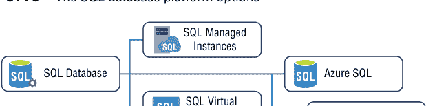

在深入了解每种不同决策场景的细节之前，完成练习 5.2 来创建一个 Azure SQL 数据库。练习之后会解释术语和内容，然后会继续介绍第一段中提到的所有内容。

### EXERCISE 5.2

#### Creating an Azure SQL DB

- 1. 登录到 Azure 门户 https://portal.azure.com 并在顶部中间的搜索框中输入 Azure SQL。点击 Azure SQL 并点击 + Add 按钮以显示 Select SQL deployment option 刀片，如图 5.17 所示。找到并点击 SQL databases 框内的 Create 按钮，并将 Resource type 保留为 Single Database。

#### FIGURE 5.17 The Select SQL deployment option blade

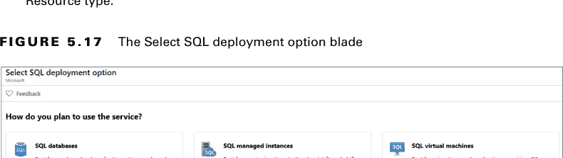

### EXERCISE 5.2 *(continued)*

- 2. 选择你希望数据库所在的订阅和资源组，并输入数据库名称（对于本练习，我使用了 csharp）。在 Server 下拉框中点击 Create New 链接以创建数据库服务器。输入唯一的服务器名称（例如，csharpguitar）并输入服务器管理员登录名和密码。确认密码后，选择服务器的位置。建议但不是必需，将服务器放置在与资源组相同的位置。现在，点击 OK 按钮。
- 3. 点击 Compute + Storage 部分中的 Configure Database 链接。查看所有选项。通用型、业务关键型和超大规模选项是面向企业应用的层级。对于本练习，点击 Basic, Standard, Premium 链接以查看这些层级。选择 Basic 层级，并查看成本、Data max size 和 DTUs。将它们与其它层级的选项进行比较。完成后，验证 Basic 层级已选定，然后点击 Apply 按钮。
- 4. 点击 Review + create 按钮，然后点击 Create 按钮。
- 5. 服务器创建完成后，导航到 Azure SQL 数据库。在 Overview 刀片上，找到名为 Show Database Connection string 的链接并点击它。注意它显示了连接到数据库的众多示例。
- 6. 返回 Overview 刀片并点击 Set Server Firewall 链接。注意 Allow Azure services and resources to access this server 默认设置为 ON，并且名为 + Add Client IP 的链接包含允许你配置 VNet 的选项。

做得好！你已创建了 Azure SQL 数据库以及托管该数据库的服务器。

你知道三个 Azure SQL 平台是 Azure SQL，即你刚刚创建的；SQL 托管实例；和 SQL 虚拟机。在创建 Azure SQL 数据库时，你可能注意到将 SQL 数据库部署以运行它的过程很简单，除了名称、用户 ID 和密码之外没有其他配置步骤。这是因为 Azure SQL 运行在 PaaS 计算服务上，你无法访问数据库服务器；你只能访问数据库。SQL 托管实例也是如此。两者之间的主要区别取决于你是迁移现有数据库还是创建新数据库。SQL 托管实例更像本地 SQL Server 实现，而非 Azure SQL 数据库。这意味着将现有数据库迁移到 Azure 会更容易，因为本地 SQL Server 可用的大多数 SQL 服务器功能在 SQL 托管实例中也可用。那么，SQL 托管实例和 SQL 虚拟机之间的区别是什么？简短的回答是，一个更像 PaaS，另一个更像 IaaS。既然你已经知道在这两种云服务模型之间你拥有的不同责任，利弊不需要太多细节。表 5.3 显示了更多细节，这将帮助你选择数据库所需的 Azure SQL 平台。


一个例子可能是，你的本地部署数据库使用了一个需要写入注册表的第三方工具，或者你需要在服务器上运行 .exe 或 .msi 来添加二进制文件，而这种操作在 PaaS 和 IaaS 中都不受支持。

Azure SQL 和 SQL 托管实例都具有内置的备份功能。Azure SQL 没有私有 IP，但 SQL 托管实例有，因此可以通过 VPN 网关或 Express Route 进行连接，就像 SQL VM 一样。可以设置防火墙规则和配置服务端点（在第3章中介绍过），以通过 Azure SQL 数据库的公共 IP 限制对数据库的访问。在数据库的上下文中讨论扩展时，所涉及的方法是纵向扩展和缩减（scale up/down），而不是像你在计算扩展中经历的那样进行横向扩展和缩减（scale in/out）。这是合理的，因为数据存储是单一位置，它是记录源，而且在任何给定时间只能有一个真实数据值。因此，除非有大量的同步发生，或者数据是只读且不频繁更新的，否则将数据库复制到多个实例上效果不佳。尽可能避免扩展数据库，因为在执行扩展操作期间会导致停机。对于 Azure SQL 和 SQL 托管实例，纵向扩展和缩减相对快速且容易，但 SQL VM 则不然，因为它可能需要比其他平台选项更长的时间。

在继续讨论层级之前，你可能已经注意到在图5.16中也提到了一个名为“弹性池”的资源类型；它出现在图5.17所示的 SQL 数据库平台类型的“资源类型”下拉框中。以防你错过了，图5.18展示了“弹性池”选项。“单一数据库”和“数据库服务器”也存在，也值得用一些文字来描述为什么你会选择其中一个而不是另一个。

#### 图5.18 SQL 数据库平台的“资源类型”下拉框内容

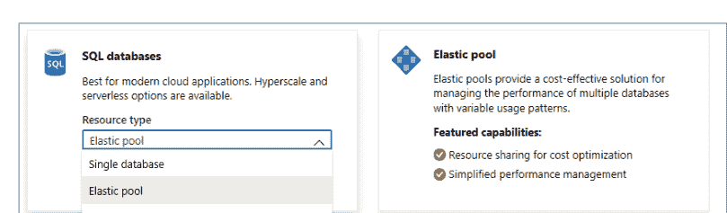

让我们从“单一数据库”开始。这就是你在练习5.2中创建的那个。你还创建了一个数据库服务器，这是托管数据库所必需的。我之前也简要提到过这一点。与 PaaS 云服务模型相比，承载数据库服务器的 PaaS VM 的维护工作进一步减轻了。SQL 数据库服务器是执行管理操作（如设置防火墙规则、启用安全监控规则和管理备份）的位置。它也是存储和访问数据的位置。前面稍微提到了设置防火墙规则；

不过，那是从数据库的角度而不是数据库服务器的角度。当你在数据库服务器上配置防火墙规则时，该服务器上的所有数据库都将允许来自规则中添加的 IP 或 IP 范围的访问。默认情况下，所有 Azure 服务都可以访问 SQL 数据库服务器上的数据库。任何其他 IP 地址都必须手动添加。为了获得更严格的安全性，建议将防火墙规则放在数据库本身，而不是放在更高级别的数据库服务器上。在接下来的章节中，我们将对这些选项进行更多介绍。

在单个 SQL 数据库服务器上可以托管多个 Azure SQL 数据库。登录门户，导航到你在上一个练习中创建的 SQL 数据库服务器。在“概述”边栏选项卡中，你会看到“+ 新建数据库”按钮。单击它后，你会进入导航向导，该向导会引导你添加另一个数据库。我之所以说是添加另一个数据库，是因为没有仅创建 SQL 数据库服务器而不在其上创建数据库的用例，所以预期是你创建 Azure SQL 单一数据库，同时需要 SQL 数据库服务器。这意味着如果你访问 SQL 数据库服务器并单击“+ 新建数据库”按钮，你就是在添加另一个数据库。该菜单栏上还有另外两个值得注意的按钮。第一个是“+ 新建数据仓库”按钮。读完前面的文字后，你应该知道数据仓库是什么了。例如，它通常被称为 EDW。之前没有练习解释如何创建一个数据仓库，但现在你知道了如果需要的话该从哪里开始。另一个按钮是“+ 新建池”，它用于将你的单一数据库移入弹性池，这是前面图5.18中显示的第三个选项。弹性池与扩展和资源最优利用密切相关。看看图5.19。

#### 图5.19 过度预配数据库资源


现在，假设你有四个 Azure SQL 单一数据库，每个都有不同的用例。这些数据库在不同时间被访问，并且有不同的峰值时间。图5.19图表中的四条线说明了响应数据请求流量所需计算资源的利用率。过去，你需要将服务器扩展到能够处理峰值流量的规模，即使该峰值每周只发生一次，甚至每月只发生一次。图5.19展示了在那种旧模型中你会产生的过度预配量；要注意，过度预配是有成本的。弹性池允许你将单一数据库移入和移出池。平台会在峰值出现时横向扩展所需的容量，而不是拥有并支付额外容量的费用——即使这些容量未被使用。“弹性”是一个恰当的词，因为你可以想象一根橡皮筋被拉伸开再缩回去，这正是弹性池对你的数据库大小所做的。它在需要时扩展，在导致扩展的力消失时收缩。

### 定价模型与限制

Azure SQL 数据库的定价相当复杂，这并不令人意外。这不仅是从 Azure SQL 的角度来看是一个挑战，许多其他 Azure 产品也是如此。这就是为什么微软有一个庞大的团队，其唯一的工作就是回答有关 Azure 账单的问题。然而，新云时代爆发的一个原因是，与本地部署相同工作负载相比，成本要低得多。理解成本是一回事，但看到在 Azure 上运行的账单少了 50%，就觉得最初的困惑是值得的。以下文字旨在提供一些关于计费术语的见解，它们如何与不同的 Azure SQL 平台相关联，以及一些限制——这些限制约束着产品不会失控，也不会以高昂成本消耗无限资源。别误会，计算成本是一种可以理解的算法，而对 Azure SQL 数据库的部署成本做出有根据的猜测也是可行的。理解了这些术语和限制之后，你很有可能做到这一点。两个最突出的购买模型是数据库吞吐量单位（DTU）和 vCore。无服务器和弹性数据库吞吐量单位（eDTU）是在弹性池中运行数据库时使用的成本模型。

DTU 定价模型是微软为这一产品所做的首次定价尝试。它基于 OLTP 行业基准，并且在基本、标准、高级定价层中仍然是采用的模型。DTU 定价模型是计算、内存/存储和 I/O 资源消耗的组合。其主要目标是以固定价格提供固定数量的计算资源，同时提供一致的性能和稳定性，预先计算数据库需要多少每种资源（CPU、内存和 IOPS），然后将其转换为你的数据库所需的 DTU 数量。如果你能做到这一点，那就相当了不起了。当然，有一些数据库工具可以让你大致了解本地部署数据库在给定时间段内消耗的最大 CPU 量、最大内存量以及最大读写操作数。利用这些发现，你可以将它们作为计算在 Azure SQL 数据库上运行相同工作负载所需 DTU 数量的基础。对于基本定价模型，

DTU 的最大数量为五，标准版为 3000，Premium 版为 4000 DTU。在练习 5.2 中你创建了一个具有五 DTU 的基本数据库。DTU 并不能直接换算成 CPU 数量、内存量或最大 IOPS 需求。相反，可以认为在十 DTU 下运行时的性能是五 DTU 时的两倍。通过 Premium 以 4000 DTU 的最大值运行，与使用五 DTU 相比，计算能力（CPU、内存和 IOPS）将提升 800 倍。在使用 DTU 定价模型时，其要点是价格基于 CPU、内存和 IOPS 的固定消耗。你不会得到将 DTU 换算为计算资源的清晰透明度。你需要在迁移后对 DTU 进行测试和调优，但经过一定测试后行为会足够稳定以达到稳定状态。

DTU 定价模型是固定的，这意味着当数据库消耗达到阈值时，计算资源会被限制。这会导致延迟，如果消耗或创建数据的应用程序无法处理这种情况，则会出现异常，并可能导致数据丢失或损坏。在从客户反馈中吸取了一些关于 DTU 的经验教训后，弹性池的概念被提出，其中包含一种名为 eDTU 的新定价模型。eDTU 在固定 DTU 概念对在达到阈值时表现不佳的传统类型应用程序造成的负面影响方面提供了一些灵活性。因此，将单个数据库移入弹性池的选项允许根据需求动态分配和释放 DTU。

DTU 遇到的另一个问题是将 CPU、内存和 IOPS 捆绑在一起。如果你的数据库对其中一项的需求高于另一项会怎样？例如，你的数据库在 IOPS 上很重，但在内存方面并不重。你可能需要扩展到非常高的 DTU 才能获得所需的吞吐量，这会花费大量成本，因为 CPU 和内存的增加与之绑定。vCore 定价模型是推荐的模型，它提供了两个好处。第一个是你可以根据计算、内存/存储和 IOPS 进行扩展，这解决了 DTU 的一个问题，使 vCore 更具成本效益。而在成本的背景下，第二个好处是计费更透明。与 DTU 相比，如果你的数据库被限制，你只需进行扩展。你根本不知道原因是因为 CPU、内存还是 IO 受限。你的唯一选择是增加 DTU 数量。然而，使用 vCore，你可以增加分配给数据库的核心数量，而无需增加其他项目。

最后一种定价模型称为 serverless，你可能还记得在上一章中在 FaaS 的计算背景下提到过。该概念对于 Azure SQL 数据库也是相同的。在练习 5.2 中你创建了最便宜的层级和成本模型。它具有固定的月度价格，无论使用与否。在 serverless 模型下，产品未使用时不分配计算资源，因此不收取费用。你仅根据其使用量和消耗量支付特定的计算和存储成本。

到目前为止，你已经阅读了有关不同 Azure SQL 产品的信息：Azure SQL、SQL 托管实例和 SQL VM。你还了解了 DTU/eDTU 与基于 vCore 的计费之间的差异。现在让我们来看看不同的可用服务定价层级。定价层级根据 DTU 和 vCores 的定价模型分为两个定价类别。General Purpose（带 serverless）、Business Critical 和 Hyperscale 使用 vCore 模型定价。Basic、Standard 和 Premium 使用 DTU 定价。Basic 层级是最具成本效益的选项，也是你在练习 5.2 中创建的选项。对于开发、非关键任务应用程序或只是为了学习和娱乐，这是一个有效的选择。它与 Standard 和 Premium 类似，你拥有相同的 PaaS 方案和基础功能，但可以获得更大的存储容量和 DTU。有关 DTU 服务定价层级的更多详细信息，请参阅表 5.4。

### 表 5.4 Basic、Standard 和 Premium DTU 层级

|  | Basic | Standard | Premium |
|---|---|---|---|
| DTUs | 5 | 10 to 3000 | 125 to 4000 |
| 数据库大小 | 100MB to 2GB | 100MB to 250GB | 100MB to 1TB |
| 只读副本 | × | × | ✓ |
| 运行 demanding 工作负载 | × | ✓ | ✓ |
| 高 I/O 工作负载 | × | × | ✓ |
| 次要数据库 | × | 1 | Active 0 to 4 |

拥有数据的只读副本在故障转移和性能方面都很有用。从故障转移角度来看，考虑一下主数据库实例宕机的场景；你可以将只读实例设为可写，将所有客户端重定向到它，并使其成为主数据库。这可能比排查故障并尝试将原始主数据库重新上线更快地恢复。从性能角度来看，你可以将运行报告的客户端引导到只读数据库实例。将报告的执行路由离开 OLTP 实例，报告通常具有大型数据集、复杂的 SQL 查询和较长的日期范围，这可能会降低主数据库的负载。这将为管理 OLTP 功能节省主数据库的计算资源。很难绝对精确地定义表 5.4 中所指的 demanding 工作负载。然而，很容易得出结论，与其他两个层级相比，五 DTU 提供的计算能力不足以用于生产。与 Standard 和 Premium 允许的高 DTU 数量相比，只有 Premium 专为高 I/O 工作负载而设计。Premium 还包括活动次要数据复制机制。这模仿了通常被称为热备的行为。这种热备不是只读实例，也不会有客户端出于任何原因连接到它。它将在主实例失败时充当故障转移实例。表 5.5 显示了基于 vCore 的服务定价层级的一些详细信息。

### 表 5.5 General Purpose、Business Critical 和 Hyperscale vCore 层级

|  | General Purpose | Business Critical | Hyperscale |
|---|---|---|---|
| 可用性 | 99.99% | 99.99% to 99.995% | 99.95% to 99.99% |
| 单个数据库 | ✓ | ✓ | ✓ |
| 弹性池 | ✓ | ✓ | × |
| 托管实例 | ✓ | ✓ | × |
| 数据库大小 | 5GB to 4TB<br>32GB to 8TB | 5GB to 4TB<br>32GB to 4TB | Up to 100TB |
| 计算大小 | 1 to 80 vCores | 1 to 80 vCores | 1 to 80 vCores |
| 内存中 OLTP | × | ✓ | × |
| 只读副本 | 0 | 1 | 0 to 4 |
| Serverless | ✓ | × | × |
| 备份 | 7 to 35 days | 7 to 35 days | 7 days |
| 自动缩放 | ×** | × | ✓* |

* Hyperscale 支持数据存储自动扩展至 100TB。将数据加载到内存中并访问的能力可提高性能，因为它消除了从磁盘读取数据的需求。此功能内存中 OLTP 仅在 Business Critical 层级可用。

** Serverless 仅通过 General Purpose 层级支持，并且会自动扩展分配的计算资源。在配置 serverless 时，你选择 vCore 的最大数量，可在 1 到 16 之间，以及最小值，可在 0.5 到 1 之间。

General Purpose 是提供最具成本效益选项的层级。尽管价格远高于 basic/DTU，但你获得了 vCore 计费、备份和更大的数据库大小等额外好处，仅举几项相比的优势。是否足以证明相关成本是值得的，由你决定。Business Critical 层级针对的是需要高故障恢复能力和高响应性和可用性的 OLTP 企业数据库的迁移。Hyperscale 正如其名所暗示的那样。同样专注于 OLTP 数据库模型，需要流畅、高频率的自动扩展。从可用性角度来看，你可能会注意到 Business Critical 和 Hyperscale 具有一系列可能的值，分别为 99.99% 至 99.995% 和 99.95% 至 99.99%。要实现最高端的 SLA 可用性，你必须添加额外的副本或区域冗余。


表 5.5 中的数值会随时间变化，因此随时在线核查它们总是有价值的。以下是可获取当前信息的链接：

```
docs.microsoft.com/en-us/azure/sql-database/
sql-database-service-tiers-general-purpose-business-critical
```

请注意，表 5.5 指出并非所有数据库类型在每个服务定价层中都可用。Hyperscale 层仅作为单个数据库可用，不会在托管实例上运行，且数据库无法添加到弹性池中。你可能还注意到，通用型和业务关键型两个层级的数据库大小都有多个值。第一行（5GB – 4TB）适用于单个数据库和弹性池数据库，而第二行适用于托管实例平台类型。

也可以配置最大数据存储大小，类似于 Hyperscale 功能。对于通用型，其可在 1GB 到 512GB 之间扩展。最后，备份功能支持捕获数据库的副本并在给定时间范围内进行存储。数据库备份的具体细节将在“数据备份、迁移和保留”部分中进一步详细说明。

### 配置和安全

DBA 专注于数据库的分析和优化，执行分析并执行在本地运行时通常所需的操作。如果你是 DBA，那么你对 Azure SQL 数据库可以进行的配置会觉得受限。这是因为 DBA 对数据库进行的许多优化和调优练习都是由平台自动完成或通过平台批准的自动化建议来完成的。请记住，如果你在 Azure VM 上运行 SQL Server 数据库，你就需要一名 DBA。这是当数据库高度专业化、定制化并符合遗留数据库限制时推荐的做法。遗留意味着旧的，可能意味着对其进行更改会产生巨大影响；对旧事物进行更改并破坏它们是渗透到现实世界应用中的技术概念之一，或许必须简单地处理它，直到它退役，而在所有情况下，这最终都会发生。

一旦你决定摆脱遗留限制，请注意 Azure SQL 的分析和优化是自动化的，而创建这些优化建议的算法是由编写 DBMS 本身逻辑的人编写的。你无法从比这更好的来源获得提示。当在 Azure 上运行 SQL Server 数据库时，你可以获得的智能性能建议并不是你能获得或可以进行的唯一配置。除了优化性能和可用性的配置外，还有一些与安全相关的功能。以下将进一步讨论的配置和安全概念。

- Scaling
- Achieving optimal availability
- Introducing backups
- Security and data encryption

到目前为止，扩展的概念不应该有什么新意，假设你已经阅读了前面的章节和本书中的前几节。扩展 simply 意味着为你的 IT 解决方案添加额外的计算资源（CPU 和内存）。也许在数据存储的上下文中，一个新的扩展领域是存储本身，或随着存储在物理驱动器上的数据需要更多空间而添加硬盘容量。这在计算上下文中可能是一个要求，确实如此，但在数据存储方面可能更相关。无论如何，对所有这些领域的扩展能力都支持所有 Azure SQL 产品，Azure SQL、SQL 托管实例和 SQL 虚拟机。请记住，从数据库的角度来看，扩展是向上或向下，而不是向外或向内。有一个例外，不过。你可以扩展只读副本的数量，但不能扩展允许写入操作的副本。（请参阅表 5.4 和表 5.5 以了解支持扩展或只读实例的层级。）你可能可以理解，如果问题是向数据库传输数据的入站传输（通常是写入过程），那么通过只读扩展并不会做太多。在这种情况下，即入站消耗，或更准确地说，数据吸收是计算消耗的原因，你唯一的选择是向上扩展。（当然，性能调优是一个选项，但假设所有这些都已由 DBA 或平台提供的智能性能优化算法完成。）

以最简单的形式，向上或向下扩展数据库是通过导航到数据库的 Overview 刀片并单击定价层属性右侧的值来执行的。如果你查看练习 5.2 中创建的数据库详细信息，你会看到 Basic，类似于图 5.20。

#### FIGURE 5.20 The pricing tier on the overview tab of an Azure SQL database

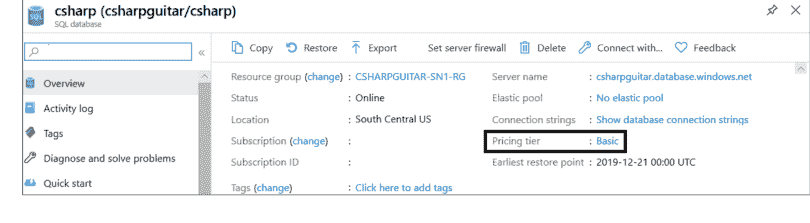

单击 Basic 链接后，你将能够扩展到，例如，standard，其默认具有 10 DTUs 和 2GB 数据存储，并且可以配置为最多 3000 DTUs 和 250GB 存储。手动扩展到使用 vCores 的其他层级也是可能的。移动到通用型和 Hyperscale 层允许自动扩展。从通用型自动扩展的角度来看，你需要选择 serverless，如图 5.21 所示。扩展由通过 max vCores、min vCores 和数据 max size 滚动条提供的设置处理；平台（即 Azure）处理其余部分。

#### FIGURE 5.21 Setting the maximum and minimum for autoscaling

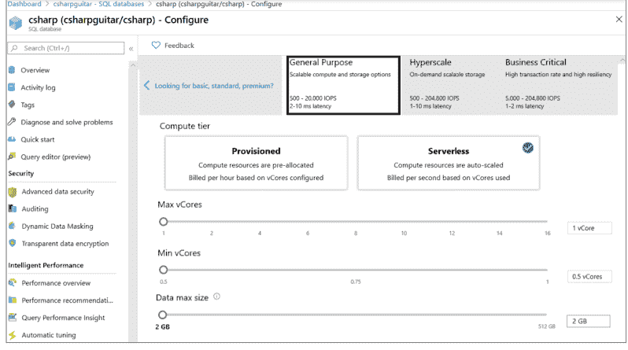

如果你想从针对 DTU 定价模型的层级扩展，这是可能的，但只能手动进行。你可以从 basic 扩展到 standard 或 premium，然后在需求需要时增加分配的 DTU 数量。在同一上下文中，你可以考虑使用弹性池，该池可以针对 DTUs 或 vCores，并将数据库添加到池中。

### SQL Azure Database Server

SQL 数据库服务器可以包含不同的层级和定价模型。它是 Azure SQL 数据库的虚拟分组，其构造和目的类似于资源组。

这是一个有趣的领域，如果你感兴趣的话，你应该去探索。对于考试，所有扩展选项的内部细节并不相关。只需注意，在创建弹性池时，选择层级是主要考虑因素。

当你决定池是一个 PaaS 时，它受限于层级内的提供内容——basic、standard、premium、general purpose 和 business critical——Hyperscale 明显缺失。在 basic DTU 弹性池定价模型的上下文中发现最小 eDTUs 为 50，这很有趣。这是有道理的，因为预计你会在池中拥有多个数据库，并且需要超过通过单个数据库默认值五所要求的最小值。

虽然灾难恢复在第 9 章中有更详细的介绍，但 Azure SQL 数据库的内置连续性功能有一些有趣的组件。内置冗余的类型或模型与所选定价层绑定。模型，如图 5.22 所示，是 basic、standard 和通用型层级存在的模型。

#### FIGURE 5.22 Database availability architecture for basic, standard, and general-purpose pricing tiers

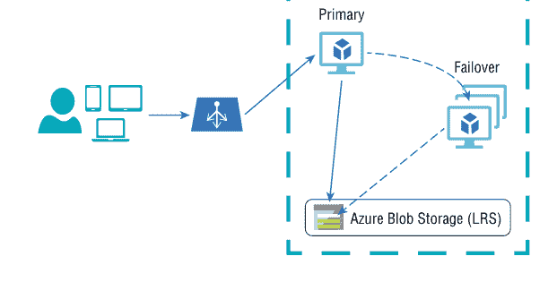

请注意，有一个主数据库实例正在被应用程序访问。存储在数据库中的数据实际上托管的不是在计算资源上。相反，数据以 blob 的形式存储在 Azure Blob Storage 容器中。blob 容器中的数据使用本地冗余存储（LRS）选项存储。本章后面会详细介绍该选项和其他冗余选项，但简而言之，这意味着数据仅存储在给定区域内。如果主计算 VM 发生故障，应用程序的流量可以路由到故障转移实例，后者将指向 blob 容器上的数据。这也是 VM 或数据库引擎升级的方式发生。在升级管理应用程序查询处理的 VM 之前，流量被路由到新的、已升级的实例。这最大限度地减少了停机时间，有助于实现 99.99% 的 SLA 承诺。你可能会遇到的一个影响是延迟，如果你的解决方案将数据加载到内存中或具有大型缓存依赖项；该数据驻留在 VM 上，如果/when 它被替换或修补，必须在新 VM 上刷新。此外，如果发生数据中心范围的问题，虽然很少发生（但确实发生过），你的应用程序将停机，直到问题得到解决。这两种可能的影响都可以在 premium 或业务关键定价层中运行来最小化或完全避免。图 5.23 更详细地说明了该架构。


### 图 5.23 高级版和业务关键型数据库可用性架构

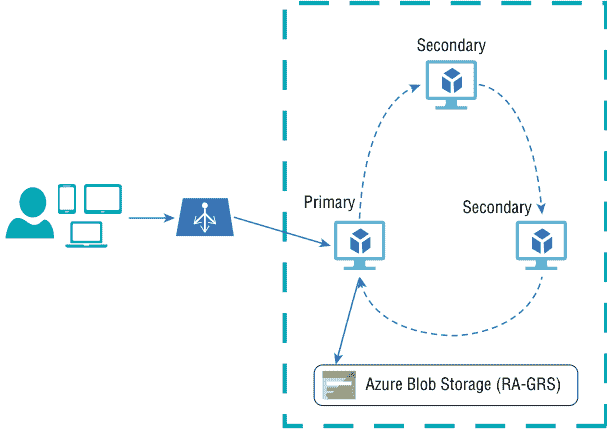

图 5.22 所示架构与图 5.23 所示架构的主要区别在于，主数据库有一个或多个与主数据库完全匹配的待机副本。缓存和内存会加载并更新应用程序所需的数据。此外，托管数据库数据的 blob 容器以 *只读访问型地理冗余存储 (RA-GRS)* 选项运行。有了该选项，即使发生区域范围的数据中心中断，您的數據仍可读取。这种可用性架构令人惊叹之处在于，它作为 PaaS 服务的一部分完全由平台管理。它就在那里，即使您永远不需要它。想想在您甚至不知道它存在的情况下需要该数据可访问性或从中受益。当您选择 Hyperscale 定价层时，也提供一种类似但更复杂的架构。它利用了许多相同的概念，例如使用 Azure Blob Storage 容器和二级副本，就像高级版和业务关键型层一样。Hyperscale 也增加了 RA-GRS 存储选项。

Azure SQL 备份会自动创建并存储在以 RA-GRS 模式运行的 Azure Blob 存储容器中。每周进行一次完整备份，每 12 小时进行一次差异备份，事务日志备份每 5 – 10 分钟进行一次。表 5.5 显示数据库备份的保留期可在 7 到 35 天之间，具体取决于您的配置。一旦现有数据库备份超过年龄，就会将其删除。这降低了成本，因为您需要为备份的存储付费。如果数据库很大或您忘记输入阈值而导致所有内容都被备份并永久存储，则该成本可能会很大——直到您收到账单为止。如果您需要将数据库备份保留超过 35 天的最大期限，请使用 *长期保留 (LTR)* 服务。LTR 允许将数据库备份存储长达 10 年。本章后面将详细介绍数据备份。

安全章节介绍了漏洞评估和威胁检测等主题。当您在 Azure 门户中点击 SQL 数据库概述刀片上的高级数据安全 (ADS) 链接时，Azure 会提供有关这两个安全概念的信息。您还可以访问数据发现和分类信息。数据发现和分类选项可提供有关存储在表、行和列中的数据的保密级别的见解，这对于 GDPR 合规性很重要。此外，它还会显示谁在访问该数据以及访问频率，这当然很重要，这样您就可以确定谁或什么有权访问数据。

漏洞评估会扫描您的数据库并生成报告，突出显示任何已知的安全或合规问题。漏洞评估可能会发现您尚未对数据库中存储的数据列的敏感性/保密性进行分类。可以正确地假设 Azure SQL 数据库无法知道您数据的含义，因此您必须手动对其进行分类。如果没有该分类，您将收到通知并收到一条建议消息。扫描还会检查有权访问数据库的角色和身份。例如，如果某些角色和身份未被使用，评估可以建议更改或删除访问权限。最后，威胁检测的工作方式与第 2 章中讨论的 Azure Active Directory 身份验证类似。平台监控数据库活动，并通过机器学习能够识别出看起来像是恶意的行为。例如，SQL 注入尝试来自不寻常的位置或使用意外的凭据访问。如果您启用了威胁检测，运行报告时，这些类型的事件将被指出，以便您了解情况并获得一些操作建议。

另外，之前在第 2 章中我们也提到了数据静态和数据传输中这两个概念，这意味着从数据库的角度来看，数据库中部分或全部数据在未使用时会被加密，并且在授权的客户端机器上呈现之前保持加密状态。这意味着即使您的数据库被复制、被盗或被恶意行为者访问，数据也会被加密，无法解密，无法使用。在下一节中，您将执行一个练习，对数据库中的数据进行加密，然后在第 7 章中，您将看到一些伪代码，用于检索数据并为经过身份验证和授权的客户端使用者解密。

### 数据迁移

将数据库从本地数据库迁移到 Azure 平台的复杂程度取决于以下因素：

- 数据库的大小
- 迁移期间所需的数据可用性
- 目标 Azure SQL 产品

有三种 Azure SQL 产品：Azure SQL、SQL托管实例和 SQL 虚拟机。其中最简单的方法之一是使用 SQL Server 备份将本地数据库迁移到 Azure。这些备份通常具有 .BACPAC 文件扩展名。创建数据库备份后，您可以将该文件上传到 Azure Blob Storage 容器。从那里，您可以将其导入到三种不同的产品提供中之一。此方法在很大程度上取决于数据库的大小以及是否可以在网络连接上实时传输数 TB 或更多数据。这可能有效，但也可能因瞬态或网络延迟问题而失败。如果您想采用这种方式，Azure Storage Explorer 或 AzCopy 是最佳选择。

如果您有一个大型数据库想要迁移到 Azure 数据库，请考虑一个名为 Import/Export 的服务。您可以在此处阅读有关它的信息：

azure.microsoft.com/en-us/services/storage/import-export/

该服务允许您将包含数据库的实际物理磁带备份或硬盘发送给 Microsoft。Microsoft 然后将其提供用于导入到 DBMS。您还可以使用 Azure 数据库迁移服务 (DMS) 将数据从本地迁移到 SQL 托管实例。这种方法对迁移期间必须保持可用的数据库更宽容。使用 Import/Export 选项需要更长的时间，并且需要更多的人工操作。人工操作涉及磁盘准备和事务日志的应用。事务日志捕获您进行备份时与 Azure 上的数据库成为主要记录来源之间的數據更改。您需要应用这些更改以使 Azure 上的 DB 保持最新。

在两个 SQL Server 数据库之间移动的另一个选项是 *SQL Server Integration Services (SSIS)*。此场景中的目标有利于 SQL 虚拟机平台。请参阅表 5.6，其中以更直观的形式总结了这些方法的内容。从本地迁移到 Azure 有多种方法；不过，以下是首选方法。

**表 5.6 按 Azure SQL 平台类型划分的迁移选项**

|  | Azure SQL | SQL 托管实例 | SQL VM |
|---|---|---|---|
| BACPAC | ✓ | ✓ | ✓ |
| Import/Export | × | × | ✓ |
| ADMS | × | ✓ | × |
| SSIS | × | × | ✓ |

完成以下练习 5.3，您将使用 .BACPAC 文件导入数据库，然后使用在练习 2.9 中创建的 Azure Key Vault 中存储的密钥对其进行加密。

### 练习 5.3

#### 创建 Azure SQL DB

- 1. 通过点击此位置的下载按钮下载数据库备份：
  github.com/benperk/ASA/blob/master/Chapter05/Ch05Ex03/guitar.bacpac

- 2. 登录到 Azure 门户 portal.azure.com，在页面顶部中间的搜索框中输入存储帐户，按 Enter， 选择您在练习 5.1 中创建的存储帐户（例如，csharpguitar），然后点击容器（请回顾图 5.11）。点击容器刀片上的 + 容器按钮，输入名称（例如，guitar），从下拉列表中选择 Blob 作为公共访问级别，然后点击确定按钮。

- 3. 点击您刚刚创建的容器，然后点击概览刀片顶部的上传菜单项。上传您在步骤 1 中下载的 .BACPAC。

- 4. 导航到您在练习 5.2 中创建的 SQL 数据库服务器（例如，csharpguitar）。点击 SQL 数据库服务器概览刀片上的导入数据库菜单项。选择数据库将被导入到的订阅，然后选择包含您在上一步中创建的 .BACPAC 的存储。您应该会看到类似于图 5.24 的内容。点击选择按钮。

#### 图 5.24 从 Azure Blob 容器中选择 SQL 数据库备份

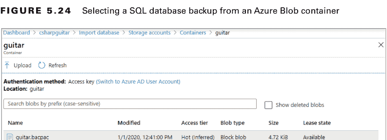

- 5. 将定价层更改为基本版，并提供您在练习 5.2 中使用的服务器管理员登录 ID 和密码。点击确定按钮。


### EXERCISE 5.3

- 6. 导入需要几分钟时间。完成后，单击你刚刚导入的 Azure SQL 数据库。你将在 SQL 数据库服务器概述刀片上看到绑定到 SQL 数据库服务器的数据库列表，类似于图 5.25。

**FIGURE 5.25** A list of SQL databases bound to a given SQL database server

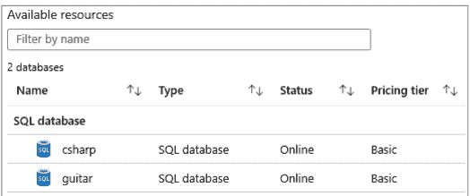

- 7. 单击位于 Azure SQL 数据库概述刀片顶部的 Set Server Firewall 菜单项。单击 **+ Add Client IP** 菜单项，然后单击 **Save**。

- 8. 从此位置下载并安装 SQL Server Management Studio（SSMS Version 18.4）：aka.ms/ssmsfullsetup。

- 9. 安装完成后，打开 Microsoft SQL Server Management Studio。提示时，输入类似图 5.26 的连接详细信息和 SQL 服务器数据库名称。用户 ID 和密码是你练习 5.2 步骤 2 中创建的。

**FIGURE 5.26** Connecting to a SQL Server database using SSMS

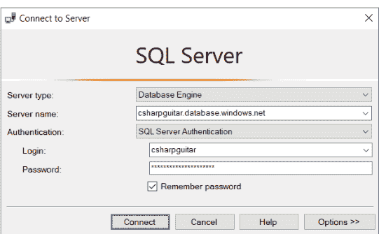

- 10. 在 Object Explorer 面板中，展开 **Databases**，然后展开 **guitar**。展开 **Tables** 并右键单击 **dbo.MODELS** 表。现在单击 **Select Top 1000 Rows**。验证输出是否与图 5.27 所示相似。

**FIGURE 5.27** The data content of the MODELS table

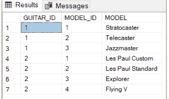

- 11. 在 Object Explorer 窗格中，展开 **Security** 然后展开 **Always Encrypted Keys**。右键单击 **Column Master Keys** 并选择 **New Column Master Key**。为密钥输入一个名称（例如，csharpguitar-DAR），然后从 Key Store 下拉列表中选择 **Azure Key Vault**。单击 **Sign In** 按钮并选择你在练习 2.9 中创建的订阅和 Azure 密钥库。配置应类似于图 5.28。现在单击 **OK** 按钮。

**FIGURE 5.28** SSMS-created Column Master Key Configuration visualization

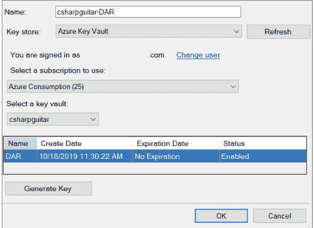

- 12. 在 Object Explorer 窗格中，**Column Master Keys** 文件夹正下方，右键单击 **Column Encryption Keys** 并选择 **New Column Encryption Key**。为密钥输入一个名称（例如，DAR），然后选择上一步中创建的主密钥；单击 **OK**。为了操作成功，你必须在 Azure Key Vault 上为以下加密操作密钥权限启用：wrapKey、unwrapKey、decrypt、verify 和 sign。查看练习 2.9 步骤 11，其中解释了如何查看现有的密钥权限。

- 13. 右键单击 **dbo.MODELS** 表，选择 **Encrypt Columns**，然后单击 **Next** 按钮。选中 **MODEL** 列左侧的复选框，然后从 Encryption Type 下拉列表中选择 **Deterministic**。如果 Encryption Key 未默认设置为你在上一步中创建的密钥，请选择它（例如，DAR）；参见图 5.29。

**FIGURE 5.29** SSMS column selection configuration

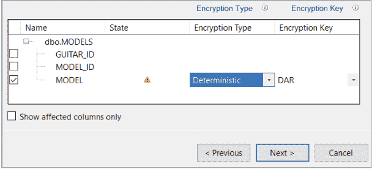

- 14. 单击 **Next** 按钮三次。查看 Summary 后，单击 **Finish** 按钮。加密完成后，再次执行步骤 10。结果应类似于图 5.30。

**FIGURE 5.30** The encrypted content of the MODELS table

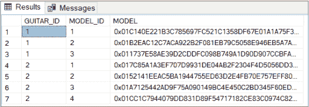

该过程加密数据花费了相当长的时间，考虑到该表只有七行。记住这一点；我建议不要在没有先在非生产环境中进行一些测试的情况下直接在生产环境中执行此过程。我建议对大型数据集使用 PowerShell 而不是使用 Set-SqlColumnEncryption cmdlet 的示例来执行此操作。此外，客户端需要修改以支持加密。在未修改客户端的情况下在生产环境中执行此操作，数据消费者会造成严重的停机。在此过程中，生产数据库将受到影响，例如无法执行写入操作。回想一下步骤 7 是你通过单击 Set Server Firewall 菜单项将客户端 IP 地址添加到防火墙设置白名单的地方；你在练习 5.2 中创建第一个 Azure SQL 数据库时也做了同样的操作。如果没有这样做，你将无法连接。当使用 SSMS 时，如步骤 9 中所做，会提示你将客户端 IP 地址添加到防火墙规则中。但是，请注意，使用连接字符串进行连接会导致访问被拒绝异常。你的客户端 IP 地址无法访问服务器；参见图 3.34，其中使用 SQLCMD 提供了之前的示例。

另一个有趣的话题是图 5.29 中提到的 Deterministic 加密类型。另一个选项是 Randomized。名称本身就描述了不同类型的工作方式。确定性加密每次对给定的文本生成相同的值。例如，单词 Telecaster 的确定性加密值将具有相同的加密值 0x01B2EAC12C7AC922B... 随机化加密会导致每次加密值都不同。随机化加密更安全，正如你所想象的那样。随机化结果不允许搜索、分组、连接和索引这些列，而确定性加密可以做到。这一切都取决于数据的敏感程度。在此示例中，你可能会同意它并不那么敏感；然而，识别号码、出生日期或任何其他个人身份数据集都是敏感的。本章后面和第 8 章中有更多关于迁移的信息。

### Monitoring

数据库的状态经常发生变化。数据以极高的频率被插入、更新和删除。这可能会改变执行这些操作的查询的行为。例如，像 `SELECT * FROM MODELS` 这样的 SQL 查询如果只有几条记录就可以正常工作；然而，如果它增长到数千或数十万行，那么接收结果集并处理它的代码就会变慢，因为它有更多的工作要做。因此，需要对数据库进行监控、调优和优化。（此类活动通常由 DBA 执行。）Azure SQL 数据库包含内置智能，提供自动性能调优和监控以及称为自适应查询处理的功能。自适应查询处理在前面的示例中会很有帮助，其中查询 `SELECT * FROM MODELS` 会被监控，如果查询开始表现不佳则会被标记。你可以在 SQL 数据库服务器的导航栏上找到名为 Intelligent Performance 的部分。同一组功能也可以在特定 Azure SQL 数据库的页面上找到，还有一些额外的功能名为 Performance Overview、Performance Recommendations、Query Performance Insight 和 Automatic tuning。数据库级别提供这些功能是最有意义的，因为每个数据库都有自己的用途和访问它的客户端，导致数据库具有不同的行为和需求。

在 Azure SQL 上运行数据库的一个有益方面是，内置的智能调优、监控、警报和优化功能是由编写 SQL Server 的团队编写的。这些人比世界上任何人都更了解 SQL Server 数据库引擎的内部结构。你将此功能作为 PaaS 提供的部分，并且无法被任何其他产品匹敌。编写产品的人也编写了工具和功能来自动改进你的数据库这一事实令人难以置信，并且具有极大的价值。这目前仅用于监控，因为 Azure Solution Architect Expert 考试中没有太多需要此知识的内容；然而，了解其存在以及一些细节对于成为优秀的 Azure 解决方案架构师专家是有帮助的。第 9 章中有更多关于一般监控概念的详细信息。

### Data Partitioning

从 Azure SQL 的角度来看，数据分区最好与水平分区（又名分片）保持一致。数据库通常受其可以包含的数据量和可以拥有的并发连接数的限制。为了突破这些限制，你可以实现分片。分片的一个基本示例之前在图 5.14 中进行了说明。使用弹性池，你可以水平扩展你的 SQL 数据库并将它们分区为分片，分布在多个数据库中。概念相当简单；然而，实现并不简单，并且在此未讨论，因为它远远超出了本书的范围。但是，考虑一个包含 C# 和吉他所有现有和未来信息的数据库。随着该数据集的增长，你意识到大小将突破最大允许大小（16TB），这需要你采取一些行动。你可以将数据库拆分为由称为全局分片映射管理器数据库的东西管理的两个分片。管理器数据库将了解请求绑定到哪个分片。（它在连接字符串中被引用，并确保将请求定向到正确的数据库实例。）在弹性池中运行时，每个分片都实现为一个单独的 Azure SQL 数据库。数据库的视觉和物理识别通过连接字符串中的一个值来抽象掉。万一你对连接字符串不明确，它是客户端连接到数据库所需的信息。例如，服务器名称、协议、端口号、用户 ID 和密码都是连接字符串中存在的参数，在此数据分区示例中，额外的参数将是分片键。

### Service Endpoints

SQL Managed Instances 和 SQL VM 都有私有 IP 地址。没有像你在练习 5.3 中访问的全局端点（csharpguitar.database.windows.net）那样。虽然 Azure SQL 数据库的全局端点受防火墙保护，但它仍然可以 ping 且可发现。这就是它的设计方式和工作方式。除了防火墙设置之外，你还可以采取另外两个步骤来更好地保护


一个 Azure SQL 数据库。第一个方法是关闭“允许 Azure 服务和资源访问此服务器”设置。如图 5.31 所示，该设置在防火墙设置刀片中默认是启用的。

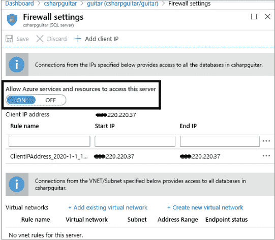

如果将该值设置为 OFF 并保存，则只有防火墙 IP 地址列表中的 IP 地址才能访问 SQL Server 数据库。请注意，这些规则适用于 SQL 数据库服务器上的所有数据库，而不仅仅是特定的数据库。

你可以采取的另一个安全措施是启用服务终结点。服务终结点已在第 3 章中介绍；请参阅图 3.36 以复习。 你还在练习 3.2 中在 Azure App Service 中创建了一个服务终结点。还记得你在 VNet 中创建服务终结点时只配置了 Microsoft.Web 服务，这允许从 Azure App Service 访问。 然后在练习 3.8 中你配置了 Azure App Service 上的访问限制以使用该服务终结点。在 Azure App Service 配置服务终结点之前，对全局终结点（例如 csharpjuitar.azurewebsites.net）的 curl 从任何具有互联网连接的客户端都可以工作。一旦为 Azure App Service 配置了服务终结点，终结点就只能从 VNet 内的资源访问。对所有其他尝试连接的客户端都会返回 HTTP 状态 403。 请注意，对于 Azure Web App 和 Azure SQL 数据库这两种情况，终结点始终保持可发现状态，但终结点会拒绝除 VNet 内资源之外的任何客户端的所有访问。 要支持 Azure SQL 数据库服务终结点，你需要启用 Microsoft.Sql 服务，然后在 Azure SQL 数据库上配置限制；这与 Azure App Service 的过程相同。完成练习 5.4，它将指导你设置和测试 Azure SQL 数据库的服务终结点。

### EXERCISE 5.4

#### 为 Azure SQL 数据库创建服务终结点

- 1. 在本地工作站上打开一个 cmd 窗口，并使用 SQLCMD 连接到你在上一个练习中创建的 Azure SQL 数据库，类似如下。输出应类似于图 5.32。参考表 3.11，其中描述了安装 SQLCMD 的要求。如有需要，使用你通过 SSMS 连接时使用的连接属性；参见图 5.26。将 * 替换为数据库服务器名称，并将 <dbname>、<uid> 和 <password> 更新为你提供的。

```
sqlcmd -S *.database.windows.net -d <dbname> -U <uid> -P <password>
select database_id, is_read_only, compatibility_level from sys.databases
go
```

#### FIGURE 5.32 使用 SQLCMD 从 Azure VM 连接到 Azure SQL 数据库

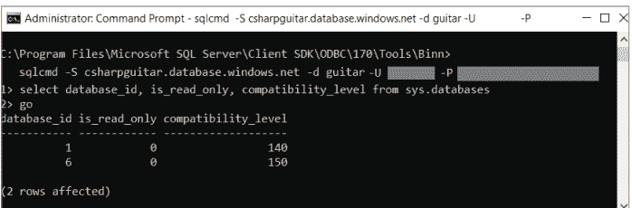

- 2. 通过 RDP 远程连接到你之前创建的 Azure VM。 如果需要创建新的，请参考练习 3.3。使用 SQLCMD 尝试再次连接到你在上一个练习中创建的 Azure SQL 数据库。输出将类似于图 5.32。

### Firewall Settings

要使步骤 1 正常工作，你的客户端 IP 必须添加到 Azure SQL 数据库的白名单中。要使步骤 2 正常工作，设置“允许 Azure 服务和资源访问此服务器”必须启用，设置为 ON。

- 3. 导航到你在练习 3.2 中创建的 Azure VNet（例如 CSHARPGUITAR-VNet-B）或创建一个新的。步骤 2 中的 VM 必须位于此 VNet 中。选择服务终结点导航项并单击 + Add 菜单项按钮。然后从服务下拉列表中选择 Microsoft. Sql。选择你在步骤 2 中测试的 Azure VM 所在的子网（例如 csharp），然后单击添加按钮。结果应类似于图 5.33。

#### FIGURE 5.33 向 VNet 和子网添加服务终结点

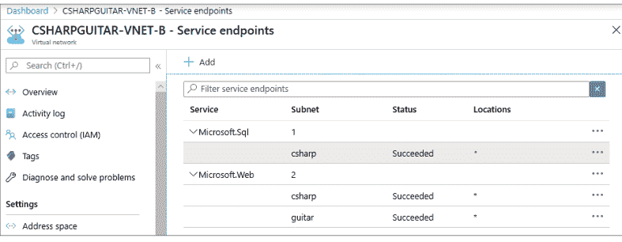

4. 导航到在练习 5.3 中创建的 Azure SQL 数据库，并在概述刀片上连接到步骤 1 和 2 中的数据库。在防火墙设置刀片底部选择 Set Server Firewall，然后单击 + Add Existing Virtual Network。输入名称和规则将驻留的订阅。输入虚拟网络（例如 CSHARPGUITAR-VNet-B）和子网名称/地址前缀（例如 csharp / 10.1.0.0/24）。配置应类似于图 5.34；单击确定按钮。

#### FIGURE 5.34 启用到 Azure SQL 数据库的服务终结点（VNet 集成）

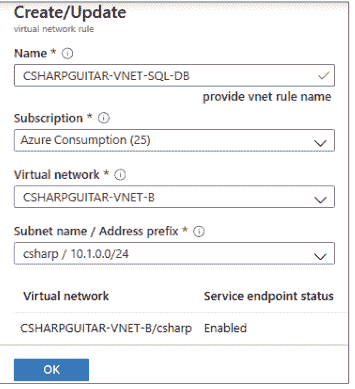

### EXERCISE 5.4 (continued)

- 5. 等待一段时间，大约 5 或 10 分钟，然后再次执行步骤 1 和步骤 2。来自你工作站的连接应失败，而来自 Azure VM 的连接将成功。请记住，最有可能的是你已将工作站 IP 添加到防火墙白名单中。这将覆盖服务终结点。此外，你可能还启用了“允许 Azure 服务和资源访问此服务器”。你需要将其关闭；然后你将拥有一个安全且受限制的数据库。

服务终结点还有更多内容。如果你想了解更多，请阅读此在线文档：

`docs.microsoft.com/en-us/azure/virtual-network/virtual-network-service-endpoints-overview`

### SQL Managed Instance and SQL VM

回顾练习 5.2 中的图 5.17，当你创建 Azure SQL 数据库时，产品（也称为部署选项）的选择默认为单数据库。在练习 5.2 中你选择了 SQL 数据库选项，它提供了单数据库、弹性池和数据库服务器等资源类型，你可以使用它们将众多其他数据库组合在一起。它有点像资源组。其他两个选项是 SQL托管实例和 SQL 虚拟机。这两个 SQL 平台选项最适合你只是想进行 lift-and-shift（在不做太多或任何更改的情况下迁移到 Azure 平台）的项目或解决方案。对于 SQL 托管实例，你可以与 VNet 完全集成，这带有私有 IP。请参阅表 5.3 以回顾 Azure SQL 数据库平台类型的差异。

在 Azure VM 上运行 SQL Server 是你能最接近在本地运行它的方式。这是一个 IaaS 解决方案，要求你承担操作系统的所有责任，但这也带来了极大的灵活性。你几乎可以对在 Azure 平台上运行数据库所需的任何更改或自定义进行操作。好处是你的数据库现在位于 Azure 网络基础设施上，这完全由 Microsoft 支持。SQL Server 已经存在很长时间了。它是为关系型 IT 解决方案而设计的，尽管它可以用于更现代的数据存储解决方案，如非结构化数据的存储。

让我们现在来看看一个正在迅速进入大数据和现代数据库存储领域的数据库，Azure Cosmos DB。

### Azure Cosmos DB

第 1 章包含 Azure SQL 和 Azure Cosmos DB 的摘要。在继续阅读这里之前，请回顾该章节，因为其中一些细节不会再次讨论。一定要快速复习一下图 1.5。我记得 Cosmos DB 还不存在的世界，我清楚地记得我开始听说这个数据存储软件的时候。回顾起来，最初我假设这只是一个新的令人兴奋的开源数据库 IT 专业人员，它恰好与开源世界人士的思维方式相吻合。那时，黑盒软件和开源之间的差距很宽，对这些技术实现和支持的方法和距离感觉非常陌生。过了一段时间，很明显，像机器学习、大数据和人工智能这样新行业正在开源思维中成长。Python、Go、R 和 Node.js 是这些新行业大多数人使用的编程语言。他们还使用 Azure Cosmos DB 来存储他们的数据，因为在这些行业诞生之时，实际上并没有设计用于存储文档、图形或键/值对的数据库；一切都是关系型的。虽然 SQL Server 可以很好地运行这些模型，但对这些的支持是在后期构建的，而不是从一开始就为这些非结构化数据模型场景而创建和设计。并不是说一个数据库比另一个好得多；只是 Cosmos DB 在行业萌芽/开始时就已存在、准备就绪，并且获得了 traction 并被使用。这并不是说与一些其他 DBMS 相比，使用 Azure Cosmos DB 没有一些优势。易于实现、极低延迟和全球分布是选择此数据存储产品时你将实现的一些好处，另外还有与在该行业工作的其他公司和开发人员的契合。

在继续之前，请通过完成练习 5.5 创建一个 Azure Cosmos DB。这将为之后讨论提供很多机会。关于易于实现、极低延迟和全球分布的含义将在之后澄清；随着你在本章的进展，它们将变得显而易见。

### EXERCISE 5.5

#### 创建 Azure Cosmos DB

- 1. 登录到 portal.azure.com 上的 Azure 门户，单击主页面左上角的菜单按钮。单击浏览器左上角的 + 创建资源。单击数据库，然后单击 Azure Cosmos DB。
- 2. 选择要放置 Azure Cosmos DB 的订阅和资源组。输入唯一的帐户名称（例如 csharpguitar），保留 Core（SQL）作为 API，选择一个位置，单击“查看 + 创建”按钮，然后单击“创建”按钮。
- 3. 部署完成后，单击转到资源按钮，然后单击导航菜单中的概述链接。注意你的 Azure Cosmos DB 的 URI。单击导航菜单中的密钥链接并注意 PRIMARY KEY 的值。主密钥类似于令牌。
- 4. 导航到 github.com/benperk/ASA/tree/master/Chapter05/Ch05Ex05 并查看 cosmos.py 的内容。（稍后会讨论。）
- 5. 返回 Azure Cosmos DB 的概述选项卡，单击 + 添加容器并添加数据库 ID（csharpguitar-db）。添加容器 ID（csharpguitar-container），然后添加分区键（/Year）并单击确定按钮。


### EXERCISE 5.5 (continued)

6. 在 Data Explorer 刀片中，展开数据库 ID，展开容器 ID，单击 **Items**，单击 **New Item** 链接，并添加 `csharp.py` 文件底部被注释掉的内容（即 `#s` 之后的代码；不要包含 `#s`），该文件位于步骤 4 中的 URL。单击 **Save** 链接并使用 `guitar.py` 文件的内容添加另一个 Item。图 5.35 说明了配置应如何显示。

**FIGURE 5.35** Adding items to an Azure Cosmos DB container

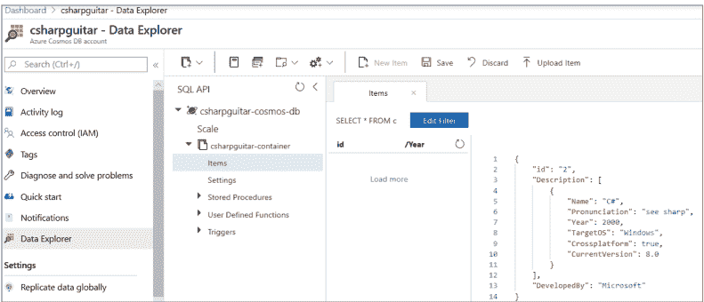

#### Setting up Visual Studio Code with Python and Cosmos

步骤 4 中链接的代码也可以从 Visual Studio Code 使用，以创建与你在 Azure 门户中手动创建的相同数据库、容器、分区键和内容。获取 Visual Studio Code 及所有支持库是一个相当复杂的场景。如果遇到问题，请在该链接的 GitHub 上开启一个 issue。

7. 从此处安装 Visual Studio Code：code.visualstudio.com/Download。本示例使用了版本 1.41.1。从此处安装 Python：www.python.org/downloads/。本示例使用了版本 3.8.1。下载并安装后，打开命令提示符并输入以下命令：

```
py -3 --version
```

图 5.36 说明了输出。

**FIGURE 5.36** Adding items to an Azure Cosmos DB container

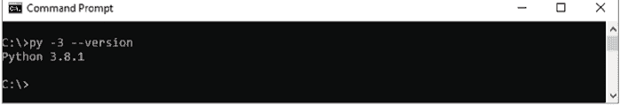

8. 打开 Visual Studio Code 并安装 Python 扩展。单击菜单中的 **View** > **Extensions**。输入 Python 并安装扩展。选择 **View** > **Terminal** 并输入以下命令：

```
mkdir csharpguitar
cd csharpguitar
code .
python -m venv .venv
pip install azure-cosmos
```

Python 扩展和命令将类似于图 5.37。

**FIGURE 5.37** What the Visual Studio Code Python extension and environment setup looks like

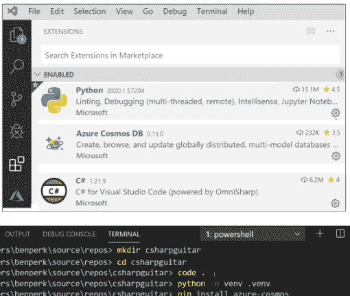

9. 使用 GitHub 上提供的代码创建文件 `cosmos.py`、`csharp.py` 和 `guitar.py`（参见步骤 4）。在 `cosmos.py` 文件中，将 endpoint 和 key 改为与你的 Azure Cosmos DB 匹配，这些在步骤 3 中已指出。然后使用 Ctrl+K+S（Save All）保存文件。执行以下命令以创建数据库、容器、分区键和项目：

```
python .\cosmos.py
```

让我们回顾一下练习 5.5 中刚刚发生的事情。让我们也查看一些其他 Azure Cosmos DB 概念，例如以下内容：

- Azure Cosmos DB API models
- Databases, containers, items, and partition keys
- The cosmos.py code
- Azure Cosmos DB migration options
- Querying an Azure Cosmos DB
- Global replication concepts

### Azure Cosmos DB API Models

在练习 5.5 的步骤 2 中，你可能注意到下拉列表中列出了 Azure Cosmos DB API。表 5.7 列出了这些 API 和数据模型。

**TABLE 5.7** Azure Cosmos DB APIs

| API Type | Data Model | Container Item |
|---|---|---|
| Core (SQL) | Document database | Document |
| Azure Cosmos DB for MongoDB API | Document database | Document |
| Cassandra | Relational (Apache Cassandra/CQL) | Row |
| Azure Table | Key/value pair | Item |
| Azure Cache for Redis | Key/value pair | Item |
| Gremlin | Graph database | Node or edge |

当你告诉别人你创建了一个 Azure Cosmos DB 时，应该会有后续的陈述或问题。这是因为，如表 5.7 所示，在幕后 Azure Cosmos DB 可以是文档数据库或其他众多数据库类型。例如，它容纳了针对 Apache Cassandra 设计的应用程序的关联数据库，该数据库可使用类 SQL 的 CQL 查询。它也可以包含键/值对数据结构或图数据库。所有这些功能都隐藏在 Azure Cosmos DB 这个通用术语之后。

Azure Cache for Redis 也是一个键/值数据存储，将在后面详细介绍。然而，现在可能是介绍该产品并将其与 Azure Cosmos DB Table API 数据模型简要比较的好地方和好时机。这两个 Azure 产品之间主要有两个主要区别，第一是数据存储的位置，第二是扩展发生时发生的情况。Azure Cache for Redis 将应用程序引用的数据存储在内存中。当应用程序需要访问该数据时，没有 I/O 延迟，因为数据已存在于进程中。如果数据是从 Azure Table 键/值存储中引用的，则需要连接到托管数据的服务器以及连接到数据存储本身以检索数据，这可能更延迟。Azure Cosmos DB Table API 的好处是，当你扩展到多个实例时，你的应用程序继续绑定到数据的单个实例。然而，对于 Azure Cache for Redis，如果应用程序的新实例扩展到服务器场中，则数据会从数据源检索并加载到内存中。如果你在五台 VM 上有五个应用程序实例，则五份数据副本会加载到内存中。多个数据副本会消耗大量内存，这会带来额外的成本，但如果性能是驱动因素，那么你至少有两个产品可以提供满足该给定要求的特性。

### Databases, Containers, Items, and Partition Keys

回想一下第 1 章图 1.5 中数据库、容器和项目之间的关系可视化。Azure Cosmos DB Core（SQL）数据库在目的上类似于 Azure SQL 数据库，因为它充当包含数据的实际数据存储的分组。一个需要注意的地方是，Azure Cosmos DB 账户中的所有数据库必须使用相同的 API。（API 已在表 5.7 中提供。）你不能在同一个 Azure Cosmos DB 账户中同时拥有 Core（SQL）数据库和 Azure Table。这是有意义的，并且与与 Azure SQL 相比时的行为相同。在 Azure SQL 的情况下，只有一个种类的数据库，即 SQL Server。因此，你只能在 Azure SQL 数据库分组中拥有那种一种数据库。如图 5.38 所示，你可以在其中拥有多个数据库，并在其中拥有多个容器。

你也可以使用 Azure CLI 列出给定资源组和账户的 Azure Cosmos DB，使用以下命令：

```
az cosmosdb sql database list -a $accountName -g $resourceGroupName
```

```
az cosmosdb sql container list -a $accountName -g $resourceGroupName \
    -d $databaseName
```

**FIGURE 5.38** Using the Data Explorer in the Azure portal to view Azure Cosmos DB and containers

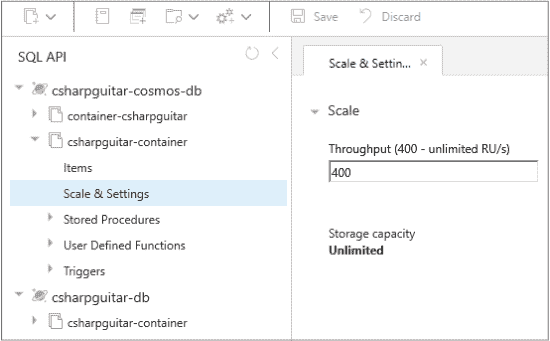

从架构角度来看，容器是该组中最重要的元素。它之所以最重要，是因为它是扩展发生的位置，也是 SLA 应用的位置。你可以在图 5.38 中看到，规模设置是在容器名称下的一级管理的。你还将在图 5.39 所示的 Azure Cosmos DB 账户的 Overview 刀片上看到，RU/s 的数量应用于容器，而不是数据库或账户。你可能会问自己关于 RU 这个术语。*request unit (RU)* 是吞吐量的单位，标识分配给容器（即 CPU、内存和 IOPS）的可用计算资源的数量。你可能还记得上一节中的 DTU；它是一个类似的度量单位。与 DTU 一样，RU 是产品的成本；你需要的越多，成本就越高。

**FIGURE 5.39** Different scale settings per Azure Cosmos DB container

| ID | Database | Throughput (RU/s) |
|---|---|---:|
| csharpguitar-container | csharpguitar-db | 800 |
| csharpguitar-container | csharpguitar-cosmos-db | 500 |
| container-csharpguitar | csharpguitar-cosmos-db | 400 |

要计算成本，请注意成本基于每小时使用的 RU，加上你消耗的存储量。重要的是要理解，当水平扩展发生时，RU 的数量不会增加；相反，你会在另一个地理位置获得该容器的一个新实例。然而，如果你知道你需要 900


在上午 8 点到下午 5 点之间需要 RUs 时，一个思路是创建一个 Azure Function 来根据需要增加和减少 RUs 的数量。基本上，因为你可以使用 Azure CLI 更新吞吐量，而 Azure Functions 支持该语言，所以你可以从 Azure Function 中运行此命令来更新该值，这模拟了扩容和缩容。创建一个名为 scaleUpCosmos 的 Azure Function，在上午 8 点运行，将 RUs 的数量更新为 900。 再创建一个名为 scaleDownCosmos 的 Function，在下午 5 点运行，将值设置为应用程序所需的最小值；最小值为 10 RU。

```
az cosmosdb sql container throughput update -a $accountName -g \
$resourceGroupName -d $databaseName -n $containerName --throughput 900
```

容器也是添加诸如存储过程、用户定义函数（UDF）和触发器等内容的地方。你可以在图 5.38 中看到这些列表。在讨论容器的开头，我指出容器从架构角度来看是最重要的元素。从 Azure Cosmos DB 的角度来看，你可能会认为存储在容器和数据库中的数据是最重要的。数据以项目形式存储，并且在通过数据资源管理器刀片访问数据库和容器后点击项目，它会执行 SELECT * FROM c 并列出 ID 和分区键。项目可以根据所选的 API 以多种形式表示。在本例中使用 Core（SQL）的情况下，项目被视为文档，这很合适，因为我们存储了 JSON 文档在其中，并将其称为文档数据库。但是，如果你使用了其他 API，那么项目可能是前面表 5.7 中所示的任何一种，例如行、节点或边。当你开始对数据存储执行 CRUD 操作时，这些很重要，因为它们定义了在执行这些操作的代码中需要创建的类型。随着你与特定的 Azure Cosmos DB API 越来越契合，它们会变得直观明显。

最后，让我们谈谈分区键。对于每种数据存储方案，都有关于分区的讨论，而一个常见的关键词是分片，通过某种逻辑将数据在计算实例之间拆分，从而实现更好的性能。对于 Azure Cosmos DB 也是如此，这就是分区键成为焦点的地方。在练习 5.5 中使用的示例中，/Year 被设为分区键，结果是分区会针对匹配的年份进行，并根据该值在多个服务器之间拆分。分区由产品自动执行，因此你不必太担心内部实现。如果你考虑进一步阅读此主题，请访问 docs.microsoft.com/en-us/azure/cosmos-db/partition-data，其中讨论了逻辑分区，即刚刚讨论的内容，以及另一种称为物理分区的分区类型。

### A Walk Through the Cosmos.py Code

正如我已经提到的，你所从事的行业对 IDE 和应用程序所使用的语言有明显的影响。虽然 C# 与 Azure Cosmos DB 完全兼容且功能齐全，你可以使用 Visual Studio Community 版创建相同的程序，但在我与使用 Azure Cosmos DB 的真实生产应用程序的个人合作时，存在大量开源语言，如 Python、Java、Node.js 和 Xamarin。具有 Microsoft 技术背景的编码人员可能会使用 Visual Studio Code。好奇的人会开始学习并使用这些语言，这将增加他们作为开发人员获得工作的机会，因为这些是机器学习、大数据和人工智能行业中程序常用的语言。虽然 Visual Studio Code 的初始配置有点具有挑战性，但在付出一些努力后是可以实现的。之后，使用 Python 编写和测试应用程序就很简单。cosmos.py 中的第一行代码导入 azure.cosmos 库，即你在练习 5.5 中安装的库。接下来它导入将存储在数据库中的 JSON 文档，一旦数据库创建完成。代码随后使用端点和密钥创建客户端；创建数据库、容器和分区键；并添加两个项目。最后，使用文档 ID 查询数据库。这很直接，并且几乎毫不费力地工作。

将此与使用 Entity Framework 或 ADO.NET 的 C# 项目进行比较，使用 Python 和 Azure Cosmos DB 可以轻松地让数据库和应用程序运行起来。这种方法取决于你的项目需要多快实现。你存储在 csharp.py 和 guitar.py 等文档数据库中的数据无关；然而，它们存储在同一个数据库中。如果你使用 C# 和 RDBMS 做同样的事情，时间框架可能要长几个小时甚至几天。在许多需要快速解决方案的场景中，有一个共同原则：捕获数据并存储它。我们稍后再弄清楚该如何处理它，但我们不想丢失任何数据。这一原则适用于 ML、大数据和 AI 行业，这些行业需要高技能的数据专家来理解数据。

### Azure Cosmos DB Migration Options

如果你要将数据从另一个云托管提供商或从本地内部数据源迁移过来，有许多工具可以帮助你实现这一点。正如你所想象的，你选择的工具取决于 Azure Cosmos DB 背后的 API 类型。以下是描述此过程的完整文档：

```
docs.microsoft.com/en-us/azure/cosmos-db/import-data
```

它根据 API 类型分解了所需的步骤。此外，如果你只是有一个装满 JSON 文档的目录，并且想要将它们加载到文档数据库中以便查询它们，那么 Document DB Data Migration Tool 将为你完成此操作。该工具是一个托管在 GitHub 上的开源项目。

### Querying an Azure Cosmos DB

回想一下在练习 5.5 文件中创建的 cosmos.py 文件，其中存在如下查询：SELECT * FROM c WHERE c.id IN ('1', '2')。这与你在查询关系数据库时运行的典型 SQL 命令非常相似。在 Azure 门户中，你将在 Azure Cosmos DB 概览刀片的导航菜单中找到一个名为数据资源管理器的功能。展开你在练习 5.5 中创建的数据库，展开容器，然后会出现一个名为 New SQL Query 的菜单项。点击该项会打开一个窗口，

允许你对容器中存在的数据项测试 SQL 查询。你应该会看到类似于图 5.40 的内容。

#### FIGURE 5.40 Using the Data Explorer in the Azure Portal for querying an Azure Cosmos DB Core (SQL) database

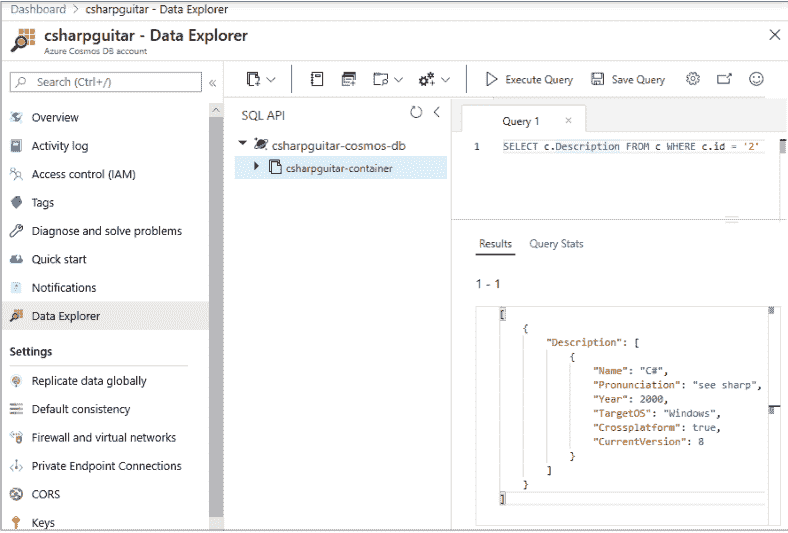

输入查询后，点击 Execute Query 链接来执行它。这是测试稍后将放入应用程序中的查询的好地方。

### Global Replication Concepts

获取数据或计算资源尽可能靠近消费它们的客户端或客户的原因已经多次提到。此外，Azure 产品如内容分发网络（CDN）或在不同 Azure 区域克隆应用程序环境并使用 Azure Traffic Manager（ATM）将请求路由到请求来源位置最近的区域，应该为你所熟知。Azure Cosmos DB 产品的一个强大功能是它支持其中存储的数据的全球复制。随此功能而来的有一些相对复杂的概念，如区域和全球数据分布、数据并发性和数据一致性。当你创建 Azure Cosmos DB 时，默认情况下你在选择的区域中创建了数据源的单个实例。如果你导航到 Azure Cosmos DB 概览刀片，


你会看到一个名为“启用地理冗余”的菜单项。如果你还记得第 3 章中关于地域的学习内容，其中讨论了每个区域在同一大洲都有一个姊妹区域。这些区域对（例如，西欧 (AM2) 与北欧 (DB3)，美国中南部 (SN1) 与美国中北部 (CH1)）有助于在不跨越国际边界的情况下提供额外的冗余。如果你的数据存在要求此类数据驻留的监管或合规问题，这会很有帮助。当你为 Azure Cosmos DB 启用地理冗余时，Azure Cosmos DB 帐户中的数据库会自动复制到其对应的地理配对区域。如你所料，当你启用全局复制时，Azure Cosmos DB 帐户中的数据库可以复制到世界上任何提供 Azure 服务的地方。要启用全局复制，请导航到 Azure Cosmos DB 帐户，然后选择“全局复制数据”导航项，如图 5.41 所示。

#### 图 5.41 如何从 Azure 门户启用 Azure Cosmos DB 全局复制

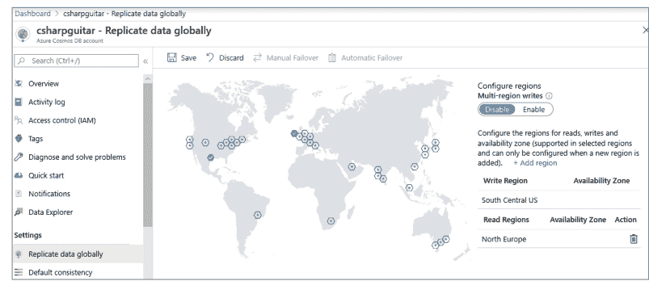

你会注意到，目前仅选定了美国中南部和北欧；但你可以选择所显示区域中的任意一个或全部。这样做后，你的数据库将复制到该位置，从而更靠近世界那个地区的客户。请注意，每多复制一个实例，成本就会增加一份；如果你有三个实例，那么成本将是单个实例运行时的三倍。这是一个重要的事实，不仅从数据库或后端角度，从前端角度也是如此。你会从单一位置运行前端，而让所有后端靠近客户吗？这不太合理。最合理的设计是不仅让后端数据库靠近需要它的人，还需要让前端也靠近。这会进一步增加成本，但你需要做出决策。速度需要付出代价，你需要确定延迟的降低是否值得付出这种代价，以及这是否是访问你应用程序的用户所要求的。这是你必须决定的架构设计，但还有另一个需要理解、设计和实现的概念。也就是说，你需要决定在不同实例之间如何以及何时复制数据。这归结为数据并发和一致性的概念。

从图 5.41 中可以看到，有一个用于启用/禁用多区域写入的按钮。假设你保留默认值“禁用”，并且只让 Azure Cosmos DB 的原始实例可写。这意味着，由于 Azure Cosmos DB 是在美国中北部创建的，所有写入都将在此处执行，然后复制到位于北欧的只读实例。可以想象，该数据的复制可能需要一秒钟或更短或更长的时间。如果你有一个高事务数据库，且数据一致性至关重要，那么这可能是一个大问题。另一方面，也许数据插入的速度比让所有数据在全球范围内复制更重要。如果是这样，那么启用多区域写入就有意义，因为一个需要跨大西洋将数据写入数据库的实时应用程序并不是最优的解决方案。这完全取决于你的应用程序做什么以及需要什么；也就是说，你需要什么级别的并发？但是，如果同一个数据库中同一行的同一数据列在复制之前就被更新了，会发生什么？这就是一致性的用武之地。

在图 5.41 中，你会看到“默认一致性”导航项。单击它会打开一个边栏选项卡，其中显示 Azure Cosmos DB 提供的五种不同一致性级别；默认级别是会话。其他级别分别是强、有界过期、一致前缀和最终。你可以在此处阅读有关这些细节的更多信息：

```
docs.microsoft.com/en-us/azure/cosmos-db/consistency-levels
```

这些不同的一致性级别为你提供了许多选项，可以找到适合本地、区域或全球使用你应用程序的数据完整性和性能。最后，这里有一个活跃且内容丰富的社区，以非常友好和活跃的方式讨论 Cosmos DB 概念：https://azurecosmosdb.github.io/CosmicNotes。通过回答以下问题来结束本节：

如果你有一个为 OLTP 场景设计的本地关系数据库，你会选择哪个数据库来直接迁移到 Azure？

- Azure SQL 单数据库
- Core (SQL) Azure Cosmos DB
- Azure SQL 托管实例
- Azure 表 Azure Cosmos DB
- 答案：Azure SQL 托管实例

尽管 Azure SQL 单一数据库选项很有可能满足你的要求，但该产品缺少某些功能（前面已讨论过），这些功能可能会对部署产生负面影响。包含 Azure Cosmos DB 的两个答案应立即作为可能答案排除。Azure SQL 托管实例是 OLTP 和关系数据库迁移的目标。

### 其他 Azure 数据存储

到目前为止，Azure SQL 和 Azure Cosmos DB 是 Azure 上最常预配的数据存储，如果 Azure 解决方案架构师专家考试中有相关问题，它们将围绕这两个服务。但要尽可能成为最好的 Azure 解决方案架构师专家，你应该了解 Azure 上其他数据存储产品的一些知识。

#### 表存储

如果你回到图 5.11，你会看到 Azure 表存储包含在 Azure 存储帐户中，就像 Azure 文件、队列和 Blob 容器一样。简而言之，Azure 表是一个可以基于键/值对以非结构化方式存储数据的地方。存储 PB 级数据和管理扩展的能力是此产品提供的主要优势。计算和存储需求均由 Azure 平台管理。创建存储帐户时，你需要决定需要哪种冗余选项，例如 LRS、ZRS、GRS 等，这对于可用性和灾难恢复（DR）场景很有帮助。

表存储基于两个基本概念：分区键和行键。一旦使用门户或 Azure PowerShell 等工具创建了表本身，你就可以配置这两个键。使用 `Import-Module AzTable` 导入 AzTable 模块后，当你向表中添加数据时，需要提供分区键和行键。类似于以下内容的 Azure PowerShell 命令会向 Azure 表插入一行：

```
Add-AzTableRow -table $tableName -partitionKey $pk -rowKey ("FEN1") /
    -property @{"MODEL"="TELECASTER";"LOCATION"="USA"}
```

#### 图 5.42 Azure 表存储分区

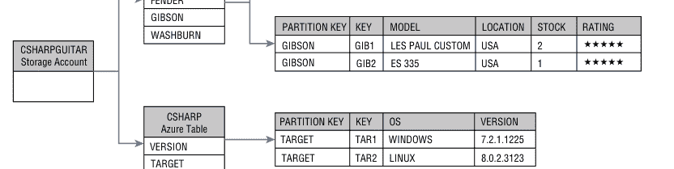

这里需要指出的另一个事实是 Azure 表存储与 Azure Cosmos DB 的 Azure 表 API 之间的关系。Azure Cosmos DB 的 Azure 表 API 后端是一个 Azure 表；但是，两者有不同的用例和目的。你必须根据应用程序的要求进行匹配。上一节中特别指出的一个重点是 Azure Cosmos DB 带来的易用性和规模。使用 Azure Cosmos DB 进行全局扩展快速、简单且非常有效，尤其是在让数据靠近访问者方面。Azure 表没有这样的功能。你只能绑定到单个区域，并且可以选择在该同一区域内提供一个辅助只读实例。另一个区别是，与 Azure Cosmos DB 相比，Azure 表针对存储进行了优化，而 Azure 表 API 针对吞吐量进行了优化。因此，这是一个基于应用程序的平衡或决策，你需要决定是需要更大的存储优化还是更大的吞吐量。例如，Azure 表有每秒 20,000 次操作的限制。Azure Cosmos DB 表 API 每秒可以支持 10,000,000 次操作；没有文档化的上限。索引、延迟和查询功能也有所不同，但在所有这些场景中，Azure Cosmos DB 表 API 通常都表现更好。但请记住，Azure Cosmos DB 的成本高于 Azure 表存储，而在许多情况下，成本是最重要的限制因素。

#### 用于 Redis 的 Azure 缓存

用于 Redis 的 Azure 缓存是一个非常面向开发或编码的产品。不过，它属于数据存储类别。即使数据以固态存储，也会从该状态加载到进程（.exe）中，以便在进程被调用时数据可以在内存中访问。重点是，这实际上不是一个类似架构的产品。尽管如此，你还是应该了解这一点，因此如果它出现在某些考试问题中，你就有相关背景。如果你的经理或客户问起，你也可以了解一些相关细节。

有一个名为 Redis 的开源产品，网址为 https://redis.io/，用于 Redis 的 Azure 缓存就是基于它构建的。有五种 Azure Cache for Redis 模式和三种 SKU 产品。让我们从模式开始。

- 旁路缓存
- 内容缓存
- 用户会话缓存
- 消息队列
- 分布式事务

旁路缓存模式与计划存储在内存中的数据大小有关。要认识到，在考虑内存优化的 IaaS 产品时有很多选择，PaaS 的产品数量较少，而 FaaS 的内存产品最少。这一切都归结为一个事实：数据存储可能很大，将整个数据库加载到内存中并不明智。相反，此模式在数据使用者请求时将数据加载到内存中。第一次会查询源；但是，对该同一数据的后续及所有未来请求都将来自内存，并且延迟会低得多。


内容缓存更多与文件的动态性质有关。与静态、不变且可以从内存加载和交付的 .html 文件不同，动态文件是根据每次请求时通常通过 HTTP POST 发送或存在于 Web 服务器标头中的属性来创建的。然而，动态生成的页面中有些部分可能不会改变，例如菜单、页眉、页脚或工具栏。这些部分可以被缓存，而动态生成的 Web 响应也可以使用此模式进行缓存。用户会话缓存可用于购物车场景。在这种情况下，您需要将客户想要购买的商品存储在内存中，并让其保留到点击购买按钮为止。不要将其存储在数据存储中，而是存储在内存中。对此有多种选择，例如 C# 中的 System.Web.HttpContext.Session 对象。

Azure Cache for Redis 中的消息队列功能，与用户会话缓存一样，有多种选项。此选项的目的是存储（例如）一个订单，以便快速做出响应，然后实际离线处理该订单。对磁盘上的数据存储执行 INSERT 所经历的延迟，会比写入内存或专为处理此类需求而设计的技术更高。（下一章将详细介绍消息传递。）只需将此模式视为一种确保已下达订单不会因实时后端 OLTP 数据存储的过度使用而失败的方式。

最后一种模式与前面讨论过的 ACID 操作概念有关。分布式事务意味着您可以执行依赖于多个命令成功完成的 CRUD 操作。如果其中一个命令失败，所有命令都将回滚。

Azure Cache for Redis 的三种 SKU 产品分别是基础版（Basic）、标准版（Standard）和高级版（Premium）。基础版不附带 SLA，因此不适用于任何生产或企业 IT 解决方案。基础版旨在用于开发和测试项目阶段。标准版运行在多个实例（即节点）上，提供冗余和故障转移能力；标准版的 SLA 为 99.9%。选择高级版最明显的好处是，与标准版相比，延迟和吞吐量要好得多。这是因为高级版运行在规格更高的计算 SKU 上。当 Azure Cache for Redis 在高级模式下运行时，其响应速度会更快。

Azure Cache for Redis 的数据分区策略与 Azure Table 相同，后者也是 Azure Cosmos DB 表 API 的基础。分片（Sharding）是这三种产品共同采用的方法，可以使用前面提供的图 5.42 进行直观理解。您可能会问自己，在什么场景下会使用 Azure Cache for Redis，而不是 Azure Table 或 Azure Cosmos DB 表 API？后者已经解释过了。然而，Azure Cache for Redis 附带了一个可以在应用程序代码中使用的框架，这意味着与选择 Azure Table 来实现相同的缓存行为相比，您可以将 Azure Cache for Redis 更快地集成到应用程序中。

### Azure Database for MySQL

当我回想起有机会从零开始一个新项目，或者甚至只是为了好玩而编码并需要数据存储解决方案时，我的首选是 SQL Server 和 Oracle。这两者都需要大量的精力、配置和技能才能安装并可供访问。Azure Database for MySQL 是一个关系数据库，对于快速发展的时代很有帮助。这迎合了那些偏爱开源社区平台、社区和产品的人的需求。它是一个功能完备、可供企业使用的 RDBMS，包括可扩展性、监控、警报、高达 99.99% 的高级 SLA，以及对复杂安全服务的支持。

Azure 的 Azure Database for MySQL 解决方案被视为一种运行在 PaaS 上的数据库即服务（DaaS/DBaaS）产品。这意味着支持基于消耗进行横向和纵向扩展，使其成为一个经济高效的数据存储产品。此外，还有 MySQL 运行在 IaaS 云服务模型中的 Azure VM 上。与在 PaaS 上运行 MySQL 相比，在 IaaS 中运行有更高的固定成本，但也有更大的灵活性。选择数据库来存储 IT 解决方案中最重要的资源之一，不应掉以轻心。Azure Database for MySQL 是一个可靠的选择，并且在概念上与开源和社区驱动的公司及开发资源紧密相连。如果开源理念或方法是贵公司的运营文化，请考虑将这种数据存储作为关系数据库的解决方案。

顺便提一下，还记得在练习 5.4 中，您为 Azure SQL 数据库创建了一个服务终结点。当时您选择的服务是 `Microsoft.Sql`；如果需要提醒，请回顾图 5.33。既没有适用于 MySQL 的服务，也没有适用于 PostgreSQL 的服务；但是，当您选择 `Microsoft.Sql` 时，它也可以让这两种数据存储配置服务终结点和 VNet。

### Azure Database for PostgreSQL

此数据库产品与您刚刚了解到的 MySQL 产品类似。它是一个基于 PostgreSQL 数据库引擎构建的开源关系数据库，您可以在 www.postgresql.org 上了解相关信息。此 Azure 产品提供两种不同的替代方案：单服务器（Single Server）和超大规模（Hyperscale，Citus）。在单服务器模式下运行时，您有三种选择：基本、内存优化和通用。后两种应该会让您想起第 4 章中介绍的内容，其中介绍了 Azure VM 可根据应用程序的特定预期工作负载（内存或 CPU 密集型，这里指数据库）来选择。虽然基本版用于测试和开发阶段，但随着项目的推进，您可以进行扩展或从基本版迁移到更大的服务层级。您将获得全套预期功能，例如高可用性、动态扩展、监控、高级安全功能和备份。所有这些功能使其成为运行关键任务应用程序的有效选择。

超大规模（Citus）让 PostgreSQL 成为了一种受欢迎的数据存储。仅从名称上，您就应该能大致了解该产品的功能。您应该已经很清楚什么是分片，并对其工作原理有了一些基本认识：将数据划分为更小的子集，有时放在不同的节点上，从而加快查询速度。PostgreSQL 数据库通过将这些分片放入不同的表状结构并能够将分片运行在完全独立的机器上，将这一概念提升到了新的高度。数据库引擎可以在这些机器上并行运行查询，从而在大型数据集上实现快速响应。

### Oracle 和 Marketplace 选项

Azure 上有许多数据存储产品，远不止 Azure SQL、Azure Cosmos DB、MySQL 和 PostgreSQL。Azure 为第三方合作伙伴提供了通过门户中的一项名为 Marketplace 的功能来放置预构建 VM 或可安装产品的机会。在那里进行搜索，您会找到 Oracle、CouchDB、SQLite、MongoDB 以及许多其他数据存储选项。如果您没有为您所需的数据库找到预构建或预配置的 VM，您可以构建一个 Azure VM，并且如果您拥有许可证或遵守所需的开源准则，您就可以使其工作并在 Azure 上运行该工作负载。

### Azure 存储

当您想到数据存储解决方案时，通常会想到以文本形式放置在由行和列组成的表中的数据。请注意，该表中的数据实际上存在于写入硬盘驱动器或某种存储帐户的物理文件中。存储数据的文件不仅需要一个存放位置，而且视频、图片和文档也可能具有相当大的体积和关键的重要性。可以想象，在确定用于在 Azure 上存储数据的产品时，需要审查许多考虑因素。安全、性能、可扩展性和冗余等概念都需要思考。

从安全角度考虑您的数据存储需求，可以提出如下问题：数据是否需要加密？数据传输过程中是否需要加密？静态数据是否应该加密？一旦迁移到 Azure 平台，访问数据的安全性如何？在审阅了每个 Azure 存储产品功能并确定自己的需求之后，您就可以选择哪个产品能够满足您的数据安全策略要求。正如您在第 2 章中已经了解到的，安全性很重要，但客户可能有一些特定的合规性要求，例如使用 AES 256 位加密或支持大小为 2048 的 RSA 密钥。了解您的需求以及哪些产品支持这些需求是您的责任，但本书前面已经提供了一些提示，后面还会提供更多。

从性能和可扩展性的角度来看，如果您的数据文件存储在 HDD 硬盘而不是 SSD 上，这有关系吗？从性能角度来看，有关系。众所周知，SSD 的吞吐量和 IOPS 都比 HDD 好得多。您的存储解决方案是否需要处理每秒超过 20,000 个请求？您的应用程序需要每秒处理多少个请求？您的应用程序或客户生成且需要存储的数据如何增长？它是只增长，还是在给定时间段内扩展和收缩？实际上，您可以使用的存储量很大，可能高达两拍字节；然而，不同地区有不同的限制，这使得这成为一个需要提前提出并回答的重要问题。


最后，让我们谈谈数据冗余和并发。在后面的章节“区域复制”中，你将最终了解 LRS、ZRS、GRS 等的细节。简单来说，这些是你确保在某个区域或可用区发生中断时既不会丢失数据也不会失去访问权限的选项。并发需要仔细考虑。你希望对数据的读写有多严格？在超大规模数据存储产品上进行写入、更新和读取数据时，可能会遇到不同客户端同时写入同一行或文件的情况。你如何处理这种情况？Azure Storage 账户支持乐观或悲观并发。乐观并发不会写入第二次更新。使用悲观并发时，会在正在写入的对象上放置一个锁，直到写入完成为止。任何其他客户端必须等待锁释放后才能执行工作。在乐观场景下，结果很快；更新会失败。你的应用程序逻辑需要处理这种情况并重试。悲观并发较慢，但在几秒内应该能完成，如果不更快的话。下节讨论的 Azure Storage 产品、功能和概念包括以下内容：

- Storage accounts
- Zone replication
- Azure managed disk storage

### Storage Accounts

存储账户产品组合包含许多最初的 Azure 云服务。当你应用到目前为止学到的知识（已接触过 Azure VM 和 Azure SQL 数据库）时，你会知道它们以及许多其他服务完全依赖于 Azure Blob Storage 和 Disks。这两个产品在其他产品被用于支持它们之前就已存在。Azure Blob Storage 和 Disks 仍被用于运行 App Services、Azure Functions 和 Azure Container Instances。这些应用程序依赖于一个或多个这些 Azure Storage 产品。不要忘记 Azure Cosmos DB Table API，它是围绕 Azure Table 构建的。总的来说，每个存储账户服务都提供一个存储数据行或文件的位置，具有极强的扩展性，但查询能力有限。如果这些符合你的需求，那么以下列表中的 Azure Storage 产品将非常合适：

- Azure Blobs
- Azure Files
- Azure Queues
- Azure Tables

快速回顾一下图 5.11。Azure Storage 服务之间的一个共同模式是它们具有全局端点，类似于表 5.8 中所示。只需将星号（`*`）替换为你的存储账户名称即可。

#### TABLE 5.8 Azure Storage Service Endpoints

| Azure Storage Service | Endpoint |
|---|---|
| Azure Blobs | https://*.blob.core.windows.net |
| Azure Files | https://*.file.core.windows.net |
| Azure Queues | https://*.queue.core.windows.net |
| Azure Tables | https://*.table.core.windows.net |

这些全局端点与许多其他 Azure 产品一样，包含创建防火墙规则以防止访问的能力。除了这些存储服务外，本节还将讨论一些其他存储产品，例如 Storage Explorer、共享访问签名、Azure Data Lake Storage 和 Azure NetApp Files。开始之前，完成练习 5.6。在这里，你将向练习 5.1 中创建的 Azure 存储账户添加一个 Azure Blob 容器。请记住，所有这些存储服务都存在于单个存储账户中。存储账户是你配置监控、警报、高级安全以及适用于账户内服务的许多其他功能的地方。

#### EXERCISE 5.6: Creating an Azure Blob Storage Container

1. 登录到 Azure 门户 portal.azure.com 并导航到你在练习 5.1 中创建的 Azure 存储账户。（我的名为 csharpguitar。）在 Overview 刀片上，单击 Containers。Blob 服务部分导航菜单中也有一个 Containers 链接。单击 + Container 菜单选项，输入名称（csharpguitar），从 Public access level 中选择 Blob（匿名读取访问仅限 blob），然后单击 OK 按钮。
2. Blob 容器创建后，单击它。单击 Upload 菜单按钮。从工作站中选择任意随机文件进行上传，将路径添加到 Files 框中。展开 Advanced 部分并查看其内容。单击 Upload 按钮。Upload blob 窗口应类似于图 5.43 所示。

#### FIGURE 5.43 Azure Blob Storage Container Upload blob window

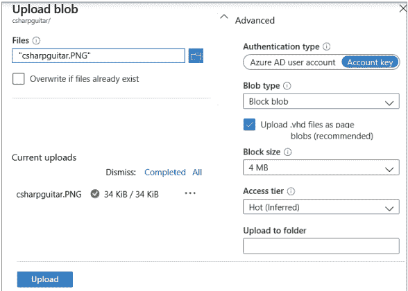

在之前的练习中，你使用门户将文件上传到 Azure Blob。这调用了 Azure Storage REST API，由 Azure 门户发出。它们在此处详细定义：

```
docs.microsoft.com/en-us/rest/api/storageservices
```

这些 API 可用于所有 Azure Storage 服务，而不仅仅是 Azure Blobs。这些 API 对于包含大量文件或数据的迁移非常有用，手动上传不可行。名为 AzCopy 的命令行工具可用于将 Azure Blobs 或存储在 Azure Files 中的文件从一个存储账户移动到另一个存储账户。最后，一个名为 Microsoft Azure Storage Data Movement Library 的开源库位于此处：

```
github.com/Azure/azure-storage-net-data-movement
```

它可用于上传、复制和下载大量存在于 Azure Files 上的 Azure Blobs 或文件。要了解更多关于练习 5.6 中设置和操作的信息，请继续阅读下一节，其中详细讨论了 Azure Blob Storage。

### Azure Blobs

如果你还记得本章开头，你会发现对象存储这个术语。用于存储对象的 Azure 产品是 Azure Blob 存储服务。如果你再次查看图 5.11，你会注意到“可扩展、经济高效的非结构化数据存储”的描述。完成之前的练习后，你知道 Azure Blobs 存在于容器中。容器是对象存储的位置。对象的类型可以如下：

- Images
- CSS
- Static HTML
- Logs
- Database backups
- CSV
- JSON
- Scripts
- Videos
- Office documents
- PDFs
- VHDs

请注意，像 HTML 或 CSS 这样的小文件类型可以像视频和 VHDs 这样的大文件类型一样保存到 Azure Blob 容器中。你可以保存到容器中的对象数量没有限制，你的存储账户中可以拥有的容器数量也没有限制。单个对象可以存储在容器中的最大大小约为 5TB。有三种类型的 blob，如果你在练习 5.6 中在上传 blob 时展开高级设置部分中的 Blob type 下拉列表，你就会注意到。它们是 block、append 和 page。

*block blob*，顾名思义，是一个较大的对象，可以拆分为多个部分（即块），并且每个块并行上传。它非常适合流式传输文件。你可以想象这可以提高上传的管理和速度。考虑上传 1TB 文件所需的时间，并且在此时间段内，你必须假设中断的风险大于上传 100MB 文件的风险，后者会更快完成。如果你可以使用多台机器或连接以块的形式上传该 1TB 文件，它会更快完成。回想练习 5.6，blob 的高级窗口中有一个 Block Size 下拉列表。值保留在默认的 4MB，并且如果文件足够大，门户逻辑将使用该块大小优化上传。关于 5TB 限制的评论原因是，对于 block blob，blob 每块的数量以及块的大小都有限制。这些值是每 blob 50,000 个块，每个 100MB，等于 4.75TB。

*append blobs* 有类似的限制：50,000 个块，最大大小为 4MB，等于 195GB。追加意味着你在文件末尾添加数据，或者在这种情况下在 blob 末尾添加数据。这种类型的 blob 针对更新进行了优化，应在追加而不是更新 blob 中包含的内容时选择。

最后一种 blob 类型是 *page blob*。你可能还记得，如图 5.43 所示，有一个复选框，其标题建议将 VHD 文件作为 page blob 上传。例如，如果你上传自定义 VHD 来创建 Azure VM，你会选择 page blob，它针对这种使用进行了优化。page blob 的最大大小为 8TB，并以在创建期间定义页大小为基础写入页面。page blob 的最大大小在创建时设置。除了是 Azure IaaS（即 VHD）产品的支柱外，这种存储还用于存储 Azure SQL 和 PaaS 的数据。


products. 在这些场景中，将大型数据文件存储在定义大小的页面集合中是有益的。记住，共享会将数据分解为逻辑分组以获得更好的查询性能。页面 blob 是提供该功能的众多设计理念之一。这就是为什么对页面 blob 的写入会立即提交并就地写入的原因。

在 Azure Blob 存储上下文中要提及的最后两个概念是容器的公共访问级别和块 blob 的访问层。回想一下你在练习 5.6 中创建 Azure Blob 容器时，除了名称之外，创建 blob 所需的唯一属性就是公共访问级别。这可以是 Private、Blob 或 Container，如图 5.44 所示。

#### FIGURE 5.44 Public access levels available for an Azure Blob Storage container

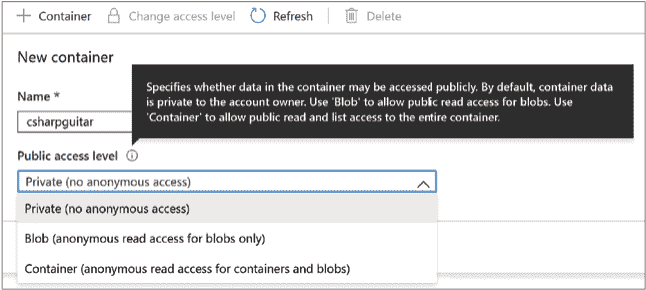

默认值为 Private（无匿名访问）。如果你想检索该容器中存储的 blob，则请求 blob 的客户端需要在请求中发送有效的令牌。使用 Postman 或 Azure Storage SDK 等工具可以提供将此令牌添加到请求中的能力，该请求的形式如下所示的 HTTP 请求：

```
csharpguitar.blob.core.windows.net/csharpguitar/csharpguitar.PNG
```

由于在练习 5.6 中你选择了 Blob（仅对 blob 匿名读取访问），只需将该地址粘贴到浏览器中即可检索 blob。blob 可以从任何可以发出 HTTP 请求并能够渲染 PNG 图像的客户端全局访问（blob 名称区分大小写；PNG 必须为大写）。第三个公共访问级别是 Container（对容器和 blob 匿名读取访问）。在这里，你允许所有容器中的所有 blob 都可以被读取和列出。你可以理解为什么此设置在容器级别。它具有容器范围的级别，而不是限制于单个 blob 或 blob 容器。此外，选择此访问级别时提供的功能不仅仅是读取 blob。列出操作也被启用。使用 Azure Storage SDK 或 Azure Storage REST API，你将有权访问容器内现有 blob 的列表，并且可以读取你想要或需要的 blob。

要讨论的最后一个 Azure Blob 功能是访问层，它仅适用于块 blob 和追加 blob。有三种不同的层，Hot、Cold 和 Archive。Hot 表示数据在 30 天期间内被访问超过一次。Cold 表示数据被访问的频率大于 30 天但小于 180 天。Archive 是超过 180 天的任何数据。这些层的原因，如你所料，是基于成本。数据访问越频繁，成本越高。然而，如果你知道某些数据将被访问得不那么频繁，你可以通过将 blob 存储在例如不需要扩展的分区上，从而节省更多成本。blob 分区基于由帐户名称 + 容器名称 + blob 名称形成的键，并用于在机器之间负载均衡 blob。因此，在此实现解决方案时，你必须考虑 blob 的名称，将经常访问的 blob 命名得相似。将访问较少的 blob 命名得不同是良好的设计。分区由平台根据分区键的派生名称创建。

### Azure Files

你可能还记得在练习 5.1 中，你创建了一个 Azure 存储帐户和一个使用了 Azure Files 的文件共享。快速查看本章中名为 Shared Files 的部分，了解有关此 Azure 存储产品的更多详细信息。Azure Files 是一种产品，提供可与你的客户或员工共享的文件存储。它与你在 Windows 资源管理器中右键单击文件夹创建的文件共享的工作方式相同。然后你可以通过右键单击属性然后共享来授予访问权限。在 Azure Files 的情况下，有一个可从任何具有互联网连接的设备访问的全局端点，无论该设备运行的是 Windows、Linux 还是 macOS。SaaS 产品 OneDrive 就是使用云中此类文件共享功能的一个例子。

设置 Azure 文件共享时，你可以选择标准和高级两个层。主要区别基于每秒的入站和出站吞吐量。其中入站指的是传入吞吐量，出站是传出。这在你移动需要快速传输的大文件时很重要。从存储容量限制来看，两个层是相同的，每个 Azure 文件共享的最大总容量为 100TB，单个文件的最大大小可达 1TB。

### Azure Queues

当英国人排队等待某物时，他们不使用“line”这个词，而是说“queue”。很高兴你不会听到我用英式口音说“Look at those people in the long queue”的尝试。将人们排队等待某物的场景可视化可以帮助你更好地理解消息队列是什么。消息队列只是一串按顺序排列并从底部到顶部排序的消息列表。像任何队列一样，排在最前面的人会先被处理，而需要该处理的人会被安排到队伍后面，并在轮到他们时被处理。这通常被称为先进先出（FIFO），而 Azure Queues 不支持这一点。查看图 5.45，你会看到一个名为 csharpGuitar 的存储帐户，它有三个存储队列。在 csharpGuitar 存储队列中，有两个需要处理的邮件。

#### FIGURE 5.45 The relationship between storage account, storage queue, and messages

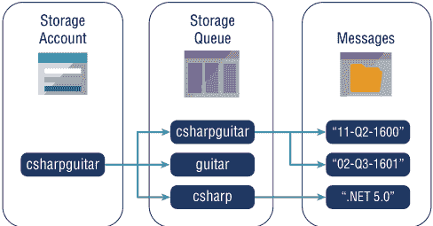

在这种情况下，csharpguitar 存储队列顶部的消息 11-Q2-1600 将在消息 02-Q3-1601 之前被处理。如果你通过 Azure 门户查看队列中的消息，它们会类似于图 5.46 所示。

#### FIGURE 5.46 What storage queue messages look like in the Azure Portal

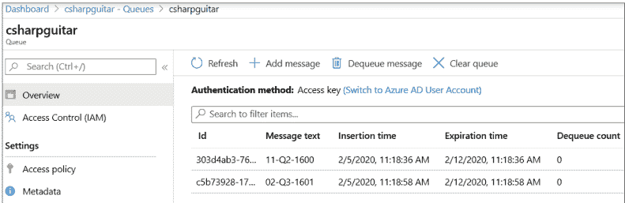

请注意，11-Q2-1600 的插入时间早于另一条消息，这就是用于强制执行 Azure Queue 消息 FIFO 处理的内容。消息的另一个有趣属性是过期时间，其默认值和最大值为七天；最小值为一秒。过期日期阈值被突破后，平台逻辑会将消息从队列中删除。在解释 dequeue count 的含义之前，先阅读一下 Azure Storage Queue 消息的用例。

第 6 章中将更深入地讨论其他 Azure 消息产品。讨论 Azure Storage Queue 的原因更多是出于历史或遗留原因，而不是其他原因。该产品是 Azure 上提供的第一个消息产品。它也

在 Azure 存储帐户中创建，就像 blob、文件和表一样；它基于它所操作的其它 Azure 产品组而归属于此处。请注意，Azure Storage Queue 大多被视为消息产品而非存储产品。话虽如此，使用消息产品的一个原因是使应用程序组件彼此解耦。一个以前使用过的例子是执行长时间运行的报告。不是向报表数据库提交大型查询并实时运行报表，你的代码可以改为将查询放入队列，例如 Azure Queue，并离线处理。这将 Web 服务器（前端）与报表和数据库服务器（后端）解耦。

在 IT 解决方案中实现消息队列的另一个原因是使系统更具弹性。例如，当客户在线下订单时，你希望 100% 确定客户会收到一条消息，说明一切正常并感谢他们下订单。你可以通过将订单信息放入队列来提高这种概率，与在实时物流验证之前、期间或之后将相同信息插入数据库相比，队列的成功率会更高。订单的验证可以离线进行，通过验证。订单可以被检查以查看项目是否在库存中并且可以交付。如果是，则可以使用例如 WebJob 或 Azure Function 处理订单，更新有关所订产品的全部物流信息。

现在，让我们回到 dequeue 属性。该属性计算消息被从队列中取出但在 30 秒后未被删除的次数。Azure Queue 的传递模型是“至少一次”而不是“恰好一次”。一个重要的概念需要掌握，即开发人员有责任不要多次处理相同的消息。这很容易，只要检查 dequeue count，如果它为零，则直接处理，因为你知道这是第一次读取它。然而，如果它大于零，你需要检查你的系统记录，以确保消息尚未被处理。每次调用 GetMessage() 方法时，dequeue count 都会增加一，该方法用于在代码中检索队列中的下一个消息。如果处理时间超过 30 秒，代码中出现异常，或在该时间范围内未调用 DeleteMessage() 方法来删除消息，则计数会增加一。使用 Azure Storage SDK 的此模式示例将在第 7 章中提供。

从分区角度来看，所使用的模型基于队列名称。所有消息，其最大大小为 64KB，发送到特定队列名称的消息都存储在分区中。如果你预计某个队列的利用率很高，你可以考虑将其拆分为更多队列，以便负载分布在分区之间。单个队列的最大大小为 500TB（非常巨大），最大请求率为每秒 20,000 条消息。

### Azure Tables

与 Azure Files 一样，Azure Tables 已经在很大程度上被详细讨论过。它最初作为通过 Azure Cosmos DB 提供的选项引入。（参见表 5.7。）阅读更多内容，你将了解到 Azure Tables 与 Azure Cosmos DB Table API 之间的关系，以及 Azure Tables 是使用键/值对存储非结构化数据的地方。Azure Cosmos DB Table API 在全球化（地理复制和


将数据与消费方就近部署（co-locating the data near those who consume it）。如果没有 Azure Cosmos DB 层，Azure Table 将绑定到单个区域，该区域可能距离当前或潜在的用户群有数个大洲之遥。关于 Azure Table 已没有太多需要补充的了。查看图 5.42 可了解此产品如何与分区配合工作，如果你出于兴趣来到这里，请浏览本章稍早的“Table Storage”部分。Azure Tables 出现在此处的原因完全是因为它被归入 Azure Storage 账户结构。 （另见图 5.10，其中说明了 Blobs、Files、Queues 和 Tables 都必须包含在 Azure Storage 账户内。）

### 其他 Azure 存储服务

前四种产品构成了最常用的 Azure 存储产品。请记住命名上的差异以及 Azure Data Store 的作用，即数据库与 Azure Storage 存储数据但具有特定用例，后者现在应该已经清楚。还有一些其他功能和产品属于存储范畴，但尚未得到直接关注，却值得关注。示例包括 Storage Explorer、共享访问签名（SAS）、Azure Data Lake Storage 和 Azure NetApp Files。

### Storage Explorer

这是一个可下载的工具，可让与 Azure 存储产品的交互变得简单。下载并安装该工具后，你可以根据需要创建任意四种 Azure 存储产品来插入、更新和删除 blob、文件、消息或键/值对。在此工具之前，唯一的方法是通过使用 Visual Studio、Azure Storage SDK 或 REST API。 后两者需要进行大量编码。图 5.47 说明了使用 Storage Explorer 查看 Azure Table 内容视图的外观。

FIGURE 5.47 View the contents of an Azure Table using Storage Explorer.

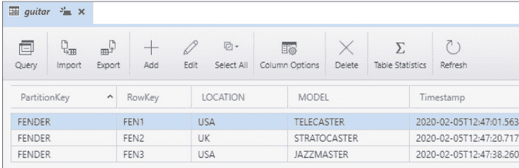

此外，还提供一些监控和管理功能，例如清空队列、创建共享和查看使用统计信息。该工具对于将中小型数据源从本地迁移到 Azure 平台也很有用。

### Shared Access Signature (SAS)

共享访问签名（SAS）密钥最初在第 2 章中介绍，它提供了限制对 Azure Storage 账户中特定资源的访问和权限的手段。在 Azure 门户中，导航到 Azure Storage 容器，然后单击导航窗格上的 Shared Access Signature 链接。这将打开一个刀片，允许你创建具有有限访问权限的访问密钥。例如，你可以创建一个只能向 Azure Queue 添加消息的 SAS。这意味着任何使用该连接字符串（包括 SAS 令牌）的客户端只能插入消息。该客户端无法读取、删除或列出任何消息。作为替代方案，导航到 Access Keys 刀片，其中包含主或管理员级别的连接字符串并生成不同的令牌。当客户端使用该连接字符串连接到 Azure Queue 时，他们还可访问账户中的所有存储选项以及其上的所有 CRUD 操作。SAS 应在你的客户端连接到账户时使用 Azure Active Directory（AAD）而无法或不使用时使用，AAD 是在 Azure Storage 上实施安全性的首选或推荐方法。本章稍后“Securing Azure Data”部分对此有更多介绍。

### Azure Data Lake Storage

Azure Data Lake Storage（ADLS）产品的第一代（Gen1）基于 Azure Blobs，用于存储支持大数据分析工作负载的数据。使用 ADLS Gen1，你大致可以期望获得与 Azure Blob 容器相同的冗余、容量、吞吐量和可扩展性。存储到 ADLS 的数据处于类似暂存的状态（数据仓库）。数据可以以任何格式存在，从数据库数据集到视频。数据保留在 ADLS 中，直到准备好进行分析。一旦由 Azure Data Lake 产品分析，结果将被发布并可使用前端工具（如 Power BI）查看。存在于 ADLS 中的数据可使用前面讨论的 Storage Explorer 查看。

### Azure NetApp Files

Azure NetApp 提供的服务与 Azure Files 相同，只有一个很大的区别。你无需管理或配置任何类型的存储产品。Azure NetApp 会为你完成此操作。它基于专有的但由 Microsoft 完全支持的 NetApp 软件解决方案，可在 www.netapp.com 找到。此产品有助于迁移和运行需要企业级文件共享解决方案的混合解决方案。与 Azure Files 相比，NetApp 需要更少的手动维护，例如。

### Zone Replication

区域复制在本书的许多地方都有提及。现在很高兴向你提供有关众多 Azure 存储冗余选项的详细信息。

- Locally redundant storage (LRS)
- Zone-redundant storage (ZRS)
- Geo-redundant storage (GRS)
- Read-access geo-redundant storage (RA-GRS)
- Geo-zone-redundant storage (GZRS)
- Read-access geo-zone-redundant storage (RA-GZRS)

表 5.9 提供了每个复制选项的冗余度、耐用性和可用性阈值。在查看之前，请注意其中两个选项具有读取访问能力。当你创建 Azure Storage 账户时，使用包含读取访问的选项，数据的副本只能读取。如果不需要对副本进行读取访问，使用不带读取访问的复制选项更具成本效益。如果 Microsoft 发起故障转移，过程中的一个步骤会使冗余副本可读。在常规使用中，该副本不可读。

**TABLE 5.9** Zone Replication and Storage Redundancy

|  | LRS | ZRS | GRS | RA-GRS | GZRS | RA-GZRS |
|---|---|---|---|---|---|---|
| Node | ✓ | ✓ | ✓ | ✓ | ✓ | ✓ |
| Data center/zone | × | ✓ | ✓ | ✓ | ✓ | ✓ |
| Region | × | × | ✓ | ✓ | ✓ | ✓ |
| Read-access | × | × | × | ✓ | × | ✓ |
| SLA | 99.9% | 99.9% | 99.9% | 99.9% | 99.9% | 99.9% |
| Durability | 11 9’s | 12 9’s | 16 9’s | 16 9’s | 16 9’s | 16 9’s |

当你阅读每个存储选项的具体描述时，节点、数据中心/区域和区域在此上下文中的含义将会变得清晰。接下来将介绍每个选项的详细信息。表 5.9 前一段已解释了读取访问，这就剩下 SLA 和耐用性选项。SLA 通常与系统的可用性有关。正常运行时间是大多数技术人员都知道的内容。它通常是一个指标，就像表 5.9 中显示的那样。另一方面，耐用性与数据的长期保护有关。与侧重于可用性和通常侧重于冗余硬件的 SLA 不同，耐用性侧重于数据的冗余以及防止其以任何方式损坏或受损。数据的耐用性正是这些存储冗余选项存在的原因。

### Locally Redundant Storage (LRS)

快速回顾一下图 3.4，该图说明了区域和区域的概念。每个区域被视为一个数据中心；所有三个都存在于同一区域中，但距离足够远

### Geo-Zone-Redundant Storage (GZRS)

当 GRS 运行中时，LRS 规则适用，正如你刚才阅读的那样。这意味着数据位于单个区域中，但位于两个区域中。GZRS 仍会复制到其双区域，但在运行中它表现得像 ZRS 而不是 LRS。请记住，ZRS 将数据复制到区域中的每个区域，而 LRS 则将数据复制到同一区域中的三个节点。这为你提供了更大的冗余度并降低了需要故障转移的可能性。没有 IT 支持人员希望经历故障转移，因为在事件发生前、中、后都需要大量的注意力和测试。此外，还必须采取步骤在中断事件结束后恢复到主节点。这有成本；成本是 IT 支持专业人员的时间。如果该时间大于 GZRS 与其他冗余选项的成本，则此选项适合你。请记住，随着你逐步了解这些选项，随着副本数量和平台要求的增加，每个选项的成本都会增加。

### Read-access Geo-zone-redundant Storage (RA-GZRS)

最后一个选项是你肯定可以毫无失败地定义的一个。阅读之前，请花点时间向自己描述 RA-GZRS 是什么。与 RA-GRS 一样，GZRS 集群的辅助副本允许读取操作。这可能是你正在迁移到 Azure 或在 Azure 上创建的工作负载的要求，也可能不是。然而，你永远不想丢失数据或出现无法访问数据的场景，对吧？这完全取决于数据访问对你有多重要。这不是开发和测试场景的有用选项；相反，将其用于高度关键的生产数据场景。

### Azure Managed Disk Storage

托管磁盘存储在第 4 章中介绍过，但没有磁盘信息的存储章节是不完整的。托管磁盘是存储在 Azure Blob 容器中以 VHD 形式存在的页面 blob 的构造。拥有托管磁盘的好处是，你可以使用它的快照作为最多 10,000 个 Azure VM 的根或主磁盘。你可以拥有 10,000 个相同的 Azure VM，它们使用从存储为 Azure Blob 容器中页面 blob 的同一 VHD 构建的托管磁盘进行配置。读完本书至今并完成所有示例后，你知道可以想象上一句中所有技术术语和概念，真是令人惊叹。请再次注意，Azure Managed Disks 与 VMSS 深度集成。查看表 4.8 了解其限制和约束。

### Data Backup, Migration, and Retention

数据对组织很重要。它已经被写过无数次，但提醒一下往往有帮助。你的安全保护什么？你的网络给你访问什么？已配置的计算资源在什么代码上运行？这些问题的答案都是数据。老实说，很难想象一个应用程序


或程序提供任何值得安全、网络和计算的价值，而这些价值不会消耗、创建或分析某种数据。这就是为什么保护它，不仅免受未经授权的访问，而且免受损坏或丢失，是非常重要的。执行数据备份、成功地将数据从本地数据源迁移到 Azure 以及保留数据备份，都是你在选择将数据解决方案迁移到 Azure 时需要考虑的主题。这些领域的许多细节在第 8 章和第 9 章中有更详细的介绍。然而，由于本章是关于数据的，因此是向你介绍一些功能的好地方。数据备份和迁移在以下部分中介绍：

- “Tools and Services”
- “Azure SQL”
- “Azure Cosmos DB”

当你创建备份策略时，你还需要考虑你的数据保留策略。这是一个确定备份在删除前应存储多长时间的领域。备份的存储成本基于备份的大小，或者换句话说，需要多少兆字节、千兆字节或太字节的存储空间来存储备份？存储成本相对便宜，但如果你每天对一个 100GB 的数据库进行完整备份，那么所需的空间和成本会迅速增长。例如，Azure SQL 支持将数据库备份保留长达十年。这些备份还可以存储在 RA-GRS 冗余 Azure blob 存储中，这将允许将备份恢复为新数据库。这是任何应用程序可以配置的最大值。你需要了解你的保留要求并采取适当措施来控制成本。有一个名为 *long-term retention (LTR)* 的功能，它是一个利用标准备份程序的框架，对需要更长时间存储历史数据的客户很有帮助。LTR 支持 *point-in-time restore (PITR)*，因此可以使用任何自动创建的备份从历史时间点恢复数据库。考虑一下，如果你的大量数据被某些错误代码损坏，或者批处理作业错误地更新了数百万条记录。如果没有办法回滚这些操作，唯一的选项是从数据被损坏之前的时间点恢复你的数据库。

最后，在进入下一部分之前，我想介绍一个新术语，称为 *data resiliency*。在上一节中，你了解了数据可用性，这通常与 SLA 和硬件有关。你还了解了数据持久性，它与使用 LRS、ZRS 和 GRS 等众多 Azure 存储选项的冗余和复制相关。这里要介绍的另一个术语是数据弹性。你（你的应用程序）能在多快时间内从主数据源丢失中恢复？这里的主要区别在于，持久性意味着你的数据已备份且不会丢失或损坏，而弹性则关注你开始使用次要数据源的速度。

### Tools and Services

除了帮助执行备份、迁移和直接绑定到产品本身的数据保留的工具外，还有一些独立工具也可以提供帮助。这些工具

通常存在于与内置产品功能不完全匹配的场景中。例如，Data Migration Assistant (DMA) 工具可以帮助你识别当前版本的 SQL Server 与目标 Azure SQL 版本之间的任何兼容性问题。DMA 是一个独立工具，你在 Azure 门户中找不到它。用于规划迁移的另一个有用的工具是 SQL Server Migration Assistant (SSMA)，当源数据库是本地数据库且不是 SQL Server 时，它执行与 DMA 类似的分析。相反，如果你从 Oracle、DB2 或 MySQL 等迁移，例如，此工具可以分析目标 Azure SQL 或 SQL VM 版本并突出显示迁移期间可能出现的任何兼容性问题。一旦你完成了初步分析和纠正任何问题，你就可以使用 DMS 来执行迁移。查看此在线 Azure Database Migration guide 以获取更多详细信息：

```
datamigration.microsoft.com
```

### Azure Database Migration Service (DMS)

DMA 对于不会对生产或企业产生影响的较小迁移很有用。流程与你在练习 5.3 中执行的操作类似。在该练习中，你使用 .BACPAC 文件并将其应用到 Azure SQL 数据库，这有效地是一次迁移。DMA 对于更简单、非关键任务的迁移很有用。当停机时间是一个问题时，你应该使用 DMS (ADMS)，它支持从本地到 Azure 的离线和在线数据库迁移。DMS 不能用于迁移到 Azure SQL 数据库；相反，目标 SQL 产品必须是 SQL Server Managed Instance 或 SQL VM。将其用于你的大型、企业级和关键任务数据库迁移。你将在第 8 章中了解更多关于此的信息。

### Archive Storage

当你备份数据源时，你需要一个地方来存储它。在上一节中，你了解了 Azure Blobs 和不同的 blob 类型，其中之一是 archive。archive blob 类型旨在存储预计在不到 180 天的时间内不会被访问的数据。当然，你可以在该层随时访问数据；然而，该层的数据成本和分区针对不到 180 天的场景进行了优化。你可能会看到或听到这种 archive blob 类型被称为一个独立产品 Archive Storage。请记住，当你听到它时，要认识到在幕后它是一个配置为使用 archive blob 类型的 Azure Blob（其他 blob 类型是 page 和 block，只是提醒你）。

### Azure Backup

尽管 Azure Backup 可用于备份许多 Azure 产品，但它在 Azure SQL 数据库方面很有用。如果你导航到你在练习 5.2 中创建的 Azure SQL 服务器，请注意在导航窗格中有一个链接到 Manage Backups。点击它会打开一个刀片，显示备份策略和数据保留配置。Manage Backups 刀片可能类似于图 5.48。

#### FIGURE 5.48 Azure SQL database backup and retention policy

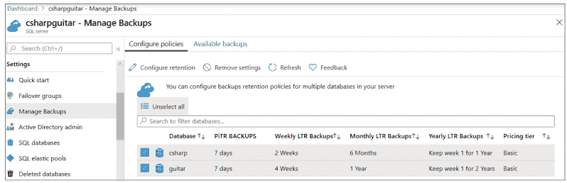

Azure SQL 单个和池化数据库以及托管实例每周会自动备份。备份包括完整备份、差异备份和事务日志备份，存储在 Azure Blob 的容器中使用冗余选项 RA-GRS。正如你从图 5.48 中可以看出，PITR 备份的保留期为七天；这是默认值。Weekly、Monthly 和 Yearly 的其他保留设置是手动配置的。

### StorSimple

该产品被微软收购，是一种被称为云集成存储 (CiS) 设备的云存储技术。该设备有助于管理本地应用程序以创建和存储本地数据的备份到异地（云）站点。传输发生的速度、加密功能及其压缩算法使该产品成为当时现有产品的有吸引力的替代方案。要了解有关 StorSimple 的更多信息，请阅读 https://azure.microsoft.com/en-us/services/storsimple 上的在线文档。

### Azure Data Explorer (ADX)

Azure Data Explorer (ADX) 不应与 Azure Storage Explorer 混淆。两者都已介绍过，但对 ADX 仍需要更多深入了解。ADX 是一种高度可扩展的数据服务，用于存储日志和遥测数据以供以后探索。没有比创建它更好的学习方式了。完成练习 5.7 以了解有关此 Azure 产品的更多信息。

### EXERCISE 5.7

#### Creating an Azure Data Explorer Cluster and Database

- 1. Log in to the Azure Portal at portal.azure.com and then click the menu link in the top-left corner of the browser. When the menu opens, click + Create A Resource. Then click Analytics. Now click Azure Data Explorer and select the subscription and resource group into which you want to bind ADX, enter a cluster name, and select the region.


（你选择的区域应与资源组的区域保持一致。）选择“计算规格”。（我选择了“开发（无 SLA）……它最便宜。）点击“查看 + 创建”按钮，然后点击“创建”按钮。

2. 预配完成后，使用“概述”边栏选项卡并导航到群集。点击“创建数据库”按钮，输入数据库名称（如 `csharpguitar`），并将其他设置保留为默认值。点击“创建”按钮。

3. 在浏览器中输入以下 URL：`dataexplorer.azure.com`。点击“添加群集”按钮。输入你刚刚创建的 Azure 数据资源管理器群集的 URL，然后点击“添加”按钮。该 URL 类似于以下 HTTPS 地址，将你在步骤 1 中提供的群集名称替换进去（示例 URL 中为 `csharpguitar`）。现在检查区域条目（示例中为 `southcentralus`）。如有必要，请将区域名称改为你创建群集时所在的区域。你可以在 Azure 数据资源管理器群集的“概述”选项卡上找到该值。

```kusto
csharpguitar.southcentralus.kusto.windows.net
```

4. 输入以下 Kusto 查询命令 `.show databases`，然后点击“运行”按钮。输出应与图 5.49 中所示类似。

**图 5.49** ADX Web 用户界面中的 Azure 数据资源管理器群集

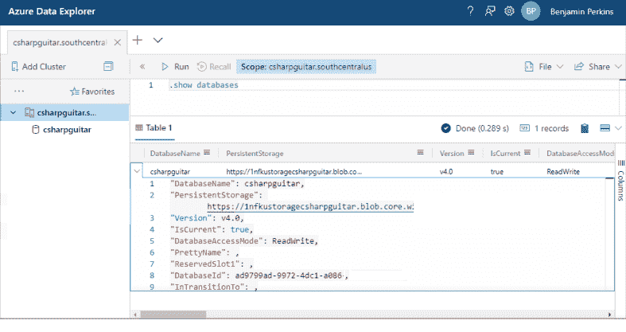

5. 以下 Kusto 查询可从此处下载：

`github.com/benperk/ASA/tree/master/Chapter05/Ch05Ex07`

通过执行以下 Kusto 命令在数据库中创建表。在单击“运行”按钮之前，请确保你的数据库已在 ADX Web UI 中被选中（处于焦点状态）。

```kusto
.create
table
CsharpGuitarEventHub
(TimeStamp: datetime, Name: string, Metric: int, Source:string)
```

6. 使用以下 Kusto 命令创建引入映射。

```kusto
.create
table
CsharpGuitarEventHub ingestion json mapping
'CsharpGuitarEventHubMapping'
'[{"column":"TimeStamp","path":"$.timeStamp","datatype":"datetime"},
{"column":"Name","path":"$.name","datatype":"string"},{"column":"Metric",
"path":"$.metric","datatype":"int"},  {"column":"Source","path":"$.source",
"datatype":"string"}]'
```

7. 表中还没有数据；数据将在下一章添加。不过，你已经体验了一个 Kusto 查询示例，该查询会从表中取出 10 条记录并按 TimeStamp 排序。

```kusto
CsharpGuitarEventHub
| sort by TimeStamp
| take 10
```

这个练习很简单。你可能会对两个地方感到困惑：引入映射 Kusto 命令和后续步骤。当某个终结点被配置为向 ADX 发送数据时，数据将以 JSON 文档的形式传入。引入映射 Kusto 命令将 JSON 文档中的元素映射到表的各列。因此，当事件中心向 ADX 发送信息时，JSON 文件会被解析，其中的元素会被放入表中的一行。目前，ADX 支持三种连接类型：事件中心、IoT 中心和 Blob 存储，可通过 Azure 门户进行配置。Microsoft 还提供了 ADX SDK，以便你可以从任何终结点向群集发送数据。至于下一步，在下一章中，你将使用练习 5.8 中创建的事件中心，配置 ADX 以引入从事件中心发送的数据，然后查询 ADX 以查看结果。

### 导入/导出

此 Azure 功能允许你将数据或应用程序的物理副本直接发送到 Azure 数据中心。这对于拥有无法通过网络发送的海量数据的客户非常有用。发送大量数据所需的时间可能需要数小时甚至数天，而且传输可能在完成之前就失败。通常你必须从头重新开始传输。此外，一些客户可能对通过网络传输数据有安全顾虑，无论传输是经过 VPN 还是 ExpressRoute。简而言之，如果你有大量数据因任何原因不想或无法通过网络上传到云端，那么“导入/导出”选项是一个不错的选择。

### Azure SQL

请记住，在使用 Azure SQL 单一数据库和弹性池数据库时，备份会自动进行。SQL 托管实例也是如此，它们具有内置备份。备份使用 RA-GRS 存储在 Azure Blob 上。如果该区域发生中断，你会得到保障。但如果你选择的是 SQL 虚拟机，则情况并非如此。在这种情况下，场景与你本地运行 DBMS 时相同。对于 SQL VM，你需要负责备份、存储和管理。但请注意，在 Azure VM 上运行的 SQL Server Standard 和 Enterprise 版本附带一项名为 SQL Server IaaS Agent Extension 的服务，你可以使用它来计划备份。此外，使用 Azure Backup 产品，也可以手动进行配置。

### Cosmos DB

与 Azure SQL 一样，该平台每四个小时会自动备份存储在 Azure Cosmos DB 中的数据。备份使用 GRS 冗余选项存储在 Azure Blob 容器中。目前你无法自行还原 Azure Cosmos 数据库；如果需要还原，你必须提交支持请求，系统会为你处理。数据库备份最多保存 30 天。如你所知，Azure Cosmos DB 最有益的一点是其全球复制能力。考虑到你的数据库在世界各地可能有很多很多副本，你几乎不需要还原。除非你意外删除了数据库或容器，否则基本不需要还原；如果真的发生，则需要进行还原。该产品还会捕获快照，这有助于回滚破坏了大量数据的更新。执行更新的查询不会被回滚；相反，可以将数据库的先前版本还原到数据损坏之前的某个时间点。

### 保护 Azure 数据

安全从来都是第一要务。这种观念从未改变，也永远不会改变。第 1 章首先介绍了安全性，因为安全是最高优先级，因此在此再次讨论这一话题没有问题。你已经了解 RBAC；它是在门户中控制对已预配 Azure 资源访问的方式，而 AAD 提供对 Azure 门户的身份验证。它还可以嵌入到应用程序代码中，以控制对 Azure 上托管的 Internet/Web 功能的访问。连接安全、身份验证、授权和加密是一套严谨而完善的原则，用于保护你的数据。从连接安全的角度来看，连接字符串以及谁能通过 RDP 访问承载数据的服务器等方面都是关注重点。

当然，用复杂的凭据保护数据会让人感到安心，而这些凭据存储在哪里以及如何存储也至关重要。一个名为 Azure Key Vault 的服务可以在这方面提供帮助。过去，你通常会把连接字符串存储在 `web.config` 文件中，如果足够聪明，还会用 `aspnet_regiis.exe` 的功能进行加密。然而，通常只有在托管网站的计算机的管理员访问权限也受到保护时，这样做才值得。如果某人拥有服务器的管理员访问权限，他们就能在该服务器上做任何事，包括解密连接字符串。现在的重点是，一个不用于登录服务器的身份可以用来访问 Azure Key Vault 中的密钥或机密；该 Key Vault 存储凭据并减少密码泄漏。

在讨论聚焦于此的同时，让我们先明确本节涵盖的内容，然后再深入密码泄漏的核心。在本节中，你将首先重新审视数据加密和 Azure Key Vault；然后，你还会进一步了解可以在 Azure 上实现的其他安全选项和功能。以下项目符号进一步说明了将要介绍的内容：

- 数据加密和 Key Vault
- Azure 存储安全性
- 共享访问签名 (SAS)
- 其他数据和存储安全选项

列表中的主题在前面的章节和节中已经有所涉及；在适用时，参考内容可以让你更容易想起它们是在哪里引入的。

#### 数据加密和 Key Vault

在完成练习 2.9 和练习 5.3 之后，你已经成功创建了一个 Azure Key Vault，其中包含一个密钥，你曾使用该密钥加密 Azure SQL 数据库中的一列数据。这种加密方式称为静态数据加密。静态数据是一个安全术语，指对未使用中的数据进行加密。它可以是数据库中存储的数据，也可以是硬盘上存储的电子邮件和文件。为了清楚地理解，可以将静态数据与其反义词——传输中数据——进行对比。传输中数据不是闲置在硬盘或数据库中，而是在客户端和服务器之间移动。加密传输中数据最明显的方式是使用 HTTPS 协议。在第 2 章中，这些内容已经进行了更详细的讨论。在 Azure 机密计算中，描述了第三种数据加密模式。使用中数据的安全性可以保护存储在内存中的数据，以防机器上安装了恶意软件。加密与密码学有关，从 C# 的角度来看，可以通过 `System.Security.Cryptography` 类访问。这远远超出了本书的范围，但如果你对这个领域感兴趣，可以查看该类及该术语。

连接字符串是一种需要全部三种加密模式的重要数据。它是一条重要的数据字符串，因为它包含连接数据库或其他资源（例如 Azure Blob 或事件中心）所需的终结点和凭据。完成练习 5.8，创建事件中心，并更新你在练习 2.9 步骤 9 中创建的 Azure Key Vault 机密。

#### 练习 5.8

**创建事件中心并更新 Azure Key Vault 机密值**

1. 登录 Azure 门户（`portal.azure.com`），然后点击浏览器左上角的菜单链接。点击“+ 创建资源”，然后搜索“事件中心”。按 Enter 键，点击“创建”按钮并提供名称。在“定价层”中选择“基本”。


tier 下拉列表（它是最低价的），然后选择要放置 Event Hub 的订阅和资源组。选择位置。（您选择的位置应与资源组的位置匹配。）单击“创建”按钮。

+   2.  一旦预配完成，导航到 Event Hub 的“概述”刀片。从导航菜单中选择“共享访问策略”；然后从“共享访问策略”刀片中选择 `RootManageSharedAccessKey`。复制连接字符串-主密钥。

+   3.  导航到你在练习 2.9 中创建的 Azure Key Vault 并单击导航菜单中的“密钥”链接。单击你创建的密钥。单击“+ 新版本”按钮，将连接字符串-主密钥输入“值”文本框，然后单击“创建”按钮。设置应类似于图 5.50。

#### 图 5.50 在 Azure 门户中更新 Azure Key Vault 密钥

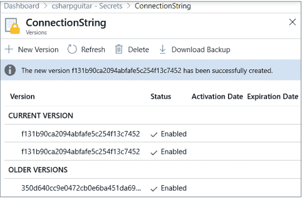

查看位于 GitHub 上的 ASP.NET Core 代码：

```
github.com/benperk/ASA/tree/master/Chapter05/DataEncryption
```

具体来说，请注意 `index.cshtml.cs` 页面。该文件中的代码提供了如何加密 Event Hub 连接字符串、将其存储为 Azure Key Vault 密钥、检索加密的连接字符串、解密它，然后使用它连接到 Event Hub 的示例。你可以使用此技术对任何 Azure 端点进行加密、存储、解密和使用，包括 Azure Blob。你只需将 Event Hub 连接字符串替换为 Azure Blob 的即可。作为替代方案，在某些情况下，你可以考虑使用 SAS 密钥而不是管理员凭据；请参阅下一节。代码使用了以下类：

+   - Microsoft.Azure.Services.AppAuthentication
+   - Microsoft.Azure.KeyVault
+   - System.Security.Cryptography
+   - Microsoft.Azure.EventHubs

关于此代码的一个说明是，它在 Visual Studio 中运行，即作为客户端。在本地工作时，使用托管标识和服务主体针对 AAD 租户进行身份验证具有挑战性，但在代码托管并在 Azure 平台本身上运行时则不那么困难。因此，你需要使用一种称为“连接服务”的东西。你可以在此处阅读有关它们的更多信息：

```
docs.microsoft.com/en-us/azure/key-vault/
vs-key-vault-add-connected-service
```

一旦你克服了身份验证障碍，使用此代码就实现了前两种加密模式，即静态数据加密和传输中数据加密。剩余的、使用中数据则需要你在受信任执行环境（TEE）中运行；请参阅图 2.51。

### Azure 存储安全性

当你将数据上传到存储帐户时，它会自动加密，然后在下载时解密。这是通过一种称为 Azure 存储服务加密（SSE）的概念实现的，并且对用户完全透明。你会立即/自动满足任何静态数据加密要求。要实现传输中数据加密，你需要使用 Windows Azure 存储客户端库并设置加密策略。基本上，你在发送到存储帐户之前在客户端设置用于执行加密的密钥。正如你可能猜到的，密钥建议存储在 Azure Key Vault 中。每个存储帐户选项都有不同的客户端，blob、文件、队列和表。请注意，加密和解密会带来一定的性能开销，但这是保持安全所需的重要步骤。另一种更好地强制执行传输中数据的方法是启用“需要安全传输”选项，如图 5.51 所示。

启用后，所有使用 Azure 存储 REST API 的通信都必须通过 HTTPS 进行。任何仅使用 HTTP 的请求都将被拒绝。此外，它将强制所有对 Azure 文件共享使用 SMB 的连接都需要加密。保护谁以及如何有人或某个客户端可以连接到你的存储帐户通常限制为下面列出的授权方法。

+   - Azure Active Directory（AAD）
+   - 匿名访问
+   - 共享密钥
+   - 共享访问签名（SAS）

#### 图 5.51 在门户中为 Azure 存储帐户启用需要安全传输选项

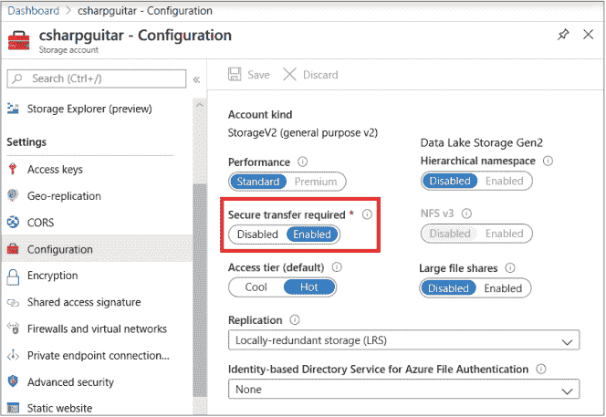

你应该对所有这些方法都有一定的熟悉程度。使用 AAD，你使用访问控制（IAM）授予对存储帐户的访问权限，然后使用客户端中的代码或 cmdlet 对用户的 AAD 凭据进行身份验证。如果用户提供有效凭据，则他们将获得对存储帐户的访问权限。匿名访问，就 Azure Blob 而言，已在图 5.44 中说明。对于开发和测试场景，这是一个可接受的设置，对于生产环境则不然。你将改为更改访问级别以禁止匿名访问，而只允许使用访问密钥（共享密钥）访问。这两者相似之处在于它们都提供对存储帐户中所有选项的访问权限并具有所有类似 CRUD 的权限。要限制对特定存储帐户选项和 CRUD 权限的访问，请使用共享访问签名（SAS）。

### 共享访问签名（SAS）

任何讨论 Azure 存储安全性的部分如果没有一些关于 SAS 的信息就不完整。你刚刚读到访问密钥提供对 Azure 存储帐户中所有选项的完全访问权限。这不是你一定希望提供给仅需要访问特定 blob 容器的客户端的东西。想象一个场景，你不再知道谁拥有令牌，并且你已失去对谁有权访问的控制，即 SAS 泄露。你确实有重新生成访问密钥的选项，但这就像更改数据库密码一样。执行此操作会产生很大影响，并会阻止所有客户端访问。有两个访问密钥，key1 和 key2，因此如果你曾经处于必须提供访问密钥且已失去控制的情况，你可以向你知道需要访问的人提供 key2，给他们一些时间进行更改，然后重新生成 key1，这将使你重新获得控制权。另一方面，当你创建 SAS 令牌时，你对可以访问的内容和访问时长有更大的控制权（见图 5.52）。

#### 图 5.52 Azure 门户中的共享访问签名属性

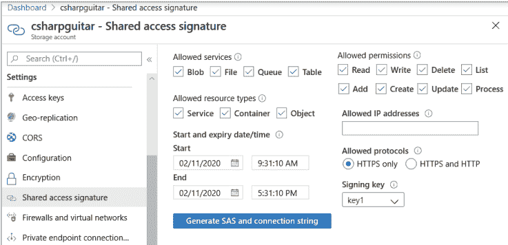

你可以将访问限制为特定服务选项，如 blob、文件、队列和表。你可以通过将它们输入“允许的 IP 地址”文本框，将 SAS 令牌限制为特定 IP 地址或 IP 地址范围。此外，你可以根据 CRUD 操作如读取、写入、列出和删除进行限制。SAS 的一个强大属性是开始和到期日期。此设置在 SAS 泄露的情况下也很有用，因为你会确信 SAS 令牌将在某个时间点过期。另一方面，这会引起一些争议，因为如果客户端需要在计划的到期日期时间后继续使用 SAS 令牌，则它需要新的令牌。你需要根据解决方案的要求设置过期值。你还需要管理重新生成令牌并向客户端提供新令牌的过程。只要记住谁或什么拥有令牌就拥有该令牌所提供的权限；要小心这一点。一旦你单击“生成 SAS 和连接字符串”按钮，你将看到类似于以下的连接字符串。你可以在 GitHub 上找到一个程序：

```
https://github.com/benperrk/AzureFunctionConsumer/releases
```

你可以使用该 Azure Blob SAS 连接字符串向容器添加 blob。源代码也可以在 GitHub 仓库中查看，如果你有兴趣了解如何使用 Microsoft.WindowsAzure.Storage SDK 和 C# 建立连接。图 5.53 说明了如果你选择尝试的话，它可能看起来像什么。


BlobEndpoint=https://csharpguitar.blob.core.windows.net/?sv=2019-02-02&ss=b&srt=sco&sp=rwdlac&se=2020-02-11T16:11:44Z&st=2020-02-11T08:11:44Z&spr=https&sig=pl2qYk**************

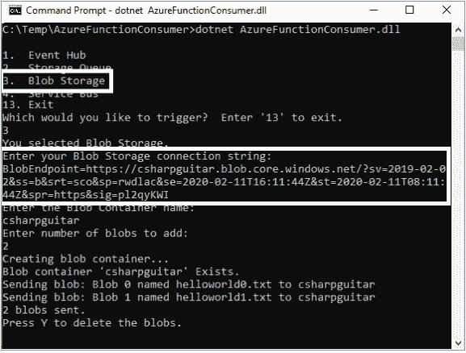

生成 SAS 访问的另一种技术比使用 SAS 令牌更安全一些。它被称为 SAS 签名或用户委派。主要区别在于，用于签署令牌的密钥是使用 Azure Active Directory (AAD) 凭据创建的。回顾图 5.52，你需要从下拉列表中选择签名密钥。Key1 和 key2 是在存储容器最初创建时由 Azure 平台生成的访问密钥。从 Azure 解决方案架构师考试的角度来看，你需要知道的是，你可以使用 SAS 令牌、SAS 签名和 AAD 来保护和 securing Azure Storage 账户。随着每种方式的顺序，安全性会提高；SAS 令牌由于 SAS 泄露是最不安全的，而使用带 RBAC 的 AAD 将是最安全的。每种方法都有其优缺点，需要了解要应用这些安全技术的应用程序。

### 其他数据和存储安全选项

这里还需要提及一些额外的数据存储和数据安全选项。其中大多数你已经接触过。在阅读它们时，请将其视为复习和总结。

### Azure Data Share

正如你所学，Azure Files 对于像过去几十年那样共享文件很有用。使用 SMB 协议共享目录，然后让客户端将驱动器映射到该共享是一种标准做法。也可以有文件共享服务器，其唯一职责是共享文件和文档。Azure Data Share 做同样的事情，但它旨在在大数据的上下文中共享文件。例如，如果你从提供商处获取数据，他们交付的方式是一个大文件，那么通过电子邮件交付或接收可能不是一个好方法。如果文件非常大，那么将其流式传输到 Azure Files 或 Azure Blob 容器可能也不是最优的。阅读有关 Azure Data Share 的更多信息：

```
azure.microsoft.com/en-us/services/data-share/
```

如果你从事大数据/机器学习领域，请考虑此产品，如果它在与其它 Azure 存储选项相比更适合你的场景。

### Firewalls

防火墙提供基于 IP 地址、协议和端口号的客户端访问保护。Web 应用程序防火墙 (WAF) 的概念在第 2 章中引入，可在应用程序网关中配置，应用程序网关是一种网络安全设备。此外，在第 3 章中介绍了 Azure Firewall 产品，也提供防火墙功能。在大多数实现中，你的计算工作在 VNet 中运行，你可以在其中配置网络安全组 (NSG) 规则以限制对其内部资源的访问。IP 限制也有帮助，但它们不是防火墙，因为限制仅基于 IP 地址，不包括协议和端口。查看第 2 章和第 3 章中关于防火墙的讨论，以了解更多关于此安全功能的信息。

### Service Endpoints

许多 Azure 产品公开一个全局端点，通常以 URL 的形式。这意味着任何连接到互联网的设备都可以完全发现它。这并不意味着任何人都可以访问它。你可以使用防火墙和 IP 限制来防止对其的访问。另一种限制访问的方法是使用服务终结点。你在第 3 章中了解了服务终结点，并在练习 3.2 中启用了服务终结点，并在练习 3.8 中稍后为 Azure App Service 配置了它们。你了解到，通过设置终结点，你将 Azure App Service 的访问限制为仅 VNet 内的资源。所有其他 IP 地址都被限制。你还在本章的练习 5.4 中做了类似的配置，在那里你为 Azure SQL 数据库配置了服务终结点，其结果是相同的限制，仅允许来自给定 VNet 中的 VM 的访问。在所有这些场景中，全局终结点仍然可被发现，但不可使用；如果客户端尝试访问，他们会收到 HTTP 状态 403，如果使用 SQLCMD 客户端，你会收到无法连接异常；参见图 3.34。有一个名为私有终结点连接的新预览功能。实现它将隐藏终结点的发现。

## Summary

在本章中，你了解了不同类型的数据库结构，特别是 SQL 与 NoSQL，以及它们的使用场景有何不同。你了解了 Azure SQL 和 Azure Cosmos DB，它们是最受欢迎的 SQL 和 NoSQL Azure 数据存储选项类型。你了解了数据分区、服务终结点和全局复制。此外，你还了解了键/值对、Azure Cache for Redis 以及众多其他 Azure 数据存储产品。Azure 存储选项包括 Azure Blobs、Azure Files、Azure Queues 和 Azure Tables。每个都有其自己的用例和数据分区策略。必须掌握的概念是区域复制，其中包括 LRS、ZRS、GRS、RA-GRS、GZRS 和 RA-GZRS。之所以必须掌握，是因为这些概念以及 Azure Blobs 构成了许多 Azure 产品（如 Azure SQL 和 Azure VM）的骨干。

知道如何将本地数据库迁移到 Azure，选择哪个数据存储以及如何备份该数据是 Azure 解决方案架构师的要求。阅读本章后，你应该知道如何选择正确的数据存储以及有哪些工具可用于使迁移成功。最后，你回顾了第 2 章中介绍的许多安全概念。重复的原因是专门针对数据存储和数据存储产品的场景。保护和加密托管在 Azure 上的数据的多种方式现在应该牢记于心。

## Exam Essentials

- **Understand RDBMS (SQL) vs. NoSQL.** 一个具有表、行、列以及通过主键/外键关系与其他表相关联的数据库，表现出与 RDBMS、关系数据库或 SQL 数据库相似的特征。常见以 JSON 文档形式存储且与表中其他数据没有或有限关系的数据被称为 NoSQL 数据库。
- **Understand Azure SQL, SQL managed instance, SQL on VMs.** 将本地 SQL Server 数据库迁移到 Azure 面临三个选项。Azure SQL 适用于启动新项目或拥有小型数据库的情况。SQL 托管实例具有许多好处，如自动备份，但如果你的数据库有大量自定义，可能迁移起来并不容易。运行 SQL VM 最类似于本地运行。
- **Understand Azure Storage.** 你可能需要存储的不仅仅是数据库中的数据。相反，你可能需要存储视频、消息和 VHD，或创建具有全局终结点的网络共享。Azure 存储提供 blob、队列、表和文件共享来满足这些需求。

Understand Azure Storage Zone replication. 如果你需要运行关键任务应用程序，冗余是必需的。停机或数据损坏不是选项，而区域复制提供了防止这些事件发生的某些功能。数据的每个副本都会产生成本，因此请将 LRS 用于开发和测试。然后决定你需要多少冗余以及你的应用程序是否可以从读取这些副本中受益。

Back up data. 如果你丢失数据，你的公司可能会倒闭。在大多数情况下，你的数据会自动备份并复制到另一个区域。因此，如果你需要从中断中恢复，你将拥有备份。甚至默认情况下也会拍摄快照，这意味着如果你的数据因恶意更新而损坏，你可以回滚到该更新执行之前的时间点。

Secure data. 你的数据暴露将是一场灾难。你可以安心地知道，Azure 存储默认会自动加密上传到其中的所有数据。此外，Azure SQL 提供了一些保护静态数据的功能。使用全局终结点访问数据可以通过服务终结点、访问令牌和防火墙规则来限制。如果你采取必要的预防措施，你的数据在 Azure 上将是安全的。

## Key Terms

- Advanced Data Security (ADS)
- Artificial Intelligence (AI)
- Atomic, Consistent, Isolated, Durable (ACID)
- AzCopy
- Azure Analysis Services
- Azure Data Explorer (ADX)
- Azure Data Factory (ADF)
- Azure Data Lake Store (ADLS)
- Azure Database Migration Service (DMS)
- Azure Storage REST APIs
- Enterprise Data Warehouse (EDW)
- Extract, Transform, Load (ETL)
- First In First Out (FIFO)
- Language Understanding Intelligent Service (LUIS)
- Locally Redundant Storage (LRS)
- Long-term Retention (LTR)
- Microsoft Azure Storage Data Movement Library
- Online Analytical Processing (OLAP)
- Online Transaction Processing (OLTP)
- Point-Time Restore (PITR)
- Private endpoint connections


-    Azure 存储服务加密（SSE）
-    二进制大型对象（BLOB）
-    云集成存储（CiS）
-    数据迁移助手（DMA）
-    数据库管理员（DBA）
-    数据库即服务（DaaS）
-    数据库管理系统（RDBMS）
-    数据库吞吐单位（DTU）
-    桌面即服务（DaaS）
-    Document DB 数据迁移工具
-    弹性数据库吞吐单位（eDTU）

-    读取访问地理冗余存储（RA-GRS）
-    请求单位（RU）
-    SAS 泄漏
-    SAS 签名
-    搜索引擎优化（SEO）
-    语义数据模型（SDM）
-    服务器消息块（SMB）
-    SQL Server 集成服务（SSIS）
-    SQL Server 迁移助手（SSMA）
-    用户定义函数（UDF）
-    虚拟网络设备（VNA）

# 复习题

1. 你可以在以下哪些选项中存储键/值对？（选择所有适用项。）
   A. Azure SQL
   B. Azure Cosmos DB 表 API
   C. Azure 表存储
   D. Azure 存储队列

2. 当执行关系数据库直接迁移（lift-and-shift）到 Azure 时，你会选择哪个 Azure 数据存储？
   A. Azure SQL
   B. SQL 虚拟机
   C. Azure Blob 存储
   D. Azure Cosmos DB Gremlin API

3. 哪个 Azure 产品提供数据仓库功能？
   A. Azure Data Factory (ADF)
   B. Azure Data Bricks
   C. Azure Synapse Analytics
   D. Azure Storage Explorer

4. 以下哪些选项提供自动数据库备份？（选择所有适用项。）
   A. Azure SQL 单一数据库
   B. Azure SQL 弹性池
   C. SQL 托管实例
   D. VM 上的 SQL

5. 以下哪个工具最适合识别 Azure SQL 与本地 SQL Server 数据库之间的潜在兼容性问题？
   A. 导入/导出
   B. Azure 备份/还原
   C. SQL Server 迁移助手 (SSMA)
   D. 数据迁移助手 (DMA)

6. 以下哪些 Azure SQL 产品提供动态扩展？（选择所有适用项。）
   A. Azure SQL
   B. SQL 托管实例
   C. SQL 虚拟机

7. 如果你想以 JSON 格式存储数据，你会选择哪个数据存储？
   A. Azure SQL
   B. Azure Cosmos DB
   C. Oracle
   D. Azure Blob 存储

8. 以下哪些 Azure 存储冗余选项可在数据中心区域中断时提供冗余？（选择所有适用项。）
   A. LRS
   B. ZRS
   C. GRS
   D. RA-GZRS

9. 以下哪个不属于 Azure 存储产品？
   A. Azure Blob
   B. Azure Queue
   C. Azure Kubernetes
   D. Azure Files

10. 对或错：使用账户密钥保护 Azure Blob 容器比 SAS 令牌更严格？
    A. 正确
    B. 错误

## 章节
6
