## 混合、合规性和消息传递

# 本章涵盖的 AZ-303 考试目标：

- 实现和监控 Azure 基础设施
  - 实现云基础设施监控
- 实现管理和安全解决方案
  - 实现和管理 Azure 治理解决方案

# 本章涵盖的 AZ-304 考试目标：

- 设计基础设施
  - 设计应用程序架构
  - 设计网络解决方案
- 设计身份和安全
  - 设计治理
- 设计业务连续性
  - 设计治理
  - 设计高可用性
  - 设计备份和恢复解决方案
- 设计监控
  - 设计日志记录和监控解决方案


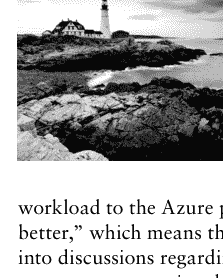

混合解决方案是作为 Azure 解决方案架构师专家，你必定会在某个时刻被要求描述和设计的内容。混合解决方案可能只持续很短的时间，在将整个工作负载迁移到 Azure 平台时帮助“弥合差距”。列宁曾说过：“信任是好的，但控制更好”，这意味着人们只应依赖经过验证的事物。这很大程度上引出了关于合规性和治理技术的讨论。符合政府或地区法规是一个专业且广泛的领域，涵盖了许多主题。你应该具备一些关于底层合规性主题的入门知识，以及有关提供合规性的 Azure 工具和文档的知识。

在第 4 章中，你学习了批处理，这是一种近乎实时的计算模型。在批处理场景中，数据被接收并存储，然后按计划频率使用 CRON 调度器触发某种批处理作业来处理数据。这种近乎实时的处理已经演变成所谓的持续计算。这意味着不再存储通常由批处理作业处理的数据，而是即时和持续地处理每条数据。这种新的计算方法由 Azure 消息传递服务（如事件中心、服务总线和 Azure 存储队列）支持。读完本章后，你将对这些产品有很好的理解。

### 混合解决方案

到目前为止，本书的每一章都至少两次提到混合云解决方案。混合解决方案在第 1 章中作为 API 管理产品的用例场景被介绍。你了解到，API 管理产品可以配置为在 VNet 内运行，并使用 VPN 或 Express Route 在本地资源和你托管在 Azure 中的工作负载之间建立连接。API 管理的另一个好处是，你可以公开一个全局端点，然后配置 API 管理器以路由到任何后端端点。后端端点可以更改而不会影响使用者，因为全局 API 管理器端点保持不变。当你在实施混合解决方案以“弥合差距”时，这很有用，这意味着你的混合解决方案可能不是永久性的。你迁移到 Azure 的工作负载或 IT 解决方案可能需要数周、数月或数年。可能存在必须串行执行的数据迁移，或者可能受到计划业务事件（如导致迁移延迟的年终销售）的限制。你可以使用类似 API 管理的东西来支持这种场景。另一方面，出于某些合规性或法律原因，你可能永远不被允许将所有的安全、计算或数据完全迁移到 Azure 平台。这意味着你将永远处于运行混合解决方案的状态，这没关系。重点是，你可能永远不会、完全或部分地处于混合状态。部分场景可能因许多合理原因随时间增加或减少。Azure 提供了一些最好的（如果不是最好的）用于混合状态运行的功能集，包括：

- 混合安全
- 混合网络
- 混合计算
- 混合数据解决方案

本节的其余部分提供了有关这些混合解决方案的一些详细信息。所有这些混合云解决方案类型的良好概述也可在以下位置找到：

```
azure.microsoft.com/en-us/solutions/hybrid-cloud-app
```

### 混合安全

当你最初考虑使用 Azure 的混合安全解决方案时，首先想到的应该是 Azure AD Connect 和单点登录（SSO）。如果你想了解有关 AD Connect 的更多详细信息，请参阅第 1 章中 AD Connect 的介绍以及第 2 章中关于该产品的部分（见图 2.11），以及贯穿该章的更多参考资料和功能讨论。总之，AD Connect 用于将本地 Active Directory 与 Azure Active Directory (AAD) 租户同步。当使用 AD Connect 在两个存储库之间同步用户时，这提供了 SSO 场景。

单点登录（SSO）允许单个实体使用同一组凭据访问多个资源。实体通常是人。在第 2 章中，你读到了一个关于早期 IT 时代的类比：每个应用程序都需要一组不同的凭据，这是多么低效。正如你目前已了解的，实体也可以是托管标识，也可以是服务主体。这三种实体类型不仅拥有用于身份验证（AuthN）的凭据，还拥有权限，例如对数据存储的 CRUD 操作或 Azure 门户中的 RBAC。权限与授权（AuthZ）直接相关。请回顾密码哈希同步、直通身份验证和 ADFS，这些是 SSO 功能，见图 2.15。另外两个 Azure 产品可以帮助你管理和实施混合安全解决方案：安全中心和 Azure Sentinel。安全中心将在本章后面介绍。

Azure Sentinel 利用 AI 来监控访问你系统的客户端行为。如果你还记得第 2 章，其中提到了一些执行这种行为监控的 AI 组件，并且可以通知并阻止访问，或者通知并允许访问。默认情况下，通知是通过安全中心提供的。


### 混合网络

在这里你会认识到，与其他云服务提供商相比，Azure 在混合云领域表现出色。Azure 提供了许多产品和功能来实现混合网络。以下所有混合 Azure 网络产品和功能都在第 3 章中提到。以下各节总结了所列的 Azure 网络产品或功能。

- Express Route 和 VPN 网关 (S2S)
- VNet 集成
- Network Watcher
- API 管理和流量管理器 (ATM)
- 混合连接管理器 (HCM)

### Express Route 和 VPN 网关

在考虑混合网络的实现时，一个严肃的考虑是用于连接两个网络的技术。提供此连接性的 Azure 产品是 Express Route 和 VPN 网关。两者之间的主要区别在于，只有 Express Route（图 3.53）连接不会经过公共互联网。因此，Express Route 网络连接可以提供更快的连接速度和更高的可靠性。请记住，私有连接的成本高于 VPN 网关。您已在第 3 章中创建了 VPN 网关；请参阅练习 3.12。VPN 网关主要用于在两个数据中心之间创建站点到站点 (S2S) 连接。使用 VPN 网关配置点到站点 (P2S) 连接是可能的，并且在大多数情况下，与 VPN 网关相关的配置、管理和成本要低得多。两者都是安全的，并且都得到 Microsoft 的完全支持；二者之间的选择基于您的应用程序需求和预算。

创建混合网络的其他原因是为了现代化并增加带宽。如果您在自己的数据中心运行其中包含网络设备并且需要升级，您肯定会知道升级可能带来的成本、风险和影响。不要做这些更改，只需在 Azure 上创建新的计算资源并使用 Express Route 或 VPN 网关连接即可。这样您就可以获得最先进的网络技术，并由一些最有经验的网络工程师支持。同样，当您本地网络的带宽成为问题时，将部分流量卸载到您的 Azure 网络。

### VNet 集成

通常在您开始向 Azure 平台迁移时就会创建 Azure 虚拟网络 (VNet)——您无法在没有 VNet 的情况下拥有 Azure VM。VNet 是访问您的 IT 解决方案的入口点，也是连接任何非云（本地）资源的途径。您不仅可以从 Azure 网络外部连接到 VNet，而且

### API 管理和流量管理器

API 管理提供了许多功能和特性，但其中专门支持混合网络的是其充当代理的能力。代理通常会公开一个由客户端访问的端点。访问通常通过 HTTPS 请求完成。HTTPS 请求包含域名、一些头部信息以及 GET、POST、PUT 等 HTTP 动词。API 管理产品可以做的是根据请求头中的内容将请求路由到 Azure 资源或本地资源的公开端点。ATM 也用于将流量路由到不同的端点，Azure 或外部。区别在于 ATM 无法分析流经其中的数据。ATM 使用位置和健康监控将请求路由到相对于客户端位置最近且可用的端点。

### 混合连接管理器

S2S 连接用于连接两个网络，以便每个网络中的资源可以相互访问。使用 Express Route 或 VPN 网关通常是用于此目的的产品。在练习 4.14 中，您在 Azure App Service 和 VNet 之间创建了 HCM 连接。测试连接时，您能够访问没有公共 IP 地址的 Azure VM。该场景反映了 P2S，其中点是 Azure App Service，站点是 VNet。该产品配置和使用起来快速简单，并且基于 Azure Relay 产品。

HCM 在混合解决方案中有效的方式是，您可以将计算放置在 Azure（Azure App Service）中，然后将前端使用的数据托管在本地私有数据中心中。不要将 HCM 连接到 VNet，您可以将其配置为访问您数据中心中的服务器。它的使用 HTTP/HTTPS 意味着支持连接所需的端口和协议很可能已在公司防火墙上打开。

### 混合计算

一个有趣的术语，云爆发，在第 4 章中引入。在正常情况下，您可以在本地私有数据中心内运行工作负载。如果您需要以数据中心无法实现的更快速度扩展计算，那么您可以在 Azure 中管理。Azure App Service 的一个有益场景允许您的网站部署但关闭，这将导致无费用。您仅在需要时启动它。您需要使用 API 管理、ATM 或甚至 Azure Front Door 创建某种请求路由场景。这是一种为临时计算提供资源非常经济的场景。

您也可以在混合计算解决方案的上下文中考虑 HCM。在这种场景中，您可以利用 WebJobs 对存储在本地的数据执行一些批处理。您也可以将前端放在 Azure 中，并在私有数据中心的数据或文件中执行 CRUD 操作。混合计算解决方案是

### 合规性和治理

除了遵守政府、行业和区域合规要求外，Microsoft 还提供了实现和治理合规义务的工具。诸如 *Microsoft Trust Center (MTC)*、*Service Trust Center* 和 *Azure Blueprints* 等工具都可以用于实现合规性。毋庸置疑，您需要知道运行 IT 解决方案以满足消费 IT 解决方案的客户条件的标准。MTC 由客户用于指导如何在 Azure 上获得某些认证。它还提供有关所有 Azure 产品和服务的安全性和隐私的透明度。以下是有关 MTC 的更多信息链接：

aka.ms/trust-center

Service Trust Center 为您提供运行 Azure 安全、信任文档和合规蓝图的审计报告的资源。审计报告对于验证 Azure 服务的技术合规性很有用。Service Trust Center 可通过以下互联网地址访问：

servicetrust.microsoft.com/ComplianceManager

最后，Azure Blueprints（可在 haka.ms/getblueprints 访问）提供了额外的指南和示例，说明如何使用 ARM 模板（ARM 将在第 8 章讨论）、资源组、RBAC 控制和 Azure 策略（本章后面讨论）在 Azure 部署中包含关键环境工件。总结来说，为了获得特定的政府、区域或行业认证，您必须遵守该认证的规则和法规。关于如何成为合规的常见做法更多；然而，在部署后维护认证也有要求，这属于 *治理* 类别。

您在第 2 章学习了 RBAC 以及它在管理 Azure 订阅中资源访问方面的用途。对 Azure 订阅的无限制访问对于需要资源配置的团队来说会更敏捷，但这会很危险且可能成本高昂。请查看图 2.42 以刷新您对 RBAC 范围的记忆以及您可以在何处放置 RBAC 限制。您可以在管理组、订阅、资源组和特定资源上放置 RBAC 限制。另请查看图 2.43，它提供了可用于向这些实体授予访问权限的身份类型（例如用户、组、托管标识和服务主体）。拥有良好的 RBAC 策略是帮助您治理订阅及其内部资源的一个方面。治理是一个持续的过程；它永不停止。治理专注于审计、管理和监控您的 Azure 消费；实施这些点的策略设计与您公司的要求和目标有关。此外，如果您有需要政府、行业或区域合规的客户，他们很可能有持续的治理要求。Microsoft 提供了一些有助于获得和维护合规性和治理认证的工具，如下所示：

- Azure Status（请参阅第 9 章了解更多信息）
- Azure Monitor（请参阅第 9 章了解更多信息）


- Azure Blueprints
- Azure Policy
- Tags

Azure 状态和 Azure Monitor 都在第 9 章中有详细介绍；然而，这里需要特别指出，因为它们在合规性和治理的上下文中很有帮助。Azure 状态为你提供了 Azure 在全球及按区域划分的整体状态的全局视图（status.azure.com/en-us/status）。这有助于检查你部署 Azure 资源的区域是否存在已知问题。也可能提供有关如何解决任何正在进行问题的信息。Azure 健康监视器和 Azure Monitor 都可以配置为通知你影响资源的 Azure 事件。这种通知功能高度可配置和可定制，以满足你的需求。Azure Monitor 专注于更深层次；它直接与你的应用程序协同工作。因此，如果你想了解 Azure 的情况，请查看 Azure 状态。如果检查无误而你仍遇到一些问题，下一步是使用 Azure Monitor，因为这可能是应用程序问题而不是 Azure 平台问题。你将在第 9 章中了解更多相关信息。

### Azure Blueprints

Azure Blueprints 是基于特定合规标准的指南，遵循这些指南可导致符合该标准的要求（例如 ISO 9001）。专门为行业、政府或区域标准认证创建的蓝图会指出不同的控制映射，识别实现该标准所需的特定组件。以下是不同控制映射主题的示例：

- 职责分离
- 远程访问
- 最小功能
- 边界保护
- 最小权限
- 恶意代码保护
- 漏洞扫描
- 账户管理
- 拒绝服务保护

每个控制映射都会引发一些关于如何在 Azure 产品、功能和资源周围实施此类控制以验证合规性并实现认证的问题。这正是 MTC、Service Trust Center 和 Azure Blueprint 服务所提供的。你将获得实现所选合规标准的指南。阅读前面的列表时，你可能会回忆起本书中迄今为止学到的一些 Azure 产品，作为实现其中一些控制映射的手段。花点时间反思一下，并思考你将实施哪些产品来实现合规。

### Azure Policy

在你开始学习 Azure Policy 的文本部分之前，完成练习 6.1 以查看 Azure 策略列表。这将帮助你了解有哪些可用策略，以及它可能如何使用。

#### EXERCISE 6.1

#### Viewing Azure Policies Using Azure PowerShell

- 1. 打开 Azure PowerShell IDE 并使用以下 cmdlet 登录：

```
Connect-AzAccount
$subscription = Get-AzSubscription -SubscriptionId "<SubscriptionId>"
Set-AzContext $subscription
```

- 2. 输入以下 Azure PowerShell cmdlet，其结果输出如 Figure 6.1 所示：

```
$azurePolicy = (Get-AzPolicyDefinition).Properties.metadata
$azurePolicy | Group-Object category | Select-Object Name, Count `
| Sort-Object Count -Descending
```

#### FIGURE 6.1 Azure PowerShell output that renders a list of Azure policies

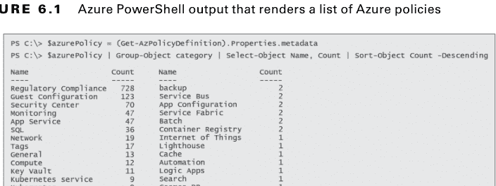

- 3. 执行以下 Azure PowerShell cmdlet，它将列出所有针对监管合规的 Azure 策略。输出如 Figure 6.2 所示。

```
(Get-AzPolicyDefinition).Properties `
| where-object {$_ .metadata.category -eq "Regulatory Compliance"} `
| Format-Table displayName
```

#### FIGURE 6.2 Azure PowerShell output that renders a targeted list of Azure policies

```
PS C:\> (Get-AzPolicyDefinition).Properties | Where-Object {$_.metadata.category -eq "Regulatory Compliance"} | Format-Table displayName
displayName
Microsoft Managed Control 1599 - Developer Configuration Management | Software / Firmware Integrity verification
Microsoft Managed Control 1375 - Incident Response Assistance | Automation Support For Availability Of Information / Support
Microsoft Managed Control 1605 - Developer Security Testing And Evaluation | Static Code Analysis
Microsoft Managed Control 1142 - Security Assessment And Authorization Policy And Procedures
Microsoft Managed Control 1089 - Security Training Records
Microsoft Managed Control 1285 - Telecommunications Services | Provider contingency Plan
Microsoft Managed Control 1709 - Security Function Verification
Microsoft Managed Control 1052 - Session Lock
Microsoft Managed Control 1034 - Least Privilege
Microsoft Managed Control 1623 - Boundary Protection
Microsoft Managed Control 1515 - Personnel Termination
Microsoft Managed Control 1327 - Authenticator Management | Password-based Authentication
Microsoft Managed Control 1229 - Information System Component Inventory | No Duplicate Accounting of Components
Microsoft Managed Control 1123 - Audit Review, Analysis, And Reporting | Audit Level Adjustment
Microsoft Managed Control 1474 - Emergency Power | Long-term Alternate Power Supply - Minimal Operational Capability
Microsoft Managed Control 1227 - Information System Component Inventory | Automated Unauthorized component Detection
Microsoft Managed Control 1361 - Incident Handling
Microsoft Managed Control 1594 - Developer Configuration Management
Microsoft Managed Control 1572 - Acquisition Process
Microsoft Managed Control 1331 - Authenticator Management | Password-based Authentication
Microsoft Managed Control 1132 - Protection of Audit Information | Audit Backup on Separate Physical systems / components
Microsoft Managed Control 1225 - Information System Component Inventory
Microsoft Managed Control 1640 - Transmission Confidentiality And Integrity
Microsoft Managed Control 1420 - Maintenance Personnel
Microsoft Managed Control 1658 - Secure Name / Address Resolution Service (Recursive or Caching Resolver)
```

在下一个练习中，你将应用其中一个 Azure 策略，但正如 Figure 6.1 所示，你可以在订阅或资源组级别应用大量 Azure 策略定义。定义代表一组规则，包括要求所有应用服务启用 HTTPS 或限制订阅所有者数量等操作。定义通常针对满足政府、行业或区域认证要求。定义很多，其中规则也很多。由你决定需要哪种认证以及使用哪个模板。Azure Blueprint 应能让你相当快速地进入正轨。使用 Azure Policy 你可以相当轻松地应用实际限制。如果需要帮助，你可以向 Microsoft 提交支持案例，有人会帮助你完成此过程。此外，如果内置规则不符合你的要求，猜猜看——你可以创建自定义 Azure Policy 并添加自己的规则组。

总体而言，Azure Policy 使管理、创建和分配策略定义成为可能。这些策略定义对你的 Azure 资源强制执行规则。这种强制执行有助于你保持与公司服务级别和标准的合规性。Azure Policy 还提供监控和扫描功能，可识别任何不符合策略的资源。请查看 Figure 6.3，它说明了可供你使用的一些报告和管理功能。

我开始审查我的 Azure 消费足迹时首先认识到的一件事是我已配置了多少资源。这只是表明资源可以多快地配置，以及你拥有的资源的概览可能会丢失。Azure Policy 概览刀片显示了策略描述。它还指出应用了它的资源是否合规以及给定策略的合规百分比。完成练习 6.2，在其中你将创建并应用自定义策略定义。


# 图 6.3 Azure 门户中的 Azure Policy 概览

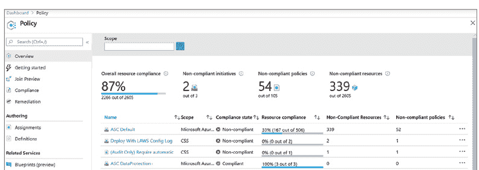

### 练习 6.2

### 创建和应用自定义策略定义

- 1. 登录到 portal.azure.com 上的 Azure 门户。在浏览器顶部中间的搜索框中，输入 Policy。选择导航菜单 Authoring 部分中的 Policy，在点击 Definitions 后，点击 + Policy Definition。

- 2. 点击 Definition Location 文本框右侧的省略号按钮。从 Subscription 下拉文本框中选择要创建策略定义的订阅，然后点击 Select 按钮。现在为策略定义提供一个名称（例如，Enforce HTTPS and TLS v 1.2），提供描述，然后在 Category 部分选择 Use Exiting 单选按钮。选择 App Service 并将 csharpguitar.policy.json 的内容添加到此处的 Policy Rule 文本块中：

```
github.com/benperk/ASA/tree/master/Chapter06/Ch06Ex02
```

最终配置应类似于图 6.4。

- 3. 点击 Save 按钮，然后在导航菜单的 Authoring 部分点击 Assignments 链接。点击 Assign policy 链接并点击 Scope 文本框右侧的省略号按钮。选择要应用策略的订阅和资源组，然后点击 Select 按钮。点击 Policy Definition 文本框右侧的省略号按钮并选择步骤 2 中创建的策略。点击 Select 按钮，点击 Review + Create 按钮，然后点击 Create 按钮。

# 图 6.4   创建自定义 Azure Policy

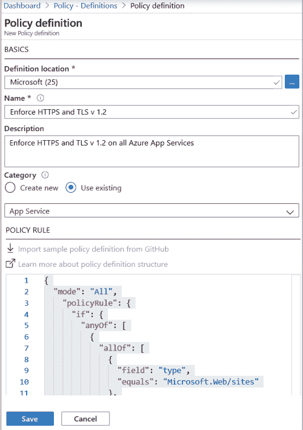

4. Azure Policy 将根据策略规则监控并限制所选资源组中 Azure 应用服务的创建，并在 Overview 刀片上显示合规状态。你的结果应与图 6.3 所示相似。

在步骤 3 中，你选择了要应用策略的资源组，你本可以将其留空并在订阅级别应用它。包含在 csharpguitar.policy.json 文件中的策略规则本身是一个 JSON 文档。它标识了你绑定规则的服务（Microsoft.Web）以及它在服务内应用的字段及其值。例如，httpsOnly 和 minTlsVersion，你将在策略 JSON 文件中找到，这些在之前的练习中进行了讨论。此示例中的 effect 是拒绝创建 Azure Apps 服务，除非 allOf 为 true。无法创建 Azure App Service，除非它启用 HTTPS Only 且仅允许 TLS 1.2。还有另一个名为 audit 的 effect，它会允许创建，但会在 Azure Policy Overview 刀片上标记它。你也可以根据需要创建一条规则，要求在预配 Azure 资源时必须使用标签。

### 标签

人们非常关注资源组作为逻辑分组一组已预配 Azure 产品的方式。分组可以基于位置或提供 IT 解决方案的资源。环境是一个有趣的场景，可以利用标签。在 IT 组织中，通常会有不同的环境，例如开发、用户验收测试（UAT）、也许集成和测试（I&T），以及生产环境。当你只有资源组的概念时，你可能会考虑将所有 Azure 资源放入单个资源组。这在某种程度上是有意义的，因为从开发到生产的所有资源都构成了 IT 解决方案，但如果你这样做，你肯定会在资源组中拥有太多资源。你会很快失去概览，无论你是否给资源起有区别的描述性名称。你也可以考虑为每个环境的资源创建资源组，但这也可能很快变得复杂。决策，如同总是那样，取决于你的需求。

你拥有的另一个选项是标签。所有 Azure 产品都支持标记。你将在 Azure 门户中每个资源的导航菜单上找到类似于图 6.5 所示的 Tag 选项。在那里，你可以设置标签名称及其值以用于查询。

# 图 6.5 使用 Azure 门户标记 Azure 资源

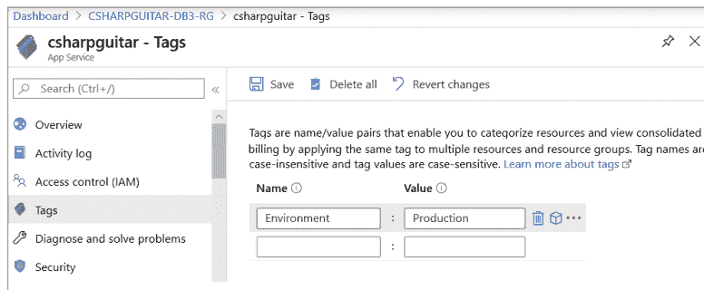

设置标签后，你可以使用以下 Azure PowerShell cmdlet 使用标签名称和标签值查询资源：

```
```powershell
Get-AzResource -Tag @{ Environment="Production"} `
    | Format-Table Name, ResourceGroupName, ResourceType

Get-AzResource -Tag @{ Environment="Development"} `
    | Format-Table Name, ResourceGroupName, ResourceType
```
```

图 6.6 说明了这些 Azure PowerShell cmdlet 的输出。查看图 6.6 时，请注意标签可以跨资源组。这更多是为了证明这是可能的，而不是建议创建此类配置。然而，如果你的场景需要它，请知道这是可以实现的。

# 图 6.6 使用 Azure PowerShell 按标签名称和值查询

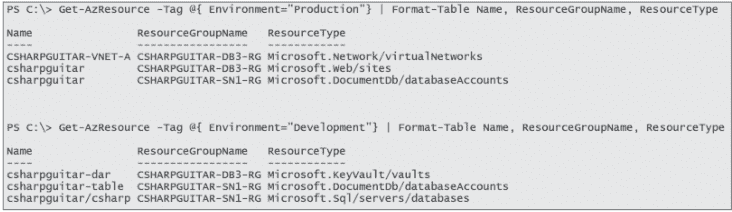

你可以使用标签作为过滤器运行许多其他查询。例如，你可以检查具有特定标签的所有资源的花费是多少，如图 6.7 所示。

# 图 6.7 在 Azure 门户中按标签名称和值过滤以查看资源成本

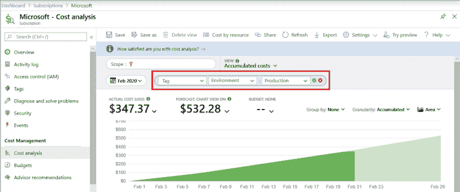

列出具有特定标签的所有资源、计算成本以及在比资源组更细粒度的级别上对资源进行分组，都是标签的优点。发挥你的创造力并找到使用标签的其他原因。例如，对于名称为 Status 且值为 Approved 的标签，你有哪些用例？你仅受创造力和想象力的限制。

### 安全

从合规角度来看，关注的安全要素是物理保护、网络安全、基础设施安全、用户访问和身份，以及数据安全。如图 6.8 所示，安全要素可以由客户负责，可以由 Azure/Microsoft 等云托管提供商负责，或是共同责任。

**图 6.8** 按云服务提供方式划分的安全合规角色和职责

| 安全要素 | SaaS | PaaS | IaaS | On-Premise |
|---|---|---|---|---|
| 物理保护 | Microsoft | Microsoft | Microsoft | Customer |
| 网络安全 | Microsoft | Microsoft | Shared | Customer |
| 基础设施安全 | Microsoft | Microsoft | Shared | Customer |
| 用户访问和身份 | Shared | Shared | Customer | Customer |
| 数据安全 | Customer | Customer | Customer | Customer |

图例：□ Customer；■ Microsoft

运行你的工作负载的物理服务器所在的位置构成数据中心。那些数据中心有门，而那些门需要被保护。如果你有一些安全经验，你会知道一旦有人获得对机器的物理访问，历史上就有可能登录到该机器。植入 LAN turtle（网络植入物）或简单地对机器和电缆造成一些物理损坏就足以证明需要采取重大的安全措施来限制对物理机器的访问。详细解释 Microsoft 如何具体保护其数据中心将违反安全的第一条规则。然而，它有一些层次，从参数屏障开始。很多时候，如果你开车经过一个数据中心，它看起来会像一个军事掩体，被围栏包围，或位于一个小山后面使其不可见。要进入，你需要通过一个单一的入口点，该点受到监控，通常由一个活人检查凭据。

一旦通过这一层，就会有另一个需要正确凭据才能进入实际建筑物或数据中心的检查点。进入内部后，如你所学


zones 和故障域以及更新域在第 4 章中有所介绍，服务器会被分段并相互隔离。数据中心中可能存在某些区域比其他区域更敏感，这取决于恶意行为者获得访问权限所造成的冲击。例如，电源开关或紧急系统如火灾报警需要更高的安全性。因此，最终层保护的是机器的控制台。这需要一个额外的、经批准的 JIT 凭证才能获得机器所在楼层的访问权限。总的来说，微软负责其数据中心中运行的工作负载的物理保护。在本地运行工作负载的客户需对本地安全承担全部责任。

就 SaaS 和 PaaS 而言，网络安全由微软负责，而就 IaaS 而言则是共同责任。在所有情况下，你都无法物理访问运行 Azure 网络基础设施的任何网络交换机、路由器或其他网络设备。你可以获得每个设备的虚拟等价物，例如虚拟网关或虚拟专用网络。从 IaaS 角度来看，网络安全责任共享的原因在于客户能够从本地网络创建到 Azure 主机工作负载的连接。例如，Azure VM 存在于 VNet 中。如果你想从本地网络安全地连接到它们，那么 VNet 中 VM 的部分保护就由你负责。记住，如果你的网络遭到入侵，微软将几乎没有手段检测到这一点。你在两个网络之间建立了信任关系，而信任意味着这两个网络之间的流量被允许并且预期会发生。不要因为存在监控恶意活动模式行为的功能而感到惊讶。Azure Sentinel 允许你配置 Security Center（稍后讨论）、Azure Threat Protection 以及端点之间通信的加密。所有这些都是你可以用来保护网络的功能。

安全的一个重要方面是防病毒和恶意软件检测软件的存在。这是从基础设施安全的角度来看的。所有用于运行 Azure 基础设施的 Azure VM 都运行着原生的恶意软件检测和防病毒软件。请记住，当你部署 Azure VM 来运行你的工作负载时，部署并不包括自动安装安全软件。此外，一些自定义软件产品与防病毒和恶意软件服务配合不佳，因为这些应用程序的行为模式与导致它们被隔离的算法相匹配。如果你需要在你的 Azure VM（IaaS）上运行防病毒或恶意软件服务，那么你可以自行安装。根据图 6.8，IaaS 安全是共同责任，而 PaaS，例如 Azure App Service，则拥有监控平台但不监控应用程序的恶意软件检测软件。SaaS 也是如此。

你可以在不提前通知微软的情况下对 Azure 执行渗透测试。请记住，你不能尝试入侵其他客户；你的测试必须专注于你自己的资源。唯一的限制是，如果你发现了问题，你需要通知微软，以便问题可以进一步分析和修补。务必注意，如果你尝试入侵除你自己的资源之外的任何资源，都有大量团队和 AI 算法在监控。不要这样做；你会输掉。记住，即使探测端点是否存在漏洞也是非法的，而尝试利用发现的漏洞会让你陷入深水。你会被抓住。

第 2 章中大量介绍了用户访问和身份。具体来说，我们介绍了 RBAC 和 Azure Active Directory 周围的安全性，以及保护应用程序的一些额外手段，例如多因素身份验证（MFA）、JIT 和基于位置的访问。在所有身份场景中，你作为客户承担了重大责任，因为你是建立对工作负载和应用程序端点访问的“谁、何时、何地”的人。这种责任在 SaaS 和 PaaS 中是共享的，因为你无法物理访问运行工作负载的机器。只有微软才有这种访问权限。然而，你可以授予任何人或任何实体访问其上运行的代码的权限。虽然 IaaS 和本地完全由你拥有，但控制远程和应用程序访问（运行自定义代码的能力）在 IaaS 和本地中完全超出范围。

在上一章中，你学习了如何在 Azure SQL 数据库上加密数据。你还学习了如何使用 SAS 密钥、Key Vault、防火墙和服务终结点来保护数据。所有这些示例都需要你执行实现和配置。没有任何一项是默认设置的。它们是可选功能，可提供额外的保护，防止未经授权访问你的数据。密钥、令牌、位置和凭证是你保护数据所依赖的全部内容，它们需要由你高度保护。唯一的例外是当你将内容存储到 Azure 存储账户（Azure Files 和 Azure Blob）时。数据在那里默认是加密的。微软无法阻止你泄露或共享 SAS 密钥、令牌或其他凭证；因此，仅提供最佳实践示例作为将其实现到工作负载中的建议。在所有情况下，保护你的数据都取决于你。不要将其与为你提供的物理、网络和基础设施等安全混淆。简单事实是，如果你的数据仅由简单的用户 ID 和密码保护并且泄露了，那么你的数据就会变得脆弱，而微软对此无能为力。

### 弹性与可靠性

执行备份、为灾难做准备以及设计 IT 解决方案以保持高可用性，都是适用于 Azure 平台的弹性与可靠性概念。此外，使云中运行的代码能够容忍瞬态问题也适用，但这是设计和编写代码的公司或个人的责任。备份你的数据库、存储和 Azure VM 映像已在前几章中讨论过，并在第 9 章中会更详细地讨论。备份和存储你的数据是你灾难恢复（DR）策略的关键部分。正如你在上一章中所学，Azure SQL 和 Azure Cosmos DB 作为 PaaS 组合的默认服务的一部分会自动备份。此外，你还了解到选择 LRS、ZRS 或 GRS 复制选项会导致存储内容在不同区域或区域中存在副本。最后，你了解到 Azure VM 可以手动备份，或你可以创建定期备份的计划。从 PaaS 角度来看，例如 Azure App Services 或 Azure Function，你更应关注将源代码保存在安全可靠的地方，而不是关注平台。记住，使用 PaaS 后你不再负责平台。第 7 章将提及一些源代码存储库，例如 Azure DevOps 和 GitHub。

这些对于存储、版本控制和保护你的代码很有用。第 9 章将有更多关于 *业务连续性和灾难恢复（BCDR）* 的内容。微软提供了一个名为 Azure Site Recovery 的工具，在第 1 章中介绍过，作为消费 *灾难恢复即服务（DRaaS）* 解决方案的推荐方式。遵循指南和建议并使用此工具可提供激活、执行和从 IT 中断中恢复的手段。

*Azure Site Recovery（ASR）* 还提供了测试你的 BCDR 解决方案的功能。如果为获得某项认证而需要验证和执行此类流程，则这是必要的。重点是，Azure Site Recovery 是在 IT 解决方案需要此类服务时实施 DRaaS 的推荐工具。拥有高质量的备份策略，结合识别和响应需要实施这些备份的场景的策略，使你的解决方案具有弹性。*弹性* 意味着你的解决方案能够承受各种故障并保持对使用该解决方案的人的功能性。当实现弹性时，其结果是客户和员工开始信任并依赖你的解决方案。结果就是可靠性。

从架构角度来看，像 Azure 负载均衡器、Azure Traffic Manager（ATM）、存储冗余选项（LRS、ZRS、GRS）、可用性集和可用性区域等产品都是内置平台设计或可配置的 Azure 功能，用于使你的系统具有弹性和可靠性。Azure Load Balancer 和 ATM 都可用于监控互联网系统的运行状况，请求首先发送到该系统。你会在 ALB（又名 LB）或 ATM 后面放置多个 Web 服务器，有时位于不同区域。当服务器无响应时，这两种产品足够智能，可以停止向其路由流量，并在配置为这样做时向管理员发送警报。存储冗余的故事已在上一章中详细介绍，但即使是最便宜的选项，你的账户中也会有三份数据副本。整个区域需要变得不可用，你才会无法连接或无法恢复。记住，LRS 对于开发项目很有用，而对于生产工作负载或无法轻松从数据丢失中恢复的工作负载，你应至少使用 ZRS。可用性集是数据中心级别的冗余。例如，如果你有多个 Azure VM 实例，它们将被放置到不同的可用性集中，每个可用性集都有自己的电源、网络基础设施和主机更新计划。可用性区域封装了可用性集。每个可用性区域内有多个可用性集，每个区域最多有三个可用性区域。区域是北欧（DB3）或美国中南部（SN1）。最后，正如你在第 7 章中所学，还有重试或断路器等编码模式，可使你的应用程序更具弹性。

### 隐私

隐私已内置于 Azure。大多数使用互联网的人都知道一些关于隐私问题以及在浏览网页时数据被捕获的情况。关于在线隐私的主要法规之一是通用数据保护条例（GDPR），它概述了严格的隐私标准和实践。作为 Azure 客户，你拥有控制权

对你的数据而言，它永远是你的数据，你拥有完全的控制权，并且你必须提供充分的隐私保护。以下是一些关键的隐私要点，突显了微软对隐私的承诺：

- 当你删除 Azure 订阅时，任何剩余数据都会在短时间内被彻底清除。
- 你的数据始终保留在部署它的区域。
- 根据原籍国的数据保护法律，你的数据不会跨境转移。
- 微软没有任何人对你的数据拥有默认访问权限；大多数员工（实际上是几乎所有员工）永远都不会接近获得访问权限。
- 如果发生安全漏洞，微软承诺会通知你。

以下是微软致力于保护数据所应用的隐私最佳实践摘要列表：

- 欧盟通用数据保护条例 (GDPR)
- 个人信息保护和电子文件法 (PIPEDA)
- 个人信息保护法 (PIPA)
- 不列颠哥伦比亚省信息自由与隐私保护法 (BC FIPPA)（加拿大）
- PDPA（阿根廷）
- “我的号码”法案（日本）
- LOPD（西班牙）
- 健康信息信托 (HITRUST)
- 健康保险携带与责任法案 (HIPAA)
- 家庭教育权利与隐私法案 (FERPA)
- 欧美隐私护盾
- 欧盟示范条款
- ISO/IEC 27018
- 加州消费者隐私法案 (CCPA)

微软为遵守隐私准则提供的一些工具包括 Azure 数据主体请求 (DSR) 门户、Azure Policy 和 Azure 信息保护 (AIP)。DSR 是一份指南，用于根据 GDPR 和 CCPA 法规，为个人提供访问已收集和存储的关于其自身数据的能力。在此处阅读有关 DSR 的更多信息：

```
docs.microsoft.com/en-us/microsoft-365/compliance/gdpr-dsr-azure
```

Azure Policy 在前一节中讨论过，但简而言之，它提供了在 Azure 资源预配方面强制执行公司准则合规性的手段。例如，在练习 6.1 中，你创建了一项 Azure 策略，要求使用 HTTPS 和 TLS 1.2，这是遵守 PCI 标准所必需的。AIP 是一种基于云的解决方案，允许你对电子邮件或文档应用标签，以限制和保护它们免遭未经授权的访问，即使是非故意的访问也是如此。管理员可以创建定义一组条件的标签，并将其应用于电子邮件或文档。例如，只有特定组织（Luthiers）中的人员才能阅读有关 Fender 正在制造的新款型号的文档。或者，某封电子邮件属于机密，不应转发或打印，因为它包含 C# 版本 12 的设计文档。

在继续之前，还有一个隐私概念需要讨论。Azure 平台上的许多位置会与多个客户共享资源。例如，当你预配一个 Azure VM 时，它肯定在某个时间点之前被其他应用程序使用过。你应该确信并放心，在 VM 放回可用计算能力池之前，任何先前在 VM 上运行的代码残留都会被移除，系统也会被彻底清理干净。对于 Azure App Services 和 Azure Functions 等 PaaS 产品也是如此，尤其是 Azure Functions，因为计算仅在实际被调用和执行期间存在。网络组件和网络带宽在某个时候可能会共享一些容量和利用率。对于需要更高级别隔离的一些客户来说，这可能是一个问题。确实，VNet 是私有且非常安全的，App Service 环境也是一个安全且隔离的环境，但某些组件仍可与其他客户共享。这仅仅是云中的设计。资源必须大规模扩展和大量利用，以获得使所有组件盈利地协同工作所需的协同效应。最大的隔离设计是在你的本地数据中心运行你的工作负载，但如果这是目标，那么一开始就不需要在 Azure 上运行工作负载。

Azure Virtual Datacenter (VDC) 是另一个可以在 Azure 平台上为你提供出色隔离的产品。VDC 像虚拟机、虚拟网络和虚拟网关一样在 Azure 平台上运行。与其他虚拟产品一样，VDC 应用的隔离在删除之前保持静态和私有。利用你对 VM、VNet 和虚拟网关的了解，请注意，尽管虚拟产品实例运行在物理硬件上，但它们之间有一道虚拟隔离墙。它们完全分离，绝对没有办法跨越那道屏障。

### 监管边界

前面已经多次讨论过区域、配对区域以及它们之间以及跨越其他国际边界的数据复制。许多国家/地区对本国公民拥有的数据如何存储都有相关规定。GDPR、PIPEDA、德国联邦数据保护法和中国网络安全法 (CSL) 都对在国内创建和使用的数据的存储和移动有严格的要求。在许多情况下，平台必须主动具备防止错误数据移动、数据捕获或存储的能力。不能把合规的责任留给企业或云主机。微软和 Azure 正在努力开发这些工具和功能。在大多数情况下，已经具备符合标准的能力。Azure Blueprints、Azure Policy 和 VDC 是企业获得适当合规性可用的一些工具。除了 Azure 上这些产品可用的高级别安全性之外，订阅级别的策略执行以及包含众多标准合规步骤的 Microsoft 信任中心，使 Azure 成为该领域的顶级竞争者。

### 安全中心

本产品在第 2 章中介绍过，该章重点介绍了其提供的安全方面。回顾该章，特别是图 2.49，以加深你的记忆。正如你将看到的，安全中心侧重于威胁检测、高级云防御、资源安全卫生，以及本章重点关注的策略与合规性。通过位于顶部中间的搜索框搜索安全中心，查看 Azure 门户中的安全中心。然后，单击导航菜单上的“监管合规性”链接，你将看到类似于图 6.9 的内容。

# 图 6.9  Azure 门户中的安全中心监管合规性概览报告

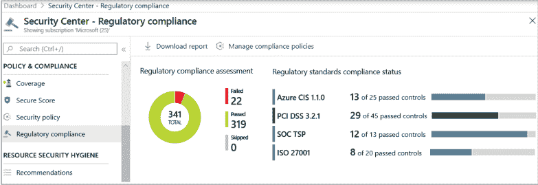

请注意，有一个监管合规性标准列表，例如已应用到订阅中产品的 Azure CIS 1.1.0、PCI DSS 3.2.1、SOC TSP 和 ISO 27001。在这些标准后面是条形图，显示订阅与符合这些标准的距离。其左侧是监管合规性的总体状态。在“监管合规性”边栏选项卡中向下滚动一点，你会注意到每个已应用标准的选项卡。每个选项卡下方都有一份关于特定不合规属性的报告以及一些关于如何修复它的说明。查看图 6.10，其中说明了如果你在订阅上执行相同操作可能会看到的内容摘要。

请注意，Azure CIS 1.1.0 合规性要求的一项操作是，订阅中的所有 Azure App Service 产品必须强制使用 HTTPS。这会加密客户端与 Azure App Service 之间的所有通信。通过处理所有未通过评估的 Azure 产品并执行已确定的操作，你将顺利走向符合该标准监管要求的道路。最后，如果该标准不在列表中，请回头查看图 6.9，并注意“管理合规性策略”链接。在这里你可以添加其他标准。添加后，会自动运行评估，然后你可以处理不合规的资源。

# 图 6.10 Azure 门户中的安全中心监管合规性概览报告

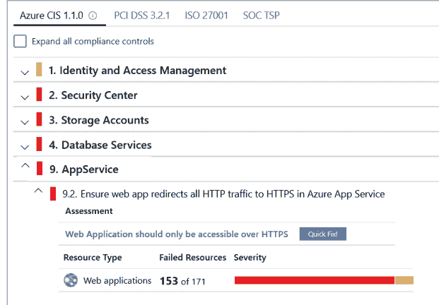

在继续下一节之前，还需要指出安全中心的其他功能，例如“数据与存储”、“计算与应用”、“网络”以及“身份与访问”。后两者不需要详细解释，因为门户边栏选项卡内容提供的报告类似于你在图 6.12 中将看到的内容。因此，由于没有其他细节需要介绍，这里不再详细介绍它们。请注意，这四个可用功能是身份（安全）、网络、计算和数据，这正是前四章所涵盖的内容。这四个组件在练习 6.3 中被特别指出。从现在开始，请把这四个 Azure 产品和功能分组牢记在心，并在将来将它们作为制定 Azure 部署策略方法基础的模型。本书之所以按这种方式排序，是出于这个特定原因：它们按重要性顺序排列。

### 数据与存储

稍早之前，你了解了 Azure 信息保护 (AIP)，它使用标签机制为电子邮件和文档标记分类。此分类

该功能可用于确保只有经过授权的人才能查看、复制、共享或打印材料。类似的功能 SQL Information Protection 也使用标签技术，有助于对数据库表中的列进行分类。你可能还记得上一章在讨论 Azure SQL 和 Azure 数据安全（ADS）功能时提到过这一点。完成练习 6.3，为你在练习 5.2 中创建并在练习 5.3 中填充的数据库添加数据分类（标签）。

### 练习 6.3

#### 配置数据发现与分类

- 1. 登录位于 portal.azure.com 的 Azure 门户。导航到你在练习 5.2 中创建的 SQL 数据库。单击导航菜单中的“高级数据安全”链接，然后在边栏选项卡上单击“数据发现与分类”图表。选择“分类”选项卡，然后从菜单中单击“+ 添加分类”链接。
- 2. 保留默认的架构名称 (dbo)，然后从“表名”下拉列表中选择 MODELS。从“列名”下拉列表中选择 MODEL。从“信息类型”下拉列表中选择 Other。从“敏感度标签”下拉列表文本框中选择 Confidential，然后依次单击“添加分类”和“保存”按钮。配置应类似于图 6.11 所示。

#### 图 6.11 Azure SQL 数据库列上的分类（标签）配置

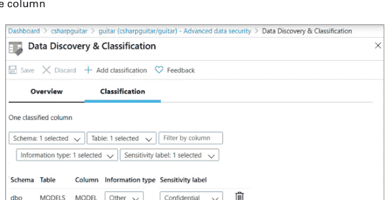

- 3. 在 Azure 门户顶部中间的搜索框中，输入 Security Center（安全中心）。在搜索结果中选择“Security Center（安全中心）”，然后从导航菜单中选择“Data & Storage（数据和存储）”（注意其他三项：Compute & Apps、Data & Storage 和 Identity & Access）。数据和存储控制台应类似于图 6.12。

#### 图 6.12 数据和存储安全中心概览边栏选项卡

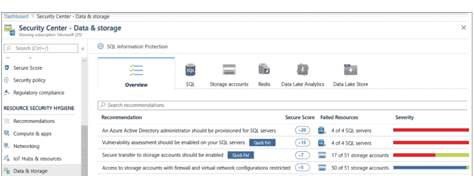

数据和存储概览边栏选项卡上的内容提供的信息类型与你在图 6.10 中看到的信息相同。你可以单击建议以获取有关如何解决合规性问题的说明。此外，在图 6.12 中，请注意 SQL Information Protection 链接。在练习 6.3 的步骤 2 中，你选择了值为 Confidential 的敏感度标签。如果你想创建或删除这些标签，可以借助 SQL Information Protection 功能来实现。既然你已经对该数据库列进行了分类，当你在第 9 章中启用审核时，你将能够检查该列被查询的频率以及被谁查询。

### 计算和应用

当你在安全中心导航到“Compute & Apps（计算和应用）”边栏选项卡时，可能会在“VM 和服务器”选项卡上看到类似于图 6.13 的内容。你可能会疑惑这个图像是否正确，因为有两个同名的 VM。图像是正确的；这些计算机存在于不同的资源组中。这是关于为 Azure 资源实施命名标准的一个很好的例子。弄清楚这两台计算机的用途还算容易，但如果有数百台，就不那么容易了。即使它们被命名为不同的名称，也可能具有挑战性。资源的组织是一个重要的设计考虑因素，在合规性和策略方面也很有用。

“Compute & Apps”边栏选项卡上的报告与其他报告类似，列出了不符合合规性的配置。通过单击报告列表中的 VM 名称，可以了解缺失或错误实现的配置是什么以及如何修复。在计算和应用这个场景中，现在是讨论 Azure VM 上一些有助于合规性、策略和审核的运维功能的合适时机。

如果你从 Azure 门户导航到先前创建的 Azure VM，向下滚动到导航菜单上的“操作”部分，你会看到三个

功能：更新管理、清单和更改跟踪。这些功能中的每一项都会把其日志放入 Log Analytics 工作区，该工作区在第 1 章中已介绍，并在第 9 章中更详细地介绍。更新管理在第 4 章中介绍，可用于安排和跟踪 Microsoft Windows 更新（也就是 KB 补丁）的安装。其中许多补丁包含对已发现安全漏洞的修复，而拥有补丁及其安装时间的记录是一项有用的合规性因素。如前所述，日志会被写入 Log Analytics，并从 Azure Monitor 中引用。

#### 图 6.13 Compute & Apps 安全中心概览边栏选项卡

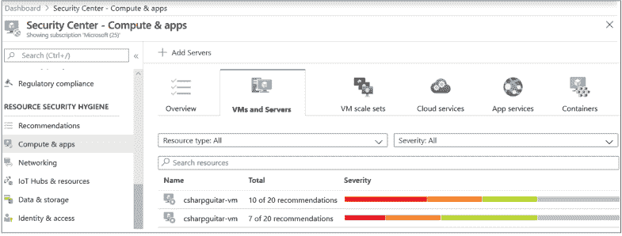

清单和更改跟踪（见图 6.14）允许你监视 VM 上以某种方式修改计算机配置的活动。启用清单和更改跟踪后，会设置一个基线，包括计算机上的软件状态、Windows 注册表项、Windows 服务和文件。然后，当这些元素中的一个或多个被修改时，后续评估可以指出修改之处。

#### 图 6.14 Azure VM 更改跟踪概览边栏选项卡

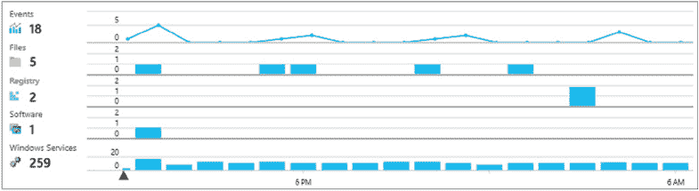

### Microsoft Cloud App Security

这是一个值得单独成书的大主题。Microsoft Cloud App Security（MCAS）的作用是将你的 Azure Active Directory 租户中的所有 Azure 资源与其他使用的 SaaS 产品无缝合并。回想一下图 2.1，它象征了如何使用 AAD 来验证和保护跨 SaaS。在这个图的基础上扩展，不仅包括身份验证，还包括以下内容：

- 威胁检测
- 信息保护
- 云发现

安全是大多数合规性标准的重要组成部分；因此，如果你计划达到任何行业标准，你将需要证明你的合规性监控和跟踪工具是胜任的。当你将资源迁移到云端（并且这里的云端不仅仅指 Azure，请参见图 2.1）时，全面管理安全的能力变得更加复杂。这正是 MCAS 通过提供前面列出的三个概念的概览和监控来实现的。

威胁检测（已在第 2 章中介绍）是一组用于监控使用你云资源的客户端行为的算法。考虑一下来自意外位置的访问或 DDoS 攻击。当识别出这些事件或其他恶意行为时，它们会被记录，并且如果配置了相关设置，管理员会在近乎实时的时间内收到事件警报。

保护信息（也就是数据）、源代码和计算资源也需要一些概览和能力。保护始于一个动作，例如设置数据的敏感度分类，就像你在练习 6.3 中对数据库列所做的那样。AIP 还与 MCAS 集成，用于电子邮件和文件分类。然后，你可以通过授予和撤销对数据和信息的权限来控制对数据的访问，从而保护这些数据。MCAS 在其配置的所有云应用中提供这些功能。

了解你的资产组合中存在哪些云应用程序是使用云发现功能来完成的。云发现使用通过代理传输的网络流量日志来确定云应用的存在。它还可以告诉你这些云应用被谁使用以及使用频率。如果发现 MCAS 保护伞下的某个云应用暴露了某种漏洞或执行了恶意活动，则可以关闭对该应用的访问。

最后，策略（例如使用 Azure Policy 创建的策略，请参见练习 6.1）可以应用于所有云应用和跨 SaaS。MCAS 是一个存在于 Azure 之外的工具，并且需要特定的许可证才能使用。有关此产品的更多信息，请阅读以下在线文档：

```
docs.microsoft.com/en-us/cloud-app-security
```

### Azure 消息传递服务

在两个或多个系统之间发送信息对计算来说并不是什么新鲜事；它实际上是一个基本概念。从 Web 应用程序的角度来看，基于 HTTP 的协议（如 SOAP、WCF 和 REST）用于管理系统之间的通信。此外，还有 Microsoft 消息队列（MSMQ）、数据分发服务（DDS）和高级消息队列协议（AMQP）等协议，这些协议适用于无法或不会通过 HTTP 运行的场景。将这些协议实现到解决方案中需要大量的编码和测试工作，因为协议提供了发送和排队消息的手段，但实际实现需要你自己完成。如果你对使用这些协议实现消息传递解决方案的方法感到困惑，请停下来，因为 Azure 消息传递服务组合中的现有产品将这种复杂性抽象掉了。你只需要设计和配置终结点，然后开始发布和消费消息并响应事件。如果你回顾一下第 1 章，就会看到微软的消息即服务（MaaS）产品组合，包括 Event Hub、Service Bus、Azure 存储队列和 Event Grid。回顾一下这些内容，以便回到消息传递上下文。你还在第 5 章中创建了一个 Event Hub。在本节中，你将学习以下内容：

- 事件与消息传递
- 如何选择正确的消息传递服务
- 消息传递模式
- Event Hub、Service Bus、Azure 存储队列和 Event Grid
- 逻辑应用和通知中心

在你开始学习这些主题之前，我想回顾并扩展一下你在第 4 章中了解的后台作业与本章中将学习的内容之间的比较。请记住，Azure Batch、HPC 和 WebJobs 都是允许你根据计划或事件触发器处理数据的产品。在后台作业的场景中，你通常会收到一个大数据集，要么一次性接收，要么随时间累积。当触发器发生时，后台处理通常会处理大型数据集。这种处理通常会消耗大量的 I/O、CPU 或存储容量。与批处理和后台处理相比，事件和消息数据在到达队列后会立即实时处理。如果存在需要以短间隔运行后台作业的场景，例如订单处理或客户注册逻辑，那么请考虑使用这些消息传递产品之一。你可能会发现，如果数据能够实时处理，那么一些对大数据集的计划处理可以在性能（执行速度）和成本方面得到优化。从许多 IT 专业人士的角度来看，消息传递是从计划后台作业执行到持续计算模型的一种演变。


### 事件与消息

你可以通过名称简单判断哪些消息产品是事件驱动的——Event Hub 和 Event Grid。其他两种，Service Bus 和 Azure Storage Queue，用于管理消息。但在这种情况下，事件和消息有什么区别？以 Windows 操作系统为例；Windows 是事件驱动的。在大多数情况下，你启动电脑，如果你不做任何操作，那么你们俩就只是坐着不动。你需要移动鼠标、点击鼠标、触摸屏幕，或在键盘上敲击某些键。每一个动作都会触发一个事件，该事件连接到一个委托，然后触发一个函数或方法。双击 Edge 图标会告诉操作系统将 MicrosoftEdge.exe 进程加载到内存中，让你能够上网冲浪。因此，事件是发布者发出的通知，表明状态或条件发生了变化。问题是，谁想知道这种状态或条件变化？你会猜测这取决于事件报告的内容，可以通过查询事件对象中的元数据找到。如果另一个系统想要被通知此类事件，该消费者可以订阅发布者并接收这些事件通知。快速查看图 4.4，了解事件发布者和事件消费者流程的说明。事件与方法之间的粘合剂是委托。在 Azure 消息服务上下文中，发布者与消费者之间的粘合剂是 Event Hub 或 Event Grid。一旦消费者（函数或方法）被通知需要运行，它会解析事件元数据的内容并根据其发现执行代码——有点像你在 C# 中调用方法时，方法会根据方法定义发送一组参数。类似于以下情况，你会期望调用 GetGuitar() 方法的事件传递琴弦数量、颜色和琴体类型：

```
GetGuitar(int numberOfStrings, string color, string bodyType)
```

Service Bus 和 Azure Storage Queue 处理的消息可以被可视化为字符和字符串的数组。你可能使用 WhatsApp、Facebook、Snapchat、Apple 或 Instagram 消息应用发送消息。在这些场景中，消息的大小和复杂性可能不如需要像 Service Bus 或 Azure Storage queue 这样服务的消息那么激烈。这里所说的*激烈*是指它们可能很大，一秒钟可能有一百万条，或者需要按顺序存储和处理。然而，消息管理服务如 Service Bus 和 Azure Storage Queue 的最简单描述是它们接收、排队并跟踪消息，直到它们被消费、处理并删除。

### 如何选择合适的消息服务

到目前为止，在几个场合中，已经出现了服务彼此解耦的例子。具体来说，有一个关于离线运行报告或下产品订单的例子，其中不是实时运行报告或处理下订单的所有要求，而是将请求放入队列。放置请求的客户端或客户会得到几乎即时的响应，因为报告实际上并未运行，订单也未下达；它只是排队等待处理。然后，在稍后的某个时刻，报告或订单会被离线处理，并向客户端或客户提供响应。这种在数据插入和处理之间对服务的解耦提高了成功概率和响应时间。它提高了成功概率，因为首先，客户端不必等待订单处理完成或报告运行后才得到响应。等待时间越长，连接中断的概率就越高。其次，将数据输入队列所需的源代码比处理订单或执行报告时所需的要少，因此出现竞争条件、异常和挂起的机会更少。实施这种解耦的原因很明确，但哪四种消息服务在哪些场景下效果最好？图 6.15 提供了一个简单的决策树，帮助你走上正确的轨道。有关此主题的更多信息，请阅读此网页上的内容：

docs.microsoft.com/en-us/azure/event-grid/compare-messaging-services

**图 6.15 如何选择合适的消息服务决策树**

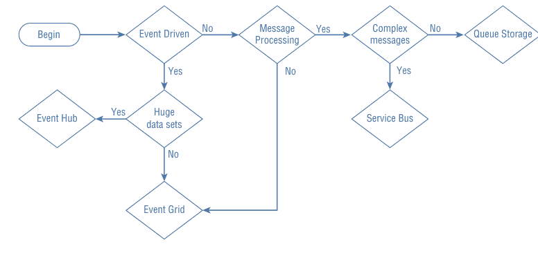

需要做的主要决策是你的解决方案是否需要在事件上触发，或者你将接收或处理消息。关于正确消息服务的完全明智决策还有更多复杂性；然而，这些是从开始时做出的最有影响力的决策。如果你需要事件驱动功能并且需要处理的数据量巨大，像大数据那样巨大，或者你有一个持续的数据流，那么 Event Hub 就是你的选择。如果不是，选择 Event Grid。如果你需要消息驱动功能且消息简单小于 64KB，则选择 Azure Queue Storage。如果消息大于 64KB 和/或消息需要 FIFO 或必须保证处理，则 Service Bus 是最佳选择。当你尝试消化这些时，请记住向消息服务发送消息通常以相同的方式进行，即使用给定类型的客户端 SDK——Event Hub、Service Bus、Azure Storage Queue 等，每个都接收一个数字字符数组。关键在于消费者如何得知消息到达。消费者是否接收到包含有关消息信息的事件，还是消费者接收到消息？关于这些消息服务的更多细节即将到来，所以继续阅读，它会变得更清晰。查看表 6.1，了解消息服务的并排分析，这些服务将在本章后面的各自部分中更详细地解释。

**表 6.1 比较 Azure 消息服务**

| Event Hub | Event Grid | Service Bus | Azure Storage Queue |
|---|---|---|---|
| 事件驱动 | 事件驱动 | 基于消息 | 基于消息 |
| 至少一次 | 至少一次 | 至少/最多一次 | 至少一次 |
| 拉取 | 推送 | 拉取或推送 | 拉取 |
| 大数据 | 响应式 | 高价值消息 | 高容量消息 |
| 遥测 | 自定义事件 | FIFO（带会话） | 队列：500TB |

在深入 Azure 消息服务的具体细节之前，先阅读一些消息设计模式和指导原则。

### 消息模式

在技术的多数组件中，都有最佳实践使用模式来实现高可用性、最佳可扩展性、弹性和性能。这同样适用于松耦合的互连异步消息系统。一些最流行的模式列于此处：

- 发布者/订阅者
- 异步请求/回复
- 基于队列的负载均衡
- 顺序队列
- 竞争消费者

通常，将消息服务实现到你的 IT 解决方案中会解耦系统，这带来诸多好处。解耦通过能够扩展系统中需要额外容量的组件而不是扩展整个解决方案来提高可靠性和可扩展性，并且分离关注点，减少对基础设施的关注，转而关注 IT 解决方案的核心业务能力。有关这些突出消息模式的更多信息，请继续阅读。要了解其他模式，请访问此网页：

```
docs.microsoft.com/en-us/azure/architecture/patterns/category/messaging
```

#### 发布者/订阅者

也 commonly 称为 pub/sub，此模式类似于前面讨论并在图 4.4 中可视化的模式。然而，为了将其专门化到 Pub/Sub 模式的上下文中，如图 6.16 所示。

**图 6.16 发布者/订阅者消息模式**

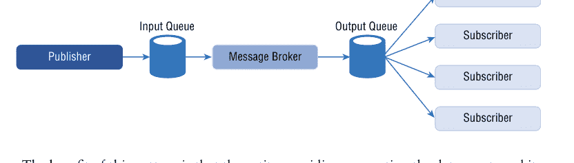

此模式的好处是提供或创建数据的实体只需将其发送到单个位置。“实体”是发布者，数据包发送到的位置被插入到输入数据队列中，这是一个超快的摄取数据存储。消息代理将负责管理数据包并以事件的形式通知订阅者有消息供他们使用。此模式避免了将信息发送给多个消费者或订阅者，这比从发布者发送广播消息花费的时间要长。此外，许多通知系统需要等待接收者的响应，而接收者可能因消费者负载而失败或变慢。此模式解耦系统，通过解耦使它们更可靠。解决方案更可靠，因为发布者向消费者发送数据的能力不再依赖于消费者是否可用。数据被放入队列，消费者会被通知并可以在任何时候来检索它。这是在 IoT 场景中常见的模式。

#### 异步请求/回复

使用 HTTP 协议时，发送请求的客户端期望得到响应。发送请求后最常见且最期望的成功响应是 200。然而，如果请求是异步的，那么响应很可能在代码完成前就发送，因此 200 响应代码不是正确的状态。相反，响应将是 202，意味着请求已被接受但不一定已完成。状态


of the processing would need to be checked from time to time from the client, and once completed, the status check would respond with the results and a 200. In modern applications where web sockets are supported, the client and server can maintain a connection that allows the server to notify the client directly when the asynchronous request has completed successfully. This pattern is useful in legacy scenarios, scenarios that require HTTP, or where callbacks are not supported due to firewall restrictions on the client side.

### Queue-Based Load Leveling

Queue-based load leveling is the pattern useful for systems that may experience bursts or carry heavy loads that may overload some backend system such as a data store like Azure SQL. This overload could cause orders from an online store to time out if the load is too high for the backend servers to respond in an appropriate time. See the left portion of Figure 6.17, which illustrates numerous clients, an Azure App Service, and an Azure Function all attempting to update data on an Azure SQL database. The dotted line represents a failure of an update because the data store is overloaded.

#### FIGURE 6.17 Queue-based load leveling messaging pattern

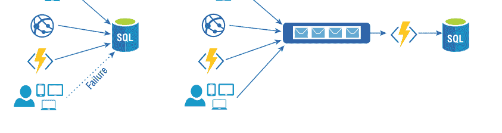

The illustration on the right side of Figure 6.17 represents the queue-based load leveling pattern. This pattern places a message queue, for example, Service Bus or Azure Storage Queue, between the clients and the database. Then there is an Azure Function, which monitors that queue and processes the messages, perhaps sequentially, in near real time or at a scheduled interval. In any case, the dotted line representing a failure due to the overloading of the backend data store is not present. This is because the orders are queued up instead of all attempting to be processed and stored at the same time. This is a one-way communication; the client will not automatically receive notification that the order has been processed. This is something you would need to build into your business logic.

### Sequential Convoy

Many IT solutions require that transactions are processed in the order that they are received. At first glance, this may appear to be straightforward, because usually when you have a queue it is sequential, like when standing in a line; it's first come, first served. The complexity arises when there are multiple consumers processing the messages. What happens if consumer A for some reason can process faster than consumer B? Perhaps consumer A processes message 1, and consumer B processes message 2 but it hangs a little, and consumer A takes message 3 from the queue and completes it before message 2 is complete. Also consider a scenario where consumers can pull and process batches of messages at a time instead of one message at a time. What if multiple consumers can pull batches? It gets complicated, agreed? The solution is to implement a pattern similar to that shown in Figure 6.18, which is a visual representation of a sequential pattern.

#### FIGURE 6.18 Sequential convoy load leveling messaging pattern

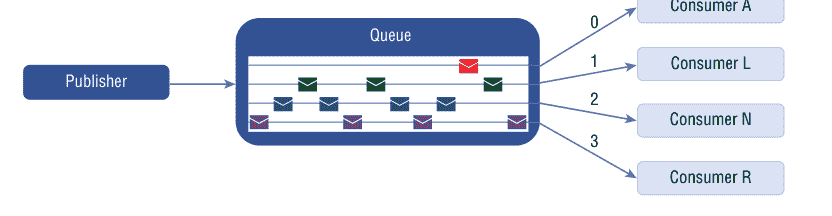

The trick, or the expectation, is that the messages being sent to the queue can be categorized into groups of messages. Take, for example, when you have an order management system that supports the creation, update, and deletion of orders and assumes that, in a scenario, all three of those happen in a close sequence. If you send all order creations to category 0, which are processed by Consumer A, all updates to category 1, which are processed by Consumer L, and all deletes to category 3, which are processed by Consumer R, and the orders are processing in the order in which they are received, there is then no way that the system could ever attempt to delete an order that hasn’t yet been created.

### Competing Consumers

This pattern can probably be visualized by reading its name. A consumer is a VM that has some code on it, whose purpose is to process messages entering a queue. It is certainly possible to have a single publisher that sends messages to a queue that are then processed by a single consumer. However, in larger solutions, there are multiple publishers and/or clients that are putting messages into the queue, and the number of messages may be too much for a single consumer to process. This would lead to a large backlog in the queue, and it is possible that the consumer never gets caught up. It may take hours or days to process all the events. If that happens, you can provision multiple consumers that pull messages from the queue and process them in parallel. Figure 6.19 illustrates that scenario and represents the competing consumers’ messaging pattern.

### ARIMA 模型详解

ARIMA（自回归积分滑动平均模型）是时间序列分析中应用最为广泛的模型之一。其核心思想是将非平稳时间序列通过差分转化为平稳序列，再建立自回归（AR）和移动平均（MA）模型。

ARIMA 模型由三个参数组成：(p, d, q)。其中 p 为自回归项阶数，d 为差分阶数，q 为移动平均项阶数。模型的数学表达形式为：

```
Y_t = c + φ1*Y_{t-1} + φ2*Y_{t-2} + ... + φp*Y_{t-p}
      + ε_t + θ1*ε_{t-1} + θ2*ε_{t-2} + ... + θq*ε_{t-q}
```

在实际建模过程中，首先需要对时间序列进行平稳性检验（如 ADF 检验），若序列非平稳，则需进行 d 阶差分使其平稳。随后通过 ACF（自相关函数）和 PACF（偏自相关函数）图来确定 p 和 q 的取值。

- **AR（自回归）**：使用过去观测值与当前值的线性关系进行预测
- **I（差分）**：通过差分使非平稳序列变得平稳
- **MA（移动平均）**：使用过去预测误差的线性组合来修正预测

模型选择通常采用 AIC（赤池信息准则）或 BIC（贝叶斯信息准则）进行判断，值越小表明模型拟合效果越好。

### Azure Cache for Redis

In Chapter 5, where you learned about Azure Cache for Redis, you may recall one of the bullet points was its ability to act as a queue. This is more of a “for your information.” You can implement queuing and Pub/Sub messaging patterns with this technology. It would require some architectural configuration as well as custom code to implement. If this interests you, read about this capability at redis.io/topics/pubsub.

### Event Hubs

If you need to ingest huge amounts of data in a short period of time from sources like IoT devices, anomaly detection algorithms, telemetry streamers, or big data generators, then consider using Event Hubs. This messaging service is capable of ingesting millions of events per second, which is huge. The most common pattern to be implemented using Event Hubs is the Pub/Sub messaging pattern. Take a look at Figure 6.20, and you will see the resemblance of the Pub/Sub pattern illustrated earlier in Figure 6.16.

#### FIGURE 6.20 Event Hub architecture components

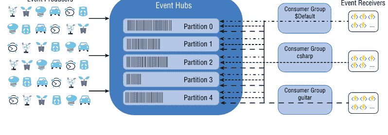

In Figure 6.20 you will find a visualization of the Event Hub architecture. There are numerous components that make up the architecture, for example the event producers (aka producers), which are depicted in the figure as IoT devices but can be anything that emits data. Your numerous partitions, multiple consumer groups, and event receivers (aka consumers) are also visualized. An event receiver can be any client that has subscribed in some way to get the Event Hub notification. Figure 6.20 shows Azure Functions as the event receivers, and the fact that there are numerous Azure Functions means that there can be multiple instances of an Azure Function, which can process events for a given consumer group and partition in parallel. Let’s explain some of the terminology described in this paragraph a bit more, beginning with a namespace. In Exercise 5.8 you created an Event Hub namespace; the name you gave it is considered the namespace and is the unique portion of the Event Hub endpoint, for example, <namespace>.servicebus.windows.net. View an Event Hub namespace as a container that contains one or more Event Hubs and where you configure security and monitoring features, which is similar to an Azure Storage account. In Exercise 6.4, you will create an Event Hub and two consumer groups.

### EXERCISE 6.4

#### Creating an Event Hub and Two Consumer Groups

- 1. Log in to the Azure Portal at portal.azure.com. In the search box at the top middle of the browser, enter Event Hubs. Select Event Hubs and then select the Event Hub Namespace you created in Exercise 5.8. On the navigation menu, select Event Hubs and then click the + Event Hub link.
- 2. Enter an event hub name (for example, csharpguitar). Be sure the name you select is globally unique. Change the partition count to 3 and then click the Create button. Once it’s provisioned, select it from the Event Hub list. Click the Consumer Groups link from the navigation menu. Notice that a default consumer group named $Default already exists. Click the + Consumer Group link, enter a consumer group name (for example, guitar), and then click the Create button. (Note that the Basic tier supports only a single consumer group.)

An Event Hub can have up to 32 partitions; a partition is the location the producers stream the data into for queuing and storage. Since the ingress of data into the Event Hub is expected to be huge, this is how the load is balanced and queued at such a high rate, meaning the incoming data is stored across the numerous provisioned partitions. If you have multiple partitions, recognize that there is no guarantee onto which partition the message is stored, nor is the order of receipt retained. It is possible to send the partition ID as part of the ingress that would force it to that specific partition; however, this is not recommended. Take a look now at Consumer Groups. Notice there are three shown in Figure 6.20, and the maximum is 20. Also notice the different patterns of lines connecting the consumers to the partitions. This means that each consumer connected to their given consumer group will have the ability to read the data stored in the partitions. You would not want to have consumers bound to different consumer groups processing events that will be stored in the same backend system. This would result in duplicates, because each consumer group gets access to all the partitions in the Event Hub. When an event or batch of events are consumed, they are not deleted from the partition. Instead, the consumer marks it as committed by using offsets or a process called checkpointing. An offset is like a pointer or a cursor that identifies where in the data stream your consumers are at in terms of differentiating what has and what has not been processed. Checkpointing is the responsibility of the consumer to notify the messaging service that the stream on that partition is no longer needed for the consumers bound to a given consumer group.

Complete the following exercise to configure ADX to ingest Event Hub information, add messages to the Event Hub you created in Exercise 6.4, and query ADX to view the logs.


### EXERCISE 6.5

#### Configuring ADX to Receive

1. 登录到 Azure 门户 portal.azure.com。在浏览器顶部中间的搜索框中，输入 Azure Data Explorer Clusters，然后选择 Azure Data Explorer Clusters。选择你在练习 5.7 中创建的 Azure Data Explorer 集群。在导航菜单中选择 Databases，然后点击你在练习 5.7 中创建的数据库。点击导航菜单上的 Data Ingestion 链接并点击 + Add Data Connection 链接。
2. 从 Select Connection Type 下拉列表中选择 Event Hub。在 Data Connection Name 文本框中输入一个名称（例如，csharpguitar-conn）。选择 Event Hub 所在的订阅，然后选择你在练习 5.8 中创建的 Event Hub 命名空间。选择你在练习 6.4 中创建的 Event Hub 并从 Consumer Group 下拉列表中选择 $Default。从 Compression 下拉列表中选择 None。
3. 添加你在练习 5.7 步骤 5 中创建的 ADX 表名（例如，CsharpGuitarEventHub），然后从 Data Format 下拉列表中选择 JSON。输入你在练习 5.7 步骤 6 中创建的 Column mapping name（例如，CsharpGuitarEventHubMapping）。最终配置应类似于图 6.21 所示。现在点击 Create 按钮。

**FIGURE 6.21 ADX to Event Hub Data connection configuration**

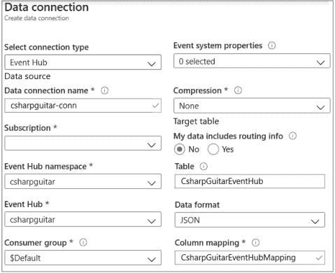

4. 回顾第 5 章，其中有一个使用 Azure Function 消费者的示例；请参阅图 5.53 以作复习。你可以从这里下载该工具或查看源代码并自行构建：

   ```text
   github.com/benperk/AzureFunctionConsumer/releases
   ```

5. 向你在练习 6.4 中创建的 Event Hub 发送消息。如果你不熟悉向 Event Hub 发送消息，请参阅图 6.22 作为示例。

**FIGURE 6.22 Adding messages to an Event Hub**

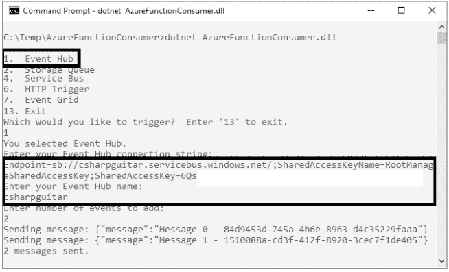

6. 导航到位于此处的 Azure Data Explorer 集群：

   ```text
   dataexplorer.azure.com/
   ```

   执行这些 Kusto 查询并将表名替换为你的表名。CsharpGuitarEventHub 查询的输出（它只是表名并转储该表上的所有数据）如图 6.23 所示。

   ```kusto
   CsharpGuitarEventHub
   | count
   ```

   ```kusto
   CsharpGuitarEventHub
   ```

**FIGURE 6.23 Kusto query output from Event Hub ADX configuration**

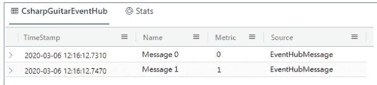

### Service Bus

第 1 章中有关于 Service Bus 的一个不错的章节。在继续之前请考虑重读该章节。你可能已经注意到 Event Hub 的端点包含一个 service bus，例如，<namespace>.servicebus.windows.net。Event Hub 建立在 Service Bus 之上；然而，Service Bus 提供了 Event Hub 中不易实现的三个功能。这些在表 6.1 中被列为能够将消息推送给接收者、FIFO 和至多一次的消息传递。推送的相反是拉取，这意味着当队列中有消息等待时，接收者必须来获取它。有了推送，消息代理会将消息推送给接收者。Service Bus 可以配置为将消息推送给接收者，或允许接收者轮询队列长度。如果找到一个或多个消息，则拉取该消息并处理它。通过实现消息会话来实现 FIFO，这是消息服务能够对消息进行排序的方式。其内部机制相当复杂，这里不作介绍，但你只需要知道 Service Bus 可以实现 FIFO，而实现方法是启用 Service Bus 队列或主题上的会话。最后，与其他三种消息服务不同，Service Bus 可以保证消息只被传递一次。这是通过称为重复检测的功能处理的，并通过在消息数据包中标识消息 ID 来实现。Service Bus 逻辑会跟踪在给定时间范围内已接收哪些消息 ID。如果发现重复，消息将被接受，但会被忽略。

Service Bus 还有一些需要介绍的额外方面：

- Namespace
- Queues, topics, and subscriptions
- Sender and receiver
- Dead-letter queue, batching, and Peek-Lock

命名空间在 Service Bus 上下文中与 Event Hub 的命名空间具有相同的目的。命名空间是队列和主题存在的容器，并允许管理员配置诸如加密、地理冗余、更改定价层和监控等功能。如图 6.24 所示，Service Bus 队列看起来与图 6.16（Publisher/Subscriber）类似，其中有一个发送者（又名发布者）将消息发送到队列，消息代理帮助摄取，然后是读取队列中消息的接收者（又名消费者）。

**FIGURE 6.24 Service Bus queue architecture components**

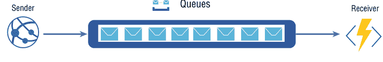

在图 6.24 中，发送者由 Azure Web App 表示，接收者由 Azure Function 表示。实际上，发送者可以是任何具有向 Service Bus 端点发送基于文本消息能力的实体。接收者也是如此。任何被授予访问 Service Bus 权限的实体都可以监控队列，并在找到消息时检索并处理它。将 Azure Function 配置为监控和处理 Service Bus 队列的场景很常见。你也可以对 Service Bus 主题执行相同的操作。请查看图 6.25，它说明了 Service Bus 主题；你可能会发现它与图 6.16（Publisher/Subscriber）和图 6.20 之间存在一些相似之处，图 6.20 说明了具有多个分区的 Event Hub 架构。

**FIGURE 6.25 Service Bus Topic architecture components**

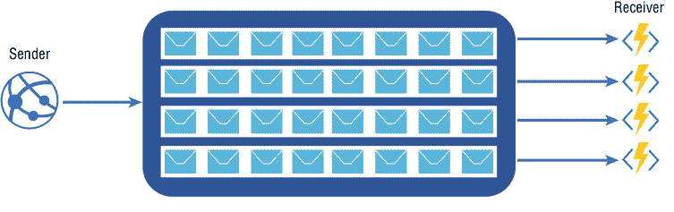

请注意，图 6.25 描绘了一个发送者；然而，消息被放置到四个不同的队列中。这些队列被称为 *subscriptions*。当你配置接收者从 Service Bus 主题读取时，需要提供订阅名称。每个订阅将接收到消息的副本，然后可以由订阅的接收者处理。此场景可能让你想起图 6.18 所示的 Sequential Convoy 模式。

Service Bus 提供的一些额外属性是 *dead-letter queue (DLQ)*、批处理和 Peek-Lock。DLQ 是一个队列，Service Bus 将无法传递的消息放置在其中。对系统设计者来说，构建一些逻辑定期检查此队列以查看 DLQ 中是否存在任何消息是明智的。DLQ 确保不会丢失消息。你需要在应用程序中编码对这些 DLQ 消息的分析，并自行找出它们失败的原因。

批处理是一个高效的概念。接收者不必接收一条消息、处理它、获取另一条并处理它，而是可以获取一批消息，也许基于时间戳范围，并在一次调用中全部处理。这与为每条消息进行网络调用相比节省了一些时间。

最后一个属性是一个有趣的属性，名为 Peek-Lock（非破坏性读取）。Peek-Lock 是一种有助于防止 Service Bus 队列中的消息被多次处理的方法。为此，你指示接收者在消息上放置一个 Peek-Lock，其中包括锁的有效时间长度。如果锁持续时间过期，则该消息再次可供其他接收者处理。定时持续时间有助于管理处理消息期间的异常或超时；这确保了如果接收者无法成功处理消息，则该消息会重新进入队列，而不会因接收者或接收者依赖的某些资源的问题而丢失。

### Azure Storage Queue

上一章讨论了大量关于 Azure Storage Queue 的内容。当你创建 Azure Storage Queue 时，你在 Azure 存储帐户的上下文中创建它，就像为 Azure blob、Azure 文件或 Azure 表所做的那样。通过 Azure Storage queue 的消息流的架构组件与图 6.24 所示类似，你已经在表 6.1 中阅读了一些 Service Bus 与 Azure Storage queue 之间的差异。正如你可能从表 6.1 回忆的那样，Service Bus 和 Azure Storage queue 都是基于消息的，但 Service Bus 具有更多功能，如主题和 FIFO。一些额外的差异将使选择使用哪一个变得更加简单。你可以在表 6.2 中找到它们。

**TABLE 6.2**  Comparing Azure Storage Queue and Service Bus

|  | Azure Storage Queue | Service Bus |
|---|---|---|
| Ordering | No | Yes |
| Atomic | No | Yes |


|  | Azure Storage Queue | Service Bus |
|---|---|---|
| Push | 否 | 是 |
| 批量接收 | 是 | 是 |
| 批量发送 | 否 | 是 |
| 重复检测 | 否 | 是 |
| 最大队列大小 | 500TB | 1GB 到 80GB |
| 最大消息大小 | 64KB | 256KB 到 1MB |
| 仅 HTTPS | 否 | 是 |
| 自动死信 | 否 | 是 |
| 传递 | 至少一次 | 至少一次 |

在选择消息驱动的消息服务时，有很多选项需要考虑。你现在应该已经具备了朝着做出良好进展的方向迈进的条件。在下一节中，你将了解其他事件驱动的消息服务，然后能够在这两者之间做出选择，最终在全部四种之间做出选择。

### Event Grid

当我尝试描述 Event Grid 是什么时，我又回到了委托的定义。委托是一个编程术语，它是事件与方法之间的粘合剂。当事件被触发时被触发的方法通常被称为事件处理程序。事件与现实世界中的通知是同一回事。它是一条可能让许多监听者感兴趣的单条信息。

在深入细节之前，请先完成下一个练习，练习 6.6，在其中你将向练习 5.6 中之前创建的 Azure Blob Storage 容器添加一个事件。此事件将在向容器添加新 blob 时触发，然后触发你在练习 4.16 中创建的 Azure Function。

#### EXERCISE 6.6

#### 配置 Event Grid 服务以在 blob 添加到容器时触发

- 1. 登录到 portal.azure.com 上的 Azure 门户。在浏览器顶部中间的搜索框中，输入 Function App。现在，选择 Function App，然后选择你在练习 4.16 中创建的 Azure Function。单击 Functions 树旁边的 + 符号，如图 6.26 所示。在刀片上选择 Azure Event Grid Trigger 并单击 Install 按钮。为函数输入一个名称（例如，csharpguitar-eg）并单击 Create 按钮。

# FIGURE 6.26 Creating an Event Grid–triggered Azure Function

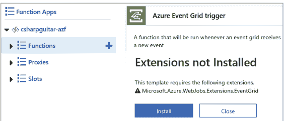

# EXERCISE 6.6 (continued)

tree, as shown in Figure 6.26. Select Azure Event Grid Trigger on the blade and click the Install button. Enter a name for the function (for example, csharpguitar-eg) and click the Create button.

# FIGURE 6.26 Creating an Event Grid–triggered Azure Function


2. 在你用于访问 Azure 门户的浏览器顶部中间的搜索框中，输入 Storage accounts 然后选择 Storage accounts。现在，选择你在练习 5.6 中创建的存储帐户。在导航菜单上选择 Events，单击 Storage accounts - Events 刀片上的 More Options 链接，然后选择 Web Hook。为 Event Hub 订阅添加一个名称，并仅从 Event Types 下拉列表中选择 Blob Created，如图 6.27 所示。从 Endpoint Type 下拉列表中选择 Azure Function 并单击 Select An Endpoint 链接。选择订阅、资源组、Function 应用和你在上一步中创建的函数。单击 Confirm Selection 按钮。

# FIGURE 6.27 Configuring an Azure Blob Storage container to trigger an Event Hub event when created

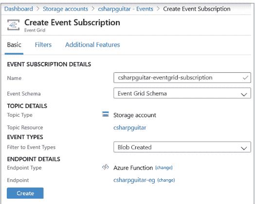

3. 导航回你创建的 Azure Function 并展开 Log 窗口，如图 6.28 所示。Log 窗口在你添加下一个步骤中的 blob 之前将是空的。一旦 blob 被添加，详细信息将被发送到 Event Grid 然后发送到 Azure Function。

# FIGURE 6.28 Azure Function log showing Event Grid and blob details

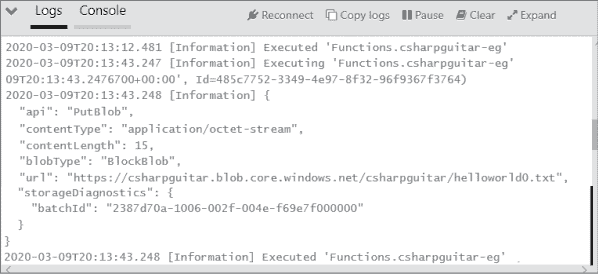

4. 使用如图 5.53 所示的相同命令向 blob 容器添加一个 blob。检查 blob 容器的内容以确认其存在。你可以通过从 Azure 门户导航到它来实现。查看 Azure Storage Account Event 刀片上的 Event Subscriptions 指标，如图 6.29 所示。

# FIGURE 6.29 A view of an Azure Storage Event Grid Event metrics

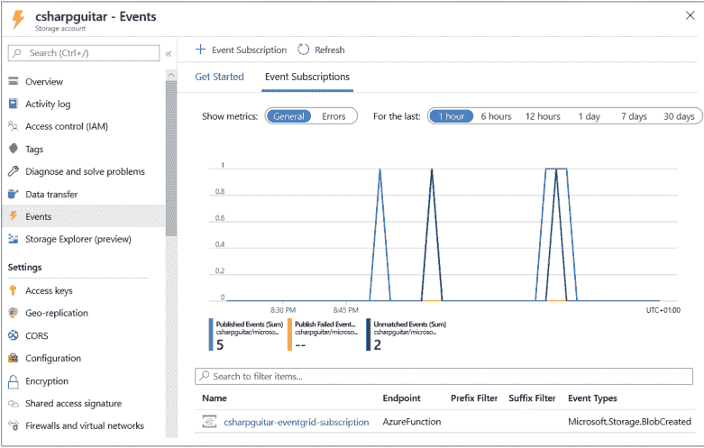

在开始学习一些 Event Grid 细节时，请查看表 6.1，然后继续学习这些最常见的 Event Grid 术语：

- - Event, publisher, source, and handler
- - Domain, subscription, and topic

在之前的练习中，认识到事件（又名通知）来自于向受监控的源 Azure Storage Blob 容器创建 blob，因为事件就发生在这里。再次注意图 6.27 中你选择了 Blob Created，这指示源将事件通知发送到 Event Grid。Event Grid 然后将事件连同详细信息一起发送，如图 6.28 所示发送到处理程序——一个 Azure Function。在练习 6.5 场景中，你有以下内容：

- - **Event:** Blob Created
- - **Source:** Azure Storage
- - **Handler:** Azure Function

如图所示 6.30，许多 Azure 产品都内置支持通过给定 Azure 产品的导航菜单上的 Events 链接配置和订阅 Event Grid。

# FIGURE 6.30 A view of event grid sources and handlers

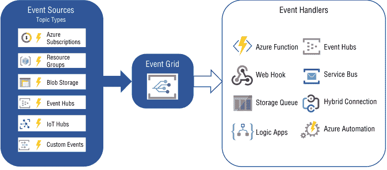

如果要发送事件的 Azure 产品是 Event Grid 且没有内置订阅 Event Grid 的能力，那么你需要手动创建 Event Grid Topic。自定义事件的创建也是如此。当你创建 Event Grid Topic 时，它会公开一个全局端点，类似于以下内容：

```
`<topicName>.westeurope-1.eventgrid.azure.net/api/events`
```

Event Grid Topic 公开了一个 API，你可以向其发送包含有关事件的信息以及 Event Grid 转发给

controls to manage your workflows. Connectors can be Office 365 Outlook, SharePoint Online, Azure Blob Storage, and Dynamics 365 to name a few. Think for a moment about how you could use those connectors to implement the workflow process identified in Figure 6.31. You would use Outlook to send requests for approval and approval emails. You could use SharePoint online as a place to store details about the changes. Azure Blob Storage can store the actual Azure Policy JSON document. Perhaps even, after approval, you could insert an Azure Blob to trigger an Azure Function and then perform the deployment to production. Figure 6.32 shows an example of the Logic Apps Designer blade in the Azure Portal. It illustrates a two-step process to send an email when a new file is added, modified, or some content is changed on a SharePoint site.

# FIGURE 6.32 Business process workflow diagram example

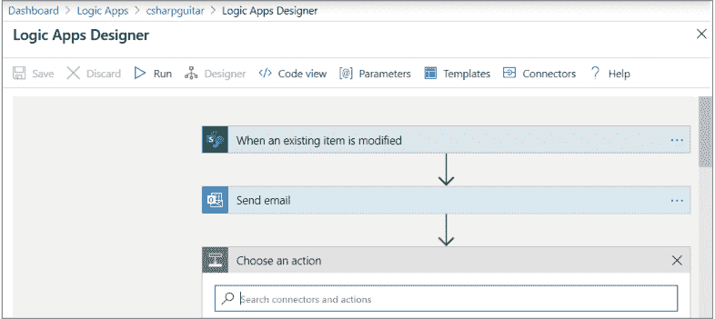

A trigger is some action or event that kicks off the workflow such as an HTTP request to an API from a client, scheduled or from another Logic App. In the workflow scenario example, this may be triggered via an email sent to a specific email alias that contains the requested change or creation to the Azure Policy. That email then triggers notifications to those who can work on, test, and ultimately approve the application of the policy into your Azure subscription. This interface reminds me of a programming technique called Snap! (snap.berkeley.edu) where you can drag and drop logical controls into a graphical interface, separated by actions such as for each, if-then-else, switch cases, and while loops. The same is possible with Logic Apps and would be necessary to implement in the workflow example used here. In short, you use the graphical user interface to drag and drop the connections and the actions required to successfully process your workflow, and the code is generated for you behind the scenes.

Also, you would use Azure Logic Apps when you want to automate workflows that have historically been performed manually, like gaining expense approvals, hiring new employees, vacation approvals, or the fulfillment of a purchase order. The days of having a large stack of papers waiting in an inbox or emails waiting in an inbox for approval are over. These types of activities can be automated using Azure Logic Apps. It is one of the driving forces behind the concept of digitalization of the enterprise and workforce.

### Notification Hubs

This tool is used to send push notifications to mobile devices running your mobile app. Have you ever received a notification on your phone that someone sent you a What’s App text, liked one of your posts on Facebook, or that the stock market climbed over 1,500 points? Well, either they used Notification Hub to perform that or they used a product similar to it. Notification Hub supports the sending of pop-up messages to clients running Android, iOS, and Windows.

Notification Hubs are tightly integrated with App Service Mobile Apps, which was introduced in Chapter 4. In that section, you learned that Mobile Apps is deprecating. However, it is important for legacy and potentially an exam question perspective to know at least a little about the integrated Azure products, Mobile Apps, and Notification Hub.

## Summary

This chapter provided the finishing touches to understand a hybrid solution. The concept was touched in many chapters before this one, and in this chapter you got clarity about security, networking, compute, and data hybrid solutions. Hybrid solutions are the combination of resources existing in cloud and private data centers. Azure Blueprint, Azure Policy, and Security Center are all tools that can help you meet compliance standards such as GDPR, PIPA, and ISO/IEC 27018. These tools help by providing an outline of what Azure procedures are required to meet a certification standard specifically one like Azure Blueprint. Azure Policy provides the means for applying and enforcing those described procedures and Security Center monitors and alerts and provides feedback on noncompliant configurations in near real time.

In the second part of this chapter, you learned about Azure’s MaaS offerings and some message patterns used to decouple large IT solutions. Decoupling makes a computer system more reliable, as the dependency between previously linked systems are detached from each other. Instead of placing an order directly into an OLTP database, the order can be placed into a queue and processed offline. You learned why you would use Service Bus, Azure Storage queues, Event Hub, or Event Grid. Messaging is not a new concept and is something that is getting more traction as legacy applications retire and are refreshed with new technology and design patterns. The digital transformation happening in many companies and one of Microsoft’s major areas of operations can be mostly achieved by digitizing historically manual workflows with Azure Logic Apps.


## 考试要点

**理解混合解决方案。** 混合解决方案是云中资源与你所在本地或其他私有数据中心中运行的资源的组合。混合解决方案可以涉及但不完全限于安全性、网络、计算和数据。

**理解 Azure Policy。** 此功能允许管理员对管理组、订阅或资源组实施限制。这些限制可以与合规性标准保持一致，也可以只是你的企业要求的一些内容，例如要求所有暴露 HTTP 接口的端点使用 TLS 1.2。

**知道如何使用标签。** 你可以将其作为组织所预置的 Azure 资源的另一种方式。当资源组不能完全满足你的要求时，甚至在同一个资源组内，也可以使用标签作为标记资源的附加方式，无论该资源是开发、测试还是生产环境。

**知道如何使用安全中心。** 这里是管理大多数安全配置并监视 Azure 资源的地方。你可以收到合规性问题、合规性得分以及如何配置不合规资源的说明。

**知道如何使用 Service Bus。** Service Bus 是一种基于消息的存储队列，用于使 IT 解决方案相互解耦。发送方将消息放入队列，该队列可以检查重复项，并按接收顺序存储和处理。可以有多个接收方并行处理同一个队列中的消息，或者通过使用 Service Bus 主题，多个接收方可以出于各自的目的接收和处理消息。

**知道如何使用 Event Grid。** 使用此产品作为遥测、流式或海量大数据消息处理的入口。你的 Event Hub 可以有一个分区，生产者向其中添加消息，并使用一个使用者组和一个接收器来处理这些消息。你最多可以有 32 个分区，每个分区都有一个使用者，这使得此类高吞吐量操作的数据处理具有极高的并行度、速度和效率。

## 关键术语

高级消息队列协议（AMQP）    灾难恢复（DR）
allOf    灾难恢复即服务（DRaaS）
身份验证（AuthN）    集成与测试（I&T）
授权（AuthZ）    标签

## 复习题

许多问题可以有多个答案。请选择所有正确的选项。

+   1. 以下哪项不能使用 Azure 产品创建混合解决方案？
+      A. Azure Active Directory
+      B. Azure Virtual Network
+      C. Azure Policy
+      D. Azure Virtual Machine
+   2. 哪些网络产品有助于创建混合网络解决方案？
+      A. API Management
+      B. Network Watcher
+      C. Hybrid Connection Manager
+      D. Single-sign on
+   3. 以下哪些选项有助于实施和监控合规性标准？
+      A. Azure Compliance Standards
+      B. Azure Policy
+      C. Security Center
+      D. Azure Blueprint
+   4. 以下哪些选项有助于对资源进行分组，以便于管理和概览？
+      A. Resource groups
+      B. Event Grid domains
+      C. Subscriptions
+      D. Tags
+   5. 对还是错？可靠性意味着系统可以从瞬态中断中快速恢复。弹性是可靠系统的结果。
+      A. 正确
+      B. 错误
+   6. 对还是错？GDPR 和 PIPA 是数据隐私合规性标准。
+      A. 正确
+      B. 错误
+   7. 以下哪些功能可在安全中心中配置？
+      A. 策略与合规性分析
+      B. 资源安全状况
C. 多因素身份验证（MFA）
D. 威胁检测

8. 对还是错？一旦 Azure 产品配置被标记为不符合其关联的合规性标准，安全中心就会自动强制执行合规性标准。
A. 正确
B. 错误

9. 如果你希望将流式数据或遥测信息引入数据源，并希望使用消息传递服务对该数据进行排队，你会使用哪一项？
A. Event Grid
B. Event Hub
C. Service Bus
D. Azure Storage Queue

10. 如果你需要按照接收顺序处理队列中到达的消息，你会选择哪项 Azure 消息传递服务？
A. Azure Storage Queue
B. Event Hub
C. Event Grid
D. Service Bus
