## 章
7

## 开发
面向云

本章涵盖的 AZ-303 考试目标：

+   - 实现管理与安全解决方案
+     - 管理应用程序的安全性
+   - 实现应用解决方案
+     - 实现应用程序基础设施

本章涵盖的 AZ-304 考试目标：

+   - 设计身份与安全性
+     - 设计身份验证
+     - 设计应用程序的安全性
+   - 设计业务连续性
+     - 设计高可用性
+   - 设计基础设施
+     - 设计应用程序架构
+     - 设计计算解决方案
+   - 设计数据存储
+     - 设计数据库解决方案


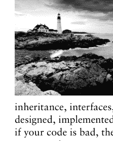

在第 5 章的开头，我告诉你要理所当然地认为你已经有了一个应用程序。该应用程序可能是一段简单的代码，也可能是一个使用继承、接口和第三方功能库的复杂企业系统。无论你在安全性、网络、计算和数据存储方面设计、实现和配置得多么好，如果你的代码很差，那么其他组件就不那么重要了。嗯，从安全的角度来看，这并非百分之百正确，因为安全始终很重要，但我认为你明白我在这里想表达的意思。简而言之，有一些编码模式可供你遵循，它们会增加在云端成功的概率。本章分享了一些这样的模式，并提供了一些编码示例。它还介绍了 IDE、源代码存储库以及更多关于安全编码的内容。

不要指望考试中会有很多（如果有的话）关于编码的问题。本章更多地是为了让你成为最优秀的 Azure 解决方案架构师专家，而不是帮助你备考。正如伊恩·斯图尔特曾经说过：“世界上有 10 种人：懂二进制数的人，和不懂二进制数的人。”在本章中，你将学习一些用于创建和管理源代码的编码模式和工具。

### 架构风格、原则与模式

在本节中，你将找到有关以下主题的信息：

+   - 架构风格
+   - 设计原则
+   - 云设计模式

在 IT 解决方案设计和配置的各个阶段，已在几个章节中提到了模式。

+   - 架构风格，例如多层应用程序
+   - 企业数据仓库（EDW）设计，例如雪花模式和星型模式
+   - 设计原则，例如分区

在云端运行时，有一些应集成到代码中的设计模式。本章提供了一些指导和建议，帮助你将所有最佳实践风格、原则和模式实施到你计划迁移到或在 Azure 平台上创建的解决方案中。

### 架构风格

最常见或传统的架构风格称为*多层*（也称为*N 层*），如图 7.1 所示。在这种设计中，你会看到一个客户端连接到 Web 服务器，这是其中的一层。然后，Web 服务器可以连接到应用程序服务器和/或数据库服务器。

图 7.1 多层架构

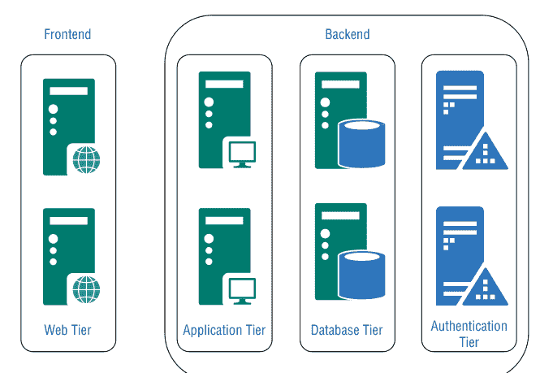

表 7.1 列出了一些其他常见的架构风格。

| 架构风格 | 描述 | Azure 产品 |
|---|---|---|
| 多层（N 层） | 按物理机器划分应用程序角色 | Azure Virtual Machines |
| 大数据 | 非结构化数据的收集与分析 | Azure Cosmos DB
Azure Synapse Analytics
Data Lake Analytics |


### 表7.1 Azure 架构风格（续）

| 架构风格 | 描述 | Azure 产品 |
|---|---|---|
| 微服务 | 通过 API 暴露服务，实现业务逻辑拆分 | Service Fabric<br>Azure Kubernetes Service (AKS) |
| Web-队列-辅助角色 | 使用消息队列实现 IT 解决方案解耦 | Service Bus<br>Azure Storage Queue |
| 事件驱动 | 生产者创建数据；消费者接收并处理数据 | Event Hub<br>Event Grid |
| 高性能计算 | 需要大量内存或 CPU 的数据分析 | Azure Batch（即 HPC）<br>Azure Virtual Machines |
| 工作流管理 | 将业务流程与现有 IT 应用自动化集成 | Logic Apps |
| 无服务器计算 | 事件触发计算模型，无需预置机器 | Azure Functions |
| Web 应用程序 | 可通过互联网访问并使用 HTTP 和 HTTPS 协议的应用 | Azure App Service |

以下为书中提供更多相关背景的图表列表：

多层（n 层）：图 4-19 和图 4-57

大数据：图 5-8

微服务：图 4-58 和图 4-60

Web-队列-辅助角色：图 6-24

事件驱动：图 4-4、6-20 和 6-30

高性能计算：图 4-48 至 4-52

此处未提及的架构风格还有很多。这里列出的是最常见的几种。既然混合模型的概念对你而言并不陌生，那么从每种风格中取用一部分来构建你所需的架构，完全是一种可行的方法。请记住，这些风格是最佳实践建议。如果你选择走自己的道路，当然可以，但要认识到这存在风险。遵循最佳实践建议才是通向成功的道路。

### 设计原则

在 Azure 平台或任何数据中心设计解决方案时，在设计阶段需要遵循一些指导原则。这些原则列在下方，之后将进行更详细的讨论：

- 冗余、弹性和可靠性
- 自我和自动修复
- 扩展和解耦
- 按 SaaS、PaaS、IaaS 的顺序优先使用
- 为变化而设计

该列表按照在 Azure 平台上成功运行工作负载的重要性和影响力进行排序。

### 冗余、弹性和可靠性

这三个概念对你来说应该并不陌生。花点时间在脑海中过一遍，然后看看你目前所学的内容是否与下面的描述吻合：

冗余 冗余意味着在多个位置保存系统配置、源代码和数据的多个副本。这对于中长期的停机情况非常重要，在某些情况下，也有助于在永久性数据丢失时进行恢复。要在 Azure 中实现冗余，应考虑可用性区域、容错域和更新域、数据库故障转移实例，以及 ZRS 和 GRS 存储选项等概念。

弹性 弹性涉及下一节讨论的内容，即自动从瞬时故障中恢复。你的应用对故障的响应和恢复能力如何？后面将讨论的一种模式——重试模式，会在执行代码遇到错误时等待几秒钟，然后再次尝试。这比直接抛出异常提示“发生意外错误，请稍后重试”要具备更好的弹性体验。

可靠性 用户、客户、员工或终端用户使用应用的体验，决定了他们对系统的信任程度。如果他们对系统失去信心，即不确定在需要时系统是否能正常工作，那么你在构建系统弹性方面就失败了，因为系统并不可靠。可靠性是系统具备弹性和冗余之后的结果。

### 自我和自动修复

云中使用的组件在很大程度上是商品化的。它们的生命周期可能达不到你对品牌计算机组件的预期。例如，当一个商品化的内存模块发生故障时，通常是直接更换，而不是试图查明为什么会

数据会依次流经应用服务器、数据库服务器，然后再返回，才能继续处理。这种架构的一个问题是，一次成功响应依赖于所有这三个层的可用性。如果能通过实现 Web-队列-辅助角色模型来解耦这种流程，那么来自客户端的请求就不会依赖于众多系统的可用性和弹性。你的应用会显得更可靠。

### 按 SaaS、PaaS、IaaS 的顺序优先使用

你可能会同意，你直接负责的任务越少，在责任更大的领域取得成功的可能性就越高。换句话说，如果你能将精力更直接地集中在你认为最重要的事情上，并在这些少数事情上取得成功，那么总体上你会更成功。如果你能将网络基础设施的管理、计算机硬件的配置和维护，以及操作系统的管理都外包出去，那么完全可以这样做。如果你只需要产品本身，那么也可以直接使用它。重点是，如果你能在 PaaS 上运行工作负载，就应选择它而不是 IaaS。这样需要操心的事情更少。实际上，如果你和我一样，总能找到操心的事情。即使只有两项任务，不用操心网络、硬件和操作系统管理也是很好的。这样你就可以专注于工作中真正重要的方面。

### 为变化而设计

事情会发生变化，有时变化很快。你能回忆起五到十年前关于云的提及吗？想想当时的我们和现在拥有的一切。为变化而设计主要关注解耦、异步模型、微服务/无服务器概念等因素，但不限于这些。简而言之，你越能将特定逻辑与整体隔离，就越容易对其进行更改。回想一下关于 NoSQL 数据库（如 Azure Cosmos DB）的讨论，你可以多么迅速地创建一个容器来存储数据。相比之下，关系数据库中的表和列具有固定的含义，更改可能产生更大的影响。与非关系型数据源相比，修改关系模型是可行的，但所需时间更长，而且需要更多的应用知识。

### 云设计模式

从编码的角度来看，有许多模式足以单独成书。因此，这里只详细讨论五种模式。这五种模式在 Azure 上运行工作负载时影响最大：

- 重试
- 网关守卫
- 节流
- 分片
- 断路器

其他值得提到的编码模式包括健康终结点监视、隔舱、代客钥匙，以及*命令和查询职责分离（CQRS）*。如果其中任何一个引起你的兴趣，可以上网搜索相关信息。网上有大量相关资料。

### 重试

重试模式可能是最需要实现的一种模式。你可以在所有平台上运行的所有代码中实现该模式，但当代码在云端运行时，它就显得尤为重要。这是因为瞬时故障发生的概率更高。历史上，有一些模式推荐使用如下代码片段来捕获异常：

```
try
{ ... }
catch (Exception ex)
{ ... }
```

关于这种模式，一个有趣的事实是，在许多情况下，catch 表达式中并没有添加任何编码逻辑来执行恢复操作。我无法解释这种行为；不过，我审查过大量代码，这是我经常看到的场景。更复杂的应用至少会记录 Exception 中包含的 ex.Message，并且可能会将其返回给触发事务的客户端，但仅此而已。在云端运行时，与在本地使用品牌硬件相比，瞬时故障可能更频繁地发生。现在，你应该在 catch 表达式中实现一些代码，重试触发异常的事务。你需要定义一个重试策略，描述应该进行重试的场景以及重试时要采取的操作。

前面代码片段中定义的 Exception 被视为一个包罗万象的异常；但实际上异常的種類很多。这里不打算一一列举所有可能的异常。其中值得一提的一种是 HttpRequestException。这种异常在等待几秒后重试可能会成功。下面是一些伪代码，展示了重试的呈现方式：

```
catch (HttpRequestException ex)
{
    writeLog($"This exception happened {ex.Message}")
    if currentRetryCount < allowedRetryCount && IsTransient(ex)
        await Task.Delay(5000)
        theMethodWhichFailed()
}
```

上面代码片段中应用的重试策略要求：

- 记录异常
- 重试仅发生特定次数


- 重试会验证异常以确认它可能是暂时的
- 重试等待五秒钟然后再次调用该方法

这里提供的示例是在使用 System.Net .Http.HttpClient 类时可能发生的情况。当你使用 Azure 产品特定的 SDK 来与例如 AAD、Azure Storage 或 Cosmos DB 等进行通信时，SDK 通常具有内置的重试功能。有关具有内置重试功能的产品列表，请查看 https://docs.microsoft.com/en-us/azure/architecture/best-practices/ retry-service-specific

### Gatekeeper

给执行其实际操作的事物命名是有意义的。Gatekeeper 模式正如其名称所暗示的那样做，就像编排器编排一样，就像程序员从父类继承属性一样。Gatekeeper 监视某个服务的入口点，并确保只有应该访问它的人才能访问。Gatekeeper 的位置在它保护的资源前面，这样未经授权的实体在进入或接近进入之前就可以被拒绝访问。（如果由我来命名，我会将其命名为 Bouncer，这似乎酷一点，但我猜 Gatekeeper 是可以接受的。）

Azure 中有许多资源具有全局端点，在给定场景中该端点已经离受保护的资源太近而不舒服。“太近”的衡量标准在很大程度上取决于数据和应用程序的敏感性和关键性。然而，让我们假设在完全信任模式下运行的服务上进行身份验证对你来说风险太大。你可能知道，当你在操作系统上运行一个进程（如 W3WP.exe）时，它在身份的上下文中运行。某些身份具有完全访问权限，而其他自定义身份可能仅对执行工作所需的特定资源具有受限访问权限。实际上，后者很难做到，但最常见的场景介于两者之间，并且倾向于提供过多的权限。因此，如果出于某种原因，你的正门入口点被攻破，那么对房屋的完全访问几乎是肯定的。有趣的是，我在那里用了“正门”这个词，因为有一个名为 Azure Front Door 的 Azure 产品可以从架构角度保护端点。你可能来自另一台服务器上的某个服务，因为线程在等待，该线程保持阻塞状态，直到从 I/O 任务返回响应。你必须明白，进程可以生成的线程数量是有限的，你应该采取行动尽可能减少它们的数量。当进程需要创建新线程时会产生一些延迟。当你使用采用 async/await 关键字的异步方法进行 I/O 调用时，线程不会被卡住等待响应。它会被重新分配到线程池供其他任务使用。一旦 I/O 函数完成，线程就会从池中取出并用于完成操作。尽可能使用异步编码模式。

单体持久化是指将所有数据存储在同一个数据存储中，而不管数据是否相关。尽可能，你应该将联机事务处理（OLTP）数据存储与包含用于日志记录、遥测或报告目的的历史数据的存储分开。这样做的原因是 OLTP 数据存储需要响应迅速。如果对同一数据存储运行大型年度销售报告，而该存储也用于下订单，则可能会受到影响。将其分开很可能会对性能产生积极影响。

当你连接到数据库或 REST API 时，该过程的一部分是实例化一个连接对象。在本地运行应用程序时，你可能拥有几乎不受限制的出站连接，最常见的模式是在 using 语句中创建连接，如下所示：

```
using (var httpClient = new HttpClient())
{
    ...
}
```

此模式遵循了对 httpClient 对象的使用的作用域指导。一旦代码执行离开闭合括号，httpClient 就会被标记为垃圾回收。其负面影响是，对于此代码块的每次调用，都需要实例化一个对象并建立新的连接。从性能角度来看，该实现是不合适的，在云中无法扩展，主要是从连接角度来看。还记得第 3 章中关于 SNAT 端口的讨论吗。认识到你同时可以打开的数量存在相当严格的限制。之前实例化 httpClient 的模式在高负载下有很大概率会使用许多 SNAT 端口。替代方案和推荐的最佳实践是在你的类中创建一个静态实例，并在构造函数中实例化它。

```
public class CsharpGuitarHttpClientController : ApiController
{
    private static readonly HttpClient httpClient;
```


```
static CsharpGuitarHttpClientController()
{
    httpClient = new HttpClient();
}
public async Task<Product> GetTheCoolestGuitarEver(string id)
{
    ...
}
}
```

当你这样做时，同一个连接对象会被用于所有指向同一服务器的出站连接。当你连接到 Azure SQL 数据库、Azure Cosmos DB 或任何需要实例化连接对象的系统时，模式也是相同的。

### 云编码入门

在整本书中，多次提到第 7 章是你将看到如何实际实现某些概念的地方。在本节中，你将看到这些示例，或获得一些关于如何继续进行的提示。将提供以下示例：

- 触发后台作业
- 连接到区域/全局数据库实例
- 使用 Azure 队列存储 SDK
- 使用表单身份验证、证书、Windows 身份验证、MFA、开放标准、托管标识和服务主体身份验证
- 从数据库读取加密数据

#### 触发后台作业

后台作业是一段代码，通常需要高 CPU、高内存或长时间运行的活动。实际上，代码片段可以做任何耗时过长而无法实时触发后台作业并等待响应的事情。触发后台作业主要有两种方式：通过事件或通过计划。例如，在 WebJob 的上下文中，事件触发器会调用其公开的 REST API。你可能还记得，WebJob 是在 Azure 应用服务（PaaS）上下文中运行的后台作业处理器。假设你有一个名为 csharpguitar 的 Azure 应用服务，它具有以下终结点：

```
csharpguitar.azurewebsites.net
```

可以使用类似的终结点触发 WebJob。该终结点类似于以下内容：

```
https://csharp guitar.scm.azurewebsites.net/api/triggeredwebjobs/
<webjobName>/run
```

这些可以从浏览器手动调用，也可以从使用 HttpClient 类的其他应用程序调用。另一种选择是使用像 CRON 作业这样的调度器，按特定时间间隔触发批处理作业或 WebJob 的执行。

#### 连接到区域/全局数据库实例

在第 5 章中，你了解了 Azure Cosmos DB 的全局复制功能。问题是，如何让代码足够智能，以连接到离客户端位置最近的只读实例？Azure Cosmos DB SDK 中一个名为 ConnectionPolicy 的类公开了一个名为 PreferredLocations 的属性。首选位置在创建用于连接数据库的客户端时使用。SDK 内部的代码会选择最优位置。这非常酷。实现这一点的代码片段如下：

```
ConnectionPolicy connectionPolicy = new ConnectionPolicy();
connectionPolicy.PreferredLocations.Add(LocationNames.SouthCentralUS);
connectionPolicy.PreferredLocations.Add(LocationNames.NorthEurope);
DocumentClient docClient =
    new DocumentClient(accountEndPoint, accountKey, connectionPolicy);
```

#### 使用 Azure 队列存储 SDK

关于 Azure 队列存储，需要了解的一些重要原则与以下三个方法相关：PeekMessage()、GetMessage() 和 DeleteMessage()。这些方法以及使用它们所需的客户端代码，可以通过 NuGet 包从此处下载：

```
www.nuget.org/packages/Microsoft.Azure.Storage.Queue
```

Visual Studio 的安装说明也可在该 URL 中找到。

PeekMessage() 方法通过以下代码片段调用。请注意，要使此代码片段正常工作，其前后还需要一些代码。例如，你必须实例化存储帐户、实例化存储客户端并标识存储队列。此示例/伪代码仅用于解释以下实现概念。

```
CloudQueueMessage peekedMessage = queue.PeekMessage();
```

以下是一段调用 GetMessage() 方法及其异步替代方法 GetMessageAsync() 的代码：

```
CloudQueueMessage message = queue.GetMessage();
CloudQueueMessage retrievedMessage = await queue.GetMessageAsync();
```

PeekMessage() 和 GetMessage() 方法之间的区别在于，GetMessage() 方法在被调用时会阻塞线程，并等待消息到达队列后才返回。线程将处于等待状态，这可能不是什么大问题，因为如果方法调用必须等待，那就意味着没有消息需要处理。尽管如此，在大多数（如果不是所有）场景中，释放而不是阻塞线程始终是一种良好的做法。

PeekMessage() 的好处在于，当它被调用时，它会告诉你队列中是否有消息正在等待处理，而不会阻塞线程或等待消息到达。因此，除非 PeekMessage() 返回状态表明有消息可供处理，否则没有必要调用 GetMessage()。PeekMessage() 不会对消息设置任何锁，也不会以任何方式修改它。

你也可以考虑调用 GetMessageAsync() 方法，它会释放线程，但会通过 await 等待队列中有消息可供处理。使用哪种流程取决于应用程序的需求。关于使用异步方法，有一点需要注意：所有包含 await 关键字的方法本身都必须是异步的（一直向上）。不建议在异步类中调用 Result() 或 Wait()。这可能会导致严重的阻塞和挂起。

在你的应用程序调用了其中一个获取消息的方法之后，你需要调用 DeleteMessage()，以便队列知道消息已被处理。请注意，此方法也有异步版本，并且它不返回值；但如果删除失败，它会返回一个可捕获的异常。

```
queue.DeleteMessage(retrievedMessage);
await queue.DeleteMessageAsync(retrievedMessage);
```

如果你的代码中出现异常，消息未被处理，那么在某时刻消息将变为未锁定状态，并再次可供处理。队列知道消息已被成功处理的唯一方式，是你在处理完成后从代码中调用 DeleteMessage() 方法。你应该认真考虑将代码放在 try{} ... catch{} 块中，并在 catch 表达式中执行一些代码来尝试重新处理，将消息放入毒信队列，务必记录日志，并决定稍后如何处理它。消息有可能格式错误，会一遍又一遍地失败，所以仅仅重新处理消息并不是最优选择，除非你在 catch 表达式中有良好的逻辑并妥善处理它们。

### 表单、证书、Windows、MFA、开放标准、托管标识和服务主体身份验证

在应用程序中实现身份验证的方法有很多。有些已经详细讨论过，有些则没有。我们将简要介绍几种类型，从表单身份验证开始。

#### 表单身份验证

表单身份验证是在 ASP.NET 应用程序中实现的，首先需要安装 IIS 模块。然后，使用类似于以下片段的语法将其配置安装到 web.config 文件中：

```
<configuration>
    <system.web>
        <authentication mode="Forms" />
    </system.web>
</configuration>
```

图 7.3 显示了表单身份验证的 IIS 模块已安装但尚未启用。

# 图 7.3 IIS 身份验证提供程序

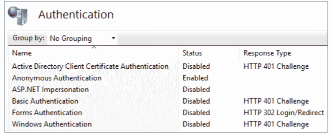

启用 IIS 模块和 web.config 文件后，身份验证提供程序即被启用。此配置的范围是针对在物理 web.config 文件位置直接相关的目录结构内及其下运行的网站。

关于配置应用位置与 web.config 文件位置关系的说明，原因是此身份验证提供程序可以在 Web 服务器上启用，但除非你在特定网站上专门启用它，否则它不会被使用。除了配置 web.config 之外，你还必须拥有身份验证（AuthN），其中你的自定义用户身份数据库存储凭据。任何定义用户在通过身份验证后是否有权访问应用程序内特定资源的组关联，都将利用授权（AuthZ）来确认访问权限。执行 AuthN 和 AuthZ 过程所需的代码必须由在应用程序本身中工作的开发人员编写。这不是一个“开箱即用”的身份验证解决方案。然而，它确实是一种可靠、复杂且有效的在互联网应用程序中实现安全性的方法。


### 证书身份验证

证书是一个包含由证书颁发机构（CA）创建和管理的加密密钥或令牌的文件。回顾第 5 章，该章涵盖了密码学，你在练习 5.3 中对 Azure SQL 数据库的一列进行了加密。证书身份验证属于同一类别并且与密码学相关。这里需要特别指出的是与公钥和私钥有关的内容。以下是基本概念：

- 私钥用于加密数据。
- 私钥解密由公钥加密的数据。

根据公钥和私钥的这些定义，很明显私钥是需要最大程度保护的。能够使用密钥加密数据并不会造成任何危害；然而，解密该数据并使用它的能力是需要更大控制的。让我们不要再深入探讨这个问题，因为之前已经提到过；这一技术领域值得作为职业和书籍来研究，但对考试来说并非必不可少。了解一些相关知识是有帮助的。证书身份验证依赖于公钥和私钥，因为这些密钥必须与证书进行验证，才能认为证书身份验证成功。请看图 7.3。你会看到还安装了一个身份验证提供程序。图 7.4 说明了此身份验证的过程（还请回顾图 2.28，其中证书被列为使用 MFA 验证身份的一种方式）。

### 图 7.4 客户端证书身份验证流程

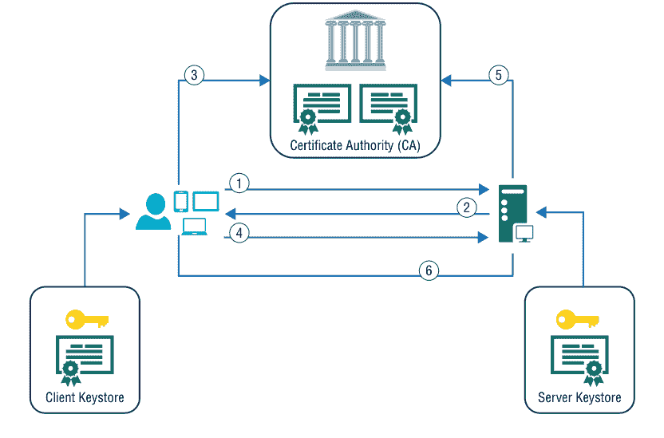

关于上图的几点有趣之处是，并非总是只有服务器端关心建立连接的客户端/用户身份。你还应该意识到并确信自己确实连接到的是你真正打算连接的服务器。很容易从银行的网页上抓取包含用户 ID 和密码文本框的内容。你在我的页面上输入它们，我在你点击提交按钮时将其存储，然后将你重定向到真正的银行网站，以便你重新输入并访问。客户端-服务器证书验证对双方都有帮助，而不仅仅是服务器端。客户端证书认证的过程如下：

- 1. 客户端请求受保护的资源。
- 2. 服务器返回服务器证书。
- 3. 客户端使用 CA 验证证书。
- 4. 客户端发送客户端证书。
- 5. 服务器使用 CA 验证证书。
- 6. 服务器根据验证结果授予或拒绝访问。

请注意，客户端在发送证书之前会先请求资源。这是有道理的，因为除非需要，否则你不会希望每次请求都发送证书。这会增加每次请求的传输数据量。然而，有一个名为 uploadReadAheadSize 的功能，它定义了在步骤 4 中客户端可以与证书一起发送的数据主体内容的大小。这提高了性能，因为数据传输可以通过利用所有可用的传输缓冲区来优化。

### Windows 身份验证

NTLM 和 Kerberos 都在第 2 章中介绍过，当时讨论的是 Azure Active Directory 域服务。这两种安全协议 NTLM 和 Kerberos 在为内联网网站启用 Windows 身份验证时都会包含在内。这里的关键点是 Windows 身份验证用于内联网而不是互联网，因为内联网通常需要 Active Directory（AD）和一些额外的基础设施来实现。如图 7.3 所示，有一个名为 Windows 身份验证的身份验证提供程序，也称为集成 Windows 身份验证（IWA）。如果你想启用 IWA，你需要禁用匿名身份验证以保护你的网站。回顾上一节，你了解到客户端向服务器的初始请求是匿名的。这是因为客户端尚未知道服务器为访问请求的资源需要哪种安全协议。因此，如果启用了匿名身份验证，IIS 会将其用作默认值；一旦身份验证被授予，它就不会继续检查其他已启用的身份验证提供程序。

集成 Windows 身份验证确实支持 NTLM，但主要使用 Kerberos，这是默认设置，因为它更安全。你可以在 IIS 管理控制台中 IWA 的高级设置中看到这一点，如图 7.5 所示。

### 图 7.6 开放标准身份验证协议

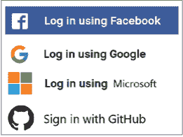

该协议将身份验证委托给身份提供程序，而不是由你自己或你的公司拥有和运营的应用程序使用。图 7.7 说明了例如使用 OAuth 进行身份验证的工作方式。

### 图 7.7 OAuth 身份验证过程

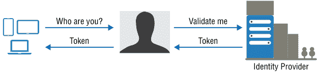

在此示例中，你尝试访问受身份提供程序保护的某个应用程序，如图 7.6 所示。你选择要使用的身份提供程序，这会触发将请求路由到所选的身份提供程序。如果凭据尚未在本地缓存，则会提示你输入所选提供程序所需的凭据。如果凭据已缓存在你的机器上，则会使用它们。如果凭据有效，则身份提供程序会返回一个令牌，该令牌必须由你想要访问的应用程序代码进行验证。在某些方面，这类似于表单身份验证，但无需在自己的数据存储中存储用户凭据。然而，你仍需要有逻辑来强制执行授权访问，使用组、声明和权限。

### 受管身份

受管身份（MI）在很多方面都是服务主体。不同之处在于它们只能与 Azure 资源一起使用。第 2 章包含有关受管身份的部分，请查看一下。在大多数情况下，凭据通常标识一个人类个体。某些场景允许你为应用程序提供身份并授予应用程序访问权限，而不是授予个人访问权限。使用 MI 的场景之一是访问 Azure Key Vault，其中存储了连接字符串或令牌以访问其他资源，例如数据库或 Event Hub 分区。使用受管身份可以防止凭据泄露，因为应用程序的开发人员和/或管理员永远看不到存储在 Azure Key Vault 中的资源的凭据。

### 服务主体身份验证

服务主体是用于访问资源但不与任何活人关联的身份。它只是一个具有用户 ID 和密码的帐户，应用程序可以使用它来确保访问它的任何内容都是允许的。在服务主体场景中，有人创建了该帐户并且需要对其进行管理。例如，必须有人负责重置密码并执行其他任务。执行此操作可能会造成一些中断，如果你不知道所有使用它的应用程序，则会如此。你需要通知它们所有人并提供新密码以及更改的日期和时间，以便它们可以更新连接的系统。综上所述，使用服务主体需要一些管理，这就是为什么围绕服务主体的抽象层被称为受管身份。服务主体身份的所有创建和管理任务都由你来管理。使用哪种方法取决于你的需求。

### 从数据库读取加密数据

对静态数据进行加密是你应该认真考虑的事情。如果你的数据源的完整性受到损害或被盗，通过简单地加密敏感数据，其影响可以大大降低。我承认自己不是世界上最好的黑客，但从外部入侵数据源极其困难。现实情况是，许多恶意活动都是通过利用拥有资源访问权限的个人的信任或贪婪来实现的。大多数时候，用户 ID 和密码足以将数据库的副本复制到 U 盘上并带走。但如果数据是加密的，就像你在练习 5.3 中所做的那样，并且没有一个人同时拥有数据源凭据和加密密钥，那么发生泄露的可能性就会大大降低。

在练习 2.9 中，你创建了一个 Azure Key Vault 并生成了一个密钥，如果你完成了练习，很可能命名为 DAR。如果你现在在 Azure 门户中查看你的 Azure Key Vault 密钥，它应该类似于图 7.8 所示。

### 图 7.8 Azure Key Vault 中的一个密钥

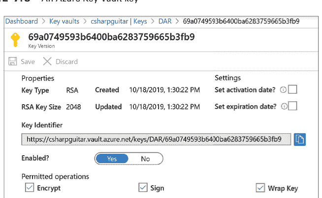


你将无法调用图 7.8 中显示的 Key Identifier，因为你没有权限。可以将权限授予托管标识，这样可以确保没有任何个人或开发人员直接访问该密钥。相反，只有应用程序可以访问。如果你是管理员，例如，如果是你创建了该密钥，那么你就可以使用以下命令通过 Azure CLI 访问它：

```
az keyvault key show --id https://<name>.vault.azure.net/keys/DAR/69 ... 0bb9
```

执行该命令后，加密密钥将被返回并存储到名为 n 的变量中。密钥可通过如下 C# 代码语法访问。下一段末尾的 GitHub 链接可让你查看整个类。

```
var publicKey = Convert.ToBase64String(key.Key.N);
```

你在练习 5.3 中使用该密钥对包含在 Azure SQL 数据库中的 MODELS 表的 MODEL 列进行了加密。如果忘了该数据是什么样子，请查看图 5.30。在练习 5.8 中，你将一个未加密的 Event Hub 连接字符串添加到 Azure Key Vault 密钥中，但后来你了解到如何使用一些 C# 代码加密并存储连接字符串。如需再次查看，请查看。

```
github.com/benperk/ASA/tree/master/Chapter05/DataEncryption
```

要使用该示例中的代码来存储和检索加密数据，你需要执行以下操作：

- 1. 使用 ADO.NET 或 Entity Framework 创建到数据库的连接。
- 2. 在 INSERT 时，使用托管标识凭据获取 Azure Key Vault 密钥。调用 EncryptText() 方法，该方法对数据进行加密。将数据写入数据库。
- 3. 在 SELECT 时，使用托管标识凭据获取 Azure Key Vault 密钥。调用解密数据的 DecryptText() 方法。将数据显示给已通过身份验证的客户端。

如果你完成了练习 5.3，那么在选择时你只需要解密数据，因为数据在插入时已由你在该练习中进行的配置进行了加密。此场景的另一个良好用途是当你实现了表单身份验证并需要在数据库中存储密码时。你肯定希望加密此列。然而，你不希望将明文密码从客户端发送到服务器；即使启用了 TLS，这样做仍然会感觉不安全。相反，你可以确保密码在离开客户端之前使用 Azure Key Vault 密钥进行加密并以加密形式存储。然后，而不是比较明文密码，在客户端加密密码，并将加密值与数据库中的加密值进行比较。

### IDEs 和源代码存储库

鉴于可以在 Azure 平台上部署的各种编程语言和技术，你可能会对最常用的 *集成开发环境 (IDEs)* 和源代码存储库有一些疑问。最常见的 IDE 毫无疑问是 Visual Studio，其次是 Visual Studio Code，后者的流行度正在迅速增长。Visual Studio 通常用于大型企业，因为它附带了大量的调试和测试功能。C# 是最常见的编程语言，但 C++ 和 Visual Basic 也很受欢迎。Visual Studio Code 用于许多开源和跨平台语言，如 JavaScript、Python 和 .NET Core。它是免费的，但缺乏完整 Visual Studio 版本（如 Professional 和 Enterprise 版本）中发现的一些更复杂的功能。图 7.9 显示了 Visual Studio Community 2019 的 IDE。IntelliJ 和 NetBeans 是用于开发基于 Java 的应用程序的两种常见 IDE。

#### FIGURE 7.9 The Visual Studio Community IDE

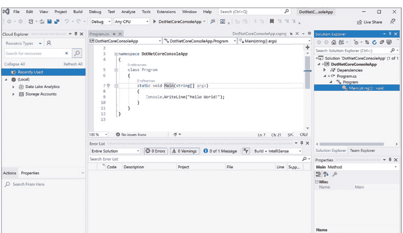

备份数据已得到详细说明，并且这样做的理由非常明确。现在想想备份分析、创建或操作该数据的源代码。如果丢失代码，那么你只剩下庞大的数据集，却无从使用或学习。因此，备份代码很重要。此外，具有变更日志以便查看谁进行了更改，并能够在出现错误或回归时回滚到以前版本的能力是有用的功能。几年前，名为 Visual Source Safe (VSS) 的 Microsoft 产品提供了这些功能。如今，Microsoft 用于此目的的工具是 Azure DevOps 产品组合中的 Repository 功能，该功能以前称为 Team Foundation Services (TFS)，又名 VSTS。第 8 章将对此有更多介绍。还有许多其他源代码存储库；其中一个流行的是 GitHub，Microsoft 最近已收购。其他像 Bitbucket 或本地 Git 存储库与 Azure 紧密集成，可用于实现诸如持续集成/持续部署 (CI/CD) 部署流程等部署概念。

### 实现安全性

你在第 2 章中获得了 Azure Solutions Architect Expert 考试安全部分所需知识的 99%。本节更侧重于应用程序本身。本章的内容如果你的目标是成为优秀的 Azure Solutions Architect Expert 是值得了解的。在本节中，你将为 Azure App Service 实现并配置托管标识，为你的 Azure App Service 提供身份，并使用该身份创建和配置 Azure Key Vault 密钥机密并提供对其他 Azure 资源的访问。代码将使用该身份从 Azure Key Vault 密钥中获取数据库连接字符串以及用于加密和解密的加密密钥，可以在此查看：

```
github.com/benperk/ASA/tree/master/Chapter07/DataEncryption
```

该代码不会被详细讨论，因为编码不是考试的一部分。但请注意，这是下一章将使用的代码。在第 8 章中，在学习如何部署到 Azure 平台时，将使用此应用程序。

源代码
你可能需要执行多个步骤才能使代码运行，例如安装依赖的 NuGet 包。此外，你需要更新代码以指向你的 Azure Key Vault。如果有任何问题，请在 GitHub 上开启一个 issue。

除了托管标识和 Azure Key Vault 访问策略之外，你还将配置 EasyAuth。EasyAuth（在第 2 章中介绍）是在 Azure App Service 或 Azure Function 的上下文中使用 Azure Active Directory 实现身份验证 (AuthN) 的快速简便方法。

让我们开始吧。在练习 7.1 中，你将启用在练习 3.8 中创建的 Azure App Service 中的托管标识，然后授予该标识访问 Azure Key Vault 密钥的权限。（你在练习 2.9 中创建了 Azure Key Vault。）

### EXERCISE 7.1

#### Enabling Managed Identity and Allowing Access to the Azure Key Vault Secret

- 1. 登录到 Azure 门户 portal.azure.com。
- 2. 导航到你在练习 3.8 中创建的 Azure App Service；然后单击导航菜单中的 Identity 链接。将状态设置为 On，然后单击保存按钮。你的配置应类似于图 7.10。

#### FIGURE 7.10 Enabling Managed Identity on an Azure App Service

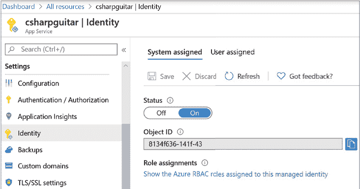

- 3. 导航到你在练习 2.9 中创建的 Azure Key Vault 并单击导航菜单中的 Access Policies 链接。单击 + Add Access Policy 链接，在 Secret Permissions 列表中选择 Get 复选框，在 Key Permissions 列表中选择 Get 和 Decrypt 复选框，然后在 Principle Member 列表中选择你已启用托管标识的 Azure App Service 的名称。单击 Add 按钮并单击 Save 按钮。你的配置应类似于图 7.11。

### EXERCISE 7.1 (continued)

#### FIGURE 7.11 Adding an access policy to an Azure Key Vault

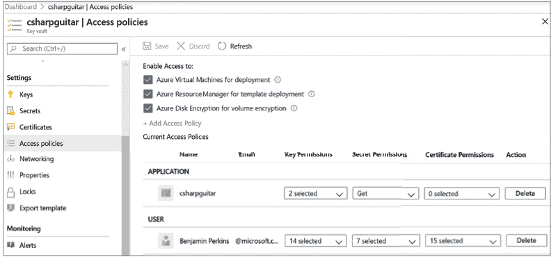

没那么难吧？只需在门户中点击几下，你就为 Azure App Service 启用了托管标识。许多其他 Azure 产品也具有相同的复杂程度的流程。在幕后，配置会创建两个环境变量，MSI_ENDPOINT 和 MSI_SECRET。你可以在链接到 Azure App Service 的 SCM/KUDU 控制台中查看它们，可通过类似以下 URL 访问：

```
https://<appName>.scm.azurewebsites.net/Env.cshtml
```

这些值由平台用于代表 principle 获取身份验证令牌。

如果你部署了更新后的 GitHub 代码以及所需的包，在完成前面的练习后，当你访问 ASP.NET Core 应用程序时，将发生以下情况：

- 1. 为应用程序 principle 检索令牌。
- 2. 创建并进行身份验证的 Azure Key Vault 客户端。
- 3. 从 Azure Key Vault 密钥中检索数据库连接字符串。
- 4. 检索 Azure Key Vault 密钥并使用它加密吉他品牌。
- 5. 连接到数据库，并将加密值插入数据库，如图 7.12 所示。
- 6. 然后检索插入的行，进行解密，并在网页上显示。


### 图 7.12 数据库表上的加密数据元素

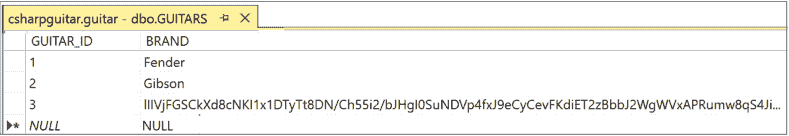

目前，网页是开放的，任何遇到该页面或发现端点的人都可以访问。为了防止这种情况，实现 EasyAuth 以确保只有与 Azure Active Directory 租户关联的经过身份验证的用户才能查看页面。参见练习 7.2。

### 练习 7.2

#### 启用 Easy Auth

- 1. 登录到 portal.azure.com 上的 Azure 门户。
- 2. 导航到你在练习 7.1 中配置了托管标识和 Azure Key Vault 的 Azure 应用服务。点击导航菜单中的 Authentication/Authorization 链接，将应用服务身份验证设置为 On，并从身份验证提供程序部分选择 Azure Active Directory。
- 3. 从管理模式选择区域中选择 Express，将授予通用数据服务权限设置为 On，点击 OK 按钮，最后点击 Save 按钮。配置应类似于图 7.13。

### 图 7.13 在 Azure 应用服务中配置 EasyAuth

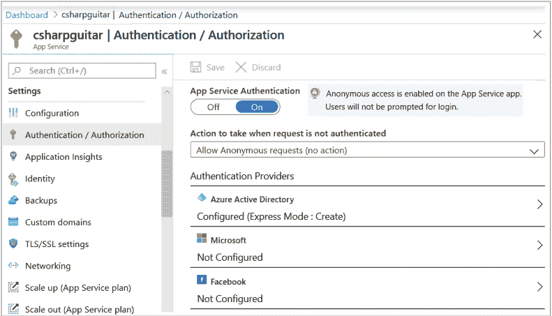

这很简单，这也是它被称为 EasyAuth 的原因。当你现在访问 Azure 应用服务时，基于配置中的允许匿名请求设置，客户端将有权访问主页面。你需要进行代码更改来保护应用程序的内容，例如实现授权（AuthZ）。如果你查看之前提供的源代码，特别是 index.cshtml 文件，你会注意到一个 if.. else.. 语句，用于检查是否存在身份验证令牌且不为 null。如果令牌不存在，则会看到使用 AAD 登录的链接。点击它会捕获凭据，进行身份验证，然后输出有关令牌的一些详细信息。你需要在每个需要受限访问的网页中检查客户端是否已通过身份验证并且具有有效的令牌。此外，最重要的是，你还需要在应用程序中构建自己的授权逻辑。EasyAuth 不提供此功能。当所有配置正确时，客户端已通过身份验证，浏览器中将呈现图 7.14 所示的屏幕。

### 图 7.14 EasyAuth Azure Active Directory 成功登录

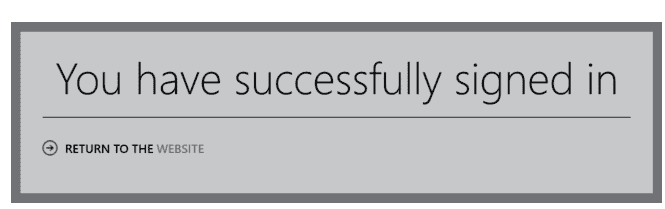

安全性是 IT 和创建应用程序时的重要方面。IT 解决方案中有许多组件，每个组件都应从安全角度进行审查。除了硬件和基础设施组件之外，代码和代码的入口点也需要专业技能、专业知识和安全领域的经验。在所有情况下，如果你对 IT 足迹的完整性有疑问，请咨询安全专家。

## 摘要

你在考试中不会发现太多关于本章内容的题目。在任何情况下，了解适用于云的最佳架构风格和编码模式只会让你成为更好的架构师。你获得了用于开发和测试应用程序的 IDE 的一些知识，以及保护和跟踪应用程序源代码的重要性。提供了有关不同类型的身份验证的示例，例如 Forms、IWA 和 OAuth。此外，你还了解了加密、启用 EasyAuth 以及在 Azure 应用服务上配置托管标识。

## 考试要点

知道 lift and shift 是什么意思。此术语与将运行在本地数据中心的应用程序移动到云中而不做任何更改有关。阅读本章后，你会认识到你可能会面临一些云特有的问题，以及一些最佳模式和风格，可以提高在云中成功的机会。它们包括重试和创建可重用的静态连接对象。

了解身份验证协议。有许多方法可以通过检查凭据来保护你的应用程序：Forms Authentication、证书身份验证、Windows 身份验证（Kerberos）和 OAuth。这些是保护应用程序入口点的协议，然后允许客户端执行代码。你需要实现一些逻辑来验证和授权对应用程序及其内部功能的访问。

了解加密。这一领域与密码学概念有关。本书中提供的示例集中在对 Azure SQL 数据库表中给定列的数据进行加密。这是对静态数据的加密示例。数据在插入时被加密，数据从数据库中选择时仍为加密状态，然后客户端可以使用加密密钥解密并查看值。这种操作会增加延迟，因此仅在非常敏感的数据上实现。

## 关键术语

- authentication (AuthN)
- authorization (AuthZ)
- Azure Front Door
- certificate authority (CA)
- Command and Query Responsibility Segregation (CQRS)
- continuous integration/continuous deployment (CI/CD)
- integrated development environments (IDE)
- Integrated Windows Authentication (IWA)
- Team Foundation Services (TFS)

## 复习问题

1. 以下哪种云概念你期望在云中比本地更多发生？（多选。）
   A. Auto healing
   B. Datacenter outage
   C. Transient outages
   D. Data loss

2. 如果你的应用程序运行在 Azure 应用服务或 Azure Function 上，收到 SocketException 或遇到 SNAT 端口耗尽，你会实现哪种编码模式？
   A. Gatekeeper
   B. Sharding
   C. Create private static connection objects
   D. Use asynchronous methods

3. 你会使用哪种编码模式来从瞬态问题中恢复？
   A. Retry
   B. Gatekeeper
   C. Circuit breaker
   D. Throttling

4. 以下哪些是你可以用来保护基于互联网的应用程序的用户身份验证机制？（多选。）
   A. Forms authentication
   B. Certificate authentication
   C. Windows authentication
   D. Service principle

5. 以下哪项不是用于构建在 Azure 上运行的应用程序的有效 IDE？
   A. Visual Studio Community
   B. IntelliJ
   C. Visual Studio Code
   D. Visio Studio

6. 关于托管标识（MI）以下哪些是正确的？（多选。）
   A. Can be used to access Azure Key Vault
   B. Cannot be used with an ASP.NET Core application
   C. Represents the identity of an Azure product
   D. Managed Identity is enabled by default on all supported Azure products

7. EasyAuth 支持以下哪些授权提供程序？（多选。）
   - A. Facebook
   - B. Google
   - C. Microsoft
   - D. GitHub

8. 你会选择哪种产品来实现大数据解决方案？（多选。）
   - A. Data Lake Analytics
   - B. Azure Cosmos DB
   - C. Event Grid
   - D. Azure Kubernetes Service (AKS)

9. 你会选择哪种产品来实现解耦的 IT 解决方案？（多选。）
   - A. Service Bus
   - B. Azure Cosmos DB
   - C. Azure Batch
   - D. Azure Storage Queue

10. 你会选择哪种产品来实现大计算解决方案？（多选。）
    - A. Service Fabric
    - B. Azure Virtual Machines
    - C. Azure Batch (aka HPC)
    - D. Azure Functions
