## 迁移和部署

### 本章涵盖的考试 AZ-303 目标：

- ✓ Implement and Monitor an Azure Infrastructure
  - ▪ Automate deployment and configuration of resources
- ✓ Implement Management and Security Solutions
  - ▪ Manage workloads in Azure
- ✓ Implement Solutions for Apps
  - ▪ Implement an application infrastructure

### 本章涵盖的考试 AZ-304 目标：

- ✓ Design Infrastructure
  - ▪ Design migrations


如果你已经完成了迄今为止的所有章节，你会意识到一切都已准备就绪，可以将你的工作负载迁移到 Azure 平台。你已经获得了到达此阶段所需的所有先决条件，例如安全、网络、计算、数据和存储、合规策略、消息服务以及云编码模式。真理的时刻已经到来，现在是时候将你的工作负载迁移到 Azure 了。在本章中，你可以获得以下技能：

- 迁移 Azure 虚拟机和你的数据存储。
- 将源代码部署到 PaaS 产品。
- 使用 ARM 模板部署。
- 使用 Visual Studio 部署。
- 使用 Azure DevOps 部署。

最常见的迁移是将你的 Azure 虚拟机和数据存储迁移过去。ARM 模板对于自动化部署非常有用。它们与 Azure 的一个功能 Azure Automation 结合得很好。Azure DevOps 支持需要或希望使用 CI/CD 部署模型的项目。最后，从 Visual Studio 将代码部署到 PaaS 产品（如 Azure App Service）与 IDE 紧密集成。从任何地方通过互联网访问网站变得快速而简单。让我们马上开始，首先学习一些迁移概念以及用于迁移计算和数据资源的工具。

### 迁移到 Azure

将现有的 IT 解决方案迁移到新平台是一件大事。即使你只迁移解决方案的一部分，也不仅仅是知道每种资源类型推荐使用哪些工具；还需要一个计划。我所说的“资源类型”是指你的计算（取决于 CPU）、内存和操作系统要求。此外，你需要知道你的目标数据存储，例如 SQL Server、Oracle 或 MySQL。例如，你试图迁移到 Azure 的内容——例如，仅使用存储、仅使用计算、仅使用数据存储的应用程序与需要所有这些以及可能其他内容的完整 IT 解决方案——将驱动迁移规划。与许多其他技术环境一样，如果使用该模式作为模型，将会提高成功的概率。该模式以及应用于迁移特定资源类型的推荐工具也在本章中进行了讨论。Azure 解决方案架构师专家考试更侧重于工具而非计划，但两者都很重要。

如图 8.1 所示，将你的资源迁移到 Azure 平台可以分为四个阶段：评估、迁移、优化以及安全和管理。评估阶段是你明确定义目标和优先事项的地方。它类似于设计阶段，你记录想要的内容，然后规划实现这些目标所需的步骤。这就是你希望聘请项目经理的地方，项目经理会将目标分解为步骤并制定时间表。时间表将包括被确定为优先事项的项目，以确保它们在需要时无论如何都完成。

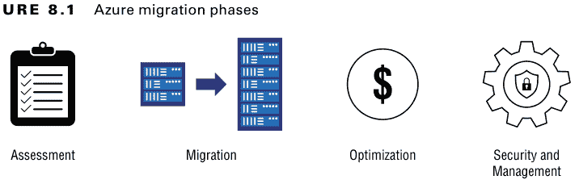

从技术角度来看，你需要评估迁移成功所需的任何更改。例如，你的工作负载是否需要特定版本的 operating system、需要注册表更改或需要某种第三方框架？这是发现此类事情的阶段，然后确定哪些计算资源或资源组可用和/或需要成功将工作负载迁移到 Azure。有些工具可以分析你当前的解决方案并生成一份报告，其中包含你迁移可能遇到的问题。考虑使用以下工具：

- 用于计算服务器评估的 Azure Migrate
- 用于检查你的数据存储的 Azure 数据迁移助手（DMA）
- 用于你的 Web 应用程序的 Azure App Service 迁移评估
- Azure 数据迁移服务（DMS）

此外，工具的输出可能包含一些需要进一步调查的可能问题的提示。这些工具将在本章后面详细介绍。所有这些都在前面的章节中介绍过。

除了执行评估外，这些工具还可用于下一阶段的实际迁移。迁移阶段是你执行在评估阶段创建的计划的地方。你如何执行部署在很大程度上取决于你是否决定进行整体迁移或对工作负载解决方案的一个或多个组件进行各种重构、重新架构或重建。请回顾图 4.2，其中说明了选择最合适的计算服务的决策树。为了提醒你，整体迁移意味着你不打算对工作负载进行任何更改，并希望它在 Azure 平台上像本地运行一样运行。在进行整体迁移时，你可以做出的可能更改范围仅限于少数云优化，例如增加可用计算能力，如 CPU 和 RAM。整体迁移在许多情况下可以直接迁移到 PaaS，并且这样做有真正的优势，例如不再需要自动缩放进行负载平衡，并将操作系统和软件库管理的责任委托出去。光谱的另一端是完全重新架构和重建当前的 IT 解决方案以实现云优化。这包括诸如使用 Azure Kubernetes（AKS）和 Azure Container Instances（ACI）进行容器化，或实施 Azure Functions 和 Azure Cosmos DB 等新技术等选项。以下是一些有助于实际执行迁移的工具：

- Azure Site Recovery
- Azure Migrate
- Azure 数据迁移服务（DMS）
- Import/Export

这些绝不是唯一可用的迁移工具；对于大量场景和技术，你需要许多其他工具。使用文件传输协议（FTP）就是一种用于在服务器之间移动各种类型和用途的文件的基本但有用的工具。也可能存在一些没有部署工具的活动。它们必须通过远程桌面协议（RDP）连接手动部署到 Azure 虚拟机。执行阶段，即你实际执行迁移的时间，是你的技能、团队的技能和你的计划汇聚在一起的时刻。考虑在评估和规划阶段包含升级路径的定义，以确定某人应在升级之前尝试解决问题的时长。此外，在此定义遇到障碍时，遇到技术问题的人应遵循的路径和流程。无论如何，如果你陷入停滞，请考虑联系 Microsoft 支持。Microsoft 致力于让客户在 Azure 平台上取得成功，你将获得他们的高水平支持。还要注意，有其他云公司专门帮助客户迁移到 Azure。如果你的工作负载和 Azure 占用量很大，请考虑咨询专门从事从本地迁移到 Azure 的第三方。这样可以提高速度并减少对你的业务和客户的意外影响。请查看此页面，它可以帮助你找到在此领域进行咨询的 Microsoft 合作伙伴：

```
azure.microsoft.com/en-us/migration/migration-partners
```

恭喜，一旦你的工作负载转移到 Azure 平台并且一切按预期运行，请花点时间拍拍你和团队的背，祝贺你们成功地将 IT 带入 21 世纪。好吧，时间够长了，还有很多工作要做。

现在是时候优化你的工作负载，以确保你的消耗和成本符合预期。实现优化的两种方法是 Azure Hybrid


*权益与 Azure 预留虚拟机实例。*这两种方案将在“迁移 Azure 虚拟机”一节中讨论。另一种优化方式是使用 Azure 成本管理和 Cloudyn，这两者均已在第 1 章中介绍。请记住，预测、监控和控制成本至关重要。如果公司资金耗尽，那么就会倒闭。你可以在 Azure 门户中查看基于订阅的支出报告，类似于图 8.2。

**图 8.2** Azure 成本管理

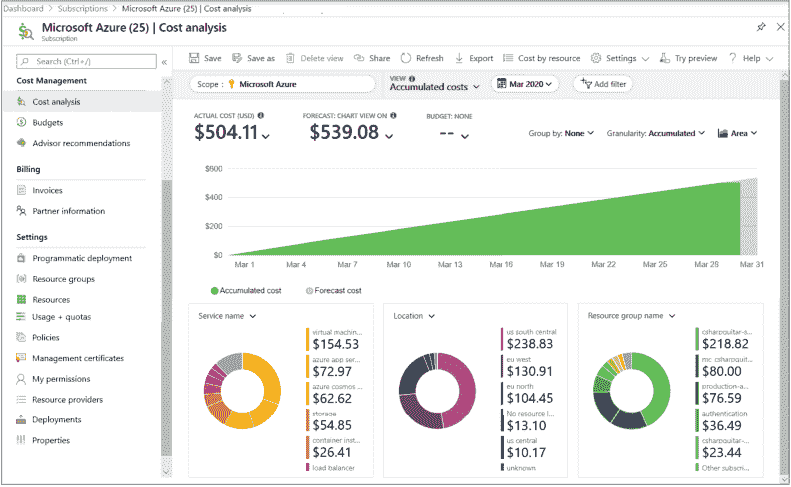

导航到“订阅”边栏选项卡，选择要评估的 Azure 订阅。单击导航菜单中的“成本分析”链接。注意，它提供了当前和预测的费用视图。成本分析边栏选项卡底部有一个不错的功能。在这里，你可以看到基于服务名称（如 Azure VM、应用服务、Azure Cosmos DB 等）、位置（如美国中南部 (SN1)、北欧 (DB3) 等）以及资源组名称的费用明细。这三份成本明细报告都能让你深入了解 Azure 支出消耗在何处。然后，你可以将其与在迁移过程的评估阶段开始时定义的预期进行匹配。

迁移的最后阶段是确保工作负载保持安全和正常运行。从安全角度来看，你应该经常进行测试。确保 RBAC 限制仍然限制订阅中的 CRUD 操作。定期检查 Azure Policy 是否仍然符合公司和行业要求。检查 MFA 和 JIT 访问提供程序是否正常工作，以及任何新应用程序是否合规地将凭据存储在 Azure Key Vault 中。核实托管标识 (MI) 是否已启用。最后，考虑在工作负载中实施恶意软件检测和其他与安全相关的 IT 解决方案。请记住，尽管 Azure 有完善的安全策略和流程，但它们主要侧重于保护平台本身，而不是在其上运行的应用程序。安全中心是让客户自定义和更详细地定义哪些行为属于恶意行为模式、哪些不属于恶意行为模式的工具。Microsoft 无法知道应用程序上的行为是否符合预期，如果 Microsoft 采取行动错误地关闭了你的工作负载，那将是一个问题。因此，应用程序安全主要是客户的责任，而不是提供商的责任。

在 Azure 上管理 IT 解决方案涉及应用程序的监控和恢复能力。这些细节将在下一章中介绍。可选工具包括 Azure Monitor、Log Analytics、Application Insights 和 Azure Backup。在我的职业生涯中，我大部分时间都在从事支持工作，经常遇到一些开发人员认为一旦代码交付并投入生产，项目就结束了。实际上，一旦代码上线并被使用，项目才刚刚开始。保持代码运行、排查问题、性能调优、升级以及确保我们能够在任何情况下恢复且不丢失数据，有时会持续数十年。现在，你了解了将 IT 解决方案迁移到 Azure 的典型通用过程的各个阶段，可以进一步阅读，以获取有关特定工具集的更多详细信息，这些工具集可以帮助你在执行和规划方面取得更大成功。以下产品将在后续章节中更详细地讨论：

- Azure Site Recovery
- Azure Migrate
- 迁移 Azure 虚拟机
- Azure 数据库迁移服务 (DMS)
- 迁移 Azure 应用服务
- 导入/导出

> 在继续之前，我想引用亚瑟·克拉克的一句话。他说：“任何足够先进的技术都与魔法无异。”随着你越来越有经验，你可能会挠头，想知道某些东西是如何工作的，以及为什么上次明明遵循了同样的步骤却没有奏效。我不会称之为魔法，因为当你执行一个过程时，它只是在运行被编程好的代码。不过，我仍然惊叹于所有位和字节是如何排列组合以实现我想要的结果的。也许其中确实有魔法的成分，但也许更多是因为我们终究是 IT 魔术师和巫师。

### Azure Site Recovery

Azure Site Recovery (ASR) 已在第 1 章中介绍。如果你还没有阅读该章，请先阅读；那里有很多信息。另外，请查看图 1.8，它说明了这种配置。第 4 章中还有 Azure Site Recovery 与 Azure Backup 之间的比较。我的意思是，这里不应该是你第一次阅读或了解此内容的地方。如果是，你需要先阅读其他相关讨论。你会注意到，Azure Site Recovery 主要用于 BCDR 场景，但也可以用它把生产工作负载迁移到 Azure。实际上，如果本地版本需要故障转移，而你的 BCDR 配置为此目的而设置，你可能不得不将工作负载移动到 Azure。

使用 Azure Site Recovery 工具可以将本地 VMware、Hyper-V 虚拟机或物理机迁移到 Azure。通过配置本地计算机与 Azure 平台上的计算机之间的灾难恢复方案来实现迁移。配置并测试后，你可以有意触发故障转移，将工作负载移至 Azure 平台。这是一种有效的迁移方法，可能比使用 Azure Migrate 影响更小。考虑一下，如果你故障转移后没有成功，你可以拨动开关，让流量恢复到原始本地架构。根据你使用 Azure Migrate 管理迁移的方式，可能无法选择故障转移回本地计算。

BCDR 的配置相对复杂，但在很大程度上取决于你要迁移自的计算环境类型。下一节将对此进行更多介绍。然而，请注意，当源迁移位置是 Hyper-V VM、VMware VM 或物理服务器时，迁移规划会有所不同。Azure Site Recovery 还支持从 Azure Stack 工作负载迁移，Azure Stack 是企业在自己的私有数据中心中运行 Azure 的产品。下一章将详细介绍 Azure Site Recovery。现在你需要知道的是，如果 Azure Migrate 无法满足你的所有要求，这个产品可以用于迁移。在继续讨论 Azure Migrate 之前，还有一个工具需要提及。ASR 部署规划器可帮助将 VMware 虚拟机迁移到 Azure。此工具将帮助分析现有 VM 的磁盘数量、磁盘大小、IOPS、BIOS 和操作系统版本，以帮助确定该 VM 是否符合 Azure VM 的要求。总之，只有当 Azure Migrate 功能不能满足你的需求时，才使用 Azure Site Recovery 进行迁移。

### Azure Migrate

到目前为止，将现有资源迁移到 Azure 一直是许多章节的主题。Azure Site Recovery 和 Azure Migrate 均在第 1 章中介绍，并在第 4 章中进一步讨论。Azure Migrate 可通过 Azure 门户访问。其概述边栏选项卡与图 8.3 类似。

请注意，这里有一些功能和工具，用于发现、评估和将本地数据中心应用程序迁移到 Azure。发现方面将识别数据中心中的所有服务器，以便你大致了解当前拥有多少台服务器和消耗多少计算资源。过去，你必须手动将自己拥有的内容与 Azure 提供的功能进行比较，然后才能确定支持哪些操作系统和硬件配置。这正是第 4 章中提到的方式，特别是表 4.1、4.2、4.4、4.5，


#### FIGURE 8.3 Azure Migrate Overview blade

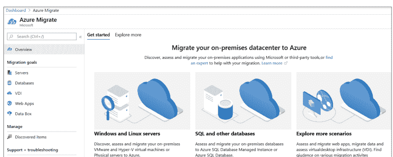

and 4.6. 这些表格提供了 Azure VM 大小的列表、支持的操作系统版本以及所选操作系统的推荐 VM 大小。由于所有这些数据都可以通过 REST API 访问，因此有人编写工具来自动化此类决策是有意义的。关于操作系统到 Azure VM 的手动映射的一个有趣点是，Azure Migrate 现在可以为您完成此操作，您可以学习代表您做出的决策的一些原因。此外，您可以认识到逻辑背后的复杂性，这在 Azure Monitor 未提供迁移路径的场景中会非常有帮助。在这种情况下，您现在将拥有知识，可以继续手动进行决策并推进迁移。

您 VMware、Hyper-V 或运行 Windows Server 或 Linux 的物理机的实际迁移将为您执行。请注意，迁移的配置相当重要。设置时您可能会发现的一个有趣点是 Azure Migrate 对 Azure Site Recovery 的依赖。在幕后，在准备本地机器进行迁移时，会创建一个 Recovery Services vault 来存储用于构建 Azure VM 的 VHD。此外，必须在所有 Hyper-V 实例上安装名为 Azure Site Recovery Provider 的工具才能成功完成迁移。Recovery Services vault 可以在 Azure 门户中看到，其外观与图 8.4 所示类似。随着您在发现（即评估）阶段和迁移阶段的进展，您应该期望在此 blade 上看到有关部署的信息。

这款有用的工具在简化企业数据中心向 Azure 平台迁移方面正朝着正确的方向发展。如果您只需要迁移少数几个 VM 或物理机，使用 Recovery Services vault 带来的开销可能对您来说太大了。

对于考试，您需要了解 Azure Monitor 及其功能。您在此处以及上一章中学到的关于它的知识将大大提高您在考试中遇到任何问题时成功回答的概率。继续阅读以获得将本地 VM 迁移到 Azure 平台的实践经验。

#### FIGURE 8.4 Recovery Services vault

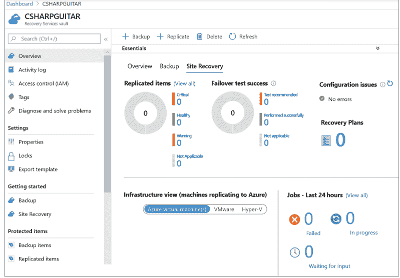

### Migrating Azure Virtual Machines

在练习 3.3 中，您创建了第一个 Azure VM。您在第 3 章中这样做是因为在没有可以应用这些概念的东西的情况下讨论虚拟网络、子网和 NSG 会变得有点复杂。您可以在其中没有 Azure VM 的情况下拥有虚拟网络，但您不能在没有虚拟网络的情况下拥有 Azure VM。因此，在尝试将本地工作负载迁移到 Azure 虚拟机之前，您需要一个虚拟网络和一个像您在练习 3.2 中创建的子网那样。您可以在 Azure VM 上运行大量 Windows Server 和 Linux 版本。那些本地机器的来源位置可以在 VMware、Hyper-V、Azure Stack 上运行，甚至可以在 AWS 上运行。是的，有一份记录在案的程序指导您将 IaaS 工作负载从 AWS 迁移到 Azure。为什么不呢？这里的重点是，每个来源都需要一些不同的步骤来准备和迁移。其中大多数已在前几章和讨论中进行了讨论。有关将单个 Hyper-V 虚拟机实例迁移并部署到 Azure 虚拟机的实践示例，请继续阅读下一节。

### Hyper-V/VMware

Hyper-V 和 VMware 都是服务器虚拟化管理软件。这些产品允许您分配特定数量的 CPU、内存量、硬盘存储量，然后安装操作系统。这就是您通常在工作站或私有数据中心服务器上创建虚拟机的方式。在本节中您要做的是学习，无论您的 VM 部署来源是 VMware 还是 Hyper-V，必须部署的文件必须是 VHD。如果您从没有虚拟化的物理服务器部署，您需要使用 Azure Migrate，或者如果更容易，先将服务器虚拟化然后再迁移。这在 Azure Migrate 的开销过大而手动迁移更简单时很有用。在很多方面，这种准备和构建过程与您在练习 4.6 中所做的类似。在那里，您有一个在 Azure 上创建的 Azure 虚拟机的快照，并用它来构建该 VM 映像的其他相同实例。同样，您即将学习的概念与之前讨论的概念密切相关。完成以下练习，练习 8.1，您将在其中将 VMware 映像（.vmdk）转换为 VHD，部署到 Azure，并用它构建一个 Azure 虚拟机。

### Regional Dependencies in Exercise 8.1

确保您上传 VHD 的 Azure Blob 容器存在于您希望 Azure VM 所在同一区域。同样，Azure VM 必须与其目标 Azure 虚拟网络位于同一区域。只需将练习 8.1 中创建的所有资源放在同一区域；否则，您将无法成功。

未提供从 VMware 提取 VM 映像的步骤；示例 VKMD 是从互联网上配置的。您可以在此处找到该链接以及所有其他引用的下载链接：

```
github.com/benperk/ASA/tree/master/Chapter08/Ch08Ex01
```

### EXERCISE 8.1

### Migrating a VMware Image to an Azure Virtual Machine

- 1. 从 VMware 管理控制台以 vmdk 文件的形式导出服务器，或从互联网获取。作为一个想成为黑客的人，我从 Rapid7 下载了 Metasploitable。（链接可从之前提供的 URL 获取；您无需从 VMware 进行任何导出。）下载完成后，将 vmdk 映像提取到另一个目录。
- 2. 下载并安装 Microsoft Virtual Machine Converter 3.0 到默认目录。下载链接提供在与上一个链接相同的位置。打开 PowerShell 并输入以下命令：

```
Import-Module "C:\Program Files\Microsoft Virtual Machine Converter\MvmcCmdlet.psd1"
```

### Migrating to Azure

3. 执行以下 PowerShell 命令将 vmdk 转换为 vhd。这可能需要几分钟才能完成。输出应类似于图 8.5 所示。

```
ConvertTo-MvmcVirtualHardDisk `
    -SourceLiteralPath "C:\Temp\Metasploitable.vmdk" `
    -DestinationLiteralPath "C:\Temp\Metasploitable.vhd" `
    -VhdType FixedHardDisk -VhdFormat Vhd
```

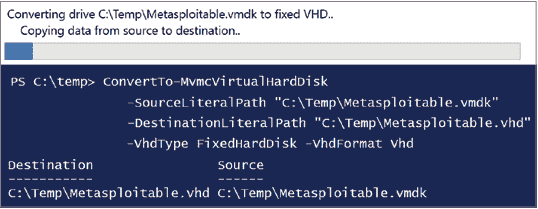

4. 执行以下 PowerShell Azure CLI 以将 VHD 上传到 Azure Blob Storage 容器。输出将类似于图 8.6 所示的内容。请务必将参数值更新为与您自己的相匹配。这可能需要几分钟，具体取决于您的连接速度。

```
Add-AzVhd -ResourceGroupName "<ResourceGroupName>" -Destination `
    "https://<name>.blob.core.windows.net/<container>/Metasploitable.vhd" `
    -LocalFilePath "C:\Temp\Metasploitable.vhd"
```

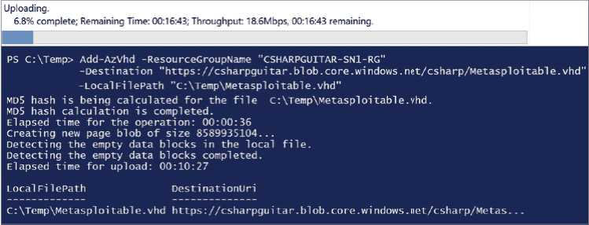

### EXERCISE 8.1 (continued)

5. 上传完成后，登录到 portal.azure.com 上的 Azure 门户。单击浏览器左上角的菜单按钮；然后单击 + 创建资源。搜索并单击托管磁盘。单击创建按钮并输入订阅和资源组。提供磁盘名称（我使用的是 METASPLOITABLE-DISK）。现在，从源类型下拉列表中选择区域和存储 blob。浏览到您在上一步中上传 VHD 的位置并从容器中选择 VHD。单击选择按钮，然后选择 Linux 作为操作系统类型。单击查看 + 创建按钮，然后单击创建按钮。

6. 创建完成后，导航到托管磁盘概览 blade。单击 + 创建 VM，并选择所需的订阅和资源组。输入虚拟机名称（我的为 METASPLOITABLE-VHD1）。确认上一步中创建的映像已从映像下拉列表框中选中，单击选择大小链接并选择 Azure VM 大小（例如，D2s_v3）。单击下一步 : 磁盘按钮，单击下一步 : 网络，并选择虚拟网络（例如，CSHARPGUITAR-VNET-A）。选择子网（例如，csharp），单击查看 + 创建按钮，然后单击创建按钮。

7. 然后您可以 SSH 到虚拟机并对其进行测试。凭据是您在本地运行时用于访问它的凭据。请注意，此 VHD 可被利用。考虑不要设置公共 IP 或任何除您自己之外的其他人访问的手段。

这很直接，不是吗？之前描述的过程在您只想测试单个虚拟化服务器在 Azure 虚拟网络中的 Azure 虚拟机上运行时效果很好。练习 8.1 不是大型企业计划迁移大量 VM 或对 Azure 计算有大量需求的路径。如果是这种情况，即您预计 Azure 计算占用量很大，那么如前所述，使用 Azure Migrate 或如果由于某种原因 Azure Migrate 不适合您，则使用 Azure Site Recovery 将您的工作负载迁移到 Azure 平台。

如果您来自 VMware 世界，还有另一套工具集会让您感兴趣，称为 Azure VMware Solutions。该工具集让您继续使用相同或类似的 VMware 管理控制台，因此您或您的团队无需重新培训。例如，vSAN、vSphere 和 vCenter 等在私有数据中心运行 VMware 时可用的功能仍然可供您使用。从 Hyper-V 角度来看，支持第 1 代（VHD）和第 2 代（VHDX）VM。但是，VHDX 需要转换为 VHD 格式，并且大小不能超过 1,023GB。您可以使用导出向导从 Hyper-V 管理控制台导出 VM，如图 8.7 所示。


#### 图 8.7 在 Hyper-V 中导出虚拟化服务器

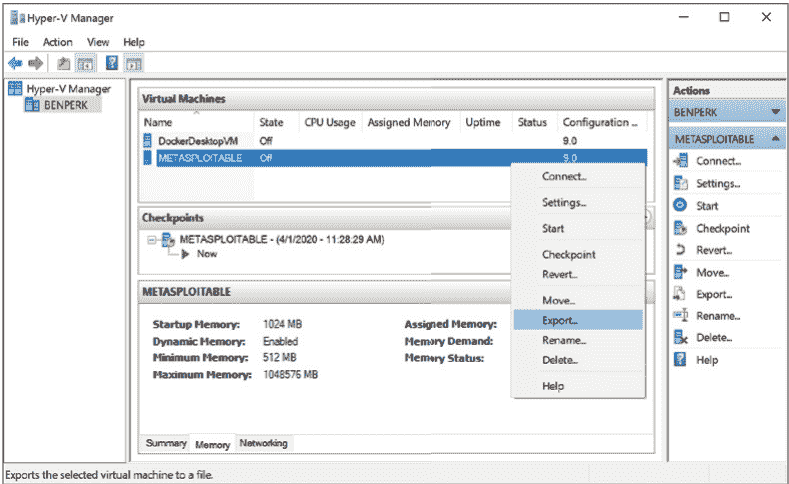

导出后，如有需要，你可以使用以下 PowerShell 命令将 VHDX 转换为 VHD：

```
Convert-VHD -Path "C:\Temp\Metasploitable.vhdx" `
    -DestinationPath "C:\Temp\Metasploitable.vhd" -VHDType Fixed
```

### Windows Server/Linux 工作负载

一种简单的方法是查看创建虚拟机时默认的镜像列表，以找到 Microsoft 为 Azure VM 提供的最常见或最推荐的操作系统版本。表 8.1 是截至本文撰写时你在该下拉列表中会找到的当前列表。

请注意，镜像下拉列表正下方有一个链接，可浏览所有公共和私有镜像。选择非常多，因此表 8.1 中提供的列表仅为概要，绝非完整列表。该列表还包含第三方镜像，因此列表并非静态的，因此本书并不是尝试创建完整列表的地方。这里请记住两点。第一，Linux 是开源的，这意味着任何人都可以创建和定制其版本。第二，这些定制在部署到 Azure 虚拟机时可能有效也可能无效。这就是为什么你希望使用平台上已有的版本和/或使用经认可即受支持的 Linux 版本的原因。你可以在此处找到它们的列表：

docs.microsoft.com/en-us/azure/virtual-machines/linux/endorsed-distros.

你将用于将本地数据中心迁移到 Azure 的许可证。Azure 上的软件许可费用通常已包含在计算平台的整体使用费用中。如果你已有许可证，那么使用你已有的许可证可能会获得某种折扣。有道理吧？Azure Hybrid Benefit 计划正是为此目的而存在的。如果你已有 Windows Server 和/或 SQL Server 许可证，那么将工作负载迁移到 Azure 时，计算成本可节省 40% 至 55%。如果你将此优惠计划与后面讨论的 Azure 预留 VM 实例（RI）结合使用，可能将节省提高到 80%。

### Azure 预留 VM 实例

云中通常采用的默认定价模式基于你的使用量。当你需要大量计算或其他 Azure 资源时，它随时为你提供。当你不再需要时，硬件和基础设施仍然存在，但如果你不使用则不会为你计费。这对你有利，也是云概念的巨大优势之一。从云服务提供商的角度来看，基础设施和计算资源处于空闲状态是不划算的。对此的解决方案是某种程度上分摊空闲硬件的成本。这种分摊的手段是通过 RI 实现的。目前支持此模式的资源可以在 Azure 门户的预留项刀片中看到。你的预留项刀片应与图 8.8 所示类似。

#### 图 8.8 Azure 预留实例

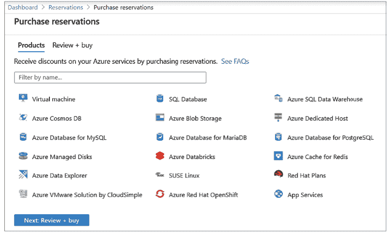

与其根据不可预见的使用量产生按需付费费用，你可以承诺在 7 天、30 天、60 天或更长时间内支出特定金额。它需要少于仅按使用量收费的情况，但比在同一时间段内使用量低于预期时多一些。总体成本平均值对客户来说更低，但对云提供商来说更具成本效益。基础设施不会只是闲置无所事事且产生零收入。查看使用 RI 时产生的成本，将其与动态按需付费使用费用进行比较，如果你能节省费用，那么务必利用它。

### 容器

如果你想快速迁移和提升一种方式，可以使用容器。万一你忘记了这种模式，请查看图 4.1 中可视化的容器即服务（CaaS）。另外，回顾图 4.2 中说明的决策树，以再次了解选择容器作为部署或迁移选项的理由。如果你陷入困境或已用尽所有努力迁移工作负载到 Azure，因为应用程序中存在当前不受支持的定制，请不要忽略或忘记此选项。认真考虑联系 Microsoft 支持；认真说，现在是与 Microsoft 支持合作的时候了。他们想要你的业务，并希望你在 Azure 上取得成功。

总之，容器可以让你将应用程序完全与 VM 和操作系统隔离。这两个或其中一个层可能是你的部署或迁移计划未能按预期进展的原因。移除它们可能是最快的解决方案。不过在此要提醒一下。在做出此类决定之前，请认识到这会带来重大的架构变更，以及迁移和支持此类架构所需的技能集影响。

### 数据库迁移

你的数据存储和数据存储需求的迁移需要遵循迁移计算所使用的结构化流程。参考图 8.1，其中指出了评估、迁移、优化以及安全和管理阶段。与评估和迁移一样，评估和迁移数据库的特定工具也存在。你完全可以使用 Azure Migrate 来帮助发现和盘点你想要迁移的机器。

一个决定迁移方法的重要决策点与数据源密切相关。

数据源是 Microsoft SQL Server，还是其他众多数据源之一，如 Oracle、MySQL、Cosmos DB 和 Mongo？

你计划将这些非 Microsoft SQL Server 数据库迁移到 Azure 上的 SQL Server 之一吗？

你是将现有系统迁移到 Azure，还是迁移到 Azure 并更改 DBMS？

如果你是从本地 Microsoft SQL Server 安装迁移到 Azure 上的 SQL Server 产品，那么一个不错的起点是 *数据库管理助手（DMA）*。

### 数据库管理助手

DMA 是一款工具，可帮助你识别当前运行的 SQL Server 版本与迁移目标版本之间的兼容性问题。表 8.2 提供了受支持的源数据库版本和受支持的目标数据库版本的概述。

**表 8.2  SQL Server 支持的源和目标**

| 位置 | 版本 |
|---|---|
| Source | SQL Server 2005 |
| Source | SQL Server 2008 |
| Source | SQL Server 2008 R2 |
| Source | SQL Server 2012 |
| Source | SQL Server 2014 |
| Source | SQL Server 2016 |
| Source | SQL Server 2017 on Windows |
| Source | SQL Server 2019 |
| Target | SQL Server 2012 |
| Target | SQL Server 2014 |
| Target | SQL Server 2016 |
| Target | SQL Server 2017 Windows / Linux |
| Target | SQL Server 2019 |
| Target | Azure SQL single database |
| Target | SQL Server manages instance |
| Target | SQL Server on an Azure virtual machine |

你可能会同意，如果你的源数据库是 SQL Server 2005 而目标是 SQL Server 2019，途中可能有一些功能已被弃用。DMA 特别指出已弃用的功能、行为变更和破坏性变更。其中大部分需要重新设计或重构才能成功迁移。DMA 也提供了一些规避方法提示，并特别显示了关于安全、性能和存储的额外建议。请注意，表 8.2 中 Azure 上最旧的可目标化 SQL Server 版本是 SQL Server 2012；因此，如果你运行的版本早于 2012，使用 DMA 进行迁移前迁移是高度推荐的。如果你想从 SQL Server 以外的 DBMS 迁移到其中一个目标 SQL Server 版本，那么你需要使用名为 SQL Server 迁移助手（SSMA）的工具。

### SQL Server 迁移助手

如果你决定从非 Microsoft SQL Server 产品迁移到 Azure，同时将 DBMS 迁移到 SQL Server，那么 SSMA 就是帮助你实现这一目标的工具。截至本文撰写时，受支持的源数据存储如下所示：

- Microsoft Access
- SAP ASE
- Oracle
- MySQL
- DB2

SSMA 工具可以自动化迁移中许多步骤的比较，包括对现有实现和目标位置的发现和评估。由于源 DBMS 的种类繁多且定制化程度高，可能存在一些问题无法通过简单的补丁或代码修改解决。可能会发现一些问题，需要从根本上重新思考应用程序实现的架构和目的。重点是，不要低估这种迁移。确保你有合适的专业人员从事此类迁移。现在你已涵盖从 SQL Server 到 SQL Server 以及从非 SQL Server 到 SQL Server 的情况，请查看 DMS 也称为 ADMS。

### Azure 数据迁移服务

DMS 工具已在第 1 章中介绍，并在第 5 章中有一些额外的讨论。 第 5 章是你学习数据和存储的地方，而关于数据和存储的章节不可能没有一点关于 DMS 的内容。有关此服务的更多详细信息可在 datamigration.microsoft.com 获取。DMS 对于需要迁移大量数据库的场景是最佳选择。DMA、SSMA 和 DMS 之间的区别如下：

- DMA 用于小型数据集、兼容性报告和从 SQL Server 到 Azure SQL Server 的迁移。
- SSMA 适用于小型到中型数据集、兼容性报告和从非 SQL Server 到 Azure SQL 的迁移。


- DMS 适用于大型数据集以及多源到多目标迁移的场景。

在深入了解 DMS 之前，请完成练习 8.2 并创建一个 Azure 数据迁移服务。

### EXERCISE 8.2

#### Creating an Azure Data Migration Service

- 1. 登录到 `portal.azure.com` 的 Azure 门户。
- 2. 单击网页左上角的菜单按钮并点击 + Create A Resource 链接。现在，选择 Databases，然后选择 Azure Database Migration Service。（它在列表底部。）
- 3. 选择要放置 DMS 的订阅和资源组并选择位置。考虑选择的区域也是您将迁移数据库的位置。输入迁移服务名称并点击 Next : Networking 按钮。
- 4. 选择现有的虚拟网络/子网或创建新的虚拟网络/子网。虚拟网络必须与 DMS 位于同一区域。点击 Review + Create 按钮，点击 Create 按钮，创建完成后导航到 DMS Overview 刀片，其应类似于图 8.9。

**FIGURE 8.9** The Azure Database Migration Service Overview blade as shown in the Azure Portal

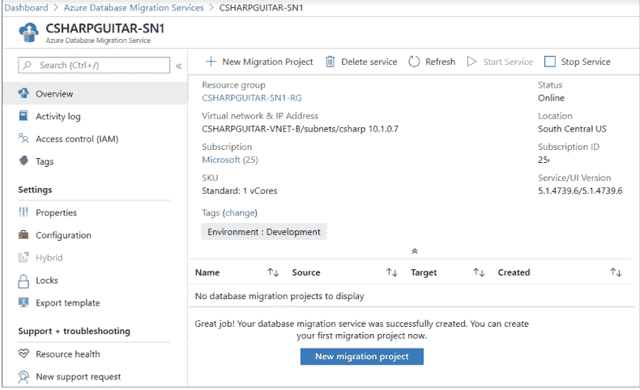

### EXERCISE 8.2 (continued)

5. 点击 Overview 刀片顶部的 + New Migration Project 链接并查看 Source Server Type 下拉列表中列出的数据库产品。同样，查看 Target Server Type 下拉列表中列出的数据库产品。将源服务器类型更改为与您数据库的源版本相匹配。选择目标服务器类型并注意选项的变化。有关这些映射，请参阅表 8.3。选择 Choose Type Of Activity 以查看列表内容。New Migration Project 刀片现在应类似于图 8.10 所示的屏幕。

#### FIGURE 8.10 DMS New Migration Project blade

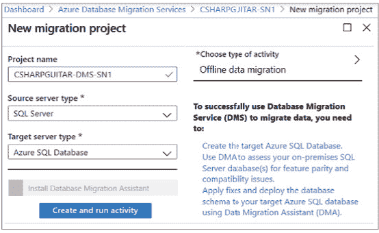

您可能在创建 DMS 时注意到有两种 DMS 模式，Azure 和 Hybrid（Preview）。当您从下拉列表中选择 Azure 时，表示目标数据库所在的 worker 位于 Azure 平台上。相比之下，您可以为混合模型创建 DMS，其中目标数据库托管在本地。当某个功能被标记为“(Preview)”时，表示该功能处于测试或测试阶段。您不希望在实时生产场景中使用任何处于此模式的产品或功能。然而，使这些功能可供使用的原因是为了测试和发现新功能。

Azure Database Migration Service（DMS 也称为 ADMS）可用于将大量 DBMS 源版本迁移到 Azure 平台上的受支持目标。表 8.3 列出了受支持的源及其在 Azure 上的推荐目标实例。

当您在下拉列表中浏览 Source Server Type 选项时，您还可能会看到有关在源和目标之间执行所选迁移的提示。例如，在图 8.10 中，您看到源是 SQL Server，目标是 Azure SQL Database。粗体文本“To successfully use Database Migration Service (DMS) to migrate data, you need to.”下方显示了一些提示和链接。阅读和学习这些内容非常有帮助。

### TABLE 8.3 Source/Target Database for DMS

| Source | Target |
|---|---|
| SQL Server | Azure SQL Virtual Machine |
|  | Azure SQL Managed Instance |
|  | Azure SQL Database |
| MongoDB | Azure Cosmos DB (MongoDB API) |
| MySQL | Azure Database for MySQL |
|  | SQL Server 2008-2017 |
|  | Azure SQL Database |
| AWS RDS for MySQL | Azure Database for MySQL |
| PostgreSQL | Azure Database for PostgreSQL |
| AWS RDS for PostgreSQL | Azure Database for PostgreSQL |
| Oracle | Azure Database for PostgreSQL |
| AWS RDS for SQL Server | Azure SQL Database |

Choose Type Of Activity 下拉列表的内容会根据所选的源/目标映射而变化。您可能还记得在第 5 章图 5.5 中说明的模式的定义。模式是包含表及其之间关系的数据库结构；如果选择模式活动，则不会迁移任何数据。其他活动包括以下内容：

- Schema-only migration
- Offline data migration
- Online data migration
- Create project only

是否可以在数据库仍允许 CRUD 操作的情况下执行迁移，取决于您的要求。如果您在数据库在线时执行迁移，则需要计划处理中断并更新在不同数据迁移阶段临时存储数据的任何表。还请注意 DMS 有不同的定价层级，并且在线迁移仅在 Premium 层级可用。您将在图 8.9 中看到 SKU 为 Standard。还请注意，与 SKU 相关联的计算量。认识到 DMS 需要计算能力来执行迁移。如果您觉得迁移速度慢，很可能是由于在配置 DMS 时选择的计算量造成的。

### Cosmos DB Data Migration Tool

如果您选择 Azure Cosmos DB 作为存储 JSON 文档、Azure 存储表中的内容、CSV 文件或许多其他类似类型的非结构化数据的存储位置，则应考虑使用此工具。您可以在此处找到有关此工具的更多信息：

```
docs.microsoft.com/en-us/azure/cosmos-db/import-data
```

安装工具后，您会识别源，该源可能是一个充满 JSON 文档的目录，并选择目标并执行迁移。非结构化数据虽然可能很大，但在许多情况下，与 RDBMS 相比，这只是一个简单的复制粘贴练习，其中复制可能会因主键/外键违规而失败。

### Azure Databox

此产品包含一些有趣的硬件组件。有关更多详细信息，请在此处查看：

```
azure.microsoft.com/en-us/services/databox
```

Azure Databox 设备可用于将大型数据集迁移到 Azure。Azure Databox 在边缘计算的上下文中工作，您通常有物联网设备捕获和流式传输数据，需要实时或接近实时的数据摄取、分析和警报功能。该产品提供离线和在线模型，其中离线模型模仿第 5 章中引入的 Import/Export 产品，并在许多其他位置进行了讨论。使用此工具，Microsoft 会向您发送一个硬件设备以安全地存储您的数据。一旦您安全地将数据和设备发送到 Microsoft 数据中心，数据就会上传到 Azure 平台。在这种情况下，需要迁移大量数据，通过任何类型的网络发送都将是一项艰巨的任务。

在线数据传输选项包括一个名为 Data Box Gateway 的虚拟设备。此设备有助于在网络上传输和捕获大型数据集。它可用于归档数百 TB 的数据、从边缘实时摄取流数据，以及如果迁移需要在线，则可能是大型数据库迁移的大规模数据传输。

### Database Experimentation Assistant

A/B 测试是一种测试概念，您将部分用户发送到应用程序的新版本，部分用户发送到当前版本。Database Experimentation Assistant（DEA）提供不同版本的 SQL Server 之间的这种测试场景。DEA 将在源 SQL Server 实例上执行并捕获定义的场景，然后在目标实例上重放。当两者完成后，该工具将分析差异并提供报告。报告将有助于识别两个 SQL Server 版本之间发生的任何兼容性问题或错误。

### Database Access Migration Toolkit

此工具将分析源代码并定位可能受数据库更改影响的特定区域。此工具处于（预览）状态，目前仅支持 SQL Server 和 Oracle DBMS。Java、C#、JSON 和 SQL 文件是受支持的编程语言和文件类型。您将与 DMA 协作使用此工具。

### Migrating Azure App Services

Azure Solutions Architect Expert 考试中对将工作负载迁移到 Azure 虚拟机以及 Azure 数据迁移工具和方法有很大关注。请确保在该领域花费大量时间。一个不太被覆盖的领域是 Azure App Service（PaaS）。正如您所知，Azure VM 和 VM 上的 SQL Server 是 IaaS 提供的服务。当然，Azure SQL 和托管实例上的 SQL Server 更像是 PaaS，但请确保 Azure App Service 是 PaaS，专门用于运行网站。Azure App Service 在第 1 章中引入，您在第 3 章中创建了第一个。 第 4 章中也提供了大量信息。请考虑再次查看图 4.2（决策树），以了解在哪些场景下您会选择配置 Azure App Service 实例。在 Azure 虚拟机上运行网站与在 Azure App Service 上运行网站之间的最大区别在于 IaaS 和 PaaS 之间的根本差异。在 IaaS 中，您有更多的灵活性，但也有更多的责任，而在 PaaS 中，您有更少的灵活性和更少的责任。这就是为什么您需要为 ASP.NET 应用程序使用 App Service Migration Assistant 的原因。您可能有一些配置或依赖项不被支持或不允许在 Azure App Services 上使用。现在认识到您可以使用容器运行 Azure App Services；这将使您绕过大多数沙盒限制。然而，由于需要重新培训您的 IT 支持、部署和开发人员，这可能不是一个选项。容器只是一个选项，并不一定是推荐。注意，如果您选择继续使用现有内容，请使用位于 aka.ms/AppMigrate 的 App Service Migration Assistant 工具。在线工具将类似于图 8.11 所示。

该图指出了一些有趣的要点。首先，分析发生在您输入要迁移到 Azure App Service 的 Web 应用程序的当前 URL 时。App Service Migration Assistant 工具将检查网站并返回框架（如 ASP.NET）、网站当前 URL 的托管位置/方式以及 Web 服务器（如 IIS）。如果发现任何不受支持的方面，则报告会指出它们。评估完成后，您可以下载迁移助手以帮助推进迁移。同样值得指出的是页面底部的 Azure Migrate 链接。您看到特定工具的频率越高，其使用和实施的重要性就越大。


#### 图 8.11 DMS 新迁移项目刀片

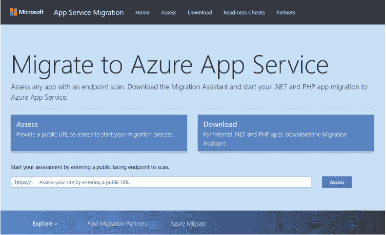

### 导入/导出

第 5 章中对该功能有详细段落的介绍。那里讨论它是因为当数据库大小巨大且无法通过网络实时传输时，该产品就是一个选择。没有什么比在两台服务器之间发送一个 50GB 文件更令人沮丧的了，连接在传输到 49.78GB 后中断，而复制完成已经等待了 19 小时。当这种情况发生时，你通常必须重新启动复制过程并希望这次能成功。但你可能根本不会考虑以这种方式传输如此大的文件。这只是一个例子，但我相信即使文件更小，你也能感同身受。请阅读第 5 章中的描述；产品相同。它在这里也添加了，以防你跳过了第 5 章直接来到这里。

总之，导入/导出工具让你可以创建数据的物理副本并将其发送到 Azure 数据中心。数据中心里的某个人会取走该物理设备并将其加载到一个安全的位置，在那里你可以访问并对其执行所需的操作。该产品看起来与之前讨论过的 Azure Databox 相似。这两个产品将来可能会合并，如果此类迁移在你的职责范围、范围或特别感兴趣的领域内，请留意这一区域。

另外请注意在图 8.12 中，资源组（更改）和订阅（更改）旁边有链接，点击它们会带你到与在 Move 菜单中点击链接相同的地点。这些是简单的，因为你实际上只是在数据库中更新一些数据。真正物理移动 Azure 产品，例如 Azure 虚拟机、数据库或 Azure App Service 应用则需要更多工作。所需的工作与从本地迁移类似，只是排除了评估应用特定配置的步骤。你在本地安装上的配置可能在你要迁移到的 Azure 位置不受支持。由于你已经在 Azure 上，这不应对你的移动造成问题。让我们更详细地讨论以下内容：

- 移动 Azure App Services
- 移动 Azure 虚拟机

每个场景会因平台设计而略有不同，具体取决于将物理资源在区域或区域之间移动时每个产品的设计。例如，目前 Azure App Service 应用不支持区域，因此你无法执行此类迁移。正在进行更改的工作，但尚不清楚你是否最终能够具体选择区域，或者是否由 PaaS  focused 平台代码管理。

### 移动 Azure App Services

请记住 Azure App Service 应用运行在 *App Service Plan (ASP)* 上，这与 VM 同义。你可以在一个 ASP 上拥有多个应用服务，这意味着你有多个网站运行在同一台 VM 上。移动应用服务的另一种方法是称为克隆的概念。使用此功能不会移动网站，而是会制作一个完全相同的副本，以便你随后可以将副本移动并安装到你指定的另一个位置。一旦站点移动并测试完毕，你可以将自定义域名重新映射到新位置并关闭旧站点。如果你导航到要重新定位的应用服务，你会在导航菜单中找到名为 Clone App 的链接。门户中的逻辑随后会引导你完成克隆过程。

一些 Azure PowerShell cmdlet 会产生相同的结果。以下是一些示例 cmdlet：

```
```powershell
$srcapp = Get-AzWebApp -ResourceGroupName SrcResGrp -Name source-webapp
$destasp = New-AzAppServicePlan -Location "North Central US" `
            -ResourceGroupName DestinationAzureResourceGroup `
            -Name DestinationAppServicePlan -Tier Standard
New-AzWebApp -ResourceGroupName DestResGrp -Name destwebapp `
            -Location "South Central US" -AppServicePlan $destasp `
            -SourceWebApp $srcapp
```
```

基本上，cmdlet 检索 Web 应用（即应用服务）的配置详细信息并将其存储在名为 $srcapp 的变量中。$srcapp 然后用作创建新应用服务的源。这假设你已检索现有 ASP 并将其存储在 $destasp 变量中，如代码片段所示。ASP 是创建的而不是检索的。如果 AzAppServicePlan 已存在，你可以使用 Get-AzAppServicePlan cmdlet 代替 New-AzAppServicePlan Azure PowerShell cmdlet。你无法物理移动 ASP，因为它是在物理计算机硬件上的 VM。你只能移动存在于 ASP 上的网站。你当然可以变得花哨，并在 PowerShell foreach 语句中遍历 ASP 上存在的所有 Web 应用，然后逐一迁移它们，以便在一次 cmdlet 调用中全部移动。

### 移动 Azure 虚拟机

本章中你已经接触到的一个工具可用于执行此类移动。你能想到它是什么吗？请记住，你不是在进行迁移；而是在移动已经迁移到平台的 Azure 虚拟机。你可能想要移动运行在 Azure 虚拟机上的应用程序或数据库的一些原因可以是一个或多个以下原因：

- 应用的用户群已远离原始区域并更接近另一个区域。
- 你的 VM 运行的区域中不存在某些功能，但它们在另一个区域可用。
- 你的公司已合并，且该区域中 VM 上存储的数据根据合规性和治理限制不再允许。
- VM 的角色已更改，需要移动到另一个 VNET 以简化管理和发布流程，如图 8.13 所示。

图 8.13 将 Azure 虚拟机重新定位到同一 Azure 区域中的另一个 VNET

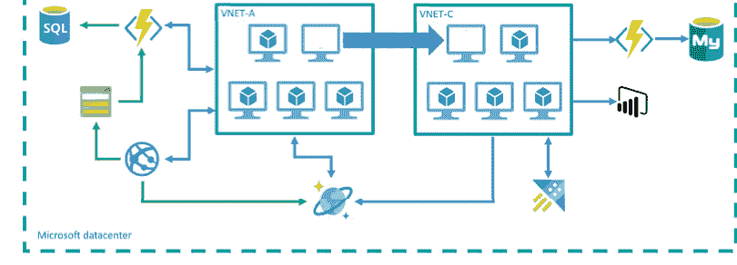

你应认真考虑用于将 Azure 虚拟机移动到另一个区域或虚拟网络的工具是 Azure Site Recovery (ASR)。了解此迁移的最佳方式是通过实践。完成练习 8.3，你将把 VM 移动到同一区域内的另一个虚拟网络。在练习 8.4 中，你将复制 Azure 虚拟机到另一个区域。

### 练习 8.3

### 将 Azure 虚拟机移动到同一区域中的另一个虚拟网络

- 1. 登录到 Azure 门户 portal.azure.com。
- 2. 点击网页左上角的菜单按钮，点击 + 创建资源 链接，点击 IT & 管理工具，选择 备份和站点恢复，并输入要放置恢复服务保管库的订阅和资源组。提供保管库名称，输入区域，然后点击 查看 + 创建 按钮。现在，点击 创建 按钮。
- 3. 一旦配置完成，导航到资源的 概览 刀片并点击 + 备份 菜单项。从下拉列表中选择 Azure 和 虚拟机，如图 8.14 所示；然后点击 备份 按钮。

#### 图 8.14 配置 Azure Site Recovery 服务保管库

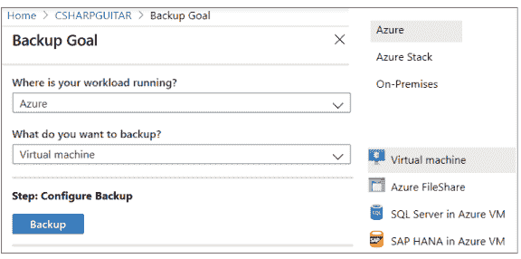

- 4. 在 选择虚拟机 刀片上，点击 确定 按钮以接受默认备份策略。选择你想要备份的 Azure VM(s)，如图 8.15 所示；然后点击 确定 和 启用备份 按钮。

#### 图 8.15 在 Azure Site Recovery 中设置备份策略

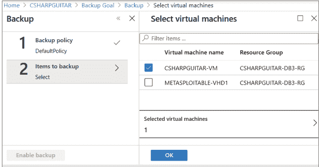

5. 一旦备份完成（这可能需要一些时间），点击导航菜单上的 备份项 链接。接下来，点击 备份管理类型 列标题下的 Azure 虚拟机 链接并选择你在步骤 4 中备份的 Azure VM。当前刀片应类似于图 8.16。

#### 图 8.16 使用 ASR 恢复 Azure 虚拟机

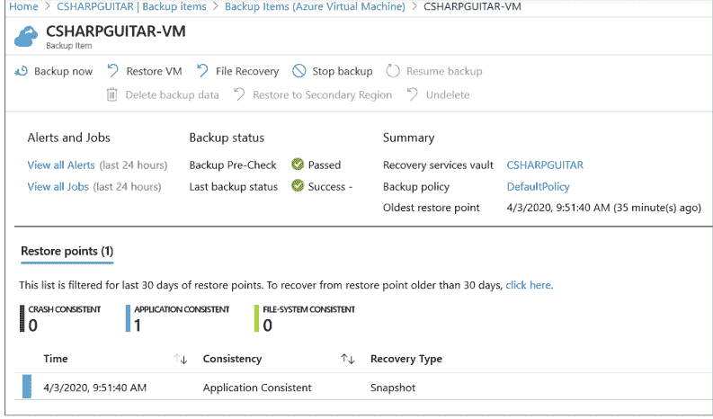


### 练习 8.3

- 6. 点击“还原 VM”菜单项，选择所需的还原点，然后点击“确定”按钮。输入虚拟机名称，选择资源组，选择虚拟网络，选择子网，选择存储帐户，然后点击“确定”按钮。现在，点击“还原”按钮。配置可能类似于图 8.17 所示。

#### 图 8.17 使用 ASR 还原 Azure 虚拟机

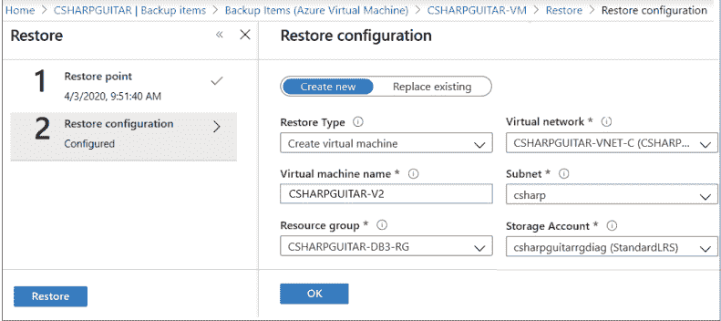

- 7. 还原完成后，导航到新的 Azure VM，确认 VNET 中的更改，并测试新的 Azure VM。测试完成后，通过关闭并删除旧 Azure VM 来将其停用。

你可能会从前面 Azure Site Recovery (ASR) 部分的讨论中认出此产品，因为图 8.4 显示了 ASR 的 Site Recovery 概述边栏选项卡。现在查看“备份概述”边栏选项卡（我假设你正在继续阅读，等待练习 8.3 步骤 5 完成），你将看到已经发生了一些操作。在下一个练习之后，回顾这些操作，你将看到其中记录了你执行的活动。同时，查看图 8.14 也是明智之举。你应该会看到配置此备份时可用的选项。以下输出显示了为你提供的备份源选项值，以及此功能支持的备份类型：

- 你的工作负载在哪里运行？
  - Azure
  - Azure Stack
  - 本地
- 你想备份什么？
  - 虚拟机
  - Azure 文件共享
  - Azure VM 中的 SQL Server
  - Azure VM 中的 SAP HANA

你在第 6 步中可以选择创建新的虚拟机或替换现有的虚拟机。如果选择替换现有虚拟机，则会移动磁盘，并且不会预配任何 VM 实例。此外，如果虚拟网络、子网或暂存位置中没有值，则很可能这些特定资源在你正在使用的区域中不存在。此处配置的所有资源都是必需的，并且需要位于同一区域才能成功执行此操作。如果它们不存在，你可以手动逐一创建，直到它们作为选项出现在下拉列表中。最后，该练习将一个 Azure 虚拟机（位于名为 CSHARPGUITAR-VNET-A/csharp 的虚拟网络/子网中）移动到 CSHARPGUITAR-VNET-C/guitar 中。这两个虚拟网络都位于同一个北欧 (DB3) 区域中。


### Windows Azure 来宾代理

Azure VM 必须正在运行，并且必须在 VM 上安装并运行 Windows Azure 来宾代理服务，才能成功备份。从市场映像创建 VM 时，这两种情况都是默认设置。但是，如果你进行直接迁移或使用自己的自定义映像，则需要手动安装它们。请参阅此页面：

```
docs.microsoft.com/en-us/azure/backup/backup-azure-arm-vms-prepare#install-the-vm-agent
```

在练习 8.4 中，你将把一个 Azure 虚拟机移动到另一个 Azure 区域。请特别注意此练习，因为你将在下一章中在恢复和 BCDR（业务连续性和灾难恢复）场景的上下文中再次看到此方案。在开始之前，请注意以下事项。在之前的练习中，Azure 恢复服务保管库的位置位于资源组 CSHARPGUITAR-DB3-RG 中，该资源组绑定到北欧区域。你将无法在与资源组所在区域相同的区域中执行恢复/复制。从 BCDR 的角度来看，这是合理的，因为在需要 BCDR 功能的情况下，中断会发生在某个区域（数据中心）中。复制到相同的区域不会带来缓解，因为这些机器将位于同一数据中心，并且也可能正在经历中断。请回头看一下图 1.8，其中对此进行了说明。另请查看图 8.18。图 1.8 展示了使用 Azure Site Recovery 在本地与 Azure 区域之间进行复制，以及在两个 Azure 区域之间进行复制。没有展示在同一区域内的复制。对于这种情况，你将使用在练习 8.3 中学到的备份和还原过程。图 8.18 展示了位于北欧 (DB3) 可用性区域 2 的 Azure 虚拟机迁移到美国中南部 (SN1) 的可用性区域 1。

#### 图 8.18 将 Azure 虚拟机重新定位到另一个区域

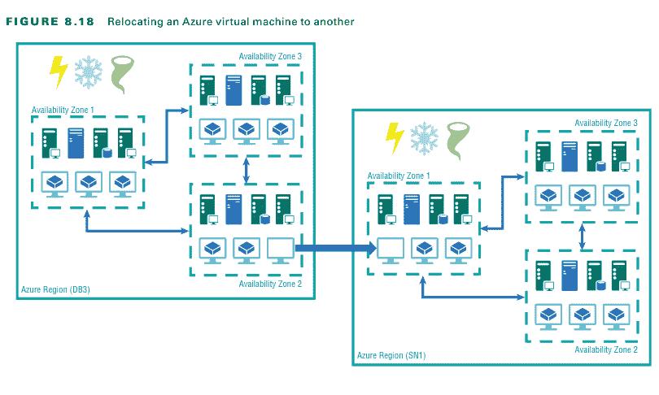

有关可用性区域概念和移动、不支持的场景以及哪些活动应留给平台的更多信息将在后面讨论。现在，请执行练习 8.4，你将把一个 Azure 虚拟机移动到另一个区域。

### 练习 8.4

#### 将 Azure 虚拟机移动到另一个区域

- 1. 登录 Azure 门户（portal.azure.com）。
- 2. 选择网页左上角的菜单按钮，然后点击“+ 创建资源”链接。选择“IT 和管理工具”，然后选择“备份和 Site Recovery”。输入你希望放置恢复服务保管库的订阅和资源组。（注意：资源组必须存在于与你要将 VM 复制到的位置不同的位置（例如，西欧 - AM2）。提供保管库名称，输入区域（例如，(欧洲) 西欧 - AM2），然后点击“查看 + 创建”和“创建”按钮。（片刻之后你就会明白为什么在此处选择 AM2。）
- 3. 完成后，导航到“概述”边栏选项卡，然后按“+ 复制”菜单项。在“源”下拉列表中选择“Azure”，在“源位置”下拉列表中选择“(欧洲) 北欧”。选择包含要复制的 VM 的资源组，并考虑使用你在练习 8.3 步骤 5 中备份的同一个资源组，如图 8.15 所示。参见图 8.19，它展示了一个示例配置。现在点击“确定”按钮。

#### 图 8.19 ASR 复制配置

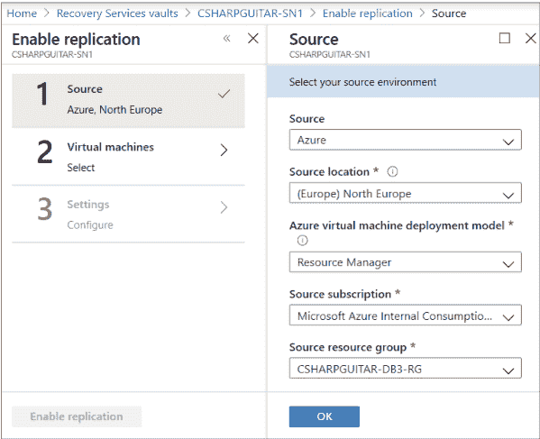

- 4. 选择你要复制的 Azure VM，然后点击“确定”按钮。在“目标位置”下拉列表中选择“(欧洲) 西欧”，然后展开下拉列表并查看你的选项。点击“创建目标资源”按钮，然后点击“启用复制”按钮。

你可能想知道为什么突然指示你在西欧 (AM2) 创建 Azure 资源组。当你在第 4 步中看到可用目标位置列表时，这一点可能已经变得很明显。事实是，此复制旨在用于 BCDR 场景，如果你想创建应用程序的故障转移实例，逻辑上应将其放在离用户最近的位置。使用美国中南部 (SN1) 的基础设施作为北欧 (DB3) 基础设施的故障转移是不合逻辑的。你也许可以创建这样的配置，但对你那些习惯了无需在故障转移期间跨越大西洋建立连接的客户端来说，这种配置不会带来良好的性能。此外，正如你所看到的，下拉列表中的目标位置位于同一地理区域内。

在第 3 章中，你学习了数据中心、可用性区域、区域和地理区域。在地理区域内，有些区域被称为姊妹区域、孪生区域，或者最常被称为配对区域。如图 8.19 所示，呈现给你的列表就是所选源位置的配对区域。从可用性区域的角度来看，移动 Azure VM 或其他支持可用性区域的产品，最好交由平台上运行的逻辑来处理。当你创建 Azure 虚拟机并选择“可用性区域”作为可用性选项时，你可以选择将 VM 放入哪个可用性区域，例如，可用性区域 1、可用性区域 2 或可用性区域 3。你还可以在创建时使用类似于以下的 Azure CLI 命令来设置可用性区域：

```
az vm create -n MyVm -g MyResourceGroup --image Centos --zone 1
```

`az vm update` 命令既没有可用的 `--zone` 属性，也无法通过 Azure 门户进行更新。因此，你必须得出结论：这是不可能的，而且不公开此类功能并将其留给平台处理是合理的。如果你在可用性选项中选择“可用性集”，那么你将进入 VMSS（虚拟机规模集）方向，可用性区域由平台管理，并且无法更改。

### 部署应用程序代码和 Azure 资源

在初始部署后的某个时间点，由于需求变化、新需求、修复错误或修补安全漏洞，代码需要更改和更新。在本节中，你将学习以下主题：


- 使用 Visual Studio 部署
- 使用 ARM 模板部署
- 使用 DevOps 和 Azure DevOps 工作

但在开始这些主题之前，先提供一些关于开发和部署主题的历史会是个好主意，因为这方面的内容很多，可以追溯到 1970 年代。成功的开发流程取决于许多因素，已有大量书籍对此进行了详细阐述。本内容并非旨在取代或与之竞争。尽管如此，仍有一些通用活动可应用于所有开发团队流程。其中一些你已经接触过，也适用于通用的项目管理术语。通用或核心活动如下：

- 需求收集
- 设计
- 构建
- 测试
- 调试
- 部署
- 维护

由于你了解混合模型，你可以将概念上的要点应用于上述这些活动，这些活动可以根据不断变化的软件技术、方法论、框架和实践进行修改和增强。对前面那组要点进行少量更改就会产生新的混合技术、方法论或编码模型。例如，结构化编程、面向对象编程（OOP）、SCRUM、快速应用开发（RAD）、敏捷，以及现在使用持续集成/持续交付（CI/CD）实践的 DevOps 模型，都是在先前活动的基础上通过学习和优化构建的混合概念。这些技术仍然存在，当你在使用它们时，要认识到你正在遵循来自那个特定时代的代码模式、技术和方法。在许多方面，你可以根据其运行的模型来判断一个 IT 应用的年代。以下是可能有争议且简化的时间线。

- 1970s/80s: Waterfall
- 1990s: OOP, RAD, and Scrum
- 2000s: Agile
- 2010s: DevOps

现在你已经了解了一些历史，请认识到这方面的内容很多，而且这是一个团队和大量高技能人员共同合作实现伟大目标的领域。如果你对此感兴趣，就进入这个领域并大胆尝试。你将在本节后面更深入地关注 DevOps，现在让我们从使用 Visual Studio 的简单部署方法开始。

### 使用 Visual Studio 部署

如果你是一个独自从事项目的个人开发者，那么这无疑是将相对复杂的应用程序部署到 Azure App Service 的最简单方法。你可以直接在 Azure 门户中在 Azure App Service 上创建应用服务。使用 Visual Studio 可能有点具有挑战性，因此掌握它的人也将掌握复杂代码的创建。练习 8.5 将指导你部署上一章中介绍的代码。

### EXERCISE 8.5

#### 使用 Visual Studio 部署 Azure App Service

1. 打开 Visual Studio 并单击 Create A New Project。选择 ASP.NET Core Web Application 并输入项目名称。选择 .NET Core，选择 ASP.NET Core 3.1，选择 Web Application，你应该会看到类似图 8.20 的内容。

FIGURE 8.20 Creating an ASP.NET Core application in Visual Studio

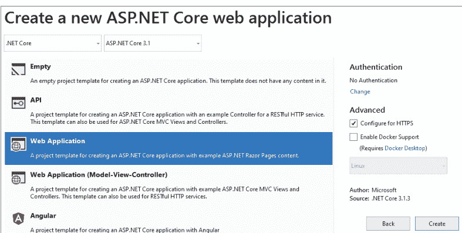

2. 用以下位置找到的代码替换以下文件：

github.com/benperk/ASA/tree/master/Chapter08/Ch08Ex04

（你必须更新代码以使用你的 Azure Key Vault、命名空间和 Azure SQL 详细信息。）

Program.cs

Startup.cs

3. 安装以下 NuGet 包。从菜单中选择 Tools: NuGet Package Manager, Package Manager Console，并依次输入以下命令：

```
install-package Microsoft.Azure.KeyVault
install-package Microsoft.Azure.Services.AppAuthentication
install-package System.IdentityModel.Tokens.Jwt
install-package Microsoft.Extensions.Configuration.AzureKeyVault
install-package System.Data.SqlClient
```

4. 按 Ctrl+Shift+B 编译 Visual Studio 解决方案。现在，右键单击你的 Visual Studio 项目并从弹出菜单中选择 Publish。选择 App Service，选择 Existing，然后单击 Create Profile 按钮。 （参见图 8.21。）

FIGURE 8.21 Publishing an ASP.NET Core application in Visual Studio to an app service

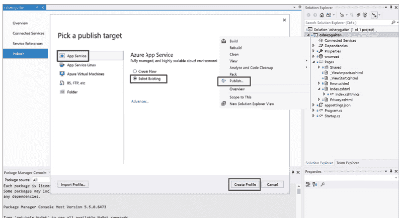

5. 选择要部署代码的订阅、资源组和 Web 应用，然后单击 OK 按钮。现在，单击 Publish 按钮。

6. 你还需要额外执行练习 7.1（配置托管标识）和练习 7.2（配置 EasyAuth）以使应用程序按预期呈现。向前看一下图 8.31，它说明了托管标识、密钥保管库访问策略和 EasyAuth 配置要求。

就这样。再次查看图 8.21；除了部署到应用服务之外，还有部署应用服务到 Linux 的选项，用于将 Azure 虚拟机部署到 IIS，以及部署到文件夹的选项。如果你选择了 Azure 虚拟机，你将被提示选择要部署代码的目标 VM，类似于图 8.22。

FIGURE 8.22 Publishing an ASP.NET Core application in Visual Studio to an Azure virtual machine

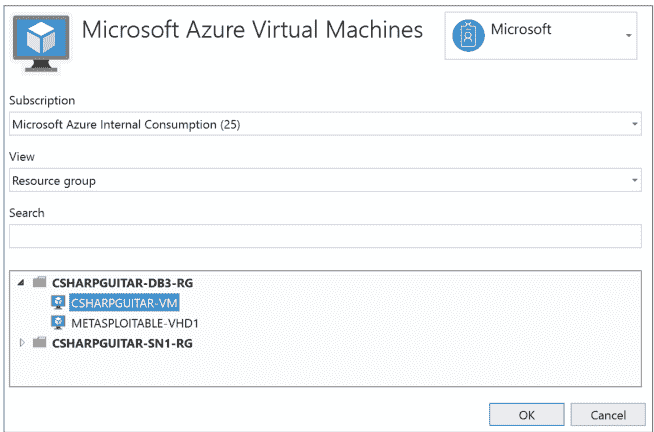

从 Visual Studio 部署到虚拟机有两个先决条件。无论部署到 Azure 平台上的机器还是其他机器，需求都相同。首先确保 Azure 虚拟机具有可部署到的终结点。理想情况下，这将是公共域名或 IP 地址。其次，Azure VM 必须配置为支持 ASP.NET Web 部署。这意味着你需要在 Azure VM 上安装并配置 Web Deploy 模块。你可以在此处找到更多详细信息：

```
www.iis.net/downloads/microsoft/web-deploy
```

此功能已在 Azure App Service 上默认配置并准备好接收你的部署。这不是 PaaS 提供的很棒吗？

### 使用 ARM 模板部署

你已经学习了一些用于使用相同映像、快照、备份和磁盘进行部署的方法。Azure Resource Manager（ARM）模板是实现此目的的另一种方式。ARM 模板是描述你的 Azure 资源为脚本形式的 JSON 文档。查看位于此处的名为 ARM-template-VM.json 的文件：

github.com/benperka/ASA/tree/master/Chapter08

你可以通过单击 Review + Create 刀片上的 Download a Template For Automation 链接来提取它，类似于图 8.23。

FIGURE 8.23 Downloading a template for automation

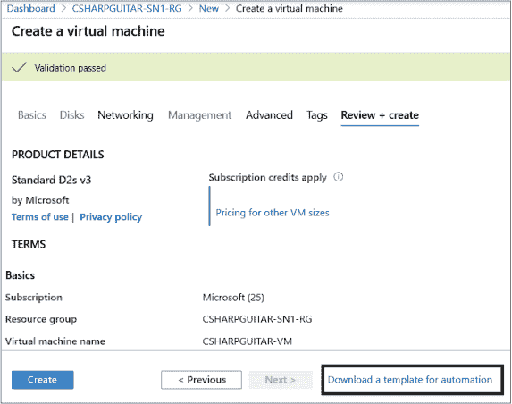

该下载 ARM 模板的链接存在于大多数 Azure 产品中，但它代表给定资源的默认预配状态模板。如果你需要在资源创建后获取 ARM 模板，导航菜单中有一个名为 Export Template 的链接。使用 Export 模板的好处是，如果你进行了一些配置，例如要求 HTTPS 或仅允许 TLS 1.2，那么这些配置将被包含在 ARM 模板中。这很重要，因为如果你由于练习 6.2 中创建的 Azure Policy 而要求 HTTPS 和 TLS 1.2，尝试在未设置这些属性的情况下创建这些资源将会失败。查看位于 GitHub 上与前面提供的 VM 相同位置的 ARM-template-APP-SERVICE.json 文件。浏览它，你会看到 "httpsOnly": true 和 "minTlsVersion": "1.2" 已正确设置在模板中。你可以以多种方式组织你的 ARM 模板以进行部署。到目前为止提供的示例，以及 GitHub 上的示例模板，代表了一个 VM 模板、一个 App Service 模板和一个 Azure SQL 模板（参见 ARM-template-AZURE-SQL.json）。该场景代表将多层 Azure 产品部署到同一资源组。每个资源都按照预定的顺序手动预配。


你可以在图 8.24 左侧看到该情况的可视化表示。如果你在运行相同的多层环境，并且希望产品位于不同的资源组中，请参阅图 8.24 右侧。同样，每个资源都是单独部署的。

图 8.24 将 ARM 模板部署到单个或多个资源组

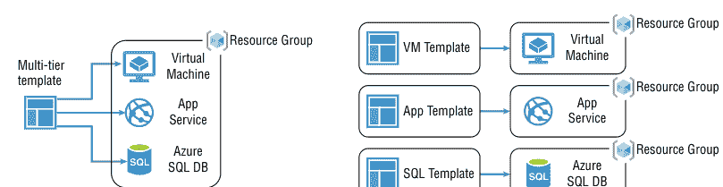

另一种部署方法与所有资源同时部署到同一资源组有关。如图 8.25 所示，你可以通过创建包含内部嵌入子（嵌套）模板的父 ARM 模板来实现此目的。

图 8.25 使用嵌套模板部署 ARM 模板

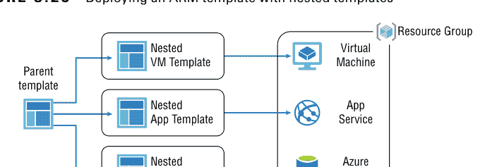

可以从资源组刀片导出 ARM 模板。在资源组刀片中，你会找到导出模板导航菜单项。一旦你将所有资源配置为以后可以按你想要的方式再次部署，你就可以导出资源组中包含的资源配置。在接下来的三个部分中，你将学习支持、部署和执行使用 ARM 模板预配 Azure 资源所需的组件。它们是 Azure 资源管理器（ARM）模板和 Azure 资源管理器。它们的关系在图 8.26 中表示。

ARM 模板的内容采用 JSON 文档的形式。在顶部，你会找到对架构的引用。就像数据库架构以文本形式描述数据库的结构一样，JSON 文档架构定义了文件的结构及其支持的属性。之前的 ARM 模板示例中有几个属性需要一些额外信息，具体来说是 type、apiVersion 和 dependsOn。

type 属性是模板将预配和配置的资源。这些被视为资源提供程序，在本章后面会更详细地讨论。绑定到 type 属性的值可能对你来说已经很熟悉了，因为这并不是一个新概念或结构模式。阅读“资源提供程序”部分，如果你想更深入地了解这一点。

apiVersion 标识 Azure 资源管理器用于预配产品的 REST API 的版本。（参见图 8.26。）本章后面有一个练习，你将使用 ARM 模板预配资源。当 ARM 模板发送到 Azure 资源管理器时，它会被翻译成使用 JSON 文档内容组装的 HTTPS 请求。type 和 apiVersion 属性将类似于以下内容：

```
PUT
https://management.azure.com/subscriptions/{subscriptionId}/resourceGroups/{resourceGroupName}/providers/Microsoft.Web/sites/csharpguitar?api-version=2018-11-01
REQUEST BODY
{
  "location": "North Europe",
  "tags": { "Environment": "Production" },
  "kind": "app",
  "properties": { "httpsOnly": true }
}
```

对于每种类型及其该类型的配置内容，将向资源提供程序发送额外的 HTTPS 请求以进行预配和配置。

现在让我们回到本节的第一句话，我说这可能会变得复杂。考虑一下，如果你为资源组中的所有产品导出了模板。思考一下预配和部署所有这些产品、功能和配置所需的 Azure 资源管理器到资源提供程序的 HTTPS 调用次数。对于大型 ARM 部署，有两个主题你应该知道。第一个是 dependsOn 属性。如之前的 ARM 模板示例所示，设置这些 App Service 属性（autoHealEnabled、http20Enabled、minTlsVersion）取决于应用服务的存在。这是有道理的，因为你无法修改尚不存在的东西。将网络接口绑定到 Azure 虚拟机或向子网添加 NSG 也是如此。这些配置彼此存在依赖关系，除非所需资源可用，否则它们将无法成功。当某些资源成功但整体部署在执行过程中部分失败时，这可能是一个挑战。这确实是一个具有挑战性的领域，随着时间的推移仍在不断改进。我导出了 CSHARPGUITAR_SN1_RG ARM 模板，其中包含资源组中的所有产品和配置，它长达近 4,000 行，包含 155 个 dependsOn 属性。这很大且复杂。

对于如此庞大的 ARM 部署，你需要记住对 Azure 资源管理器每小时的请求次数有限制。它们是相对较高的数字，但如果你进行一些大型部署或利用 Azure 资源管理器的其他活动，你的部署可能会被限制。限制大约为每小时 1,200 次写入和 12,000 次读取。你应该认真考虑在可能的情况下进行较小的部署，使用多个模板由一些自定义代码协调，按特定顺序并在较长的时间范围内执行它们。关于 ARM 模板有很多东西需要学习，请查看 aka.ms/arm-template，以了解内部结构、更多技术、结构和故障排除指南。

### 内容部署

在进入下一节之前，请注意，到目前为止关于 ARM 模板的讨论一直集中在 Azure 产品的预配上。尚未讨论将应用程序代码与 ARM 模板的计算预配一起部署。 正如你在练习 8.5 中所学，你可以使用 Visual Studio 将内容部署到 Azure App Service 和 Azure 虚拟机。在这两种情况下，部署在幕后使用 Web Deploy（msdeploy）来实现。ARM 模板中的 msdeploy 扩展可以执行内容部署。 这里显示的 JSON 文档片段在 ARM 模板中包含内容：

```
"resources": [
  {
    "apiVersion": "2016-08-01",
    "name": "MSDeploy",
    "type": "Extensions",
    "dependsOn": [
      "[concat('Microsoft.Web/Sites/', 'csharpguitar')]"] ,
    "properties": {
      "addOnPackages" : [
        {
          "packageUri":
            "https://<n>.blob.core.windows.net/csharp/webdeploy_package.zip",
          "AppOffline": true}}]}]

```

此功能使用 addOnPackages 架构元素来标识代码的位置。代码位置由 packageUri 属性提供，该属性指向存储在 Azure Blob 存储容器上的 zip 文件。还请注意 dependsOn 属性，它确保在尝试将代码部署到应用服务之前，应用服务已存在。你将在练习 8.6 中稍后配置和部署此内容。

### 资源提供程序

每个 Azure 产品、功能和服务都存在相应的资源提供程序。它们的数量超过 100 个。表 8.4 总结了本书中引用的资源提供程序及其匹配的服务。由于 Azure 经常添加或修改产品和功能，列表可能会发生变化。如果你需要查找其他资源提供程序，请查看此处：

docs.microsoft.com/en-us/azure/azure-resource-manager/management/azure-services-resource-providers

你也可以在互联网上搜索文档，特别是 docs.microsoft.com。另请考虑使用此 Azure CLI 命令：

```
Get-AzResourceProvider
```

该命令列出所有当前的 Azure 资源提供程序并保持最新。结果还提供资源可用的区域以及你的帐户是否已注册使用资源提供程序。如果你未注册和/或无法访问资源提供程序，则无法创建或配置该 Azure 资源。要在 Azure 门户中查看你有权访问的资源提供程序，请导航到你的订阅并单击资源提供程序导航菜单链接。图 8.27 显示了它可能的外观示例。

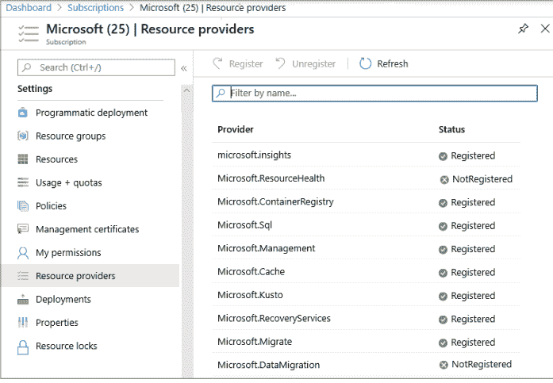


| 资源提供程序 | 服务 |
|---|---|
| Microsoft.Migrate | Azure Migrate |
| Microsoft.NetApp | Azure NetApp Files |
| Microsoft.Network | Application Gateway |
| Microsoft.Network | Azure Bastion |
| Microsoft.Network | Azure DDoS Protection |
| Microsoft.Network | Azure DNS |
| Microsoft.Network | Azure ExpressRoute |
| Microsoft.Network | Azure Firewall |
| Microsoft.Network | Azure Front Door Service |
| Microsoft.Network | Azure Private Link |
| Microsoft.Network | Load Balancer |
| Microsoft.Network | Network Watcher |
| Microsoft.Network | Traffic Manager |
| Microsoft.Network | Virtual Network |
| Microsoft.Network | VPN Gateway |
| Microsoft.NotificationHubs | Notification Hubs |
| Microsoft.OperationalInsights | Azure Monitor |
| Microsoft.OperationsManagement | Azure Monitor |
| Microsoft.PolicyInsights | Azure Policy |
| Microsoft.Portal | Azure Portal |
| Microsoft.PowerBI | Power BI |
| Microsoft.RecoveryServices | Azure Site Recover |
| Microsoft.Relay | Azure Relay |

### 表 8.4 常见资源提供程序和服务（续）

| 资源提供程序 | 服务 |
|---|---|
| Microsoft.ResourceGraph | Azure Resource Graph |
| Microsoft.ResourceHealth | Azure Service Health |
| Microsoft.Resources | Azure Resource Manager |
| Microsoft.Scheduler | Scheduler |
| Microsoft.Security | Security Center |
| Microsoft.SecurityInsights | Azure Sentinel |
| Microsoft.ServiceBus | Service Bus |
| Microsoft.ServiceFabric | Service Fabric |
| Microsoft.Sql | Azure SQL Database |
| Microsoft.Sql | Azure Synapse Analytics |
| Microsoft.SqlVirtualMachine | SQL Server on Azure Virtual Machines |
| Microsoft.Storage | Storage |
| Microsoft.StorageCache | Azure HPC Cache |
| Microsoft.StorageSync | Storage |
| Microsoft.StorSimple | StorSimple |
| Microsoft.Synapse | Azure Synapse Analytics |
| Microsoft.VirtualMachineImages | Azure Image Builder |
| microsoft.visualstudio | Azure DevOps |
| Microsoft.Web | App Service |
| Microsoft.Web | Azure Functions |
| Microsoft.WorkloadMonitor | Azure Monitor |

这是一份本书中已详细讲解或已做过总结的所有 Azure 产品、服务和功能的清单。如果你想使用 ARM 模板或通过某个 HTTP 客户端应用程序直接通过 REST API 与 Azure 产品交互，那么表 8.4 中列出的资源提供程序可作为起点。

Azure 资源管理器和资源提供程序已在第 2 章中介绍过，当时是在使用基于角色的访问控制（RBAC）功能向用户授予权限的上下文中介绍的。每个资源提供程序都公开了一组权限，你可以随后将这些权限授予用户，例如读取、写入和删除。请查看图 2.28 并将其与表 8.4 中列出的资源提供程序进行比较。你会认出其中一些。在本书的许多位置和许多练习中，你都接触过资源提供程序，因为它们是访问、配置和部署 Azure 资源的基础。具体来说，在练习 3.2 中，你启用了 Microsoft.Web 资源提供程序并将其授予子网的访问权限；参见图 3-8。请注意，在图 8.28 中，服务终结点配置可用的终结点是基于资源提供程序的。

这意味着只有该资源提供程序内的服务才支持服务终结点。资源提供程序消费用于配置 Azure 资源之间的依赖关系和链接的用例还有很多这样的例子。

#### 图 8.28 可用于服务终结点配置的资源提供程序

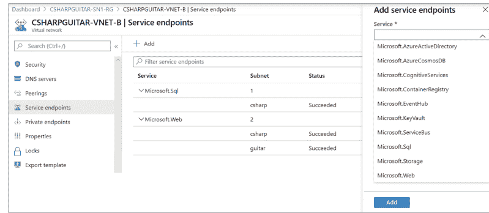

### Azure 资源管理器

最后一块拼图是 Azure 资源管理器，它是 management.azure.com 背后的平台服务和计算能力。图 2.45 和图 8.26 中表示的所有受支持客户端都会发送用于部署和管理 Azure 产品和功能的指令。Azure 门户、Azure CLI、Azure PowerShell 以及任何自定义编码的程序都可以与 Azure 资源管理器交互以执行请求的操作。对资源管理器的请求由 Azure 资源管理器进行身份验证、授权并执行。完成练习 8.6 并使用 ARM 模板部署一个 Azure App Service。

### 练习 8.6

### 使用 ARM 模板部署 App Service

- 1. 练习的第一部分要求你创建一个 zip 部署。为此，你需要已完成练习 8.5。再次查看图 8.21。不要选择 App Service，选择 Folder。在 Visual Studio 中右键单击项目，从弹出菜单中选择 Publish，选择 Folder，单击 Create Profile 按钮（参见图 8.29），单击 Publish 按钮，最后导航到应用程序已发布到的文件夹。
- 2. 选择 bin\Release\netcoreapp3.1\publish 目录内的所有内容（Ctrl+A），右键单击所选文件，选择 Send to，然后选择 Compressed (zipped) folder。重命名 zip 文件（我使用的是 csharpguitar.zip）。登录到 portal.azure.com 上的 Azure 门户，导航到你之前创建的 Azure Blob 存储容器，然后上传压缩的 zip 文件。成功上传后，你应该会看到类似图 8.30 的内容。

#### 图 8.29 将 Visual Studio Web 应用程序发布到文件夹

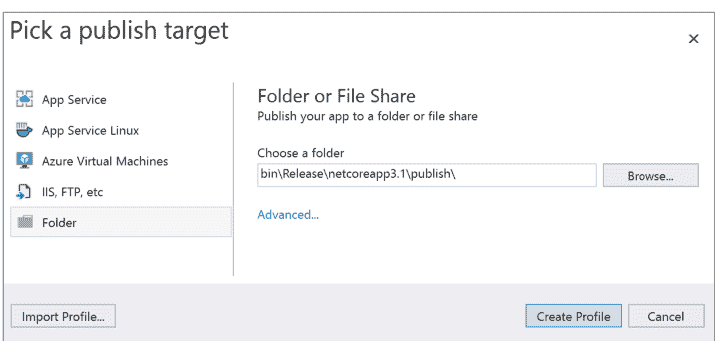

- 3. 下载位于此处的 ARM-template-APP-SERVICE.json 文件：github.com/benperk/ASA/tree/master/Chapter08/Ch08Ex05 修改 appName 和 serverFarm 目录路径以匹配你的订阅、资源组和 App Service Plan，当然还要修改

#### 图 8.32 Azure DevOps 在 Azure 工作负载中的作用

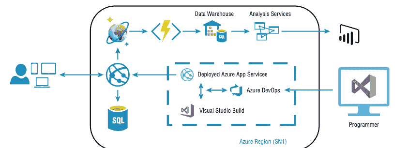

#### 图 8.33 Azure DevOps 服务

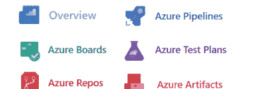

表 8.5 列出了每个 Azure DevOps 的详细信息。请记住，此工具面向公司或企业内部的开发团队。如果你是个人，实现这样流程所需的精力不会比设置体验获得更多。你可以考虑使用 GitHub 仓库，如果你作为一个单人组织在自己工作。

### 表 8.5 Azure DevOps 服务描述

| 服务 | 描述 |
|---|---|
| Boards | 提供工作项分配和跟踪的界面 |
| Repos | 存储和管理应用程序源代码的位置 |
| Pipelines | 用于构建、测试和部署应用程序的界面 |
| Test Plans | 创建和存储应用程序测试模块和计划的位置 |
| Artifacts | 存储应用程序依赖包的单一位置 |

当你在一个开发团队中工作时，工作分配流程可能会含糊不清。使用 Azure Boards 可以帮助明确谁负责什么以及何时预期交付。分配的单位被称为工作项。Azure Artifacts 是存储依赖包版本的场所，例如来自 Node Package Manager（npm）、NuGet 和 Python 公共源的包。并不罕见的是，库或运行时的依赖版本会被从公共使用中移除。Azure Artifacts 是你可以将它们存储起来供将来内部使用的场所。表 8.5 中列出的其他 Azure DevOps 服务不言自明，或已在之前某个时间点讲解过。

### 使用 Azure DevOps 部署

现在你知道了 Azure DevOps 是什么，是时候做一个练习来使用它部署应用程序了。在开始之前你需要一个 Azure DevOps 账户。请按照 aka.ms/devops 上的说明操作并单击 Try For Free 按钮创建一个。我确实认识到并非所有阅读本书的人都是程序员，下面的练习可能会超出你的技能范围。此练习确实需要一些先决条件，不会详细讲解，但在发生时会被指出。最重要的收获是了解 Azure DevOps 是什么、它能做什么以及何时为何使用它。实际执行工作可以留给该领域的专家。如果你感到有挑战，请执行练习 8.7。如果你卡住了，请在 GitHub 上记录一个 issue，你可以在那里获得代码示例。

### 练习 8.7

### 从 Azure DevOps 部署应用程序

- 1. 使用你在练习 8.5 中创建的应用程序，或使用相同的说明创建一个新的。在 Visual Studio 中打开项目/解决方案，从菜单中选择 View Team Explorer，然后单击 Team Explorer 菜单上的 Manage Connection 按钮。（它看起来像一个插头适配器。参见图 8.37 作为示例。）连接到你在 aka.ms/devops 上创建的 Azure DevOps 实例（正如本练习前一段所述）。单击 Synchronize 按钮并将代码发布到 Azure DevOps。完成后，Azure DevOps Repo 将如下图 8.34 所示。

#### 图 8.34 Azure DevOps Repos

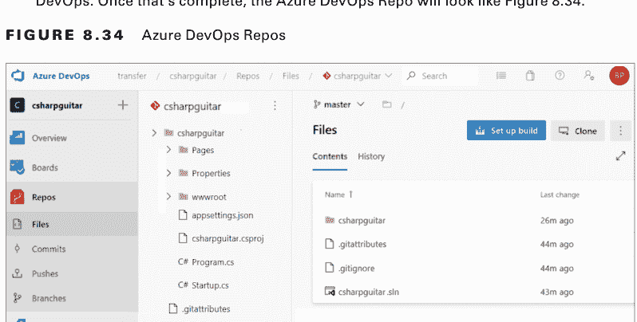


点击 Save 按钮，然后点击 Run 按钮。如果遇到任何问题，请在你下载此 YAML 文件的 GitHub 站点上记录一个 issue。

5. 与练习 8.5 和练习 8.6 一样，你还必须额外执行练习 7.1（配置托管标识）和练习 7.2（配置 EasyAuth），才能使应用程序按预期呈现。请参阅图 8.31，其中说明了托管标识、密钥库访问策略和 EasyAuth 配置要求。

6. 为证明 CI/CD 正在工作，默认情况下修改 index.cshtml 的第 33 行，使其将以下文字颜色修改为红色。

```
<h5 style="color: red">A JWT Token Does Not Exist</h5>
```

7. 查看图 8.37，其中说明了以下说明。保存 index.cshtml 文件。注意文件名旁边的复选标记。点击 Team Explorer 选项卡，点击 Changes 选项，添加一条注释（例如，Made H5 red），然后点击 Commit All 按钮。点击位于 Team Explorer 选项卡顶部的 Home 按钮；然后点击 Sync 按钮。现在，点击 Outgoing Commits 标题下的 Push 链接并监控 Pipeline Runs 选项卡。Run 完成后，刷新浏览器中的 App Service 页面以确认更新已自动发布。

**FIGURE 8.37** Azure DevOps Pipeline CI/CD process flow

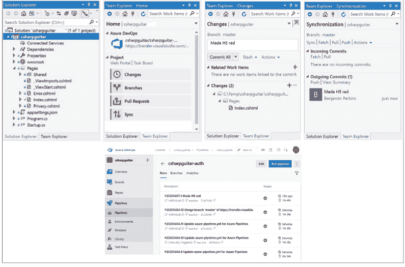

Azure DevOps 以及产品与 DevOps 方法论的集成是你应该参与并深入学习的内容。这里的信息只是触及了皮毛。请记住，还有许多其他源代码存储库。其中两个立刻想到的就是 GitHub 和 Jenkins。你可以轻松地用其中任何一个替换 Azure DevOps 并实现同类的 CI/CD 和 DevOps 流程。这仅仅取决于你想使用哪个工具。所选工具中可能存在一些细微差异或仅有的优势；然而，本书的作者并不了解它们。你需要成为使用这些工具的专家才能找到它们，而这对于通过 Azure Solutions Architect Expert 考试来说并不是必要的。

最后，YAML 专业知识很快就会成为你口袋里的一项不错技能。YAML 在第 4 章中已向你介绍过，在讨论 AKS 的开发和部署时。使用 YAML 时，似乎又架起了一座连接微软和开源社区的桥梁。AKS 是开源的并且依赖于 YAML 文件，而 YAML 用于配置从 Azure DevOps 部署 .NET Core 应用程序，这都是微软向开源迈进的迹象。这是一个值得花时间学习的有趣领域，以助你在成为优秀的 Azure Solutions Architect Expert 的道路上前行。然而，就通过考试而言，这并不那么重要。

### Other Deployment Options

还有一些其他与部署相关的主题需要提及。首先与直接部署到生产环境有关。在本章提供的示例中，就是这样发生的，但在现实世界中这是有风险的。这是有风险的，因为部署可能在中途失败，或者引入了一个在测试中未被发现的 bug。你应该认真考虑在进行数据库升级时使用故障转移，以便如果需要回滚，就回滚到原始实例。对于 Azure VM，也许可以通过更改绑定到 VM 的 IP 地址或 DNS 条目，将安装在预生产环境中的应用程序实例变为生产实例。最后，在部署到 Azure 应用服务时，有一个名为部署槽的功能，你可以在其中部署应用程序。测试通过后，你可以交换槽，使测试槽变为生产槽，而生产槽变为测试槽。重点是，直接将更改部署到生产环境是不良做法；它影响太大，可能会导致严重的停机。

Azure Portal 中有一个用于部署的有用功能，可通过搜索“Deploy a custom template”找到。如图 8.38 所示，该功能允许你在线创建 ARM 模板。你也可以将练习 8.6 中使用的模板剪切并粘贴到门户中，点击 Save，然后发布它。这是一个很不错的功能。

**FIGURE 8.38** Azure Portal custom deployments

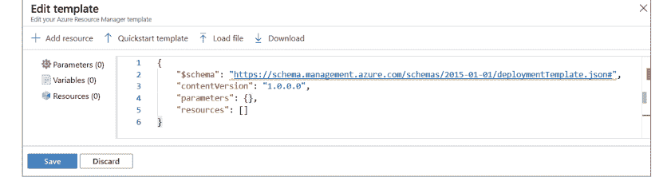

最后，Visual Studio 中有一个名为 Azure Resource Group 的项目模板，它提供了创建 ARM 模板的图形界面。见图 8.39。

**FIGURE 8.39** Creating ARM templates in Visual Studio

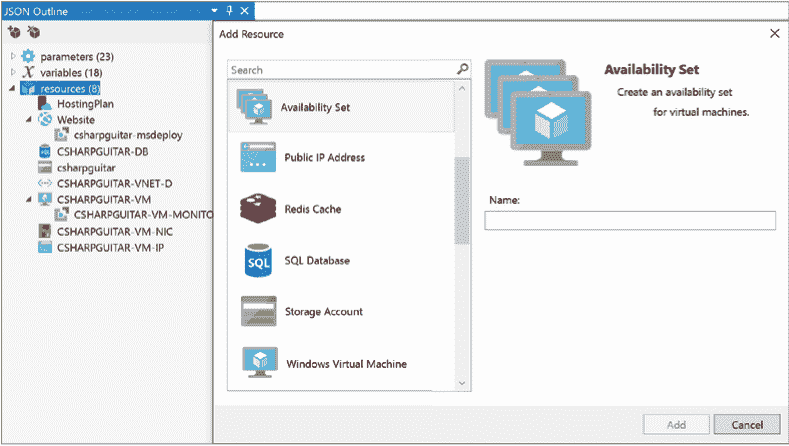

JSON 文档为你勾勒了轮廓，通过右键单击参数、变量或资源，你可以获得创建、更新或删除它们的选项。这比在 Notepad 中操作容易得多。你也可以考虑将从某个网站下载的 ARM 模板示例粘贴到 IDE 中，看看 JSON Outline 如何以图形方式解释它。

### Learning Azure Automation

随着你学习并提升对 Azure 和云计算的整体知识，你的足迹最初会很小。没有人应该被置于沉没或自救的境地，领导者应始终致力于创造有利于成功的环境。随着你的公司发展或你承担更具挑战性的云和 Azure 相关项目，受管理的资源数量会增长，而且会增长。云计算的一个陷阱就是，配置资源如此容易，然后在短时间内就会积累大量资源。回顾图 6.3，它展示了我的个人订阅的状况， somehow 拥有超过 2,600 个资源——而且那只是我一个人。幸运的是，其中没有运行生产或任务关键型应用程序；否则我会迷失。我的观点是，在开始时，当你配置的 Azure 资源数量较少时，手动管理是可行的。这一足迹会迅速增长到手动管理云产品不再可行的程度。此外，如果你等到“啊哈”时刻，回头重新为管理所有 Azure 产品而重构自动化方法所付出的努力可能太大。你需要有这种视角，并且要有这样的视角：单个大脑或一群优秀大脑仍然不足以管理庞大的计算规模。你必须使用计算本身来管理你配置的资源。你和你的团队管理管理计算和工作负载的产品和功能。

微软理解这一点，并提供了一套工具和服务来帮助你管理云规模的计算足迹。它始于一个名为 Azure Automation 的服务组合。Azure Automation 专注于消除手动 Azure 相关管理任务。Azure Automation 功能列表如下：

- Process automation
- Configuration management
- Update management

在深入介绍这些功能之前，有一个练习等着你。在练习 8.8 中，你将查看众多 Azure Automation 模块以了解可用内容。然后你将创建一个简单的“Hello CSHARPGUITAR” Process Automation Runbook。

### EXERCISE 8.8

#### Creating a Process Automation Account and Runbook

1. 登录到 Azure Portal portal.azure.com。点击网页左上角的菜单按钮，点击 + Create A Resource，选择 IT & Management Tools，选择 Automation，输入名称，选择你希望 Automation 帐户存在的订阅和资源组，并选择区域。 （你应强烈考虑将 Automation 帐户放置在包含你想要自动化的产品的资源组中。并且为 Automation 帐户选择与资源和资源组相同的区域。）从下拉列表框中选择一个 Location 并点击 Create 按钮。

2. 一旦配置完成，导航到 Azure Automation 帐户的 Overview 刀片；见图 8.40。

3. 在导航菜单中，点击 Runbooks Gallery 链接。查看一些示例，其中一些特别感兴趣的列在这里：

    - Stop-Start-AzureVM, Stop-Start-VMSS
    - Backup Azure SQL Database to Blob Storage
    - Delete Azure blobs older than X number of days
    - Stop-Start-Scale Websites (App services)


### EXERCISE 8.8 (continued)

- 检查 SSL 过期并通过电子邮件通知。
- 禁用已过期的 Active Directory 账户。
- Azure RBAC 报告
- 垂直扩展 Azure SQL 数据库。
- 将 Azure 虚拟机接入更新管理和变更跟踪
- 删除空的资源组。

#### FIGURE 8.40 The Azure Automation account Overview portal blade

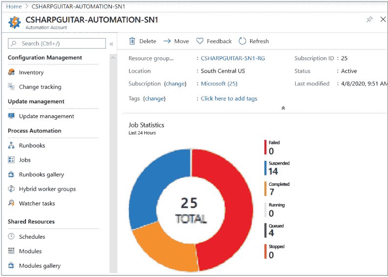

4. 从导航菜单中选择 Runbooks，点击 + Create A Runbook，并输入运行手册名称。从 Runbook Type 下拉列表中选择 PowerShell，输入描述，点击 Create 按钮，并在编辑器中输入以下代码片段，如图 8.41 所示。它可从此处下载：
github.com/benperk/ASA/tree/master/Chapter08/Ch08Ex07
param

```
(
    [Parameter(Mandatory=$false)]
    [String] $Name = "CSHARPGUITAR"
)
"Hello $Name!"
```

#### FIGURE 8.41 Creating an Automation runbook in the Azure Portal

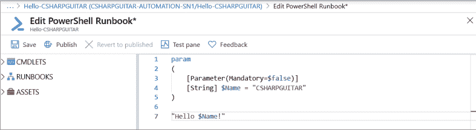

5. 点击 Save 按钮，点击 Test Pane 按钮，输入名称，然后点击 Start 按钮。见图 8.42。

#### FIGURE 8.42 Testing an Automation runbook in the Azure Portal

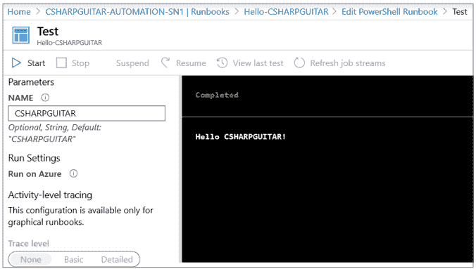

6. 通过点击刀片右上角的 X 关闭 Test 刀片，点击 Publish 按钮，然后点击 Yes 按钮。然后你就可以根据需要从例如 Hello-CSHARPGUITAR Runbook 概览刀片对运行手册进行调度、运行、导出和编辑。

继续阅读以讨论更多关于此练习以及一些其他 Azure Automation 功能。

### Process Automation

在练习 8.8 中你创建了一个简单的流程自动化运行手册。然而，当你查看示例模板库时，你肯定学到了并意识到这个 Azure 产品所能提供的强大功能、能力和机会。流程自动化的目的是自动化耗时较长的任务、出错风险较高的任务、高影响或活动的任务，以及频繁发生的任务。这些好处使得你的工作负载在自动化后更具弹性和可靠性，因为一旦操作被完善并编码，那么出错或忘记执行任务的可能性就会大大降低。例如，练习 8.8 中你看到的运行手册模板，它会检查 SSL 证书的到期日期。我无法计数我收到过多少次导致大规模高可用性停机的升级事件，其原因就是证书过期。这种问题会完全关闭系统，而且通过此流程自动化运行手册任务是 100% 可避免的。

在之前的练习中，你使用 PowerShell 语法创建了一个运行手册。当你从 Runbook Type 下拉列表中选择 PowerShell 时，你可能注意到还有其他支持的类型，例如 Python 和一种图形化的、类似工作流图的选项。支持更多运行手册创建选项增加了组织拥有创建此类自动化所需技能集的可能性。此外，一旦运行手册创建完成，你可以创建一个 web hook 来触发运行手册的执行。如果你还记得第 6 章中关于 Event Grid 的讨论，你会记得它可以根据事件被触发或触发 web hooks。考虑使用 ARM 模板或从 Azure DevOps 部署 Azure 虚拟机的自动化，其中包括触发此 web hook。此功能允许你在资源 provision 时收到通知，并且还能运行针对产品的运行手册报告并确认其符合你的企业授权、合规和治理约束或指南。

使用运行手册和流程自动化可以实现许多示例和场景。其中一个我经常回到的领域是安全。例如，看看练习中列出的与 RBAC 相关的运行手册。如果你已授予他人管理员权限，这是一件大事，而且如果你像我一样是个控制狂，那么你会想检查确保他们自己保留控制权。一旦你失去对安全的控制，你的订阅或 IT 解决方案就没有任何完整性；因此，你必须保持控制。每月或每周多次运行报告并查看其外观将有助于安全专家和订阅管理员安心入睡。如果你发现未使用的账户、大量新账户的存在，或密码已过期的账户，运行手册脚本的一部分可以暂停然后最终删除这些账户。

### Configuration Management

看看图 8.40 中 Configuration Management 标题下的导航菜单选项。Inventory 和 change tracking 可能对你很熟悉，因为第 6 章讨论了监控变更和跟踪你的 Azure VM 以及其他受支持 Azure 产品的库存。图 6.14 说明了 Azure 门户中变更跟踪报告的外观。你会在 Azure VM 刀片上找到相同的 inventory 和 change tracking 导航菜单项；然而，Automation Account 刀片上的此选项可以比单个 Azure VM 或产品具有更大的范围。拥有这种可见性有助于检查进行了哪些更改、何时以及在何处进行更改，以及其他有助于性能和可用性故障排除的有用信息。

Azure Automation 刀片上找到的另一个菜单项是 State Configuration (DSC) 链接。Desired State Configuration (DSC) 在其原始形式中是基于 Windows 的 PowerShell 平台，用于使用声明式代码管理你的本地 IT 和开发基础设施的配置。这意味着你可以创建自己的 PowerShell 类似 cmdlet，例如 CreateVM，然后它将使用包含应用程序特定设置的预定义配置创建 VM。

将相同上下文应用于 Azure 平台，这就是你在 Azure Automation 中配置状态配置 (DSC) 时得到的结果。点击导航菜单中的链接并浏览选项。 （见图 8.43。）

#### FIGURE 8.43 Azure Automation desired state configuration

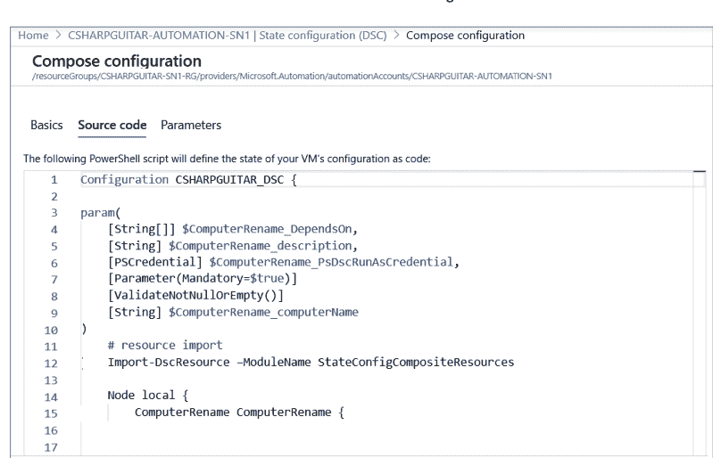

### Azure Arc

你知道 Azure 是什么，你知道本地部署意味着什么，你知道私有数据中心是什么，你知道混合云是所有这些的组合。将范围扩大到其他云托管提供商和 SaaS 混合，你就有了 Azure Arc。

### Other Automation Resources

Azure Automation 并不是 Microsoft 帮助你将手动计算活动机械化的唯一工具。其他两个工具是 System Center Orchestrator 和 Service Management Automation。表 8.6 更详细地描述了每个工具。

TABLE 8.6 Microsoft Automation Tools

| Automation Tool | Description |
|---|---|
| Azure Automation | 旨在在公有云中运行自动化运行手册，具体为 Azure |
| Service Management Automation | 一个自动化引擎，目标是在私有云中运行配置和配置活动，例如使用 Windows Azure Pack 或 Stack 时 |
| System Center Orchestrator | 一个旨在运行本地配置和配置活动的自动化引擎。无需脚本编写，因为它提供图形界面用于创建运行手册。 |

关于 Azure Automation 的最后一个需要涵盖的话题是导航菜单中 Shared Resources 标题下的功能集。图 8.44 显示了 Azure Automation Azure 门户刀片上的其中一些。以下是完整的列表及其简要描述：

- Schedules 设置一个计划，然后将运行手册链接以基于时间、日期和频率执行。
- Modules 类似于 DSC 脚本，易于执行但在幕后做了大量工作
- Modules Gallery 用于作为模板的模块列表，类似于练习 8.8 中提供的项目符号列表
- Python 2 Packages 类似于模块，但用 Python 编写
- Credentials 存储执行运行手册所需敏感信息的位置
- Connections 你的自动化任务可能需要连接详细信息，例如 IP 地址、端点和访问令牌；这是存储它们的地方。


**证书** 如果自动化任务需要证书身份验证，请将证书存储在此安全位置。

**变量** 当运行手册需要在另一个正在执行的运行手册中访问某个值时，这就是在它们之间传递这些值的方法。

没有简单的方法可以让所有机器保持最佳状态。团队和组织存在的目的就是为了支持应用程序运行的基础设施。不要低估这一领域所需的复杂性、重要性和工作量。您的 IT 解决方案需要持续维护才能保持可靠。

## 摘要

在本章中，您了解到 Azure Migrate 是开始将资源从本地迁移到 Azure 的起点。在将资源在 Azure 内部迁移到不同区域、订阅或资源组时，也请考虑 Azure Migrate 服务，但不要忘记有用的 Azure Site Recovery (ASR) 工具。最常迁移的资源是计算资源，例如 Azure 虚拟机和 Azure 应用服务，但虚拟机上的 SQL Server 在更改位置时需要特别注意。制作虚拟机及其内容的备份或映像快照，然后在新实例上恢复它们，是一种有效的迁移和移动方法。

您学习了将代码迁移到 Azure 计算产品的大量方法。同样，您还学习了如何在初始部署后持续对应用程序代码进行更新。Visual Studio、ARM 模板和 Azure DevOps 是进行这些部署的几个来源。Azure DevOps 特别具有众多其他功能，可支持开发工作的分配、其测试，然后部署到您选择的 Azure 计算产品。您现在知道不应直接部署到生产环境，而应部署到部署槽或预生产实例。

## 考试要点

**从 Azure Migrate 开始。** 在您开始云之旅时从这里开始。此服务有助于评估和迁移您的工作负载从本地到 Azure 平台。Azure 虚拟机、数据库、Web 应用程序和数据存储是能从 Azure Migrate 中获得最大收益的工作负载。

**了解 Azure Site Recovery (ASR)。** 名称定义了其目的。其主要作用是提供 BCDR 策略的骨干。它可用于执行从本地到 Azure 以及 Azure 区域之间的工作负载备份和复制。

**了解 Azure 数据迁移服务 (DMS)。** 当您需要迁移数据存储，即数据库时，请从此服务开始。此工具可以评估现有的本地数据库配置并将其与目标 Azure 数据存储产品进行比较。然后，它会为您提供可能冲突的报告以供进一步分析和纠正。在许多情况下，会提供提示来解决冲突。

**了解 Azure 资源管理器 (ARM)。** 在 Azure 门户中对 Azure 产品和资源进行更改需要资源。当您更改 Azure SQL 数据库、应用服务或 VM 的配置时，平台必须对这些产品的配置进行身份验证、验证和更新。ARM 是执行该职责的资源。

**了解 Azure 资源提供程序。** Microsoft.Web、Microsoft.Sql 和 Microsoft.Compute 是 Azure 资源提供程序的示例。这些提供了 RBAC、服务主体、用户访问验证、资源预配和资源配置的结构。它代表了 ARM 背后的结构。

**了解 Azure DevOps。** DevOps 是一种方法论，与 IT 行业中正在获得动力的一些新技术相契合，例如开源、无结构数据存储、AI 以及新代码功能极快的发布。Azure DevOps 是一种产品，为客户和公司提供实施此类 IT 开发方法论的框架。

## 关键术语

- App Service Plan (ASP)
- ASR Deployment Planner
- Azure Arc
- Azure Automation
- Azure Hybrid Benefit
- Azure Recovery Service Vault
- Azure Reserved Virtual Machine Instances
- Azure Reserved VM Instances (RI)
- Azure Resource Manager (ARM)
- Azure Stack
- Azure VMware Solutions
- Continuous Integration / Continuous Delivery (CI/CD)
- Database Experimentation Assistant (DEA)
- Database Management Assistant (DMA)
- Deployment Slots
- Desired State Configuration (DSC)
- File Transfer Protocol (FTP)
- Node Package Manager (npm)
- Object-Oriented Programming (OOP)
- Rapid Application Development (RAD)
- Remote Desktop Protocol (RDP)
- Service Management Automation
- Software Development Life Cycle (SDLC)
- SQL Server Migration Assistant (SSMA)
- System Center Orchestrator

7. 您需要一个 Azure 订阅才能从 Visual Studio 部署应用服务。
A. True
B. False

8. Azure DevOps 主要旨在支持以下哪种部署和开发方法？
A. Continuous integration/continuous delivery (CI/CD)
B. Waterfall
C. Object-oriented programming (OOP)
D. Agile

9. 以下关于 ARM 模板的说法哪些是正确的？
A. Implemented using YAML-based syntax
B. Implemented using JSON-based syntax
C. Can only provision and configure Azure products and/or features
D. Useful for provisioning and configuring Azure product, features, and deploying application code

10. 以下哪一项是 Azure Automation 的实际收益？
A. Templates that describe the most optimal configuration of Azure products
B. Increase the manageability of larger cloud workload footprints.
C. Monitor the installation status of operating system patches across an entire subscription
D. Proactive monitoring of malicious activities happening on provisioned resources
