## 监控和恢复

### 考试 AZ-303 本章涵盖的目标：

- Implement and Monitor an Azure Infrastructure
  - Implement cloud infrastructure monitoring

### 考试 AZ-304 本章涵盖的目标：

- Design Monitoring
  - Design for cost optimization
  - Design a solution for logging and monitoring
- Design Business Continuity
  - Design a solution for backup and recovery
  - Design for high availability


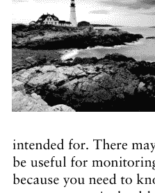

本章涵盖了一些有助于监控 Azure 平台的工具和场景。请特别注意“用于监控 Azure 平台”的表述，因为这正是 Azure 上您会找到的监控功能所要实现的目标。本章中可能有几个地方指出某个工具可能对监控您的应用程序有用，但并不那么多。这很重要，因为您需要知道应用程序需要生成和存储哪些日志和指标来衡量其健康状况。Azure Monitor 将为您的应用程序运行的产品和功能提供日志和指标，而不会提供更多信息。此外，在本章中，您将了解灾难恢复和故障转移工具。但同样，重点是工具；您需要确定如果解决方案的一部分变得不可用，应用程序需要什么才能继续工作。您需要了解的最重要的 Azure 服务与监控和恢复有关的是 Azure Monitor、Azure Backup 和 Azure Site Recovery (ASR)。这些在第 1 章中以及本书的许多其他章节中都有介绍。

IT 解决方案生命周期的监控和恢复部分通常由支持组织负责。支持的本质是，IT 支持工程师是被动的。这意味着支持团队成员通常在某物损坏之前才采取行动，而且通常有足够多的损坏事项让他们忙个不停。支持组织通常会开展专注于预防性支持活动的项目，目标是减少组织的被动性，即力求变得主动。但不幸的是，人力支持资源的限制往往导致这些愿望落空。监控是如果您希望对生产 IT 资源采取主动行动的绝对必要条件。必须制定监控策略，需要直接的财务投入，因为默认情况下可用的指标有限。您通常有 CPU 和内存日志，可能有助于解决许多问题，但仅靠这些是不够的。

在我数十年的 IT 行业工作经历中，大部分时间在支持角色中，我从未执行过一次完整的灾难恢复计划。团队在准备和测试 BCDR 计划上花费了大量时间，但我从未完全将生产应用程序迁移到另一个环境。我认为这在历史上与拥有一个完全相同的生产环境副本闲置以备不时之需的成本有关。在大多数情况下，当我们触发灾难恢复计划时，问题大多在我们越过不可挽回的点之前就得到解决。当我回想那些场景时，我不记得曾经对我们构建的充当 DR 生产环境的系统有过任何信心。也许这就是为什么从未完全迁移到 DR 环境的原因

实际发生的情况。请记住，支持团队不仅要排查生产问题，而且通常还负责执行 BCDR 计划。如果对 DR 生产环境是否真正能正常工作没有信心，那么支持团队就会专注于修复问题，而不是进行故障转移。遗憾的是，这种信心的缺失会导致更长的停机时间，并让支持组织承受更大的压力。

那些充满挑战的时期可能永远不会再发生，因为那些故障转移环境的成本已不再高昂。这意味着你可以拥有生产环境的精确副本，并能在短时间内准备就绪。拥有用于灾难恢复的完全相同生产环境，不仅会让你获得信心，而且 Azure 还提供了快速轻松执行故障转移所需的工具。你现在只需要将这种 BCDR 文化融入你的支持组织。Mitch Radcliff 曾说过：“计算机让你犯错误的速度比其他任何发明都快。”因此，请确保你始终对在计算机上执行的任何操作都制定备份计划。拥有可用于衡量这些变更影响的指标，并制定在出错时故障回滚或转移到另一个环境实例的计划。Azure Monitor、Azure Backup 和 ASR 可以帮助你实现这一目标。

### 监控 Azure 资源

首先，你需要思考为什么要监控在 Azure 上运行的工作负载。以书面形式明确你的目标，然后将其分解为不同的可衡量项，并按重要性顺序排列。然后思考如何衡量这些项，存在哪些提供某种比较值的指标和工具，以及什么值是可接受的阈值。实际上，为什么要监控是一个容易回答的问题。你必须了解平台以及运行在平台上的应用程序的表现。你的目标是满足你已向客户、合作伙伴和/或公司内部业务组织承诺的 *服务级别协议 (SLAs)*。如果你想现在重新了解一下，第 2 章中已经介绍了 SLA。除了满足 SLA 之外，你还应当期望一个既可靠又有弹性的 IT 解决方案。为了实现这些目标，请将监控策略重点放在以下监控方面：

- 可用性/SLA 监控
- 收集、存储和报告
- 审计
- 运行状况监控
- 性能监控
- 安全监控
- 使用情况监控

应用程序可用性的定义很简单，就是应用程序可供使用的时间量。计算应用程序可用性可通过以下算法实现：

```
percent_availability = ((total_time - total_downtime) / total_time) * 100
```

percent_availability 的常见值例如有 99.9%、99.95%、99.99% 和 99.999%。最后一个被称为“五个九”，是可用性的圣杯，因为它难以实现且成本高昂。IT 应用程序很少只存在于单台服务器上，也很少只依赖自身。在第 6 章中，你了解了如何通过解耦系统来提高可用性。如果没有解耦系统，计算你的 IT 解决方案中某一层的可用性会变得有点复杂，尤其是当你想精确定位 total_downtime 的根本原因时。精确定位停机时间的根本原因对于改进很重要，而不是为了推卸责任或互相指责。重点是，total_downtime 值可能并非由被访问的应用程序本身导致，而是由其某个依赖项导致。当然，有些工具和指标可以帮助你跟踪可用性指标。但遗憾的是，与本书中总结的许多其他主题一样，如何找出可用性问题发生的原因以及如何修复它，是另一个可以成为职业的专业领域，也值得单独写一本书。

Azure 产品组合提供以下服务来收集、存储和报告有关工作负载的详细信息：

- Azure Monitor
- Log Analytics
- Application Insights
- Azure Data Explorer (ADX)

在图 9.1 中，你可以看到前面提到的 Azure 服务是如何组合在一起的。你可以看到，Azure Monitor 用于监控在 Azure 平台上运行的产品，并将该数据提供给 Log Analytics 进行报告。同样，监控数据也可以直接馈送到 Azure Data Explorer (ADX) 或某些自定义日志源。Application Insights 是一种用于捕获更偏向应用程序特定（即非平台特定）日志的工具。这些监控数据可以馈送到众多存储库中，并可在门户中进行分析，门户会以图形方式展示信息。或者，你可以使用类似 KUSTO 的 SQL 查询（也称为 KQL）来查询数据。

可以将日志记录配置为跟踪 Azure VM、容器、安全性、Azure Active Directory 和订阅。几乎所有 Azure 产品和功能都能够创建日志，并公开一个用于检索和分析这些日志的接口。可以从多个端点查看日志/监控数据，首先从 Azure 门户开始。此外，Application Insights、Log Analytics 和 ADX 中还提供仪表板和视图，允许你自定义要分析的数据及其呈现方式。本章后面将向你介绍这些仪表板。还请记住，Power BI 是用于以图形方式表示大型复杂数据集的有效工具。在构建监控策略时，Azure Monitor 是你需要了解并重点关注的主要组件，但在继续阅读本章的过程中，你将学到更多。

Azure 的。然而，图 9.1 中的工具有助于从平台角度捕获、存储和报告这类数据中的发现。其中提到的一个指标是应用程序响应请求的速度。它应该有多快？什么是正常值？什么阈值是你认为应该执行操作的值？这些都是你需要针对应用程序问自己的问题。响应在十秒内返回是正常的，还是 500 毫秒更常见？什么算健康，什么不算健康，这同样取决于应用程序在做什么。你的应用程序消耗大量内存可能是正常的。将大型数据集缓存到内存中通常会导致大量内存消耗，但这样做实际上会使你的应用程序更快。CPU 消耗也是如此；如果你执行大量复杂的正则表达式比较，应用程序将消耗更多 CPU。

在性能监控场景中，你可能会听到关键绩效指标 (KPIs) 这个术语。KPI 是你为应用程序设定的阈值，其范围包括但不限于：HTTPS 响应应多快、数据库查询应多快、两台服务器之间的 ping 应耗时多长，以及多少并发连接属于正常。当任何这些 KPI 被突破时，就需要发送警报并进行分析，找出发生了什么，并在它导致停机时实施解决方案以防止再次发生。如果它没有导致停机或任何中断，那么你应该考虑更改 KPI，使其反映“正常生产活动”。从这种场景中获得的信息也有助于通过对你已在计算或数据工作负载中实施的自动缩放规则进行一些调整来管理增长。

在 Azure 中，你绝不会缺少与安全相关的监控；你已经知道有一个名为 Security Center 的完整产品。查看第 2 章以获取有关 Security Center 的更多信息；具体请查看图 2.49。从安全监控的角度来看，一些感兴趣的领域属于用户访问视角。Azure Active Directory (AAD) 在 AAD 面板的 Monitoring 标题下提供了一些功能。还有一些报告可用于运行和管理 RBAC、用户、组、登录和审计日志，这些日志描述了在这些登录活动下执行了哪些操作。请记住，这些安全报告针对的是 Azure 门户中发生的情况；如果你需要有关应用程序中发生的情况的更多信息，可以在后面名为“监控安全”的章节中找到更多内容。但是，许多与安全相关的应用程序责任都在于你，也就是 Azure 产品和服务的用户。

这里讨论的最后一个监控场景与使用情况有关。你已经有一个有用的使用情况监控报告；回头看看图 8.2。这是针对给定 Azure 订阅的成本分析报告。该报告按资源组、区域和事件细分到特定的 Azure 产品。这不仅有助于你了解哪里成本最高，还有助于了解哪里活动最频繁。请记住，云计算按用量收费。使用量最大的产品和功能通常会导致最高成本。但这也有助于确定你最受欢迎的产品或服务。为什么这很重要，归根结底是为了确保


只要分配了足够的可用资源，尤其是当它是一个创收应用时，情况更是如此。你可以对资源和订阅设置限制规则，而当超出限额时，可以指示 Azure 停止分配更多资源。但在你最热门的产品上，你肯定不希望这样做，对吧？使用情况报告有助于识别这些资源，然后你可以确定需要对每一项应用什么样的限制。与其限制一个热门的创收应用，不如管理支出、消耗与收入之间的关系，并对其进行调优以实现增长。

本节的其余部分分为两个子小节。第一个小节与 Azure Service Health 相关，之后是最重要的 Azure Monitor 服务。你将了解 Azure Service Health，然后准备好动手实战 Azure Monitor。

### Azure Service Health

将 IT 解决方案迁移或创建到 Azure 平台始于信任。你将大量责任交给了 Microsoft，这可能会对你的解决方案和公司的成功产生重大影响。在许多情况下，一旦你迁移到 Azure，整个业务的成功就掌握在 Microsoft 手中；也许你公司的全部收入都来自现在运行在 Azure 上的应用程序。如果是这样，而 Azure 平台又出现问题，那么你也会遇到问题。你可以信任 Microsoft Azure，也可以依赖这个平台；它确实是目前最好的云产品和功能套件。它是一个稳定的平台，但了解并跟踪其总体状态仍是一个好习惯。你希望知道是否有任何平台问题或变更影响了你，并且希望找出为什么这些变更或暂时性问题会产生影响。了解并学习 Azure 的工作原理将使你明白，Azure 不仅仅是一个架构；在幕后还有大量的代码和技术在协同工作，使所有组件保持正常运行。你对此了解得越多，就越能设计和调整你的应用程序以在该平台上运行。Azure Service Health 是一个可以用来监控平台上发生情况的工具。看一看图 9.2，它展示了 Azure Service Health（又称 Service Health）在 Azure 门户中的显示方式。

该 Azure 功能的输出是一份关于服务事件、计划维护、健康公告和安全公告的报告。它还提供了按订阅、区域和服务（例如 Azure 虚拟机、Azure SQL 或事件中心等服务）对平台健康相关事件进行筛选和历史查看的功能。要实现这一点，请从图 9.2 所示的下拉列表中选择相应选项。当你对 Azure 平台上某个工作负载记录的中断进行根本原因分析时，这种筛选功能会很有帮助。你可以检查图 9.2 底部列出的历史记录，查看你的任何服务是否在应用程序事件发生的时间前后有过相应的事件。还有一个名为“健康警报”的功能，你可以在图 9.2 的导航菜单中看到它。你可以从导航菜单访问此功能，也可以通过单击主概览边栏选项卡上的“+ 添加服务健康警报”来访问它（如图 9.2 所示）。此功能会根据事件类型（即服务问题、计划维护、健康公告和安全公告）主动向你发送可能影响 Azure 工作负载的任何事件的信息。你可以通过选择特定订阅、区域和服务来定制这些通知，甚至可以将其发送给特定人员或组，以便他们进行通知和可能的应对。

#### 图 9.2 Azure 门户中的 Azure Service Health 边栏选项卡

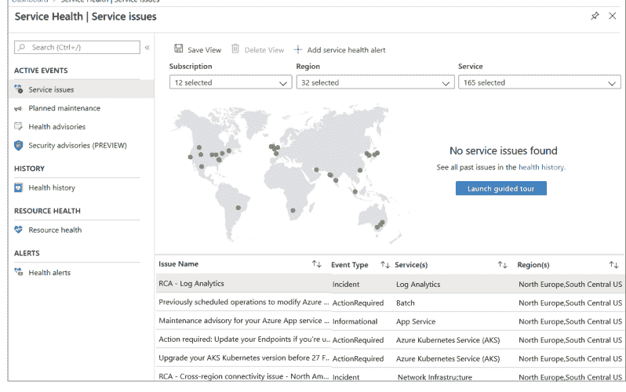

资源健康的概念在本书中一直是一个常见主题。在第 4 章和第 6 章中，我们提到了应用程序健康。在第 6 章中，提到了 Azure Health Monitor（又称 Azure Monitor）和 Azure Status，这应该已经提供了一些清晰的信息。提醒一下，Azure Status 位于 status.azure.com，有助于了解 Azure 的整体运行情况。

总之，Azure Service Health 专注于监控 Azure 平台。它使你在平台事件可能影响到已配置的 Azure 产品时收到警报。在许多情况下，它还会提供根本原因分析（RCA），说明发生了什么、为什么发生以及正在采取什么措施来防止将来再次发生。这些信息对于与管理层或业务负责人的状态会议非常有帮助。此外，在许多情况下，还会提供一些有关如何更好地配置工作负载以更好地应对和响应此类事件的建议。现在让我们进入 Azure Monitor，它有助于记录和分析 Azure 平台以及运行在 Azure 上的 IT 解决方案的某些方面。

### 练习 9.1（续）

#### 图 9.3 Azure Monitor 活动日志报告——门户

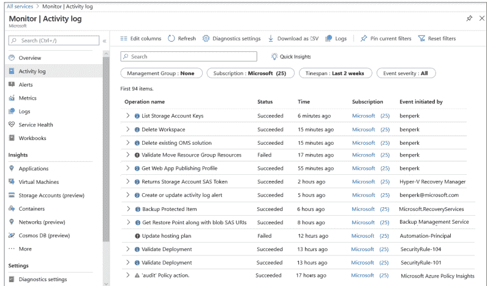

3. 通过 PowerShell 控制台执行以下 Azure CLI cmdlet，以检查指定资源组在最近一天的情况。图 9.4 显示了汇总后的输出。

```
az monitor activity-log list --resource-group "CSHARPGUITAR-SN1-RG" \
  --offset 1d --query \
  '[].{Operation: operationName.value, Status: status.value}'
```

#### 图 9.4 Azure Monitor 活动日志报告——Azure CLI

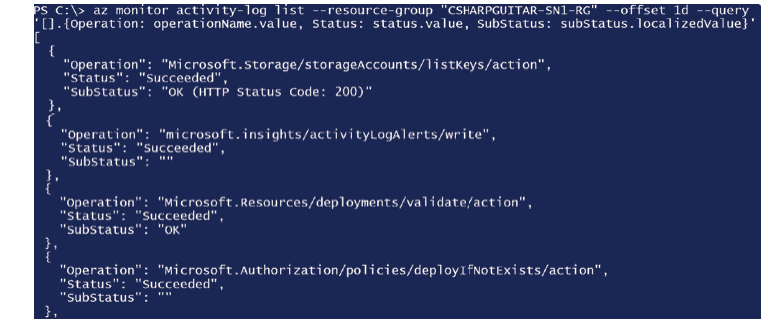

4. 单击“见解”标题下导航菜单中的“虚拟机”链接。依次单击“受监视”➤“不受监视”➤“工作区配置”。导航回到“不受监视”，你会看到与图 9.5 类似的内容。

#### 图 9.5 Azure Monitor — 虚拟机见解

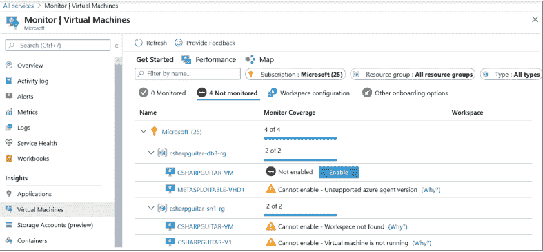

5. 要为图 9.5 所示列表中的某个 Azure VM 启用 Azure Monitor，请单击你想要启用 Azure Monitor 的 Azure VM 旁边的“启用”按钮，在弹出边栏选项卡上再次单击“启用”按钮，选择订阅，选择或创建一个 Log Analytics 工作区，最后再次单击“启用”按钮，然后导航到“受监视”选项卡。见图 9.6。

#### 图 9.6 Azure Monitor 虚拟机已受监视

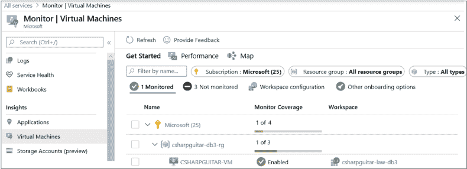

### 练习 9.1（续）

6. 单击“Monitor | 虚拟机”边栏选项卡顶部的“性能”链接，查看 CPU 利用率、内存、发送/接收字节数、磁盘空间等详细信息。单击“映射”可看到 Azure VM 的图形表示，包括进程列表、端口、IP 地址、操作系统版本、事件等。见图 9.7。

#### 图 9.7 Azure Monitor 虚拟机映射

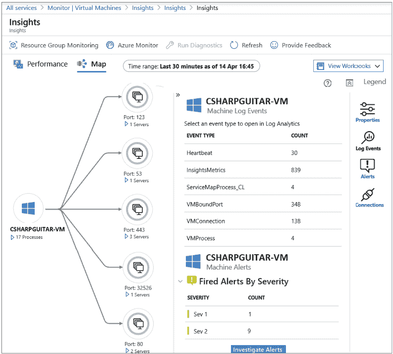

7. 在导航菜单中，选择“诊断设置”，选择要启用诊断的资源，单击“+ 添加诊断设置”，输入“诊断设置名称”，选择要记录的日志详细信息，勾选“发送到 Log Analytics”，选择订阅，然后选择要存储日志的 Log Analytics 工作区。见图 9.8。

#### 图 9.8 Azure Monitor 诊断设置

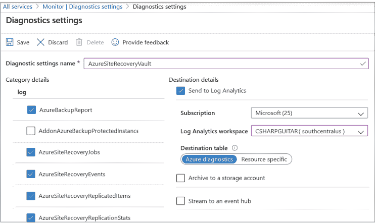

8. 单击“保存”按钮，然后导航回到“诊断”边栏选项卡。你会看到与图 9.9 类似的内容。

#### 图 9.9 Azure Monitor 诊断设置概览

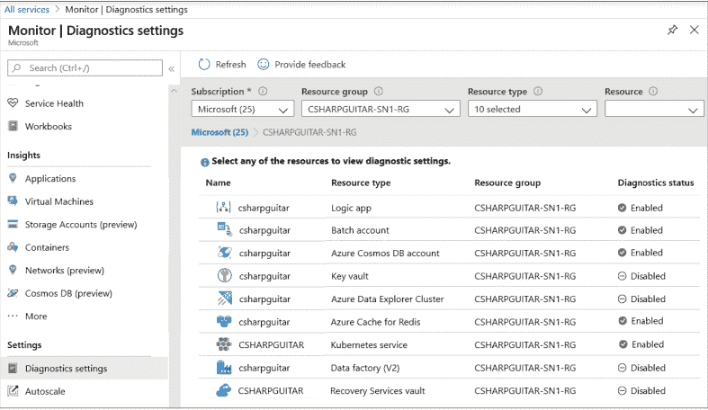

做得不错——你为 Azure 虚拟机配置了一些见解，创建了一个 Log Analytics 工作区来存储这些见解，并为一项或多项 Azure 资源配置了诊断设置。你在练习 9.1 中执行的第一个操作是查看订阅中各 Azure 资源的*活动日志*。每个 Azure 产品概览边栏选项卡上都提供了“活动日志”导航菜单项。如果你有很多产品，逐一查看是不可行的，因此你可以使用这个 Azure Monitor 界面来了解整个订阅中的情况。你还了解到可以使用 Azure CLI 检索活动日志，并将目标锁定为特定资源组。在所有情况下，数据量都很大。因此，将查询优化到你所寻找的特定信息类型是明智的。也许只查找错误或 Key Vault 私钥的更新；该工具非常灵活，但需要你自己决定你的应用程序需要什么。图 9.5 中值得指出的一点是，METASPLOITABLE-VHD1 这个 Azure 虚拟机无法被监视。监视需要在机器上安装一个用于监视的服务，就像练习 8.3 之后讨论的内容（即 Windows Azure 来宾代理）。图 9.5 中出现该消息的原因很可能是，部署到该 Azure VM 的操作系统不被视为受认可、认可或支持的 Linux 映像。在对这种运行 Linux 操作系统的配置进行故障排除时，请记住这一点，确保操作系统是受认可的。

在图 9.5、9.6 和 9.7 中，你会看到图像顶部显示为“性能”和“映射”的项。如练习中所述，“性能”边栏选项卡将显示基本的默认服务器指标，如 CPU 使用率、内存消耗和吞吐量。这些指标很有用，可以作为可能正在酝酿问题的早期预警信号。另一项是“映射”，如图 9.7 所示得很好。这是对 Azure VM 属性、事件、警报和连接的一个很好的表示。当你看到这样的可视化时，重要的一点是你经常查看它，了解你的应用程序的正常状态是什么样，如果画面突然变得不同，就采取行动找出原因。还有一点需要指出，你在练习 9.1 中体验过，特别是在步骤 7 中，你配置了诊断设置的“目标详细信息”，如图 9.8 所示。那里有三个选项：

- 发送到 Log Analytics
- 存档到存储帐户
- 流式发送到事件中心

在练习中，你选择将所选的日志发送到 Log Analytics 工作区。你将在下一节中了解更多相关信息；不过，你本也可以选择以 JSON 格式将它们放入 Azure Blob 存储容器。然后你可以编写一个自定义应用程序，使用该 JSON 文档进行查询和报告。另一个选项是将日志流式传输到事件中心。你在第 6 章中了解了事件中心，它是一个消息传递服务。数据在该位置不应/不该长时间存在，因此如果你选择此选项，就需要有一个使用者来处理发送到事件中心的消息。这是一个你可能需要在近乎实时的情况下分析和警报应用程序健康状态的选项。最后，请注意 Azure Monitor 有一些默认限制；参见表 9.1 作为限制示例。


# 表 9.1 Azure Monitor 限制

| 资源 | 默认限制 |
|---|---|
| 警报 | 每个订阅 2000 个 |
| 电子邮件警报通知 | 每小时 100 条 |
| 短信 | 每 5 分钟 1 条 |
| KUSTO 查询 | 每 30 秒 200 次 |
| 存储限制 | 500MB–无限 |
| 数据保留 | 7–730 天 |

如果你发现某些日志丢失了，这可能是由于其中一个默认限制造成的。这些限制是为了保护你而设，因为该资源的消耗是有成本的；它不是免费的。如果你需要超过默认限制，可以向 Microsoft 创建支持案例，限制可以提高，或提供一些关于如何优化日志策略的反馈。还要记住，一些限制基于你在创建 Log Analytics 工作区时选择的定价层。存储限制和数据保留基于定价层，因此在确定你的需求时请查看它们。定价层可以在创建后更改，因此也许可以从小开始，随着需求的增长而扩展。

### Log Analytics

与其他许多 Azure 产品一样，这不是你第一次接触 Log Analytics。随着本书接近尾声，绝大多数云概念、Azure 产品和功能都已经涵盖。在之前的练习中，特别是在步骤 5 中，你创建了一个 Log Analytics 工作区。它的创建很简单，只需要一个位置、一个名称和一个定价层即可。如图 9.1 所示，它是存储日志和指标以用于报告和警报功能的地方。Log Analytics 工作区具有许多功能，因此请在 Azure 门户中查看它们。导航到你之前创建的工作区。导航菜单中不应该有太多未知的选项。点击 Logs 导航菜单项。你将看到与图 9.10 所示类似的内容。

在之前的练习中，你为一个或多个 Azure 产品启用了诊断设置。数据开始流入工作区需要几分钟时间，但一旦开始流动，你就可以使用以下查询查询信息。查询和输出也在图 9.10 中可视化。点击 Run 按钮执行查询。

```
AzureDiagnostics
| project Category
| summarize Count = count() by Category
| order by Count desc nulls last
```

#### 图 9.10 在 Log Analytics 工作区中查询诊断

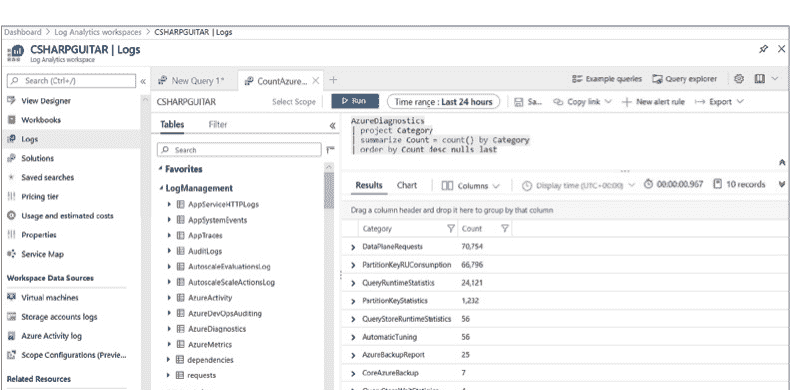

更新管理、变更跟踪、库存以及其他合规性和跟踪数据也记录在 Log Analytics 工作区中。所有数据以某种方式绑定在一起；该区域仍在不断发展，但对于了解你的应用程序和应用程序依赖项的行为很有用。这些类型的指标有助于采取主动措施来管理增长和消耗；它们也有助于排查当前问题或查找历史问题的根本原因。Log Analytics 工作区也存在限制，如表 9.2 所提供。

# 表 9.2 Log Analytics 限制

| 资源 | 默认限制 |
|---|---|
| 工作区限制 | 10–无限 |
| 门户中返回的行数 | 10000 |
| 表中最大列数 | 500 |
| 最大列名长度 | 500 |
| 数据导出 | 不支持 |
| 数据摄取 | 6GB/分钟 |

Log Analytics 工作区有一个免费层，这是每个订阅的工作区数量有限的那个层。另请注意，目前无法将存储在工作区中的数据导出。这就是当前的情况；未来可能会改变。最后，你配置的诊断日志越多，生成的数据就越多。请注意，每分钟可以放入工作区的数据量是有限制的。

### Application Insights

Application Insights 具有相当大的功能集。首先，你已经知道 Log Analytics 和 Application Insights 的区别，对吧？花点时间提醒自己，在什么场景下你会查看 Log Analytics 数据而不是 Application Insights。图 9.11 显示了一些额外的区分，具体是存储指标数据的表名。

#### 图 9.11 Application Insights 与 Log Analytics 工作区日志

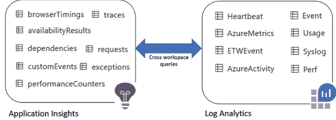

之前曾尝试比较这两个已合并到 Azure Monitor 服务中的组件。我试图解释 Log Analytics 存储更多平台特定的信息，而 Application Insights 存储应用程序和代码数据。具体来说，Log Analytics 显示的 Event 表更与平台相关，你期望在其中找到你在 Windows 服务器上的事件查看器中看到的内容。通过 Application Insights 可访问的异常或请求表，仅仅从名称上看，就更与代码和应用程序相关，而非平台。现在希望两者之间的关系或缺乏关系更清晰了。此外，如图 9.11 所示，可以跨两个数据存储库执行查询，两者都是 ADX 集群。这将在后面变得更加明显。

回顾图 9.9，你会看到导航菜单中的 Applications 链接。导航回 Azure Monitor 刀片并点击该链接。在该链接上，你将获得添加新的 Application Insights 服务的能力。这是一个简单的过程，只需要一个订阅、一个资源组和一个名称。创建后，导航到它并点击 View Application Insights data 链接并注意两个具体项目。第一个在 Overview 刀片上；有一个名为 Instrumentation Key 的属性，看起来很像 GUID。这是唯一标识你的 AI 日志的信息。Instrumentation Key 是从应用程序代码中配置 AI 日志记录所必需的、必需的信息。在 ASP.NET Core 应用程序中，你在配置文件中将两者连接起来；它类似于以下内容：

```
{
  "ApplicationInsights": {
    "InstrumentationKey": "appInsightsInstrumentationKey"
  },
  "Logging": {
    "LogLevel": {
      "Default": "Warning"
    }
  }
}
```

然后你安装并配置 Microsoft.ApplicationInsights.AspNetCore NuGet 包以按需向 AI 服务创建日志。这就是真正所说的“应用程序代码监控”的含义，因为日志记录功能确实在运行在 Azure 平台上的自定义代码内部。接下来，查看 AI 可用的导航菜单项，你会找到一个名为 Logs 的项。点击 Logs，你将看到与图 9.10 中相同的查询界面；但是，你会看到特定于 AI 的表，如图 9.11 所示。在 AI 的 Overview 刀片上，你会看到一个 Application Dashboard 链接。点击它，你会看到一些令人印象深刻的默认信息。见图 9.12。

#### 图 9.12 Application Insights—应用程序仪表板

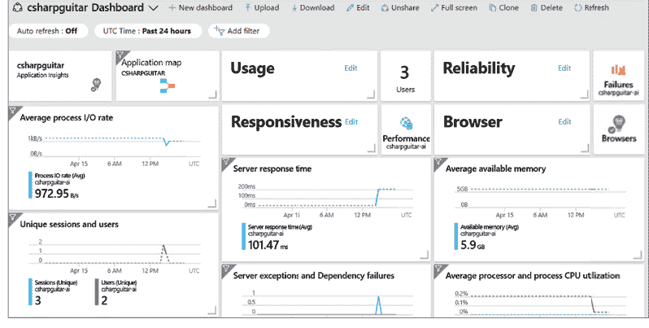

在继续下一节之前，请注意，对于所有 Azure 产品，在 Azure 门户的导航菜单中都将存在一个 Monitoring 部分。该部分的内容是标准的，包含与图 9.13 类似的内容。请注意，在大多数情况下，它们都使用相同的后端技术来存储数据。这些工具允许你配置、查看，并在许多情况下操作数据。它还支持直接访问，以便你可以根据自己的确切要求创建自己的工具和报告。

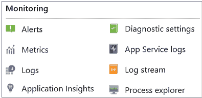

目前，只有 Azure App Services 和 Azure Functions 具有内置的、默认的 Application Insights 支持。在门户中创建其中任何一个时，你会注意到有一个步骤是启用该功能。可以在稍后为这些 Azure 产品启用 Application Insights，也可以为任何应用程序启用，只需创建 AI 服务并在代码中使用 Instrumentation Key 即可。

### Azure Data Explorer

如果你想构建自己的自定义监控和报告系统，这是开始旅程的好地方。你可能已经意识到 Log Analytics 和 Application Insights，这两个 Azure Monitor 的组件，将数据存储在同一类型的数据源上。此存储位置通常称为 *KUSTO 集群* 或 *ADX 集群*。请查看图 9.14。

你会看到 Azure Monitor 使用的是共享集群，这意味着你配置为使用 Azure Monitor 的所有 Azure 产品都将日志存储到该集群中。这是你在练习 9.1 中创建的日志存储位置，具体在步骤 5 中，你为 Azure VM 启用了监控并选择了 Log Analytics 工作区。在幕后，它配置并链接到一个 ADX 集群。Application Insights 在创建时也在幕后执行类似的工作。在 Application Insights 场景中，ADX 集群仅绑定到具有 Instrumentation Key 的客户端，因此被视为私有。最后，回忆练习 5.7 中你创建了一个独立的 ADX 集群和数据库；然后在练习 6.5 中你配置了 Event Hub 将信息发送到集群。IoT Hub 和 Azure Blob 容器除了 Event Hub 外，还内置了对 ADX 集成的支持。还存在一个 Azure Data Explorer SDK；其 NuGet 包名为 `Microsoft.Azure.Kusto.Ingest.NETStandard`，可从任何客户端用于向集群发送日志。你


在之前的章节以及本章中，你已经接触过一些 Kusto 查询语言（KQL）。如果你想进一步了解这种查询语言，可以查看这里：

```
docs.microsoft.com/en-us/azure/data-explorer/kusto/query
```

**图 9.14** 共享、虚拟和专用 ADX 集群

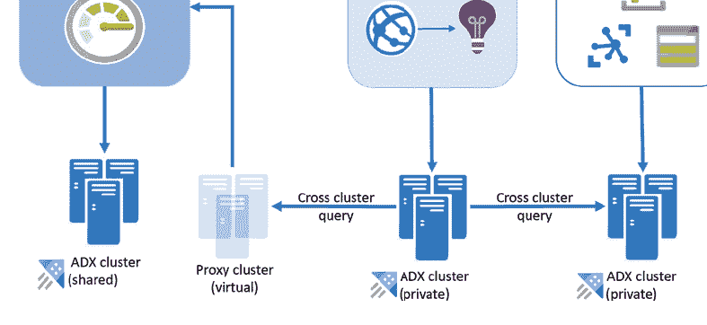

KQL 功能强大，使用起来与 SQL 类似。我使用 KQL 的时间还不够长，因此没有发现它与 SQL 之间的显著差异或局限性。两者在各自设计的场景中都表现得很好，我没有任何抱怨。如果你想成为 KQL 专家，就需要跳出本书，在该领域做更多深入研究，如果你对此感兴趣的话。现在似乎是个做练习的好时机。在练习 9.2 中，你将把在练习 9.1 中创建的 Log Analytics 工作区添加到 dataexplorer.azure.com 上 ADX 的 Azure Monitor 中。在练习 5.7 中，你创建独立 ADX 集群时做过类似的操作。此外，你还将把 Application Insights 添加到 ADX 集群中。通过将这些添加到 ADX，你将能够在同一个地方直观地看到所有内容，这在创建跨集群查询时会很有帮助。你可以在图 9.14 中看到跨集群查询的示意，以及代理集群。代理集群是你为了查询 ADX 集群的共享实例而必须创建的东西。

### 练习 9.2

#### 将 ADX 集群添加到 Azure 数据资源管理器

1. 在浏览器中打开此 URL：dataexplorer.azure.com。
2. 单击“添加集群”按钮，然后输入你的 Log Analytics 和 Application Insights 端点。它们类似于以下内容。请将 `<sub-id>`、`<resource-group>` 和 `<*-name>` 替换为你自己的值。

    ```
    ade.loganalytics.io/subscriptions/<sub-id>/resourcegroups/<resource-group>/providers/microsoft.operationalinsights/workspaces/<workspace-name>
    ade.applicationinsights.io/subscriptions/<sub-id>/resourcegroups/<resource-group>/providers/microsoft.insights/components/<ai-app-name>
    ```

3. 为你的 Log Analytics 工作区端点选择数据库，然后输入你在图 9.15 中看到的查询。输出结果将与图 9.15 类似。
4. 这种配置的强大之处在于，它允许你联接存在于多个集群中的日志。以下 KQL 查询是如何实现这一点的示例：

    ```
    let LA1 = 'https://ade.loganalytics.io/subscriptions/...';
    union <AI1-ADX table>, cluster(LA1).database(<workspace-name>).<table name>
    ```

**图 9.15** 共享、虚拟和专用 ADX 集群

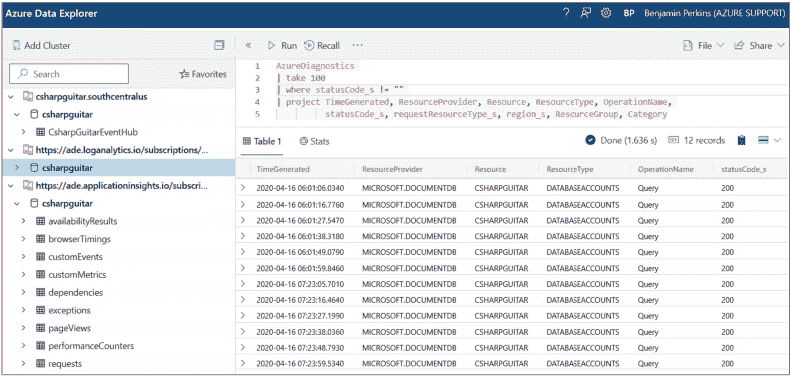

该查询只是一个模板，旨在为你提供示例。你可能已经意识到其中的可能性和复杂性。这是一个有趣的领域。

在进入下一节之前，讨论有关日志指标数据的保留和安全主题非常重要。在第 6 章中，你了解了治理与合规性，其中一个主题涉及数据的位置、保护和存储。当你创建 Log Analytics 工作区或 Application Insights 监视器时，创建过程的一部分就是选择其位置，而你对此有控制权。来自任何位置的任何 Azure 产品或资源都可以写入数据存储，无论其位置如何。这意味着无论数据生产者位于何处，你的数据都可以保留在特定的地理区域。还要记住，当你为 Azure VM 配置 Azure Monitor 时，配置的一部分是选择 Log Analytics 工作区，该工作区也是绑定的，即在所选区域中创建。关键在于，你可以控制指标和跟踪数据的存储位置。你还可以考虑使用 Azure Policy 来禁止在任何区域创建 Log Analytics 工作区，否则会导致不符合你的任何隐私法规。

ADX 数据集群中已有的数据在默认情况下经过静态加密。此外，SDK 与门户之间的所有数据通信都通过 HTTPS 进行，这意味着数据在传输过程中也被加密。如果你需要回顾静态加密和传输加密的含义，请回看第 2 章。第 6 章中也有相关讨论，特别是“Azure 云合规性技术”一节，其中讨论了一些关于谁可以访问你的数据以及数据如何受到保护的内容。请快速回看图 6.8，其中说明了围绕数据的不同类型安全性，以及你与云提供商之间的责任划分。最后，请看表 9.1，其中提供了 Azure Monitor 的数据保留限制。对于 Log Analytics，保留值范围为 7 到 730 天，具体取决于你的定价层或配置。Application Insights 默认保留 90 天。以下各节旨在展示每个 Azure 组件（如安全性、网络、计算等）可用的部分监视功能。所提供的信息用于帮助你开始为每个垂直领域设计监视策略。正如你在职业生涯中所经历的那样，监视通常是一个得不到应有重视或投入的领域。监视是一个相当复杂的领域，通常对故障排除和预测有着重大影响，值得关注和资本投入。

### 按组件划分的 Azure 监视

本书的组织方式使你的迁移或初始部署能够在 Azure 云平台上完成。如果你的计划按照与部署工作负载相同的顺序进行，即安全性、网络、计算、数据等，那么你在 Azure 上设计工作负载部署顺序的成功概率会更高。在完成向 Azure 的部署后，了解 IT 解决方案的运行情况是必不可少的组成部分。你大概无法想象，在没有某种报告和指标来说明运行情况的情况下经营一个 IT 组织。下面将提供一些关于 Azure 组件监视功能的见解。你应该考虑在每种组件的初始设计中纳入这些监视概念，然后在此基础上构建你的自定义配置。如果等到项目结束、工作负载已在 Azure 上运行后再考虑监视，可能会导致无法获得完成 IT 支持模型中这一重要部分所需的投入。你可能会发现自己处于故障排除场景中，却没有任何信息来帮助你解决问题。

#### 监视安全性

在 Azure 上有关安全性需要监视三个基本领域：Azure Active Directory、RBAC 和你的 Azure 产品。还有一个额外领域，即应用程序安全性；然而，这取决于你的应用程序需求和行为，因此这里不做过多介绍。与许多其他 Azure 产品一样，你会在导航边栏中找到“诊断设置”和“日志”菜单项；Azure Active Directory 也有这些项。配置诊断设置后，日志会被放入 Log Analytics 工作区，并可用于 KQL 查询。当你启用 Azure Active Directory（AAD）诊断时，数据存储中会添加两个表：AuditLogs 和 SigninLogs。审计日志提供有关某个身份的信息，该信息可以关联到例如在门户中执行的活动。如果你想查看谁更改了 RBAC 组，可以分析此表来找到答案。登录日志则提供相应的信息，即谁尝试登录以及状态如何。表 9.3 总结了当前 AuditLogs 和 SigninLogs 表的架构。

**表 9.3** AAD 诊断日志表架构

| AuditLogs | SigninLogs |
|---|---|
| AADOperationType | AADTenantId |
| AADTenantId | AppDisplayName |
| ActivityDateTime | AppId |
| ActivityDisplayName | Category |
| AdditionalDetails | ClientAppUsed |
| Category | ConditionalAccessPolicies |
| CorrelationId | ConditionalAccessStatus |
| DurationMs | CorrelationId |
| Id | CreatedDateTime |
| Identity | DeviceDetail |


# 表 9.3 AAD 诊断日志表架构（续）

| AuditLogs | SigninLogs |
|---|---|
| InitiatedBy | DurationMs |
| Level | Id |
| Location | Identity |
| LoggedByService | IPAddress |
| OperationName | IsRisky |
| OperationVersion | Level |
| Resource | Location |
| ResourceGroup | LocationDetails |
| ResourceId | OperationName |
| ResourceProvider | OperationVersion |
| Result | OriginalRequestId |
| ResultDescription | Resource |
| ResultReason | ResourceProvider |
| ResultSignature | ResourceGroup |
| ResultType | RiskDetail |
| SourceSystem | RiskLevelDuringSignIn |
| TargetResources | RiskState |
| TimeGenerated | UserId |
| Type | UserPrincipalName |

这些表列应该能让您了解存储了什么以及其中数据如何被使用。例如，存储在 `AuditLogs.ResourceProvider` 列中的信息会显示执行操作所针对的 Azure 资源。`SigninLogs.RiskLevelDuringSignIn` 列将确定登录的风险程度。在第 2 章中，您了解了此风险的值可以是高、中或低，并且由 Azure 平台的高级安全算法为您计算。请考虑以下 KQL 查询，并回顾图 9.10 中的“+ 新建警报规则”功能；您也会在图 9.16 中看到它。该功能允许您在指定查询在给定时间范围内检索到特定数量的结果时配置警报。

```
SigninLogs
| where RiskLevelDuringSignIn == "High"
```

#### 图 9.16 Log Analytics 警报

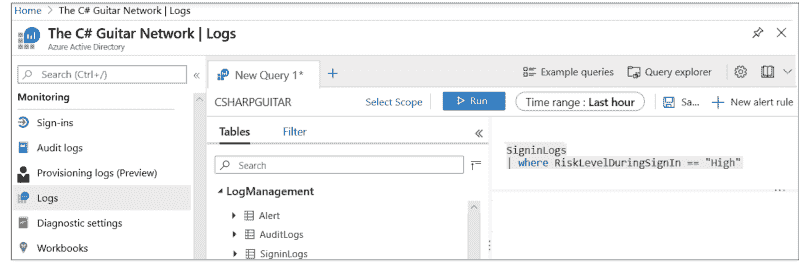

有很多选项可用于创建查询并根据其结果设置警报。这仅取决于您的需求、创造力和成本。请记住，这些警报会产生费用，因为需要一定的计算能力代表您执行和分析结果。从基于角色的访问控制（RBAC）的角度来看，最好的监控方式是选择“活动日志”导航菜单项。例如，在资源组、特定 Azure 服务或 Azure 订阅级别单击“活动日志”导航，即可获取这些级别中每个级别发生情况的报告。向日志添加筛选器，并查找以下操作：

- 创建角色分配
- 删除角色分配
- 创建或更新自定义角色定义
- 删除自定义角色定义

图 9.17 显示了使用 Azure 订阅的活动日志功能执行此类查询的输出。您可以单击结果并筛选到日志的详细信息。您还会注意到“日志”链接，它将打开 Log Analytics 工作区控制台，您可以在其中使用 KQL 查询获取相同的信息。

#### 图 9.17 Azure 门户中的 RBAC 活动日志

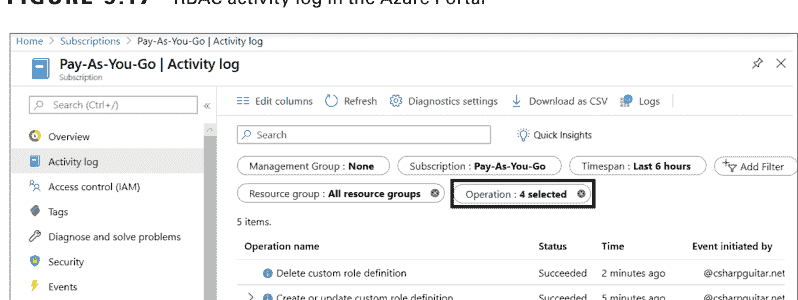

最后一个用于安全的监控组件侧重于您的 Azure 产品、资源和平台。您了解安全中心，它具有许多功能来保护您在 Azure 环境中的工作负载和资源。具体来说，在“安全中心”边栏选项卡上，您会看到“威胁防护”标题下有一个名为“安全警报”的导航菜单项。单击此项可查看平台已识别可疑行为的事件，例如，从未知位置或 IP 地址范围访问的识别。还有一个平台功能名为 Azure Sentinel，在第 2 章介绍过，并在第 6 章有更多介绍。Azure Sentinel 是一种安全信息和事件管理（SIEM）安全系统，利用人工智能监控平台，以匹配已知恶意行为。

### 监控网络

对于 IaaS 和 PaaS，一旦您在 Azure 上运行，IT 部门的网络方面工作就已经外包。因此，您不必太担心这一点，直到您开始遇到一些延迟问题并检查了所有其他方面仍未找到原因。如果是这种情况，一个常用工具是 Network Watcher。使用 Network Watcher，您可以诊断 VM 路由问题并记录 VM 网络流量。您在第 3 章的练习 3.1 中执行了一个练习，使用过 Network Watcher。在该练习中，您通过 Azure PowerShell 与它一起操作，但 Azure 门户中也提供了丰富的功能。看看图 3.48，您会看到 Network Watcher 如何呈现您的网络拓扑。在“网络监视器”边栏选项卡上，您会在导航菜单中找到一个名为“连接监视器”的链接。此功能将为您提供监视两个 Azure VM 之间的连接和延迟指标的方法，以及跟踪网络拓扑的任何更改。您将在“网络监视器”导航菜单中找到许多其他故障排除工具。

还有一个到目前为止尚未讨论的好功能。它称为“指标”，您可以在 Azure Monitor 边栏选项卡上找到它；请参见图 9.18。在我寻找更多用于监控网络和机器之间连接的选项的过程中，我发现了这个网页：docs.microsoft.com/en-us/azure/azure-monitor/platform/metrics-supported。它根据资源提供程序描述了所有支持的指标；请参见表 8.4，以及本书所涵盖产品的回顾。相关的资源提供程序是 Microsoft.Network/*。

#### 图 9.18 Azure Monitor 指标

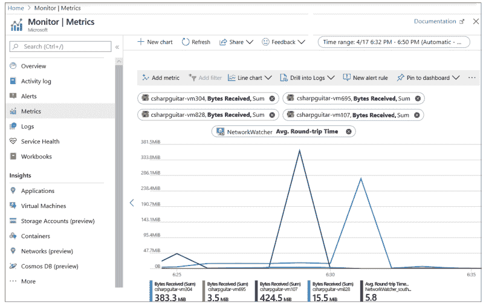

正如您在图 9.18 中所见，Microsoft.Network/networkInterfaces 和 Microsoft.Network/networkWatchers 已添加到指标中。表 9.4 显示了每个可用的指标。

### 表 9.4 网络 Azure Monitor 指标

| 网络接口 | 网络监视器 |
|---|---|
| 接收字节数 | 探测失败百分比 |
| 发送字节数 | 平均往返时间（毫秒） |
| 接收数据包数 | 检查失败百分比 |
| 发送数据包数 | 往返时间（毫秒） |

存在大量可用于捕获、存储和分析 Azure 产品的信息。您需要花一些时间来找到能够提供所需信息以回答您所面临或自己提出的问题的报告和产品。将数据解释为一组可操作的任务不仅需要技术经验，还需要对所分析产品的经验。所有应用程序都有其独特的运行行为，这些行为只能随着时间推移在与它们一起工作时学习。

本节还需要涵盖另一个网络设备，即 WAF/应用程序网关。在许多场景中，这是您的可公开访问的 Azure 工作负载的入口点。该端点可全局访问，因此可能需要一些额外的监控。请确保如果您已配置安全中心和/或 Azure Sentinel，您默认会收到恶意行为通知和预防提示/操作。如果由于某种原因这些功能成本过高，您可以使用 Azure Monitor 指标来监控某些应用程序网关行为。正如您在图 9.18 及更早之前看到的，“指标”边栏选项卡上有一个“+ 新建警报规则”链接。一旦您确定了描述设备正常行为的基线，如果有任何超出此正常范围的情况，您就可以收到警报或向团队发送警报，团队应采取措施。

### 监控计算

监控组件是您花费最多时间进行配置、优化和分析指标的地方。这是您的应用程序运行的地方，也是您的客户、用户、客户端或员工将报告为问题来源的位置。不仅要配置指标、创建警报并通知您的 IT 支持团队，关键还要制定行动方案以响应这些警报并在警报发生时采取措施。为 Azure 计算设计监控解决方案时，将计算划分为以下云服务模型是一个好方法。这些模型在第 4 章中介绍；另请参见图 4.1 作为回顾。

- IaaS：Azure 虚拟机
- CaaS：AKS 和 ACI
- PaaS：Azure 应用服务
- FaaS：Azure Functions

您可能已经注意到，在可用的监控功能方面，Azure 虚拟机是与众不同的一种。当我说与众不同时，我的意思是它是最好的。正如您在练习 9.1 中学到的，与您在 Azure Monitor 中配置其他 Azure 资源时所看到的不同，Azure 虚拟机的工作方式有些不同。这主要是因为旧技术；Azure 虚拟机是 Azure 提供的第一个产品，许多客户依赖于其当前运行方式，因此更改它们的运行和日志指标方式不能掉以轻心。然而，随着时间的推移，Azure 团队吸取了一些教训，识别了优化和简化的机会，然后基于这些发现进行了增强。由于兼容性问题，其中一些增强功能无法添加到 Azure VM 指标中，这就是差异的原因。


我所说的监控功能如下，本书已对这些功能进行了详细介绍：

- 更新管理（图8.44）
- 变更跟踪（图6.14）
- 配置管理
- 清单
- 安全中心：计算与应用（图6.13）

对于其他Azure计算产品，监控功能如图9.13所示，并在此列出：

- Insights（即Application Insights）
- 指标
- 日志
- 诊断设置
- 警报

此外，别忘了Azure自动化runbook，它不仅可以用来监控Azure计算，还可以监控几乎所有能想到的内容。请看图9.19，它展示了流程自动化runbook的搜索结果，这些结果按关联标记等于Monitor进行了筛选。你可以直接复用它们，或稍作修改，以满足你的具体监控需求。

**图9.19** Azure自动化Monitor runbook模板

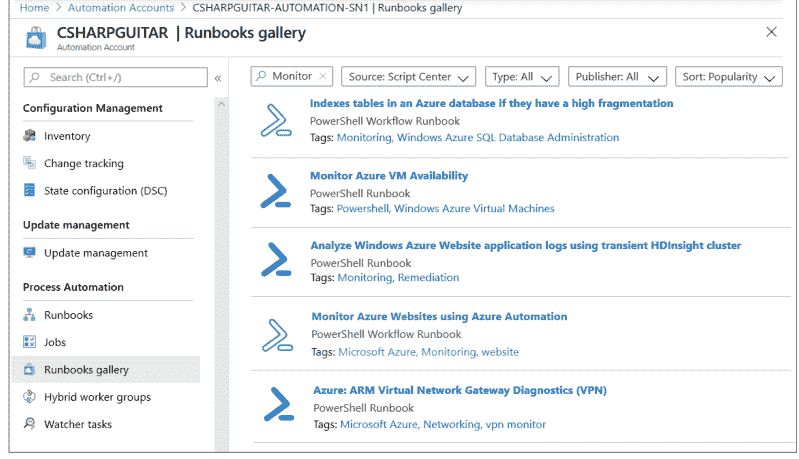

在为Azure应用服务和Azure函数配置指标功能时，你会发现它们很相似，尤其是当Azure函数的触发器来自HTTP时。表9.5列出了Microsoft.Web/sites资源提供程序的一些指标示例。

**表9.5** Azure应用服务和Azure函数指标

| Azure应用服务 | Azure函数 |
|---|---|
| Http5xx | Http5xx |
| MemoryWorkingSet | MemoryWorkingSet |
| Gen0-2Collections | Gen0-2Collections |
| HealthCheckStatus | Health check status |
| Requests | FunctionExecutionUnit |
| ResponseTime | FunctionExecutionCount |
| Handles | RequestsInApplicationQueue |
| Threads | FileSystemUsage |
| CurrentAssemblies | CurrentAssemblies |

对于Azure应用服务指标，你会发现它们与查看IIS Web服务器日志时看到的详细信息有许多相同之处。其中存储了大量信息，可以让你全面了解该产品以及在某些情况下应用程序的运行状况。

### 监控数据

监控数据存储与它托管的云模型和DBMS的类型有很大关系。如果你运行的是SQL Server虚拟机，那么你可能希望使用前面计算部分学到的知识，结合独立的SQL Server指标，构建混合监控解决方案。如果数据存储是Azure SQL或Azure Cosmos DB，则可以使用常见的监控组件，如指标、诊断设置和日志（即Log Analytics）。请查看表9.6，其中总结了Azure SQL和Azure Cosmos DB数据存储可用的指标。

**表9.6** Azure SQL和Azure Cosmos DB指标

| Azure SQL | Azure Cosmos DB |
|---|---|
| allocated_data_storage | DataUsage |
| blocked_by_firewall | DocumentCount |
| connection_failed | DocumentQuota |
| connection_successful | IndexUsage |
| cpu_percent | RegionFailover |
| deadlock | ReplicationLatency |
| dtu_consumption_percent | ServiceAvailability |
| dtu_used | TotalRequests |
| storage_used | UpdateAccountKeys |

Azure Cosmos DB在门户中提供了良好的指标图形化表示，如图9.20所示。

**图9.20** Azure Cosmos DB指标

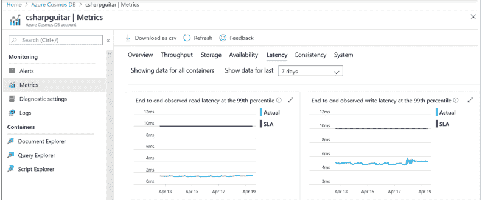

请注意“指标”边栏顶部的选项卡：概述、吞吐量、存储、可用性、延迟、一致性和系统。这些指标及其可视化效果应能让你全面了解Azure Cosmos DB的运行状况。从Azure SQL的角度来看，你会发现类似的指标和诊断信息。这里我想继续讨论你在第6章中执行的练习，该练习涉及在数据库表的特定列上设置敏感度级别。回顾一下练习6.3并查看图6.11，这可能会帮助你回忆。你可以花点时间执行以下Azure PowerShell cmdlet，以确认你在Azure SQL表上是否有此类设置，并查看这些设置是什么。输出结果将类似于图9.21所示。

**图9.21** Azure SQL敏感度级别

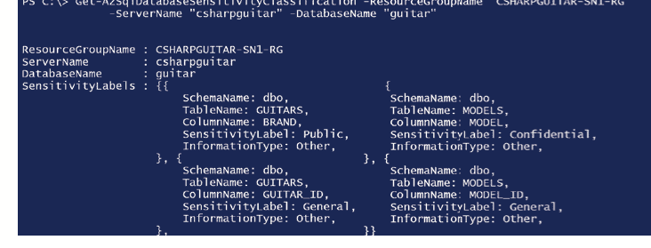

```
Get-AzSqlDatabaseSensitivityClassification -ResourceGroupName "<rgName>" `
    -ServerName "<sName>" -DatabaseName "<dName>"
```

这很好，但如何监控谁在访问它以及访问频率呢？这可以通过Azure SQL数据库的审核功能进行监控。你可以在门户中Azure SQL数据库边栏的“安全性”标题下找到此功能。它默认处于禁用状态，你需要先启用它；只有这样才能记录访问监控。启用后，请注意“审核”边栏顶部有一个名为“查看审核日志”的菜单项。单击它，然后点击“查看仪表板”链接，你将看到如图9.22所示的概览。

当你比较图9.21和图9.22中的设置时，你会理解它们是如何配合使用的。为了创建该报告并生成审核日志，我对guitar数据库中的MODEL表多次运行了SELECT查询。要获取更多访问详细信息，请单击“Azure SQL – 对敏感数据的访问”指标，如图9.22所示。你将找到有关谁执行了查询以及来自哪个客户端的信息；见图9.23。当然，也有办法使用Log Analytics上的KQL来找出查询访问了哪些列和表。正在运行的数据库、表和查询是重要的信息，但它们显然不是默认报告功能的一部分。相反，只提供对具有此类状态的表和列的访问次数，即不具体提供表和列名称。但是，你可以使用Log Analytics和KQL手动获取它们，然后将结果导出为CSV，并在Power BI或Excel中创建自己的报告。

**图9.22** Azure SQL敏感度级别概览

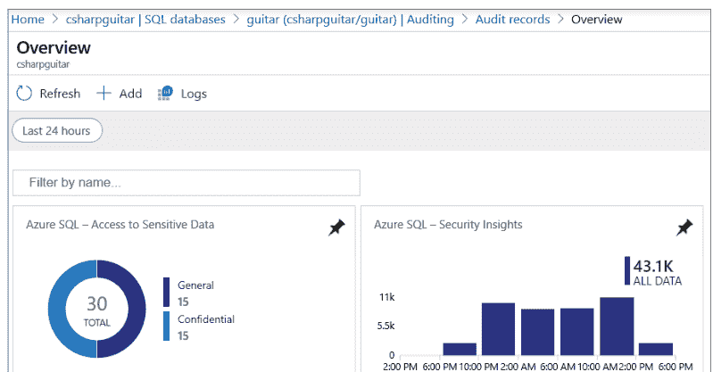

**图9.23** Azure SQL敏感度级别：谁、多久一次、从哪里

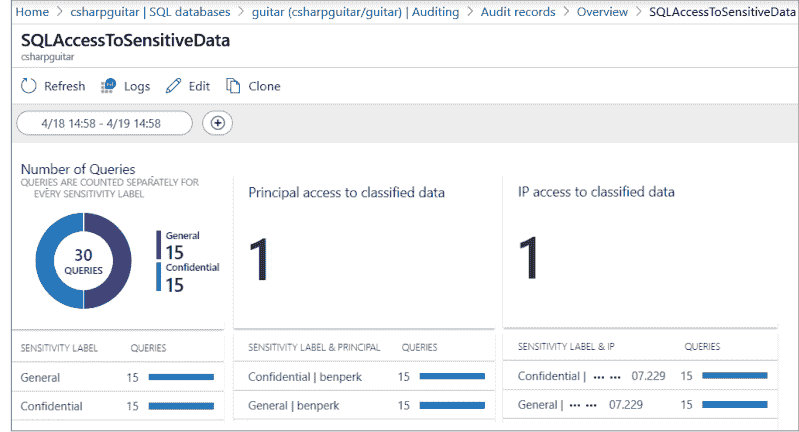

对于这些Azure产品，需要考虑的一个重要方面是你要在哪个级别进行监控。事件中心和服务总线有一个命名空间，你可以在其中放置事件中心的事件中心，或服务总线的队列或主题。Azure存储队列存在于存储帐户中，而事件网格可以包含一个或多个存在于事件网格域中的主题。你可能希望获得适用的命名空间、帐户或域以及接收和管理事件或消息的产品部分的监控指标。这需要你采取具体行动来区分和配置。你应该再次查看此处可用的指标，以确定需要哪些特定日志：

```
docs.microsoft.com/en-us/azure/azure-monitor/platform/metrics-supported
```

如图9.24所示，每个消息服务的“概述”边栏上默认都有一些可用指标。

**图9.24** Azure消息传递指标示例

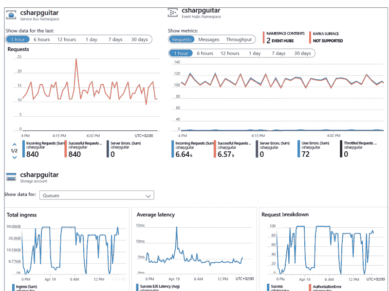

### 监控合规性

一旦你实施了合规性和治理规则，其背后的核心思想就是监控这些规则，并确保人员和IT系统遵守这些规则。在第6章中，你了解了Azure Policy，并在图6.3中看到整个“策略概述”边栏专门用于显示你已创建和应用的政策的状态。你还了解到，当你不合规时，Azure Policy功能将为你提供一些提示，这些提示定义了一些步骤来帮助你实现合规。在安全中心内，也存在一些关于策略和合规性的详细信息和指标。回顾一下图2.49和图6.9，它们显示了有关监管合规性的指标。

### 其他监控主题

你可以监控许多其他领域。在本节中，你将找到关于监控部署以及标记和标签如何有助于改善监控体验的简短总结。

#### 部署日志

如果你想要了解订阅中正在发生的部署的概览，有两个地方可以查看。这并不涉及第7章中讨论的应用程序代码部署的监控，而是Azure产品、功能和服务本身的部署。一个有趣的点是检查资源组内发生的部署。如图9.25所示，资源组的“概述”边栏上有一个名为“部署”的标题。在该标题下方有一个链接，显示失败和成功部署的数量。

**图9.25** 从Azure门户查看部署状态

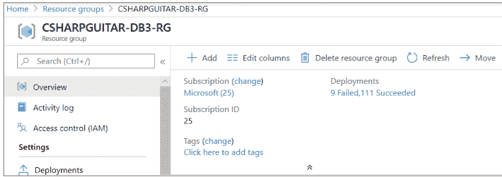

如果单击该链接，你将获得每个部署的详细信息。还有一个名为“部署”的导航菜单项，也显示在图9.25中，它将引导你到


为了避免丢失业务 IT 数据或应用程序，您需要拥有备份、冗余和灾难恢复计划。在没有将这三个 DR 方面嵌入 IT 组织的文化中就运营一家公司是巨大的风险。Azure 提供了产品和功能，帮助客户设计、测试、实施和维护 BCDR 解决方案。Azure Backup 和 Azure Site Recovery (ASR) 已在第 1 章中介绍过，因此请再次回顾它们；两者后面也会再次介绍。本节并不是您第一次阅读关于 BCDR 的内容；第 3 章、第 5 章、第 6 章以及本书中的许多其他地方都有讨论。请不要忽视 IT 的这一重要方面，继续阅读以了解有关 Microsoft Azure 提供的产品和功能如何帮助客户防止可能摧毁您业务的灾难性事件的更多信息。

### 什么是 BCDR？

当您的 IT 系统出现中断影响业务运营时，您需要有一个计划来应对，通过实施业务连续性和灾难恢复 (BCDR) 计划来执行。第一步是确定什么构成中断。它是由瞬时问题引起的中断，还是可能需要数分钟或数小时才能解决的停机，或者看起来会存在长期停机？第一步是拥有良好的监控，以便您了解实际情况，然后定义确定何时激活 BCDR 计划的指标。一旦指标明确且阈值被突破，您就执行计划，该计划可能包括在 Azure Front Door 上更改路由、使用 Azure Traffic Manager (ATM)，或进行 DNS 更改以将网站地址路由到新的 IP 地址。也可以将生产环境的副本切换到另一个区域。存在许多场景，每个计划都需要根据应用程序要求详细描述，并随着应用程序架构和行为的任何变化而持续更新。最后，一旦您执行了故障转移并且一切正常，您需要确定是否将在此状态下继续运营业务，还是需要着手恢复之前的生产环境并使其功能正常，然后将客户或员工重新路由回该环境。执行 BCDR 计划的实际操作中涉及如此多的工作、压力和复杂性。任何经历过这种情况的人都知道这一点；没有计划会更糟且非常混乱，但请阅读剩余章节，您将获得一些关于如何使这种情况更易忍受的建议。让我们先更深入地了解业务连续性。

#### 业务连续性

需要此类程序的场景通常都很激烈且复杂。它们之所以复杂，是因为在大多数情况下，没有人真正执行过 BCDR 流程，而且风险很高。使任何场景变得不那么复杂的最佳方式是将其分解为更小的部分，然后逐一学习并执行。业务连续性的概念不仅涉及 IT 连续性，而且如名称所示，它描述了如果发生中断业务将如何运营，并不一定是技术方面的。考虑一下您的公司与合作伙伴合作，他们为您的产品下单，而他们用于此的互联网门户已关闭。是否可以增加呼叫中心的人力资源，手动在纸上接收这些订单，然后在系统恢复后将其输入系统？另一个方面是弄清楚这种业务连续性流程可以存在多久，然后才需要激活您的灾难恢复计划。停机对业务的影响有多大以及它可以保持这种状态多久，决定了您开始在生产环境上进行配置以将客户和员工路由到应用程序的另一个实例的时间。理想情况下，您拥有此环境以及使用它的计划；否则，在危机模式下再构建就为时已晚。没有计划是有风险的，如果需要计划却发现不存在，将会对 IT 组织产生负面影响。

#### 灾难恢复

BCDR 计划的这一部分专注于 IT 方面，更加底层。它从定义 IT 中断的阈值被突破时开始，意味着是执行计划的时候了。从这一点开始无法回头；做出这样的决定风险巨大，因为您很可能不知道自己即将做的事情是否会成功。您的 IT 组织可能花费了数年甚至数十年的时间使解决方案在当前环境中按现在的方式运行，而您现在要在接下来的几个小时内尝试复制该环境。这些参考来自于由本地或私有数据中心场景驱动的历史视角。在那些日子里，IT 解决方案运行在昂贵的商标硬件上，拥有一个闲置的生产环境副本的对话根本无法开始；它只是太昂贵了。然而，在云中，您可以配置灾难恢复 (DR) 环境而不使用它，并且成本合理，这改变了整个格局。请记住，在云中，您仅在产品或功能被使用时才付费。在云中拥有 DR 环境开启了 DR 对话渠道，并解决了拥有 BCDR 计划的主要障碍，即成本。但您仍然需要计划；计划需要包括阈值，并且计划需要根据需要进行测试和维护。以下部分将为您提供在需要时创建、测试和执行 BCDR 计划的一些方法。

### Azure Recovery Services

本章的其余部分将介绍一些 Azure 产品和功能，有助于创建、测试和执行 BCDR 计划。设计部分过于特定于应用程序，因此需要逐案进行。您可能需要设计的一些主题，例如，仅仅举例来说，对构成您的 IT 解决方案的 Azure 资源有一个清晰的概述。这是本书中在资源组和标签方面反复强调的一个领域，两者都是将构成您的 IT 解决方案的 Azure 资源分组在一起的有用功能。一旦您知道自己拥有什么，就需要确定是否要创建环境的完全副本还是仅其一部分。请记住上一章中的一个示例，指出您可以导出包含给定资源组所有 Azure 资源的 ARM 模板。那只会包含 Azure 部署的配置部分，但它可以作为一个起点。如果您决定在另一个区域重新配置相同的负载，那么使用 ARM 模板可能是一个选项。不建议在实际执行 BCDR 计划时尝试使用模板部署。这种方法需要在之前完成，因为在配置完成后，您还需要对新平台进行配置。在危机模式下做这些工作太多了。

如果您只需要故障转移应用程序的特定部分，那么您需要识别它们并制定计划。Azure Traffic Manager (ATM) 可以为您自动执行此操作，如果您将其配置为这样做。例如，如果您的一个 Web 服务器变得不健康，ATM 将停止向其发送流量，如果您在其他区域配置了其他 Web 服务器作为故障转移，那么您将只经历瞬时中断。同样适用于您的数据存储，例如 Azure SQL、Azure Cosmos DB 或 SQL Server 虚拟机。每种情况都有不同的 BCDR 计划。计划不仅涵盖如何使数据库恢复并可访问，还涵盖如何确保所有连接到它的客户端都已更新或被通知新的连接要求。下一节将从讨论如何捕获您在 Azure 上运行的内容的概述开始。理想情况下，您已以便于此的方式组织这些部分。然后您将了解备份，如果您进行备份，将使您处于能够从触发 BCDR 计划的事件中恢复的位置。最后，您将执行一些模拟故障转移的任务，这将是真实世界 BCDR 恢复计划创建中采取的操作之一。本章的最后一节将提供有关每个 Azure 产品特定恢复选项的详细信息，类似于本章前面为监控提供的那样。

#### Azure Resource Graph

此 Azure 功能有助于确定您当前在 Azure 平台上配置并运行的内容。有一种名为 Azure Resource Graph Explorer 的工具，您可以在其中执行 Kusto 查询 (KQL) 以收集有关资源的 information。如图 9.26 所示，可以执行查询来查找具有名为 Environment 且等于 Production 的标签的所有资源。

您也可以使用 Azure CLI 和以下命令查询与图 9.26 中看到的相同输出：

```
az graph query -q "Resources | where tags.Environment =~ 'Production' \
| project name, type, location"
```

一旦您获得了所有必要的 Azure 资源以拥有生产环境的完整副本，您就需要决定哪些将包含在 BCDR 计划中。确定后，逐一检查它们，确保您知道所有备份的计划和位置。查看 Azure Backup 功能，它可以帮助您管理已配置 Azure 资源的备份。


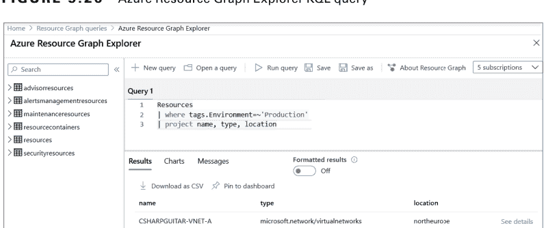

### Azure Backup

在你能够从数据丢失、服务器崩溃或全面灾难中恢复之前，你必须有东西可以恢复。通常你会使用备份来从丢失数据或服务器的事件中恢复。Azure Backup 是你应该为 Azure VM、Azure Files 和 SQL Server 虚拟机捕获备份时选择的工具。关于创建备份的一些细节已在前几章中介绍过，例如第 4 章的 Azure VM 和第 5 章的数据存储。如果您直接跳到本节并希望了解更多信息，请查看这些章节以作复习。对于本节，将从 Azure 平台的角度讨论以下主题：

- Description of a backup
- How backups work on Azure
- Storing and managing backups
- Backing up other products
- Linux versus Windows backups

像运行一个成功的 IT 组织所需的许多其他活动一样，制作备份是一项复杂的工作。备份、管理和从备份恢复系统并没有什么简单之处。你首先需要确定需要备份哪些特定服务器，如前所述。之后，你需要确定该服务器上的所有内容是否都需要备份。

### Description of a Backup

请记住存储是有成本的，因此你不会想存储不必要的更多内容。存储并不是 Azure 上最昂贵的产品之一；然而，花费超过必须的费用永远不是一个好主意。当对 Azure VM 执行 Azure Backup 时，最常见的更新组件是文件、文件夹、系统状态和应用数据。前两个组件不言自明，即文件和文件夹，例如你在 Windows 资源管理器中看到的内容。系统状态将包含注册表，其中可能包含自定义设置、环境设置或进程执行路径。你会同意，许多应用程序依赖于位于特定位置的其他程序集。那些配置被视为系统状态，并在你配置 Azure Backup 时默认备份。应用数据通常用于本地临时存储和存储应用程序特定信息。例如，如果应用程序需要解析一个文件，该文件需要在处理过程中临时存储在某处。

从数据存储的角度来看，如 SQL Server，运行它的 Azure VM 需要备份，正如刚才讨论的那样，数据库也需要备份。正如你在第 5 章中学到的，数据库本身只是一个 DBMS 管理访问的大文件。因此，备份数据库就是备份文件和任何专门的数据库配置。它的工作原理将在下一节中介绍；现在让我们先看看不同类型的备份，这些备份在表 9.9 中提供。

#### TABLE 9.9 Azure Backup Types

| Backup Type | Azure Product | Description |
|---|---|---|
| Full | VM/SQL | A complete backup of the entire source |
| Incremental | VM | A backup of changes since last backup |
| Differential | SQL | A backup of changes since last backup |
| Transactional | SQL | A log which enabled PITR restoration |

增量备份和差异备份之间的区别在于，差异备份需要一个完整备份才能执行恢复，因为未更改的数据不包含在内。当执行差异备份时，只备份已修改的数据。与其他 Azure Backup 类型相比，差异备份减少了存储需求、网络消耗以及执行备份所需的时间。支持每天执行一次完整数据备份；然而，你需要确定在你的场景中是否需要。再次记住，存储是有相关成本的，如果你每天备份一个 5GB 的数据库，成本，就像所需的存储空间一样，可能会迅速变得很大。注意这一点并确保优化备份的内容和频率。正如你可能还记得点时间恢复（PITR）来自第 5 章；参见图 5.48，在那里你接触到这个概念。PITR 允许你将数据库恢复到特定秒之前的状态。相比之下，增量或差异备份支持每日或每周计划，这意味着如果没有事务备份，你可能会丢失一天的数据。你能接受吗？值得这个成本吗？这些是你需要根据数据的关键性和其丢失对公司造成的影响来决定的问题。

### How Backups Work on Azure?

Azure Backup 依赖于许多不同的 Azure 产品和服务来执行备份。备份 Azure VM 或 SQL Server 虚拟机的最简单方法是利用 Azure Backup 扩展，该扩展安装到在 VM 上运行的 Azure VM 代理中。在为 VM 配置 Azure Backup 后，如你在练习 9.3 中将要做的那样，当你导航到 Azure 门户中 VM 的 Extensions 刀片时，你会看到已安装 Microsoft Monitoring Agent；这之前被称为代理。

在上一章中，你了解到 Microsoft Azure Recovery Services (MARS) 可用于将工作负载部署到 Azure 平台。对于执行备份也是如此；请回顾图 1.8，它说明了 MARS 用于备份本地和 Azure VM 并将其存储在 Azure 上的用途。Microsoft Azure Backup Server (MARS) 和 System Center Data Protection Manager (DPM) 是将本地 VM 备份到 Azure 的有用工具。MARS 和 DPM 都需要安装和配置服务器软件，以及在 Azure VM 上或本地机器上预配用于运行服务器软件的机器。如果你目前拥有 DPM 许可证，那么你或你的公司已经具备执行此类备份所需的技能。在你已经拥有 DPM 的情况下，你需要更改存储备份的位置，使其位于 Azure 平台上。如果你没有 DPM 许可证，那么你可以使用 MARS 来实现与 DPM 相同的备份功能。DPM 的好处是它是 System Center 工具套件的一部分。要了解有关 System Center 的更多信息，请阅读此页面：www.microsoft.com/en-us/system-center。

执行备份和恢复的另一个选项是使用 Azure Automation 脚本。Azure Automation 已在上一章中讨论过。通过脚本化备份活动，你可以一次性维护的 VM 范围会增加，并降低复杂性和犯错的可能性。在练习 9.3 中，你将为 Azure VM 配置备份；配置是在单个 VM 上执行的。如果你有许多 Azure VM 和/或需要备份的 SQL Server 虚拟机，一次一个地做是不可行的。相反，你可以使用 Azure Automation 执行的 PowerShell 脚本脚本化备份过程。完成练习 9.3 以学习如何为 Azure 虚拟机配置 Azure Backup。

### EXERCISE 9.3

#### Configuring Azure Backup for an Azure VM

- 1. Log in to the Azure Portal at portal.azure.com.
- 2. Navigate to one of the Azure virtual machines that you have created in a previous exercise or create a new one. Make sure the VM is running, click the Backup link from the navigation menu, click the Create New radio button, enter a name, enter the resource group into which you want the Recovery Service vault to be placed into, and click the Create (or Edit) A New Policy link under the Choose Backup Policy drop-down list.
- 3. Enter a policy name; configure the Backup schedule by choosing a frequency, time, and time zone; click the OK button; and click the Enable Backup button.

在练习中，配置 Azure Backup 所需的步骤之一是创建备份策略。它包含三个组件：备份计划、快照恢复和保留范围。备份计划定义备份执行的频率（每日或每周）、时间以及时区。正如你可能还记得第 4 章中的内容，快照是绑定到 VM 的磁盘副本，可用于构建副本或，在本例中，从服务器崩溃中恢复。快照不携带配置和环境设置，就像使用 Azure Backup 执行备份时那样。备份必须保留的时间可能由合规或治理要求驱动。如果你的场景不依赖于两者中的任何一个，那么你需要确定恢复到多远之前是有意义的。时间范围将根据使用情况以及配置或数据在给定时间范围内的变化频率而有所不同。你备份的频率以及保留备份的时间是特定于你的应用程序场景的。然而，在我的经验中，并且不受任何合规、法律或治理约束，我不会考虑恢复到超过一到两周前的数据库状态。有许多约束和条件需要考虑；花时间弄清楚什么最适合你的场景。

在执行练习 9.3 中的 Azure Backup 配置后运行了几次备份后，点击导航菜单中的 Backup 链接将呈现类似于图 9.27 所示的内容。你将看到三种恢复点状态：Crash Consistent、Application Consistent 和 File-System Consistent。

在备份数据存储或 VM 时，它处于关闭状态是最理想的状态。从数据存储的角度来看，关闭意味着数据库不可访问，而从 VM 的角度来看，它意味着没有客户端连接，并且没有作业或服务在上面运行。如果你在备份运行时备份的服务正在使用中，那么尝试备份正在被访问的文件可能会挂起，这可能导致只备份了部分数据或只备份了预期内容/配置的一部分。所有这些场景如果尝试使用其中一个部分


successful backups. 除非你采取预防性措施确保在计划备份运行时被备份的服务处于“关闭”状态，否则在尝试恢复时需要预期并计划进行一些故障排除。这就是那三种一致性状态代码的原因和目的。原因是你知道备份的质量如何，这有助于你确定如果用于从中断或崩溃中恢复时成功的概率。

#### FIGURE 9.27 Azure VM configured Azure Backup

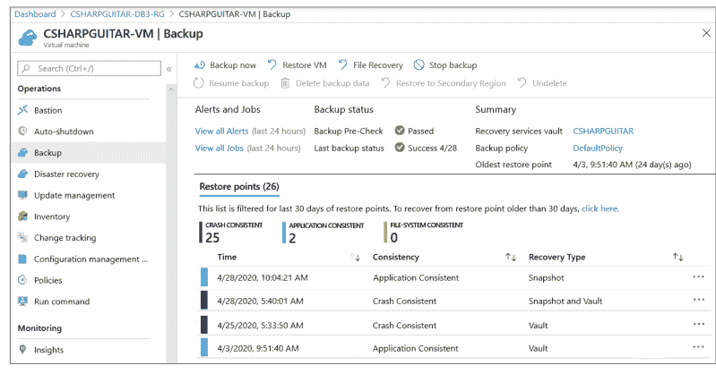

Crash consistent 不会被认为是良好的备份。它意味着备份在 VM 处于停止或取消分配状态时运行。VM 需要处于运行但“关闭”的状态才能获得良好的备份，其中“关闭”意味着没有活动发生，没有程序运行，并且没有用户访问 VM 上的任何内容。

你可能能够从这些备份中恢复并启动，但如果你在 Backup 刀片上看到的只有这些，请考虑手动运行一次备份以确保你至少有一个。Application Consistent 是你想要看到的状态。这意味着备份成功，并且备份的各个方面都成功。使用此状态下的备份进行恢复将提供最高的成功概率。正如你可能预期的那样，File-System Consistent 在两者之间，意味着备份的部分或全部失败。失败的原因可能是 VM 在备份执行时未处于“关闭”状态。未处于“关闭”状态可能会导致前面提到的类似问题，其中之一是文件当前正在被访问，因此被锁定，备份进程无法访问。

### Storing and Managing Backups

当你在练习 9.3 中为 Azure VM 配置 Azure Backup 时，配置的一部分是预配一个 Azure Recovery Services Vault。恢复 vault 也在第 8 章中提到，并使用图 8.4 显示，该图显示了 Site Recovery 仪表板，后文也会讨论。现在关注的仪表板是侧重于 Backup 选项卡的，并由图 9.28 说明。

#### FIGURE 9.28 Azure Backup, Azure Recovery Services Vault

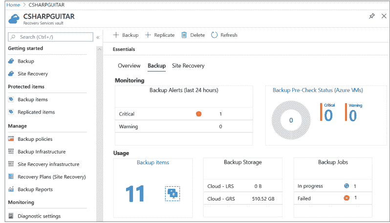

Backup 仪表板为你提供当前正在进行或处于失败状态的任何 Azure Backup 的概览。它标识有多少备份已执行并存储在 Recovery Services vault 中。如果你点击 Usage 文本块中靠近数字 11 的 Backup Items 链接，你将被呈现一份已执行的各类备份数量的列表。见图 9.29。

如果然后你点击特定的备份管理类型，例如 Azure Virtual Machines，将提供已备份的具体 VM 的详细列表。例如，你将看到 VM 名称、其所在的资源组以及其状态。从图 9.28 的 Backup 仪表板得出的最后一个细节是 Backup Storage 文本框。这显示了你的备份消耗了多少存储。LRS 和 GRS 存储类型应该很熟悉。你在第 5 章学习了不同的 Azure 存储冗余类型。基于 Backup 仪表板上显示的信息，你可以得出结论，你的备份以 Azure Blob 的形式存储在 Azure Blob Storage 容器中，并且默认使用 GRS 冗余类型。快速回顾一下，GRS 意味着你的备份在主区域备份三次，然后在辅助区域再次备份。

#### FIGURE 9.29 Azure Backup Items in Azure Recovery Services Vault

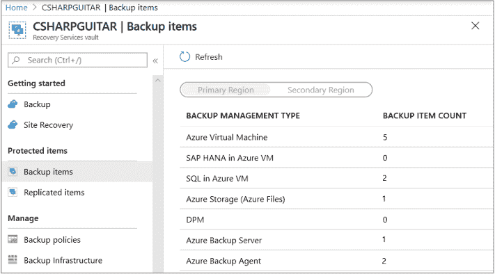

现在你知道了 Azure Backup 的工作原理，它使用在 Azure 上的 VM 上运行的代理。然后你配置一个备份策略来定义备份的频率和保留期。使用 MARS/DPM 来备份运行在本地数据中心的 VM 到 Azure。当你为备份 VM 配置这些代理中的任一个时，备份会存储到 Azure Blob 存储账户中。Recovery Services vault 是你可以从中监控和管理备份的位置。从管理角度来看，有两个重要点需要涵盖：备份的安全性和管理。从安全角度来看，所有数据在传输中和静态时都已加密，这意味着如果有人碰巧获得了你的备份副本，他们无法使用它。备份数据通过 HTTPS 链接发送，并且当备份使用 Recovery Service vault 存储时，它是加密存储的。从管理角度来看，如果你不再想执行备份，你可以通过点击 Stop Backup 来禁用备份，该按钮位于 Azure VM Backup 刀片上，如图 9.27 之前所示。当你点击 Stop Backup 按钮时，会询问你是否要保留或删除备份数据。如果你选择保留数据一段时间然后稍后删除，你可以返回 Azure VM 的 Backup 刀片并点击 Delete Backup Data 菜单选项，也显示在图 9.27 中。它在那里是灰色的，因为备份仍处于启用状态；然而，当备份停止时，它将被启用。记住，你的旧备份会根据你在创建备份策略时提供的保留设置自动删除。

### Backing Up Other Products

在前面的章节中，你学习了备份 Azure VM 和 SQL Server 虚拟机，但其他 Azure 产品和功能呢？回答这个问题的方法与你使用的云托管服务类型密切相关。Azure VM 是 IaaS，因为你承担了平台的责任，你负责管理它，这包括备份它。情况并非如此，当你在 PaaS 云托管服务上运行时，例如 Azure App Services、Azure Functions、Azure SQL 或 Azure Cosmos DB。运行在 PaaS 上时，你唯一关心的就是你的应用程序和你的数据，因此你只需要备份这些。当你部署 Azure App Service 或 Azure Function 时，它们的配置作为产品的一部分存储并由平台自动备份。例如，如果你的应用程序需要 .NET Core 二进制文件，如果它允许 HTTP 或应用程序设置连接字符串中的名称和值，基本上你在图 9.30 下 Setting 标题下看到的任何配置都由平台存储和保护。这必须是这种情况；因为该配置信息用于扩展应用程序的额外实例，它们都需要相同的源代码和配置。重点是，与 IaaS 不同，PaaS 为你提供了操作系统和应用程序配置的备份。

Azure App Services 和 Azure Functions 存在备份和快照功能，如图 9.30 所示。它们将帮助你在需要时提高应用程序恢复的速度。当你配置备份时，你还可以配置它以包含应用程序连接的任何数据库。

#### FIGURE 9.30 Backing up Azure PaaS products

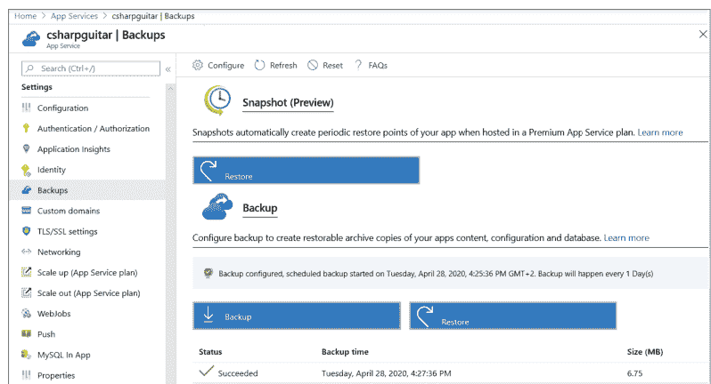

像 Azure Backup 和 Recovery Services vault 一样，Azure App Service 或 Azure Functions 备份被放置到 Azure Blob Storage 容器上。你在配置备份时通过点击 Configure 菜单链接选择它，也显示在图 9.30 中。记住要小心将你的内容和代码存储在源代码存储库中，例如 Azure DevOps 或 GitHub。因为，正如你所知，存在

| **TABLE 9.10** | Linux vs. Windows Azure Backups *(continued)* |
|---|---|
| **Feature** | **Linux** | **Windows** |
| Azure DPM | × | ✓ |
| File-system consistent is default | ✓ | × |
| Application consistent is default | × | ✓ |

Microsoft Azure Recovery Services (MARS) 仅支持 Windows 机器，因此当你讨论运行 Linux 的机器时，你可以默认排除该工具。如果你需要备份运行在本地数据中心的受支持的 Linux 版本到 Azure，那么你会选择 Microsoft Azure Backup Server (MABS) 或 Data Protection Manager (DPM)。然而，MABS 也不 DPM 不能用于备份运行 Linux 的 Azure VM，而是仅限于本地。使用 Azure Backup 将有效；请注意，对于 Linux，默认的还原点状态是 File-System Consistent。Microsoft 为运行 Linux 的客户提供了一个选项来配置 Azure Backup，以便捕获应用程序一致的还原点。有关更多信息，请阅读 docs.microsoft.com/en-us/azure/backup/backup-azure-linux-app-consistent。

能够捕获应用程序一致还原点的能力取决于用于执行此类备份的 Microsoft 功能。该功能是一个名为 *Volume Shadow Copy Service* (VSS) 的 Windows Server 服务，仅支持 Windows。从 Linux 角度来看，你需要安装 Python 并利用一个名为 fsFreeze 的功能。你可以在这里找到有关这两个服务的更多信息：

- **VSS:** docs.microsoft.com/en-us/windows-server/storage/file-server/volume-shadow-copy-service
- **fsFreeze:** github.com/Azure/azure-linux-extensions/tree/master/VMBackup

除了 Linux 和 Windows 操作系统之间的不同备份支持外，像其他 Azure 产品一样，Azure Backups 通常存在限制。表 9.11 提供了一些关于 Linux 和 Windows 的相关细节。请记住，在大多数情况下，默认限制是为了防止你无意中触发一个尝试消耗无限资源从而导致天文数字账单的任务而设置的。如果你需要更多，请向 Microsoft 开启支持案例，他们肯定会为你提高限制。

默认限制在支持每个订阅备份 500,000 台机器方面非常慷慨。那将是很多机器，并且任何公司遇到这种情况都很少见，但永远不要说永远。如果你快速计算 Azure App Service 条目并计算如果备份限制为每小时一次，则最大值只能为 24，那么为什么支持 50？首先，能够对 Azure


应用服务取决于定价层。只有运行在“标准”或更高级别定价层的 Azure 应用服务才能执行备份，而且在“标准”层中，每天最多可进行 12 次备份，并且每两个小时只能备份一次。这里的计算是成立的；不同之处在于，你还可以进行手动备份。因此，如果你每小时执行一次计划备份，然后在 24 小时内再执行 26 次手动备份，仍然是可以的。

**表 9.11** Azure 备份限制

| 产品/功能 | 每个订阅的限制 |
|---|---|
| 恢复服务保管库 | 500 |
| 每个保管库的计算机 | 1000 |
| Azure 虚拟机的 Azure 备份 | 每天一次 |
| 使用 DPM/MABS 备份到 Azure | 每天两次 |
| 使用 MARS 备份 | 每天三次 |
| Azure 应用服务（高级层） | 每天 50 次，每小时一次 |

### Azure Site Recovery

现在，我们假设你已经确定了组成生产环境的所有 Azure 产品，并且已对它们进行了备份，以防万一需要还原。希望你永远不需要这样做。ASR 是一种工具，可以帮助你将资源从一个区域或一个位置移动到另一个区域或位置。这里特别提到“位置”，是因为 ASR 不仅支持移动 Azure 中托管的 VM，还支持在本地（即私有数据中心）运行工作负载的客户。在客户使用本地部署的场景中，当发生中断时，他们可以使用 ASR 将工作负载移动到 Azure，直到本地事件解决为止。

回顾一下第 1 章，那里首次介绍了 ASR。图 1.8 展示了如何使用 ASR 来备份和还原已位于 Azure 中的 VM，或将 VM 从本地备份/还原到 Azure。在第 4 章中，你了解了 Azure 备份与 ASR 之间的区别。此外，你还了解到，在将本地 VM 迁移到 Azure 平台时，ASR 是一个有用的工具。在第 8 章中再次讨论了 ASR，你了解到它不仅可用于迁移在 Hyper-V 或 VMware 上运行的 Windows 和 Linux VM，还可用于迁移独立的非虚拟化服务器。ASR 剩下的最后一部分是故障转移的实际执行。在练习 8.3 中，你使用了恢复服务保管库中提供的备份和还原功能。然后在练习 8.4 中，你使用了复制功能（即 ASR）将 Azure VM 从一个区域移动到另一个区域。练习 8.4 很简单，只需四个步骤；这并不是一项复杂的活动。在练习 9.4 中，你将使用恢复服务保管库中的“站点恢复”功能，将运行在欧洲西部（AM2）的 Azure VM 恢复到欧洲北部（DB3）。你将在前面提供的图 9.28 和图 9.29 中看到名为“Site Recovery”的导航菜单项。

#### 练习 9.4：使用 Azure Site Recovery 恢复 Azure VM

1. 登录 portal.azure.com 上的 Azure 门户。

2. 导航到你在练习 9.3 中创建的恢复服务保管库，并单击“Site Recovery”导航菜单项。图 9.31 显示了页面的外观。单击“第 1 步：复制应用程序”。

   **图 9.31** Azure Site Recovery，复制应用程序

   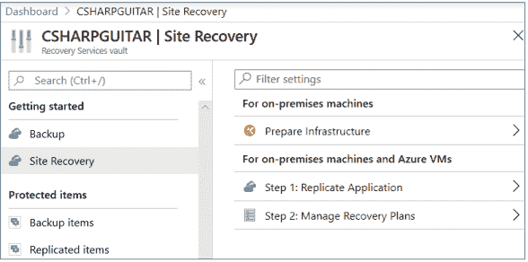

3. 在“源”下拉列表中选择“Azure”，在“源位置”下拉列表中选择“（欧洲）欧洲西部”，在“Azure 虚拟机部署模型”下拉列表中选择“Resource Manager”，选择源订阅，选择要恢复的 Azure VM 所在的源资源组，然后单击“确定”按钮。

4. 选中要恢复的 VM 或 VM 组旁边的复选框。单击“确定”按钮，在“目标位置”下拉列表中选择“（欧洲）欧洲北部”，单击“创建目标资源”按钮，并单击“启用复制”按钮。该边栏选项卡的外观与练习 8.4 的图 8.19 相同。

5. 在部署 Site Recovery 配置期间，请回头查看图 9.31。注意“第 2 步”，该步骤是关于管理恢复计划的。部署完成后，单击名为“恢复计划（站点恢复）”的导航菜单项，可以单击“第 2 步：管理恢复计划”或导航菜单链接。无论哪种方式，都会呈现相同的边栏选项卡。单击“+ 恢复计划”菜单项，输入名称，在“源”下拉列表中选择“欧洲西部”，在“目标”下拉列表中选择“欧洲北部”，并在“允许包含使用以下部署模型的项目”下拉列表中选择“Resource Manager”。单击“选择项目”链接，并为要添加到恢复计划中的 VM 选中复选框。图 9.32 说明了此配置。

   **图 9.32** Azure Site Recovery，创建恢复计划

   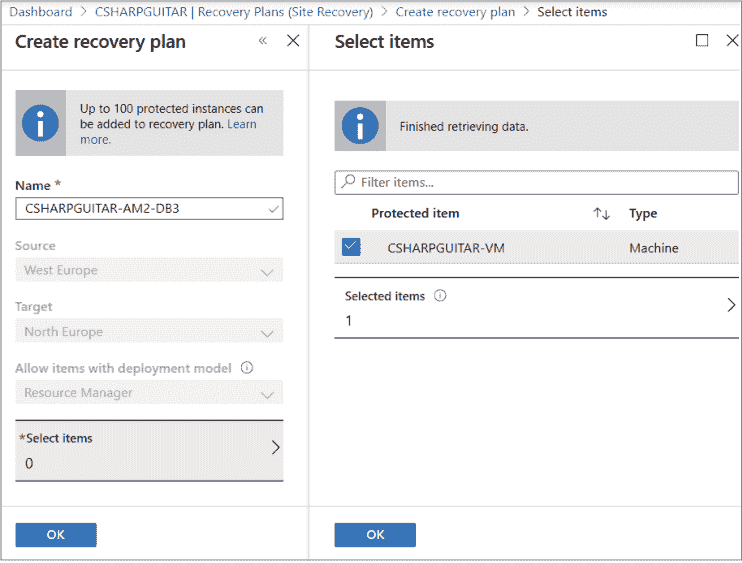

6. 单击“确定”按钮两次。恢复计划创建后，将显示在恢复计划列表中。单击刚刚创建的恢复计划的省略号（...），然后从弹出菜单中选择“测试故障转移”。参见图 9.33。在呈现的“测试故障转移”边栏选项卡中，从“Azure 虚拟网络”下拉列表中选择要用于测试故障转移的 VNet，然后单击“确定”按钮。

   **图 9.33** Azure Site Recovery 测试故障转移

   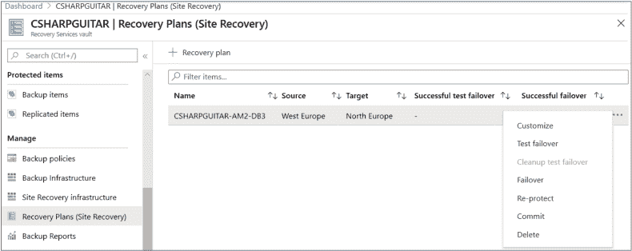

7. 测试成功后，从弹出菜单中选择“清理测试故障转移”，然后从弹出菜单中选择“故障转移”来执行故障转移，保留默认设置（即源、目标、恢复点以及在执行故障转移前关闭 VM），并单击“确定”按钮。故障转移完成后，从弹出菜单中选择“提交”，并单击“确定”按钮以确认你确定。

关于该练习，有几点需要指出。首先，你只能故障转移到同一地理区域中的区域。这一点之前提到过一次，但值得再次说明。例如，无法使用 ASR 将 VM 从欧洲北部（DB3）故障转移到美国中南部（SN1）。练习中使用的区域仅为示例，你应该选择自己场景所需的区域。此外，如果你要设置 Site Recovery，以便将 Azure VM 用作本地工作负载的灾难恢复（DR），则应该选择离你的私有数据中心最近的 Azure 区域。这将加快故障转移速度，并且如果这些在你的场景中相关，还可以避免任何合规性和治理数据问题。接下来要指出的是你在练习 9.4 中创建的恢复计划的说明和用途。

恢复计划是一个模板，用于在故障转移过程执行时定义源、目标以及需要故障转移的项目。练习 9.4 是一个简单的示例，只包含一个 Azure VM。在真实场景中，Azure VM 的数量以及它们之间的关系要复杂得多。这就是为什么有一个“自定义”弹出菜单项，让你可以根据自己的特定需求定制恢复计划。这种定制之所以重要的一个原因是，在 BCDR（业务连续性和灾难恢复）场景中，如果你对工作负载进行故障转移、关闭或启动的顺序有任何要求。例如，如果你有一个批处理作业，在启动后会立即开始向数据库写入数据，那么你需要确保数据库已准备好接收数据；否则，你可能会制造另一个需要清理的混乱局面。也许批处理作业本身依赖一个系统来获取正确处理数据所需的属性。如果这些数据参数不可用，你的数据库可能会收到损坏的数据，这是你需要解决的另一个问题。提供这种定制功能正是为了处理这些情况。原因是，定义 VM 需要关闭、移动、然后重启的顺序，对 BCDR 计划能否成功执行有很大影响。

实际上，在确实需要之前，最好不要真正执行故障转移；如果你这样做了，恢复计划中标识的 VM 将被移动到另一个区域。你应该考虑只执行测试，以确认如果将来确实需要真正故障转移到另一个区域，它能够正常工作。如果你确实需要执行实际的故障转移，那么按照你在练习 9.4 中学到的，从弹出菜单中选择“故障转移”。从弹出菜单中选择“故障转移”所触发的进程完成后，故障转移并没有完全结束。你可能已经注意到，另外两个弹出菜单项是“提交”和“重新保护”。如果你还记得，选择“故障转移”时，所需的部分信息是为给定 VM 选择恢复点。“恢复点”下拉列表的内容如下：

- 最新（最低 RPO）
- 最新已处理（低 RTO）
- 最新应用一致

*应用一致*的含义应该很清楚，因为我们已经讨论过。应用一致状态意味着备份的所有方面都成功了。这是你想要的状态，因为它在部署时成功的可能性最大。*恢复点目标（RPO）* 和 *恢复时间目标（RTO）* 是衡量指标，它们根据备份计划确定你愿意丢失的数据量，以及让备份重新运行所需的时间。RPO 的考量可以关联到在每日备份和每周备份之间做出决策。如果你选择每周备份计划，而 VM 在距上次备份六天后崩溃，你将丢失六天的数据。RTO 的考量涉及可用网络带宽、需要传输的备份大小以及绑定到 VM 的磁盘速度。RTO 专注于尽快让 VM 和其他服务启动并运行。默认选项是“最新已处理（低 RTO）”。因此，你应该可以得出这样的结论：执行 BCDR 计划的人最常见的目标是尽快部署、设置并运行 DR 环境。请明智地做出选择；你可以使用测试故障转移功能来查看哪个选项最适合你的特定场景。请注意，在实际故障转移后，一旦你提交，就不能更改此恢复点。但在通过选择“提交”菜单选项来执行提交之前，你仍然拥有这些其他恢复点，如果任何其他恢复点出现问题，你可以使用它们。


如果您将 Azure 用作从本地数据中心进行 DR 计算需求的平台，那么重新保护（re-protect）与您相关。在许多场景中，DR 故障转移只是一种临时解决方案，直到实际的生产环境恢复运行。当您准备好从 Azure 上的 DR 故障转移回本地数据中心时，您必须首先选择 Re-protect。完成 Re-protect 过程后，您会看到一个名为 Unplanned Failover 的弹出菜单项，点击它将启动将工作负载从 Azure 移回本地数据中心的过程。要执行故障回，所有恢复计划中的 VM 必须在 Azure 上至少有一个恢复点。因此，您需要确保在 Azure 上运行 DR 机器时至少运行一次备份。这很可能是您整体 BCDR 计划中应该添加的一个好步骤，具体来说是在触发故障回之前创建备份。

在进入下一节之前还有最后两点，涉及 Azure Automation 以及对站点恢复活动的监控。您在上一章中创建了一个简单的 Azure Automation 脚本，如图 9.19 所示，您可以编写脚本来自动化在 Azure 上执行的许多活动。脚本可以执行监控活动，这里相关的是故障转移过程也可以被脚本化。尽管练习 9.4 并不是一个复杂的练习，但通过脚本化会变得更简单。想象一下，与其执行真实世界中复杂的故障转移的众多步骤，您可以改为执行单个 PowerShell cmdlet。在您拥有大量资源、依赖关系和复杂性的场景中，您应该考虑脚本化故障转移过程。从监控的角度来看，请回顾图 8.4。该图说明了 Recovery Services vault 内的 Site Recovery 仪表板。该仪表板提供了您已执行的故障转移数量及其状态的概览。此概览非常有帮助，特别是如果您使用 Azure Automation 在发生特定事件需要此类操作时自动执行故障转移。

### Site Recovery Deployment Planner

如第 1 章中介绍的，Site Recovery Deployment Planner (SRDP) 是一种命令行工具，用于分析您希望潜在故障转移到 Azure 的本地虚拟机。此工具适用于 Hyper-V 和 VMware 虚拟化场景。分析的输出将识别任何兼容性问题，例如磁盘数量、IOPS、磁盘大小、启动类型（EFI/BIOS）和操作系统版本。如果存在任何问题，您将被通知并能够采取行动使本地 VM 兼容。执行操作所需的带宽量也作为工具的输出提供。此信息将帮助您决定是否需要创建 ExpressRoute 连接或 VPN，或者是否可以简单地通过互联网复制。有关存储需求的信息以及执行恢复计划所需的 VM 数量将有助于计算成本，如果您需要触发故障转移。

### Azure Recovery by Product Type

我们 Azure 产品和功能所需的大部分备份、恢复或构建冗余的信息已经涵盖。本节的内容是为了额外回顾而提供的，可能包含一些补充提示、程序或图表，有助于在 Azure 上构建弹性 IT 解决方案。

#### Recovering Azure Networking

Azure 运行的网络骨干由 Microsoft 为所有云托管模型完全支持。您无需从网络基础设施角度采取任何主动活动。因此，从 BCDR 角度来看，您应关注另外两个方面。第一个与由 ASR 专门支持的基于 IaaS 的 Azure 产品有关。从网络角度来看，注意在图 9.34 中，当您测试故障转移时，您会选择要将恢复项目放置其中的 Azure 虚拟网络。如果目标区域中不存在，则会提示您创建它。

**FIGURE 9.34** Azure Site Recovery Test failover VNET creation

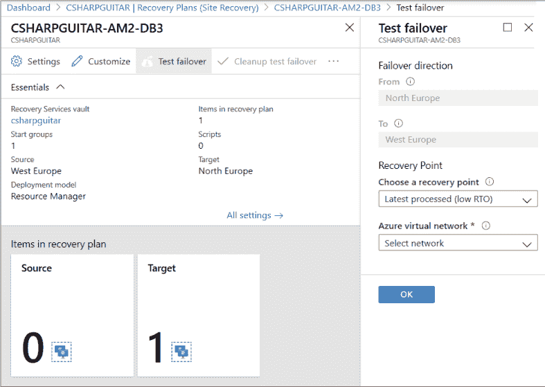

一旦测试成功并且您需要实际触发故障转移，目标区域中的虚拟网络就是您的 VM 将被放置的位置。该虚拟网络已准备好支持在其内部运行的计算资源。另一个方面涉及利用 Azure 为您提供的众多网络虚拟设备（NVA）。主要在第 3 章网络部分，您了解了 API Management、Azure Front Door、Azure Traffic Manager (ATM) 和与 Azure Application Gateway 协同运行的 Web Application Firewall (WAF) 能力。所有这些 Azure 网络产品大多是为了帮助故障转移场景而存在的，而不是需要故障转移场景本身。WAF 需要手动配置以将流量从一个端点重定向到另一个端点；ATM 的情况并非如此。ATM 可以配置为监控端点的运行状况，并在配置的阈值被突破时，例如基于响应时间，ATM 可以将所有流量重定向到运行相同应用程序的另一个端点，如图 9.35 所示。

**FIGURE 9.35** How Azure Traffic Manager works

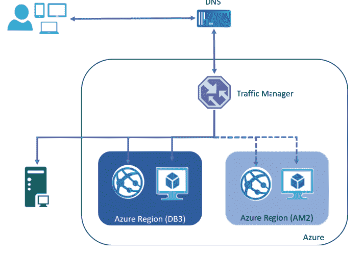

请注意，当请求来自客户端时，请求会被路由到 Azure Traffic Manager 而不是运行应用程序的实际 Web 端点。DNS 有一个 CNAME，它会将自定义域路由到 ATM 端点，该端点根据图 9.35 的配置将请求路由到 Azure App Service 和/或在北欧（DB3）区域运行的 Azure VM。ATM 也可以配置为将流量路由到未托管在 Azure 的端点。如果运行状况监视器发现 DB3 中的端点没有按预期响应，西欧（AM2）将自动开始接受来自客户端的流量。

#### Recovering Azure VMs

恢复 Azure 虚拟机的方案取决于您是使用 Azure 作为本地工作负载的 DR 环境，还是 VM 已经托管在 Azure 上。如果您使用 Azure 作为 DR 环境，那么您用于设置和执行任何故障转移的工具应该已经很清楚。工具在此提供以便清晰。

- Azure Backup
- Site Recovery Deployment Planner (SRDP)
- Azure Site Recovery (ASR)
- Recovery Services Vault

当您的工作负载已经在 Azure 上运行时，您有额外的选项来设置和维护弹性应用程序。快照是一个有用的概念，在第 4 章中讨论过，它不仅可以备份绑定到 VM 的磁盘，还可以使用它们来构建相同的副本。这些额外的副本有助于为您的 Azure 工作负载增加冗余。快照在大多数场景中是绑定到运行操作系统的 VM 的驱动器的副本。这意味着快照一旦绑定到 VM 即可启动，这与映像的属性相似。您会在 Azure Container Instances (ACI)、Azure Kubernetes Service (AKS) 和 Virtual Machine Scale Sets (VMSS) 中找到映像的概念。这被特别指出，因为如果您在 Azure 门户中导航到这些 Azure 产品，即 ACI、AKS 或 VMSS，您将找不到任何专注于备份和恢复的导航菜单项。原因在于磁盘映像是应该被保护和存储的内容，而不是一台或多台机器的实际备份。请记住在第 4 章练习 4.1 中您创建了一个 Docker 映像。就像源代码一样，您希望安全地存储该映像的脚本和依赖组件。如果您需要重新部署映像，可以通过遵循练习 4.4 中提供的说明来完成。

本节中要强调的另外两项是 Azure VM 刀片上的 Disaster Recovery 导航菜单项以及从备份中部分恢复文件。Disaster Recovery 导航菜单项在之前的图像图 9.27 中可见。点击该导航菜单项会打开 Replicated Items 刀片，与您从 Recovery Services Vault 刀片导航到它时看到的完全相同，如图 9.36 所示。

您会注意到，您也可以从该刀片执行测试故障转移或在需要时执行实际的 BCDR 故障转移计划。顺便说一下，如果您发现功能在多个位置重复，您可以确定它们都在后端调用相同的 Resource Manager REST API。因此，使用对您特定场景最简单、最合乎逻辑的方法和程序来使用它们。让我们继续下一个主题，即仅恢复 VM 的一部分。可能存在您只需要从备份中恢复文件或文件夹而不需要整个备份的场景。在这种情况下，使用图 9.27 中显示的刀片，点击省略号，您将看到 Restore VM 和 File Recovery。


包含在弹出菜单中。单击 File Recovery，然后会提示您下载并运行名为 IaasVMILRExeForWindows.exe 的可执行文件，该文件将连接到磁盘的快照。图 9.37 显示了该可执行文件的输出。

#### 图 9.36 Azure 虚拟机灾难恢复

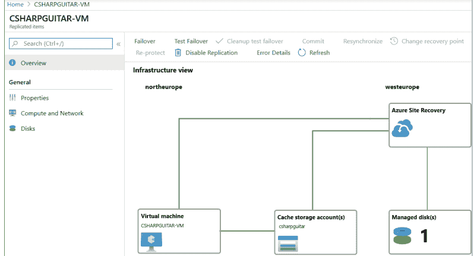

#### 图 9.37 Azure 虚拟机文件恢复

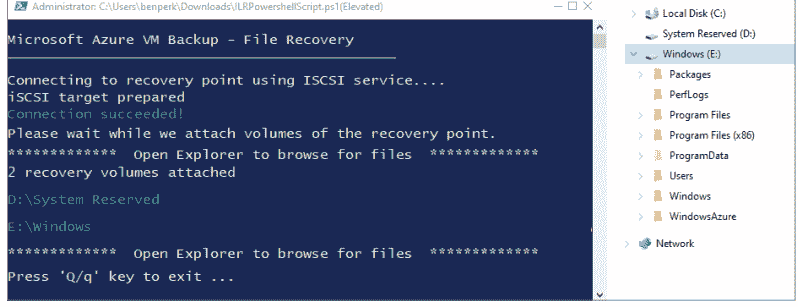

该可执行文件将恢复点的磁盘挂载为本地驱动器。请注意图 9.37 中存在 D:\ 驱动器和 E:\ 驱动器，这使您可以浏览内容并复制要检索的文件或目录。在提供挂载驱动器功能的同一刀片上，还存在一个 Unmount Disks 按钮。完成恢复后单击该按钮，驱动器将保持挂载 12 小时并自动卸载，以防您忘记。

### 恢复 Azure App Services

这一点已经涵盖得很充分了；您需要记住，在运行 PaaS 云托管模型时，服务提供商拥有操作系统。您的主要关注点是确保应用程序代码安全，并且您拥有包含部署到 PaaS 后对应用程序所做的配置的文档，即 Azure App Service。尽管配置被安全存储，但拥有描述任何自定义配置的文档是有意义的。Azure App Services 确实提供了执行和恢复备份的功能；请参阅图 9.30 作为提醒，了解其外观。此外，请回顾图 9.35，其中讨论了 ATM 作为响应可能需要执行 BCDR 计划的事件的恢复选项。

### 恢复 Azure 数据服务

Azure 数据服务主要分为两大类，即数据库型数据存储和涉及文件或文档的数据存储。本书中重点关注并且很可能在考试中出现的数据库是 Azure SQL 和 Azure Cosmos DB。数据存储产品是存在于 Azure Storage 账户中的产品，具体为 Azure Blobs、Azure Tables 和 Azure Files。Azure 队列也驻留在 Azure Storage 账户中；然而，Azure Queues 更多是出于历史原因而存在。让我们确保您尽可能多地了解这些 Azure 产品各自的备份、恢复和冗余功能。请注意，其中大部分内容已在第 5 章中介绍过；这里的内容只是为了收尾可能存在的遗留问题。

- Azure SQL、SQL 托管实例和 SQL 虚拟机
- Azure Cosmos DB
- Azure Storage

从数据恢复的角度来看，一个重要的概念是数据保留。这是指您计划保留备份副本的时间长短。您已学习过 LTR 和 PITR 等概念，它们决定了备份的频率以及备份将保存多长时间；最长为 10 年。默认情况下，Azure SQL 数据库每 12 小时备份一次，事务日志每 5 到 10 分钟采集一次。回想一下图 5.48，您将在其中看到数据库备份计划的自定义配置。如果您想恢复其中一个备份，您将在 Azure 门户中 Azure SQL 或 SQL 托管实例的 Overview 刀片上找到 Restore 菜单项，如图 9.38 所示。单击 Restore 后，您可以选择最新的 PITR 备份或 LTR 备份。

#### 图 9.38 Azure SQL 或 Azure 托管实例恢复

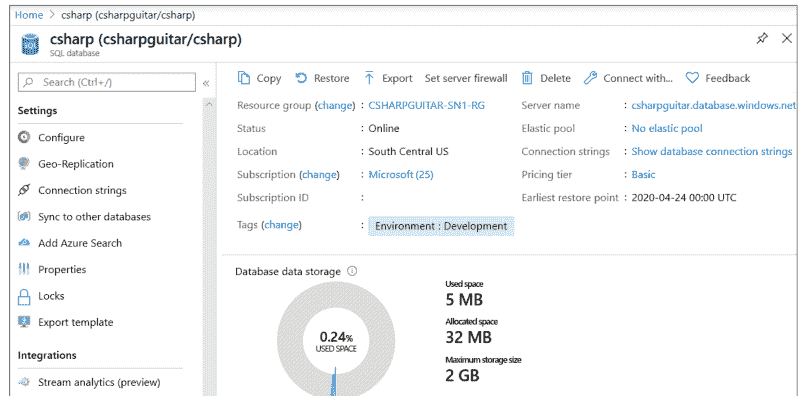

当您选择 LTR 时，会提供一个下拉列表，让您根据日期选择要使用的特定备份。从 SQL 虚拟机的角度来看，您已经知道这一点，但数据库的备份会与运行它的 Azure VM 的备份一起执行。Azure Backup 和 Azure Site Recovery Services (ASR) 是在 VM 上执行此操作的工具，并且刚刚介绍过。从 Azure Cosmos DB 的角度来看，请查看图 5.41，其中显示了 Azure Cosmos DB 的 Replicate Data Globally 刀片。一旦启用复制，Manual Failover 菜单项将被启用。如果您在主 Azure Cosmos DB 实例上发现任何问题，可以使用 Manual Failover 菜单使另一个实例成为主实例。或者，考虑启用 Automatic Failover，它会监控该区域中的数据库，如果确定不健康，平台将为您执行到另一个区域的故障转移。在配置 Automatic Failover 时，您将指定首选的故障转移实例区域。Azure Cosmos DB 数据库每四小时由平台自动备份。如果您必须从备份中恢复数据库，您将需要联系 Microsoft 支持。目前没有在线功能支持此场景。

当您的 Azure Storage 账户运行在 GRS 或 RA-GRS 服务层时，您可以配置地理复制，如图 9.39 所示。如您所见，主 Azure Storage 账户位于 West Europe (AM2)，辅助账户位于 North Europe (DB3)。

如果您的主 Azure Storage 账户（包括 blob、表和文件）开始出现问题或发生中断，请单击 Prepare For Failover 按钮开始故障转移过程。该过程将简单地使 North Europe 的存储成为主存储，并将所有存储端点重定向到该新区域的实例。请记住，您的 Azure Storage 端点类似于以下内容：

- Blob: https://*.blob.core.windows.net
- Files: https://*.file.core.windows.net
- Queue: https://*.queue.core.windows.net
- Tables: https://*.table.core.windows.net
- Static Website: https://*.z6.web.core.windows.net

#### 图 9.39 Azure Storage 账户地理复制

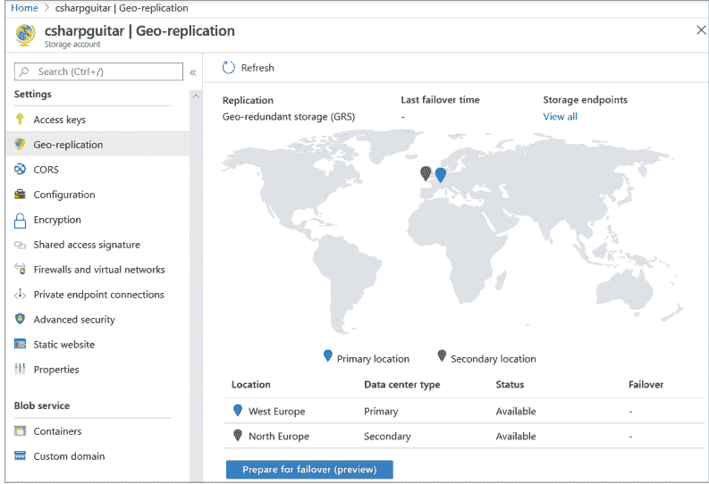

您也可以使用以下 Azure CLI 命令执行存储账户的故障转移：

```
az storage account show --name <accountName> --expand geoReplicationStats
az storage account failover --name <accountName>
```

将 <accountName> 替换为您的 Azure Storage 账户名称。第一个命令将显示主和辅助信息，如您之前在图 9.39 中看到的那样。第二个命令将执行实际的故障转移过程。

### 恢复 Azure 消息服务

第 6 章详细介绍了 Azure 消息服务，其中关于备份和恢复的内容并不多。从概念上讲，在很多方面，备份的需求并不大。因为队列中的数据不会在那里停留很长时间。消息服务的目的是存储信息并通知消费者有信息可供处理。一旦消息被处理，它就会从消息服务队列中删除。因此，从恢复的角度来看，您在消息方面的首要考虑应集中在冗余上。也就是说，如果某个区域发生中断，请确保您可以快速将生产者和消费者转移到不同区域的可用端点。

从 Azure Storage Queue 的角度来看，冗余方法刚刚在上一节中提供。Azure Queue Storage 包含在 Azure Storage 账户中，因此如果需要执行故障转移，在启用地理复制后您拥有该功能，这需要 GRS 或 RA-GRS。关于 Azure Service Bus 和 Event Hub，您只能在初始配置期间选择使其区域冗余。区域冗余，如您所回忆的，是指产品部署到区域内的所有数据中心；每个区域的数据中心典型数量为三个。并非所有区域都支持可用性区域；您可以在此处找到支持可用性区域的 Azure 区域的最新列表：

```
docs.microsoft.com/en-us/azure/availability-zones/az-overview
```

Azure Service Bus 的地理复制仅在使用高级定价层时可用。对于 Event Hub，实现地理复制所需的定价层为标准层。这两个消息服务被归为一类，因为其流程和地理复制 Azure 门户刀片彼此非常相似。Azure Service Bus 和 Event Hub 都有类似图 9.40 所示的地理复制刀片。您也一定会注意到图 9.39 和图 9.40 之间的相似之处，这是有道理的，因为该功能的目标是相同的，即冗余。

#### 图 9.40 Azure Service Bus 地理复制

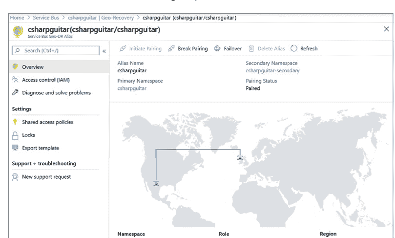


## 考试要点

了解 Azure Monitor。这是一个收集、分析和提供云和本地工作负载性能和可用性方面的见解的工具。Azure Monitor 可以主动识别您已配置的 Azure 产品和资源以及它们所依赖资源的问题。

了解 Log Analytics。该产品已合并到 Azure Monitor 中，是存储遥测数据的所在地。使用 Kusto 查询（KQL）和 Azure Data Explorer（ADX），您可以以所需的确切格式提取数据。此存储库中存储的数据侧重于平台和 IaaS 云产品。一些关键指标是 CPU 利用率、内存和 IOPS。

了解 Application Insights。这是一款用于捕获性能和可用性指标的日志、分析和报告 Azure 产品。该产品如其名称所示，更侧重于应用程序和 PaaS 云产品。该功能还具有 SDK，因此您可以将其直接嵌入到应用程序代码中，这将提供对解决方案行为的更深入见解。

了解业务连续性和灾难恢复（BCDR）。BCDR 计划侧重于当发生导致工作负载无法访问的中断时您将采取哪些行动。业务连续性侧重于在计算机系统不可用时使业务继续向前推进，例如通过电话下单并在系统恢复在线前将订单写在纸上。灾难恢复部分侧重于运行数据库、计算和/或消息服务的计算机系统。提前进行备份并创建恢复计划将帮助您在需要时将工作负载故障转移到其他 Azure 区域或从本地迁移到 Azure。

了解 Azure Backup。顾名思义，此功能执行已配置工作负载的备份。名称未暗示的是它也执行恢复。这是安排、执行和管理 Azure 和本地备份和恢复需求的首选工具。

了解 Azure Site Recovery（ASR）。该产品不仅在迁移场景中很有帮助，也是执行 BCDR 计划中 DR 部分的支柱。在 Recovery Services vault 的帮助下，您可以创建并复制 Azure 和本地工作负载的备份。此外，您还可以使用该产品来测试故障转移场景、执行实际故障转移，并在事件解决后将其故障转移回实际生产环境。

### 复习问题

- 1. Azure Service Health 监控全球所有区域中所有 Azure 产品的性能和可用性。
    - A. 真
    - B. 假
- 2. 可通过门户或 Azure PowerShell 访问的活动日志提供什么类型的信息？（多选。）
    - A. 部署到 Azure App Service
    - B. Azure VM 上的登录尝试
    - C. 通过门户删除 Azure 资源
    - D. 对 Key Vault Key 的访问
- 3. 关于 Log Analytics，以下哪些是正确的？（多选。）
    - A. 支持使用 Kusto 查询（KQL）进行自定义查询
    - B. 支持使用 GUSTO 查询（GQL）进行自定义查询
    - C. 提供对应用程序代码异常和内存消耗的见解
    - D. 可从 Azure Data Explorer（ADX）查询
- 4. 分析 Application Insights 日志时，您不会期望看到哪种指标？
    - A. Exceptions
    - B. ETWEvent
    - C. Requests
    - D. Syslog
- 5. 要在监控上下文中使用 Azure Automation runbooks，只能使用 PowerShell 脚本。
    - A. 真
    - B. 假
- 6. 以下哪些备份/恢复场景不受 Azure Backup 支持？
    - A. Azure 到 Azure
    - B. Azure 到本地
    - C. 本地到 Azure
    - D. 本地到本地
- 7. 在默认情况下，Azure Backup 在备份运行 Linux 的 VM 或物理机时支持以下哪些？（多选。）
    - A. 32 位操作系统
    - B. 应用一致备份
    - C. 64 位操作系统
    - D. 文件系统一致备份
- 8. 以下哪种备份状态是最理想的？
    - A. 应用一致
    - B. 崩溃一致
    - C. 文件系统一致
- 9. Azure Site Recovery（ASR）在以下哪些场景中有用？（多选。）
    - A. 监控
    - B. 从本地迁移到 Azure
    - C. 在 Azure 区域之间迁移
    - D. 测试和执行 BCDR 计划
- 10. 以下哪些产品支持地理复制？（多选。）
    - A. Azure Cosmos DB
    - B. Azure Service Bus
    - C. Azure Storage Account
    - D. Event Hubs

### 第 1 章：获得 Azure 解决方案架构师认证

- 1. A, D. Azure Active Directory 和单点登录（SSO）可以保护 Azure App Service 免受未经授权的互联网访问。RBAC 管理 Azure 门户中对 Azure 资源的访问，而托管标识是应用程序安全相互通信的功能。
- 2. A, C. Azure VM 和 Azure Functions 是计算资源。ExpressRoute 和 API Management 不是计算资源。
- 3. A, B, C. 自定义域可以绑定到 Azure App Service、Azure Storage Account 和 Azure VM。您无法将自定义域绑定到 Azure SQL 端点。
- 4. A, B 和 C. Azure Storage 确实由 blob、队列、文件和表服务类型组成。
- 5. B. 在给定要求下，区域冗余解决方案是最便宜的。LRS 是最便宜的，但没有冗余。
- 6. C. 只有托管标识提供该功能。
- 7. A. 只有 Azure 可用性集提供业务连续性功能。
- 8. D. TLS 1.3 是最新的；然而，目前尚未广泛实施。
- 9. A. 除 P2P 外，所有均受支持。
- 10. C. *.onmicrosoft.com 是正确的。其他不是 AAD 的有效域扩展，除非由客户拥有并配置。
- 11. C. Azure Functions 可能被考虑；然而，它限制为 1.5GB，因此无法工作。因此，WebJobs 最适合该场景。
- 12. B. 尽管选项 C 看起来相关，但最佳答案是您所知道的东西和您拥有的东西。考试中有这样的问题，其中许多选项似乎都可能。您需要从可能选项中选择最佳的。
- 13. A. 提供最全面覆盖的产品是 Azure Monitor。Application Insights 确实监控并提供指标，但目前仅特定于 Azure App Service。
- 14. A, B, C, D. 所有都是 Azure VM 的有效功能。
- 15. B. CORS 是安全功能，确保在客户端渲染网页时不会执行来自其他站点的意外脚本。
- 16. B, C. API Management 的用例是帮助管理集成，因为它公开了一个充当代理的单一全局端点，允许重定向到其他端点。它还提供访问管理功能。
- 17. A. 不可能自动扩展。
- 18. C. Azure VM 允许将程序集注册到全局程序集缓存（GAC）。Azure Functions 和 Azure App Service 在沙箱中运行，不支持访问 GAC。
- 19. A, C, D. RESTful API 支持跨平台软件，通常使用 JSON 通信，并由 Cosmos DB 支持。WCF 与 REST 之间没有关系或依赖。
- 20. B, D. Azure Web App for Containers 实例与 Azure Files 兼容，并且可以消耗 GPU 资源。没有统计数据证明启动速度，并且 GPU 资源在 Azure 容器中不可用。

### 第 2 章：安全和身份

- 1. A, B, D. AAD 不提供视网膜扫描功能。此功能需要手动开发并集成到应用程序中。
- 2. D. 我喜欢这些两者皆是、两者皆非和无一皆是的问题，编写 Azure 解决方案架构师专家考试的人也喜欢。您必须承认他们确实测试了您的知识并制造了怀疑。在可能的答案列表中，尽管有许多数据静态加密的场景，但只有 D 是正确的。
- 3. C. RBAC 没有费用，但在许多场景中，您需要知道什么付费什么不付费。了解产品哪个层级具有哪些功能以及哪些是免费的，是考试中的常见主题。
- 4. C. 这是一个您可能会看到的问题的良好示例。我认为您可以很容易地排除选项 A。但选项 B 似乎也是可能的，即使您从未读过或见过相关信息。因此，我在 C 和 D 之间犹豫，因为我确信选项 C 是 AAD Connect 所做的。如果您有一些良好的经验并阅读过 AAD Connect 的文档，并且您觉得从未读过关于选项 B 的任何内容，那么就选择 C。
- 5. A. 尽管条件访问可以配置为强制执行许多易受攻击的场景，但登录尝试的位置是这里唯一正确的。
- 6. D. `Microsoft.Authorization/roleDefinitions/read` 和 `Microsoft.Authorization/roleDefinitions/write` 可以组合使用，但只有 `Microsoft.Authorization/roleDefinitions/*` 是正确答案。
- 7. A. ARM 确保客户端如 Azure 门户、Azure PowerShell、Azure CLI 以及任何使用 REST API 的客户端经过身份验证。管理 Azure 上的资源取决于 ARM。


- 8. B. 它不会加密内存中的所有数据；它只加密在enclave内定义的数据。

- 9. C. 你可以在 Azure Blob Storage 容器上使用 SAS 密钥进行用户身份验证。没有 Azure Message Storage Container 产品，而且其他选项不支持 SAS 令牌作为有效的身份验证令牌。

- 10. D. 机密、密钥和证书（即 PFX）可以存储并在 Azure Key Vault 中受保护。

### Chapter 3: Networking

- 1. A. 路由前缀越小，分配的 IP 地址就越多。路由前缀为 8 等于 2^24，等于 16,777,216。你可以通过从 32 中减去它来计算幂，其中 2^(32−8) = 2^24。

- 2. D. Application Gateway 和 Azure Front Door 服务提供 SSL 终止。

- 3. A. Azure Firewall 工作在第 3 层，而不是第 7 层。Azure Front Door 确实在第 7 层工作，但对于小型公司来说它过大；换句话说，成本太高，而且大多数其他功能都不需要。因此，Application Gateway 提供的 WAF 是最佳选择。

- 4. B. 每个 VNet 只能有一个网关子网。网关子网的名称是 GatewaySubnet，因此 A 也不正确。

- 5. A. 默认情况下，存在允许源和目标均为 VirtualNetwork 的入站和出站 NSG 规则，允许所有流量。

- 6. A. 选项 B 看起来是合理的，但建议的解决方案中缺少 global 这个词。因此，正确答案是 VNet 对等连接将同一区域中存在的两个或多个 VNet 连接起来。

- 7. C. OSI 第 3 层提供对 TCP 会话的访问，并且只有 Azure Firewall 在该层上运行。其他选项不在该 OSI 层上运行。

- 8. C. 可以将前端如 App Service 连接到后端如 SQL Azure；然而，这不是教科书定义的网络配置。

- 9. C. 用于提供主机名到 IP 解析的 DNS 服务器是可选的，并不是必需的。

- 10. A. Azure CDN 没有将请求路由到后端池中特定服务器的功能。

### Chapter 4: Compute

- 1. A, C

| IaaS | CaaS | PaaS | FaaS | |
|---|---|---|---|---|
| Function | Function | Function | Function | User Managed |
| Application | Application | Application | Application | Unit of Scale |
| Runtime | Runtime | Runtime | Runtime | Cloud Provider |
| Container (optional) | Container (optional) | Container (optional) | Container (optional) | |
| Operating System | Operating System | Operating System | Operating System | |
| Virtualization | Virtualization | Virtualization | Virtualization | |
| Hardware | Hardware | Hardware | Hardware | |
| Networking | Networking | Networking | Networking | |

图显示了云提供商与客户拥有的 IT 堆栈的不同层。你会看到 IaaS 和 CaaS 允许客户选择托管应用程序所针对的运行时版本。例如，.NET Core 3 或 Python 3.8。

- 2. C. Azure VM 的成本会更高，因为在配置时会收取固定费用；无论是否使用都会收费。此外，维护需求更多，因为你拥有操作系统，需要保持其最新状态。Azure Functions 的主要目的不是托管 Web API，而是运行在触发时执行的少量代码片段。Azure Batch 不会公开 API，并且适用于 HPC 模型；因此，Azure App Service 是唯一剩下的选择。它适用于 Web API 和 Web 应用程序托管。

- 3. A, B. Azure Container Registry 不是计算产品；它是一个像 Docker Hub 这样的存储库，用于存储镜像，并且 Azure Functions 不支持容器。其他两个选项支持容器。

- 4. D. 在配置 VM 和容器实例时，你会选择工作负载运行的 VM 系列。VM 和容器都可根据负载自动扩展。因此，选项 A 和 B 都不正确。选项 C 也不正确，因为你可以在不重新部署和重建 VM 的情况下随时更改 VM 系列。

- 5. A, C. Stop-AzVM PowerShell cmdlet 会释放 VM，就像执行 Remove-AzResourceGroup 一样，因为它在执行时会删除资源组中包含的所有内容。Azure CLI 命令 az vm stop 不会释放 VM，因此正确的命令是 az vm deallocate。使用远程桌面连接 RDP 从 VM 注销不会关闭或释放 VM。

- 6. C. 对 VMSS 可以放置到的可用性区域数量没有此类限制。然而，最大值为三个；只有三种的可能性存在。由于选项 C 是选项 B 的相反，因此选项 B 不正确。所述架构最适合可用性集。最后，扩展应用程序的新实例不会管理状态，并且可能产生负面影响。如果客户端在实例 X 上有会话，突然被定向到实例 Y，则其状态将不存在于该服务器上。

- 7. A. 不支持触发式 WebJob 的远程调试。你只能远程调试连续的 WebJob，并且没有名为 manual 或 singleton 的 WebJob 类型；然而，这些术语确实存在于 WebJobs 的上下文中。它们不是一种类型，不会暴露任何启用或需要调试的功能。

- 8. A, D. 选项 B 和 C 都不正确。选项 B 不正确，因为临时驱动器附加到 VM，当 VM 被重新映像时，它会刷新内存中的所有状态并且消失，这会对连接到应用程序的客户端产生影响。当 VM 因重新映像而从池中取出时，状态不会共享给另一个 VM；请求被路由到状态不存在的新 VM，从而产生影响。关于这两种存储选项而言，并没有基于该数量的具体限制问题；因此，选项 C 不正确。选项 A 正确，因为临时驱动器没有费用，选项 D 为真，因为它是选项 B 的相反。它们相反在于被重新映像的 VM 上没有状态，因此当一个 VM 从池中取出时，请求可以简单地重定向到另一个 VM。

- 9. A, B, C, D. 所有选项都是正确的。所有声明的组件都是必需的。

- 10. A. 所有选项都是实现 Windows Virtual Desktop 解决方案所必需的。

- 11. B, C. 由于选项 C 为真，选项 A 不能为真。临时驱动器（选项 D）是物理连接到 Azure VM 的驱动器，并且由于其与托管磁盘的直接连接而提供更好的性能。

- 12. A, B. 选项 C 更适合 Azure App Service，选项 D 更适合 Azure Batch。选项 A 和 B 都是 Azure VM 的有效用例。

- 13. B, C, D. Azure App Service 不支持安装安装二进制文件的 EXE 或 MSI 程序。在 PaaS 上运行，你无法在操作系统级别进行任何更改。

- 14. A, B, D. 如果你想在 Windows 机器上运行 PHP 或 Node，你不会选择用于容器的 App Service Web 应用，因为它们可以在普通的 Azure App Service 上运行。其他选项是选择用于容器的 Web 应用的有效原因。

- 15. B. Azure Function 限制为一个 CPU 和 1.5GB 内存。如果你的每次调用的计算需求超过此限制，就不应该使用此产品。由于 Functions 是无服务器的，如果未使用，则 VM 会被释放，这意味着第一次请求可能需要一些时间，因为 VM 需要配置并启动。Azure Functions 用于运行小的编程逻辑片段，而不是用于托管内容。

- 16. B. 相反是正确的。

- 17. A, B. ACI 支持 Windows 和 Linux，并且目前不提供可与 AKS 相媲美的编排功能。

- 18. A, B, D. YAML 是用于配置 AKS 的语法，而不是 JSON。AKS 和 Service Fabric 都设计用于运行微服务，并且提供类似的功能。

- 19. D. ACR 具有将镜像复制到其他区域的地理复制功能。它仅在 Premium 定价层可用。

- 20. A, B, D. Windows Virtual Desktop 的主要用例之一是优化计算资源的使用。当公司需要购买昂贵的内部工作站时，部分计算资源可能会闲置，这不是最优的。如果实施 Windows Virtual Desktop，则内部工作站可以采用较小的规格，并且你使用 Azure 上的计算资源，按使用量付费。

### Chapter 5: Data and Storage

- 1. A, B, C. Azure Cosmos DB Table API 是最佳解决方案；然而，你可以在 Azure SQL 数据库中存储键/值对。Azure Table Storage 是 Azure Cosmos DB Table API 的基础，可以在没有 Azure Cosmos DB 包装的情况下使用。

- 2. B. SQL VM 在执行关系数据库的 lift-and-shift 迁移时提供最可能的成功水平。Azure SQL 可能过于受限，因为它在 PaaS 上运行，Azure Blob Storage 用于存储 blob，而 Azure Cosmos DB Gremlin API 用于图数据库。

- 3. C. Azure Data Factory 和 Azure Databricks 是帮助分析托管在 Azure Synapse Analytics 上的数据的产品。Azure Storage Explorer 用于查看 Azure 存储帐户中的内容。

- 4. A, B, C. 唯一不提供自动备份的是 VM 上的 SQL。这是因为 VM 是 IaaS，而自动数据库备份是 PaaS 类型的功能。

- 5. D. 前两个选项可能有助于迁移，但它们中没有功能会检查兼容性问题。SSMA 用于源数据库不是 SQL Server 但目标数据库是的情况。DMA 是正确答案。

- 6. A, B. 动态扩展是常见的 PaaS 功能，并且由 Azure SQL 和 SQL 托管实例支持。SQL VM 是 IaaS，扩展需要手动执行或手动配置脚本或程序进行扩展。

- 7. B. 请记住，当有多个可能正确的选项时，你始终需要选择“最佳”或“推荐”的答案。你可以在任何这些数据存储中存储 JSON 文档，但对于 JSON 文档，Azure Cosmos DB 是推荐的数据存储。

- 8. B, C, D. 只有本地冗余存储 LRS 不提供在数据中心中断的情况下可用于数据中心中断的远程位置复制，即区域中断。

- 9. C. Azure Blob、Azure Table、Azure Queue 和 Azure Files 都包含在 Azure 存储帐户中，因此被视为 Azure 存储产品。Azure Kubernetes Service AKS 是一个计算产品。


10. B. SAS 令牌也可以配置为限制对特定 Azure Blob 容器的访问。可以使用 SAS 令牌限制 CRUD 操作。帐户密钥可完全访问存储帐户中的所有存储选项。

### Chapter 6: Hybrid, Compliance, and Messaging

1. A, B, D. Azure Policy 在创建混合云解决方案方面没有用处。Azure Policy 用于合规性和策略上下文。

2. A, B, C. 单点登录可能有助于简化本地和云中工作负载的身份验证实现，但它不是网络产品。

3. B, C, D. Azure 中没有名为 Azure Compliance Standards 的产品或功能。

4. All of the above. 棘手的是 Event Grid domains，但它确实将 Event Topics 和 Event Subscriptions 组合在一起。事件域有助于对 Event Grid 消费进行分组和管理。命名空间和存储帐户也将 Azure 资源和功能组合在一起。

5. B. 情况正好相反。具有弹性应用程序的结果使其可靠。

6. A. 两者都专注于定义数据隐私标准。有关 GDPR 和 PIPA 的更多信息，请查看以下页面：en.wikipedia.org/wiki/General_Data_Protection_Regulation en.wikipedia.org/wiki/PROTECT_IP_Act

7. A, B, D. MFA 不能通过 Security Center 配置；其他可以。

8. B. Security Center 中有一个功能可以分析可能不符合所选合规性标准列表的漏洞和配置。它们会被突出显示，并提供推荐的解决方案；但是，这些建议的实施是手动的。

9. B. Event Hub 专为该场景而设计。

10. D. Service Bus 专为该场景而设计。

### Chapter 7: Developing for the Cloud

1. A, C. 在这两种情况下，数据中心停机都很罕见，但由于可用性区域的存在，如果您已将其构建到云解决方案中，您会期望它们在云中影响更小。如果您在执行自动备份的适当定价层级中运行，您不会期望出现太多或任何数据丢失。许多产品默认执行备份，因此数据丢失很少见。

2. C. 在 PaaS 上运行时的出站连接数是有限的。如果连接对象在类级别创建而不是为每个请求创建，则可以重用连接。

3. A. 重试模式是在应在短时间内恢复的问题上工作的最佳模式。瞬态问题是指发生但随后自行纠正的问题；这类问题很难排查。

4. A, B, C. 尽管 Windows 身份验证历史上用于内部网应用程序，但可以通过互联网使用集成 Windows 身份验证（IWA）。但是，您不会使用服务主体来验证应用程序的用户。

5. D. Visual Studio 不是用于开发代码、运行或测试应用程序的 IDE。

6. A, C. 您可以使用 ASP.NET Core 应用程序中的身份验证代码访问存储在 Azure Key Vault 中的信息。托管标识在受支持的 Azure 产品上默认未启用。它必须为每个产品启用和配置。

7. A, B, C, D. 所有列出的内容均通过 EasyAuth 提供。

8. A, B. Event Grid 用于管理由消息发布者发送的消息，然后将它们发送到已订阅接收它们的端点。AKS 是用于运行微服务设计程序的计算产品。因此，只有 Data Lake Analytics 和 Azure Cosmos DB 是正确的。

9. A, D. Service Bus 和 Azure Storage Queue 都接收消息以供离线处理。这种离线处理是解耦 IT 系统的常见做法。其他两个选项 Azure Cosmos DB 和 Azure Batch 不被视为有助于解耦 IT 应用程序的产品。

10. B, C. Service Fabric 专为微服务而设计，Azure Functions 是一种无服务器功能；因此，这些选项不正确。Azure 虚拟机和 Azure Batch 都能够运行大型计算工作负载。

### Chapter 8: Migrate and Deploy

1. C. Azure Blueprint 在迁移和治理领域有帮助，而不是在工作负载迁移方面。Azure Monitor 也不是，它专注于平台上工作负载的健康和可用性。一旦在平台上。没有名为 Azure Deployment Assistance (ADA) 的工具，这只剩下 Azure Migrate 作为正确答案。

2. B. 导出的映像必须采用 VHD 格式，可以使用 VMware 实现。

3. B. 您不仅可以升级 DBMS 版本，例如从 SQL Server 2005 到 SQL Server 2019，还可以在迁移期间从 Oracle 迁移到 Azure SQL。

4. A, B,C. 它们都有帮助，除了 Azure Deployment Assistant，它根本不是一项服务。

5. A, C. 通过 Azure 门户和 Azure CLI 可以将 Azure 产品移至不同的订阅。任何可以访问 ARM 的工具都可以更新此数据。无需物理移动资源即可更改订阅或资源组。虽然 ASR 会导致资源可能位于新的资源组或订阅中，但您不会选择该工具进行迁移。没有名为 Azure Deployment Assistance (ADA) 的工具。

6. A, C, D. 您无法在资源预配后将其移至特定的 Azure 区域；这是平台执行的角色。在创建时，您可以选择希望产品放置到多少个区域中，但之后无法更改。

7. A. 您必须拥有 Azure 订阅才能预配和访问任何 Azure 资源。

8. A. 瀑布式和敏捷方法都是组织模型，而不是方法论。OOP 是一种编码模式，而不是部署技术。Azure DevOps 旨在提供执行 CI/CD 方法论的能力。Azure DevOps 也可支持敏捷模型，但这不是其主要目标模型。

9. B, D. ARM 模板是 JSON 文档，也是将数据传输到 REST API 的最常见方式。ARM 模板可以使用嵌入到文档中的 msdeploy 扩展部署应用程序代码。

10. B, C. Azure Automation 不提供有关如何配置 Azure 产品的建议。这取决于您的要求，而不是微软会尝试推动的事情。确实有一些建议，但不是在 Azure Automation 的上下文中。Azure Automation 中也没有内置任何安全相关功能；最好在 Security Center 上下文中执行。

### Chapter 9: Monitor and Recover

1. A. Azure Service Health 是一个网页，用于监控全球所有 Azure 产品的性能和可用性状态。

2. A, C, D. 当客户端使用资源管理器公开的 REST API 时，会记录活动日志。登录已预配的 Azure VM 将使用 RDP 或 SSH，两者都与资源管理器无关。

3. A, D. KQL 是用于对 Log Analytics 运行客户查询的查询语言；没有 GQL 语言。Log Analytics 专注于平台指标，不会记录由自定义代码生成的应用程序异常。

4. B, D. ETW 代表 Windows 事件跟踪，您不会期望在应用程序日志中看到它。同样适用于 Syslog 也称为系统日志。选项 B 和 D 都是系统/平台 focused，而不是应用程序 focused。ETWEvents 和 Sys-Logs 都是 Log Analytics 指标。

5. B. 这不是要求。PowerShell 脚本、图形运行手册、PowerShell 工作流和 Python 脚本都受支持。

6. D. Azure Backup 支持在 Azure 内部的备份和恢复场景、从本地到 Azure 平台以及从 Azure 恢复到本地。

7. C, D. 不支持 32 位 Linux 版本，并且由于 Linux 缺少 VSS，默认情况下不支持运行 Linux 时的应用程序一致备份。

8. A. 应用程序一致是最理想的。对于 Linux，需要特殊配置才能达到此状态。

9. B, C, D. ASR 不适用于监控备份、恢复和故障转移。您会在 Recovery Services vault 仪表板上的备份和站点恢复中找到这些信息。

10. A, B, C, D. 它们都支持在不同区域之间复制数据。地理复制的目的是为您的 Azure 产品提供一个二级端点，当包含主端点的区域不可用时，该端点可访问。


