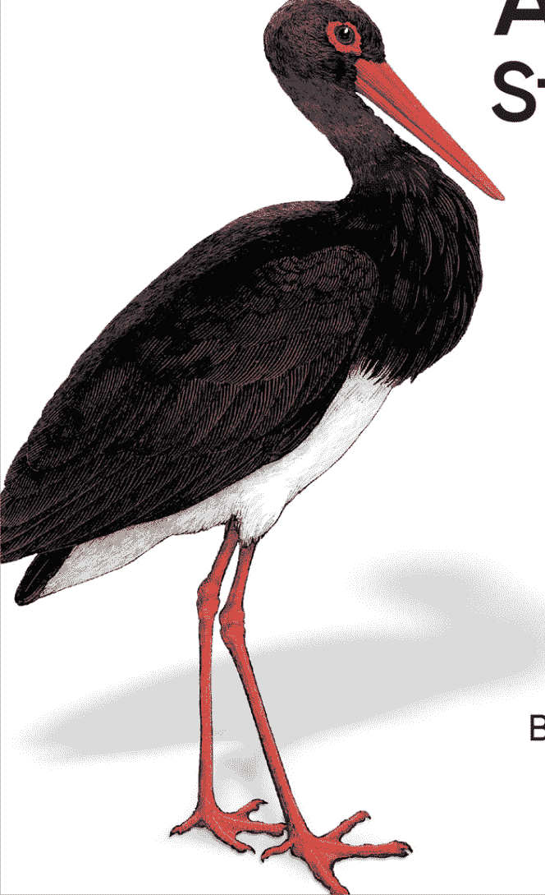
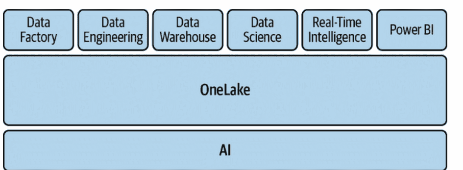

# Microsoft Fabric 分析工程师助理学习指南 (for . .)

[LSI]

## 前言

当我们创立 *Guy in a Cube* 时，我们的使命很简单：教大家操作步骤，帮助人们在数据之旅中成长。起初只是几段粗糙的 YouTube 视频，如今已发展成为一个全球性的创作者、分析师和梦想家社区，他们相信数据应该赋能，而非令人畏惧。

这就是我们对这本书如此兴奋的原因。Brian Bønk 和 Valerie Junk 创造了特别的东西；这本书不仅仅是对 Microsoft Fabric 的技术深度剖析，更是现代数据专业人士的路线图。Fabric 将分析之旅的每一层都汇聚在一起，从摄取和转换到建模、可视化和治理，全部在一个统一的体验中实现。这本书不仅仅教你 *如何* 使用 Fabric；它帮助你理解 *为什么* 它很重要。

当今数据创新的步伐可能让人感到不知所措。新的工具、新的模式、新的 AI 体验……即使对我们来说，要跟上也很多。但当你阅读这些章节时，你会看到基础依然不变：好的数据、好的设计和好的讲故事。无论你是在构建第一个语义模型，还是优化企业级分析，这里见解都会在你所在的位置与你相遇，并帮助你提升水平。

我们一直说，我们旅程中最美好的部分就是人们：学习、分享并互相扶持的社区。这本书是这种精神的延伸。所以，深入阅读吧！尝试、犯错、学习新东西。因为下一代数据故事——那些将改变组织思考、行动和成长方式的故事——可能就始于你在本書中获得的知识。

好了，废话不多说。让我们进入正题吧！

## Adam Saxton 和 Patrick LeBlanc
Guy in a Cube

## 前言

*Microsoft Fabric* 是 Microsoft 提供的 *软件即服务*（SaaS）平台，涵盖构建现代分析平台的各个方面。从摄取到洞察，从批量加载到流式处理，从图表到函数，一切都无缝集成到统一平台中。

Microsoft Fabric 最早于 2023 年在 Microsoft Build 大会上宣布为平台的公开预览版。在此之前，该平台已在内部代号 Trident 下进行大量测试和私人预览。

它基于之前对 *Azure Synapse Analytics* 的工作，这是 Microsoft 首次将分析工作负载从仅使用 Structured Query Language（SQL）服务器二进制文件，转变为在计算和存储之间进行分离的重大发布。

计算仍基于 SQL 引擎的基本思想，但采用全新的二进制文件和功能。存储现在基于 *Azure Data Lake Storage*，它充当集中式、灵活的存储系统，用于存储各种类型的文件。最常见的是，用户会存储开源的 Parquet 文件格式，但他们也可以存储 CSV、JSON、XML 和 Microsoft Excel 等格式（但不限于这些格式），以便由计算引擎读取。

在 Microsoft Fabric 的首次发布中，我们也在平台的一些服务中看到了 *Synapse* 名称，但在其最新版本中，该名称已消失。我们现在拥有一个全新且独立的平台，拥抱构建任何规模组织的全功能分析平台所需的一切，从小型企业到最大型企业。

平台中的所有内容均基于现有的 Microsoft Azure 服务（少数例外除外），¹ 打包成易于使用的图形界面。

Microsoft Fabric 中的不同服务如图 P-1 所示，具体如下：

- Data Factory
- Data Engineering
- Data Warehouse
- Data Science
- Real-Time Intelligence
- Power BI
- OneLake

图 P-1. 完整的 Fabric 平台及其所有服务

您可以在第 1 章中阅读有关每个服务的更多信息。

## 谁应该参加考试

Microsoft Fabric 由技术人员和商业专业人士使用，包括商业智能开发人员、数据分析师和商业智能专家，用于集成数据、构建语义模型以及理解和可视化重要的业务数据。

无论您从事金融、制造、销售、营销、科学或专业服务行业，数据都是您业务的脉搏，数据分析是您成功的关键。作为技术专业人士，获得 Microsoft Fabric 认证将提升您的职业前景和专业信誉，为您在领域内出类拔萃提供诸多优势。通过 Microsoft DP-600 考试并获得 Fabric Analytics Engineer Associate 认证，是展示您对该平台的知识和经验的关键。

本书基于作者从一开始就在 Microsoft Fabric 平台工作的专业知识和经验。您可以用它作为学习资源，帮助您为认证考试做准备，并作为日常参考指南，用于从分析和可视化角度使用 Microsoft Fabric。

## 官方课程大纲

DP-600 认证考试从数据分析师的角度测试您的一系列技能和知识，该角色包括处理摄取、转换和可视化。

### NOTE

鉴于 Microsoft Fabric 平台的快速发展，认证考试的内容可能会随时间而变化。本书撰写时该认证的内容如下所述。

考试衡量您掌握以下技能：²

- 维护数据分析解决方案
  - 实施安全和治理
  - 维护分析开发生命周期
- 准备数据
  - 获取数据
  - 转换数据
  - 查询和分析数据
- 实施和管理语义模型
  - 设计和构建语义模型
  - 优化企业级语义模型

## 本书的目的

本书详细涵盖了官方课程大纲中的所有技能。它将帮助您了解考试和课程大纲的内容，并指导您如何在实践中运用理论。

请注意，本书的结构并不遵循上一节中列表的顺序。这是因为

因为我们相信更以实施为基础的方法，而维护分析解决方案的第一要素却在列表的末尾。实际考试的结构也不与列表顺序相同，因此我们将在本指南中以随机顺序向你呈现问题。

### TIP

现在参加微软考试时需要注意的一个关键点是：如果你只是阅读了像这样一份学习指南加上 Microsoft Learn 的文档，就不能指望通过考试。你还需要通过使用该技术获得实践经验，因此我们鼓励你尝试本书中介绍的所有内容。

本书将帮助你理解通过 DP-600 考试所需的技术领域和知识。它将带你了解考试的不同领域，教你如何入门，并向你介绍考试的基础课程。你可以将其用作学习指南、考试练习题的来源（见本书末尾的问题库），以及未来项目的参考资料。但你也需要在 Microsoft Fabric 平台的真实实施和项目中获得实践、动手经验。换句话说，通过考试并不是你仅靠阅读就能实现的！

过去，一些微软考试主要测试考生记忆能力，问题要求考生从文档中回忆硬性事实，而不是他们如何在微软的不同技术领域实际执行实施。但最近，考试已转向衡量考生的技能水平，这意味着考生需要具备实践经验。

## Book Summary

本书包含三个部分共八章。第 1 章介绍了 Microsoft Fabric，第 2 章将指导你了解不同的集成实现方式。第 3 章涵盖转换，第 4 章涵盖查询和分析功能。第 5 章向你展示如何构建语义模型，第 6 章向你展示如何管理企业级模型。第 7 章是治理和安全的指南，第 8 章涵盖开发的生命周期。

第 9 章，即最后一章，是一个包含 100 道练习题的问题库，你可以练习以帮助为考试做准备。请注意，这些问题都不是你在实际考试中会遇到的题目；它们是旨在帮助你测试技能并熟悉考试中出现的测试题形式的练习题。做这些题目将帮助你熟悉问题类型、如何阅读和理解问题，以及如何在考试中管理时间。

每一章都是独立的，我们已尽可能使每章彼此独立。然而，你会在全书中看到对其他章节和部分的引用，以提醒你细节和上下文。这将帮助你在将本书用作参考指南时看到全貌。

我们还尽可能使本书对具有不同 Microsoft Fabric 经验水平的广泛读者都易于使用。如果你是该平台的新手，我们鼓励你从第 1 章开始并从头到尾阅读本书。或者，如果你是经验丰富的 Microsoft Fabric 用户，请随意跳跃并专注于那些能帮助你提升现有技能的章节。

说了这么多，我们，Brian 和 Valerie，祝你在考试中好运，并希望本书能很好地帮助你开始通往认证的个人旅程。

## Conventions Used in This Book

本书中使用了以下排版约定：

*Italic*

表示新术语、URL、电子邮件地址、文件名和文件扩展名。

Constant width

用于程序列表，以及在段落中引用程序元素，如变量或函数名、数据库、数据类型、环境变量、语句和关键字。

**Constant width bold**

显示用户应逐字输入的命令或其他文本。

*Constant width italic*

显示应由用户提供的值或由上下文确定的值替换的文本。

### TIP

此元素表示提示或建议。

### NOTE

此元素表示一般说明。

## WARNING

此元素表示警告或注意。

## O’Reilly Online Learning

### NOTE

40 多年来，*O’Reilly Media* 一直为公司提供技术和商业培训、知识和见解，帮助公司取得成功。

我们独特的专家和创新者网络通过书籍、文章和我们的在线学习平台分享他们的知识和专业知识。O’Reilly 的在线学习平台为你提供按需访问实时培训课程、深入学习路径、交互式编码环境，以及来自 O’Reilly 和 200 多家其他出版商的庞大文本和视频收藏。有关更多信息，请访问 https://oreilly.com。

## How to Contact Us

请将有关本书的评论和问题发送给出版商：

O’Reilly Media, Inc.

141 Stony Circle, Suite 195

Santa Rosa, CA 95401

800-889-8969（美国或加拿大境内）

707-827-7019（国际或本地）

707-829-0104（传真）

support@oreilly.com

https://oreilly.com/about/contact.html

我们为本书设有网页，在那里我们列出勘误表和任何额外信息。你可以在 https://oreil.ly/microsoft-fabric-analytics-study-guide 访问此页面。

有关我们的书籍和课程的新闻和信息，请访问 https://oreilly.com。

在 LinkedIn 上找到我们：https://linkedin.com/company/oreilly-media。

在 YouTube 上观看我们：https://youtube.com/oreillymedia。

## Acknowledgements

From Brian

写书一直是我愿望清单上的一项很长时间，我终于通过与才华横溢的 Valerie Junk 的合作实现了这一雄心。

这个项目之所以能够实现，多亏了 O’Reilly 提供的机会。我欠我们的编辑 Shira Evans 巨大的感谢，她在整个紧张的日程中坚定地支持我们，并花费了许多小时确保我们按时保质完成。

我还欠技术审阅者 Nikola Ilic、Alexander Arvidsson、Ben Weissman、Reitse Eskens 和 Johnny Winter 很大的人情，他们对每一页的细致审查和对每个代码片段的测试，确保了成功认证指南所需的准确性。

我还要特别感谢 *Guy in a Cube* 背后的精彩团队，Adam Saxton 和 Patrick LeBlanc 为撰写前言。你们的工作真正激励了整个社区。

这种工作无疑是马拉松，而不是短跑。对我终生的伴侣和配偶 Christa，感谢你默默的时光，我们不得不错过的电视剧，以及无论我选择追求什么事业，你都坚定不移地相信我。

最后，致你，读者：我真诚希望本指南能帮助你通过 DP-600 考试，更重要的是，释放你作为成功的 Microsoft Fabric 分析工程师的潜力。

## From Valerie

写这本书是一次宝贵的学习经历。与 Brian Bønk 一起完成这样规模的项目，确实推动我在新的方式上成长。

感谢 O’Reilly 提供的机会，感谢我们的编辑 Shira Evans 在每一步引导我们。感谢技术审阅者 Alexander Arvidsson、Johnny Winter、Ben Weissman、Reitse Eskens 和 Nikola Ilic，花时间仔细审阅所有内容。

特别感谢我的伴侣 Jochem van Iterson，在漫长的写作日里给予支持、茶水和零食。再次感谢 Alexander Arvidsson，他在需要讨论事情时是很好的陪练伙伴。

- 1. Activator is not a standalone service in Microsoft Azure.
- 2. Read the complete exam details here: “Study Guide for Exam DP-600: Implementing Analytics Solutions Using Microsoft Fabric”.

