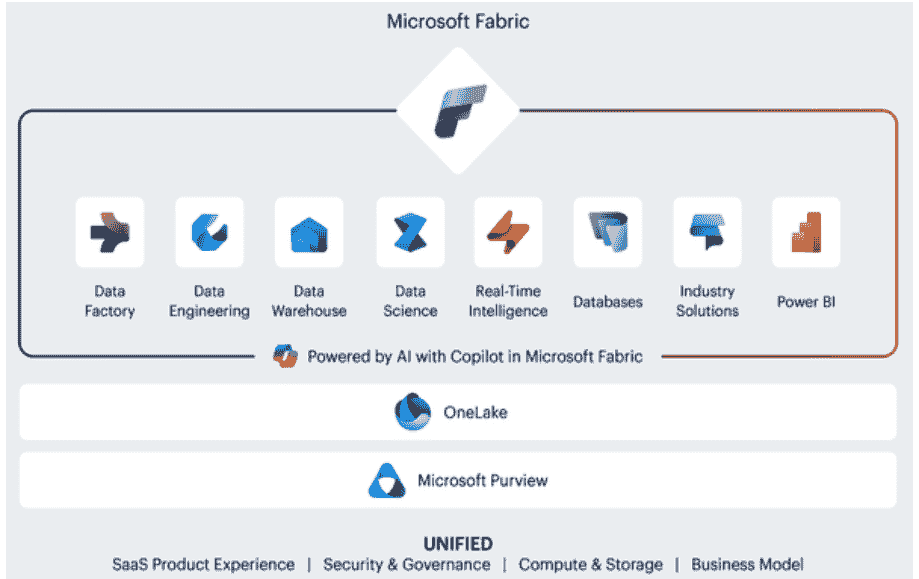
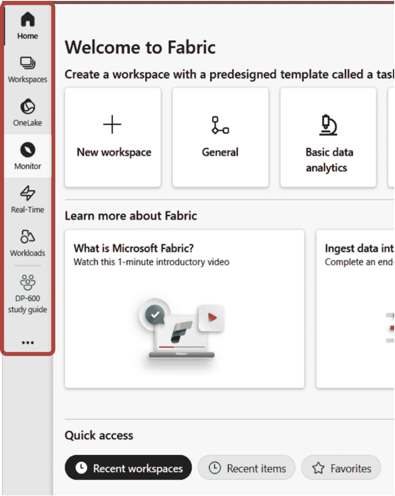
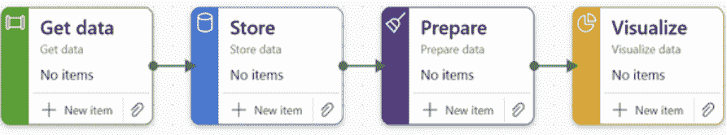
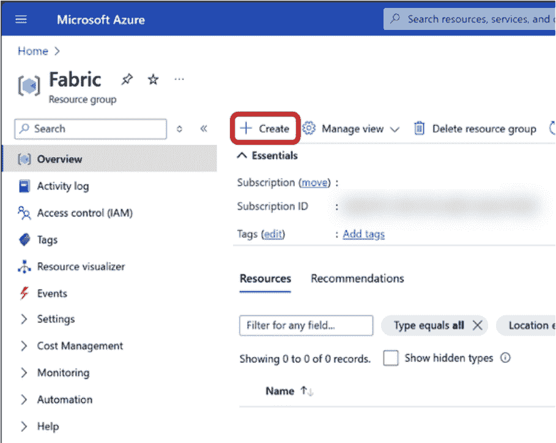

# 第 1 章. Microsoft Fabric 及认证内容的介绍

在本章中，我们将向您介绍 Microsoft Fabric 平台，并为您概述其所有组成部分。我们将为您提供 Microsoft Fabric 内部服务的概览，并向您介绍来自 Microsoft 的认证路径。在后续章节中，我们将根据考试需要深入探讨每项服务的具体细节。

## 关键组件和架构

Microsoft Fabric 平台包含一系列服务，如图 1-1 所示。这些服务作为一组联合服务，是您可以执行的操作的目录。

> **提示**
> 
> 有些人会被 Microsoft Fabric 中服务和功能列表所淹没。但您不需要全部使用它们；它们只是您在构建自己的解决方案时可供选择的选项，基于您的具体需求。

图 1-1. 包含所有服务的完整 Fabric 平台

在此，我们列出图 1-1 中的图标，并提供每个图标所代表服务的简要描述：

## Data Factory

此服务让您能够访问数据流和管道，您可以使用它们从长长的来源列表中摄取、准备和转换数据，例如内置的湖仓、仓库和事件中心。

## Analytics

此服务让您能够创建湖仓、笔记本、Spark 作业定义以及其他元素，以支持收集、存储、分析和处理大量数据的流程实现。这还包括创建机器学习模型、进行实验以及使用 PySpark 和 Python 中的笔记本来创建所需的 AI 解决方案的选项。在此，您还可以与数据代理和环境一起工作。

## Databases

这是 Fabric 中内置的 SQL 数据库，基于 Azure SQL Database。它提供易于设置和配置的功能，并通过 OneLake 中的自动备份和存储，为来自原生 SQL 数据库的基于应用程序的存储提供支持。

## Fabric IQ

通过此服务，您可以为业务定义标准和语义，并在整个公司中重复使用它们。您还可以创建和维护业务中使用的主要定义，以及内部业务关系。您还可以使用此服务中的元素用于 Fabric 内部的数据代理和其他服务。

## Power BI

此服务是报告和分析的行业标准。借助数据流、组织应用、记分卡、仪表板和分页报表等支持服务，您将拥有完整的服务堆栈来支持您的分析需求。

## Real-Time Intelligence

此服务让您能够以快速的零提取、转换、加载（零 ETL）转换和极低延迟来处理运动中的数据。它将摄取您所有的遥测数据，并在需要时让您处理它，底层服务包括事件中心、实时仪表板、激活器、规则和事件驱动操作。

## OneLake

这是 Microsoft Fabric 中所有数据的唯一位置。它为所有服务提供开放的存储模型，并提供共享、保护和管理您宝贵数据的便利性。

在第 2 章中，我们将深入探讨 DP-600 考试中涉及的这些图标的细节。

此服务列表还由一系列主要元素支持，这些元素可以在 Fabric GUI 画布左侧的主菜单中找到，如图 1-2 所示。

这些主要元素的细节如下：

## Workspaces

您可以单击此图标以从整个工作区列表中找到您有权访问的工作区。您的组织中可能有更多工作区，但此列表将过滤为仅显示您有权访问的工作区。

## OneLake Catalog

这是获取工作区和可使用项概览的入口点。这里还有一个名为 Govern 的区域，可让您概览 Microsoft Fabric 的一些治理视角。我们将在本书后面详细介绍治理。

## Monitor

在此，您可以找到有关在您的 Fabric 租户内部运行的作业、笔记本执行、管道运行等的概览和状态更新。

## Real-Time Hub

这是您处理流数据和运动中数据的入口点。在这里，您将找到可交互的预创建项和对象，您还能够直接从此入口点创建自己的 Fabric 项和对象。

## Workloads

在此，您可以添加自定义工作负载，即第三方提供商为您创建的 Fabric 服务（其中一些为付费服务）。

## Welcome to Fabric

使用名为任务的预设计模板创建工作区

新建工作区

常规

基础数据分析

## 了解更多关于 Fabric

## 什么是 Microsoft Fabric？

观看此 1 分钟介绍视频

摄取数据

完成端到端

## 快速访问

最近的工作区

最近的项目

收藏夹

主页

工作区

OneLake

监控

实时

工作负载

DP-600 学习指南

图 1-2. Microsoft Fabric 中的主要元素列表

您还可以在溢出菜单中找到以下其他选项（图 1-2 中左侧菜单底部的三个点）：

## Apps

在此，您可以找到您已创建并部署到应用目录的任何应用。

## Metrics

在此，您可以直接使用记分卡并创建指标集，也称为目标。底层引擎维护这些目标，以为您提供每个指标集随时间变化的视角。为了维护每个目标的随时间变化视角，引擎会自动创建一个新的语义模型。

所有这些可能性都为任何组织，从小型企业到最大型企业，提供构建量身定制以满足其特定需求的分析解决方案的机会。

## 认证内容的简要历史

当 Microsoft Fabric 进入市场时，它不仅仅掀起波澜，它像一场风暴般到来，改变了 Microsoft 分析生态系统的格局，并重新定义了我们对数据平台的思考方式。凭借其服务的无缝集成、强大的分析功能和端到端的 SaaS 交付，Fabric 真正将 Microsoft 数据平台提升到了下一个水平。

如果您在数据领域待得足够久，记得云计算之前的时代，一切都必须在本地安装和维护，那么您就见证了令人难以置信的演变。过去，在云中仅用几分钟就启动整个分析环境似乎像科幻小说。但我们已经走了很远，从物理服务器和手动修补到完全托管的云原生服务，处理从摄取到 AI 驱动洞察的一切。随着每一次飞跃，我们完全重新构想了我们处理商业智能、数据工程、集成和可视化的方式。

而在这一切过程中，Microsoft 认证始终与我们同在，为希望证明其专业知识的专业人士提供结构、方向和认可。自 90 年代初以来，*Microsoft Certified Professional*（MCP）计划一直是技术发展的基石。早在 1992 年，认证围绕 LAN Manager、Windows 3.1 和早期版本的 SQL Server 等产品展开。这些早期认证为至今仍然强大的持续学习和凭证文化奠定了基础。

此后，每次新的 Microsoft 平台发布都伴随着一波量身定制的认证，帮助 IT 专业人员、开发人员和数据从业者加深技能并展示其能力，而 Microsoft Fabric 也不例外。

随着这一强大新平台的到来，一个全新的认证轨道被引入。首个推出的是 DP-600：Microsoft Fabric Analytics Engineer Associate 认证，该认证专为希望展示其在 Microsoft Fabric 中构建、管理和优化分析解决方案方面的知识和专业技能的专业人士设计。

不久之后，Microsoft 为该平台发布了另一项基于角色的认证。它是 DP-700：Microsoft Fabric Data Engineer Associate，当它进入市场时，它吸收了一些基础设施和

最初属于 DP-600 的架构聚焦内容已移出。这一转变使课程开发者能够将 DP-600 的重点调整为更加强调分析、治理和数据洞察，从而巩固其作为在 Microsoft Fabric 上工作的分析工程师的首选认证的地位。

本学习指南围绕当前 DP-600：Microsoft Fabric Analytics Engineer Associate 认证构建。无论你是刚刚开始使用 Fabric，还是经验丰富的商业智能（BI）或数据专业人士正在转向这一新平台，本指南旨在全程支持你。它涵盖完整的认证范围，从数据摄取和转换，到设计和维护分析解决方案，再到在整个平台上应用治理和安全最佳实践。

本指南不仅仅是一份应试资源，更是提供实用见解、动手示例和真实世界背景的来源，帮助你不仅为考试做好准备，而且在日常工作中作为 Microsoft Fabric 分析工程师取得成功。

## 端到端分析概述

现在你已经掌握了基本信息，我们可以开始利用 Microsoft Fabric 提供的可能性构建端到端分析解决方案。

无论我们的最终目标是什么，我们都需要构建一个从源读取数据、根据业务要求管理数据，并以用户和应用程序能够用于增值活动的方式易于理解地呈现数据的解决方案。

图 1-3 显示了此过程的示例。

图 1-3. 平台上分析过程的简单示意

为了帮助我们构建图中所展示的解决方案（我们已使用任务流功能来说明），我们可以使用 Microsoft Fabric 的所有服务进行选择：

## 获取数据

为了帮助我们获取数据，我们有 Data Engineering、Data Factory、Data Science、Power BI 和 Real-Time Intelligence 服务。

### 存储数据

为了存储数据，我们可以使用 Databases、Data Warehouse、Data Engineering、Power BI 和 Real-Time Intelligence 服务。这里的共同点是 OneLake，除了导入模式语义模型和 Real-Time Intelligence 外（请参阅注释框了解详情）。

> NOTE
> Real-Time Intelligence 和 eventhouse 在 Kusto 引擎中使用专有存储格式（Real-Time Intelligence 存储的底层引擎）。你可以在第 4 章阅读更多关于 Kusto 引擎的内容。你也可以创建 OneLake 的副本，我们将在本书后面介绍。

## 准备数据

Databases、Power BI、Data Engineering、Data Warehouse 和 Real-Time Intelligence 服务都可以支持数据准备阶段。

### 可视化数据

为了可视化数据，我们有来自 Power BI 和 Real-Time Intelligence 服务的选项。

> **NOTE**
> 我们不会更深入地探讨基于 Microsoft Fabric 构建分析解决方案的架构方法，因为这是 DP-700 认证的一部分。

在使用 Microsoft Fabric 和平台中的数据时，你可能会想知道治理方面的问题。虽然平台有一些内置的治理功能，但企业级的 Microsoft Fabric 平台实施通常也需要 Microsoft Purview 服务。

Microsoft Purview 是一个统一的数据治理、合规和风险管理平台，帮助组织管理、保护并从数据中获得更多价值。它是一个开放平台，不仅拥抱 Microsoft 服务，还提供对数据和分析平台周围第三方服务的访问。这使得 Purview 成为管理治理、合规和风险的一站式商店。

## 设置 Fabric 环境

在本学习指南中，我们没有包含供你自行逐步进行的显式实验。相反，为了熟悉平台，我们强烈鼓励你尝试来自 Microsoft Learn 的官方实验室和练习。这些实验室练习基于现有的 Fabric 环境，为了帮助你入门，我们提供了以下快速指南。

要使用 Microsoft Fabric，你需要两样东西：

- 一个 Fabric 容量
- 一个 Power BI Pro 许可证

> **TIP**
> 
> 你只有在想将 Power BI 作为服务使用时才需要 Power BI Pro 许可证。你可以在没有 Power BI 的情况下使用 Fabric。
> 
> 如果你购买 F64 或更大的容量，只有你的开发人员需要 Power BI Pro 许可证。你的终端用户将自动由 F64+ 容量覆盖。

### Fabric 容量

Fabric 容量驱动你在平台上处理数据和操作时进行的所有计算操作。可以将其视为加载、读取和操作数据所需的 CPU、内存和网络。

Fabric 容量有不同大小，按库存单位（SKU）衡量，最小的一个称为 F2（F 代表 Fabric），目前最大的一个称为 F2048。Fabric 容量可以使用与 F 后的数字相同的 SKU 数量。

每个服务和进程使用多少容量以容量单位（CUs）衡量。服务使用的 CU 数量可以是任何正数，例如，使用 F2 容量的服务如果每个线程仅使用 0.5 CU，则可以运行四个并行线程。

创建 Fabric 容量的过程始于 Azure 门户。图 1-4、1-5 和 1-6 为你提供了快速指南，帮助你轻松开始创建 Fabric 容量。

图 1-4. 在资源组中选择 + Create 按钮

图 1-5. 搜索 fabric capacity 并选择 Create

### Create Fabric capacity

### Welcome to Microsoft Fabric

Fabric 提供从数据湖到业务用户的端到端分析平台。

了解更多

Basics

Tags

Review + create

创建 Fabric 容量以供你的 Fabric 工作区使用。

### Project details

选择订阅以管理部署的资源和成本。使用资源组像文件夹一样组织和管理所有资源。

Subscription *

Resource group *

Create new

### Capacity details

为你的容量命名并选择位置。

Capacity name *

Enter capacity name

Region *

North Europe

Size

F64
64 Capacity units
Change size

Fabric capacity administrator *

Select

Review + create

< Previous

Next: Tags >

图 1-6. 为你的容量命名，选择区域和大小，并根据需要配置其余设置

你也可以在 Microsoft Fabric 中创建试用容量。当你在 Fabric 门户中开始使用 Fabric 项目时会自动创建，并在此时提示你开始试用容量。

如果你有一个未启用 Fabric 的工作区，并且首次尝试创建 Fabric 特定项目，你将自动升级为 Microsoft Fabric 的试用许可证。

然而，此许可证限制每个租户最多五个试用容量，因此当你尝试此过程时，你可能会看到有关 Fabric 试用容量限制的通知。

> **TIP**
> Fabric Trial 等同于 F64 容量，但无法访问所有功能。例如，使用试用容量时你将无法访问 Copilot，且试用容量在激活后有效期为 60 天。

在本書中，我们提供了来自 Microsoft Learn 的指南、问题和练习，其中包含 Microsoft Fabric 中的 XML for Analytics 端点元素。如果你想在阅读本书其余部分之前设置它，请参阅第 8 章了解详情。

### 创建 Fabric 启用工作区

Microsoft Fabric 中的每个项目都包含在 *workspace* 中，*workspace* 是一个合并的占位符或项目组，你可以根据业务领域、技术领域或任何其他方式将其分组以满足业务需求。工作区也可以作为访问数据和见解的安全上下文。有关安全和治理的更多信息，请参阅第 7 章。

要创建工作区，请在 Fabric 门户左侧的主菜单中找到 Workspaces 按钮，输入工作区的名称，展开 Advanced 部分，然后选择 Fabric 容量或 Trial 容量（见图 1-7）。

## Create a workspace

Name *

为此工作区命名

Description

描述此工作区

Domain ⓘ

分配到域（可选）

Learn more about workspace settings

Workspace image

Upload

Reset

## Advanced ^

Contact list * ⓘ

输入用户和组

License mode ⓘ

Pro
选择 Pro 以使用基础 Power BI 功能并协作处理报表、仪表板和记分卡。要访问 Pro 工作区，用户需要 Pro 按用户许可。Learn more

Trial
选择 Trial 将此工作区分配给 Fabric 试用容量。Microsoft Fabric 试用容量允许用户探索 Microsoft Fabric 的功能，如 Data Factory、Data Engineering 和 Real-Time Intelligence 等。Learn more

Premium per-user
选择 Premium per-user 以使用 Power BI Premium 功能进行协作，包括高级数据流和数据马特。要在 Premium per-user 工作区中协作和共享内容，用户需要 Premium per-user 许可。Learn more

Premium capacity
如果工作区将托管在 Premium 容量中，请选择 Premium 容量。当您共享、协作和分发 Power BI 和 Microsoft Fabric 内容时，查看者角色中的用户无需 Pro 或 Premium per-user 许可即可访问此内容。Learn more

Embedded
如果工作区将托管在 Azure 嵌入式容量中，请选择 Embedded。ISV 和开发人员使用 Power BI Embedded 将可视化和分析嵌入到其应用程序中。Learn more

Fabric capacity
如果工作区将托管在 Microsoft Fabric 容量中，请选择 Fabric capacity。使用 Fabric 容量，用户可以创建 Microsoft Fabric 项目并使用 Fabric 功能和体验与其他人协作。探索 Power BI、Data Factory、Data Engineering 和 Real-Time Intelligence 等中的新功能。Learn more

Figure 1-7. Selecting a Fabric capacity when creating a new workspace

暂时保持其他设置不变，然后单击 Apply。

## Configuring a Workspace

在 Microsoft Fabric 中创建给定工作区后，您将有一系列用于配置它的选项。您可以在工作区顶部的右侧找到 Workspace settings。图 1-8 显示了工作区设置中的主菜单项。

## Workspace settings

- General
- License info
- Azure connections
- System storage
- Git integration
- OneLake
- Workspace identity
- Network security
- Monitoring
- Power BI
- Delegated Settings
- Data Engineering/Science
- Data Factory

Figure 1-8. Main menu items in the workspace settings menu

TIP
图 1-8 中的大多数设置超出了本书内容的范围。我们将在第 8 章中详细介绍相关设置，但对于其他设置，我们仅提供高层次描述，如本节所述。

图 1-8 中的关键设置如下：

### General

在此部分，您可以配置工作区的主要部分，包括名称和工作区图像。您可以添加描述，将其加入域，编辑工作区联系人，添加 OneDrive 安全组，并删除工作区。请注意，您很少需要更改 General 设置，因为它们是高层次的。

## License info

在此处，您可以查看和更改工作区的许可信息。许可信息是容量使用的配置，您可以更改工作区对 Fabric 容量的使用。

您还可以获取工作区的连接链接，您将使用它将第三方应用程序连接到工作区并对其进行编程更改（例如 API 和 Graph 连接）。

## Azure connections

在此处，您可以配置与 Azure Data Lake Storage Gen 2 帐户的链接，以存储您的数据流的数据（见第 4 章），您还可以将工作区连接到 Log Analytics 工作区，以便将日志发送到那里。

## System storage

在此处，您可以快速查看系统存储使用情况，按总计以及按项目名称和大小分组。

## Git integration

在此处，为了轻松配置工作区的 Git 集成，您可以设置与 GitHub 或 Azure DevOps 的连接。（请注意，Git 集成不是本书的一部分，因为它超出了考试范围。）

如果您使用 GitHub，您必须手动维护个人访问令牌（PAT）。这与使用 Azure DevOps 不同，后者通过 Azure Entra ID 的单点登录（SSO）功能维护安全连接。

## OneLake

在此处，您可以下载 OneLake 文件资源管理器应用，它为您提供对 OneLake 中原始文件的完全集成视图，该视图直接嵌入到您本地计算机上的正常本地文件资源管理器中。

您还可以为快捷方式启用缓存（见第 6 章）。此缓存将存储快捷方式的一些数据，直接存储在工作区的 OneLake 中，以加快数据的读取速度。

## Workspace identity

在此处，您可以配置工作区身份，以便 Microsoft Fabric 之外的其他应用程序可以与工作区中的项目和流程协同工作。

当您单击绿色的 + Workspace identity 按钮时，Fabric 将创建一个托管服务主体，用于在 Fabric 外部进行应用程序访问。

## Network security

在此处，您可以创建到 Azure 中私有端点的连接。您将使用私有端点连接到虚拟专用网络中的服务，它们使 Microsoft Fabric 能够从这些特定服务读取和写入数据和其他信息。

## Monitoring

在此处，您可以设置工作区监控。您可以使用标准的工作区项目集来启用对工作区中发生情况的深度监控，这将创建一个 eventhouse 和一个 eventstream，用于监控工作区中的事件以供进一步分析。

## Power BI

在此菜单部分，您可以访问三个主要区域：

### General

在此处，您可以配置应用程序和模板的访问控制（如果在工作区中启用），并且您可以启用或禁用在 Web 用户界面中直接使用语义模型的工作选项（见第 3 章）。

### Data connections

在此处，您可以启用一项额外的安全功能，如果最终用户编辑报表，该功能将断开报表与底层语义模型的连接。在某些情况下，这可以帮助整个工作区设置的<|message|> 安全和治理。

### Embed codes

使用 Microsoft Fabric，您可以选择将 Power BI 报表嵌入到自己的网站中，而最终用户看不到 Fabric 门户。如果您创建了嵌入式 Power BI 报表，您将在此处找到维护该设置的代码。

## Delegated Settings

在此部分，您可以启用或禁用用户和应用程序使用共享访问签名（SAS）令牌访问工作区的 OneLake 的选项。

## Data Engineering/Science

> **TIP**
> 尽管菜单的这一部分不是 DP600 考试的一部分，但我们在此添加了详细信息，以帮助您全面了解设置。

在此处，您可以指定 Spark 设置中 Spark 的使用选项。您有五个选项：

### Pool

在此处，您可以指定 Fabric 环境的不同 Spark 池大小。默认情况下，将有一个启动池，其启动速度比手动配置的 Spark 池更快（您也可以在此处配置）。

### Environment

在此处，您将有配置工作区中环境设置的选项。默认环境带有配置 Spark 属性、使用库、笔记本如何使用 Spark 以及 Spark 作业定义如何处理数据处理的选项。这里最好的功能之一是启用 Native Execution Engine（NEE）的选项，这将加速笔记本执行的速度。您还可以配置标准 Spark 池的使用和设置，上传自己的自定义 Spark 库，并配置在此特定工作区中可以使用哪些标准库。

### Jobs

在此处，您可以配置 Spark 作业中执行的设置。此设置允许您为 Spark 作业运行保留最大核心数，这将降低可同时运行的并行作业数量。您还可以配置 Spark 池的超时时间，这将帮助您在未使用指定时间后停止 Spark 池。

### High concurrency

在此处，您可以配置同时在同一 Spark 会话上运行多个笔记本的选项，这将帮助您优化并行进程的利用。您也可以对在管道内运行的笔记本执行相同操作（有关笔记本和管道的更多信息，请参阅本书后面的内容）。

### Automatic log

在此处，您可以启用跟踪来自笔记本的机器学习模型和实验的选项，以记录其指标、参数和模型。

## Data Factory

在此处，您可以配置 Apache Airflow 的运行时设置，Apache Airflow 是使用代码构建的流程执行的编排器。（请注意，这超出了本书的范围。）

## Summary

在本章中，你阅读了 Microsoft Fabric 平台的起源、其来源以及微软认证流程如何随时间演变。我们向你展示了如何设置 Fabric 环境并配置工作区设置，这些是使用 Fabric 工作环境的基础，也是开发周期的基线。
