## Chapter 2. Getting Data

没有数据，任何分析平台都无法运行。在本章中，你将学习如何在 Fabric 环境中直接使用各种方法摄取数据。

首先，我们将引导你了解 Fabric 门户中的入口，在那里你将处理现有和新的数据连接。接下来，我们将深入介绍使用 Power BI Desktop 和 Fabric 门户以不同方式创建新连接的过程。然后，我们将引导你了解三种数据存储服务：湖屋、仓库和事件中心。在这三者之间做出选择可能看起来繁琐且困难，但我们将帮助你理解它们，以便你选择正确的位置存储数据。为了结束本章，我们将向你展示如何设置 OneLake 与事件中心之间的集成，并将此数据与数据资产中的语义模型连接。我们还将介绍 OneLake 服务，你在那里存储所有数据（有一个例外；稍后会详细介绍），并展示如何从集中位置使用、共享和重用数据。

### Discovering Data with the OneLake Catalog and Real-Time Hub

在 Microsoft Fabric 中，你有两个进入数据资产高层视图的入口：OneLake 目录和实时中心，它们的使用方式不同。

OneLake 目录让你了解存储在 OneLake 中的数据，但仅限于你有权访问的数据。即使作为整个 Fabric 服务，OneLake 中可能存在更多数据，但作为终端用户，你只能看到并发现你至少具有读取权限的数据。

实时中心让你了解租户中的实时工件。此外，实时中心的权限视角与 OneLake 数据中心相同：你只能看到你有权访问的内容。

现在，让我们深入了解它们的细节。

### The OneLake Catalog

OneLake 目录可以是新业务用户开始使用报表和洞察的第一个入口点。它也可能是许多 Microsoft Fabric 新手寻找特定项目或浏览发现新项目的首选起点。对于一些人来说，直接打开工作区并开始在 OneLake 目录中处理项目是最简单上手的方式。

OneLake 目录还旨在作为集成开发的入口点，用于从源获取数据。它提供了可用数据的概览，并使发现 Fabric 租户中现有元素变得容易。

通常，任何数据分析工程师都希望能够访问所有内容，但现实有时有所不同，因为当今许多组织限制了开发人员和工程师对数据和项目的使用权限。因此，与 OneLake 目录交互的每个用户只能看到基于其对项目和工作区的访问级别的租户中所有项目的过滤视图。

图 2-1 突出了 OneLake 目录的不同区域。

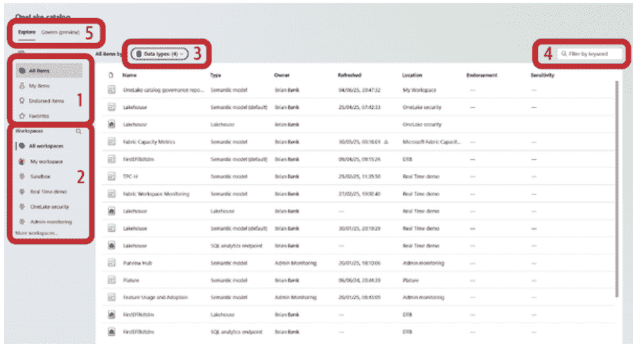

图 2-1. OneLake 目录概览

这些区域（编号 1–5）的细节如下：

### Grouped items selector (area 1)

在这里，你可以根据其背书、你的收藏项目或你拥有的项目来筛选项目分组。你也可以选择查看你在 Fabric 租户中可以访问的所有项目。

### Workspaces (area 2)

此列表显示你有权访问的工作区。在这里，你可以浏览选择所需的工作区，或使用右侧的小放大镜图标搜索工作区。

### Filter (area 3)

此选择器和筛选器包含基于项目类型的筛选选项，分为五个类别：

数据、洞察、流程、解决方案和配置。在每个类别中，你会找到正在搜索的特定项目类型。还需要注意的是，你只能从同一组项目中选择项目，不能同时从两个不同的组中选择项目。

### Search bar (area 4)

在这里，你可以搜索任何内容，如项目名称、所有者、工作区、背书和敏感性。这是一个自由文本搜索，并且运行非常快，输入时实时筛选。

### Explore (area 5)

在这里，你将找到数据的治理状态信息。你会收到有关可以采取的行动以改善当前治理状态的建议，并且你还会找到学习 Microsoft Fabric 治理功能的工具链接。

> **NOTE**
> 在撰写本书时，OneLake 目录中有两个预览功能：名为 Insights 的项目分组和目录的 Govern 部分。这两个功能很可能在它们的状态更改为普遍可用（GA）后，才会在后续阶段加入考试。

### The Real-Time Hub

实时中心（也在 Fabric 门户的左侧菜单中作为 Real-Time 找到）是你关于流数据的“一站式商店”。这包括连接、数据流、来自 Fabric 租户的事件处理以及 Fabric 容量中发生的事件。

The Real-Time hub operates as the ingestion control plane within Microsoft Fabric’s real-time data architecture. It supports the following:

- Connecting to CDC-enabled sources like Azure SQL DB and SQL Server through Event Hubs or Kafka
- Bridging ingestion from source systems to real-time consumers like eventstreams and eventhouses
- Working in conjunction with Azure Event Grid to ingest Fabric and Azure system events

The Real-Time hub in Microsoft Fabric offers a strategic capability for ingesting system-level events emitted by both Fabric and Azure services. These are not only limited to telemetry from user-defined applications; they also cover platform-generated events that signal state changes, health conditions, operational triggers, and resource lifecycles.

This system event ingestion is built on top of *Azure Event Grid*, which is a fully managed event routing service that enables reactive, event-driven patterns across distributed systems.

In this context, the Real-Time hub provides a powerful interface that surfaces relevant system events for discovery and routing, while Event Grid acts as the under-the-hood backbone that delivers those events from their source to consumers like an eventstream, eventhouse, or activator.

*System events* are structured messages that are automatically emitted by Microsoft Fabric or Azure services to indicate that something of significance has occurred, like 100% of the Fabric capacity having been used or a special file in the storage account having been deleted or changed. These system events include but are not limited to the following:

- Dataset refresh completion notices in Power BI
- Capacity utilization threshold warnings
- Workspace creation, modification, or deletion notices
- Dataflow failure alerts
- Eventstream deployment status updates

System events are standardized, contain rich context metadata, and follow consistent schemas. For example, a workspace creation event includes the workspace ID, creator identity, timestamp, and other useful operational attributes.

From a monitoring and orchestration perspective, these events are critical for building automation, enforcing governance, and triggering data pipelines in response to system changes.

When users open the Real-Time hub in Microsoft Fabric, they are presented with a curated interface that includes a category called *Fabric Events* and another called *Azure Events*. These are automatically populated with all the system events that the Real-Time hub can currently discover and ingest via Event Grid.

From there, users can do the following:

- Discover available system events across Fabric and Azure services.
- Enable routing of selected events to the eventstream for transformation or aggregation.
- Trigger rules using the activator to invoke actions (e.g., sending Teams alerts, starting pipelines) in

response to specific events.

This simplifies what has historically been a complex event subscription process. Instead of manually wiring up Event Grid topics, endpoints, and event handlers, users can simply opt in to the event categories exposed by the Real-Time hub and configure routing with a few clicks.

## OneLake Catalog versus Real-Time Hub

The main differences between the OneLake catalog and the Real-Time hub are found in Table 2-1.

Table 2-1. Differences between the OneLake catalog and the Real-Time hub

| Topic | OneLake catalog | Real-Time hub |
|---|---|---|
| Discoverability | It gives the end user high-level insights into all existing items with deep search capabilities. | It gives the end user deep insights into the accessible items from Real-Time Intelligence in both Microsoft Fabric and in Microsoft Azure. |
| Creation of items | Users can’t create items directly from the OneLake catalog. | Users can create all item types linked to Real-Time Intelligence and the activator. |
| Governance | From the Govern tab in the OneLake catalog, the user can get insights into the current state of all items in the tenant. | There’s no built-in central governance overview, though some governance insights can be found in the details of each item. |

## Creating Connections and Ingesting or Accessing Data

When you create connections to data and either read it once or plan to permanently ingest it into the Fabric environment, you have several options for how to do so. We’ll cover the following options from the perspective of the analyst role:

- Creating shortcuts to data from both inside and outside Fabric
- Implementing Dataflow Gen1 and Dataflow Gen2
- Creating data connections directly in Power BI
- Creating Connections to semantic models

> **TIP**
> There are more options than the ones mentioned here for ingesting data, such as Pipelines and notebooks. However, those options are out of scope for the DP-600 exam.

We’ll go through each option in the following sections and describe the methods you need to know to work with them. We’ll also cover some tips and tricks for some of the options.

## Creating Shortcuts to Data from Inside and Outside Fabric

Microsoft Fabric has special connections to data called *shortcuts*. They don’t move data to the place where you create the connection. Instead, they’re pointers that

indicate where data currently resides, and you can use them to read data when you need it.

The obvious benefit of this approach is that you don’t need to move data and then create a copy of it. You merely read the data when you need it and always get the latest version.

These shortcuts exist in different flavors: from inside a single workspace, from outside the current workspace, and even from outside the tenant you are currently working in. And these shortcuts are not limited to other Fabric environments. You can also connect to Azure Data Lake Storage Gen2 and data environments from other vendors like Databricks, Snowflake, AWS, and other S3-compatible endpoints.

When creating *local shortcuts*, you can connect to the following items from both outside and inside your current workspace, if you have access to them:

- Kusto Query Language (KQL) databases
- Lakehouses
- Mirrored Azure Databricks catalogs
- Mirrored databases
- Semantic models
- SQL databases
- Warehouses
- Warehouse snapshots

Note that the shortcut functionality from KQL databases only works if the OneLake availability setting on the KQL database has been enabled. You can find the setting in Figure 2-2.

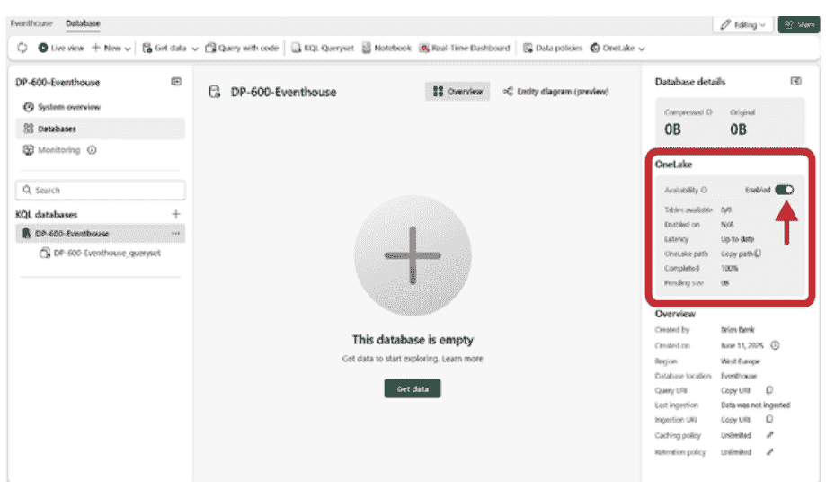

Figure 2-2. OneLake availability setting in KQL databases

When you create a shortcut, the user interface differs from item to item but the overall approach is the same: you create a connection to a data store without moving data based on the current user’s or user principal’s access to data.

All local shortcuts adhere to the current user’s security context, and they filter the data based on this configuration. This also means that the developer can have one set of access configurations and the end user can have a different set of configurations. Each will still only see the data they have access to. This is the opposite of how external shortcuts work, and we discuss them next.

External shortcuts are the data we can set up to be read from outside Fabric. We can set up Amazon, Google, and Snowflake (to mention just a few) using delegated authorization, which means we can set up the shortcut and access to data but cannot inherit the current security context from that service. They are all configured using a

specific set of credentials that are fitted to suit the external data provider.

This is a crucial difference between local shortcuts and external shortcuts. The security context will change when someone is using external shortcuts, and everyone will have access to the same data, no matter the user’s specific security setting on the external data source.

Speaking of external data sources, there are other ways to work with them and ingest them directly into the Fabric environment. They are called *dataflows*, and we’ll dive into them in the next section.

## Dataflow Gen1 and Dataflow Gen2

When working with external data and the need to ingest, transform, and load it into Fabric, you have two UI-assisted options: Dataflow Gen1 and Dataflow Gen2. *Dataflow Gen1* has been in the Power BI area for years, and it was the first service to utilize the Power Query (or M) language directly in the browser. *Dataflow Gen2* is the new version of this UI-assisted integration option, and it brings custom destinations, more UI-based overview of what’s happening, and options to load data faster than does Dataflow Gen1.

**TIP**
Dataflow Gen1 is slowly being replaced by Dataflow Gen2 in the entire exam. The features from Dataflow Gen1 are the same in Dataflow Gen2, with more features in Gen2.

We will start with Dataflow Gen1 and then transition to Dataflow Gen2.

## Dataflow Gen1

Dataflow Gen1 是一种 UI 辅助的方法，使用 Power Query 语言在 Fabric 中读取、转换和保存数据。Dataflow Gen1 包含一个摄取引擎，其功能几乎与 Power BI Desktop 相同。它使用 Power Query，目标位置位于数据流内部。它还在幕后使用存储帐户，您可以配置此存储帐户为从 Azure 门户自行管理和创建的显式帐户。

当您创建新项目时，您会在 Fabric 菜单的“获取数据”和“准备数据”部分找到 Dataflow Gen1（见图 2-3）。

当您开始在 Fabric 中创建 Dataflow Gen1 时，您会看到一个屏幕询问您是否真的想要 Dataflow Gen1 而不是 Dataflow Gen2（见图 2-4）。

### New item

### Get data

将批处理和实时数据摄取到 Fabric 工作区内的单一位置。

## Dataflow Gen1

准备、清理和转换数据。

## Dataflow Gen2

准备、清理和转换数据。

### Prepare data

清理、转换、提取和加载您的数据以进行分析和建模任务。

## Dataflow Gen1

准备、清理和转换数据。

## Dataflow Gen2

准备、清理和转换数据。

Figure 2-3. Fabric menu item for Dataflow Gen1

## Want to create a Dataflow Gen2 instead?

Dataflow Gen2 在 Dataflow Gen1 可用的数据摄取和转换功能上进行了显著增强，具有诸如输出目标、Copilot、快速复制（用于大规模数据摄取）、新的大规模数据流转换引擎、VNET 网关支持、增强的刷新历史和诊断体验等新功能等等。

Learn more

Don't show this again, always create a Dataflow Gen1

Yes, create a Dataflow Gen2

No, create a Dataflow Gen1

*Figure 2-4. Splash screen when you start to create a Dataflow Gen1*

即使存在功能更强大的新版 Dataflow（见图 2-4），我们仍会向您展示 Gen1 在什么情况下仍然有用。然后，我们将详细介绍 Dataflow Gen2 的附加功能。

当您需要直接从外部源摄取数据但无法使用前面所述的快捷方式方法时，Dataflow Gen1 很有用。这是因为 Dataflow Gen1 具有一种特殊功能，可以以直接查询模式从源读取数据并将其呈现给最终用户或应用程序，而 Dataflow Gen2 则没有。如果快捷功能不起作用或不适用于该场景，则 Dataflow Gen1 是一个不错的选择。

在表 2-2 中，您可以看到 Dataflow Gen1 和 Dataflow Gen2 之间的差异。

Table 2-2. Differences between Dataflow Gen1 and Dataflow Gen2

| Features | Dataflow Gen1 | Dataflow Gen2 |
|---|---|---|
| Author dataflows with Power Query | Yes | Yes |
| Shorter authoring flow | No | Yes |
| Autosave and background publishing | No | Yes |
| Data destinations | No | Yes |
| Improved monitoring and refresh history | No | Yes |
| Integration with data pipelines | No | Yes |
| High-scale compute | No | Yes |
| Getting data via Dataflows connector | Yes | Yes |
| Direct query via Dataflows connector | Yes | No |
| Incremental refresh | Yes | Yes |

如果您在图 2-4 所示的屏幕上单击“否，创建 Dataflow Gen1”按钮，它将打开图 2-5 中的屏幕。

在那里，您有以下四个选项：

- Defining new tables
- Linking tables from other dataflows
- Importing a model
- Attaching a Common Data Model folder (preview)

### NOTE

请注意，第四个选项“附加通用数据模型文件夹”处于预览中。它已经预览了相当长一段时间了，而且由于引入了 Dataflow Gen2，我们不确定它是否会最终退出预览。如果您参加考试时它仍处于预览中，您将不会被问及相关问题。

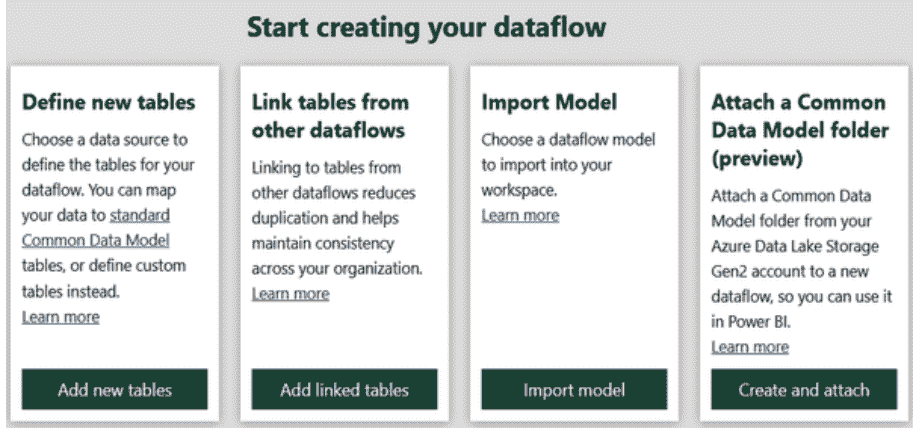

Figure 2-5. Welcome screen for Dataflow Gen1

## Defining new tables

如果您单击定义新表的选项，您将看到 Power Query 的众所周知的 UI，并且您可以继续使用图 2-6 中列出的源。

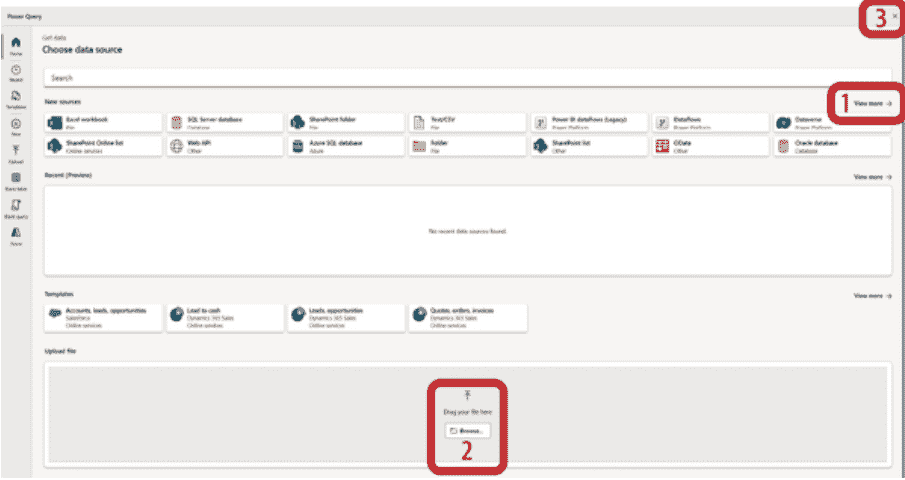

我们突出显示了一些特定区域（编号为 1、2 和 3）：

### View more (area 1)

您可以单击此选项以查看可使用的所有可能的源的完整选择。随着 Microsoft 在 Power BI 和 Fabric 中扩展选项，此列表会不断扩展。

### Upload file (area 2)

您可以使用此界面上传单个文件并将其用作数据流的源。

### x (area 3)

我们突出显示这一点是因为它可能很难找到。您单击它以在不想保存工作时关闭 UI。

一旦您选择了要使用的源，您就可以在提供的屏幕上连接到该源。

> **TIP**
> 
> 每个源都有自己的设置，因此我们不会在此深入探讨每个源。它也超出了认证范围去了解源的网络设置和连接性。

接下来，我们将深入研究数据操作屏幕（见图 2-7）。

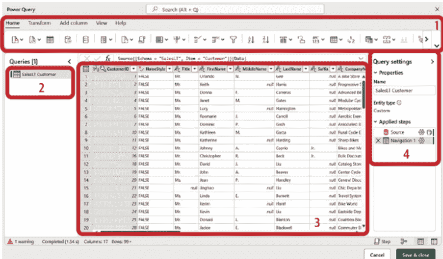

Figure 2-7. The Power Query UI in Dataflow Gen1

我们突出显示了四个感兴趣的区域（编号为 1–4）。

### Menu bar (area 1)

这几乎与您在 Power BI Desktop 版本的 Power Query 中找到的菜单栏相同（见本章后面部分）。在这里，您可以选择 Power Query、转换、添加列、视图和帮助。

### List of queries (area 2)

在这里，您可以找到数据流中的所有查询。
每个数据流可以包含多个查询，最终用户将看到它们全部。然后，最终用户可以连接到 Fabric 中的项目。

### Data preview (area 3)

在数据预览窗格中，您可以看到数据的当前状态，预览前 99 行，您也可以通过鼠标向下滚动查看更多行。在这里，您可以通过右键单击单元格来替换值，并通过右键单击列来执行图 2-8 中显示的任何命令来修改数据。

Figure 2-8. Complete context menu retrieved by right-clicking on a column in Dataflow Gen1

### Query settings (area 4)

每当您在 Power Query 视图中对数据进行更改，无论是通过鼠标还是通过公式栏，您都会在屏幕最右侧的“查询设置”区域看到一个新的已应用步骤。您将看到您连接的源、您创建的步骤以及您正在处理的表的名称。此视图还允许您单击任何步骤并在预览窗格中查看该步骤的预览，从而使您能够动态地处理数据操作需求。它还可以帮助您进行调试和进一步开发数据。

从某些上下文菜单项中，您还可以访问更多选项的下拉列表，并可以单击每个选项查看其详细信息。例如，图 2-9 显示了拆分列操作的详细信息。

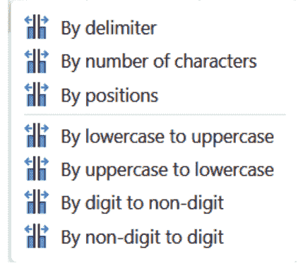

Figure 2-9. Details on Split column action

如果您想自己编写代码而不是使用鼠标，您可以在数据预览上方的公式栏中编写所需的 M 脚本。

NOTE
在本书中，我们不会深入探讨 M 语言的细节。如果您想了解更多信息，您可以在 Microsoft Learn 上找到完整的参考指南。

## Linking tables from other dataflows

“从其他数据流链接表”部分为您提供了从已存在的数据流中读取数据并将其用作数据流源的选项。如果您有一些想要使用的数据，并且还想添加更多参考数据、清理或汇总数据，这可能很有用。

当您选择此选项时，它将打开图 2-10 中的屏幕。

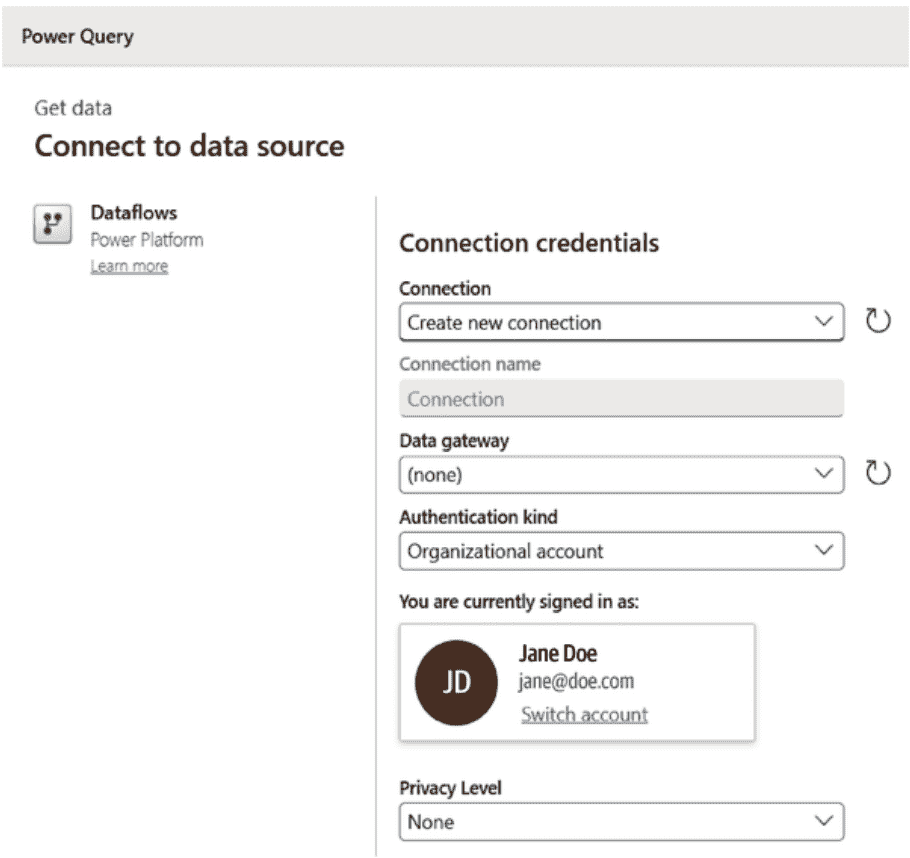

Figure 2-10. Screen for connecting to tables from other dataflows

请注意屏幕指示您已登录。这也意味着作为开发人员，您需要有权访问数据流才能读取它。

## Importing a model

导入模型选项使您能够将预定义的数据流模型导入您的数据流并用作起点。Dataflow Gen1 的格式为 JSON，您可以通过直接从现有项目的 UI 导出数据流来获取其副本（见图 2-11）。

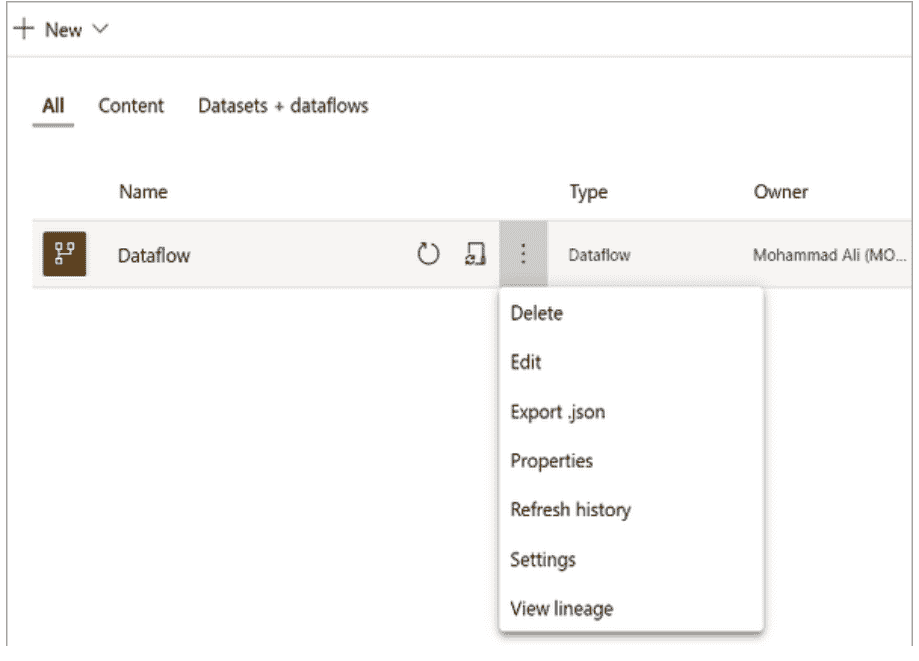

Figure 2-11. Exporting an existing Dataflow Gen1

这完成了对 Dataflow Gen1 的介绍。接下来是 Dataflow Gen2。

## Dataflow Gen2

Dataflow Gen2 Fabric 工作区项是 Dataflow Gen1 的新版本和更新版本，带来了大量新功能和能力。它配备了全新的后端引擎，并且有更多选项可用于从不同来源工作和加载数据。

与 Gen1 一样，你可以在“新建项”屏幕的“获取数据”和“准备数据”部分找到 Gen2（见图 2-12）。

当你选择 Dataflow Gen2 选项时，下一个窗口会要求你输入名称，并提供禁用“启用 Git 集成、部署管道和公共 API 场景”的选项（见图 2-13）。

## 新建项

收藏夹

所有项

dataflow

## 获取数据

将批处理和实时数据摄取到 Fabric 工作区内的单一位置。

## Dataflow Gen1

准备、清理和转换数据。

## Dataflow Gen2

准备、清理和转换数据。

## 准备数据

清理、转换、提取和加载你的数据以进行分析和建模任务。

## Dataflow Gen1

准备、清理和转换数据。

## Dataflow Gen2

准备、清理和转换数据。

图 2-12. Dataflow Gen2 项创建

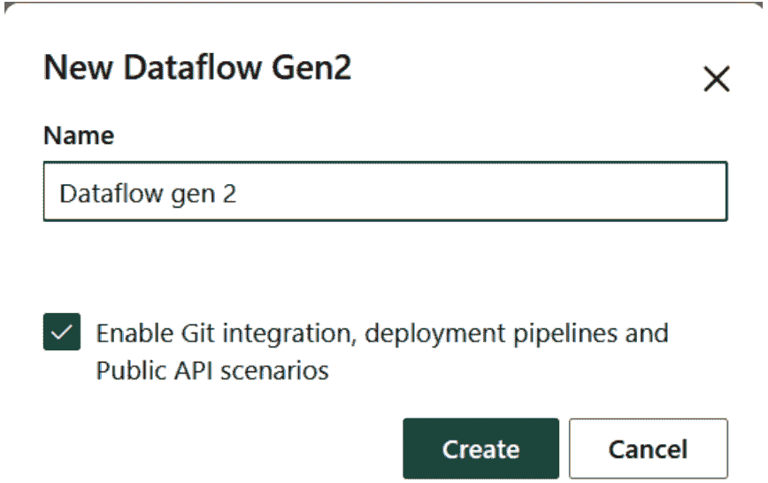

图 2-13. Dataflow Gen2 的名称和选项

此选项与为 Dataflow Gen2 启用 Git 集成以及使用完整的 CI/CD 流程来处理开发周期中版本的部署有关。

NOTE
CI/CD 和开发周期超出了 DP-600 考试的范围，但如果你想了解更多相关信息，可以阅读微软的完整博客文章。

当你完成 Dataflow Gen2 的创建后，它会弹出一个包含五个选项的屏幕（见图 2-14）。

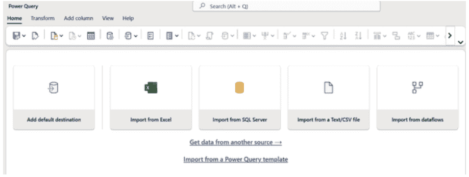

图 2-14. 创建 Dataflow Gen2 后出现的第一个屏幕

在这里，你可以直接添加默认目标、导入 Excel 文件、从 SQL Server 导入数据、从文本或 CSV 文件导入、以及从其他数据流导入。如果这还不够，你可以点击“从其他源获取数据”前往另一个屏幕，该屏幕（几乎）与你在 Dataflow Gen1 中使用的“选择数据源”屏幕相同。它为你提供了完整的数据源和处理数据的选项列表，但不同之处在于它允许你从 OneLake 目录读取数据（见图 2-15），我们在本章前面已经描述过。

在此视图中，你可以找到连接数据源所需的一切。与 Dataflow Gen1 一样，如果你点击屏幕右上角的“查看更多”选项，你可以找到更多数据源。

你还会看到一些用蓝色标记并带有 Preview 字样的连接器。这些连接器处于预览状态，不会成为 DP-600 认证考试的一部分。

在你创建对所需数据的连接并加载数据后，你会看到与 Dataflow Gen1 中相同的[content]

## Dataflow Gen2

Dataflow Gen2 Fabric 工作区项是 Dataflow Gen1 的新版本和更新版本，带来了大量新功能和能力。它配备了全新的后端引擎，并且有更多选项可用于从不同来源工作和加载数据。

与 Gen1 一样，你可以在“新建项”屏幕的“获取数据”和“准备数据”部分找到 Gen2（见图 2-12）。

当你选择 Dataflow Gen2 选项时，下一个窗口会要求你输入名称，并提供禁用“启用 Git 集成、部署管道和公共 API 场景”的选项（见图 2-13）。

## 新建项

收藏夹

所有项

dataflow

## 获取数据

将批处理和实时数据摄取到 Fabric 工作区内的单一位置。

## Dataflow Gen1

准备、清理和转换数据。

## Dataflow Gen2

准备、清理和转换数据。

## 准备数据

清理、转换、提取和加载你的数据以进行分析和建模任务。

## Dataflow Gen1

准备、清理和转换数据。

## Dataflow Gen2

准备、清理和转换数据。

图 2-12. Dataflow Gen2 项创建

图 2-13. Dataflow Gen2 的名称和选项

此选项与为 Dataflow Gen2 启用 Git 集成以及使用完整的 CI/CD 流程来处理开发周期中版本的部署有关。

NOTE
CI/CD 和开发周期超出了 DP-600 考试的范围，但如果你想了解更多相关信息，可以阅读微软的完整博客文章。

当你完成 Dataflow Gen2 的创建后，它会弹出一个包含五个选项的屏幕（见图 2-14）。

图 2-14. 创建 Dataflow Gen2 后出现的第一个屏幕

在这里，你可以直接添加默认目标、导入 Excel 文件、从 SQL Server 导入数据、从文本或 CSV 文件导入、以及从其他数据流导入。如果这还不够，你可以点击“从其他源获取数据”前往另一个屏幕，该屏幕（几乎）与你在 Dataflow Gen1 中使用的“选择数据源”屏幕相同。它为你提供了完整的数据源和处理数据的选项列表，但不同之处在于它允许你从 OneLake 目录读取数据（见图 2-15），我们在本章前面已经描述过。

在此视图中，你可以找到连接数据源所需的一切。与 Dataflow Gen1 一样，如果你点击屏幕右上角的“查看更多”选项，你可以找到更多数据源。

你还会看到一些用蓝色标记并带有 Preview 字样的连接器。这些连接器处于预览状态，不会成为 DP-600 认证考试的一部分。

在你创建对所需数据的连接并加载数据后，你会看到与 Dataflow Gen1 中相同的

Cancel 取消你的工作。

在图 2-22 所示的示例中，我们已选择 SQL Server 数据源选项，并准备配置连接。

在顶部字段中，你可以输入数据库的连接字符串，以及如果需要的话，数据库的名称。如果你在这里没有输入名称，后续会提示你输入数据库名称。作为示例，我们在 Server 中填入了 `<someserver>.database.windows.net`，在 database 中填入了 `<databasename>`，但你应使用来自你环境的连接信息。

## SQL Server 数据库

Server ①
`<someserver>.database.windows.net`

Database (optional)
`<databasename>`

Data Connectivity mode ①
● Import
○ DirectQuery

▲ Advanced options

Command timeout in minutes (optional)

SQL statement (optional, requires database)

☑ Include relationship columns

☐ Navigate using full hierarchy

OK
Cancel

Figure 2-22. SQL Server database connection configuration screen

尽管我们向你展示了 SQL Server 数据库连接的工作方式，但你并不局限于使用该特定连接。还有其他数据连接模式，你需要了解它们，以便全面理解 Power BI 中的连接。你必须在两种模式之间进行选择：Import 和 DirectQuery：

## Import

在此模式下，Power BI 会将所有数据读入内存并存储在底层引擎中。这种方法在数据摄取时速度较慢，因为引擎需要读取所有数据，但在查询时速度非常快，因为所有数据都以列式格式存储在内存中，可随时使用 DAX 表达式进行查询。你将在第 4 章和第 5 章中了解更多关于 DAX 表达式的内容。

## DirectQuery

在此模式下，数据在查询时读取。当你筛选报表或进行任何导致引擎需要新数据集的操作时，Power BI 会启动查询以从连接的源获取数据。在某些场景下，此选项可能相当缓慢，例如当你在 SQL Server 数据库中有非常大的数据集，而引擎需要基于另一个表中的列来筛选该数据集时。你将在第 5 章中了解更多关于星型模式和关系的内容。

尽管 Direct Lake 不是此类型连接的选项，但值得一提。

Direct Lake 通过将计算引擎与 OneLake 中的结构化数据无缝集成而工作。当用户与报表或查询交互时，连接首先尝试直接从 OneLake 文件将必要的数据块加载到内存缓存中。如果数据已缓存，性能是即时的。如果没有，Direct Lake 会按需读取文件数据。至关重要的是，它会监控 Delta Lake 事务日志以跟踪底层数据的更改。当新的事务提交到数据湖时，Direct Lake 会使相应的缓存数据失效，并自动将最新版本的 Parquet 文件拉取到缓存中以供后续查询。此过程确保数据新鲜度，无需手动完整刷新数据集，因此可在 Fabric 中的湖仓或仓库表上提供接近实时分析。

在处理对源的连接时，你还可以选择连接到已在 Fabric 中并存储在 OneLake 服务中的数据。OneLake 连接性是图 2-20 中名为 OneLake catalog 的选项，当你单击该选项时，你将被带到图 2-23 所示的屏幕。

屏幕将向你展示你作为开发者可以访问的所有项目。它们可能是你有权访问的工作区或工作区中的特定项目。你可以连接到以下项目类型：

- KQL Databases
- Lakehouses
- Semantic models
- Metric sets
- SQL analytics endpoints
- SQL databases
- Warehouses

根据你选择的可用项目，你将直接访问数据源，或需要选择一个配置文件进行登录。

如果提示你选择配置文件进行登录，你将看到类似于图 2-24 所示的屏幕，其中有一个导航器可用于查找你想要连接的元素或项目。

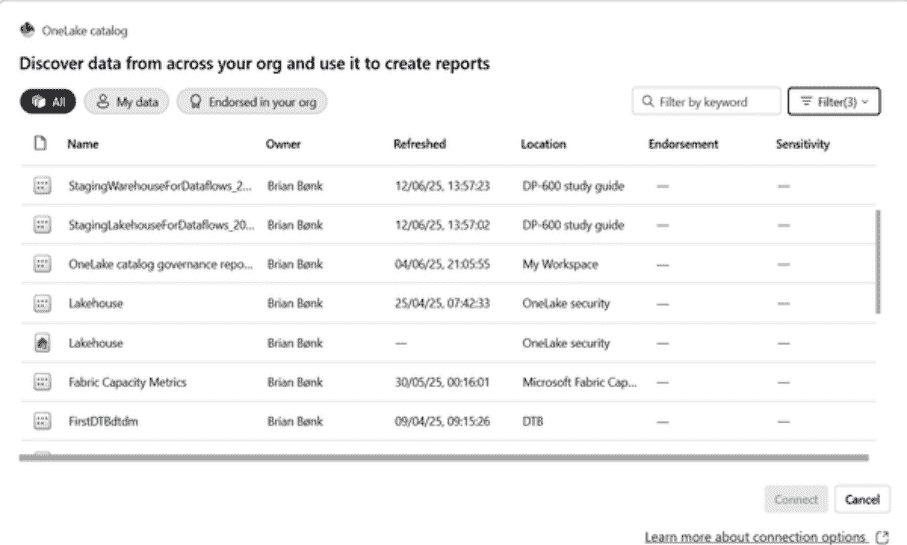

Figure 2-23. OneLake catalog screen for connection from Power BI Desktop

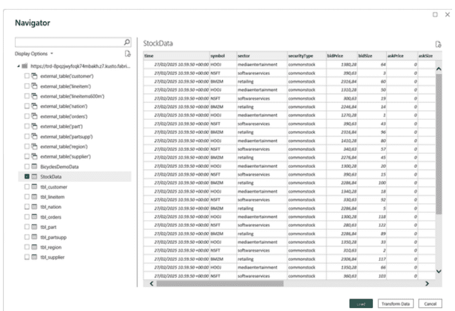

Figure 2-24. Navigator screen for selecting items after establishing a connection

图 2-24 显示了对 KQL 数据库的连接，在这里，你需要选择要连接到的特定表。这与连接到 SQL Server 数据库或 Microsoft 的任何其他面向对象服务类似。

然后你可以选择直接加载数据，使用屏幕底部的 Load 按钮，或通过使用 Transform Data 按钮进入 Power Query 体验。我们在上一节中解释了 Power Query 体验。

如果你选择从 OneLake catalog 连接到语义模型，那么你将被直接引导到 Power BI Desktop 应用程序，其中屏幕右侧将有一整套表和度量值（见图 2-25）。

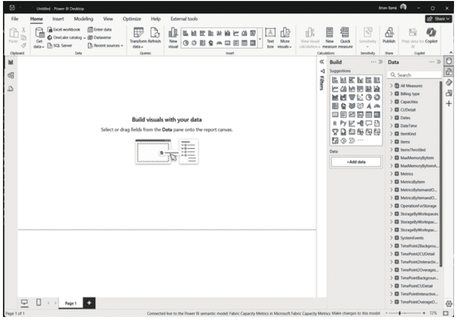

Figure 2-25. Power BI Desktop connected to a semantic model

Power BI Desktop 具有许多功能，可用于摄取、操作和可视化数据，以及与组织共享报表。来自 Power BI Desktop 的应用程序体验是 Power BI 的完整功能集。在 Microsoft Fabric 中，在使用 Power BI 报表时还有基于 Web 界面的体验。

## Data Connections to Power BI

当你在 Fabric 工作区中时，你可以选择直接从新项目列表中创建 Power BI 报表，如图 2-25 所示。当你选择 Power BI 报表项目时，它将弹出图 2-26 所示的屏幕。

## Build your first report

- Add and prepare your data
- Generate a premade report
- Customize to suit your needs

Add data to start building a report

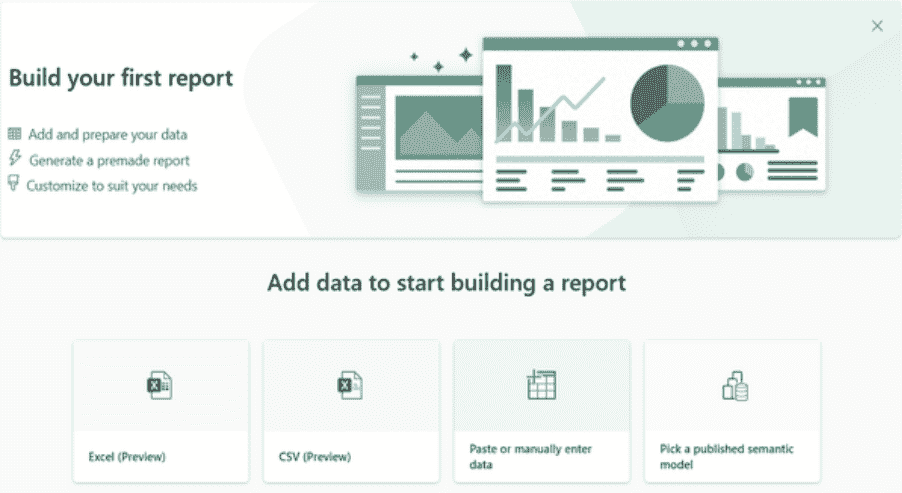

Don't see the source you're looking for? Download the desktop app.

Figure 2-26. New Power BI report experience from the web user interface

在这里，你可以连接 Excel 或 CSV 文件，手动粘贴或输入数据，或连接到你有权访问的工作区中已发布的语义模型。

在图 2-27 中，你可以看到语义模型选择器中的资源管理器选项，这与本书中介绍的其他连接屏幕类似。

你还可以按工作区筛选（屏幕左侧）或使用 All 按钮（显示你有权访问的所有项目）、My data（显示你拥有的项目）或 Endorsed in your org（显示在组织中以某种方式认可的项目；它还会自动筛选你有权访问的项目）。

在右上角提供自由文本搜索，而屏幕中间显示当前筛选上下文并列出可供选择的语义模型。

当你选择一个语义模型时，你有两种创建报表的方式：“Auto-create report”（标准方式）或“Create a blank report”（可从下拉列表中选择）。“Auto-create report”选项使用一组内置模板，并根据语义模型现有内容向报表添加视觉对象。

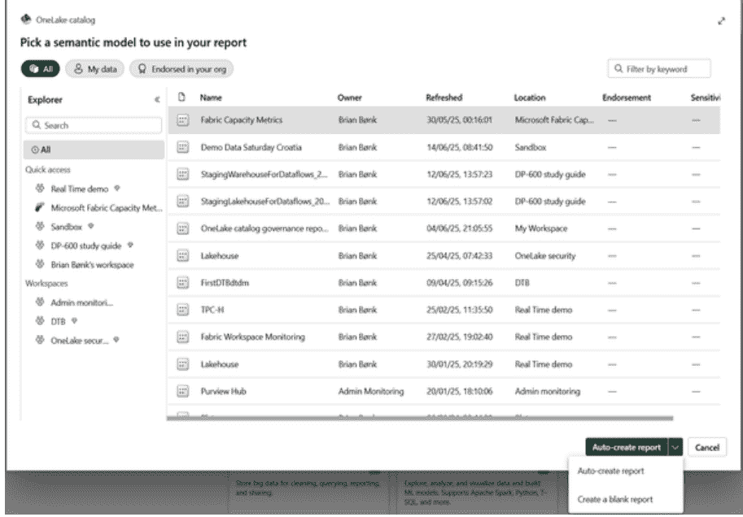

Figure 2-27. OneLake catalog explorer for semantic models

如果你想更快地生成报表，可以使用图 2-28 所示的启动屏幕。图 2-28 中的选项可能只在屏幕上显示几秒钟，因为 Fabric 服务在为我们生成报表方面非常快。因此请迅速做出决定。

Generating your report...

Hint: To see the best results, try pre-selecting the data you’re most interested in.

Pre-select data

Figure 2-28. Pre-selecting data for the autogenerated report

根据我们的经验，使用此选项几乎每次都会创建类似于图 2-29 的报表，只是这里那里有些变化。

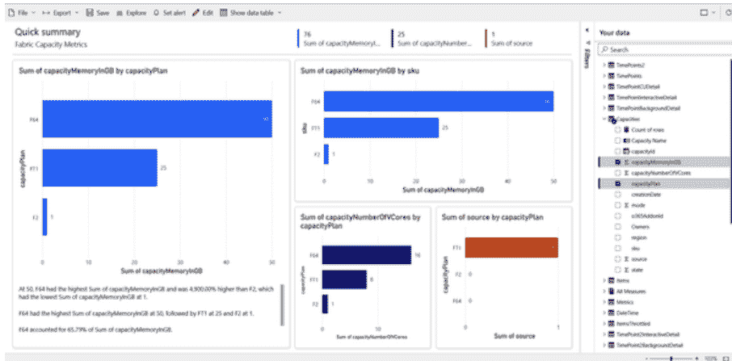

Figure 2-29. Results of using “Auto-create report” option in Power BI report web experience

你将看到报表、保存和导出的选项、顶部的其他选项，以及屏幕右侧语义模型的全部内容。默认情况下，报表以“实时”模式显示，你不能直接编辑它

在浏览器中。相反，你可以点击顶部的编辑按钮，这样你就可以编辑报表并使其符合你对可视化、交互以及其他业务需求的需求。

要向现有可视化添加新元素，只需从字段列表中将它们拖放到可视化中即可。要更改可视化，你可以进行对象内编辑，选择它后，你会看到屏幕右侧的属性窗格（见图 2-30）。

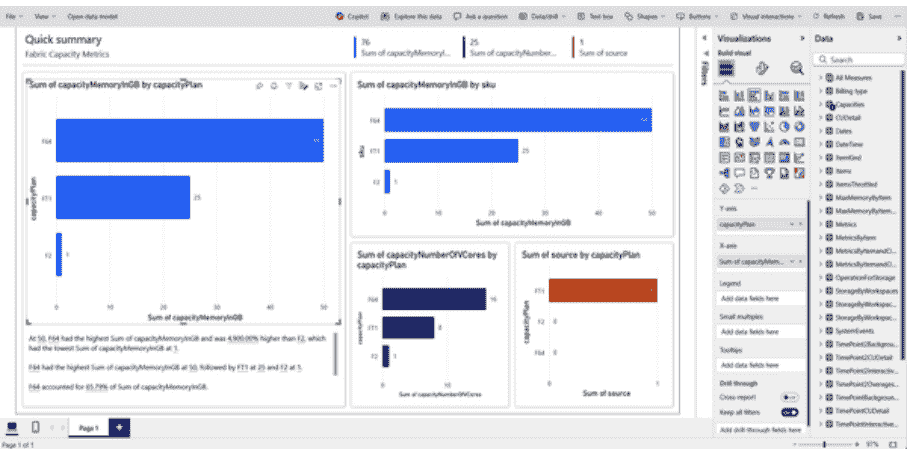

图 2-30. Power BI 网页体验中的对象内编辑

然后，你就可以像在 Power BI Desktop 中一样编辑可视化。你可以从顶部菜单添加新的可视化，并将报表保存并分享给组织。如果你愿意，你也可以编辑报表的移动版布局，你可以在屏幕左下角找到它（见图 2-30）。默认情况下，选择的是桌面版布局，你可以选择移动版布局并设计报表以适应在手机或平板上使用时的需求（见图 2-31）。

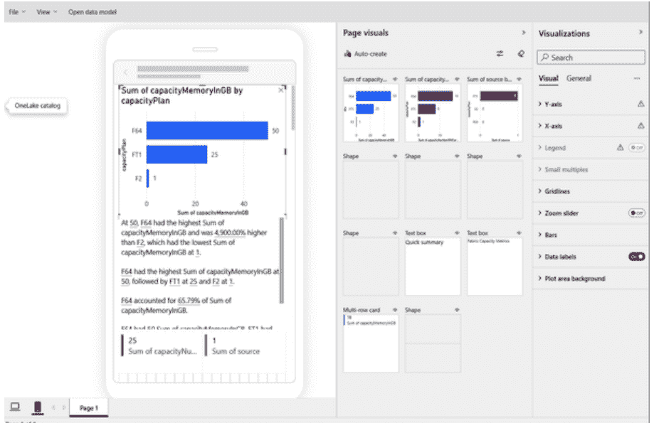

图 2-31. Power BI 网页体验中的移动版布局

你也可以使用桌面版布局中现有的可视化，并将它们拖放到移动版布局的画布上。当你需要在画布上更改可视化时，只需在画布上选择该项并使用屏幕右侧的属性窗格即可。

## KQL 查询到 Power BI

在处理 KQL 查询到 Power BI 时，我们需要使用一种特殊的数据获取实现方法。使用 Power BI Desktop 应用程序和 Power BI 网页体验的方法略有不同，我们将在下一节中介绍这两种方法。

## Power BI Desktop 中的 KQL 查询

在 Power BI Desktop 应用程序中，使用获取数据选项并在连接器列表中找到 Azure Data Explorer（Kusto）连接器（见图 2-32）。

## 获取数据

搜索

- 全部
- 文件
- 数据库
- Microsoft Fabric
- Power Platform
- Azure
- 在线服务
- 其他

### Azure

- Azure SQL 数据库
- Azure Synapse Analytics SQL
- Azure Analysis Services 数据库
- Azure Database for PostgreSQL
- Azure Blob 存储
- Azure Table 存储
- Azure Cosmos DB v1
- Azure Data Explorer（Kusto）
- Azure Data Lake Storage Gen2
- Azure HDInsight（HDFS）
- Azure HDInsight Spark
- HDInsight 交互式查询
- Azure 成本管理
- Azure 设备注册表（ADR）（Beta）
- Azure 资源图
- Azure Cosmos DB v2

已认证连接器

模板应用

连接

取消

图 2-32. Power BI Desktop 中的 Azure Data Explorer（Kusto）连接器

当你选择此连接器时，它会弹出一个对话框，你可以在其中输入集群名称和数据库名称，并且你有选项可以粘贴 KQL 查询并将其用作分析工作的源（见图 2-33）。

## Azure Data Explorer（Kusto）

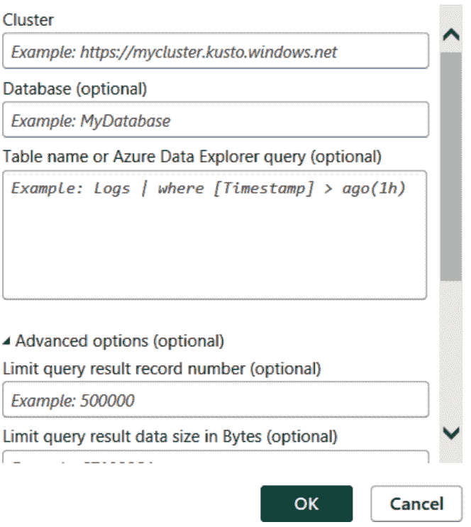

图 2-33. Azure Data Explorer（Kusto）连接对话框

接下来，向下滚动并选择 Direct Query 数据连接模式（见图 2-34）。

你需要选择 Direct Query 模式，因为 KQL 引擎在处理来自数据库的数据查询方面比 Power BI 处理相同数据量的能力要好得多。KQL 引擎专为非常大的数据集而构建，可以处理你想要的几乎任何查询，并且连接器在*查询折叠*（将我们在 Power BI 中所做的工作翻译成实际的原生 KQL 查询）方面做得非常好，供 KQL 引擎执行。因此，在此场景中请不要犹豫选择 Direct Query 选项。

现在你已完全配置了连接器，可以点击确定开始像平常一样在 Power BI 中使用数据。

## Azure Data Explorer（Kusto）

高级选项（可选）

限制查询结果记录数（可选）

示例：500000

限制查询结果数据大小（字节）（可选）

示例：67108864

禁用结果集截断（可选）

示例：false

附加设置语句（以分号分隔...）（可选）

示例：set query_datascope=hotcache;

数据连接模式 ①

导入

DirectQuery

确定

取消

图 2-34. 为 KQL 查询连接选择 Direct Query 作为数据连接模式

## Power BI 网页体验中的 KQL 查询

正如我们在 Power BI Desktop 方法中看到的，如果我们记得选择 Direct Query 选项，使用 KQL 查询就很容易。但在 Power BI 网页体验中，我们需要使用稍微不同的方法。

在这里，我们需要在 eventhouse 和 KQL 数据库级别开始。在 KQL 数据库中，我们有一个标准附加的 *KQL 查询集*，它只是一种将 KQL 查询作为数据库一部分保存的笔记本。

图 2-35 显示了 KQL 数据库和附加的 KQL 查询集，其中创建了一个 KQL 脚本。这是一个非常基础的 KQL 脚本，它获取一个表并根据列过滤行。

当 KQL 查询完成并且我们对结果集满意时，我们可以继续将其添加到新的 Power BI 报表中。

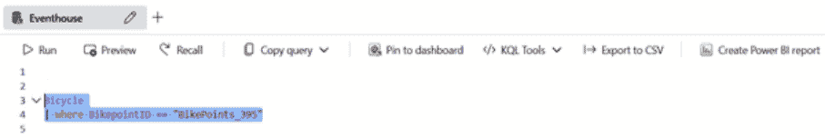

图 2-35. 带有简单 KQL 脚本的 KQL 查询集

### 注意

请注意图 2-35 中顶部菜单中倒数第二个菜单项是创建 Power BI 报表。只有在查询集中选择了特定的 KQL 查询时，此项才会被启用，如果没有选择 KQL 查询，我们就无法点击此菜单项。请注意，在图中，KQL 查询已被选中，因此我们可以点击创建 Power BI 报表并将数据获取到报表中。

当我们点击创建 Power BI 报表时，会出现一个屏幕，右侧显示 Kusto 查询结果和我们可以操作的列。然后我们可以开始创建和设计我们的报表（见图 2-36）。

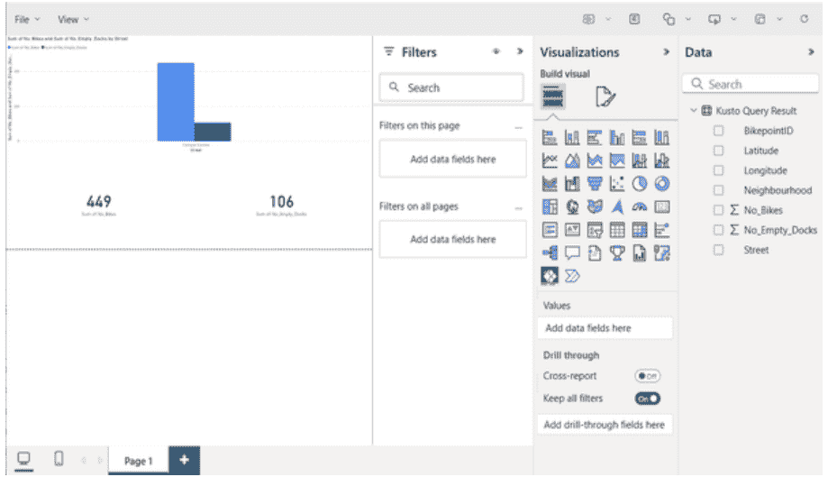

图 2-36. Power BI 网页体验中的 KQL 查询

在图中，我们添加了一些简单的可视化，并且可以继续保存报表并与组织分享，正如我们在本章前面解释的那样。

到目前为止，我们已经涵盖了将数据获取到 Power BI 并将数据摄取到 Fabric 的所有方面。但关于我们应该选择哪种服务的问题呢：湖仓、仓库还是事件中心？这也是 DP-600 考试的一部分，因此在下一节中，我们将深入探讨如何在三个选项中进行选择。

## 选择湖仓、仓库或事件中心

Microsoft Fabric 有三个用于存储分析数据的主要服务：湖仓、仓库和事件中心。但选择适合任务的服务可能很困难，因为它们都不是一刀切的解决方案。因此，在这里，我们将尝试帮助你了解不同的服务以及如何为你的使用场景选择合适的服务。

湖仓和仓库服务都建立在存储在 OneLake 中的 Delta Parquet 文件格式方法之上。尽管底层引擎不同，但它们在 OneLake 中存储数据时共享一些相似的功能。

事件中心也可以将数据存储在 OneLake 服务中，但它以选择性镜像选项的形式直接在 KQL 数据库或 KQL 数据库中的每个单独表中进行存储。

## 湖仓

此服务旨在支持来自不同来源的结构化、半结构化和非结构化数据。它还旨在使用笔记本方法最有效，使用 Spark、Scala、PySpark、Python SparkR 和 SparkSQL 脚本语言来摄取、操作和处理数据结构。它还在 OneLake 连接和 SQL 分析端点中提供数据。然而，它不支持多表事务，因为仓库服务支持，并且它将数据存储在引擎中按数据库和表分组的文件夹和文件中。

> 提示
> 你也可以使用 Data Factory 管道将数据摄取到湖仓，但这不在 DP-600 考试范围内。

## 仓库

此服务也在存储中支持半结构化和结构化数据，并且它使用 Transact-SQL（T-

SQL) 作为数据操作的主要语言。它支持使用与 SQL Server 相同 的函数和存储过程。然而，正如我们在第 3 章中将要介绍的那样，它的功能与湖仓相比并不相当。另一方面，仓库可以使用具有完整原子性、一致性、隔离性和持久性（ACID）属性的多表事务，而湖仓一次只能在一个表上具有 ACID 属性。所以基本上，仓库具有与 Microsoft SQL Server 相同的持久性功能。

## Eventhouse

该服务建立在与湖仓和仓库完全不同的引擎之上。它使用 Kusto 数据库引擎作为其计算和存储的主要驱动。Kusto 引擎在 Azure 生态系统中被广泛使用，在 Log Analytics、Azure Sentinel 以及 eventhouse 中 KQL 数据库的实现中。

eventhouse 支持非结构化、半结构化和结构化数据集，支持使用 T-SQL 和 KQL，并构建为处理我们通常在物联网（IoT）设备、日志事件和遥测中发现的基于时间序列的数据，仅举几例。

Microsoft 已撰写了一份完整且详尽的指南，介绍如何为存储和计算选择合适的服务，您可以在此链接找到：Microsoft Fabric decision guide: choose a data store。

表 2-3 比较了湖仓、仓库和 eventhouse 的功能。

## Table 2-3. Comparison of lakehouse, warehouse, and eventhouse

| Features | Lakehouse | Warehouse | Eventhouse |
|---|---|---|---|
| Data volume | Unlimited | Unlimited | Unlimited |
| Types of data | Unstructured, Semi-structured, and structured | Structured and semi-structured (JSON) | Unstructured, Semi-structured, and structured |
| Primary developer personae | Data engineer and data scientist | Data warehouse developer, data architect, data engineer, and database developer | App developer, data scientist, data engineer |
| Primary developer skill | Spark (Scala, PySpark, Spark SQL, and R) | SQL | No code, KQL |
| Data organized by | Folders and files, databases, and tables | Databases, schemas, and tables | Data schemas, tables |
| Read operations | Spark and T-SQL | T-SQL and Spark | KQL, and Spark |
| Write operations | Spark (Scala, PySpark, Spark SQL, and R) | T-SQL | KQL, and connected ecosystems |
| Multi-table transactions | No | Yes | Yes, multi-engine |
| Primary development interfaces | Spark notebooks and Spark job definitions | SQL scripts | KQL and data |
| Security | Row-level security (RLS), column-level security (CLS), and table-level security (T-SQL) (but none for Spark) | Object-level security (OLS), RLS, CLS, DDL/DML, and dynamic data masking | RLS |
| Access data via shortcuts | Yes | Yes, via SQL analytics endpoint | Yes |
| Can be a source for shortcuts | Yes (files and tables) | Yes (tables) | Yes |
| Query across items | Yes | Yes | Yes |
| Advanced analytics | Interface for large-scale data processing, built-in data parallelism, and fault tolerance | Interface for large-scale data processing, built-in data parallelism, and fault tolerance | Time native elements, full geospatial and capabilities |
| Advanced formatting support | Tables defined using PARQUET, CSV, AVRO, JSON, and any Apache Hive-compatible file format | Tables defined using PARQUET, CSV, AVRO, JSON, and any Apache Hive-compatible file format | Full ingestion for files and semi-structured data JSON |
| Ingestion latency | Available instantly for querying | Available instantly for querying | Queue ingestion and streaming ingestion at close to second latency |

## Summary

在本章中，我们已经介绍了多个功能，并展示了如何使用 OneLake 目录和 Real-Time hub 的示例。我们还向您展示了如何使用 Dataflow Gen1 和 Dataflow Gen2 摄取数据，并为您提供了在 Power BI 桌面应用程序和 Web 体验中创建数据连接的见解。最后，我们向您展示了如何从两种体验中创建到 KQL 查询的连接，并为您提供了选择分析工作负载的存储和计算服务的知识。
