## Chapter 3. Transforming Data

原始数据很少能立即用于报告或分析。它通常包含重复项、缺失值和不一致的格式，有时，其表之间的关系也不理想。这就是为什么我们必须转换数据，以确保我们在最终分析中使用的 数据是准确的并且性能良好。

在本章中，我们研究了在 Fabric 中清理、丰富和转换数据的不同技术。我们首先探讨如何创建视图、函数和存储过程以重用逻辑并简化数据准备。然后，我们研究如何通过添加新列或连接相关表来丰富数据。接下来，我们介绍使用连接、聚合、过滤器和数据类型的工作，这些都是将数据塑造成适合我们业务问题的必要条件。我们还解释了如何处理重复项、缺失值和 NULL。在清理数据后，我们将学习 *星型模式*，这是一种常见的建模模式，用于组织数据以实现快速直观的分析。最后，我们讨论 *反规范化*，即合并相关表为一个表的过程。

## Creating Views, Functions, and Stored Procedures

在 Fabric 中使用湖仓或仓库处理结构化数据时，您可以使用多种方法在流程早期应用转换。不要将原始数据导入 Power BI 再在其中进行转换，您可以在数据准备过程中更早地定义转换（例如，在 Fabric 仓库中）。当您管理大量数据或需要重用特定逻辑、集中维护或一致应用时，这种方法特别有益。

视图、函数和存储过程是定义转换数据的 SQL 逻辑的有用选项。您通常会在 Fabric 仓库中创建这些对象，因为它提供完整的 T-SQL 支持。在湖仓中，您也可以使用 SQL 分析端点创建视图，但函数和存储过程尚不支持。

例如，您可以使用视图为无组织的表创建清理后的版本，或为特定用户限制对敏感列的访问。函数可以计算业务特定的指标，而存储过程可以作为可重复的过程自动化多个转换步骤。

在以下各节中，我们将探讨视图、函数和存储过程是什么、何时以及为何使用它们，以及如何在 Fabric 仓库中创建每个对象。所有示例均使用 SQL，并且与湖仓和仓库相关，除非另有说明。

### Views

视图是建立在 SQL 查询之上的虚拟表。它本身不存储任何数据，除非它是物化的，如果是，则查询结果会物理存储以便更快访问。否则，视图在每次访问时都会返回底层查询的结果。您可以将视图视为一个保存的 SELECT 语句，其行为类似于表。

当您的数据分布在多个表上，并且发现自己反复编写相同的连接、过滤器或计算列时，视图特别有用。与其在每个查询中重复该逻辑，您可以一次在视图中定义它。这不仅使查询更简洁、更易于维护，还有助于在报告和用户之间强制执行一致性。视图还可以帮助为最终用户简化复杂的数据集。例如，如果一个表包含某些用户不应公开的敏感或无关列，您可以使用视图仅返回他们被允许查看的数据子集。它充当原始表的受控、过滤版本，可根据用户或应用程序的特定需求量身定制。此外，视图在安全方面表现得像表。您可以直接为视图分配 SELECT 权限，从而允许用户查询它，即使他们无法访问底层表。这提供了一种方便的方式来强制执行行级或列级限制，而无需公开完整的源数据。

通过使用视图，您可以向用户展示一个干净、专用的数据集，其中包含他们所需的信息，而无需他们自己编写连接、过滤器或计算。查询视图的每个人都会看到相同的逻辑和结构，这有助于减少错误并提高对数据的信任。


### NOTE

你可能会想知道当底层数据发生变化时会发生什么。由于视图基于实时 SQL 查询，因此它始终反映底层表的最新状态。如果你的数据结构发生变化——例如重命名列或添加新逻辑——你只需更新视图定义，所有使用该视图的报表都会立即受益于更新后的逻辑。

在 Microsoft Fabric 中，你可以直接在 lakehouse 或仓库中使用 SQL 分析终结点创建视图。一旦创建了视图，你可以交互式地查询它们，将它们用于管道，并通过使用导入或直接湖模式将它们加载到 Power BI，就像常规表一样。

为了说明如何创建视图，我们可以访问 Fabric lakehouse 或 Fabric 仓库的 SQL 分析终结点。在此示例中，我们使用 Microsoft 在 Fabric lakehouse 中提供的销售示例数据。我们想要创建一个视图，将客户表中的客户键和客户与销售表中的利润和交易次数结合起来。我们可以通过打开 Fabric lakehouse，单击新建 SQL 查询，并编写以下代码来实现：

```
CREATE VIEW dim_customer AS
SELECT
    c.CustomerKey,
    c.Customer,
    SUM(fs.Profit) AS Profit,
    COUNT(fs.SaleKey) AS NumberOfTransactions
FROM fact_sale fs
JOIN dimension_customer c
ON fs.CustomerKey = c.CustomerKey
GROUP BY c.CustomerKey, c.Customer;
```

当我们编写此查询并单击运行时，我们会创建一个新视图。我们可以在 lakehouse 屏幕左侧的导航窗格中找到它，其中包括表、视图和我们用于创建视图的查询（见图 3-1）。

视图在你想要简化数据访问、抽象业务逻辑或控制向不同用户显示的信息时非常有用。然而，视图仅限于返回结果集；它们不接受参数或执行逐行操作。当你的数据转换需求更为高级时——例如计算取决于输入值或你需要在不同查询中使用它们时——函数就派上用场了。

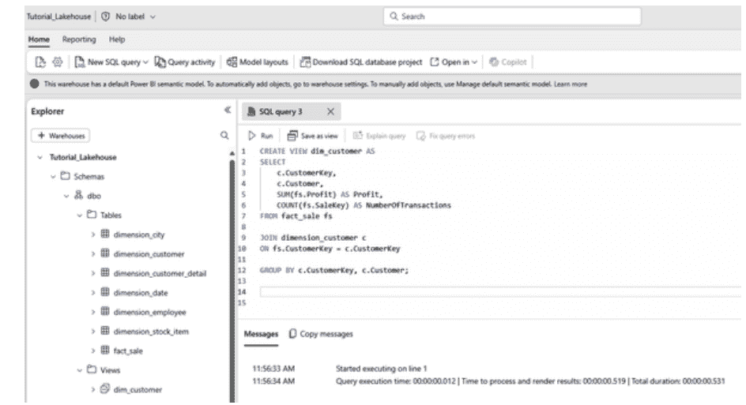

图 3-1. Fabric lakehouse 的 SQL 分析终结点

让我们看看函数的工作原理、存在哪些类型，以及如何在 Fabric lakehouse 或仓库中使用它们。

## Functions

*函数*是小型、可重用的 SQL 代码块。它接受输入（称为*参数*），对其执行操作并返回结果。函数很有用，因为它们可以帮助你避免一遍又一遍地重复相同的逻辑。如果某个计算或转换经常出现，将其变成函数意味着你只需编写和更新一次。

主要有两种函数类型：*标量函数*，返回单个值，如折扣或格式化的日期；以及*表值函数*，返回一个完整的表，你可以在查询中再次使用。虽然传统 SQL 允许标量函数和表值函数，但 Fabric 目前仅支持*内联表值函数*。这些函数返回结果集，通常基于输入值，并以单个 RETURN SELECT 语句编写。这意味着你不能使用 BEGIN ... END 块、声明变量或传统上使用条件逻辑。然而，你仍然可以使用 CASE 语句或 SELECT 中的表达式表达相当多的逻辑。

### Scalar functions

让我们看一个示例，其中我们定义一个函数，根据输入销售额计算折扣。如果金额超过 $1,000，我们返回 5% 的折扣；否则，我们返回零：

```
CREATE FUNCTION fn_CalculateDiscount (@SalesAmount DECIMAL(10,2))
RETURNS TABLE
AS
RETURN
    SELECT
        CASE
            WHEN @SalesAmount > 1000 THEN @SalesAmount * 0.05
            ELSE 0
        END AS Discount;
```

运行查询后，我们可以在仓库的 Functions 文件夹中看到一个新的函数（见图 3-2）。

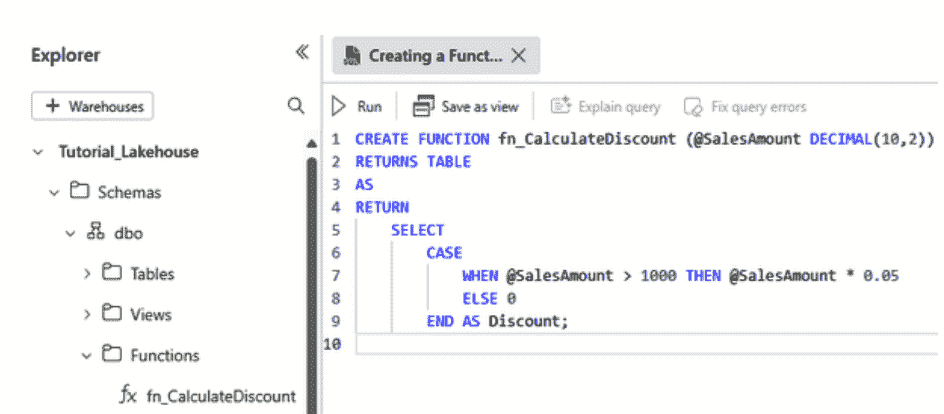

图 3-2. 查询以定义一个函数，当销售额高于 $1,000 时创建 5% 的折扣

创建此函数后，你可以通过将值作为参数传递在 SELECT 语句中使用它：

```
SELECT Discount
FROM fn_CalculateDiscount(1500)
```

```
SELECT Discount
FROM fn_CalculateDiscount(999)
```

顶部语句的结果为 75，即 1,500 的 5%，而第二个语句返回的数字为 0。因为 999 低于 1,000 的阈值，所以不适用折扣。然后你可以在其他 SQL 查询或视图中使用此函数返回的值，例如计算每个客户的总折扣或向销售报表添加折扣逻辑。

### Table-valued functions

现在，让我们看一个表值函数的示例，它根据输入参数返回表中的多行。表值函数在你想要返回基于一个或多个提供的值的过滤或计算后的数据子集时特别有用。想象一下，你经常需要检索高价值销售，即销售额超过某个阈值的销售。与其在每个查询中重复相同的过滤逻辑，不如为该逻辑创建一个可重用的函数。

以下是接受最低销售额作为输入并返回 fact_sale 表中总计达到或超过最低金额的所有行的表值函数的示例。此示例基于 Microsoft Fabric Lakehouse 中提供的销售演示数据：

```
CREATE FUNCTION fn_GetHighValueSales (@MinAmount DECIMAL(10,2))
RETURNS TABLE
AS
RETURN
    SELECT
        SaleKey,
        CustomerKey,
        Profit,
        TotalExcludingTax,
        InvoiceDateKey
    FROM fact_sale
    WHERE TotalExcludingTax >= @MinAmount
```

此函数接受一个参数：@MinAmount。它返回一个表，其中包含 TotalExcludingTax 大于或等于传入金额的所有销售记录。返回的表包括销售键、客户键、利润和发票日期等选定列，这些列在分析高价值交易时可能相关。

创建函数后，你可以像使用任何其他表或视图一样在查询中使用它：

```
SELECT *
FROM fn_GetHighValueSales(500)
```

此查询将返回总计为 $500 或以上的销售。主要好处是过滤逻辑存储在一个地方（在函数内部），这使得重用和维护变得容易。如果你以后想更改阈值逻辑或添加更多过滤器，只需更新一次函数，而无需编辑出现此逻辑的每个单独查询。

## Stored Procedures

虽然视图和函数非常适合封装可重用逻辑，但*存储过程*在你需要按定义顺序执行一系列步骤或操作时是理想选择。存储过程是可以作为单个单元执行的已保存 SQL 语句块。与主要用于返回数据的视图和函数不同，存储过程通常用于执行操作，例如插入数据、更新表、清理暂存数据以及调用其他过程或函数。

存储过程在你自动化重复的数据准备过程或想要打包对于单个 SELECT 语句来说过于复杂的逻辑时特别有用。

假设你有一个包含新销售记录的表，需要处理并插入到主 fact_sale 表中。在传统的数据库中，这种涉及插入数据并可选地记录或验证数据的逻辑存储在存储过程中。以下是 Fabric 仓库中存储过程可能的样子示例：

```
CREATE PROCEDURE sp_LoadSalesData
AS
BEGIN
    INSERT INTO fact_sale (SaleKey, CustomerKey, Profit,
TotalExcludingTax)
    SELECT SaleKey, CustomerKey, Profit, TotalExcludingTax
    FROM stg_sale;
END
```

值得注意的是，Fabric lakehouse 确实支持存储过程，但功能有限。你可以使用它们运行一组固定的 SQL 命令，例如将数据从一个表插入到另一个表。然而，它们不支持控制流逻辑，例如 IF 语句、WHILE 循环和变量使用。此外，目前你无法从笔记本或管道中调用 lakehouse 中的存储过程。实际上，这意味着 lakehouse 中的存储过程更像是对静态 SQL 脚本的简单包装。虽然这对于组织基本操作很有用，但它不如 Fabric 仓库中的存储过程灵活或动态。

在 Microsoft Fabric 中，视图、函数和存储过程可帮助你高效地结构化和重用逻辑。视图是基于 SQL 查询的虚拟表。它们不存储数据，但简化复杂查询并控制数据访问。视图在你想要简化数据访问、抽象业务逻辑或控制向不同用户显示的信息时非常有用。函数允许你定义可重用逻辑。标量函数返回单个值，而表值函数返回完整表。函数在你需要在不同查询或报表中进行一致的计算或过滤逻辑时很有用。存储过程将多个 SQL 步骤组合成一个单元，它们非常适合插入数据、清理暂存表和运行数据工作流等任务。在仓库中，存储过程灵活且支持 T-SQL 功能。在 lakehouse 中，存储过程受支持但有限，你只能运行简单的 SQL 脚本而没有逻辑、变量或参数。你也不能调用 lakehouse-


stored procedures from notebooks or pipelines. Table 3-1 provides an overview of all of this.

Table 3-1. Comparison of views, functions, and stored procedures

|  | Views | Functions | Stored procedures |
|---|---|---|---|
| What it is | A virtual table | Reusable logic | A group of steps |
| Stores data? | No | No | No |
| Returns | A table | One value or a table | Nothing (runs the steps) |
| Use cases | Simplifying queries and controlling data access | Repeating the same calculation | Running workflows |
| Used in | Reports and queries | Reports and queries | Pipelines and workflows |
| Supported in Fabric? | Yes | Yes | Fully in warehouses and limited in lakehouses |

## Enriching Data

Often, the tables containing data we receive from source systems are not exactly what we’re looking for. Therefore, we need to understand how we can enrich our data by adding new columns or tables. In Fabric, we can enrich data both at the data engineering level in the lakehouse and warehouse and at the modeling level by adding columns and tables inside the Power BI data model.

## Enriching Data in the Fabric Warehouse with SQL

The Fabric warehouse environment is built on a SQL engine similar to Azure SQL or SQL Server. Here, tables are relational and stored in a structured format that’s optimized for fast queries. You enrich your data by creating new tables or modifying existing ones using Data Definition Language (DDL) SQL commands such as CREATE TABLE and ALTER TABLE.

For example, say you have a sales fact table that contains basic columns like OrderID, ProductID, and SalesAmount. If you realize that you need another column like DiscountAmount, you could create it by writing a SQL statement to change (alter) the existing table:

```
ALTER TABLE fact_sales
ADD DiscountAmount DECIMAL(10, 2);
```

Additionally, you could create new tables, such as a dim_product table with columns for product keys, names, categories, and prices:

```
CREATE TABLE dim_product (
  ProductKey INT NOT NULL,
```

```
ProductName VARCHAR,
Category VARCHAR,
Price DECIMAL(10, 2)
);
```

The Fabric warehouse supports a wide variety of schema modifications. You’re not limited to just adding new columns; you can also rename existing columns, change data types, and even remove columns when they are no longer needed.

## Enriching Data in the Fabric Lakehouse with Notebooks

The Fabric lakehouse stores data in *Delta tables*, which are files saved in a special format (Parquet) that also supports transformation. These tables live in OneLake and are well suited to handling large, analytical datasets. You enrich your data in a Fabric lakehouse by adding new columns or creating new tables, just like in a Fabric warehouse. However, some things work a bit differently.

The most common way to enrich data is by using a notebook with Spark SQL, but other methods exist, such as dataflows and Hive queries. We’ll focus on Spark SQL, but it is good to know that alternatives are available.

Let’s say you have a table called `customer_data` that was created by loading a CSV file. It includes columns such as `Timestamp` and `CustomerName`. Later, you decide to enrich this data by adding a new column to classify each customer based on their region.

In a Microsoft Fabric notebook, you can use Spark SQL to do this. If you don’t have a sample table you can work with, go ahead and create one by pasting this code into a Fabric lakehouse notebook:

```
%%sql
CREATE TABLE customer_data (
    CustomerID STRING,
    CustomerName STRING,
    Timestamp TIMESTAMP
);
```

Now, to add a new column called Region based on a condition (e.g., classifying customers by name), you can create a temporary view in a new notebook section:

```
%%sql
CREATE OR REPLACE TEMP VIEW customer_data_view AS
SELECT *,
    CASE
        WHEN CustomerName LIKE 'A%' THEN 'North'
        WHEN CustomerName LIKE 'B%' THEN 'South'
        ELSE 'Unknown'
    END AS Region
FROM customer_data;
```

Then, you can create a third notebook cell and overwrite the existing table with this enriched data using PySpark:

```
df = spark.sql("SELECT * FROM customer_data_view")
df.write.mode("overwrite").format("delta").saveAsTable("customer_data")
```

This workflow allows you to enrich your Delta table with new columns and logic while working within the lakehouse environment using notebooks and PySpark.

## Enriching Data in the Fabric Lakehouse with Dataflow Gen2

If you’re not comfortable enriching data by using notebooks and PySpark, you can employ the user-friendly interface of Dataflow Gen2. It offers a visual, no-code environment that you can use to transform and enrich your data in the Fabric
lakehouse. This interface is easier for beginners or those who prefer a more guided approach to work with. This approach is also similar to the one we use when we transform our data in Power BI using Power Query.

> **TIP**
> 
> You can also use Dataflow Gen2 with a Fabric warehouse, but the examples in this chapter focus on the Fabric lakehouse.

To use this approach, open your lakehouse and click on Get Data and New Dataflow Gen2 (see Figure 3-3).

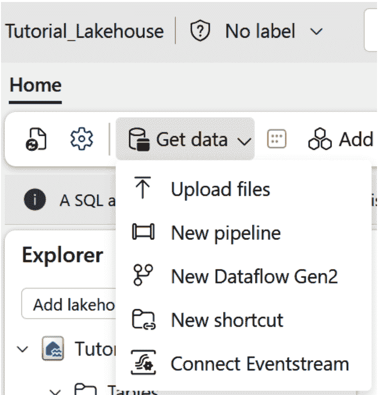

Figure 3-3. Creating a new Dataflow Gen2 in a Fabric lakehouse

After creating a new dataflow, you can connect it to your data source (for example, an existing dimension_customer table in your Fabric lakehouse). When you select the table you want to enrich or transform, it will bring up the query editor, at the top of which you’ll find a Transform tab that offers a variety of options such as grouping, renaming, and splitting columns. Right next to it is the Add Column tab, where you can add new columns to your data.

For instance, you can add a conditional column that classifies customers based on existing fields like Customer. This functionality is very similar to writing a CASE statement in SQL or PySpark, but it uses an easy, visual interface, and no coding is required. See Figure 3-4 for an example of this interface.

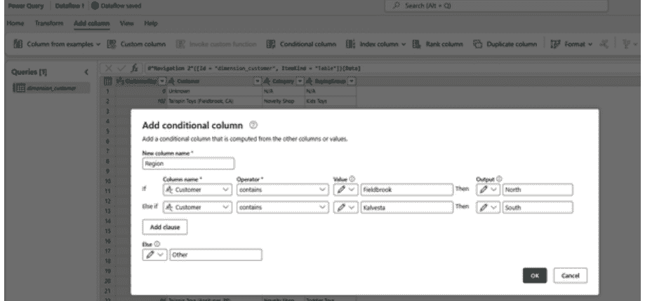

Figure 3-4. Creating a conditional column in Dataflow Gen2 in a Fabric lakehouse

Before publishing the table, you can check the bottom right to determine whether the data destination is correctly configured. Then, after you’ve made all the transformations you want to make, you can publish the table by clicking the Publish button (see Figure 3-5).

### Data destination


Figure 3-5. Choosing a destination and publishing transformations in Dataflow Gen2

The dataflow will apply the transformations and write the updated dataset back into OneLake as a Delta table. Using Dataflow Gen2, you can perform this transformation entirely without coding, through a visual interface.

Whether you work in the Fabric warehouse or the lakehouse, adding new columns or tables to your data helps you keep pace with changing business needs. By enriching your data, you can store new information, add useful categories, and enhance your analysis, making it clearer and more meaningful. For instance, creating tables allows you to filter and group your data easily, while adding columns prepares your data for more advanced calculations using SQL or DAX. Microsoft Fabric gives you the flexibility to enrich your data in ways that suit your skills and the project, whether by writing simple SQL commands, using notebooks with Spark SQL and PySpark, or working visually with Dataflow Gen2’s no-code interface.

Learning these enrichment techniques is an important step in building data models and reports that evolve with your business and provide better and more meaningful insights.

## Refining Data

Now that we’ve learned how to get data into Fabric and enrich it by adding new columns or tables, the next step is
to refine it even further. Often, the information you need is spread across multiple tables or files. To get the whole picture, we need to combine that data.

Besides combining data, you often need to summarize it, filter it, and make sure each column has the correct data type. These are essential steps in preparing your data for reporting or analysis. There are different ways to do these things, depending on the choices you make for your data source and your personal preferences.

Let’s start by exploring joins and merges for combining multiple tables.

## Joins for Combining Data

Let’s imagine we have two tables, one with orders (in Order ID, Invoice Date, and Order Date columns) and a shipment table (with Shipment ID, Order ID, and Shipped Date columns). These tables are related by the Order ID column, which appears in both. When we want to bring the data together (for example, to see when each order was shipped), we use a join. The Order ID column is referred to as a key, and we use it to match the rows.

Before we look at how to join data in Microsoft Fabric, let’s look at the most common types of joins:

*INNER JOIN*

An INNER JOIN only keeps rows where a match is found in both tables. In our example, the following apply:

+   - If an order has a shipment, it will be included.

+   - If an order has no shipment (or a shipment has no matching order), it will be excluded.


这在我们只想处理完整数据时很有用（例如，只有已发货的订单）。图 3-6 直观地展示了 INNER JOIN 的样子。

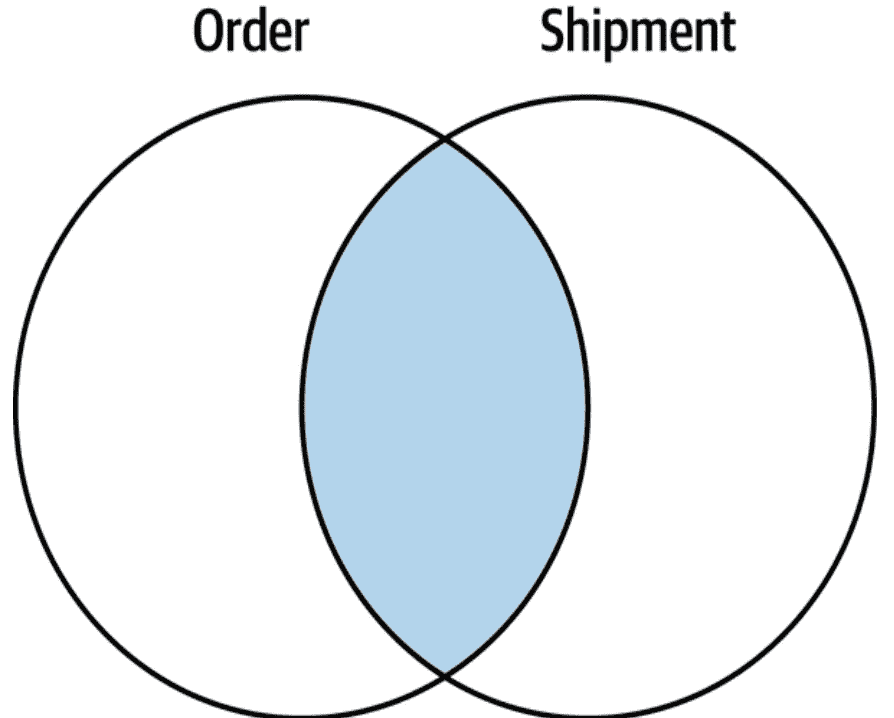

图 3-6. order 和 shipment 表的 INNER JOIN，仅保留在两个表中都找到的行

## LEFT OUTER JOIN

LEFT OUTER JOIN 会保留第一个（左）表中的所有行，即使在第二个（右）表中找不到匹配项。在我们的示例中，适用以下情况：

- 包含所有订单。
- 如果有发货记录，则显示发货日期。
- 如果没有，发货字段将为空（NULL）。

这在你想查看所有订单时很有用，包括尚未发货的订单。图 3-7 直观地展示了 LEFT OUTER JOIN 的样子。

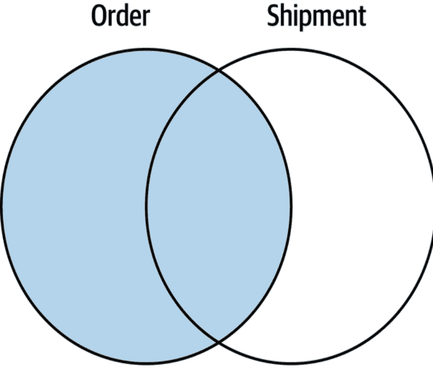

图 3-7. order 和 shipment 表的 LEFT OUTER JOIN，保留左表的所有行和右表中匹配的行

## RIGHT OUTER JOIN

RIGHT OUTER JOIN 与 LEFT OUTER JOIN 相反。它会保留第二个（右）表中的所有行，即使在第一个（左）表中没有匹配项。在我们的示例中，适用以下情况：

- 包含所有发货记录。
- 如果有匹配的订单，则显示其详细信息。
- 如果没有，订单字段将为空（NULL）。

这种用法较少见，但在第二个表是主要关注点时有时会使用。

图 3-8 直观地展示了 RIGHT OUTER JOIN 的样子。

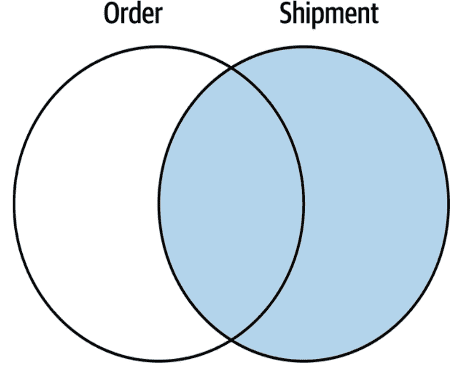

图 3-8. order 和 shipment 表的 RIGHT OUTER JOIN，保留右表的所有行和左表中匹配的行

## FULL OUTER JOIN

FULL OUTER JOIN 会保留两个表中的所有行。匹配时数据会合并，如果没有匹配，则缺失值显示为空。在我们的示例中，你会得到每个订单和每个发货记录。

没有发货的订单和没有订单的发货都会显示出来，缺失数据的地方字段为空。这在审计和质量检查中很有用，以识别不匹配的情况。图 3-9 直观地展示了 FULL OUTER JOIN 的样子。

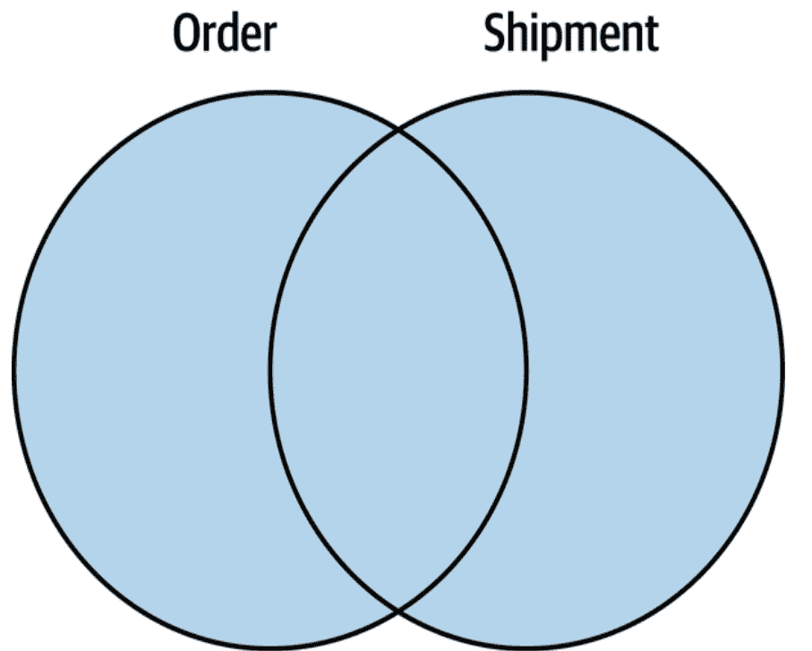

图 3-9. order 和 shipment 表的 FULL OUTER JOIN，保留所有行

## Joins in a Fabric Warehouse

在 Fabric Warehouse 中，你使用 T-SQL 处理结构化表。让我们再次使用我们的示例，其中我们有一个 order 表和一个 shipment 表。假设你想列出所有订单并在有可用信息时显示其发货日期。你将使用 LEFT JOIN 来实现：

```
SELECT
    o.OrderID,
    o.OrderDate,
    o.InvoiceDate,
    s.ShippedDate
FROM
    orders o
LEFT JOIN
    shipments s
ON
    o.OrderID = s.OrderID;
```

如果你是 SQL 新手，代码乍一看可能有点 confusing，所以让我们分解一下：

```
FROM
    orders o
```

这意味着我们从 orders 表开始（图 3-9 中的左表）。o 是我们分配给该表的别名；它使查询其余部分更易于阅读，尤其是在有很多列或连接时。每当我们引用 orders 表时，都可以只写 o，而不是全名：

```
LEFT OUTER JOIN
    shipments s
```

这意味着我们想连接 shipment 表，别名为 s，并且我们要执行的连接是 LEFT JOIN：

```
ON
    o.OrderID = s.OrderID
```

这是任何连接中最重要的行，因为它告诉 SQL 两个表是如何连接的。在这种情况下，OrderID 列出现在两个表中，并且代表相同含义：订单的 ID。这称为连接条件，必须始终写在 ON 之后。

在我们的 SQL 查询中，orders 的所有行都被包含在内。如果有具有相同 OrderID 的发货记录，则会显示 ShippedDate；如果没有，ShippedDate 列将为空（NULL）。这是在业务场景中非常常见的连接（例如，显示所有订单以及它们是否已发货）。

## Joins in a Fabric Lakehouse Using Notebooks

在上一节中，我们在 Fabric Warehouse 中使用 SQL 连接了两个表。但如果我们使用 lakehouse，可以使用 notebooks 执行相同的操作。让我们继续使用 orders 和 shipments 的示例。我们想使用 LEFT JOIN 将它们连接起来，以便保留所有订单，即使尚未注册发货记录。

首先，我们使用 Spark SQL 定义一个临时视图，然后使用 PySpark 查询结果：

```
%%sql
CREATE OR REPLACE TEMP VIEW order_shipments AS
SELECT o.OrderID,
    o.OrderDate,
    o.TotalAmount,
    s.ShippedDate,
    s.Carrier
FROM orders o
LEFT JOIN shipments s
  ON o.OrderID = s.OrderID;
```

此查询创建一个临时视图，将两个表合并。对于每个订单，我们希望添加发货信息；但是，如果尚未发货，这些字段将为 NULL。创建视图后，我们可以使用 PySpark 查询它：

```
df = spark.sql("SELECT * FROM order_shipments")
display(df)
```

df = spark.sql("SELECT * FROM order_shipments") 行在 Fabric notebook 中使用 Spark 引擎运行 SQL 查询。它从之前创建的临时 order_shipments 视图中选择所有数据。此查询的结果存储在一个名为 df 的变量中，它是一个 Spark DataFrame。数据加载到此 DataFrame 后，下一行 display(df) 会直接在 notebook 中显示该 DataFrame 的内容。

或者，你可以在不创建 SQL 视图的情况下直接在 PySpark 中执行连接：

```
df_orders = spark.table("orders")
df_shipments = spark.table("shipments")

df_joined = df_orders.join(df_shipments, df_orders.OrderID == df_shipments.OrderID, "left")
display(df_joined)
```

df_joined = df_orders.join(...) 行完全在 PySpark 中运行连接操作，返回一个 Spark DataFrame。这显示的结果与 SQL 方法相同，但如果想以编程方式应用进一步转换，则提供更大的灵活性。

在 Fabric lakehouse 中，使用 notebooks 是处理大型数据集的强大方式。你可以使用 Spark SQL 或 PySpark 连接表，使组合数据、丰富数据并为分析或进一步转换做好准备变得容易。

## Joins in a Fabric Lakehouse Using Dataflow Gen2

一种更直观且无需代码的连接数据方式是通过 Dataflow Gen2 提供。在 lakehouse 中，我们可以

通过选择其中一个表创建新的 Dataflow Gen2，然后在 home 选项卡上使用 Merge queries 选项（见图 3-10）。

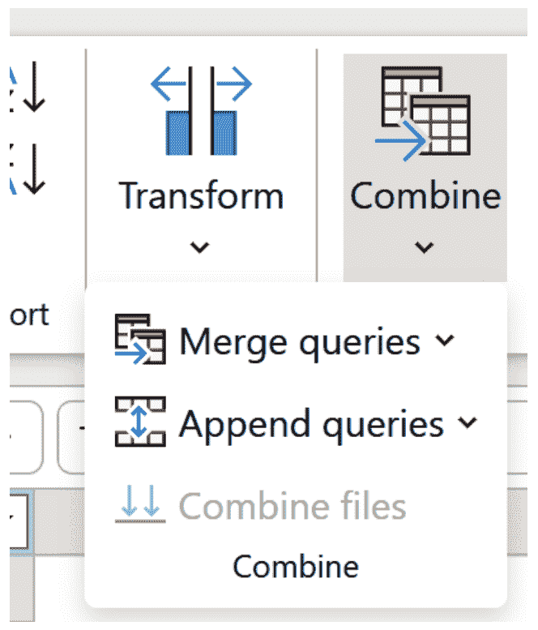

图 3-10. 合并查询，要么在当前表，要么作为新表

单击 Merge queries 后，你将被要求提供第二个表（右表），然后通过单击列来指示匹配键，如图 3-11 所示。你可以通过按住键盘上的 Ctrl 键同时单击列来指示多个列。

## Merge

Select a table and matching columns to create a merged table.

orders

| OrderID | OrderDate | TotalAmount |
| --- | --- | --- |
| 1 | 5-1-2026 | 150 |
| 2 | 5-3-2026 | 200 |
| 3 | 5-4-2026 | 150 |

shipments

| ShipmentID | OrderID | ShippedDate | Carrier |
| --- | --- | --- | --- |
| S001 | 1 | 5-2-2026 | DHL |
| S002 | 2 | 5-5-2026 | FedEx |

Join Kind

Left Outer (all from first, matching from second)

Use fuzzy matching to perform the merge

Fuzzy matching options

The selection matches 2 of 3 rows from the first table.

图 3-11. 在弹出窗口中选择第二个表并指示合并应发生的列

在你选择要连接的表并指定连接类型后，你将在弹出窗口底部看到两个表之间匹配了多少行。在我们的示例中，三个行中有两个匹配。当你确认合并并展开相关列，例如 ShippedDate 时，没有匹配的行将显示 ShippedDate 的 NULL 值（见图 3-12）。


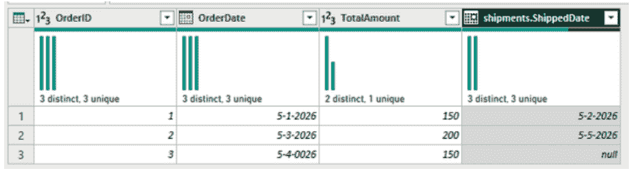

*图 3-12. LEFT OUTER JOIN 的结果，其中第二个表中不存在一个值*

结果是一个可用于报表或进一步转换的合并表。得益于直观的视觉界面，你无需编写任何代码即可执行这些连接。这使得处理相关数据对初学者以及对 SQL 或 Spark 不太熟悉的人来说变得容易。你可能还会注意到合并选项中称为 LEFT ANTI 和 RIGHT ANTI 的连接类型（请参考图 3-11）。这些连接类型在你想要查找一个表中没有在另一个表中对应匹配的行时很有用；这有助于你快速识别未匹配或缺失的数据。

无论你是在 Fabric 仓库中使用 SQL，还是在 Fabric Lakehouse 中使用笔记本和 Dataflow Gen2，你都需要理解连接和合并。它可以帮助你将来自不同来源的相关数据汇集在一起，并创建支持清晰且富有洞察力的报表和分析的表。

## 汇总数据

在你通过连接合并数据后，下一个重要步骤是对其进行汇总。

## 用于汇总数据的聚合

*聚合* 帮助你对数据进行分组并计算有意义的总计、平均值和计数，还可以帮助你找到最小值和最大值。常见的聚合函数如下：

SUM

这会将组中的所有值相加。

COUNT

这会计算行数或非 NULL 值的数量。

AVG

这会计算平均值。

MIN

这会找到最小值。

MAX

这会找到最大值。

让我们来看两个实际示例，按产品汇总总销售额和按地区汇总客户数量，以及如何在 Fabric 仓库中使用 SQL 以及在 Fabric lakehouse 中使用笔记本和 Dataflow Gen2 对其进行聚合。

## 在 Fabric 仓库中使用 SQL 进行聚合

使用 SQL，我们通过 GROUP BY 子句对数据进行分组和聚合。该子句告诉 SQL 按哪些列对行进行分组，而 SUM 和 COUNT 等聚合函数则对分组后的行进行操作以计算汇总值。例如，如果我们想查看每个产品的总销售额，我们按 ProductName 列对数据进行分组。SUM(SalesAmount) 部分计算每个组内的总销售额：

```
SELECT
    ProductName,
    SUM(SalesAmount) AS TotalSales
FROM
    sales
GROUP BY
    ProductName;
```

此查询按产品（ProductName）对销售数据进行分组，并使用 SUM 计算每个产品的总销售额。结果是一个表格，显示每个产品及其总销售额。

类似地，要按地区统计客户数量，我们按 Region 列分组，并在 CustomerID 列中使用 COUNT 函数来查找每个地区的客户数量：

```
SELECT
    Region,
    COUNT(CustomerID) AS NumberOfCustomers
FROM
    customers
GROUP BY
    Region;
```

在此，查询按 Region 对行进行分组，并统计每个组中的客户 ID 数量。

> **注意**
> 这些 SQL 聚合查询在 Fabric lakehouse 中使用 Spark SQL 时也适用。本章中，我们为清晰起见重点介绍仓库示例，但在两种环境中都可以执行相同的操作。

## 在 Fabric Lakehouse 的笔记本中进行聚合

在 Fabric lakehouse 的笔记本中，我们使用 PySpark 并使用 DataFrames。要执行聚合，我们使用 .groupBy() 方法定义要按其分组的列(s)，然后跟上 .sum()、.count() 或 .agg() 等聚合函数。假设我们想计算每个产品的总销售额。以下是 PySpark 中的做法：

```
sales_df.groupBy("ProductName").sum("SalesAmount").show()
```

.groupBy("ProductName") 方法按产品名称对数据进行分组，.sum("SalesAmount") 计算每个组的总销售额，.show() 在笔记本中显示结果。结果显示每个产品及其销售额之和（见图 3-13）。

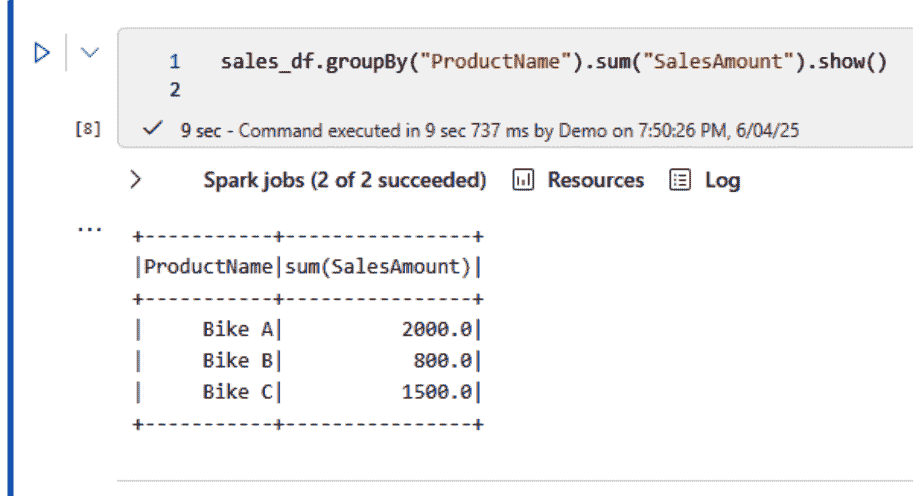

图 3-13. 在笔记本中按产品对销售进行分组

要统计每个地区的客户数量，我们可以做类似的操作：

```
customers_df.groupBy("Region").count().show()
```

在此示例中，.count() 统计每个地区中的行数（客户）。由于我们在 .groupBy() 之后直接使用 .count()，它返回每个组中的总行数——在本例中即每个地区。

## 在 Fabric Lakehouse 的 Dataflow Gen2 中进行聚合

在 Dataflow Gen2 中，聚合是通过 Power Query 编辑器中的转换以可视化方式完成的。在我们的 lakehouse 中，我们可以创建一个新的 Dataflow Gen2 并加载我们的表，一旦拥有表后，我们可以点击 Transform 以显示 Group by 按钮（见图 3-14）。

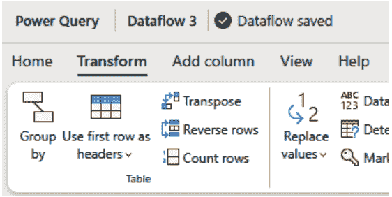

图 3-14. 点击 Transform 会显示 Group by 按钮

然后，我们可以点击“Group by”来定义如何分组。例如，我们可以按 ProductName 分组，然后说明应执行什么操作，例如汇总 SalesAmount（见图 3-15）。

### Group by

指定要按其分组的列和所需的输出。

Basic Advanced

Group by *
ProductName

New column name *
Sales
Operation *
Sum
Column *
SalesAmount

Use fuzzy grouping

Fuzzy group options

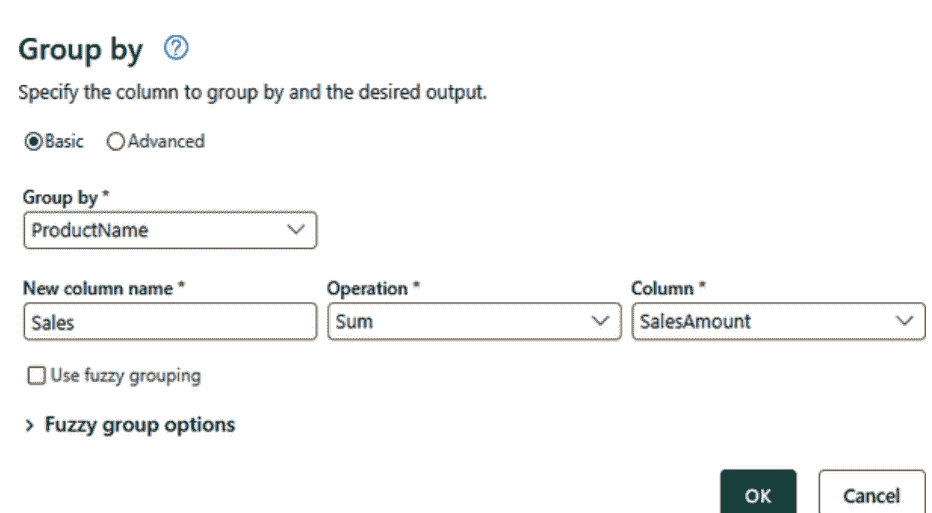

图 3-15. 按产品名称汇总销售额

结果将是 Product 在一列中，SalesAmount 在另一列中。

在通过连接合并数据后，聚合是将详细数据转换为有意义汇总的下一步关键步骤。聚合允许你按一个或多个列对行进行分组，并应用 SUM、COUNT、AVG、MIN 和 MAX 等函数来计算每个组内的总计、平均值、计数或极值。在 Fabric 仓库中，SQL 的 GROUP BY 子句对数据进行分组，而聚合函数则计算每个组的汇总值。在 Fabric lakehouse 中，笔记本利用 .groupBy() 方法与 .sum() 和 .count() 等聚合函数来实现相同结果。Dataflow Gen2 通过 Power Query 的“Group by”转换实现可视化分组和聚合，使汇总无需代码即可实现。

无论你是在 Fabric 仓库还是 lakehouse 工作，向数据添加新列或表都有助于你跟上不断变化的业务需求。

## 过滤器和聚焦于相关数据

处理数据时另一个重要步骤是对其进行过滤，使其尽可能窄且相关。我们过滤表以仅包含满足特定条件的行，因为这可以提高性能并使分析更直接。根据处理数据的地点，我们可以使用不同的过滤方法：

- SQL 中的 WHERE 子句，指定行必须满足的条件才能包含
- 在笔记本中过滤行，使用 Spark/PySpark DataFrames 与条件表达式
- Dataflow Gen2 中的可视化过滤器，使用 Power Query 转换

## 过滤数据

让我们看看如何在 Fabric 仓库中使用 SQL 过滤，在 Fabric lakehouse 中使用笔记本过滤，以及在 Dataflow Gen2 中可视化过滤。

## 在 Fabric 仓库中使用 SQL 过滤

在 SQL 中，你使用 WHERE 子句进行过滤，它允许你指定要选择的行的条件。例如，如果你只想查看最近 30 天的销售订单，你可以根据订单日期进行过滤：

```
SELECT *
FROM sales
WHERE
OrderDate >= DATEADD(day, -30, CURRENT_DATE);
```

此查询返回 OrderDate 在今天之前 30 天内的所有行。要过滤销售额大于 $100 的销售，查询如下：

```
SELECT  *
FROM sales
WHERE SalesAmount > 100;
```

WHERE 子句告诉 SQL 仅包含条件为真的行。

## 在 Fabric Lakehouse 的笔记本中过滤

在 PySpark 笔记本中，你通过在 DataFrames 上应用条件表达式使用 .filter() 或 .where() 方法进行过滤。 .filter() 和 .where() 的工作方式相同，并且可以与其他转换链接。例如，要过滤最近 30 天的订单，请执行以下操作：

```
from pyspark.sql.functions import current_date, date_sub

recent_sales_df = sales_df.where(sales_df.OrderDate >= date_sub(current_date(), 30))
recent_sales_df.show()
```

这里，.filter() 仅保留 OrderDate 在最近 30 天内的行。

> **注意**
> 
> 在 Microsoft Fabric 笔记本中，你可以使用 SparkSQL 和 PySpark 来过滤和转换数据。虽然 SparkSQL 使用类似 SQL 的语法，而 PySpark 使用基于 Python 的 DataFrame 操作，但两者在大多数任务中可以互换。在本章中，我们将展示使用 PySpark 的示例。


### 使用 Dataflow Gen2 在 Fabric Lakehouse 中进行筛选

在 Dataflow Gen2 中，我们在 Power Query 编辑器中以可视化方式执行筛选。当我们选择要筛选的列时，可以单击列名旁边的箭头并选择操作。例如，在日期列中，我们可以选择日期筛选器（见图 3-16）。

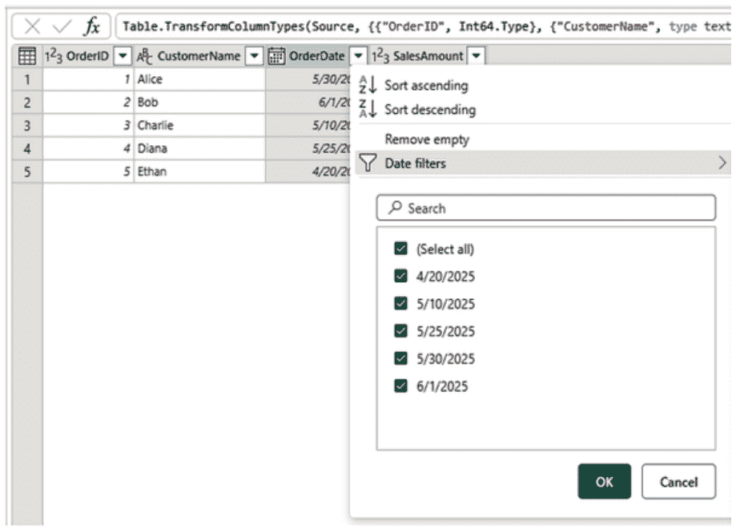

图 3-16. Power Query 中日期列的筛选选项

在这里我们可以选择“在之前”，这将打开一个新窗口，在其中我们可以定义“之前”的含义，例如之前的 30 天（见图 3-17）。

## 筛选行

对该表中的行应用一个或多个筛选条件。

基本 高级

保留 “OrderDate” 的行

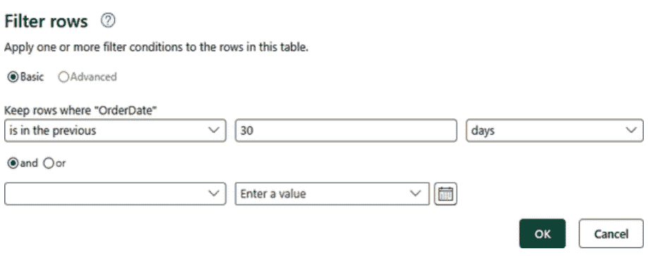

图 3-17. 筛选在之前 30 天内的行

根据列的数据类型，我们有不同的筛选选项。例如，我们可以对 SalesAmount 列进行筛选，其数据类型为货币（见图 3-18）。

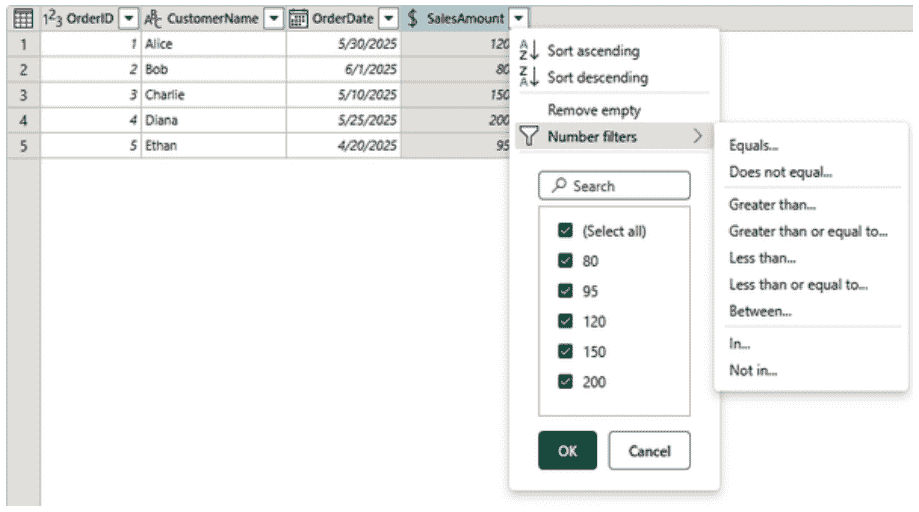

图 3-18. SalesAmount 列的筛选选项

以前，我们可以对日期进行筛选，现在，我们可以对数字进行筛选。我们也可以使用“等于”和“不等于”对特定数字进行筛选，或提供“大于”之类的范围。

筛选是我们将数据缩小到仅与分析相关的部分的重要技术。在 SQL 中，我们使用 WHERE 子句来做到这一点，它允许我们指定条件。在笔记本中，我们使用 DataFrames 上的 .filter() 或 .where() 方法来应用类似的条件逻辑。在 Dataflow Gen2 中，我们通过 Power Query 编辑器以可视化方式进行筛选，在其中我们可以对列设置条件以仅包含我们想要的行。应用筛选不仅可以减少我们处理的数据量，还可以提高查询性能，从而确保我们的洞察力集中在最重要的数据上。

## 数据类型

数据类型定义了每列中存储的数据类型，例如整数、字符串、小数或日期和时间值。我们需要理解数据类型，因为它们决定了我们可以对数据执行的操作。例如，我们不能对文本列求和，尝试这样做会导致错误或意外结果。常见的数据类型包括整数（int）、小数、字符串（文本）以及日期和时间戳。有时，数据以错误的类型存储（例如，数字可能以文本保存），这会导致在聚合或筛选数据时出现问题。此外，将日期存储为字符串会阻止正确的排序或日期计算。

为了避免这些问题，我们需要确保每列都有适当的数据类型。有三种不同的方法可以管理数据类型，具体取决于我们是在 SQL、笔记本中还是在 Dataflow Gen2 中操作：

### 在 SQL 中

我们可以使用 CAST 函数更改列的数据类型。例如，如果一列以文本存储但包含数字，我们可以使用 CAST( column AS INT) 将其转换为整数以执行数学运算。

### 在 PySpark 笔记本中

我们可以使用 .cast() 方法管理数据类型。我们通过应用 .withColumn("column", df["column"].cast("int")) 创建具有所需类型的新 DataFrame 列，这会将列转换为整数，以便正确进行数值计算。请看图 3-19，了解 SalesAmount 列如何从文本数据类型转换为整数。

在图的底部，您会看到我们现在也可以对该列进行计算。

```
27  total_sales = df_casted.groupBy().sum("SalesAmount").collect()[0][0]
28  print(f"Total sales: {total_sales}")
29
```

✓ 17 sec - Session ready in 12 sec 1 ms. Command executed in 5 sec 466 ms by Demo on 9:05:05 PM, 6/04/25

Spark jobs (8 of 8 succeeded) Resources

Original schema:
root
|-- ProductName: string (nullable = true)
|-- SalesAmount: string (nullable = true)

+----------------+-----------------+
|ProductName|SalesAmount|
+----------------+-----------------+
|    ProductA|            100|
|    ProductB|            200|
|    ProductC|            150|
+----------------+-----------------+

Schema after casting SalesAmount to int:
root
|-- ProductName: string (nullable = true)
|-- SalesAmount: integer (nullable = true)

+----------------+-----------------+
|ProductName|SalesAmount|
+----------------+-----------------+
|    ProductA|            100|
|    ProductB|            200|
|    ProductC|            150|
+----------------+-----------------+

Total sales: 450

图 3-19. SalesAmount 列从文本数据类型转换为了整数数据类型

### 在 Dataflow Gen2 中

我们可以通过选择列并从 Power Query 编辑器中列名左侧的数据类型下拉菜单中选择正确的类型来可视化地管理数据类型（见图 3-20）。

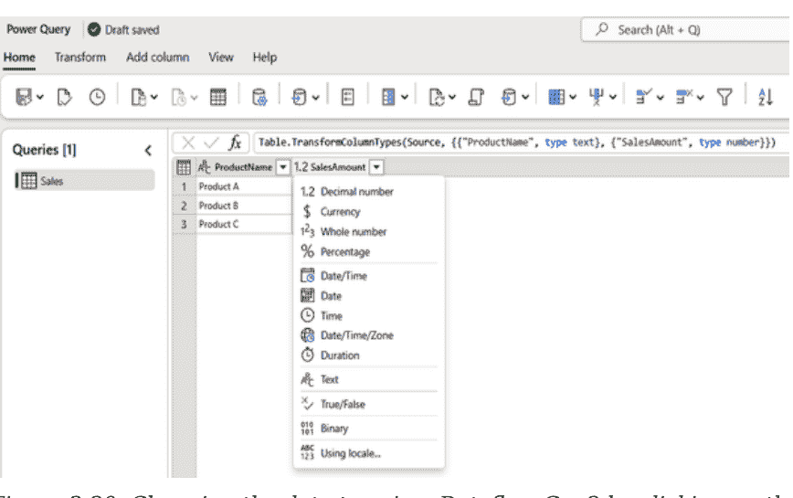

图 3-20. 通过单击列并选择数据类型在 Dataflow Gen2 中更改数据类型

总之，我们需要正确理解和管理数据类型以确保准确的数据处理和分析。确保每列具有适当的类型可以防止错误、提高性能并实现有意义的计算和筛选。无论使用 SQL、笔记本还是 Dataflow Gen2，掌握数据类型转换都是任何使用 Fabric 的数据分析师必备的重要技能。

通过学习如何连接表、汇总值、应用筛选和管理数据类型，您正朝着将原始数据转变为有意义的结构化数据集迈出关键一步。这些操作构成了数据准备的支柱。无论您是在编写 SQL 查询、在笔记本中分析数据还是设计数据流，您都可以运用这些技能来确保您的数据可靠、相关且已准备好进行分析。

## 处理和解决重复、缺失和 NULL 值

当我们将数据加载到数据源中时，现实世界的数据几乎从不完美。无论我们是在仓库还是湖仓中准备数据，我们经常会遇到缺失字段、重复行和意外的 NULL 值。我们需要在将数据交付给将使用它的人之前解决这些问题，以确保最终用户可以信任数据并且无需自行执行大量转换即可轻松使用它。

## 去重：删除重复数据

重复数据可能因多种原因出现在表中。数据可能被多次加载，连接可能未按预期执行，或者源系统可能存在错误。如果我们不删除重复的表行，它们会损害我们的数据分析。例如，销售数字可能过高，从而导致对数据的信任度下降。

我们可以根据选择的转换方法选择不同的去重数据选项。让我们看一下图 3-21 所示的表，其中我们看到包含重复行的订单数据。

|  | OrderID | CustomerID | OrderDate | TotalAmount |
|---|---|---|---|---|
| 1 | 1 | C001 | 2024-06-01 | 100.00 |
| 2 | 2 | C002 | 2024-06-01 | 200.00 |
| 3 | 3 | C001 | 2024-06-02 | 150.00 |
| 4 | 3 | C001 | 2024-06-02 | 150.00 |
| 5 | 4 | C003 | 2024-06-03 | NULL |
| 6 | 5 | C004 | NULL | 300.00 |
| 7 | 6 | NULL | 2024-06-04 | 120.00 |
| 8 | 6 | NULL | 2024-06-04 | 120.00 |

图 3-21. OrderID 为 3 和 6 的表加载了两次，导致重复

## 在 Fabric 仓库中使用 SQL 去重

在 Fabric 仓库中，我们可以使用 SQL 使用 DISTINCT 语句仅选择唯一的行：

```
SELECT DISTINCT CustomerID
FROM orders_with_issues;
```

图 3-22 显示了该语句产生的结果。

我们也可以选择基于特定列删除重复项：

```
SELECT DISTINCT OrderID, CustomerID, OrderDate
FROM orders_with_issues;
```

|  | OrderID | CustomerID |
|---|---|---|
| 1 | 1 | C001 |
| 2 | 2 | C002 |
| 3 | 3 | C001 |
| 4 | 4 | C003 |
| 5 | 5 | C004 |
| 6 | 6 | NULL |

*图 3-22. 由于 SQL 查询中的 DISTINCT 语句，表中仅包含唯一行*

这个表很简单，但通常，我们会处理更大的表，在这些表中很难在数据中发现重复项。为了找出是否存在重复项，我们可以编写另一个查询，例如统计特定列出现多次的行：

```
SELECT OrderID, COUNT(*) AS Count
FROM orders_with_issues
GROUP BY OrderID
HAVING COUNT(*) > 1;
```

此 SQL 查询有助于识别 orders_with_issues 表中的重复项。它按 OrderID 列对所有行进行分组并计算每个 OrderID 出现的次数。如果 OrderID 出现多次，则被视为重复。HAVING COUNT(*) > 1 代码会过滤结果，以便仅显示重复项。结果是出现多次的 OrderID 列表以及它们出现的频率。图 3-23 显示了此查询对我们示例的结果。


|  | 123 OrderID | 123 Count |
|---|---|---|
| 1 | 3 | 2 |
| 2 | 6 | 2 |

Figure 3-23. Query results showing two duplicate table rows that were identified with the HAVING statement

## Deduplication in a Fabric Lakehouse with Notebooks

We can also handle and resolve duplicates with notebooks, by writing PySpark code in a notebook linked to our lakehouse. Just as in SQL, we can state that we want to remove duplicates in general or based on a column like OrderID. We do this by using the .dropDuplicates statement, which we can do in the following ways:

```
orders_df.dropDuplicates().show()
```

This removes duplicates.

```
orders_df.dropDuplicates(["OrderID"]).show()
```

This removes duplicates based on OrderID.

This allows us to either fully remove identical rows or simply deduplicate based on a specific key, such as OrderID. This way, we can remove duplicates easily using a notebook (see Figure 3-24).

Table with duplicates

|OrderID| OrderDate|CustomerID|TotalAmount|
|---|---|---|---|
|      A001|2024-06-01|        C001|        100.0|
|      A004|2024-06-04|        C004|        200.0|
|      A002|2024-06-02|        C002|        NULL|
|      A003|2024-06-03|        NULL|        150.0|

Table after removing duplicates)

|OrderID| OrderDate|CustomerID|TotalAmount|
|---|---|---|---|
|      A001|2024-06-01|        C001|        100.0|
|      A002|2024-06-02|        C002|        NULL|
|      A003|2024-06-03|        NULL|        150.0|
|      A004|2024-06-04|        C004|        200.0|

Figure 3-24. Table in a notebook before and after application of dropDuplicates statement

## Deduplication in a Fabric Lakehouse with Dataflow Gen2

In Fabric Dataflow Gen2, we can handle duplicates and NULL values by using visual transformations without writing code. We do this by applying filters and transformations in the Power Query editor. After we open our dataflow, we can click on “Remove rows” and then “Remove duplicates” in the navigation pane (see Figure 3-25).

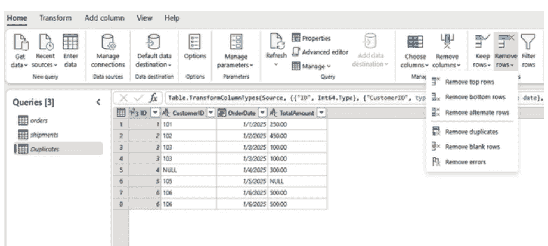

Figure 3-25. Removing duplicates in Dataflow Gen2

If we want to see exactly which rows are duplicates, we can click on “Keep rows” and “Keep duplicates” (see Figure 3-26).

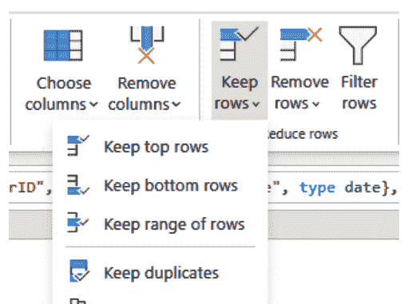

Figure 3-26. Viewing duplicates

Keeping all the duplicates can be very handy when you want to analyze the cause of the duplicates and how many rows are impacted.

## Handling NULLs and Missing Values

A NULL represents unknown or missing data. While common, NULLs can cause problems if you don’t handle them properly. For example, trying to sum or compare NULLs can return unexpected results. However, a NULL is not simply an empty value or zero; it means unknown or missing information, which means that we can’t simply replace it with a zero value. Also, a NULL value is not equal to anything, not even another NULL value, which means that it’s treated as false in filtering or joining data. For example, if we write a query and put NULL = NULL in the WHERE statement, we’ll get no results.

Before you take any action to handle a NULL, such as replacing or dropping it, you need to understand why a value is missing. Is it missing because of late-arriving data, is there a technical issue (such as a failed load), or is the field optional and the NULL completely valid? Understanding the cause of a NULL helps you choose the right strategy for dealing with it. Replacing a NULL with a default value like 0 or " " (an empty string) might seem harmless, but it could lead to incorrect interpretations of the data and business decisions based on wrong data. In addition to understanding the technical aspects, you need to discuss these kinds of issues with, for example, the data owner/architect, the business stakeholders who understand the process behind the data, or other team members involved in the development process.

## Handling NULLs in a Fabric Warehouse with SQL

When writing SQL in a Fabric warehouse, we need to understand how to handle missing values correctly. We know that missing values are shown as NULL, and when we write a query, we can use IS NULL or IS NOT NULL to detect missing values. For example, if we want to find out which CustomerID in our example is NULL, we can write the following query, which returns only rows where the CustomerID is NULL:

```
SELECT *
FROM orders_with_issues
WHERE CustomerID IS NULL;
```

Figure 3-27 shows the results.

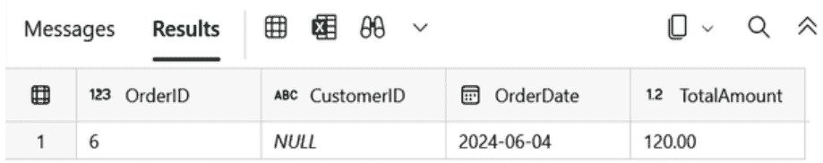

Figure 3-27. Results of a SQL query to find all rows where the CustomerID column is NULL

Sometimes, you’ll want to replace NULL with a default value (for example, to make totals easier to aggregate or display in a report). But be careful! Replacing NULL with 0 or an empty string can lead to a misinterpretation of the data. For instance, a NULL in TotalAmount might indicate that the order is not yet finalized, while a 0 might suggest that the order is free or has been cancelled:

```
SELECT OrderID, COALESCE(TotalAmount, 0) AS TotalAmount
FROM orders_with_issues;
```

Figure 3-28 shows the results of a query that replaces NULL with 0.

|  | 123 OrderID | 1.2 TotalAmount |
|---|---|---|
| 1 | 5 | 300.00 |
| 2 | 4 | 0.00 |
| 3 | 6 | 120.00 |
| 4 | 3 | 150.00 |
| 5 | 1 | 100.00 |
| 6 | 2 | 200.00 |

Figure 3-28. Results of replacing a NULL with a 0

You should only apply this when you’re sure that a default value reflects the intended meaning of the missing data. Replacing NULL changes the meaning of the data, and unless you’re confident about the business logic behind it, it’s not a good idea to replace NULLs with zeros.

In some cases, it’s best to exclude rows with missing values. We can filter them out with this code:

```
SELECT *
FROM orders_with_issues
WHERE CustomerID IS NOT NULL;
```

This removes rows where the CustomerID is unknown, and it ensures that your dataset includes only valid references.

## Handling NULLs in a Fabric Lakehouse with Notebooks

In Microsoft Fabric notebooks, NULLs are handled like they are in SQL. They represent missing or unknown data, and operations like comparisons or aggregations behave differently when NULLs are present. Using PySpark, we can choose several statements to transform NULL values. The most common ones are as follows:

```
.Na.drop()
```

This function removes entire rows if one or more columns contain NULL values. While this can help clean up incomplete records, it also comes with risks because dropping rows may lead to unintended data loss. So, before you use .na.drop(), you need to determine whether the affected rows contain valuable data that should be retained and whether the missing value truly makes the entire row unusable.

```
.fillna()
```

With .fillna(), you replace NULL with a specific default, so you should only use .fillna() when you’re confident that the default value reflects the intended meaning. For example, using 0 might be misleading if the actual reason for the NULL was a processing delay or a missing entry from another system.

```
.replace()
```

While .fillna() specifically targets NULL (which indicates missing values), .replace() is a more general function that’s used to replace any specified value with another. This is useful for standardizing or cleaning data beyond just handling NULLs (for example, replacing placeholder strings like "N/A" or correcting inconsistent spellings). It can replace values regardless of whether they are NULL or not.

Figure 3-29 shows us the effect each of these commands has on our data.

Original data with NULLs:

```
+---------------------------+
|OrderID| OrderDate|CustomerID|TotalAmount|
+---------------------------+
|   A001|2024-06-01|    C001|     100.0|
|   A002|2024-06-02|    C002|     NULL|
|   A003|2024-06-03|    NULL|     150.0|
|   A004|2024-06-04|    C004|     200.0|
|   A005|2024-06-05|    NULL|     NULL|
+---------------------------+
```

Drop rows with NULL CustomerID:

```
+---------------------------+
|OrderID| OrderDate|CustomerID|TotalAmount|
+---------------------------+
|   A001|2024-06-01|    C001|     100.0|
|   A002|2024-06-02|    C002|     NULL|
|   A004|2024-06-04|    C004|     200.0|
+---------------------------+
```

Fill NULL TotalAmount with 0:

```
+---------------------------+
|OrderID| OrderDate|CustomerID|TotalAmount|
+---------------------------+
|   A001|2024-06-01|    C001|     100.0|
|   A002|2024-06-02|    C002|       0.0|
|   A003|2024-06-03|    NULL|     150.0|
|   A004|2024-06-04|    C004|     200.0|
|   A005|2024-06-05|    NULL|       0.0|
+---------------------------+
```

Replace NULL CustomerID with 'Unknown':

```
+---------------------------+
|OrderID| OrderDate|CustomerID|TotalAmount|
+---------------------------+
|   A001|2024-06-01|    C001|     100.0|
|   A002|2024-06-02|    C002|     NULL|
|   A003|2024-06-03| Unknown|     150.0|
|   A004|2024-06-04|    C004|     200.0|
|   A005|2024-06-05| Unknown|     NULL|
+---------------------------+
```

Figure 3-29. The original table, a table where NULLs are removed, a table where NULLs for TotalAmount are replaced with 0, and a table where NULLs for CustomerID are replaced with UNKNOWN


### 注意

以下各节中的示例使用的是 PySpark，但 SparkSQL 也是一个有效的选择。在某些情况下，尤其是在比较时，它对 NULL 的处理更可预测。

## 在 Fabric Lakehouse 中使用 Dataflow Gen2 处理 NULL 值

在 Dataflow Gen 2 中，我们通过可视化转换来处理 NULL 或缺失值，这使得在无需编写代码的情况下直观地检测、替换或过滤 NULL 变得简单。

你可以通过应用“替换值”转换来替换所选列中的 NULL 或任何特定值。这对于将 NULL 替换为默认值（如 UNKNOWN 或 0）很有用，但前提是该值能准确反映数据上下文。你可以在导航窗格中找到“替换值”选项（见图 3-30），也可以通过右键单击列名找到（见图 3-31）。

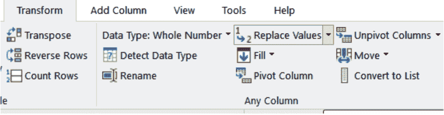

图 3-30。通过单击“替换值”按钮，用任何指定值替换所选列中的值

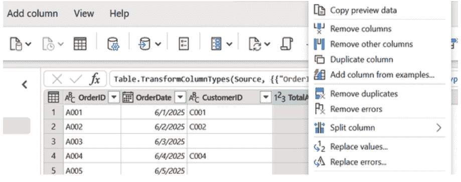

图 3-31。通过右键单击列名然后单击“替换值”来替换值

我们还可以通过在导航窗格中单击“筛选行”（见图 3-32）来筛选包含 NULL 的行。这会打开另一个窗口，在其中我们还可以选择是筛选单个列还是多个列（见图 3-33）。

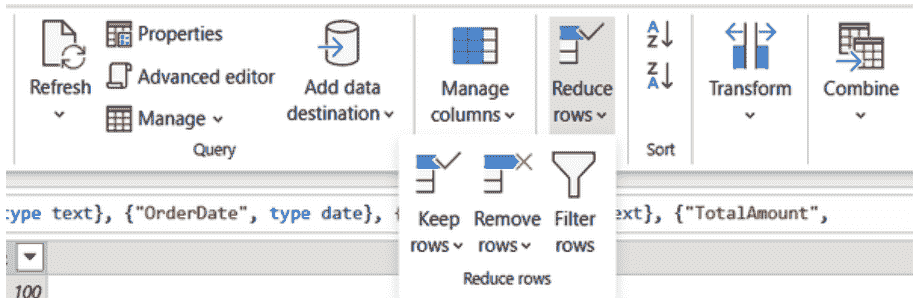

图 3-32。通过单击“筛选行”并指定筛选操作来筛选表中的行

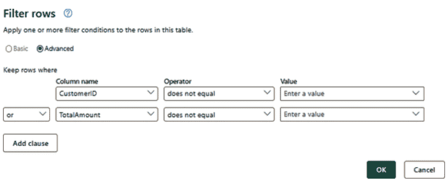

图 3-33。筛选不包含 NULL 的多行

正如你所见，你还可以通过使用“筛选行”转换根据其他条件进行筛选。

处理重复项、NULL 和缺失数据是为分析和报告准备数据的基础部分。重复项会夸大计数或总额，导致误导性见解。NULL 和缺失数据代表未知或不完整的信息，需要引起关注，而在不了解上下文的情况下简单替换它们可能会对数据的含义产生负面影响。

在实践中，在采取行动之前，确定数据缺失或重复的原因非常重要。这需要与数据所有者、源系统专家或业务用户密切合作，以全面了解数据。

## Fabric Lakehouse 和 Warehouse 的星型架构

在准备和清理数据、删除重复项、处理 NULL、通过新增列丰富数据，并通过连接和聚合塑造数据之后，下一步是对数据进行组织以实现高效的分析和报告。这就是 *星型架构* 的用武之地。星型架构是建模数据时广泛使用的方法。Ralph Kimball 于 1996 年引入了它，自那以后一直保持最佳实践，因其简单性、性能和灵活性。虽然它并不专属于 Microsoft Fabric，但星型架构对于在现代平台上构建高效数据模型仍然高度相关。

在星型架构中，数据分为两大类表：事实表和维度表。*事实表* 存储实际事件或数值（如销售额或数量），而 *维度表* 描述这些值的上下文（如产品、客户、时间或位置）。

这种设计具有多项优势。它有助于用户更直观地浏览数据，并且查询性能更好，因为结构减少了连接的数量。此外，当业务发生变化时（例如客户搬家或产品重新品牌），模型更容易维护和适应。

总之，我们选择星型架构是因为它让我们能够为各种用户创建快速、可扩展且易于理解的数据模型。例如，我们可以将 Fabric lakehouse 或 warehouse 中开发的星型架构导入 Power BI。

由于星型架构的设计，Power BI 开发人员可以轻松建立关系，从而创建清晰可靠的数据模型。

图 3-34 显示了星型架构的示例。

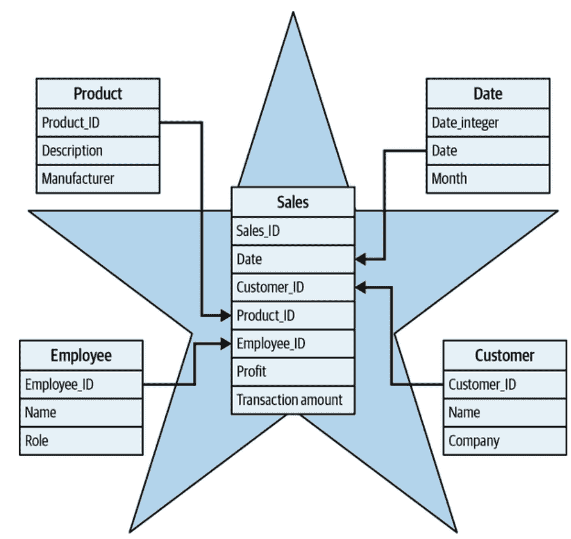

图 3-34。一个星型架构，其中一个事实表与四个维度表相连

那么，你可能想知道，星型架构是什么样的，我该如何创建它？让我们从基础开始。如图 3-34 所示，星型架构通常包含一个中央事实表（本例中为 Sales），并有多个引用它的维度表。让我们深入了解每种表的细节：

## 事实表

事实表衡量事件并包含数值。在我们的示例中，它包含有关销售交易的数值数据，但它也可以包含销售额、利润、折扣和各种可衡量指标等值。事实表位于星的中心，并连接到每个维度表。

事实表中的每一行代表一个事件（例如销售）并链接到相应的维度键。这提高了查询效率，并使用户能够更轻松地在 Power BI 等工具中与数据交互，因为结构良好的模型和可靠的关系使 Power BI 开发人员能够专注于从数据中创建见解，而不是在 Power BI 中重新建模。

## 维度表

维度表包含描述性信息（称为 *维度*），帮助用户回答“谁、何事、何地、为何、何时”等问题。在图 3-31 的示例中，这些维度和它们可以回答的问题如下：

- Customer：谁进行了购买，他们的名字、地址和年龄是什么？
- Product：销售了什么，其产品名称、类别、尺寸和颜色是什么？
- Date：销售何时发生，在哪一年或季度，星期几？
- Employee：哪位员工处理了销售，他们的名字、地址和角色是什么？

但在我们介绍如何在 Fabric lakehouse 或 warehouse 中创建星型架构之前，我们想介绍另一种众所周知的架构，并说明为什么星型架构是我们用于 Fabric 的首选架构。

## 星型架构与雪花架构

你可能还听说过 *雪花架构*，这是一种变体，其中维度表被规范化为子维度。例如，Product 维度表可能会被划分为 Product 和 Product detail 表（见图 3-35）。

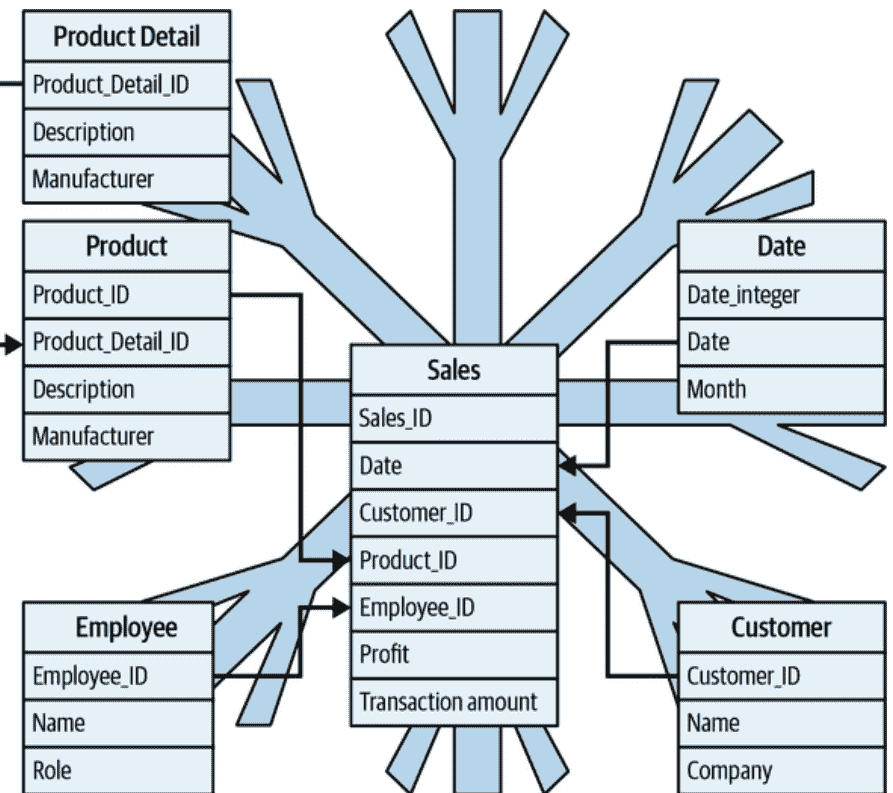

图 3-35。一个雪花架构

这种方法减少了数据冗余，这在某些事务性或存储优化系统中可能有帮助。然而，在 Power BI 或 Fabric 中构建的分析场景中，这种规范化通常会带来更多问题。它增加了模型中的关系和连接数量，这可能使查询变慢，并使模型更难导航和筛选。这就是为什么星型架构几乎总是更受欢迎。它简化了数据结构，提高了查询性能，并使模型对终端用户更直观。

> **注意**
> 虽然星型架构和雪花架构是用于分析最常用的架构，但也存在其他建模方法，通常用于其他目的，例如暂存和操作系统。

## 在 Fabric Lakehouse 中实现星型架构

现在我们已经探讨了定义和基础，让我们看看在 Fabric lakehouse 中实现星型架构需要做什么（我们稍后会介绍在 warehouse 中的实现，因为过程略有不同）。在 Fabric 中创建 lakehouse 并加载一些数据（例如 Microsoft 提供的示例数据集之一）后，你可以根据自己的专业知识和偏好使用以下任一方法对其进行转换：

- *Notebooks (PySpark)*
这对于大规模或复杂的转换尤其理想，特别是针对半结构化数据。

- *Dataflows Gen2*


这适用于低代码用户（Power BI 中的 Power Query 也是如此）。

两种方法都适用于创建星型模式；它们使用不同的方法来实现组织和转换数据的相同目标。无论您选择哪种方法，您都需要创建一个事实表（例如 Sales）和维度表（例如 Customer、Product、Date 和 Store）。

每个维度都应有一个唯一的键，即主键，而事实表应存储引用这些维度的外键。在图 3-36 中，您可以看到湖屋中的一个事实表。

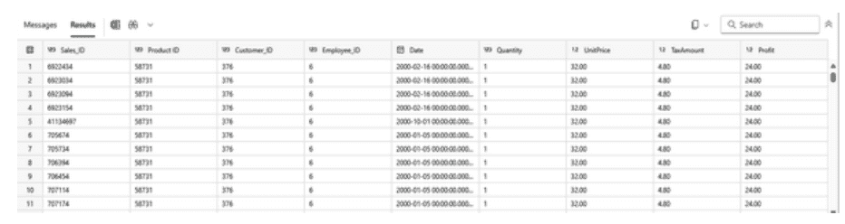

图 3-36. Fabric 湖屋中的一个事实表，包含与维度表主键相关的所有外键

事实表显示了与维度表主键相关的所有外键。例如，Customer_ID 376 对应于图 3-37 中 Customer 维度表中的记录。

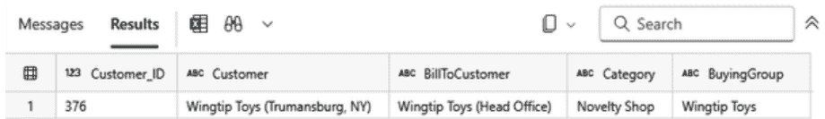

图 3-37. 与图 3-36 中的事实表相关的 Customer 维度表中的记录

您通常需要自己创建这些表，因为大多数数据源不会以这种结构提供数据。对于每个维度表，您需要定义一个主键，对于事实表，您需要包含引用维度表中键的外键。通过创建不同的表并提供键，您为 Power BI 可消费的湖屋中的星型模式奠定了基础。

## 使用 PySpark 笔记本实现

要通过 PySpark 笔记本创建表，您进入 Fabric 中的湖屋并点击 Open notebook > New notebook（见图 3-38）。这让您可以启动一个附加到湖屋的新的 Spark 笔记本。

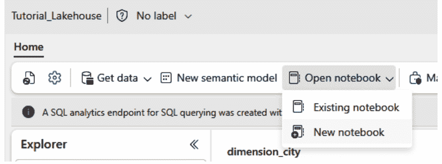

图 3-38. 在湖屋中打开新的笔记本

打开笔记本后，您可以编写 Python 代码来创建维度和事实表。我们在图 3-39 中提供了一些示例代码。

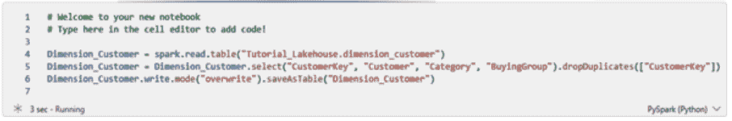

图 3-39. 用于创建客户表的笔记本中的 Python 代码

使用 Python 代码，您可以为 Customer 维度创建一个表，其中包含一个将链接到事实表的主键。Customer 维度表将包括客户的姓名、类别和购买组（见图 3-40）。

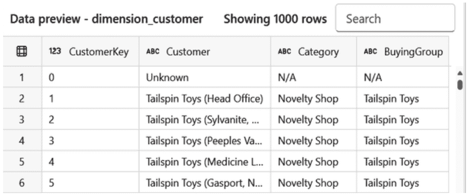

图 3-40. Fabric 湖屋中的 Customer 维度表

## 使用 Dataflow Gen2 实现

您也可以使用 Dataflow Gen2 执行相同的实现。这对于开发人员（尤其是那些在 Power BI 中有数据转换经验的人）来说非常方便，他们希望采用低代码/无代码方法。

要使用 Dataflow Gen2 转换数据，请进入 Fabric 湖屋，点击 Get Data，然后选择 New Dataflow Gen2（见图 3-41）。

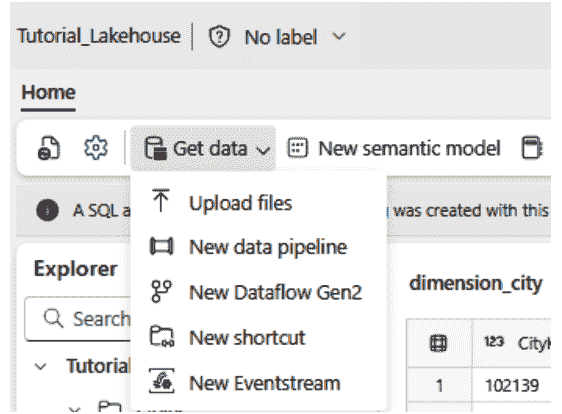

图 3-41. 在 Fabric 湖屋中创建新的 Dataflow Gen2

这将打开 Power Query 编辑器，您可以在其中连接到湖屋中现有的表、转换它们，或创建新表以构建您想要的维度和事实表。整个体验与我们在 Power BI 中的体验相似，因此不需要编码经验。对表进行所有更改后，您可以将数据流发布到湖屋。

无论您选择 Notebooks 还是 Dataflows Gen2，您的目标保持不变：将您的数据塑造成具有明确定义的维度和事实表关系。这样的结构允许在 Power BI 中进行高效的查询和报告。两种方法都会产生相同类型的表，这些表将存储在湖屋中并可用于星型模式模型。您应该选择哪种方法取决于您的专业水平以及您是更喜欢编写代码还是使用图形界面。

接下来，我们将探讨如何在 Fabric 仓库中实现星型模式，其过程略有不同。

## 使用 SQL 在 Fabric 仓库中实现星型模式

就像在湖屋中一样，您可以通过创建维度和事实表在 Fabric 仓库中构建星型模式。主要区别在于仓库支持 T-SQL，并且默认使用结构化表。这种方法非常适合喜欢编写 SQL 或希望在更经典的数据仓库环境中工作的人员。您可以将自己的数据或示例数据加载到仓库中，并使用 T-SQL 将数据塑造成维度和事实表。

就像在湖屋中一样，仓库中的每个维度表都应具有主键，事实表存储引用这些维度的外键。这里的主要优势是仓库支持模式定义、数据类型、约束和索引，使其非常适合结构化报告工作负载。

打开 Fabric 仓库后，您可以自行编写查询来创建表或使用提供的 SQL 模板（见图 3-42）。

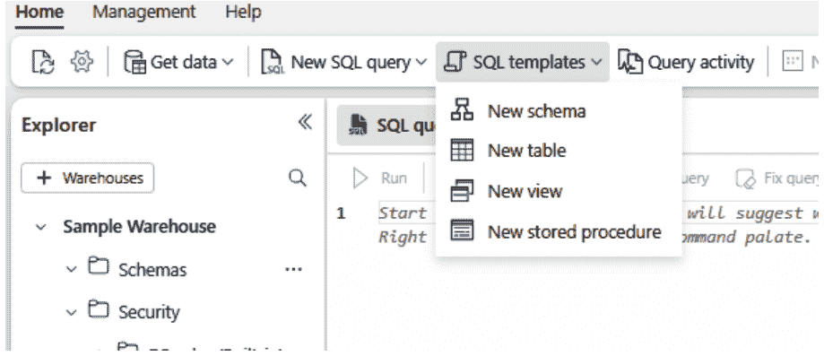

图 3-42. Fabric 仓库中的 SQL 模板

从 SQL 模板开始可以让您更轻松地创建事实表和维度表。

## 维度建模的一般原则

无论您是在湖屋（更灵活，适用于大数据和半结构化源）还是仓库（具有严格的模式，适用于结构化关系数据）中工作，维度建模的原则保持不变：

- 使用事实表来衡量业务事件。
- 使用维度表来描述您的业务和这些事件。
- 对技术和业务用户都保持简单。

您创建的结构构成了 Power BI 数据模型和报告的基础。设计良好的星型模式可实现更快的性能、更好的可用性以及分析的可靠起点。

## 数据反规范化

在上一节中，我们探讨了星型模式如何为我们的数据提供结构和清晰度。它将业务概念（维度）与可衡量事件（事实）分离，以创建清晰易懂的模型。我们还简要解释了雪花模式，其中销售数据连接到 Product 表，而 Product 表又链接到 Product detail 表（见图 3-43）。

这种设置在技术上是正确的，并且遵循规范化的规则，即将数据拆分为较小的相关表以避免重复。然而，它

也可能使您的模型在 Power BI 中更难使用。为什么？因为 Power BI 需要在用户与可视化交互或应用筛选器时每次都遵循这些表之间的关系，这可能导致性能变慢和更复杂的 DAX 计算。它还使报告用户更难自行探索数据，尤其是如果他们不了解底层结构。

这就是反规范化的用武之地。假设您的模型中有以下表：

- Fact: Sales
- Dimension: Product
- Dimension: Product detail

为了反规范化，我们希望合并 Product 和 Product detail 表中的信息，以便我们最终只使用一个表，这将使我们的模型成为星型模式而不是雪花模式。

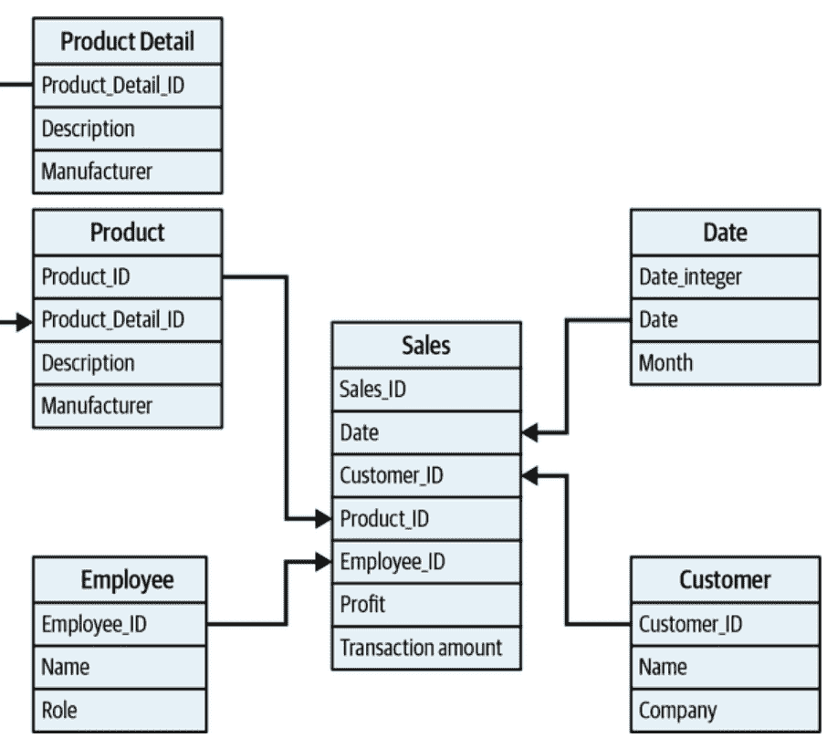

图 3-43. 具有 Product 表和 Product detail 表的雪花模式

## 使用 Power Query 反规范化表

假设您正在 Power BI 中工作，并连接到您之前创建的 Fabric 湖屋或仓库中的表。现在，您有一个 Product 表和一个 Product detail 表（见图 3-44 和 3-45）。

| Product_ID | ProductName | ProductCategory | ProductSubCategory |
|---|---|---|---|
| 1 | Running Shoes | Footwear | Sports |
| 2 | Basketball Shoes | Footwear | Sports |
| 3 | Leather Boots | Footwear | Casual |
| 4 | T-Shirt | Apparel | Casual |
| 5 | Sweatshirt | Apparel | Sportswear |
| 6 | Baseball Cap | Accessories | Headwear |
| 7 | Sunglasses | Accessories | Eyewear |
| 8 | Sports Watch | Electronics | Wearable |
| 9 | Laptop Backpack | Accessories | Bags |
| 10 | Yoga Pants | Apparel | Sportswear |

图 3-44. 带有 Product_ID 列的 Product 表

| Product_Detail_ID | Product_ID | Color | Size | Material |
|---|---|---|---|---|
| 101 | 1 | Blue | 42 | Mesh |
| 102 | 1 | Black | 44 | Mesh |
| 103 | 2 | Red | 43 | Synthetic |
| 104 | 3 | Brown | 44 | Leather |
| 105 | 4 | White | M | Cotton |
| 106 | 5 | Gray | L | Fleece |
| 107 | 6 | Navy Blue | One Size | Polyester |
| 108 | 7 | Black | One Size | Plastic Frames |
| 109 | 8 | Black | N/A | Silicon/Rubber |
| 110 | 9 | Black | N/A | Nylon |

图 3-45. 带有 Product_ID 列的 Product detail 表

如您在图 3-46 中所见，Product detail 表通过同时存在于两个表中的 Product_Detail_ID 列与 Product 表建立了关系。


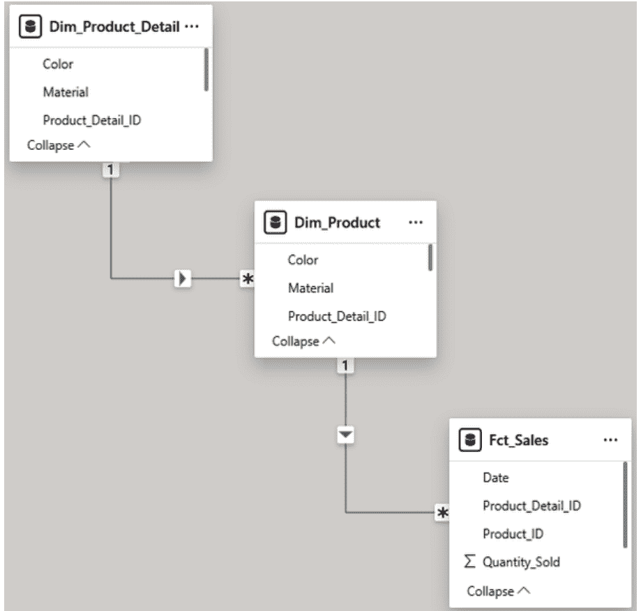

图 3-46。Product 表和 Product detail 表之间存在关系

你可以直接在 Power BI 中进行反规范化，具体在 Power Query 中。通过本节中的步骤，你可以将 Product detail 表与 Product 表合并，创建一个单一表，这样在将 Product 表连接到事实表时可以保持星型模式，同时保留所有必要的数据可用。

要实现这一点，首先将所有表加载到 Power BI 中，然后通过单击 Transform data 进入 Power Query Editor。接着，选择 Product 表并单击功能区中的

Merge Queries。那将打开一个弹出窗口，你可以在其中选择 Product detail 表作为要合并的表（见图 3-47）。

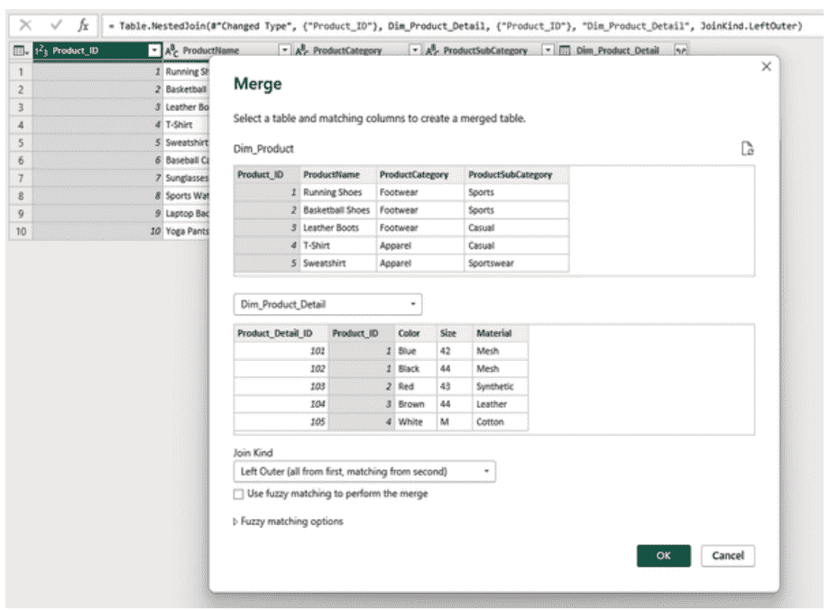

图 3-47。在 Power Query Editor 中合并两个相关表

在 Power Query Editor 中，你会被提示选择用于合并两个表的列。在我们的示例中，Product_ID 列作为通用标识符，因为它在两个表中包含相同的信息。你需要选择 LEFT OUTER JOIN 以保留 Product 表中的所有产品 ID，并添加来自 Product detail 表的匹配项。接下来，你需要扩展合并的列以包含所有相关的 Product detail 字段，例如 Color、Size 和 Material（见图 3-48）。

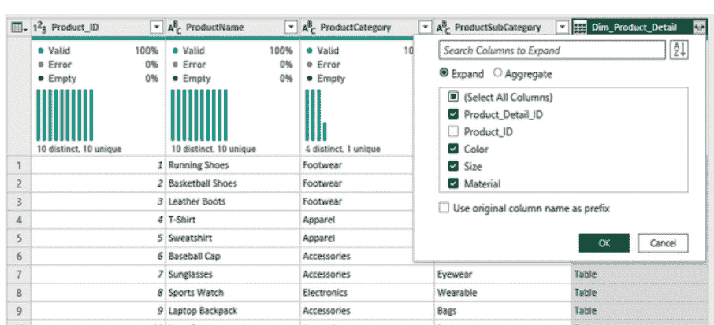

*图 3-48。从合并的表中扩展相关列*

在加载表之前，你需要确保 Product detail 表在 Power BI 数据模型中不再可见。还需要注意的是，你不能简单地删除该表，因为这样合并将会失败。你需要做的是在 Power Query 中进入 Product detail 表，右键单击它，然后选择“Disable load”。一旦你这样做，菜单将如下图 3-49 所示。你仍然可以在合并中使用该表，但它不会显示在数据模型中。

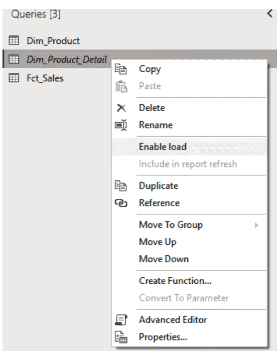

图 3-49。已禁用加载的 Product detail 表

一旦你在 Power Query Editor 中单击 Close and Apply，新的表结构将在 Power BI 模型视图中可用。你将拥有 Product 维度表和事实表，并且 Product 维度表将包含来自 Product detail 表的所有必要信息（见图 3-50）。

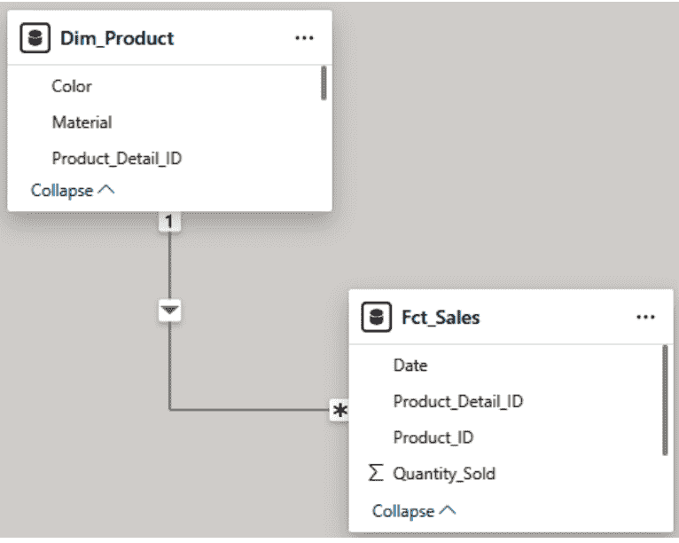

图 3-50。反规范化后的数据模型

反规范化是简化数据模型并在 Power BI 中提升性能的绝佳技术，特别是在处理包含多个相关维度表的雪花模式时。通过将相关表（如 Product 和 Product detail）合并为单个维度表，你可以创建更清晰的星型模式。这种方法减少了 Power BI 需要管理的关联数量，使模型更容易理解和供报表使用者使用。

然而，在应用反规范化时应谨慎。虽然它对数据量可控的维度表有效，但我们不建议对事实表进行反规范化。这是因为事实表通常包含大量详细的事务数据，反规范化会导致数据重复、增加模型大小并减慢刷新和查询性能。保持事实表精简并专注于可衡量的事件有助于保持高效的查询性能、简化维护并增强可扩展性。因此，在决定规范化之前，你应始终权衡更简单模型的优势与数据冗余和性能负面影响等潜在弊端。

## Summary

在本章中，你学习了如何在 Fabric 中通过清理、丰富和转换数据来为分析准备数据。你练习创建视图、函数和存储过程以重用逻辑并使数据准备更轻松。你添加了新列并连接相关表以丰富数据，并使用连接、聚合、过滤器和数据类型来塑造数据，使其符合业务需求。你处理了重复项、缺失值和 NULL 等常见问题，并学习了星型模式，它有助于组织数据以实现更快、更清晰的分析。最后，你探索了反规范化，它将相关表合并为一个以提高性能并简化报表。
