## Chapter 4. Querying and Analyzing Data

在第 1 章到第 3 章中，我们解释了如何使用 Power BI Desktop 应用程序和 Microsoft Fabric 中的基于 Web 的体验从各种来源获取数据。我们还向你展示了如何在整个数据平台中转换摄取的数据。

在本章中，我们将介绍使用可视查询编辑器、T-SQL 语言和 KQL 脚本语言查询和分析数据的主题。

首先，我们将深入可视查询编辑器，并向你展示如何使用基于 Web 的工具从 Fabric 环境中更改数据结构并分析数据。接下来，我们将进入 Fabric 的 T-SQL 世界，并向你展示如何利用 SQL 的知名脚本语言来分析数据。最后，我们将向你介绍 Microsoft Fabric 的实时智能部分中使用的 KQL 语言。

## The Visual Query Editor

*visual query editor* 是一个工具，可帮助你使用查询和分析数据的步骤的可视化表示来设计查询。

**NOTE**
正如名称可能暗示的那样，可视查询编辑器并不仅限于鼠标交互。虽然此工具的主要目的是通过交互式方法简化查询的创建，但你仍然可以使用已知的 T-SQL 技能来完成使用该工具时所需的操作。然而，使用 T-SQL 时存在一些注意事项，我们将在本章后面介绍。

可视查询编辑器可在 Microsoft Fabric 的仓库和湖屋项目中使用。你可以在从工作区或 OneLake 目录体验打开仓库项目时在顶部菜单功能区中找到它，如我们在第 1 章中所述（见图 4-1）。在湖屋体验中，你只有在使用 Microsoft Fabric 中的 SQL 分析端点时才会找到可视查询编辑器。

**TIP**
可视查询编辑器的一个限制是，你只能创建基于现有数据操作输出的 SELECT 语句。你不能使用此方法 UPDATE 或 DELETE 数据。

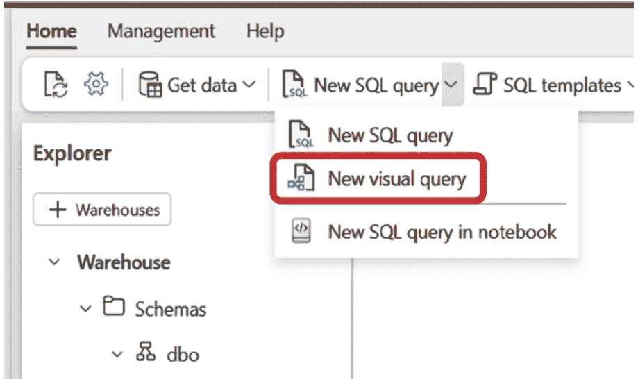

图 4-1。创建新的可视查询，其中你将使用可视查询编辑器

当你创建可视查询时，将出现一个空白画布，你需要将第一个表添加到查询画布中。你通过从仓库或湖屋中的表中拖放方法将其拖到画布上来实现。

在图 4-2 中，你可以看到第一个表已添加到画布中。此时，我们准备开始操作数据。

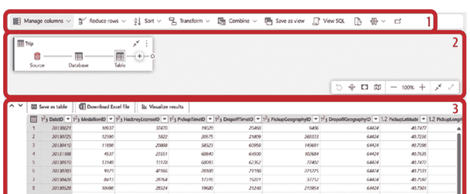

图 4-2。已添加第一个表的可视查询画布

接下来，我们将引导你了解画布并展示其组成。我们突出显示了一些重要区域（编号 1–3）：

### Top bar (area 1)

这里是你会找到用于操作数据的主要操作选项。在这里，你可以使用不同的工具进行转换、过滤、更改列、组合表等。

你还会在屏幕右侧附近看到一个配置齿轮。此选项可让你访问 Power BI 中的 Power Query 体验，其中显示结果集中每个列的列统计信息（见图 4-3）。

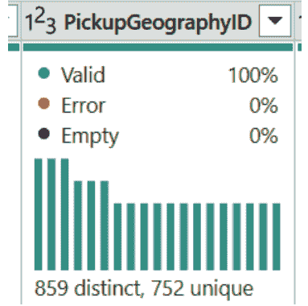

图 4-3。可视查询编辑器中启用的列统计信息

### Canvas (area 2)

这是你正在执行的数据操作的可视化表示，每个数据元素都由其自己的信息框表示，其中包含源、数据库和表。在画布底部，你还会找到缩放功能和可视查询的迷你地图，方便你使用。

### Results area (area 3)

这是屏幕的底部部分，你可以在此处查看当前正在处理的查询的结果集。在这里，你还会找到“Save as table”、“Download Excel file”和“Visualize results”按钮。“Save as table”按钮将查询结果保存为湖屋或仓库中的新表。“Download Excel file”按钮将当前结果集保存为本地计算机上的 Excel 文件。“Visualize results”按钮帮助你以可视方式分析结果集。

当你单击“Visualize results”按钮时，它会带你进入用于构建报表的 Power BI 在线体验。见


Figure 2-26, also repeated here for reference:

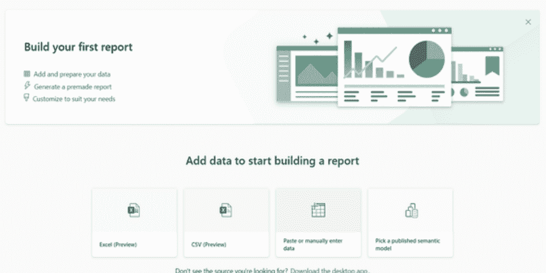

直接从这里，你可以保存输出作为报告并以这种方式共享数据集。但这并不是可视化查询编辑器的主要意图，所以让我们回到画布并开始处理和操作数据。

在可视化查询编辑器中，你有多种处理单个表格的选项。一个选项是使用顶部菜单栏，如前所述。另一个选项是通过点击表格右上角的三点菜单来查看完整的选项列表。最后，你可以点击表格右侧的加号，查看该表格可用的所有操作列表（见图 4-4）。如果找不到所需内容，列表顶部还有一个搜索栏。

Figure 4-4. List of actions available by clicking the plus sign on a table

### NOTE

你可能会认出这里的操作列表，因为其中一些项目与你在 Power Query 中找到的相同。这里的列表包括 T-SQL 的功能，可以对数字进行计算和算术运算，以及文本操作。

本书中对可视化查询编辑器的介绍到目前为止只涉及单个表格，但此服务让你处理更多表格并对数据执行连接和其他操作。

## Working with Tables Using the Visual Query Editor

在可视化查询编辑器中，你可以对数据执行几乎与使用 T-SQL 脚本相同的操作和处理，包括连接和合并。图 4-5 显示了点击任意表格中的加号调出下拉列表后可用的操作。

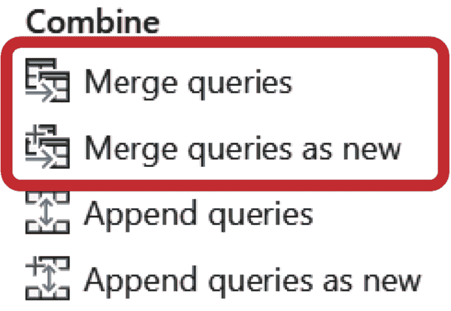

Figure 4-5. Available operations in the visual query editor

## Joins

使用 T-SQL 时，我们通常会调用连接操作符来在查询中连接两个或多个表。在可视化查询编辑器中，此操作称为合并。你可以通过使用连接中的左表或右表来合并两个表。正如我们在第 3 章中提到的，连接数据有不同的方法。

当你从图 4-5 所示的屏幕中选择 Merge 选项时，你会看到两个选项：“Merge queries”和“Merge queries as new”。这些与 Power Query 体验中的选项相同。两者都会在现有表格中添加一个新列，其结果是在该列中嵌入的表格，你可以展开它以获得所需的任意多列。

然而，在两者之间选择可能相当具有挑战性。这里的经验法则是，如果你需要来自两个连接表的全部列，那么应选择“Merge queries as new”选项，因为这会将两个连接的所有列添加到新列中。如果不需要，则选择“Merge queries”选项并展开以仅选择所需的列。

选择任一选项时都没有性能实现。这意味着无论你选择哪个选项，任务的性能都相同，查询的执行时间也相同。

图 4-6 显示了两种不同选项在屏幕上的显示方式。

当我们在此服务中创建两个表的合并时，可视化查询编辑器也在合并操作上为我们提供了一些帮助，既在数据的视觉表示上，也在要执行合并的列上。图 4-7 演示了这一点，并将指导你完成合并体验。

Figure 4-6. How the “Merge queries” and “Merge queries as new” options appear onscreen

Figure 4-7. Merge experience in the visual query editor

在图中，你可以看到我们正尝试合并两个表：Trip 作为左表，Geography 作为右表进行连接。

当你选择两个表进行合并时，引擎会尝试帮助你选择要进行连接的列。如果你点击右上角的灯泡，你会看到引擎假设连接可行的列的选择选项。在图 4-7 的示例中，你有以下选项：来自 Trip 表的 PickUpGeographyID 列或 DropOffGeographyID 列，以及来自 Geography 表的仅 GeographyID 列。

如果引擎的自动选择列不正确（例如，如果你有不同的命名方案或其他业务规则需要实现），你可以随时从任一表中点击所需的列并以这种方式创建连接。

另请注意屏幕底部的“Join kind”菜单。在那里，你可以使用你在第 3 章中获得的知识来选择此操作中正确的连接类型。

但有时，普通的连接类型是不够的。例如，如果人类手工输入列，我们有时会在值中看到错误或拼写错误。这就是模糊连接发挥作用的地方。

## Fuzzy joins

*Fuzzy joins* 涉及在具有匹配算法的列中创建连接。图 4-8 显示了当你在图 4-7 中“Join kind”菜单底部的“Use fuzzy matching to perform the merge”框中勾选时出现的选项。

Use fuzzy matching to perform the merge

### Fuzzy matching options

Similarity threshold ①

0.8

Ignore case

Match by combining text parts ①

Show similarity scores ①

Number of matches ①

Transformation table ①

Figure 4-8. Fuzzy matching options in visual query editor

可视化查询编辑器中的模糊连接功能为我们在连接两侧处理较低质量数据时提供了更多匹配两个表的选项。

### NOTE
通过较低质量数据，我们指的是可能包含拼写错误、大小写不正确或其他错误导致数据输入不完全准确的任何数据。请注意，这是对数据质量的非常基础的解释，它本身就可以填满一整本书，所以我们不会在本书中深入探讨其细节。

让我们逐一介绍模糊匹配选项：

### Similarity threshold

从 UI 中，当我们将光标悬停在圈出的 i 上时，我们得到以下描述：

- 此选项表示两个值需要多相似才能匹配。最小值 0 会导致任何相似程度的值相互匹配，而最大值 1 仅允许完全匹配。 （请注意，模糊“精确匹配”可能会忽略大小写、词序和标点符号等差异。）默认值为 0.8。

*匹配级别* 是表示对应值与主表中的查找值匹配程度的百分比。因此，文本“4ppl4s”与文本“Apples”的匹配程度约为 87%，而“I really like 4ppl4s”与“Apples”的匹配程度仅约为 57%。此计算由聚类函数在幕后完成。

### Ignore case

此框默认被选中，它使模糊算法不考虑大写字母和小写字母之间的差异。这意味着模糊算法默认不区分大小写，因此你可以通过取消选中该框使其区分大小写。

### Match by combining text parts

从 UI 中，当我们将光标悬停在圈出的 i 上时，我们得到以下描述：

- 尝试组合文本部分（例如将“Micro”和“soft”组合成“Microsoft”）以找到匹配项。

当此框被选中时，算法会尝试对单词进行分组并找到相似性（例如将 Micro 和 soft 分组以创建 Microsoft）。它不仅在相邻单词上执行此操作，还在整个值字段中的单词上执行。

### Show similarity scores

选中此框会在数据集中添加一列，其中包含引擎执行的相似性匹配评分。该分数和列中的数字将具有与前面提到的“Similarity threshold”中可配置的相同可能值。

### Number of matches

从 UI 中，当我们将光标悬停在圈出的 i 上时，我们得到以下描述：

- 此选项控制为每个输入行返回的最大匹配行数。例如，如果你只想为每个输入行找到一个匹配行，请指定值为 1。

这几乎说明了一切。如果你想在设置阈值范围内控制匹配行的输出，可以将此值设置为不同的数字。请注意，如果此值高于 1，结果行将为每个匹配项复制，我们必须自己进行选择。

### Transformation table

从 UI 中，当我们将光标悬停在圈出的 i 上时，我们得到以下描述：

- 选择一个将在匹配过程中用于映射值（例如将“MSFT”映射为“Microsoft”）的转换表。该表应包含“From”列和“To”列。

在进行模糊连接时，为算法提供一个转换表来映射不同的


known values to new values. For example, this can include mapping *MSFT* (the stock market abbreviation for Microsoft) *Microsoft* (the company’s full name).

## Switching from Visual Query Editor to T-SQL Statements

> **NOTE**
> If you want to follow along with script development from a T-SQL perspective, you can click View SQL in the top menu bar found in Figure 4-2.

In Figure 4-9, you’ll see an example taken from the query merge in Figure 4-6, with all columns expanded from the join.

## View SQL

Copy to clipboard

```
select [$Outer].[DateID],
[$Outer].[MedallionID],
[$Outer].[HackneyLicenseID],
[$Outer].[PickupTimeID],
[$Outer].[DropoffTimeID],
[$Outer].[PickupGeographyID],
[$Outer].[DropoffGeographyID],
[$Outer].[PickupLatitude],
[$Outer].[PickupLongitude],
[$Outer].[PickupLatLong],
[$Outer].[DropoffLatitude],
[$Outer].[DropoffLongitude],
[$Outer].[DropoffLatLong],
[$Outer].[PassengerCount],
[$Outer].[TripDurationSeconds],
[$Outer].[TripDistanceMiles],
[$Outer].[PaymentType],
[$Outer].[FareAmount],
[$Outer].[SurchargeAmount],
[$Outer].[TaxAmount],
[$Outer].[TipAmount],
[$Outer].[TollsAmount],
[$Outer].[TotalAmount],
[$Inner].[GeographyID],
[$Inner].[ZipCodeBKKey],
[$Inner].[County],
[$Inner].[City],
[$Inner].[State],
[$Inner].[Country],
[$Inner].[ZipCode]
from [Warehouse].[dbo].[Trip] as [$Outer]
left outer join [Warehouse].[dbo].[Geography] as [$Inner] on ([ $Outer].[PickupGeographyID] = [$Inner].[GeographyID])
```

Edit SQL script Cancel

Figure 4-9. T-SQL statement from the visual query editor

This is a T-SQL statement from the visual query editor, and you can clearly see that the two table names are automatically renamed to [$Inner] and [$Outer], based on the merge operation we did earlier.

There are also two buttons at the bottom of the new window: “Edit SQL script” and “Cancel.”

Clicking the “Edit SQL script” button doesn’t directly open an edit mode for the provided T-SQL script for the visual query editor. Instead, it opens a new query in the warehouse or lakehouse, based on the shown T-SQL script.

From there, you can then modify or change the script to fit your needs.

Figure 4-10 shows an example of this new query.

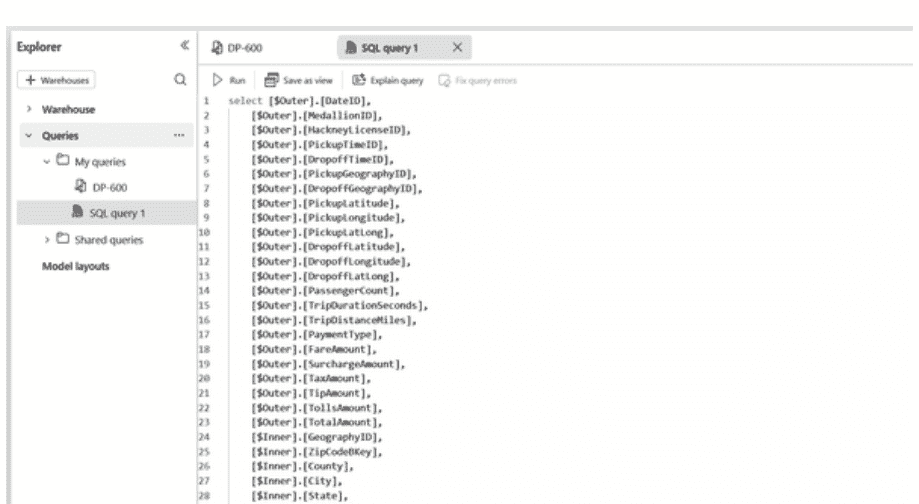

Figure 4-10. T-SQL script in edit mode from the visual query editor

There is no standard way of switching from T-SQL to visual query editor in Microsoft Fabric.

## Cross-Lakehouse and Cross-Warehouse Queries

> TIP
> This feature is based on the cross-database query capability from Microsoft Fabric. Cross-database queries and analytics are heavily implemented in Microsoft Fabric and continue to be developed.

The visual query editor also supports the use of tables and views from databases in other warehouses and lakehouses. You can do this by adding a warehouse or lakehouse in the Explorer area on the left side of the visual query editor window. Click the + Warehouses button to open a new window, where you can add reference to a different warehouse. Thereafter, you can work with that warehouse just like any other object.

## Saving a Query or a Query’s Output

When you’re done manipulating data to fit your needs, you have two options:

- Save the query as a view
- Save the output of the query to a table

### Saving a query as a view

To save a query as a view, you start by selecting the “Save as view” option from the top menu bar. That will bring up the pop-up window shown in Figure 4-11.

### Save as view

This will save the text of your SQL query as a view. Make sure the SQL syntax for the view is correct below.

Warehouse

Warehouse

Schema

dbo

View name *

TripWithGeography

SQL statement

```
CREATE VIEW [dbo].[TripWithGeography]
AS
select [$Outer].[DateID],
    [$Outer].[MedallionID],
    [$Outer].[HackneyLicenseID],
    [$Outer].[PickupTimeID],
    [$Outer].[DropoffTimeID],
    [$Outer].[PickupGeographyID],
    [$Outer].[DropoffGeographyID],
    [$Outer].[PickupLatitude],
    [$Outer].[PickupLongitude]
```

Copy to clipboard

OK

Cancel

Figure 4-11. “Save as view” pop-up window from the visual query editor

Then, fill in the “View name” field (in our example, we’ve filled it in with the name TripWithGeography).

Schemas are used to separate logical layers, business areas, and other groupings, based on the technical aspects and implementation rules you may have in your organization. You can select a different schema if you need to (for example, if you have an implemented naming convention in your lakehouse or warehouse).

From this window, you also have the option to copy the view statement to the clipboard and paste it to a new query window and continue your work. Click the “Copy to clipboard” button to do so.

When you’re done, click the OK button and your new view will be populated and ready to use.

### Saving the output of a query to a table

You also have the option to save the output of your visual query to a new table in your warehouse. To do so, click the “Save as table” button at the top of the results area and give your table a new name and schema in the pop-up window that appears (see Figure 4-12).

Notice the change in the SQL statement. In Figure 4-11, the SQL statement begins with CREATE VIEW...AS, but in Figure 4-12, it begins with CREATE TABLE...AS.

Also note that the same “Copy to clipboard” button is available here as in “Save as view” pop-up window.

### Save as table

This will create a table from the results of the visual query that has Enable load applied. To use a different visual query, cancel this dialog and apply Enable load to the visual query you want to use.

Warehouse

Warehouse

Schema

dbo

Table name *

TripsWithGeography

SQL statement

```
CREATE TABLE [Warehouse].[dbo].[TripsWithGeography] AS
    select [$Outer].[DateID],
    [$Outer].[MedallionID],
    [$Outer].[HackneyLicenseID],
    [$Outer].[PickupTimeID],
    [$Outer].[DropoffTimeID],
    [$Outer].[PickupGeographyID],
    [$Outer].[DropoffGeographyID],
    [$Outer].[PickupLatitude],
    [$Outer].[PickupLongitude],
    [$Outer].[PickupLatLong]
```

Copy to clipboard

OK

Cancel

Figure 4-12. “Save as table” pop-up window from the visual query editor

## Limitations

When working with the visual query editor, you can only create data query language (DQL) scripts from the T-SQL package of options. This means that you can’t do data manipulation (insertions, updates, and deletes) on existing tables in the database with the visual query editor. Also, you can only create data definition language (DDL) scripts by using the “Save as table” options from the results area of the visual query editor.

> **NOTE**
> There are some functions and features of the visual query editor that are only available in the visual query editor experience and can’t be translated into T-SQL. Though they’re outside the scope of the DP-600 exam, you might find it interesting to read more about these functions.

## Lineage and Debugging

If you encounter errors or other problems when working with the visual query editor, you have several options for determining what may have gone wrong each step of the way.

### Clicking on Each Box with Steps to View Query Results

When you click each main box of steps (which is also named in the UI as a query) in the visual query editor, the results pane changes to show you the results set from the last step in that query.

### Clicking on Each Step in Each Query to View Results of That Step

You can click on each step inside the queries to see that step’s specific results set.

### Viewing the Data Source Query

You can right-click on each of the steps within a query to view the data source query. For example, Figure 4-13 shows the results of the TripWithGeography visual query’s last step.

### Data source query

```
select [$Outer].[DateID],
    [$Outer].[MedallionID],
    [$Outer].[HackneyLicenseID],
    [$Outer].[PickupTimeID],
    [$Outer].[DropoffTimeID],
    [$Outer].[PickupGeographyID],
    [$Outer].[DropoffGeographyID],
    [$Outer].[PickupLatitude],
    [$Outer].[PickupLongitude],
    [$Outer].[PickupLatLong],
    [$Outer].[DropoffLatitude],
    [$Outer].[DropoffLongitude],
    [$Outer].[DropoffLatLong],
    [$Outer].[PassengerCount],
    [$Outer].[TripDurationSeconds],
    [$Outer].[TripDistanceMiles],
    [$Outer].[PaymentType],
    [$Outer].[FareAmount],
    [$Outer].[SurchargeAmount],
    [$Outer].[TaxAmount],
    [$Outer].[TipAmount],
    [$Outer].[TollsAmount],
    [$Outer].[TotalAmount],
    [$Inner].[GeographyID],
    [$Inner].[ZipCodeBKey],
    [$Inner].[County],
    [$Inner].[City],
    [$Inner].[State],
    [$Inner].[Country],
    [$Inner].[ZipCode]
from [Warehouse].[dbo].[Trip] as [$Outer]
left outer join [Warehouse].[dbo].[Geography] as [$Inner] on ([$Outer].[PickupGeographyID] = [$Inner].[GeographyID])
```

Figure 4-13. View of data source query


### 查看查询计划

你可以在查询框内右键单击某个特定步骤，以查看该步骤的查询计划（见图 4-14）。

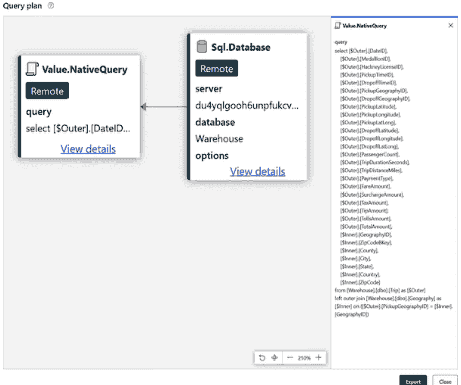

图 4-14. 从视觉查询编辑器查看查询计划

在此查询计划视图中，我们现在可以开始看到数据从 SQL 数据库（右侧）流向原生查询（左侧）的流程。当你在 Value.NativeQuery 中单击“查看详细信息”时，它会在屏幕右侧显示 Value.NativeQuery 语句。当你在 Sql.Database 中单击“查看详细信息”时，它会显示服务器名称、数据库名称以及连接的选项配置（见图 4-15）。

你可以通过此选项查看查询计划，将整个查询计划导出为 JSON 对象。单击图 4-14 所示屏幕底部的导出按钮，即可下载视觉查询编辑器的 JSON 定义。

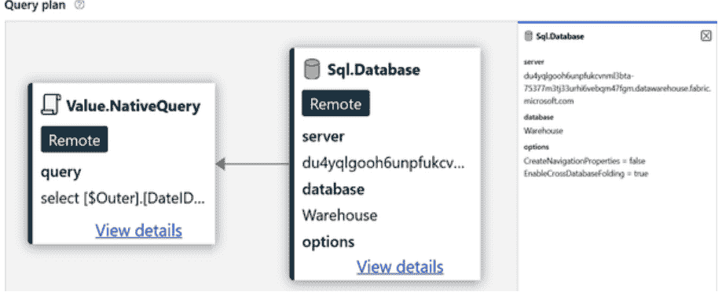

图 4-15. 视觉查询编辑器中查询计划视图中的 Sql.Database 详细信息

下面是一个此 JSON 的示例，已格式化并截断以提高可读性。

原始导出的 JSON 在需要时包含转义字符，并且换行结构与此处所示不同：

```
{
  "queryName": "Merge",
  "stepName": "Expanded Geography",
  "diagnostics": [
    {
      "queryName": "Trip",
      "queryPlan": {
        "nodes": [
          {
            "kind": "Invocation",
            ...
            ...
            "argumentsByName": {}
          }
        ]
      }
    },
  "removedStructuredColumns": false
```

```
},
"queryPlanAsSteps": "
let
#"Sql.Database" = Sql.Database("<server address>", <database>,
[ CreateNavigationProperties = false,
EnableCrossDatabaseFolding = true ]),
#"Value.NativeQuery" = Value.NativeQuery(#"Sql.Database",
select [$Table].[DateID] as [DateID],
...
...
as [TotalAmount]
from [<database>].[dbo].[Trip] as [$Table])
in
#"Value.NativeQuery"",
"queryPlanStatus": "Succeeded",
"queryScript": "
let
Source = Sql.Databases("<server address>",
[CreateNavigationProperties=false,
EnableCrossDatabaseFolding=true]),
Database = Source{[Name = "<database>"]}[Data],
Table = Database{[Schema = "dbo", Item = "Trip"]}[Data]
In
Table
},
{
"queryName": "Geography",
"queryPlan": {
"nodes":
...
```

你可能会认出此 JSON 对象中使用的语言：Power Query。`let` 和 `in` 运算符就是线索。此示例展示了众所周知的 Power Query 引擎如何作为此视觉查询编辑器的底层查询引擎传递给最终用户。而且，如果你愿意，可以复制 Power Query 语句，粘贴到 Dataflow Gen2 中，并在那里继续你的工作。

### CI/CD

在撰写本书时，视觉查询编辑器的查询不是 Fabric 提供的 CI/CD 流程的一部分。

在使用 Fabric 时需要了解的一件重要事情是哪些项目（湖库、仓库、数据流等）受内置 CI/CD 功能支持。还重要的是深入了解哪些子项目（查询、视觉查询等）受 CI/CD 流程支持。

这将为你作为开发者提供一个非常好的基线，以便从开发治理的角度使用 Fabric（尽管这目前不在 DP-600 考试范围内）。

正如你所见，视觉查询编辑器是一个全面的服务，Power Query 语言的功能和强大性以及将其转换为 T-SQL 并后续工作的能力都有其优势。首先，你不需要深厚的 T-SQL 技能就能开始满足你的数据操作需求，其次，你可以学习新技能，例如同时使用 T-SQL 和 Power Query。

话虽如此，也有一个选项可以直接使用 T-SQL 语言。在下一节中，我们将帮助你了解 Microsoft Fabric 的 T-SQL 格局以及如何使用它来操作数据。

### 使用 SQL 操作数据

在 Microsoft Fabric 中，你可以选择使用 T-SQL 语言来操作和转换数据以满足你的需求。本节提供 SQL 语言的指南，说明在哪里使用它以及其当前限制。

还值得注意的是，笔记本使用的是 *SparkSQL* 版本的 SQL 脚本语言。Spark SQL 是 Apache Spark 的一个模块，它是一个强大的分布式计算引擎，专为大数据处理而设计。它基于美国国家标准学会结构化查询语言（ANSI SQL），并为跨海量分布式数据集的分析工作负载而设计。它利用 Spark 的可扩展能力，因此非常适合大规模 ETL 管道、实时流处理以及高级分析（如通过与 Spark MLlib 集成进行机器学习）。Spark SQL 针对从各种分布式源（如 Parquet、JSON 和 Delta Lake）读取数据并执行复杂的迭代转换进行了优化，其中处理速度和吞吐量优先于严格的事务控制。

### 在哪里找到 SQL 语言

在深入展示如何使用 SQL 语言之前，我们想向你展示在哪里可以找到它。在这里，我们提供了一个列表，说明你会在哪些区域找到使用 SparkSQL 语言的选项：

*在笔记本中*

在 Microsoft Fabric 中的 PySpark 笔记本项目中，你可以通过两种主要选项使用 SQL 语言。你可以使用单元格魔术 %%sql 或将单元格标记为 SQL 单元格。两种选项均显示在图 4-16 中。

在第二个选项中，你使用以下 Spark 函数：

```
spark.sql(<your sql statement>)"
```

在 `<your sql statement>` 占位符的空间中，你可以编写 SQL 代码以将数据读入 DataFrame 或操作现有数据库或表中的数据。

### TIP

笔记本方法是一个数据工程任务，因此其细节超出了本书的范围。你只需要知道你有此选项。

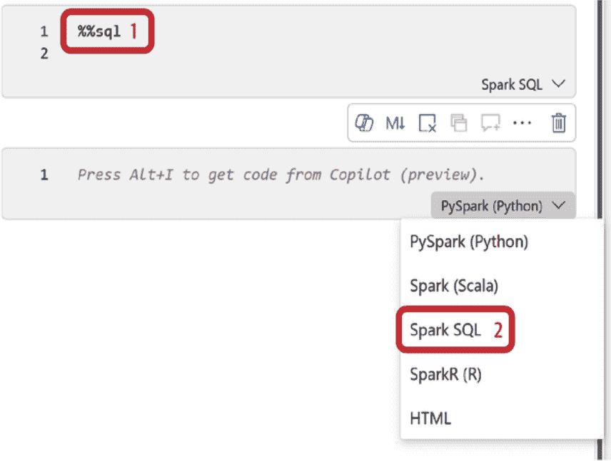

图 4-16. PySpark 笔记本中的 SQL 选项

### 在仓库中

正如你在前几章中所学到的，Microsoft Fabric 中的仓库方法主要基于 SQL 方法进行数据存储和操作。仓库公开了所谓的 T-SQL 表面区域。这种 T-SQL 语言的特殊实现是与仓库交互的默认语言，但与完整的 SQL Server 体验相比，其功能有限。我们将在“ T-SQL 表面区域”部分介绍这些限制。

### 在 SQL 数据库中

Microsoft Fabric 中的原生 SQL 数据库项目将完整的 SQL 语言带给你作为开发者，并且它将拥有你操作数据所需的大部分功能。你可以访问与无服务器 Azure SQL 数据库中可找到的相同 SQL 语句和函数。Fabric 中原生 SQL 数据库与无服务器 Azure SQL 数据库之间 T-SQL 的差异细节超出了本次考试的范围，但你可以在以下 Microsoft Learn 网站找到它们的详细说明：

T-SQL differences between SQL Server and Azure SQL Database

Limitations in SQL database in Microsoft Fabric

### 在湖库中

在使用 Microsoft Fabric 中的湖库项目时，你也可以访问 SQL 分析端点，从中可以使用 T-SQL 语言进行数据操作。与仓库项目一样，存在一些限制，我们将在下一节中描述。

### T-SQL 表面区域

Microsoft Fabric 中 T-SQL 语言能力的特殊实现称为 T-SQL 表面区域，用于 SQL Analytics 端点和仓库项目。

此实现有一些限制，这些限制是 Delta Parquet 存储格式和 Microsoft Fabric 背后底层计算引擎的自然结果。以下是仓库与 SQL Analytics 端点之间 T-SQL 表面区域的这些限制和差异的详细列表：

- 在 Microsoft Fabric 中，仅在仓库中支持创建、更改和删除表，以及插入、更新和删除，而在湖库的 SQL 分析端点中不支持。
- 你可以在湖库的 SQL 分析端点中创建自己的 T-SQL 视图、函数和过程，以引用你的 Delta Lake 数据的表之上。
- 你可以通过两种方式在仓库中创建表：使用 CREATE TABLE 或 CREATE TABLE AS SELECT 语句。
- 你可以以以下显式命令创建临时表（名称前带 # 的表）：
- 全局临时表（名称前带 ## 的表）目前不支持。
- Fabric 仓库和 SQL 分析端点均支持标准、顺序和嵌套公共

```
CREATE TABLE #table_name (
  Col1 data_type1,
  Col2 data_type2
);
```


table expressions (CTEs)。CTEs 通常在 Microsoft Fabric 中可用。

- 在 Microsoft Fabric 的仓库中支持 TRUNCATE TABLE。
- 要更改仓库中用户表的列名，请使用 sp_rename 存储过程。
- 支持部分查询和连接提示。
- 在 Microsoft Fabric 的仓库中支持会话范围的分布式 #temp 表。

以下是不受 Microsoft Fabric 中 T-SQL 表面区域当前支持的功能列表：

- ALTER TABLE ADD 和 ALTER
目前，仅支持 Microsoft Fabric 仓库中以下子集的 ALTER TABLE 操作：
- 添加受支持的列数据类型的可空列。
- DROP COLUMN。
- 添加或删除 PRIMARY KEY、UNIQUE 和 FOREIGN_KEY 列约束，但仅当已指定 NOT ENFORCED 选项时。所有其他 ALTER TABLE 操作均被阻止。
- BULK LOAD
- CREATE USER
- FOR JSON 必须是查询中的最后一个运算符，因此不允许在子查询中使用。

- IDENTITY 列
- 手动创建的多列统计信息
- 物化视图
- MERGE
- PREDICT
- 针对系统表和用户表的查询
- 递归查询
- 结果集缓存
- / 和 \
架构和表名不能包含这些。
- SELECT - FOR XML
- SET ROWCOUNT
- SET TRANSACTION ISOLATION LEVEL
- sp_showspaceused
- 触发器

在本文的这两个表格以及对仓库、湖屋和 SQL Analytics 端点的介绍中，我们帮助您了解 T-SQL 表面区域的限制和实现情况。这将帮助您找到操作这些服务中的数据所需的 T-SQL 功能。

然而，本书并不是 T-SQL 培训指南，因此如果您需要，我们将把学习更多 T-SQL 语言的工作留给您。以下是一些有用的链接供您入门：

- Microsoft Learn 的官方免费课程，介绍如何使用 T-SQL 脚本语言开始查询
- Microsoft Learn 的官方免费课程，介绍如何熟悉 T-SQL 语言
- Learning SQL, 3rd Edition (O’Reilly)
- Advanced SQL

这些指向免费在线课程和购买书籍的链接将为您提供使用 T-SQL 语言处理数据所需的一切。

话虽如此，使用 T-SQL 只是处理和操作 Microsoft Fabric 中数据的一种方式。另一种是 KQL，我们将在下一部分介绍。

## 使用 KQL 操作数据

*Kusto Query Language*（KQL）是 Microsoft Fabric 中实时智能服务套件中使用的主要脚本语言。该套件包含 eventstreams、eventhouses、KQL 数据库、KQL 查询集、实时仪表板和 Activator 项目等服务。

所有这些服务主要基于相同的底层计算和存储引擎：Kusto 数据库。该数据库具有许多特殊功能，其中之一是它从一开始就由 Microsoft 打造，以支持流数据的存储和操作。物联网设备、日志事件和遥测数据只是这种数据的几个例子。这种数据的共同点是它始终发出状态和/或事件，并且基于时间。数据库

处理所有内容，包括索引、文件、压缩和表优化，以便您可以专注于数据操作。

在操作 Kusto 数据库中的数据时，如果使用 KQL，您将获得最佳体验。是的，您可以使用 T-SQL 语言，我们将在下一节介绍，但完整的体验和功能集来自于使用 KQL 脚本语言。

在我们深入研究 KQL 语句的位置之前，您必须知道如何入门。我们在本节开头列出的 Microsoft Fabric 实时智能项目包括 KQL 查询集。这些是特殊项目，用于保存可重用或用作未来开发人员阅读和理解的文档形式的 KQL 查询和脚本。

您可以创建 KQL 查询集有两种方式：通过自动创建和通过创建独立查询集。

## 在创建 Eventhouse 时自动创建 KQL 查询集

在第一个选项中，当您在 Microsoft Fabric 中创建 eventhouse 项目时，您会连带获得两个默认项目：一个与 eventhouse 同名的 KQL 数据库，以及一个以 eventhouse 名称为前缀的 KQL 查询集（见图 4-17）。

图 4-17. eventhouse 中的三个项目

我们在图 4-17 中突出显示了一些项目（编号 1-3）：

DP-600-Eventhouse（项目 1）

这是 eventhouse 的名称。

*DP-600-Eventhouse（项目 2）*

这是 KQL 数据库的名称。

*DP-600-Eventhouse_queryset（项目 3）*

这是 KQL 查询集。

正如您所见，项目名称在 eventhouse 和第一个 KQL 数据库之间被重用，该数据库是在创建 eventhouse 的同一步骤中创建的。此外，如果您愿意，您可以在 eventhouse 中创建一个新的 KQL 数据库并删除默认数据库，以便为 KQL 数据库使用不同的名称。eventhouse 可作为 KQL 数据库的服务器形式。

> **NOTE**
> KQL 数据库名称可以包含字母数字字符、下划线、句点和连字符。不支持特殊字符。

随着 KQL 数据库的自动创建，每个数据库中都会自动创建 KQL 查询集（图 4-17 中的项目 3）。

## 创建独立的 KQL 查询集

第二个选项是在 Fabric 工作区中将 KQL 查询集作为独立项目创建。如果您在工作区菜单中单击“+ New item”按钮，您将在列表中找到 KQL Queryset 作为新项目（见图 4-18）。

### New item

Favorites  All items

### Track data

Monitor your streaming or nearly real-time operational data, and make decisions based on gained insights.

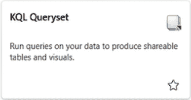

图 4-18. Microsoft Fabric 中的独立 KQL 查询集

无论您希望如何利用 KQL Queryset，您都需要一个来开始编写第一个 KQL 语句。

在下一节中，我们将介绍使用 T-SQL 的选项，然后逐步介绍如何学习 KQL 脚本语言并进入更高级别的学习。即使本书不是 KQL 培训书籍，我们也会带您了解该语言的一些良好使用示例，展示它能做什么，并提供更多学习信息。

NOTE

> 我们无法为您培训整个 KQL 语言，因为这本身就需要一本书（或两本）。

## 在 Kusto 数据库中使用 T-SQL

如前所述，您可以在一定程度上在 Kusto 数据库中使用 T-SQL 语言。这是因为 Kusto 数据库默认可以处理大部分 T-SQL 脚本基础，但仅限于 SELECT 语句。您不能使用

T-SQL 来创建表、更新数据或以其他方式执行数据定义语言（DDL）或数据操作语言（DML）语句。

在 Kusto 数据库中使用 T-SQL 与在任何其他基于 T-SQL 的数据库中编写 T-SQL 命令一样简单。以下是名为 Weather 的表的示例：

```
select top 10 * from Weather
```

在图 4-19 中，您可以在 KQL 查询集中找到执行的查询以及其下方的结果集。（注意：图中未显示所有列。）

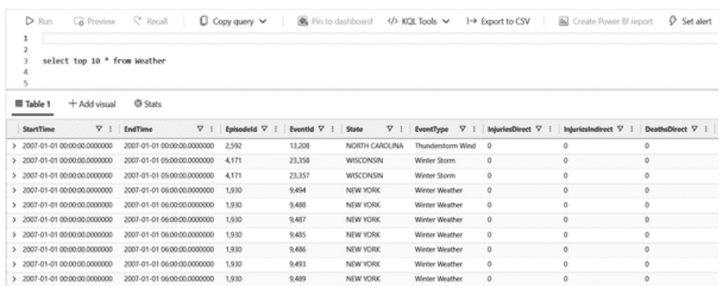

图 4-19. 在 KQL 查询集中使用 T-SQL

您还可以向上述 T-SQL 脚本添加以下内容：WHERE 子句、聚合和基于行的计算，以及连接和重命名列（与在基于 T-SQL 的数据库中的任何其他 SELECT 语句一样）。

在 Kusto 数据库中使用 T-SQL 语言也有局限性。例如，您不能使用 CTE 或子查询。

要阅读有关在 Kusto 世界中使用 T-SQL 的完整文档，请前往 Microsoft Learn。

当您完成 T-SQL 脚本的开发后，您可以做两件事之一：

*Execute the statement*

要么单击顶部菜单栏中的 Run 按钮，要么按 SHIFT 和 ENTER 来执行脚本。

*Translate from T-SQL to KQL*

Kusto 引擎附带一个非常有用的功能，可帮助您理解 KQL 语言并从 T-SQL 迁移到 KQL。引擎可以使用 EXPLAIN 运算符将您编写的 T-SQL 脚本直接翻译成 KQL。

让我们回到本节前面开始的 T-SQL 语句：

```
select top 10 * from Weather
```

现在，添加这两行：

```
--
explain
```

在实际的 T-SQL 脚本之前，您将得到不同的输出。结果集将消失，取而代之的是您的 T-SQL 脚本被翻译成 KQL（见图 4-20）。


Figure 4-20. Results set translated from T-SQL into KQL

In the figure, we’ve a few areas (numbered 1–3):

### The T-SQL statement with the newly added explain operator (area 1)

The newly added operator is just above the T-SQL statement. The two dashes (--) on the line above it are optional and will remove red underlines in your code. Without the two dashes, you’ll still get the newly translated results set, but the command will have red squiggly lines indicating any syntax errors.

### The “open result set” button (area 2)

Here, you can “open” the results set to view the newly translated KQL statement in a more readable format than the single-line results set you get by default.

### The newly translated KQL script (area 3)

This is the new translation of the T-SQL statement into a KQL statement written in the KQL queryset.

In the figure, you can also see that the engine tries to give you some nudges towards a best-practice approach for writing KQL script. (We’ll touch more on that in section 3 ). You can see the project operator, which is the equivalent of “Select these columns.” Using any T-SQL statement with the wildcard (*) is not a best practice because we want to help the engine use only the needed columns. Neither is the KQL statement with all the columns, unless you really need all the columns. If you only need a subset of the columns, you can use the project operator and list only the columns you need for the query.

The last line of the KQL script selects only the first 10 rows of data by using the take operator with the number of rows after it. The explicit int(10) script casts the 10 string to an integer. This is not a requirement, but again, the engine nudges you to use a best practice, as you should avoid any implicit data type conventions in your code when writing your KQL statements.

Translating your T-SQL statements into KQL by using the explain operator is fine when you’re just getting started with learning the KQL language, but it won’t give you all the benefits of working with your streaming data from the Kusto database. To get all those benefits, you need to learn the KQL syntax, operators, and functions.

Now that you’ve translated your first statements from T-SQL into KQL, you’re ready to move on and start writing your first KQL statements directly in the KQL queryset window.

## Structure of a KQL Statement

The syntax of a KQL statement is very much like the language you’d use to tell your colleague how to build a query. It could sound something like this:

> From the Weather table, take the data only from the last 100 days and only the first 200 rows. Aggregate these rows by <aggregation type> on <column> and group the results by <columns>.

Directly translated, this requirement will look like this in KQL:

```
Weather
| where StartTime >= ago(100d)
| take 200
| summarize
    sum(DamageCrops)
    by State
```

From this KQL statement, you can see that the narrative fits the syntax of the query structure. Start with the table name (Weather) and filter (with where) on the StartTime column and only the last 100 days. From this, take the 200 rows and summarize the sum of DamageCrops by State.

As you can see, the KQL language is a script language that works and sounds very much like how you would describe your needs to the developer. But you still need to understand how to write in this language, and that’s what this section will teach you.

## Starting a New Line of Code

You must start every new line of code with a pipe (|) to tell the Kusto engine that you’re writing a new task in the statement. This also means that you can begin to structure

your script with line breaks and indentation, as seen in the last line of code in the previous script. This feature can be very useful to the next developer when you’re structuring your script, as it makes it easier to read and understand the script at first glance.

## Funneling Data with KQL Statements

You can also think of any given KQL statement as a funnel into which you pour data. At the top of the funnel is all the data, and as you read the statement, it filters, aggregates, and manipulates the data in other ways to make it fit the requirements of the output (see Figure 4-21).

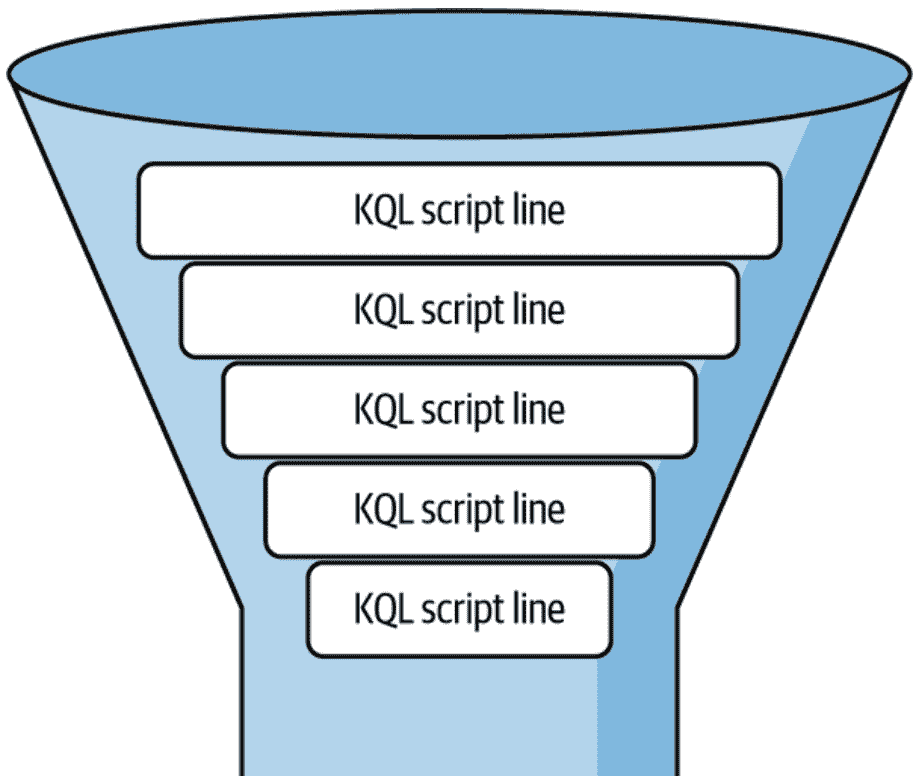

Figure 4-21. KQL statement depicted as a funnel for data

In the figure, the data is narrowed down as you follow the script lines of the KQL statement and get deeper into the funnel. This general illustration is a good way to think of your KQL statement.

If we define a new line beginning with the pipe (|) character, any given line of code in a KQL statement has its own results set. In other words, you can execute every specific new line of code, with all the preceding lines, and get a result. The reason we want you to know this is that the faster you can limit the result set, the faster your KQL statement will return the result to you. So to use a visual example, you can make the funnel in Figure 4-21 filter faster by changing the angle of its sides so they’re closer to horizontal.

To make the funnel filter faster, you can move your where operator up in the lines and put it as early in the script as possible. Sometimes, a where clause cannot be put in line 2, right after the table declaration, but remember to try to place it as early as possible to help the Kusto engine limit the dataset for the next row(s) in the complete KQL statement.

## The Simplest KQL Statement

To get started writing your own KQL statements, you write the simplest statement of all: a statement in which you tell the engine to give you all the data from the table. You do that by simply writing the table name in the KQL queryset window and executing that line. Using an example from our Weather table, you would write this:

```
Weather
```

Then, execute this script to start the Kusto engine, which will give you all the rows in the table.

But there’s a catch. As the Microsoft Fabric service is web based, it’s highly dependent on your browser’s capability to show data. If your table has more than 64 MB of data, the error message in Figure 4-22 will appear in the results pane.

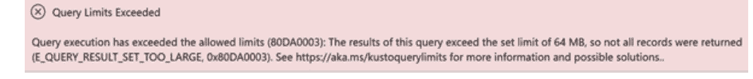

Figure 4-22. Error message when the results set exceeds a browser’s internal limits

The error message states that the default limit on the rows in the results set was exceeded when the engine tried to render them in the browser. You can choose to bypass this limit, but we strongly recommend that you don’t. If you allow the browser to try to render the rest of the rows, it will often become unresponsive due to its internal memory limitations. This also means you should try to limit your data as soon as possible.

Now that you know the simplest and most basic KQL statement you can execute, we will introduce you to more common KQL operators every Fabric analyst must know.

**TIP**
An important difference between the T-SQL language and the KQL language is that in KQL, you can have as many of the same operators as you need in your statement. For instance, you can have more than one where operator, and you can place it wherever you need in the complete KQL statement.

## Common KQL Operators

The operators you must know perform the following functions:

TIP
Because this book is focused on the DP-600 exam and not on providing all the details of the Real-Time Intelligence suite of services, we’ll only give you the following list of 10 common operators.

- Counting rows
- Getting a subset of rows of data and the first n rows
- Getting a column subset of data
- Getting a list of unique values
- Filtering a results set
- Sorting a results set
- Performing row-based calculations
- Performing aggregations
- Creating joins
- Creating visualizations

In this section, we’ll introduce you to each of these KQL operators in detail.

NOTE
Unless we say otherwise, the example KQL scripts in this section are based on the Weather demo table script we started earlier in this chapter.


## 计数行数

要统计结果集中的行数，可以使用如下所示的 count 操作符：

```
Weather
| count
```

此脚本将给出结果集（见图 4-23）。

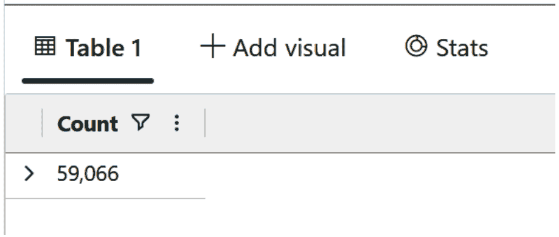

图 4-23. KQL 中 count 操作符的结果集

## 获取数据子集的行和前 n 行

你可以使用 take 操作符从结果集中获取任意数据子集。这会给出 Kusto 引擎从数据库读取的前 n 行数据。以下是使用 take 操作符的示例：

```
Weather
| take 5
```

此脚本将给出类似于图 4-24 所示的结果集。你可能得不到相同的结果集

因为你的数据在数据库磁盘上的物理结构可能不同。

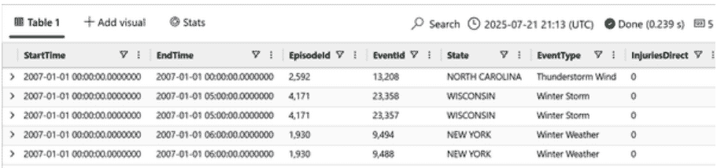

图 4-24. KQL 中 take 操作符的结果集

TIP

在 KQL 中，take 操作符有一个名为 limit 的同义词，其工作方式完全相同。

如果你想要基于列排序的特定 n 行，可以在脚本中添加 by <columnname> <可选排序类型 (desc 或 asc)>，如下所示：

```
Weather
| take 5 by EpisodeId
```

这会给出图 4-25 所示的结果集。

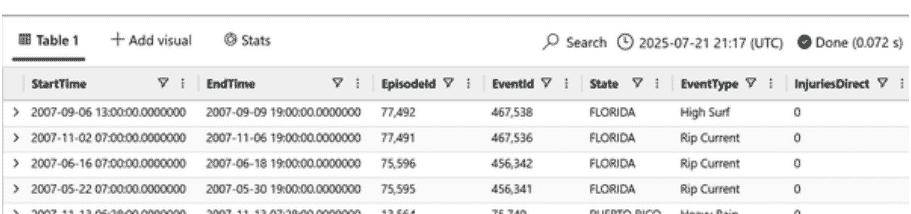

图 4-25. KQL 中带列排序的 take 操作符的结果集

请注意，EpisodeId 列现在按默认降序（desc）排序。要更改它，请在行末添加 asc。

## 获取列子集数据

要选择数据的列子集，你有两个函数可选：

- project
- project-away

project 函数可主动选择结果集中所需的列。以下是使用它的示例：

```
Weather
| project StartTime, EpisodeId, EventType
```

此示例脚本仅返回列出的列：StartTime、EpisodeId 和 EventType。图 4-26 显示了结果的子集。

| StartTime | EpisodeId | EventType |
|---|---|---|
| 2007-01-01 00:00:00.000 | 2,592 | Thunderstorm Wind |
| 2007-01-01 00:00:00.000 | 4,171 | Winter Storm |
| 2007-01-01 00:00:00.000 | 4,171 | Winter Storm |
| 2007-01-01 00:00:00.000 | 1,930 | Winter Weather |
| 2007-01-01 00:00:00.000 | 1,930 | Winter Weather |
| 2007-01-01 00:00:00.000 | 1,930 | Winter Weather |
| 2007-01-01 00:00:00.000 | 1,930 | Winter Weather |
| 2007-01-01 00:00:00.000 | 1,930 | Winter Weather |
| 2007-01-01 00:00:00.000 | 1,930 | Winter Weather |
| 2007-01-01 00:00:00.000 | 1,930 | Winter Weather |
| 2007-01-01 00:00:00.000 | 1,930 | Winter Weather |
| 2007-01-01 00:00:00.000 | 1,930 | Winter Weather |
| 2007-01-01 00:00:00.000 | 765 | Blizzard |
| 2007-01-01 00:00:00.000 | 1,979 | Heavy Rain |

图 4-26. 使用 project 函数主动选择所需的列

另一方面，使用 project-away 函数，你可以从结果集中移除不需要的列。以下是使用方法：

```
Weather
| project-away StartTime, EpisodeId, EventType, StormSummary,
  EventNarrative, EpisodeNarrative, EndLon, EndLat, BeginLat,
  BeginLon
```

此查询返回图 4-27 中的结果集。

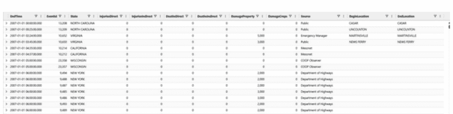

图 4-27. 使用 project-away 函数从结果集中移除列

## 获取唯一值列表

要从结果集中获取唯一值列表，我们可以使用 distinct 函数。此函数可在多个列上工作。首先输入 distinct 函数，然后列出所需的列，如此示例所示：

```
Weather
| distinct State, Source
```

此查询返回图 4-28 所示的结果。

| State | Source |
|---|---|
| NORTH CAROLINA | Public |
| WISCONSIN | COOP Observer |
| NEW YORK | Department of Highways |
| ALASKA | Department of Highways |
| DELAWARE | Mesonet |
| OKLAHOMA | Emergency Manager |
| INDIANA | COOP Observer |
| INDIANA | Unknown |
| INDIANA | Other Federal |
| ILLINOIS | Unknown |
| MINNESOTA | Other Federal |
| MINNESOTA | Official NWS Observations |
| TEXAS | Official NWS Observations |
| WISCONSIN | Official NWS Observations |
| SOUTH DAKOTA | Other Federal |
| TEXAS | Unknown |
| UTAH | Other Federal |

图 4-28. 使用 distinct 函数检索多列

另请注意，你可以使用聚合函数来获取不同的值，但然后你需要在其上进行聚合的列。但使用 distinct 函数时，你不需要聚合列即可获取唯一值。

## 过滤结果集

要根据列值过滤结果集，你可以在 KQL 语句中使用 where 操作符，如下所示：

```
Weather
| where State == "FLORIDA"
```

此脚本在 Weather 表上按 State 列进行过滤，仅返回匹配 “FLORIDA” 值的行（见图 4-29）。（请注意，图中的结果已截断。）

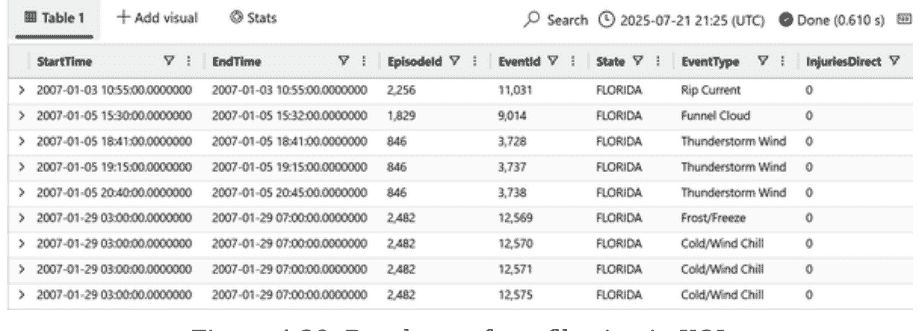

在此图中，你可以看到结果集现在仅包含 State 列中包含 FLORIDA 的行。

如果需要更多过滤器，你有两个选择。你可以向现有行添加 and 或 or 子句，或添加新行并使用新的 where 子句进一步过滤结果集。以下是两种示例：

```
Weather
| where State == "FLORIDA" and EventType == "Frost/Freeze"
```

```
Weather
| where State == "FLORIDA"
| where EventType == "Frost/Freeze"
```

这两个脚本返回相同的结果集。如果你想在语句中添加 or，必须在 KQL 语句的一行代码中编写它。

## 排序结果集

你可以按任意给定列对结果集进行排序，无论是表本身的列还是计算列。（稍后将介绍如何创建新列。）

以下示例脚本按 EndTime 列升序对结果集进行排序：

```
Weather
| sort by EndTime asc
```

这将给出图 4-30 所示的结果集（此处已截断）。

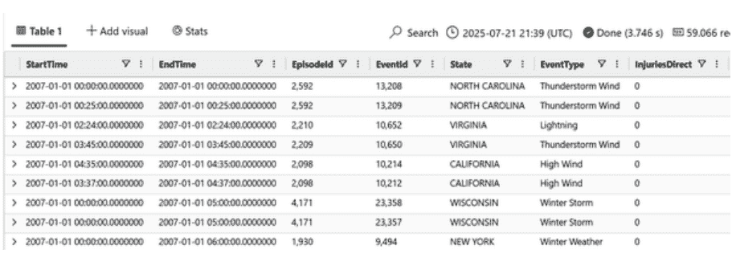

你可以通过使用逗号（,）并输入所需的列名来按其他列添加更多排序。你也可以输入 **asc** 使其按升序排列，或保持降序（desc），这是默认值。

## 基于行的计算

在实现基于行计算的要求时，KQL 脚本语言与 T-SQL 语言非常相似。

例如，在 Weather 表中，你可以使用 extend 操作符添加 DamageCrop 和 DamageProperty 列。此操作符向现有结果集添加新列。以下是示例脚本：

```
Weather
| extend TotalDamage = DamageCrop + DamageProperty
```

此脚本给出图 4-31 所示的结果集。请查看最右边的列。

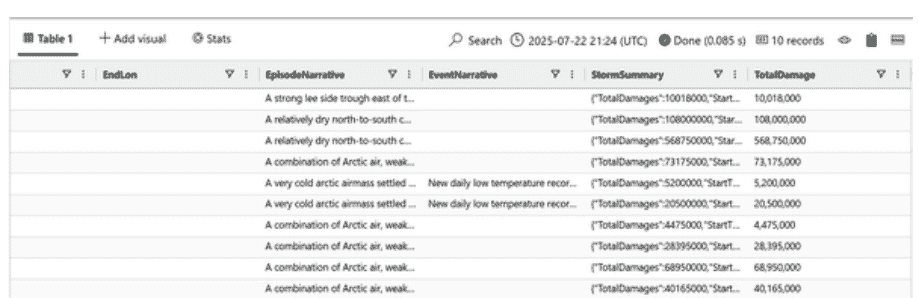

图 4-31. 使用 KQL 中的 extend 操作符添加新列

在前面的示例脚本中，我们对两列做了非常简单的加法。当然，我们可以做更高级的列操作。例如，我们可以使用

extend 操作符替换现有列。为此，我们只需为新列提供与现有列相同的名称。

此示例脚本替换结果集中的 State 列：

```
Weather
| extend State = "Demo state"
```

图 4-32 显示了此脚本的输出。

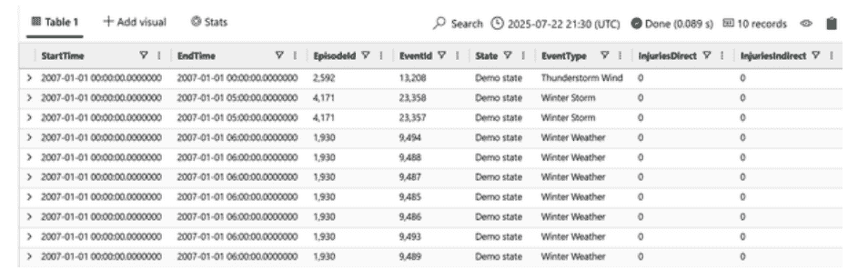

图 4-32. 使用 KQL 中的 extend 操作符替换现有列

## 执行聚合

Kusto 引擎的众多优势之一是其能够极快地对海量数据集执行聚合。summarize 操作符是入门的关键。它使你能够在一行代码中创建聚合，这比在 T-SQL 世界中容易得多，在那里你必须记住添加 GROUP BY 以及所有不在聚合函数中的列。

在 KQL 中，你只需从新行开始输入 summarize，输入所需的聚合函数，输入 by，然后输入需要用作分组列的列名。以下是该示例，其中


Weather 表正在按 State 聚合 DamageCrops 的总和：

```
Weather
| summarize sum(DamageCrops) by State
```

图 4-33 显示了此脚本的输出。

| State | sum_DamageCrops |
|---|---|
| NORTH CAROLINA | 149,144,000 |
| WISCONSIN | 32,864,100 |
| NEW YORK | 10,000 |
| ALASKA | 0 |
| DELAWARE | 0 |
| OKLAHOMA | 1,087,000 |
| INDIANA | 26,462,000 |
| ILLINOIS | 90,116,500 |
| MINNESOTA | 5,334,500 |
| TEXAS | 35,373,000 |
| SOUTH DAKOTA | 5,000 |
| UTAH | 0 |

图 4-33. 在 KQL 中使用 summarize 运算符的结果

你还会注意到，新列名是自动生成的，基于聚合函数、下划线（_）和表名。你可以通过在聚合函数前输入想要的名称来指定新列名，如以下示例所示：

```
Weather
| summarize SumOfDamageCrops = sum(DamageCrops) by State
```

你可以在图 4-34 中看到新的列名。

| State | SumOfDamageCrops |
|---|---|
| NORTH CAROLINA | 149,144,000 |
| WISCONSIN | 32,864,100 |
| NEW YORK | 10,000 |
| ALASKA | 0 |
| DELAWARE | 0 |
| OKLAHOMA | 1,087,000 |
| INDIANA | 26,462,000 |
| ILLINOIS | 90,116,500 |
| MINNESOTA | 5,334,500 |
| TEXAS | 35,373,000 |
| SOUTH DAKOTA | 5,000 |
| UTAH | 0 |

图 4-34. 在 KQL 中聚合函数中指定新的列名

使用 KQL 的好处之一是可以将多个聚合函数添加到同一行代码中。如果你想同时找到 DamageCrops 列的总和和最大值，可以使用以下示例中的脚本：

```
Weather
| summarize
    SumOfDamageCrops = sum(DamageCrops),
    MaxOfDamageCrop = max(DamageCrops)
    by State
```

图 4-35 显示了此脚本的结果。

| State | SumOfDamageCrops | MaxOfDamageCrop |
|---|---|---|
| NORTH CAROLINA | 149,144,000 | 10,000,000 |
| WISCONSIN | 32,864,100 | 10,000,000 |
| NEW YORK | 10,000 | 10,000 |
| ALASKA | 0 | 0 |
| DELAWARE | 0 | 0 |
| OKLAHOMA | 1,087,000 | 500,000 |
| INDIANA | 26,462,000 | 3,030,000 |
| ILLINOIS | 90,116,500 | 3,450,000 |
| MINNESOTA | 5,334,500 | 750,000 |
| TEXAS | 35,373,000 | 13,000,000 |
| SOUTH DAKOTA | 5,000 | 5,000 |
| UTAH | 0 | 0 |
| COLORADO | 320,000 | 100,000 |

图 4-35. 使用 KQL 在同一行中实现多个聚合函数

## 创建连接

在 KQL 中创建连接的过程与我们在第 3 章中解释连接理论和 Venn 图时介绍的过程相同。然而，KQL 中有三种额外的连接类型：ANTI JOIN、INNERUNIQUE JOIN 和 SEMI JOIN。

首先，我们将向你介绍这三种新的连接类型，然后，我们将带你了解在 KQL 中编写和执行连接的方法：

### ANTI JOIN

这与第 3 章中的 LEFT JOIN 结合只取右表中因与左表中的行不匹配而为空的行过滤器相同。在 KQL 中，你可以用 ANTI JOIN 的一个命令来完成此操作。图 4-36 是此连接的 Venn 图。

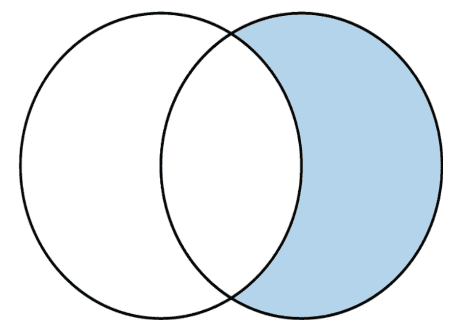

图 4-36. KQL 中的 ANTI JOIN

### INNERUNIQUE JOIN

如果未声明其他内容，这是 KQL 中的默认连接类型。 （参见本章后面关于默认连接和声明的内容。）此连接会从左表中删除重复的键，并且仅返回两个表中存在匹配的行。

图 4-37 说明了这一点。

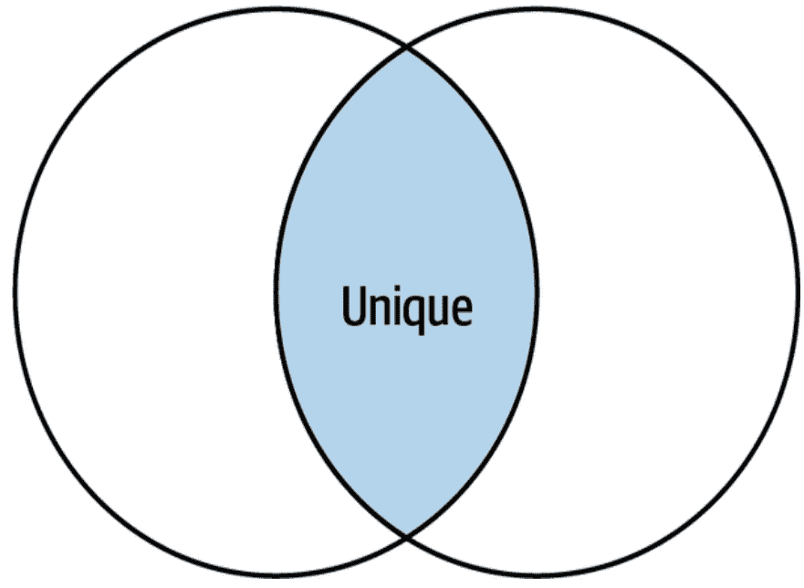

图 4-37. KQL 中的 INNERUNIQUE JOIN

### SEMI JOIN

这有点像正常的 INNER JOIN，但区别在于引擎会自动仅返回右表的列。这对于根据左表中的行过滤右表中的数据很有用，但左表仅作为引用表，并且在数据集中不发挥其他作用。

图 4-38 说明了这一点。

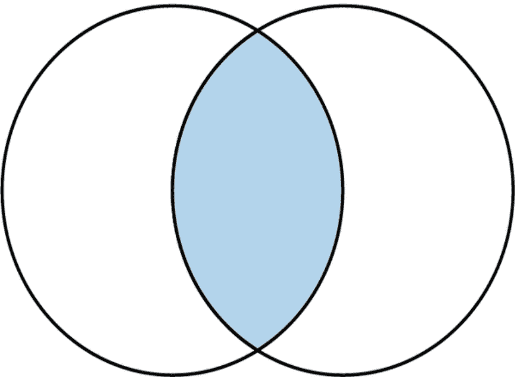

图 4-38. KQL 中的 SEMI JOIN

你还可以将连接类型组合在 KQL 中以创建额外的连接类型。例如，LEFTANTISEMI 是一个仅返回右表列的左 ANTI JOIN。你可以在本节后面看到可用连接类型的完整列表。

## 连接方法

现在我们已经向你介绍了 KQL 中的新连接类型，我们可以为你提供有关在脚本中编写和使用不同连接运算符的语法的一般介绍。

首先，你可以在 KQL 中使用两种不同的方法执行连接操作：join 和 lookup。你将根据连接中表的特征在两者之间进行选择，我们将分别介绍每种方法。

### *连接方法*

当右表在行数上明显长于左表时应使用此方法。例如，假设你有一个记录数百万事件数据的表，并且你需要从包含数十万台设备数据的引用表中向其添加列。你应该使用连接方法，因为表在长度上没有显著差异。

要使用连接方法，你需要指定连接类型（就像在 T-SQL 方法中一样），但你必须使用此处列出的连接类型之一：

- innerunique
- inner
- leftouter
- rightouter
- fullouter
- leftsemi
- leftanti, anti, or leftantisemi
- rightsemi
- rightanti or rightantisemi

在语法中编写连接类型时，你可以选择两种语法之一。

- 如果连接两侧的列名相同，可以使用此语法：

```
<LeftTableName>
| join kind=<jointype> <RightTableName> on <ColumnName>
```

这里有一个例子：

```
Weather
| join kind=innerjoin Locations on LocationId
```

- 如果连接两侧的列名不相同，则需要使用此语法：
  <LeftTableName>
  | join kind=<jointype> <RightTableName>
    on $left.<ColumnNameLeftTable> = $right.
  <ColumnNameRightTable>

这里有一个例子：

```
Weather
| join kind=innerjoin Locations on $left.LocationId =
$right.LocationKey
```

请注意，$left 和 $right 表引用必须始终按此顺序：$left 在前，$right 在后。如果你将 $right 作为第一个引用，你将收到执行错误。

### 查找方法

当右表在行数上明显短于左表时应使用此方法。例如，假设你有一个基于事实的表，其中包含来自全市流式发出设备的温度和湿度等数据，并且你需要从你自己办公楼的设备列表中向其添加列。由于你办公楼的设备列表明显短于事实表，因此你应该使用查找方法。

要使用查找方法，你必须在两个表中具有相同的列名，因为你没有显式声明连接列的选项。

查找的语法如下：

```
<LeftTableName>
| lookup <RightTableName> on <ColumnName>
```

这里有一个例子：

```
Weather
| lookup Locations on LocationId
```

现在我们已经介绍了 KQL 中的连接方法，你就可以开始创建和完善自己的 KQL 查询了。

## 创建可视化

KQL 脚本语言的一个非常惊人的功能是能够直接从脚本创建可视化，而无需执行任何额外步骤或使用特殊的可视化应用程序。KQL 语言为直接从 KQL 代码中可视化数据提供了内置功能。这种方法不如你在 Power BI 中看到的那样广泛和可定制，因为 KQL 引擎是为在大量数据上实现速度而构建的，可视化必须足够快以基于查询的结果集进行渲染。

现在，不再进一步讨论 Power BI 与 KQL 中可视化的差异，让我们直接深入了解如何基于 KQL 语言创建可视化。

这就是 render 查询运算符发挥作用的地方。此运算符是直接在 KQL 脚本中从结果集可视化数据的关键。

此示例脚本基于查询渲染条形图：

```
Weather
| summarize SumDamageProperty = sum(DamageProperty) by State
| take 10
```


```
| order by SumDamageProperty desc
| render barchart
```

在图 4-39 中，你可以看到此查询的结果。

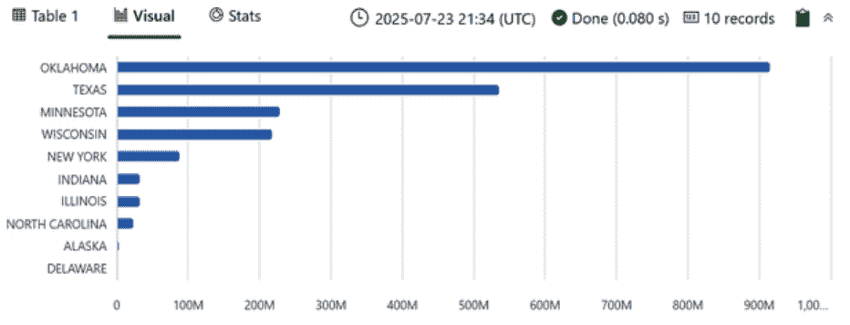

图 4-39. KQL 中条形图的渲染

示例脚本最后一行的 render 操作符告诉 Kusto 引擎基于脚本中前面几行代码的结果集渲染特定图表。

render 操作符（以及 KQL 引擎）还附带一组标准的可视化效果：

- Table
- Bar chart
- Column chart
- Area chart
- Line chart
- Stat/multi-stat chart
- Pie chart
- Scatter chart/map
- Time chart
- Anomaly chart
- Funnel chart
- Heatmap
- Plotly

正如你从此列表中看到的，与 Microsoft Power BI 相比，KQL 中渲染可视化的选项 somewhat limited。

> **TIP**
> Plotly 可视化是用于创建自定义可视化的 Python 库。它超出了考试范围，但如果你想了解更多关于它的信息，这个链接是一个很好的起点：https://oreil.ly/LnvIy。

不同的渲染可能性都带有各自用于自定义可视化的选项。我们在这里不会详细介绍它们，因为它们不是本次认证考试的一部分。

## Summary

在本章中，你学习了如何使用可视化查询编辑器、特殊的 T-SQL 实现以及 KQL 语言方法来查询和操作数据。
你了解了在使用 Microsoft Fabric 时三种选项的局限性和能力。你学习了如何从可视化查询编辑器切换到 SQL，如何在笔记本中更改为 SQL，以及如何在 lakehouse 和 warehouse 中使用 T-SQL。你还学习了如何编写你的第一个 KQL 语句，既可以通过 Kusto 数据库上的 SQL 到 KQL 翻译选项，也可以通过自己输入代码。

此外，你学习了如何通过在查询的执行顺序中移动不同的操作符来帮助 Kusto 引擎优化查询。你练习了使用 count、where、take 等基本操作符以不同方式编写 KQL 语言。你还学习了如何使用 summarize 操作符进行聚合，以及如何使用 join 选项或 lookup 选项在两个表之间连接数据，根据两个表的特征在它们之间进行选择。最后，你学习了如何直接在 KQL 查询集中渲染结果以进行结果的可视化分析。
