## Chapter 5. Designing and Building Semantic Models

在使用 Power BI 时，很容易从简单的设置开始，随着时间的推移让事物增长，添加更多表到模型，添加更多可视化到报表，添加更多字段和度量。但在某个时候，保持性能和清晰度可能会成为挑战。本章重点介绍在模型增长时保持模型可管理的几种方法。

我们将从基础开始：在 Power BI 中选择正确的存储模式。在那之后，我们将看看如何构建表之间的关系以及如何创建星型模式。表之间的关系对于创建语义模型至关重要，该模型在用户切片和筛选报表时性能良好且行为可预测。

然后，我们将看看如何通过使用计算组来减少重复的 DAX 度量，并向你展示我们如何使用字段参数为报表用户提供对 Power BI 报表中显示哪些字段或度量的控制。

最后，我们将查看两个更高级的主题，这些主题在大型企业模型中尤其相关：大型语义模型存储格式和构建复合模型。

## Choosing a Storage Mode

当我们开始在 Power BI 中开发语义模型时，我们需要选择最适合我们需求的存储模式。做出正确的选择很重要，因为每种模式都有其自身的优点和局限性，这直接影响性能、灵活性和我们数据的最新程度。Power BI 有四种存储模式选项：Import、DirectQuery、Direct Lake 和 Dual。让我们看一下每种存储模式并深入探讨其优势和劣势。

> **NOTE**
> 当你将数据存储在 DirectQuery 模式下时，你可以选择稍后切换到 Import 模式。此更改是永久性的，并且之后无法再切换回 DirectQuery。因此，在进行更改之前，你需要确定更改。

## Import Mode

*Import mode* 只要语义模型允许，就应始终是我们的首选。在 Import 模式下，我们将数据直接加载到 Power BI 并在其中存储。这通常在性能和灵活性之间提供了最佳权衡，因为 Power BI 在我们与报表交互时无需每次都访问源。然而，数据仅与最后一次计划或手动刷新一样新，因此不是实时的。

### Strengths

Import 模式的优势在于它能让我们的报表即使在大量数据下也能非常快速地响应。这是因为 Power BI 已经将所有数据存储在内存中，并且无需持续向原始数据源发送查询。

### Weaknesses

Import 模式的弱点是，我们的数据仅反映最后一次刷新时加载的内容。如果源中的数据在此之后发生变化，报表将不会显示这些更新。此外，刷新非常大的数据集可能需要很长时间或失败，如果数据集超过可用容量。

## DirectQuery Mode

*DirectQuery mode* 将数据保留在源中，并在用户与报表交互时实时查询。这对于非常大的数据集或需要接近实时结果的情况很有用。然而，其性能通常比 Import 模式慢。

### Strengths

DirectQuery 模式的优势在于，我们无需等待刷新即可始终看到最新信息，这在处理频繁变化的数据时很重要。

### Weaknesses

DirectQuery 模式的弱点是报表可能感觉更慢、响应性更差，尤其是在数据源负载很重或存在许多可视化和筛选器时，因为 Power BI 需要在每次与报表交互时发送新的查询。DirectQuery 模式依赖于数据源的速度，这限制了一些建模功能（如计算表或某些复杂度量）。

## Direct Lake Mode

*Direct Lake mode* 让我们可以直接从 Microsoft Fabric lakehouse 或 warehouse 查询数据，而无需将其存储在语义模型中。它针对从 Microsoft Fabric 中存储的大型 Delta 表快速将数据加载到内存进行了优化，并且查询由 VertiPaq 引擎处理，就像在 Import 模式中一样。此外，与 DirectQuery 不同，Direct Lake 不需要单独的计算引擎来提供查询。相反，它按需仅将必要的列加载到内存中，使其在正确优化时对大规模模型高效。

然而，此模式需要 lakehouse 或 warehouse 设置，并且可能需要调优以获得最佳性能。在特定场景中，例如当内存压力阻止列加载或当我们使用不受支持的功能（如 SQL 视图）时，Direct Lake 可能会回退到 DirectQuery 模式，这可能会影响性能。

### Strengths

Direct Lake 模式为我们提供了快速访问大量数据的能力，从而消除了将数据导入 Power BI 的需要。这在我们希望避免加载时间或存储限制时特别有帮助。

### Weaknesses

Direct Lake 模式的弱点是它仅适用于 Microsoft Fabric lakehouse 或 warehouse，这意味着我们必须设置和维护这样的环境。此外，如果 lakehouse 中的 Delta 表未得到良好优化，我们仍可能遇到缓慢的性能。


## 双模式

*双模式* 允许我们在单个模型中混合导入模式和 DirectQuery 模式，或组合多个 DirectQuery 数据源。这提供了使用实时数据和导入数据的灵活性，并且在无需桥接表的情况下支持多对多关系。然而，它会带来复杂性和潜在的性能问题，尤其是在组合来自多个来源的数据时。

## 优势

双模式的优势在于我们可以兼得两者之长：对某些表使用导入模式的快速性能，以及对其他表通过 DirectQuery 实现的实时数据更新。这有助于我们在性能和最新信息之间取得平衡。

## 劣势

双模式的劣势在于导入表仍需要定期刷新，并且组合来自不同来源的数据可能会减慢报表速度或导致关系工作方式出现问题，这会使故障排除和维护变得更困难。

表 5-1 总结了存储模式及其优势和劣势。

## 表 5-1. Power BI 中不同存储模式的比较

| 存储模式 | 描述 | 优势 | 劣势 |
|---|---|---|---|
| Import | 它将数据加载并存储在 Power BI 中。 | 它提供快速性能，所有数据都在内存中。 | 数据的新鲜度取决于上次刷新时间，大型刷新可能缓慢或失败。 |
| DirectQuery | 它从源实时查询数据。 | 它始终是最新的。 | 性能较慢，建模功能有限，取决于源速度。 |
| Direct Lake | 它直接从 Fabric lakehouse 或仓库查询数据。 | 它可快速访问大型数据集，且无需完全导入。 | 需要 Fabric 环境，其性能取决于表优化。 |
| Dual | 它是单个模型中导入和 DirectQuery 的混合。 | 它在性能和实时数据之间取得平衡，并且灵活。 | 它增加了复杂性，导入表仍需刷新，组合来源可能会减慢报表。 |

## 用于语义模型的星型模式

在第 3 章的“Fabric Lakehouse 和 Warehouse 的星型模式”部分，我们解释了星型模式是什么以及如何在 Fabric lakehouse 或仓库中实现它。如果你尚未阅读该部分，并且对星型模式还不熟悉，我们建议你现在阅读。你需要掌握我们在那里提供的基本信息，才能完全理解本节的内容，其中包括星型模式的基础知识、星型模式与雪花模式之间的差异，以及为什么星型模式更适合分析场景。

适用于 Fabric lakehouse 或 Fabric 仓库的相同星型模式原则，例如有多个维度表连接到事实表，在 Power BI 中实现语义模型时也适用。图 5-1 显示了我们在第 3 章中讨论的相同星型模式。

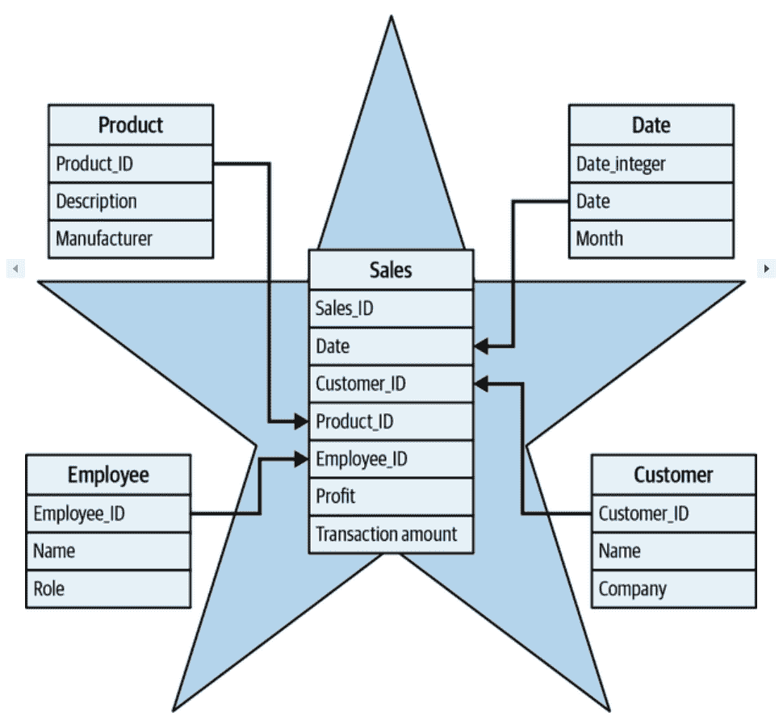

图 5-1. 典型的星型模式，包含一个事实表和多个维度表

快速回顾一下，星型模式由一个事实表和多个维度表组成。事实表存储度量、指标和交易数据，例如销售、订单，通常包含数字列和链接到维度表的外部键。维度表存储与业务实体相关的描述性属性，例如客户信息、产品信息。维度表中的信息通常用于在报表中过滤数据。

一旦导入事实表和维度表，例如来自 Fabric 或其他数据源，你需要在这些表之间创建关系，以在 Power BI 数据集中形成星型模式。这可以实现高效的过滤、聚合和直观的分析。你可以在图 5-2 中看到其外观，我们将在下一节讨论如何创建这些关系。

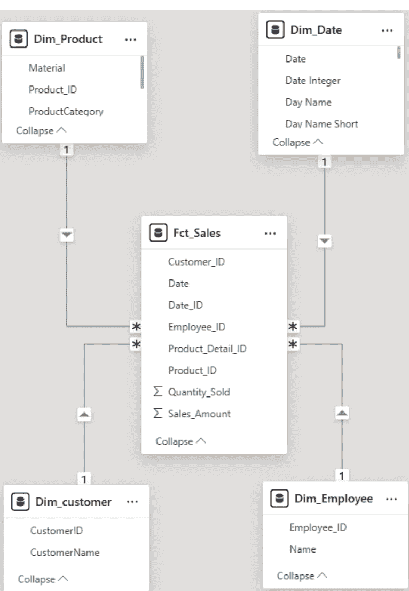

图 5-2. 在 Power BI 中创建的星型模型，包含一个事实表和多个维度表

## 在语义模型中创建关系

将表加载到 Power BI 后，我们需要创建它们之间的关系，以便它们能够有效协同工作。如果没有关系，表将保持独立：你仍然可以看到数据，但如果你想组合信息，例如使用不同的维度表来过滤或分析事实表中的数据，则只有在存在正确的关系时才能做到。

图 5-3 显示了一个包含多个表的数据模型。我们可以看到 Fct_Sales 表和 Dim_Employee 表之间目前没有任何连接。

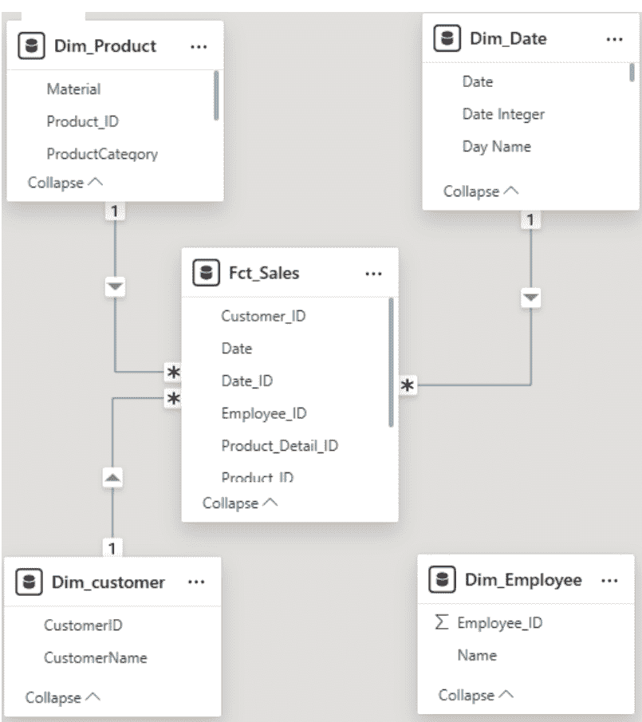

图 5-3. Power BI 中的模型视图，显示一个维度表与事实表之间没有关系

在这种情况下，如果我们在报表中将 Dim_Employee 表中的员工姓名添加为切片器，它不会影响基于 Fct_Sales 表的可视化。切片器只会过滤直接使用 Dim_Employee 表数据的可视化，这是因为表之间没有关系来连接员工信息与销售数据。因此，我们需要创建表之间的关系以使其正确交互。

在 Power BI 中创建关系很容易。你只需单击一列，例如 Dim_Employee 表中的 Employee_ID 列，并将其拖到 Fct_Sales 表中的对应列。然后，Power BI 会自动打开一个窗口，让你更详细地定义关系。在此窗口中，你可以配置关系中涉及的表和列，设置基数，例如一对多，并指定交叉筛选方向。图 5-4 显示了此关系设置窗口的示例。

## 新关系

选择相关的表和列。

来自表

Dim_Employee

| Employee_ID | Name |
|---|---|
| 1 | Anna |
| 2 | Ben |

到表

Fct_Sales

| Customer_ID | Date | Date_ID | Employee_ID | Product_Detail... | Product_ID | Quantity_ |
|---|---|---|---|---|---|---|
| 102 | 20250601 | zondag 1 juni... | 1 | 101 | 101 | 3 |
| 103 | 20250601 | zondag 1 juni... | 2 | 102 | 102 | 1 |
| 104 | 20250602 | maandag 2 ju... | 1 | 103 | 103 | 2 |

基数

一对多 (1:*)

交叉筛选方向

单向

使此关系处于活动状态

在两个方向应用安全筛选

假设引用完整性

保存

取消

图 5-4. 通过定义表、基数和交叉筛选方向在 Power BI 中创建新关系

第一步是选择要连接的两个表。当你将列从一个表拖放到另一个表时，Power BI 会自动在关系编辑器中选择这些表。但是，你可能会不小心将列拖放到错误的位置，或意识到实际上需要连接不同的表。在这些情况下，你可以手动调整选择。在关系窗口中，你可以单击每个表中代表关系的列。还要确保选择具有正确键的列：维度表中的主键和事实表中的对应外键。

一旦我们选择要连接的表，就需要查看 *基数*，它定义了两个表之间关系的类型，基于一个表中的行与另一个表中的行如何相关。它告诉 Power BI 一个表中的每个值与另一个表中的一个或多个值匹配。图 5-5 显示了各种基数选项。

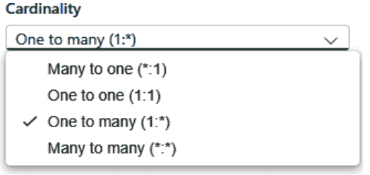

*图 5-5. Power BI 中的不同基数选项*

选择正确的选项对于确保报表功能至关重要。正确的基数可确保筛选和聚合按预期工作。另一方面，如果你选择了错误的基数，报表中显示的结果可能不正确，并可能导致用户犯错或得出错误结论。正确的基数也有助于性能，因为 Power BI 不必猜测表之间的关系。当关系明确定义时，Power BI 可以生成更高效的查询。

## 基数：不同类型的关系

让我们更仔细地查看不同的基数选项：

- *多对一 (*:1) 或 一对多 (1:*) *


这是在星型架构中最常见的关系类型：事实表中的多行对应维度表中的一个值。例如，考虑 Fct_Sales 和 Dim_Employee 表：每个员工（具有唯一的 Employee_ID）在他们每次销售时都可能在销售数据中多次出现。然而，每个员工在维度表中应该只有一个唯一的键来引用他们。

你应该选择 多对一 (* : 1) 还是 一对多 (1 : *) 取决于你在创建关系时选择表的顺序。如果你先选择维度表，它就成为“一方”，事实表将是“多方”，因此你应该选择 一对多 (1 : *) 基数。另一方面，如果你先选择事实表，你应该选择 多对一 (* : 1) 基数，因为事实表包含与一个维度值相关的多条记录。

## 一对一 (1 : 1)

在此基数下，一个表中的每一行恰好匹配另一个表中的一行。这种情况不常见，通常表明两个表包含相似或重叠的数据，可以合并为一个表，从而得到更简单的模型。一对一 (1 : 1) 关系例如在数据来源中表被拆分但实际上在语义模型中可以是一个表时就会发生。始终考虑将这些表合并以简化语义模型。

## 多对多 (* : *)

当用于创建关系的列中两个表都存在重复值时，就会发生这种关系。

这通常发生在任一表中都没有唯一键时。例如，假设你有以下情况：
- 一个销售目标维度表，其中区域名称多次列出，因为每个区域每个月都有目标。
- 一个销售事实表，其中区域名称也多次列出，因为每个区域有多笔销售。

如果你尝试通过使用区域名称列在这两个表之间创建关系，两个表都将具有区域值的重复项。因此，Power BI 将无法确定行之间单一、清晰的关系，因此表之间存在 多对多 (* : *) 关系。这可能导致总计不正确、重复计数和令人困惑的筛选，因此你需要非常确定这是你想要的关系。

## 跨筛选方向

除了关系基数外，我们在两个表之间创建关系时还需要选择跨筛选方向。我们有两个选项可供选择：Single 和 Both（见图 5-6）。

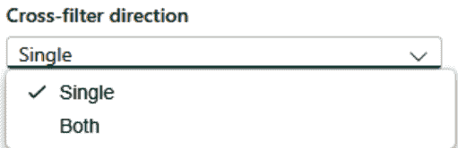

图 5-6. Power BI 中的跨筛选方向选项

### Single

在星型架构中，筛选方向通常设置为 Single，这使其从维度表流向事实表。这意味着当你在维度表中选择或筛选某项（如产品类别）时，引擎会自动筛选事实表中相关的记录（如该类别的销售数据）。这是推荐且最常见的设置，因为它使模型保持简单，避免意外结果，并确保更快的查询性能。使用单向筛选时，Power BI 只需要在一种方式下计算筛选，这更快也更容易理解。

### Both

双向筛选允许筛选在两个表之间双向移动，这意味着在任一表中选择某项都可能影响另一表。虽然这有时可能有用（例如，如果你希望来自两个表的切片器或视觉对象相互交互），但它也可能使模型更难跟踪，并在筛选以你不期望的方式应用时导致令人困惑的结果。它还可能降低性能，尤其是在多个表使用双向筛选连接时。

## 活动和非活动关系

有时，语义模型需要在两个表之间建立多个关系，但一次只能有一个处于活动状态。例如，想象我们的 Fct_Sales 表同时具有 Order Date 列和 Shipment Date 列，这两列都应与 Dim_Date 表中的 Date 列建立关系。我们需要两个关系，因为我们希望在某些视觉对象中按订单日期分析销售数据，在其他视觉对象中按发货日期分析。由于 Power BI 只允许两个表之间存在一个活动关系，我们可以创建一个将被显示为非活动关系的第二个关系。

图 5-7 显示了具有活动和非活动关系的两个表。

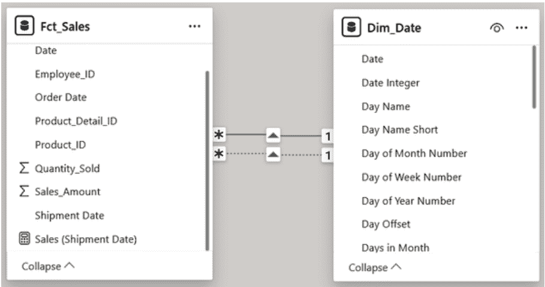

图 5-7. 具有活动和非活动关系的两个表

当我们尝试在已存在关系的两个表之间创建新关系时，Power BI 会将新关系设为非活动。如果你尝试使两个关系都处于活动状态，你还会看到错误消息（见图 5-8）。

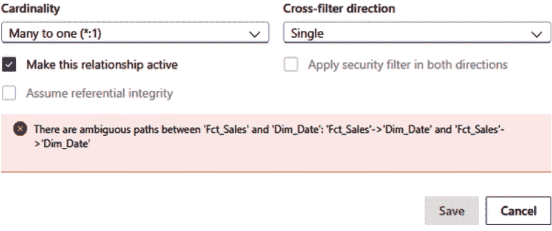

图 5-8. 尝试创建第二个活动关系时出现的错误消息

要在 Power BI 中使用非活动关系，你需要在 DAX 度量值中显式激活它。你可以通过在 DAX 公式中使用 USERELATIONSHIP() 函数来实现。例如，考虑一个具有 Order Date 和 Shipment Date 列的 FCT_Sales 表，这些列与 Dim_Date 表有关系。Order Date 具有活动关系，但如果你想使用 Shipment Date，你可以创建图 5-9 所示的 DAX。

```
Sales (Shipment Date) =
CALCULATE (
    SUM ( Fct_Sales[Sales_Amount] ),
    USERELATIONSHIP ( Dim_Date[Date], Fct_Sales[Shipment Date] )
)
```

图 5-9. 在 DAX 中使用 USERELATIONSHIP() 函数激活非活动关系

因此，虽然 Power BI 只允许两个表之间存在一个活动关系，但我们可以创建多个非活动关系，并通过在 DAX 度量值中使用 USERELATIONSHIP() 动态地在它们之间切换。

## 断开连接的表

我们的数据模型中并非每个表都需要直接连接到其他表。在某些情况下，我们根本不想要关系，这时断开连接的表就派上用场了。断开连接的表通常用作输入表，因为它们为报表用户提供了一种与度量值交互的方式，而不会改变底层数据关系。

例如，想象我们希望用户设置一个目标以执行假设分析。我们将创建一个包含固定选项的小表，如 0.8、1、1.2 和 1.5，表示不同的目标情景。此断开连接的表与语义模型中的其他表无关。我们可以将此目标添加为切片器，然后使用以下 DAX 创建一个与这些目标相对应的度量值：

```
Adjusted Target Sales =
    [Total Sales] * Target
```

这之所以有效，是因为断开连接的表为我们提供了目标，切片器让我们选择这些值，然后 DAX 度量值根据输入动态更改视觉对象中的值。表是否断开连接并不重要，因为你并不是试图直接筛选其他表。相反，你只是捕获用户的选择并在 DAX 度量值内部使用它。这使得使用断开连接的表成为向报表添加灵活、交互式功能的有力方法，而无需向模型添加不必要的复杂性或关系。

## 实现计算组、字段参数和动态格式字符串

现在，让我们来看看两个可以帮助你构建更灵活报表的 Power BI 功能：计算组和字段参数。它们让我们可以在多个度量值之间重用逻辑，并允许用户在字段或视觉对象之间切换。当我们知道如何实现这些选项时，我们不仅可以提高报表的性能，还可以使它们更易于理解且更不复杂，因为逻辑是可重用的。

让我们从计算组开始。


## 计算组

使用计算组是减少报表中 DAX 度量值数量的绝佳方法。与其为每个度量值重复类似的逻辑，不如将该逻辑分组到一个计算组中并重复使用。常见用例是时间智能计算，例如年初至今 YTD、月至今 MTD 和去年年初至今计算。如果您有多个基础度量值，如销售额、数量和利润，您通常会为每个度量值分别创建 YTD、MTD 和去年年初至今版本。但使用计算组，您可以在不重复逻辑的情况下将这些计算应用于所有相关度量值。

在我们深入了解如何创建计算组之前，让我们先看看在哪里可以找到它们。在 Power BI Desktop 中，转到模型视图（您可以查看表和关系的位置）。顶部，您会看到添加计算组的图标（见图 5-10）。

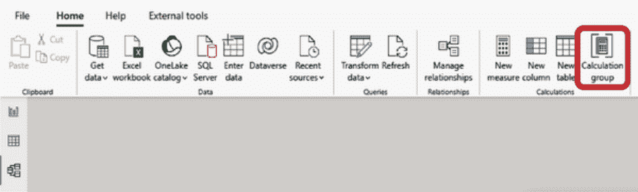

图 5-10. Power BI 模型视图中的计算组按钮

创建计算组后，它会显示为包含一列的表。该列代表我们可以应用于现有度量值（如销售额或数量）的计算项。图 5-11 显示了计算组在报表视图中的显示方式。

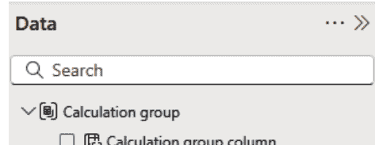

图 5-11. 计算组在报表视图中显示为包含一列的表

在我们的示例中，计算组包含三个项：月至今、年初至今和去年年初至今。虽然我们在报表视图中无法直接看到这些项的内容，但我们可以通过将计算组字段和我们的一个度量值（如 Sales）拖到表格视觉对象中来应用它们。图 5-12 显示了结果。

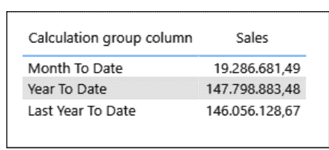

图 5-12. 表格中包含计算组和一个度量值，显示三个时间智能度量值

正如我们在此处看到的，三个计算组项会自动应用于报表中选择的度量值。如果我们选择另一个 DAX 度量值，如总数量，相同的计算也会为该度量值创建。

## 隐式和显式度量值

当您创建计算组时，Power BI 会显示警告，计算组仅适用于显式度量值。图 5-13 显示了此警告。

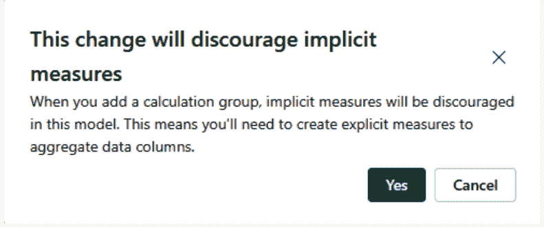

图 5-13. 警告计算组仅适用于显式度量值

那么，隐式度量值和显式度量值有什么区别？隐式度量值是在将字段拖入视觉对象时自动创建的，Power BI 会（大多数情况下）为您汇总或计数该字段。显式度量值是您使用 DAX 度量值自行编写的。计算组需要显式度量值，如果您尝试使用隐式度量值，Power BI 会提醒您这是不可能的。

## 创建计算组

当您打开模型视图并单击计算组按钮时，会发生两件事：顶部会出现一个 DAX 公式栏，右侧会打开一个窗格。默认情况下会创建一个新的计算项：

```
Calculation item = SELECTEDMEASURE()
```

这只是返回所选度量值的当前值，通常用作“基础”或“当前”项（尽管您可以保留或更改它）。图 5-14 显示了当有一个计算组和四个计算项时窗格的外观。

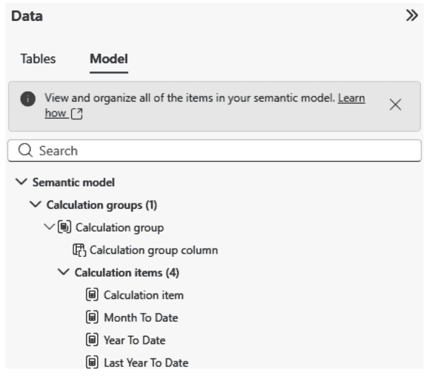

图 5-14. Power BI 模型视图中的计算组视图

您可以通过右键单击“Calculation items”然后选择“New calculation item”来创建额外的计算项（见图 5-15）。

图 5-15. 右键单击“Calculation items”以创建新项

每个计算项都有自己的名称和 DAX 表达式。时间智能的一些示例如下：

### 月至今

```
MTD = CALCULATE(SELECTEDMEASURE(), DATESMTD(DimDate[Date]))
```

### 年初至今

```
YTD = CALCULATE(SELECTEDMEASURE(), DATESYTD(DimDate[Date]))
```

### 去年年初至今

```
LYTD = CALCULATE(
    SELECTEDMEASURE(),
    SAMEPERIODLASTYEAR(DimDate[Date]),
    'Time Intelligence'[Time Calculation] = "YTD"
)
```

如果您想更改计算项出现的顺序（例如，让 YTD 在去年年初至今之前显示），请打开属性窗格，单击计算组，然后拖动项以重新排序（见图 5-16）。

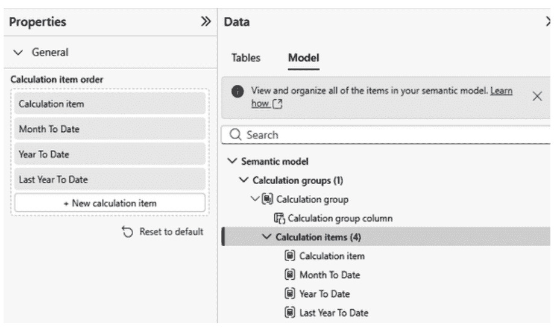

图 5-16. 在模型视图的属性窗格中重新排序计算项

## 计算项的动态格式字符串

默认情况下，计算项使用基础度量值的格式。但是，您可以使用动态格式字符串覆盖它。例如，您可以单击

Year to Date 项，在属性窗格中启用动态格式，然后只需填写您想要使用的格式字符串。一个示例是“$#,##0”，它会在值前显示 $ 符号。图 5-17 是以 YTD 为例的窗格截图。

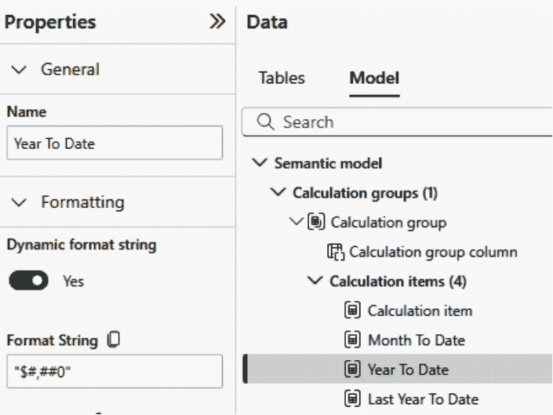

图 5-17. 在属性窗格中为 YTD 计算项选择不同的格式字符串

图 5-18 显示了该格式在视觉对象中的应用方式。它使 YTD 值脱颖而出，因为它是唯一带有美元符号和格式的项。

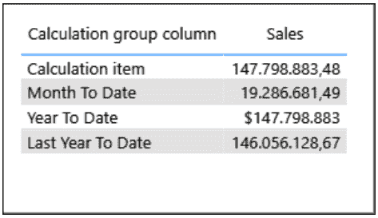

图 5-18. YTD 计算项已配置动态格式字符串，因此不使用基础格式

计算组允许您通过在多个度量值上应用共享逻辑（如时间智能）来简化模型。它们有助于减少冗余并保持模型干净高效。然而，有一些限制：

- 计算组不适用于隐式度量值，仅适用于显式度量值。
- 行级安全性 RLS 和对象级安全性 OLS 不受支持。
- 使用实时连接连接到模型时，动态格式字符串将无法工作。

在决定是否在 Power BI 模型中使用计算组时，请务必牢记这些事项。

## 字段参数

虽然计算组通过在多个度量值上应用共享逻辑来减少 DAX 度量值的数量，但字段参数让您控制视觉对象中显示哪些字段。使用字段参数，用户可以在不同的度量值或维度之间切换（例如，使用切片器在产品、类别和国家之间选择）。这是一种使报表更具交互性而不会使页面杂乱的简单方法。

假设我们有一个按产品、类别和国家显示销售额的报表。一个选项是为每个创建单独的视觉对象（见图 5-19）。

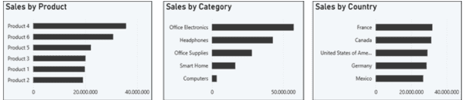

图 5-19. 三个条形图显示按产品、类别和国家划分的销售额

这可行，但占用空间且不总是必要的。通常，不同用户希望使用不同的视图——例如，产品经理可能希望使用产品视图，类别经理可能希望使用类别视图，而领导层可能希望使用国家视图。但他们不需要同时看到所有内容，字段参数帮助我们解决了这个问题。与其显示全部三个视觉对象，不如让用户选择他们想要查看的内容。这使报表保持简洁，同时仍提供灵活性。

让我们逐步了解如何设置两种类型的字段参数：一种切换维度，一种切换度量值。

## 创建字段参数

在使用字段参数之前，我们需要先创建它。在 Power BI 的报表视图中，我们转到建模，单击“New parameter”图标，然后选择 Fields（见图 5-20）。

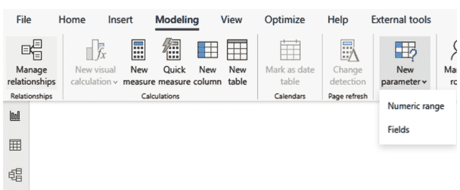

图 5-20. 通过单击建模然后“New parameter”在 Power BI 中创建字段参数

然后，会出现一个名为 Parameters 的弹出窗口。这就是我们设置的地方。首先，Power BI 询问我们想要为其创建参数的内容。在我们的例子中，我们想要切换字段，因此默认选择是可以的。然后，我们为参数命名，在下方选择我们想要包含的字段。底部有一个选项可自动向页面添加切片器。默认情况下已选中，我们保留它，因为我们使用此切片器在最终视觉对象中在不同维度之间导航。图 5-21 显示了弹出窗口中添加了三个维度：Product、Category 和 Country 的样子。

然后，我们单击 Create 以创建字段参数。它在数据窗格中显示为一个表，与模型的表一起显示。要使用该参数，我们可以简单地创建一个像之前创建的那样的条形图，将销售额放在 x 轴上，将参数放在 y 轴上（见图 5-22）。


## Parameters

为可视化对象和 DAX 表达式添加参数，以便人们可以使用切片器调整输入并查看不同的结果。了解更多

你的变量将调整什么？

Name

Parameter

添加并重新排序字段

+   - Product
+   - Category
+   - Country

Fields

Search

+   - Calculation group
+   - Date
+   - Dimension Parameter
+   - Incremental
+   - Location
+     - Country
+   - Measures in model
+   - Parameter - Measures
+   - Product
+     - Category
+     - Custom
+     - Product

Create

Cancel

Figure 5-21. Pop-up we use to set up our parameters

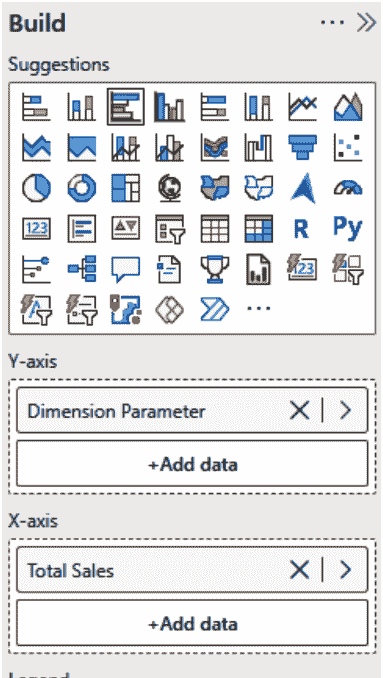

Figure 5-22. Adding the parameter in our visual, just like we added a normal dimension before

当我们创建参数时，我们选择了“Create slicer”，因此带有参数值的切片器可视化对象会自动添加到我们的报表页面中。如果我们没有这样做，我们也可以始终选择一个切片器可视化对象并将参数添加到其中。但现在，我们有一个切片器和一个可视化对象（见图 5-23）。

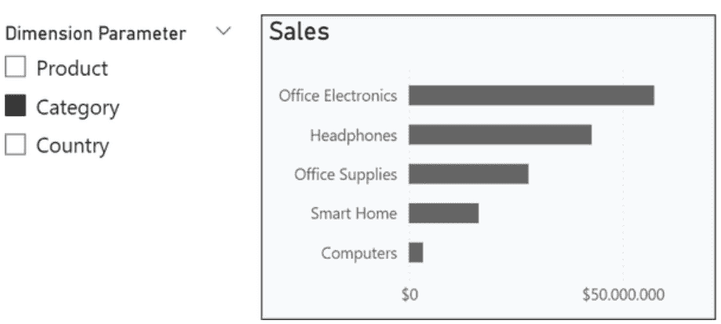

Figure 5-23. A visual with a field parameter on the y-axis that we control with the slicer

我们现在可以通过在切片器上单击来在三个不同维度之间切换，可视化对象将自动在维度之间切换。当大量受众查看你的报表并且你希望为用户提供快速在视图之间切换的选项，并为每个人提供对他们最有价值的信息时，这非常方便。

## Modifying field parameters

现在你可能会想，如果我想对字段参数进行更改，比如添加一个维度或更改排序顺序怎么办？你无法返回之前使用的弹出窗口，但当你在数据概览中单击你的参数时，DAX 窗格将打开，你将看到字段参数的配置（见图 5-24）。

```
Dimension Parameter = {
    ("Product", NAMEOF('Product'[Product]), 0),
    ("Category", NAMEOF('Product'[Category]), 1),
    ("Country", NAMEOF('Location'[Country]), 2)
}
```

Figure 5-24. Configuration of your field parameter, viewed in the DAX pane

因此，当我们想要添加一个类别时，我们只需向 DAX 度量中添加一行。每一行代表一个维度。它以名称开头，然后定义它引用的维度，然后显示排序顺序。如果我们希望切片器中首先显示 Country，我们只需在排序顺序中交换 Product 和 Country。

除了使用字段参数用于维度外，我们还可以使用它们用于度量（例如，当我们希望在可视化对象中在 Sales 和 Quantity 之间切换时）。设置相同：我们单击 Fields 参数图标，然后不是添加维度，而是添加我们希望在参数中看到的度量（见图 5-25）。

在我们为字段参数创建度量后，我们可以将它添加到之前创建的条形图中的 x 轴。然后，通过单击具有两个参数选项的切片器，我们可以在两个度量之间动态切换（见图 5-26 和 5-27）。

## Parameters

为可视化对象和 DAX 表达式添加参数，以便人们可以使用切片器调整输入并查看不同的结果。了解更多

你的变量将调整什么？

Fields

Name

Parameter - Measures

添加并重新排序字段

+   - Total Sales
+   - Total Units Sold

Fields

Search

+   - SalesID
+   - Segment
+   - Sheet
+   - Sheet1_1
+   - Total Sales
+   - Total Units Sold
+   - Total Units Sold LY
+   - Units Sold
+   - Units Sold YoY Growth %
+   - Units Sold YoY Growth % variable
+   - Window No partition
+   - Window Running Sum by Year

Add slicer to this page

Create

Cancel

Figure 5-25. Adding two measures to a field parameter

Parameter - Measures
Total Sales
Total Units Sold

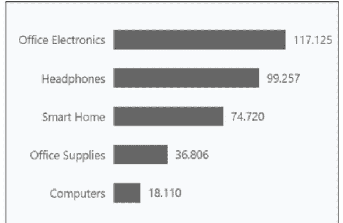

Figure 5-26. Bar chart with two field parameter options for measures, with Total Units Sold selected

Parameter - Measures
Total Sales
Total Units Sold

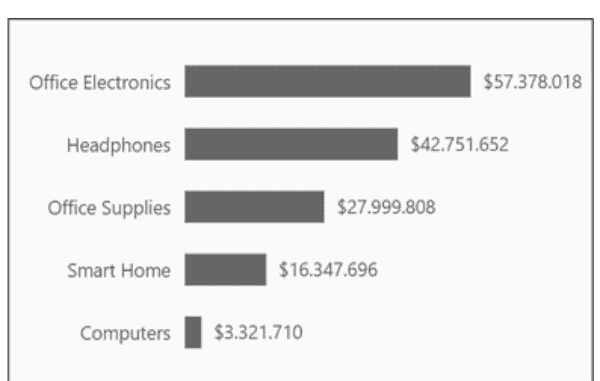

Figure 5-27. Bar chart with two field parameter options for measures, with Total Sales selected

我们还可以同时使用两个字段参数。例如，我们可以使用我们首先创建的包含三个维度的字段参数和我们最后为度量创建的字段参数。为此，我们将它们都放入一个可视化对象中，并确保两者都有切片器可视化对象，以便为用户提供选择他们希望在可视化对象中看到的内容的选项（见图 5-28）。

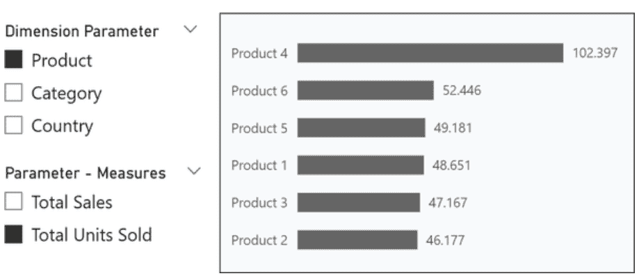

Figure 5-28. Visual with two field parameters: one for the dimensions and another for the measures

使用字段参数是一种简单但强大的方法，可以使你的报表更灵活。与一次性显示所有内容相比，你可以让用户控制他们想要看到的内容。无论是切换维度还是度量，字段参数都有助于保持你的报表简洁、专注且更易于使用。

## Limitations

字段参数存在一些限制，我们需要牢记。我们需要使用切片器在维度之间切换，当未选择任何内容时，一切都会显示。这意味着我们需要记住为切片器激活“强制选择”。此外，字段参数不适用于实时连接，因此模型需要在导入模式下。他们也只适用于显式度量。

## Dynamic Format Strings

动态格式字符串让我们能够根据条件或规则控制度量在可视化对象中的显示方式，而不会更改底层值。我们已经向你展示了它如何与计算组一起使用，但你也可以直接将动态格式字符串应用于单个度量。这提供了更大的灵活性，避免了使用不同格式重复度量。

## Creating dynamic format strings

要创建动态格式字符串，首先需要在 Power BI 的数据窗格中单击度量来为其启用。然后，你可以在“度量工具”选项卡中将格式更改为动态（见图 5-29）。

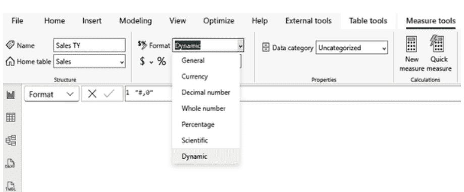

Figure 5-29. Clicking on a measure and changing its format to Dynamic

在你启用动态格式设置后，“度量工具”选项卡中的列表框将显示格式视图，表明你现在正在查看格式设置。你也可以单击列表框以切换回度量视图（见图 5-30）。

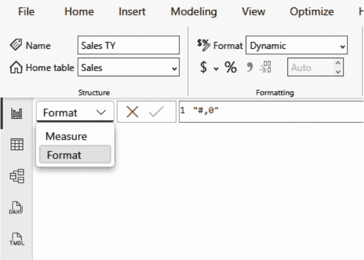

Figure 5-30. Switching between Format and Measure views by clicking on the listbox

假设我们有一个包含国家、货币和我们想要使用的格式的表。每个国家可以有不同的货币和格式（见图 5-31）。

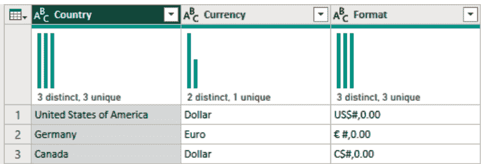

Figure 5-31. Table with countries, currencies, and corresponding format strings

现在，我们可以转到我们的 Sales 度量并将格式更改为动态。在格式列表框中，我们将字符串设置为根据所选国家返回正确格式字符串的 DAX 表达式。这里有一个示例：

```
SELECTEDVALUE('Country Currency Format Strings'[Format], "\$#,0.00;(\$#,0.00);\$#,0.00")
```

此表达式从表中查找格式字符串。如果未进行选择，则使用默认格式："$#,0.00; ($#,0.00);$#,0.00"。此默认格式以美元符号和两位小数显示正数（例如 $1,234.50），负数用括号显示（例如 ($1,234.50)），零值显示为 $0.00。基本上，它根据上下文或筛选动态地将正确的格式应用于度量。见图 5-32，了解动态格式字符串的结果。

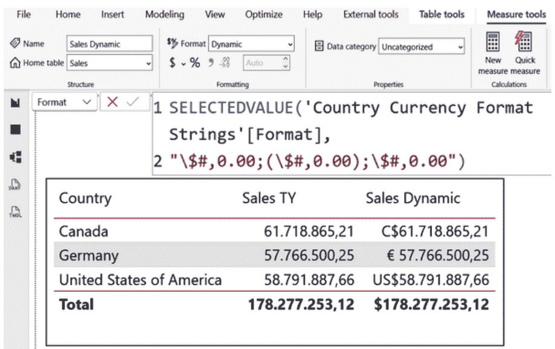

Figure 5-32. Assigning a dynamic format string to a measure by using a lookup table

一旦度量具有动态格式字符串，可视化对象将自动显示正确的格式（见图 5-33）。例如，当用户按国家筛选时，折线图将在 y 轴上显示正确的货币。


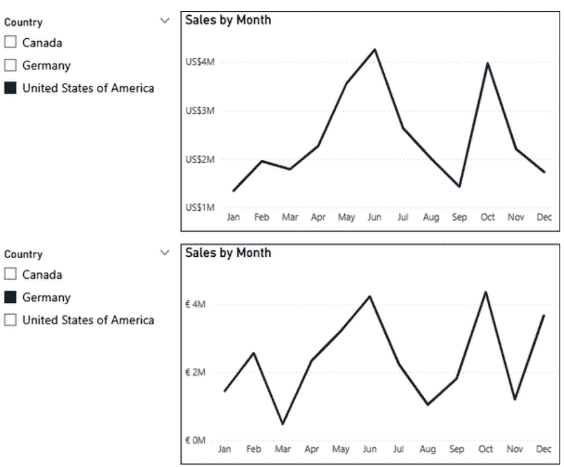

图 5-33. 基于选择的 y 轴会自动更新为正确货币的可视化

## 优点和局限性

动态格式字符串可以使报表更易于阅读，并自动根据数据显示的上下文进行调整。它们通过以正确的格式显示值，例如货币或百分比，帮助用户正确解释值，而无需创建同一度量的多个版本。这使得报表更易于使用，并减少了维护工作量。

然而，你需要知道动态格式字符串仅适用于显式度量，并且在实时连接的 DirectQuery 模式下不受支持。尽管如此，它们提供了一种实用的方法，使报表更具动态性和可读性，而不会给模型增加不必要的复杂性。

## 大型语义模型存储格式

有时，尤其是在处理大量数据时，即使我们通过实施星型模式来优化数据模型，创建计算组和字段参数也可能使数据集变得如此庞大，以至于达到 Power BI 导入模式的限制。默认情况下，使用 Power BI Pro 许可证的 Power BI 数据集在导入模式下限制为 1 GB。但是，如果你在 premium 工作区中工作，你可以切换到 *大型语义模型存储* 格式，这允许你的数据集增长超过 10 GB。该格式专为企业级模型设计，并在处理大量数据时提供更大的灵活性。

大型模型存储模式的限制由 Fabric 容量的限制定义。表 5-2 提供了此类限制的概述。

表 5-2. 大型模型存储模式限制

| Capacity | Limit1 |
|---|---|
| F2 | 1 GB |
| F4 | 2 GB |
| F8/EM1/A1 | 3 GB |
| F16/EM2/A2 | 5 GB |
| F32/EM3/A3 | 6 GB |
| F64/P1/A4 | 10 GB |
| F128/P2/A5 | 10 GB |
| F256/P3/A6 | 10 GB |
| F512/P4/A7 | 10 GB |
| F1024/P5/A8 | 10 GB |
| F2048 | 10 GB |

### NOTE

此表中的限制对应于 Power BI 中数据集的压缩大小。源表中的实际数据量可能大得多。Power BI 使用高效的列式压缩，典型的压缩比范围为 5 倍至 10 倍。这意味着 Power BI 中的 5 GB 数据集可能代表 25–50 GB 的原始源数据。

要启用大型语义模型存储格式，我们需要进入 Power BI 服务，即在线 Power BI 环境。在那里，我们可以创建具有大型存储格式的新工作区或更改现有工作区。

要创建新工作区，我们选择“New workspace”，进入工作区设置，并选择“Large semantic model storage format” （见图 5-34）。

## Create a workspace

License mode ①

Pro
Select Pro to use basic Power BI features and collaborate on reports, dashboards, and scorecards. To access a Pro workspace, users need Pro per-user licenses. Learn more

Premium per-user
Select Premium per-user to collaborate using Power BI Premium features, including advanced dataflows, and datamarts. To collaborate and share content in a Premium per-user workspace, users need Premium per-user licenses. Learn more

Premium capacity
Select premium capacity if the workspace will be hosted in a premium capacity. When you share, collaborate on, and distribute Power BI and Microsoft Fabric content, users in the viewer role can access this content without needing a Pro or Premium per-user license. Learn more

Embedded
Select embedded if the workspace will be hosted in an Azure embedded capacity. ISVs and developers use Power BI Embedded to embed visuals and analytics in their applications. Learn more

Fabric capacity
Select Fabric capacity if the workspace will be hosted in a Microsoft Fabric capacity. With Fabric capacities, users can create Microsoft Fabric items and collaborate with others using Fabric features and experiences. Explore new capabilities in Power BI, Data Factory, Data Engineering, and Real-Time Intelligence, among others. Learn more

Trial
Select Trial to assign this workspace to a Fabric trial capacity. A Microsoft Fabric trial capacity allows user to explore the capabilities of Microsoft Fabric like Data Factory, Data

Apply Cancel

图 5-34. 创建新工作区时选择存储模式

如果我们已经有工作区并想更改存储模型，我们可以进入要更改的语义模型的设置，向下滚动到“Large semantic model storage format” 部分，并为现有语义模型启用该选项（见图 5-35）。

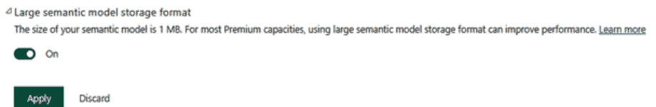

图 5-35. 在语义模型设置中更改语义模型的存储模式

在 Power BI 中处理大型数据集时，切换到大型语义模型存储格式允许你超出默认大小限制。此选项在 Power BI 服务中易于启用，并且取决于你的 Fabric 容量。对于需要更多增长空间同时保持性能和灵活性的企业级模型，它也特别有用。

## 设计和构建复合模型

当你处理企业规模的模型时，你通常会有来自多个来源的数据。一些数据可能存储在导入模式中，而其他数据可能需要使用 DirectQuery 进行实时连接。这种结合不同存储模式的数据模型称为复合模型。

复合模型允许我们在单个报表中组合来自多个来源的数据。我们可以将导入模式与一个或多个 DirectQuery 连接混合，甚至可以组合多个 DirectQuery 数据源。这在处理具有不同刷新计划的数据源或需要实时访问时提供了灵活性。例如，我们可能每天导入一次更新的销售数据，同时使用实时连接获取实时库存数据。

复合模型允许数据集具有来自不同源组的两个或多个连接。这些可以如下：

- 一个或多个 DirectQuery 连接与导入模式组合
- 来自不同数据源的多个 DirectQuery 连接
- 支持源的任何其他组合

## 创建复合模型

在 Power BI 中创建复合模型只需几个步骤。假设我们在 Power BI 中有一个导入模式语义模型。我们意识到我们需要来自其中一个 Fabric 事件中心的某个表，并且我们需要与数据进行实时连接。我们可以将此数据加载到 Power BI，一旦这样做，我们将看到 Power BI 的消息询问我们希望数据如何连接：通过导入模式还是通过 DirectQuery。在这种情况下，因为我们希望与数据进行实时连接，所以我们选择 DirectQuery。Power BI 然后会添加新表，你可以通过其顶部栏加粗且颜色不同来识别它（见图 5-36 中的 Tutorial 表）。

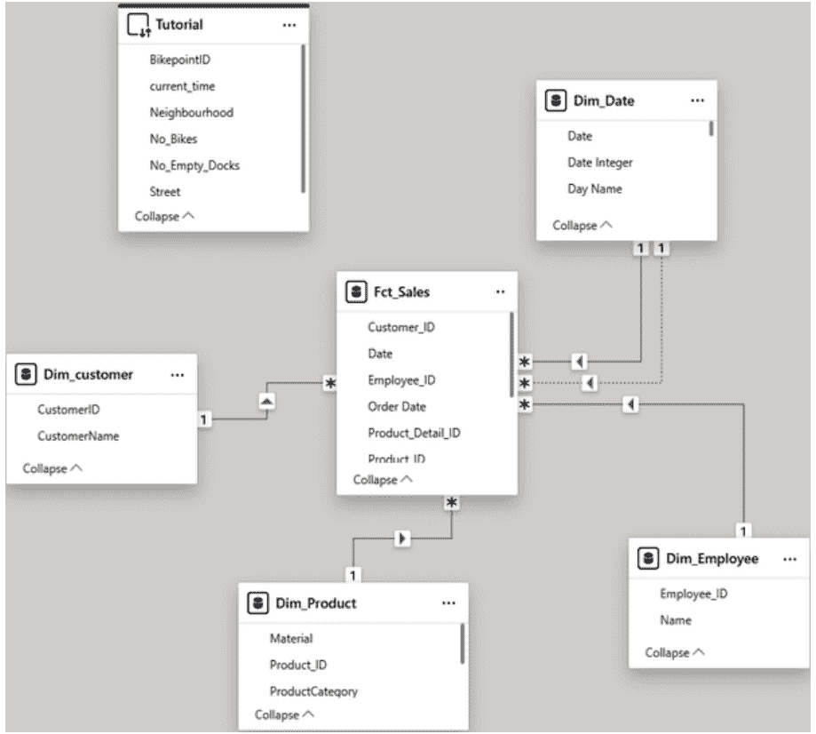

图 5-36. 复合模型，其中一个直接查询表与导入模式表并列

一旦我们在 Power BI 中拥有复合模型，然后在右下角，我们将看到图 5-37 中的消息。


图 5-37. 指示复合模型的提示

## 优点和局限性

当你想组合来自多个数据源的数据，其中一些数据需要实时，而其他数据可以处于导入模式时，使用复合模型很有意义。尤其是在企业环境中，你会经常看到这种情况，不同部门使用不同的工具和不同的数据存储。

你可以在 Power BI 中在新加载的表与其他表之间创建关系，就像你通常做的那样。然而，你需要知道默认情况下，两个不同来源（导入模式和 DirectQuery）之间的关系将是多对多。你可以更改此设置，但你需要主动点击关系并将其更改为例如一对多。

> **NOTE**
> 
> 在双模式复合模型中，此默认行为不适用，因为关系的处理方式不同，取决于哪些表处于导入模式，哪些处于 DirectQuery 模式。

在选择复合模型而不是导入模式之前，你还需要考虑性能。使用复合模型可能会影响性能，尤其是在可视化或计算依赖于多个来源时。单个可视化可能会触发多个查询，其中一个来源的结果传递到另一个来源。

复合模型允许我们在单个数据集中组合来自不同来源、存储模式和刷新策略的数据。它们提供了构建更智能、更具响应性的报表的灵活性，而无需将所有内容强制到同一数据源或刷新模式。通过对关系行为和性能影响有所了解，你可以使用复合模型构建语义模型，其中数据需要在不同的“新鲜度”级别。


## Summary

本章介绍了在 Power BI 中构建结构良好的语义模型的关键概念。

我们首先介绍了如何选择存储模式。然后，我们讲解了关系以及设计星型模式的重要性。接下来，我们研究了计算组，它允许我们在多个度量上应用共享逻辑（例如年初至今和去年年初至今），而无需重复 DAX。我们还讨论了动态格式，它可以让你为不同的计算项更改数字格式。然后，我们转向字段参数，这是一项功能，可以通过让用户在视觉对象中选择他们想要查看的字段或度量，使报表更具交互性。这减少了页面上的视觉对象数量，并根据不同用户定制体验。接下来，我们研究了大型语义模型是什么以及我们如何自行配置它们。最后，我们讲解了复合模型，即语义模型使用不同类型的数据源存储模式。

这些方面中的每一个都是在 Power BI 中设计和构建语义模型的重要组成部分。了解这些知识应该能让你更容易创建随时间推移可扩展且保持性能的语义模型。
