## Chapter 6. Optimizing Enterprise-Scale Semantic Models

随着语义模型规模的增大，其性能可能会成为问题。对于较小的模型，变通方法可能有效，但随着模型增长，你会发现优化不仅仅是锦上添花——它是至关重要的。一个反应迟缓的模型会影响你制作的所有内容，包括 Power BI 报表，这些报表必须具有快速加载的视觉对象和高效的刷新，以便最终用户将其视为可用。随着时间的推移，这些性能挑战会给使用数据的人员和最终用户都带来重大困扰。

本章将重点帮助你通过更明智地决定如何查询、存储和刷新数据来优化性能。我们将首先使用 DAX INFO.VIEW 函数和 Power BI 性能分析器来识别性能问题。接下来，我们将研究改进 DAX 性能的实用技术，例如优化你的度量。然后，我们将研究 Direct Lake，这是一种存储模式，特别适合大型语义模型，包括企业级操作中的模型。最后，我们将介绍增量刷新，它允许你仅更新新添加的数据，而不是反复重新加载所有数据。当你处理具有大量频繁添加数据的庞大语义模型时，这变得至关重要。

## Understanding Performance Metrics in DAX Queries and Report Visuals

缓慢的性能会让用户感到沮丧，并损害 Power BI 报表的采用率。要提高性能，你需要了解延迟来自何处——猜测并不能帮你走远。你需要了解幕后发生的事情的可见性，并且需要从衡量和分析性能开始。

在本节中，我们将研究如何深入了解报表视觉对象和 DAX 查询的性能。首先，我们将介绍 INFO.VIEW 函数，它允许你直接在 Power BI 中查询语义模型的元数据（例如度量、表、列和关系），无需外部工具即可完成。这些元数据有助于你识别潜在的瓶颈，例如过多的计算列，并且对于记录模型中发生的情况也很有用。

接下来，我们将探讨 Power BI Desktop 中的性能分析器。此内置工具可帮助你了解每个视觉对象加载所需的时间。更重要的是，它分解了该时间在视觉对象渲染、准备 DAX 查询以及等待数据源响应等方面花费的情况。它准确显示了 Power BI 在幕后如何与你的模型交互，并且它还允许你导出结果，这使得稍后查看结果或与团队分享发现变得更容易。使用性能分析器是识别报表变慢的原因以及优化工作重点的实用方法。

## DAX INFO.VIEW Functions

在使用 Power BI 时，了解你的数据对于可视化很重要。然而，掌握语义模型，包括其结构和性能，同样重要。获得这些见解将帮助你制作更好的文档，实现更简单的维护和更智能的性能优化。

在处理 Power BI 报表时，可能会出现以下几个问题：

- 模型中存在哪些 DAX 度量？
- 度量中的 DAX 表达式是什么？
- 是否存在需要审查的隐藏表或列？
- 不同表之间的关系是什么？

你可以通过手动点击每个 DAX 度量并查看语法来回答第一个问题（模型中存在哪些 DAX 度量？）。但这很快就会变得乏味，尤其是在较大的模型中。一种更快、更可扩展的选择是使用 Power BI 中的 INFO.VIEW 函数，它以表格格式返回语义模型的元数据。这种方法对于文档和治理很有用，但对于发现优化机会，例如未使用的列和过于复杂的度量，也非常有用。

让我们看一些如何检索有关我们使用的度量、列、表和关系的信息的示例。首先，我们将研究使用 DAX 查询视图检索这些数据的方法，之后，我们将研究检索信息并在 Power BI 报表中可视化它的方法。

在进入查询之前，我们需要让你了解一些限制。INFO.VIEW 函数需要对语义模型具有写入权限，只有只读权限的用户无法运行这些查询，因为它们会公开诸如度量、列和关系之类的元数据。这也意味着当你实时连接到已发布的数据集时，无法使用 INFO.VIEW 函数。在这种情况下，你需要直接在本地或可编辑的模型中工作。

## DAX Query View Examples

让我们从 DAX 查询视图开始。如果你以前没有使用过，你可以在 Power BI Desktop 的左侧窗格中找到它（见图 6-1）。

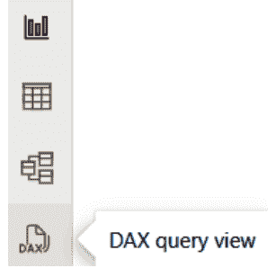

图 6-1. Power BI Desktop 左侧窗格中的 DAX 查询视图

你可以通过在 DAX 查询视图中使用 EVALUATE 语句直接对语义模型运行查询。例如，要获取模型中所有表的概览，可以使用以下代码：

```
EVALUATE INFO.VIEW.TABLES()
```

它返回一个包含模型中每个表的元数据的表，包括表名、是否隐藏、存储模式以及是否使用 DAX 表达式创建。

执行此概览是快速评估模型结构的好方法。它可以帮助你发现不再需要的隐藏表以及使用计算表达式构建的表，从而可以对其进行优化。它还有助于清理、性能调优，甚至治理。图 6-2 显示了此类查询的结果。

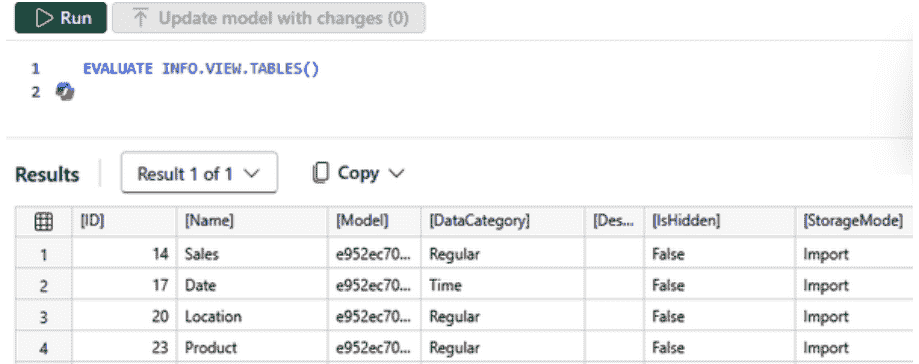

图 6-2. DAX 查询视图中 INFO.VIEW.TABLES() 查询的结果

你也可以使用以下代码检索有关模型中列的信息：

```
EVALUATE INFO.VIEW.COLUMNS()
```

这将为你提供模型中所有列的概览，并返回诸如列名、数据类型以及列是否隐藏等元数据。这将帮助你审查哪些列实际使用，找出仍残留在模型中的不必要的列，并检查命名和数据类型的 consistency。另请注意，如果你的模型变得庞大，这种概览可以为你节省大量点击时间。

现在，每个人在与 Power BI 工作一段时间后都会寻找的是模型中的 DAX 度量。你可以通过以下查询获取此信息：

```
EVALUATE INFO.VIEW.MEASURES()
```

这将为你提供模型中所有度量的完整列表，包括其名称、DAX 表达式和格式字符串。这是一种很好的方法来检查你的度量是否命名一致，任何逻辑是否可以重用或简化，或者某些度量是否缺少文档。在团队中工作或进行长期项目时，你还应注意可见性，因为隐藏的度量可能并非 intended 永远保持隐藏。

以下是另一个方便的查询，可帮助你检查模型中表之间的关系：

```
EVALUATE INFO.VIEW.RELATIONSHIPS()
```

它返回 from 和 to 列、关系类型、交叉筛选方向以及关系是否处于活动状态。这些元数据可以在无需视觉扫描语义模型图的情况下为你提供清晰的了解。图 6-3 显示了此类查询的结果。


EVALUATE INFO.VIEW.RELATIONSHIPS()

结果

结果 1 / 1

复制

|  | [ID] | [Name] | [Relationship] | [Mo... | [IsActive] | [CrossFilteringBehavior] |  |
|---|---|---|---|---|---|---|---|
| 1 | 1525 | AutoDete... | 'Sales'[Country] *<->1 'Location'[Country] | e95... | True | OneDirection |  |
| 2 | 2580 | AutoDete... | 'Sales'[Custom] *<->1 'Product'[Custom] | e95... | True | OneDirection |  |
| 3 | 3598 | 159ebffe... | 'Sales'[Date] *<->1 'Date'[Date] | e95... | True | OneDirection |  |
| 4 | 36146 | AutoDete... | 'Location'[Country] 1<->1 'Country Currency ... | e95... | True | BothDirections |  |
| 5 | 30803 | 97ae943e... | 'Incremental'[current_time] *<->1 'Date'[Date] | e95... | True | OneDirection |  |
| 6 | 36146 | AutoDete... | 'Country Currency Format Strings'[Country] 1<... | e95... | True | BothDirections |  |

图 6-3. DAX 查询视图中列出的关系

现在我们已经在 DAX 查询视图中查看了这些查询的结果，重要的是要提到，你并不局限于在查询中使用这些函数。你也可以在计算表或度量值中使用它们，将元数据直接带入你的模型中。这意味着你可以在 Power BI 报表中可视化这些结果，这可以极大地帮助你进行模型文档化、治理和总体清理。例如，你可以创建 DAX 度量值，通过统计度量值、列、表和关系的数量来快速概览你的语义模型（见图 6-4）。这将帮助你监控模型复杂性，并在开发后识别出意外的更改。


图 6-4. Power BI 报表中模型表的、列和度量的概览

你可以用如下简单的 COUNTROWS 语句来实现：

```
Number of measures =
    COUNTROWS( INFO.VIEW.MEASURES() )
Number of columns =
    COUNTROWS( INFO.VIEW.COLUMNS() )
Number of tables =
    COUNTROWS( INFO.VIEW.TABLES() )
Number of relationships =
    COUNTROWS( INFO.VIEW.RELATIONSHIPS() )
```

除了在 Power BI 中将这些度量值用于卡片视觉对象外，你还可以创建一个计算表，其中包含模型中使用的所有度量的详细信息。图 6-5 显示了你可以用来执行此操作的查询示例。

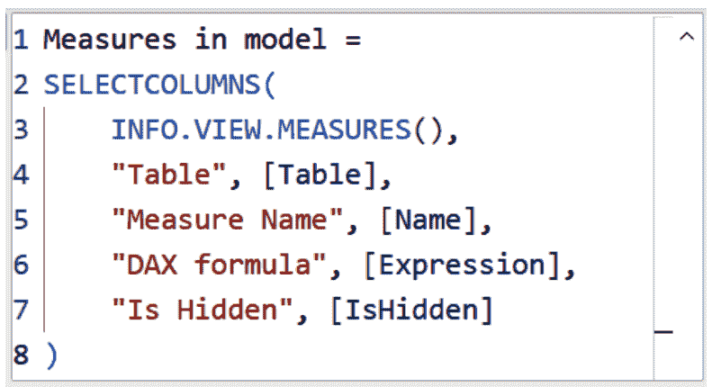

这会创建一个包含有关度量的有用元数据的表，例如它们的位置、名称、实际的 DAX 公式，以及它们是否隐藏。在此示例中，我们只选择了四列，但你可以通过引用 INFO.VIEW.MEASURES() 中的其他字段轻松包含更多列。图 6-6 是使用计算表的列的 Power BI 表视觉对象的示例。

## INFO.VIEW.MEASURES()

| Table | Measure Name | DAX formula | Is Hidden |
|---|---|---|---|
| Sales | Total Sales | SUM(Sales[Sales]) | False |
| Sales | Total Units Sold | SUM(Sales[Units Sold]) | False |
| Sales | Total Units Sold LY | CALCULATE([Total Units Sold], SAMEPERIODLASTYEAR('Date'[Date])) | False |
| Sales | Units Sold YoY Growth % | DIVIDE([Total Units Sold] - CALCULATE([Total Units Sold], SAMEPERIODLASTYEAR('Date'[Date])), CALCULATE([Total Units Sold], SAMEPERIODLASTYEAR('Date'[Date]))) | False |
| Sales | Units Sold YoY Growth % variable | VAR PrevUnitSales = CALCULATE([Total Units Sold], SAMEPERIODLASTYEAR('Date'[Date])) RETURN DIVIDE( | False |

图 6-6. 使用计算表的列的表视觉对象

## Power BI 中的性能测试：性能分析器

在 Power BI 中构建报表时，你可能会想知道为什么某些页面或视觉对象感觉很慢。是因为某个特定的视觉对象、繁重的 DAX 查询，还是后台发生了其他事情？Power BI Desktop 中的性能分析器可以帮助回答这些问题。它测量报表不同部分在加载或用户与之交互时响应的耗时。

你可以通过转到顶部功能区的“优化”选项卡并选择“性能分析器”（见图 6-7）找到性能分析器。

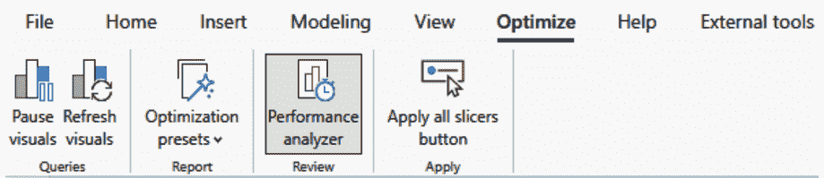

图 6-7. 性能分析器图标

这将在 Power BI Desktop 屏幕的右侧打开性能分析器窗格（见图 6-8）。

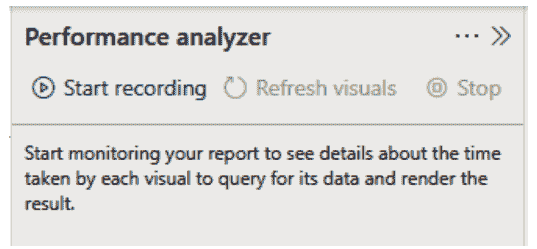

图 6-8. 性能分析器窗格

## Power BI 中性能分析器的工作原理

你会在性能分析器窗格中看到“开始记录”按钮。“停止”和“刷新视觉对象”选项在开始记录前会处于灰色状态。当你点击“开始记录”时，Power BI 开始跟踪你交互的性能。无论你使用切片器、筛选表格，还是更改视觉对象，Power BI 都会按发生的顺序记录你的所有交互。

这有助于你识别哪些视觉对象缓慢、延迟的原因是什么（DAX、渲染或其他），以及你所做的任何更改是否改善了性能。你可以通过点击“刷新视觉对象”一次性测试所有内容，也可以通过手动与报表交互来实时跟踪单个操作的影响。图 6-9 是选项的屏幕截图。

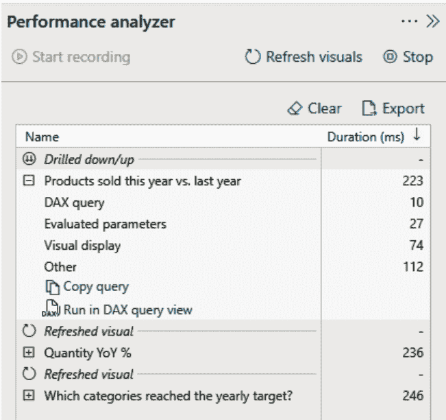

图 6-9. 刷新部分视觉对象后的性能分析器

当你通过点击 + 图标展开视觉对象的日志条目时，你会看到以下四种类型的性能指标：

### DAX 查询

这是 Power BI 运行视觉对象生成的 DAX 查询所需的时间。它测量从发送查询到从数据模型接收结果之间的间隔。这里的长时间间隔通常表示模型中复杂的或低效的 DAX 计算或关系。

### 评估参数（预览）

如果你使用字段参数（用于动态字段选择），这表示评估这些参数所需的时间。这有助于你了解动态视觉对象对性能的影响。

### 视觉对象显示

这是视觉对象实际出现在屏幕上所需的时间。

### 其他

这涵盖了前面各节未包含的剩余时间，包括准备查询、等待其他视觉对象完成或运行后台进程所花费的时间。

与其刷新所有视觉对象，你也可以通过点击“分析此视觉对象”图标（在图 6-10 中突出显示）一次测试一个视觉对象。这将仅刷新该视觉对象并显示其性能指标，这在你尝试识别减慢页面的单个视觉对象时很有帮助。

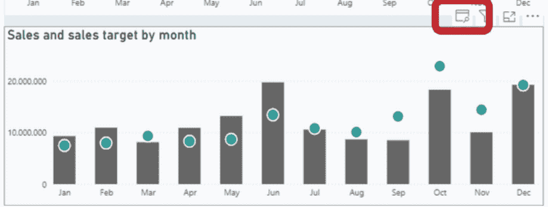

图 6-10. 通过点击突出显示的图标刷新单个视觉对象并分析性能

测试完成后，点击导出将结果保存为 .json 文件。这对于文档、与团队分享见解以及在你改进报表时随时间比较性能非常有用。要重新开始，点击性能分析器窗格中的清除以删除所有先前的日志，然后再次点击“开始记录”以运行新的测试。

## 在 DAX 中实施性能改进

一旦你开始使用超过干净演示数据集的数据集在 Power BI 中工作，你就会意识到 Power BI 报表会迅速变得复杂，并且随着数据集的增长，性能和用户体验也会迅速恶化。虽然我们希望报表对最终用户来说加载流畅且快速，但它们往往会随着时间的推移变得更慢。

编写不当的 DAX 会导致刷新时间长、视觉对象变慢，甚至导致结果不准确。为防止这种情况，我们可以实施不同的策略来提高 DAX 表达式的效率和清晰度。

在本节中，我们将研究如何编写性能更好的 DAX，以及这些更改如何使其更易于理解并最终维护。我们将介绍变量如何通过减少重复计算来简化 DAX 公式，同时提高可读性。你还将了解空白值和错误处理的重要性，以及如何管理它们以避免性能陷阱。

我们还将比较不同的 DAX 方法，例如使用 DIVIDE 函数而不是除法运算符，


to help you understand their impact on performance and error prevention.

## 使用变量改进 DAX 公式

那么，在 DAX 中 *变量* 究竟是什么？它是一个使用 VAR 关键字存储的值或表达式，并在公式中使用 RETURN 稍后引用它。它可以帮助你避免重复并使度量更结构化。

在 Power BI 中使用变量可以帮助你清晰地构建 DAX 逻辑，同时提高性能。当你在改进 Power BI 报表中的 DAX 时，很容易只关注微调公式和调整函数以获得正确的结果。但编写 DAX 不仅仅是得到正确的结果；它还关乎编写高效、可读的代码。

在 DAX 度量中使用变量有两种重要好处。首先，它可以提高性能。通过一次性计算一个值并重复使用它，Power BI 避免了重复相同的计算。其次，使用变量使你的度量更易于阅读和维护。当你编写公式时，它可能对你来说完全有意义，但当你六个月后重新查看它时，尤其是如果它有点复杂时，你可能需要一段时间才能弄明白。

让我们看两个 DAX 度量的例子：一个使用变量，另一个没有。

假设你正在处理销售数据，并希望计算同比增长率百分比，即今年与去年相比销售了多少更多（或更少）的单位。一个不使用变量的 DAX 度量可能如下所示：

```
Units Sold YoY Growth % =
DIVIDE (
    [Total Units Sold]
        - CALCULATE (
            [Total Units Sold],
            SAMEPERIODLASTYEAR ( 'Date'[Date] )
        ),
    CALCULATE (
        [Total Units Sold],
        SAMEPERIODLASTYEAR ( 'Date'[Date] )
    )
)
```

此 DAX 度量的结果将提供你想要的答案，但在审阅时，你会看到你在度量中重复了其中一部分两次：

```
CALCULATE([Total Units Sold], SAMEPERIODLASTYEAR('Date'[Date]))
```

不仅重复是低效的，而且它还使度量看起来比实际复杂得多，从而更难阅读。我们可以通过使用变量来简化它。添加变量后，此 DAX 公式如下所示：

```
Units Sold YoY Growth % variable =
VAR PrevUnitSales =
    CALCULATE([Total Units Sold],
SAMEPERIODLASTYEAR('Date'[Date]))
RETURN
    DIVIDE(
        [Total Units Sold] - PrevUnitSales,
        PrevUnitSales
    )
```

在这个例子中，我们将去年的销售额存储在一个名为 PrevUnitSales 的变量中，然后在 DAX 的 RETURN 部分中使用它，而无需重复相同的计算。这种方法使公式更简单、更易于维护且更高效。你还可以定义多个变量并在 RETURN 语句中使用它们所有，这是 DAX 度量中你告诉 Power BI 最终结果应该是什么的部分。它是你放置使用先前定义变量的逻辑的地方。

可以这样想：首先，你准备好所需的一切，这些就是你的变量。然后，你编写返回最终值的部分，那就是 RETURN。

总之，在 DAX 中使用变量有几个好处。它通过只计算一次值来提高性能，使你的公式更易于阅读，帮助你更快地调试，并减少代码中的复杂性。随着你的 DAX 公式变得更复杂，使用变量将使你的工作变得更加易于管理。

## 计数表行：COUNTROWS 与 COUNT

在 Power BI 中处理数据时，有时我们需要计数某些内容，例如特定表中行的数量。在 DAX 中，我们有两个可以协助此操作的函数：COUNT 和 COUNTROWS。虽然它们听起来相似，但它们的功能不同，并且根据你的数据可能会产生不同的结果。你需要了解它们之间的区别，以避免在报表度量中犯错。

以下是关键区别：

### COUNT

它计算你指定的单个列中非空白值的数量：

DAX

```
COUNT(<column>)
```

### COUNTROWS

它计算表中行的总数，而不管列中的内容如何：

DAX

```
COUNTROWS([<table>])
```

假设你有一个包含三百行的 Sales 表。每一行代表一次销售交易，你想创建一个度量来计算完成的销售订单数量。你可以用两种方式编写该度量（见图 6-11）。

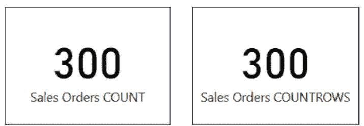

图 6-11. COUNT 和 COUNTROWS 显示相同的结果

两个度量都返回相同的值：300。乍一看，这似乎合乎逻辑；每个销售订单都有一个日期。因此，无论你计数行还是日期的数量，你都会得到相同的结果。

但现在，想象一下你的数据存在问题。也许有两行没有填写日期。它们仍然代表销售，但出于某种原因，日期字段被留空，例如导入错误、手动输入错误或数据缺失。

在这种情况下，度量的结果会不同：

```
COUNT(Sales[Date])
```

返回 298，因为它跳过了两个空白。

```
COUNTROWS(Sales)
```

仍然返回 300，因为它不在乎行中有什么；它计算每一行。

图 6-12 显示了结果。

| Date | Units Sold |
|------|------------|
|      | 500 |
|      | 405 |
| 01-12-2025 | 515 |
| 01-12-2025 | 545 |
| 01-12-2025 | 117 |

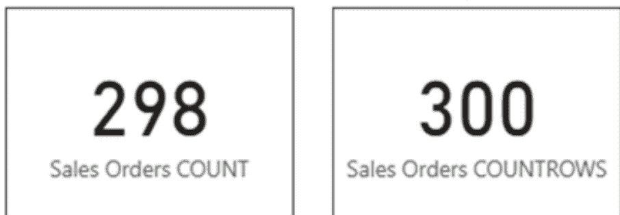

图 6-12. 由于空值，COUNT 和 COUNTROWS 之间的差异

有一些重要的细节需要记住。当你 specifically 想要检查列包含多少条目时，使用 COUNT 是有意义的，例如有多少订单填写了发货日期。然而，要计算表中的记录数，你应该始终使用 COUNTROWS。

想象一下构建一个跟踪随时间订单量的 Power BI 报表。如果你使用 COUNT(Sales[Date]) 并且某些日期缺失，你的数字将是不正确的。这可能会影响决策和预测，甚至可能导致有人认为数据不完整，而实际上数据就在那里，只是你计数的列中没有。

避免此类问题的经验法则是：如果要计数表中的行，请使用 COUNTROWS；如果要计数特定列中的值（排除空白值），请使用 COUNT。

## 将 NULL 转换为 0

有时，当你处理真实世界的数据集时，你可能会遇到 NULL 值。它们可能出现在例如数据缺失、数据尚未加载或数据质量较低时。你可能会想知道是否应该将这些值留空或替换为例如 0。假设你有一个按国家显示总销售额的表，其中一行，德国，在某一天显示没有销售额。你很可能会想用 0 替换那个空值，你甚至可能被要求这样做以使其看起来更整洁。看一下图 6-13，看看包含空值的表是什么样子的。

## Bike Sales

| Date | Country | Sales |
|---|---|---|
| 1-6-25 | Germany |  |
| 1-6-25 | Mexico | 6.305,76 |
| 1-6-25 | France | 7.247,10 |
| 1-6-25 | Canada | 7.388,85 |

图 6-13. Sales 列中包含空值的表

一个用于替换 NULL（空白）值的 DAX 度量可能如下所示：

```
Sales blank to 0 =
IF(
    ISBLANK([Total Sales]),
    0,
    [Total Sales]
)
```

此 DAX 度量的结果将包含 0 而不是 NULL 值（见图 6-14）。

## Bike Sales

| Date | Sum of Sales | Sales - null to 0 |
|---|---|---|
| 1-6-25 | 20.941,71 | 20.941,71 |
| Canada | 7.388,85 | 7.388,85 |
| France | 7.247,10 | 7.247,10 |
| Germany |  | 0,00 |
| Mexico | 6.305,76 | 6.305,76 |
| Total | 20.941,71 | 20.941,71 |

图 6-14. 在最后一列用 0 替换 NULL

从视觉上看，这可能更直观，但它会影响你的计算吗？在许多情况下，Power BI 处理得相当好。假设你在一个 DIVIDE() 度量中使用你的“空白转 0”版本，如下所示：

```
Profit Margin Bike Sales = Divide([Profit Bikes],Sales[Sales - null to 0])
```

它仍然会给出预期的结果（见图 6-15）。


## Bike Sales

| Date | Sum of Sales | Sales - null to 0 | Profit Margin Bike Sales |
|---|---|---|---|
| 1-6-25 | 286.639,50 | 286.639,50 | 32,9% |
| Canada | 80.200,80 | 80.200,80 | 29,1% |
| France | 65.340,00 | 65.340,00 | 33,3% |
| Germany |  | 0,00 |  |
| Mexico | 74.100,00 | 74.100,00 | 33,3% |
| United States of America | 66.998,70 | 66.998,70 | 23,4% |
| Total | 286.639,50 | 286.639,50 | 32,9% |

Figure 6-15. The result of a DIVIDE measure

If [Profit Bikes] is also blank when [Total Sales] is blank (which is usually the case), then the whole expression stays blank. Even if it’s not blank, users often understand that dividing by 0 gives either a blank or “infinity.”

So, you may think, why does it matter whether or not you use a 0 value? The answer is that using a 0 value doesn’t always go smoothly. It can influence your results and show incorrect findings. For example, let’s look at these two AVERAGEX calculations:

```
AverageX Bike Sales = AVERAGEX(Sales,[Total Sales])
```

```
AverageX Bike Sales - 0 value = AVERAGEX(Sales,[Sales - null to 0])
```

The difference between them is in how they treat blanks:

AVERAGEX(Sales, [Total Sales])
This skips blanks and ignores Germany.

AVERAGEX(Sales, [Sales - null to 0])
This includes Germany as 0.

If you replace a blank with 0, then suddenly, you’re calculating something completely different. This can seriously mess up key performance indicators (KPIs), dashboards, and anything else in which precision matters (as shown in Figure 6-16).

Bike Sales
Date | Sum of Sales | Sales - null to 0 | AverageX Bike Sales | AverageX Bike Sales - 0 value
1-6-25
Canada | 80.200,80 | 80.200,80 | 40.100,40 | 40.100,40
France | 65.340,00 | 65.340,00 | 32.670,00 | 32.670,00
Germany |  | 0,00 |  | 0,00
Mexico | 74.100,00 | 74.100,00 | 37.050,00 | 37.050,00
United States of America | 66.998,70 | 66.998,70 | 33.499,35 | 33.499,35
Total | 286.639,50 | 286.639,50 | 35.829,94 | 28.663,95

Figure 6-16. Table showing how blanks and 0 are treated in a measure

Showing a 0 might seem cleaner, but a blank and a 0 don’t mean the same thing:

### A blank

This means no data—maybe nothing was sold, the product doesn’t exist, or the data hasn’t been collected yet.

### 0

This means a real value of zero.

Replacing blank values with 0 might seem like a harmless change that enhances your report’s appearance. However, once you begin using these 0 values in calculations, problems can quickly arise. AVERAGEX, for instance, treats blanks and zeros very differently. While it ignores blanks in the calculation, it counts zeroes and thus pulls down your average and potentially misrepresents your data. This can impact how users interpret KPIs.

There’s also a performance aspect to consider. Using an expression like IF(ISBLANK(), 0) introduces additional logic that the Power BI engine must evaluate for each row. Especially within iterator functions like AVERAGEX and SUMX, Power BI evaluates that branching repeatedly, row by row. While this may not matter in a small model, it becomes significant in real-world datasets with millions of rows, as it can slow down performance.

## Using DIVIDE Instead of the / Operator

When report creators start using Power BI and DAX, they often use the slash (/) operator to divide one value by another. It feels intuitive, and Power BI allows it without complaint.

However, there’s also the DIVIDE function, which offers important benefits over the / operator. It not only optimizes for better performance, but it also handles blank values efficiently (see Figure 6-17).

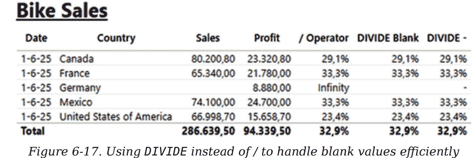

Also, DIVIDE has an optional third argument that enables you to define an alternative result when the division can’t be performed (for instance, when the denominator is a NULL value):

```
DIVIDE(<numerator>, <denominator> [, <alternateresult>])
```

Without DIVIDE, you’d need to write additional IF logic to manage such cases, and that requires more writing effort from you and more time for Power BI to evaluate.

Let’s look at our bike sales table in Figure 6-18 again. Note that it has a NULL value in the Sales column:

## Bike Sales

| Date | Country | Sales | Profit |
|---|---|---|---|
| 1-6-25 | Canada | 80.200,80 | 23.320,80 |
| 1-6-25 | France | 65.340,00 | 21.780,00 |
| 1-6-25 | Germany |  | 8.880,00 |
| 1-6-25 | Mexico | 74.100,00 | 24.700,00 |
| 1-6-25 | United States of America | 66.998,70 | 15.658,70 |
| Total |  | 286.639,50 | 94.339,50 |

Figure 6-18. Table with a NULL value

Our sales dataset has data by date and country, showing both sales and profit. To calculate the profit margin, we divide profit by total sales, and there are two ways to do this in DAX: use the standard slash (/) operator or use the DIVIDE function. The DIVIDE function is more robust, especially when we’re dealing with missing or zero values, as in our example.

We’ve created two DAX measures to show the effect of dividing the profit (the numerator) by the sales (the denominator). In this initial example, we don’t provide an alternative result for the DIVIDE function to show you how NULL values are handled:

```
Margin / Operator = [Profit Bikes]/Sales[Total Sales]
```

```
Margin DIVIDE = Divide([Profit Bikes],Sales[Total Sales])
```

When we compare the two approaches, the difference between them becomes clear. Using the slash operator results in “infinity” when total sales are blank, because Power BI can’t properly handle that scenario. With the DIVIDE function, however, Power BI returns a blank value as expected, because no alternate result was provided. This makes the DIVIDE function the safer and more predictable option for handling division in your DAX measures (see Figure 6-19).

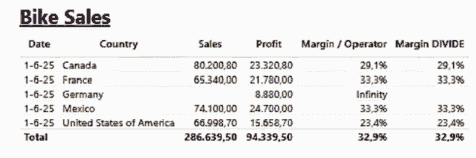

Figure 6-19. Preventing “infinity” by using a DIVIDE statement

Of course, you can also provide an alternate result for cases in which the division isn’t possible. This result can be any value you want, such as 0, a dash (“-”), or even custom text. You add it as the third argument in the DIVIDE function, like this:

```
Margin DIVIDE - = Divide([Profit Bikes],Sales[Total Sales],"-")
```

This way, instead of returning a blank when the denominator is 0 or absent, Power BI will display your chosen value in the result (see Figure 6-20).

## Bike Sales

| Date | Country | Sales | Profit | Margin / Operator | Margin DIVIDE |
|---|---|---|---|---|---|
| 1-6-25 | Canada | 80.200,80 | 23.320,80 | 29,1% | 29,1% |
| 1-6-25 | France | 65.340,00 | 21.780,00 | 33,3% | 33,3% |
| 1-6-25 | Germany |  | 8.880,00 | Infinity | - |
| 1-6-25 | Mexico | 74.100,00 | 24.700,00 | 33,3% | 33,3% |
| 1-6-25 | United States of America | 66.998,70 | 15.658,70 | 23,4% | 23,4% |
| Total |  | 286.639,50 | 94.339,50 | 32,9% | 32,9% |

Figure 6-20. Displaying a chosen value instead of a blank

Using the DIVIDE function is better than using the / operator in DAX. While both calculate the same result, DIVIDE is more reliable; it handles division by zero or blank values without returning “infinity” as a result, and you can even choose what should be returned in such cases. Moreover, it improves performance by avoiding the need for extra IF statements to manage exceptions. Additionally, DIVIDE makes your DAX code easier to read and maintain, especially when you’re working with more complex measures.

## Are IFERROR and ISERROR as Helpful as They Look?

If you’re experienced with Excel, you’re probably familiar with IFERROR and ISERROR. They seem like handy tools: they catch errors, return a fallback value, and are done. However, in Power BI, these functions can slow things down, especially in larger models or more complex reports.

The DAX for the two tools look like this:

```
ISERROR = ISERROR(<value>)
IFERROR = IFERROR(value, value_if_error)
```

The difference between them is that ISERROR returns either TRUE (there’s an error) or FALSE (if there’s no error), while IFERROR evaluates whether there’s an error and then provides an alternative value for that error. While all of that sounds helpful, the issue is that, even when there is no error, the whole logic is executed to check for any error, and that adds performance time.

Also, while the function may seem helpful sometimes, we may have other logic that works better. Let’s look at this example based on our bike sales margin, where one column returns a NULL value:

```
ISERROR = ISERROR([Margin / Operator])
IFERROR = IFERROR([Margin / Operator], BLANK())
```

The ISERROR statement will return a TRUE value when we have a NULL value, and the IFERROR measure will return a blank value when we find the NULL value. But if you revisit the previous section on the DIVIDE function, you may realize that DIVIDE would be a great option for this, too, because it automatically returns a blank value when no value can be returned:

```
Margin DIVIDE = DIVIDE([Profit Bikes], Sales[Total Sales])
```

Figure 6-21 shows the difference between handling a blank value with ISERROR and doing it with IFERROR.


## Bike Sales

| Date | Country | Sales | Profit | / Operator | ISERROR | IFERROR | DIVIDE |
|---|---|---|---|---|---|---|---|
| 1-6-25 | Canada | $80.201 | $23.321 | 29,1% | False | 29,1% | 29,1% |
| 1-6-25 | France | $65.340 | $21.780 | 33,3% | False | 33,3% | 33,3% |
| 1-6-25 | Germany |  | $8.880 | Infinity | True |  |  |
| 1-6-25 | Mexico | $74.100 | $24.700 | 33,3% | False | 33,3% | 33,3% |
| 1-6-25 | United States of America | $66.999 | $15.659 | 23,4% | False | 23,4% | 23,4% |
| Total |  | $286.640 | $94.340 | 32,9% | False | 32,9% | 32,9% |

> Figure 6-21. Difference between handling a blank value with ISERROR and doing it with IFERROR

但随后，你可能会问，这对我的报表会产生多大的差异？我们将这两种度量放在一个简单的卡片视觉对象中，并使用性能分析器对其进行测试。结果相同，但 IFERROR 的执行时间更长。在简单的报表中， resulting 的时间差异很小，但在扩展到复杂的 DAX 逻辑或更大的数据集时，该差异会迅速增加。

在处理数据质量问题或潜在错误时，最佳做法是在尽可能上游解决该问题，以便错误根本不会进入模型。理想情况下，你应该在源头做到这一点。如果不可行，那么你应该仔细评估 IFERROR 和 ISERROR 等函数是否真正增加了价值，或者是否存在替代函数可以在对 Power BI 性能影响更小的情况下解决该问题。

## Special DAX Functions: ORDERBY, PARTITIONBY, and MATCHBY

你可能在处理数据时熟悉排序和分区。在 Power BI 中，我们有三个特殊的 DAX 函数——ORDERBY、PARTITIONBY 和 MATCHBY——它们与窗口函数一起使用（例如 INDEX、OFFSET、WINDOW、RANK 和 ROWNUMBER）。

这些特殊函数帮助你在进行计算之前组织数据，以便你可以在窗口函数中定义如何对行进行分组、排序和匹配。每个函数在使你的计算更高效、更准确方面都发挥着独特的作用。表 6-1 列出了它们的工作方式。

## Table 6-1. Special DAX functions and their effects

| Function | Effect |
|---|---|
| ORDERBY | Defines the sort order |
| PARTITIONBY | Defines the grouping or partition |
| MATCHBY | Defines how to match and find the current row |

你不能独立使用这些函数；它们只能在窗口函数内部工作。你可以把它们看作是帮助 DAX 在计算之前组织数据的助手。

让我们详细查看每个函数。

## ORDERBY

此函数定义窗口函数内部数据的排序顺序。它告诉 DAX，“这是我希望你在使用时使用的顺序 计算。”如果没有明确的 ORDERBY，DAX 就不知道哪一行是第一行、第二行、第三行等。

让我们查看图 6-22 中的示例，其中我们希望按年份计算销售额的累计总和，并按细分进行排序。

## Running Sum Sales by Year

| Year | 2025 | |
| Category | Sales | Running Sum Order by Segment |
| Computers |  |  |
| 1 | 28.855,56 | $28.855,56 |
| 2 | 645.300,00 | $674.155,56 |
| 3 | 25.932,00 | $700.087,56 |
| 4 | 79.794,24 | $779.881,8 |
| 5 |  | $779.881,8 |
| 6 | 1.378.669,56 | $2.158.551,36 |
| 7 | 20.344,98 | $2.178.896,34 |
| 8 | 25.692,00 | $2.204.588,34 |
| 9 | 71.561,16 | $2.276.149,5 |
| 10 | 32.751,60 | $2.308.901,1 |
| 11 | 962.500,00 | $3.271.401,1 |
| 12 | 50.309,28 | $3.321.710,38 |
| Smart Home |  |  |
| 1 | 2.048.285,52 | $2.048.285,515 |
| 2 | 827.287,98 | $2.875.573,495 |
| 3 | 995.522,56 | $3.871.096,055 |
| 4 | 572.351,35 | $4.443.447,405 |
| 5 | 2.072.160,25 | $6.515.607,655 |
| 6 | 4.576.840,43 | $11.092.448,08 |
| 7 | 1.753.642,99 | $12.846.091,07 |
| 8 | 160.409,34 | $13.006.500,41 |
| 9 | 113.777,21 | $13.120.277,62 |
| 10 | 1.797.602,21 | $14.917.879,83 |
| 11 | 1.161.604,00 | $16.079.483,83 |
| 12 | 268.211,90 | $16.347.695,73 |
| Total | 19.669.406,11 | $19.669.406,11 |

Figure 6-22. A running sum measure using the ORDERBY function

DAX 代码如下：

```
DAX
Window Running Sum by Year Order by Segment =
SUMX (
```

```
WINDOW (
    1, ABS, 0, REL,
    ALLSELECTED (
        'Date'[Year],
        'Date'[Month Of Year]
    ),
    ORDERBY ( 'Product'[Segment])),
    [Total Sales]
)
```

我们在这里使用 ORDERBY 函数来确定在执行窗口函数计算之前应如何排列数据。这很重要，因为在我们的案例中，我们希望按 Segment 定义的特定顺序处理每个年份和月份的销售数据。

接下来，这里是我们与 ORDERBY 一起使用的函数的详细信息：

## WINDOW

此函数定义计算窗口并处理所选年份和月份的销售数据。

## ORDERBY( 'Product'[Segment] )

这是我们按 Product 表中的 Segment 列对数据进行排序的位置。ORDERBY 子句确保在执行 SUMX 计算之前数据按 Segment 排列。这确保了累计总和按所需顺序应用。

## ALLSELECTED

此函数确保累计总和是在所选年份和月份上计算的，同时保留报表中的当前筛选器。

## SUMX

此函数遍历窗口并计算每一行的总销售额，根据排序后的数据应用累计总和逻辑。

ORDERBY 对于在 WINDOW、RANK 和 INDEX 函数内部定义计算的序列非常有用。

## PARTITIONBY

我们可以使用此函数在数据中定义组（或分区）。它告诉 DAX，“仅在同一组内的行之间进行比较和排名。”当你必须为每个细分、类别或分组维度分别执行计算时，此函数非常有益。它确保 DAX 在计算期间将每个组视为独立实体。它在你想要执行按组重置的累计总计或排名等计算时也很关键。

例如，假设你要计算销售额随时间推移的累计总和。如果没有 PARTITIONBY，计算将连续跨越所有年份运行。但是，当你使用 PARTITIONBY 时，你告诉 DAX 为每个新年份重置计算。

让我们看一个示例，其中我们希望按年份对销售额的累计总和进行分区（见图 6-23）。

## Running Sum Sales by Year

| Year | 2024 |  | 2025 | |
| Month | Sales | Running Sum | Sales | Running Sum |
| 1 | 944.112,64 | $944.112,635 | 2.077.141,08 | $2.077.141,075 |
| 2 | 2.266.706,22 | $3.210.818,855 | 1.472.587,98 | $3.549.729,055 |
| 3 | 1.381.079,01 | $4.591.897,865 | 1.021.454,56 | $4.571.183,615 |
| 4 | 3.893.186,48 | $8.485.084,345 | 652.145,59 | $5.223.329,205 |
| 5 | 4.830.122,32 | $13.315.206,665 | 2.072.160,25 | $7.295.489,455 |
| 6 | 5.361.405,36 | $18.676.612,025 | 5.955.509,99 | $13.250.999,44 |
| 7 | 2.561.238,72 | $21.237.850,745 | 1.773.987,97 | $15.024.987,41 |
| 8 | 808.533,09 | $22.046.383,835 | 186.101,34 | $15.211.088,75 |
| 9 | 1.807.938,87 | $23.854.322,705 | 185.338,37 | $15.396.427,12 |
| 10 | 3.228.348,30 | $27.082.671,005 | 1.830.353,81 | $17.226.780,93 |
| 11 | 4.676.428,04 | $31.759.099,045 | 2.124.104,00 | $19.350.884,93 |
| 12 | 1.853.949,14 | $33.613.048,185 | 318.521,18 | $19.669.406,11 |
| Total | 33.613.048,19 | $33.613.048,185 | 19.669.406,11 | $19.669.406,11 |

Figure 6-23. Running sum measure in DAX for different years

DAX 代码如下：

```
DAX
Window Running Sum by Year =
SUMX (
    WINDOW (
        1, ABS, 0, REL,
        ALLSELECTED (
            'Date'[Year],
            'Date'[Month Of Year]
        ),
        PARTITIONBY ( 'Date'[Year] )
    ),
    [Total Sales]
)
```

如果没有 PARTITIONBY，累计总和将从一年延续到下一年，这可能不是你想要的。例如，如果你跟踪每年的销售业绩，你可能希望总和在每年 1 月 1 日重新开始，而不是跨年累积。通过使用 PARTITIONBY，你可以实现这一点，确保累计总和针对每一年独立计算（见图 6-24）。

## Running Sum Sales by Year

| Year | Month | Sales | PARTITIONBY (Year) | No PARTITIONBY |
|---|---|---|---|---|
| 2024 | 1 | 944.112,64 | $944.112,635 | $944.112,635 |
| 2024 | 2 | 2.266.706,22 | $3.210.818,855 | $3.210.818,855 |
| 2024 | 3 | 1.381.079,01 | $4.591.897,865 | $4.591.897,865 |
| 2024 | 4 | 3.893.186,48 | $8.485.084,345 | $8.485.084,345 |
| 2024 | 5 | 4.830.122,32 | $13.315.206,665 | $13.315.206,665 |
| 2024 | 6 | 5.361.405,36 | $18.676.612,025 | $18.676.612,025 |
| 2024 | 7 | 2.561.238,72 | $21.237.850,745 | $21.237.850,745 |
| 2024 | 8 | 808.533,09 | $22.046.383,835 | $22.046.383,835 |
| 2024 | 9 | 1.807.938,87 | $23.854.322,705 | $23.854.322,705 |
| 2024 | 10 | 3.228.348,30 | $27.082.671,005 | $27.082.671,005 |
| 2024 | 11 | 4.676.428,04 | $31.759.099,045 | $31.759.099,045 |
| 2024 | 12 | 1.853.949,14 | $33.613.048,185 | $33.613.048,185 |
| 2025 | 1 | 2.077.141,08 | $2.077.141,075 | $35.690.189,26 |
| 2025 | 2 | 1.472.587,98 | $3.549.729,055 | $37.162.777,24 |
| 2025 | 3 | 1.021.454,56 | $4.571.183,615 | $38.184.231,8 |
| 2025 | 4 | 652.145,59 | $5.223.329,205 | $38.836.377,39 |
| 2025 | 5 | 2.072.160,25 | $7.295.489,455 | $40.908.537,64 |
| 2025 | 6 | 5.955.509,99 | $13.250.999,44 | $46.864.047,625 |
| 2025 | 7 | 1.773.987,97 | $15.024.987,41 | $48.638.035,595 |
| 2025 | 8 | 186.101,34 | $15.211.088,75 | $48.824.136,935 |
| 2025 | 9 | 185.338,37 | $15.396.427,12 | $49.009.475,305 |
| 2025 | 10 | 1.830.353,81 | $17.226.780,93 | $50.839.829,115 |
| 2025 | 11 | 2.124.104,00 | $19.350.884,93 | $52.963.933,115 |
| 2025 | 12 | 318.521,18 | $19.669.406,11 | $53.282.454,295 |
| Total |  | 53.282.454,30 | $53.282.454,295 | $53.282.454,295 |

Figure 6-24. Result of a DAX measure using PARTITIONBY year


### MATCHBY

此函数被引入以增强 INDEX、OFFSET、WINDOW、RANK 和 ROWNUMBER 等窗口函数的性能和精度。它有助于避免循环依赖和重复行错误。

更重要的是，MATCHBY 允许你指定一个唯一标识符（例如 ID 或键）来确定窗口函数计算中的“当前行”，而不是使用表中的所有列。这在处理大型数据集时特别有用。与其让 Power BI 扫描所有列，MATCHBY 将其缩小到指定的唯一标识符，从而显著提高性能。例如，如果你正在处理一个大型销售表，在唯一的 SalesID 列上使用 MATCHBY 可确保在计算其他列（如 Sales）的窗口函数时，每一行都被单独处理。这使得计算更高效、更准确。

### Direct Lake

之前，我们研究了如何分析性能指标并增强 DAX 度量以提高 Power BI 报表性能。本节重点介绍一种名为 Direct Lake 的存储模式，该模式特别适用于企业级模型。但它是什么？

*Direct Lake* 是 Microsoft Fabric 中的 Power BI 语义模型存储模式。它让你能够使用存储在 Delta 表中的大型数据集，通常在湖仓或仓库中，而无需将数据导入模型。不是提前刷新或加载所有内容，

Power BI 在需要时直接从存储中读取数据。

为了了解它如何契合，让我们将其与导入和 DirectQuery 进行比较：

- 导入模式将所有数据加载到内存中并在本地缓存。然而，缺点是刷新可能很慢且资源密集，特别是对于大型数据集。
- DirectQuery 绕过将数据加载到内存中，并将每个查询直接发送到数据源。虽然这最大限度地减少了内存负载，但可能导致性能变慢和建模功能受限。
- Direct Lake 在导入模式和 DirectQuery 之间取得平衡。它使用 VertiPaq 引擎实现快速查询性能（像导入模式），但仅在需要时检索所需数据（像 DirectQuery）。这导致开发更快、可扩展性提高和内存使用减少，使得 Direct Lake 成为数据频繁变化或数据集庞大而难以复制的环境的理想解决方案。

### Implementing and Configuring Direct Lake

要使用 Direct Lake，你必须在 Microsoft Fabric 工作区中工作并连接到受支持的源——具体来说，是来自 Fabric 湖仓或仓库的 Delta 表。当你在 Fabric 中 Power BI 中创建语义模型并将其链接到湖仓时，如果连接和数据满足要求，Direct Lake 会自动应用。

设置过程很简单。你通过 Power BI 连接到你的湖仓或仓库，只要数据采用 Delta 格式，Direct Lake 就会被使用。除非你从其他存储模式切换，否则无需手动启用它。

### DirectQuery as a Fallback for Direct Lake

你还需要了解 Direct Lake 并非总可用。某些场景可能导致 Power BI 即使底层数据仍为 Delta 格式时也使用 DirectQuery 模式作为后备。例如，如果语义模型查询 SQL 分析端点中的视图或强制行级安全性（RLS）的表，则不会应用 Direct Lake，而是会应用 DirectQuery 模式。此外，如果 Delta 表超过容量 guardrails（例如，如果它有太多 parquet 文件或行组），Power BI 可能会使用 DirectQuery 作为后备。这即使数据采用 Delta 格式且语义模型在同一工作区内也可能发生。

DirectQuery 作为后备的使用是自动且无通知发生的，因此最终用户可能无法立即识别。表明它已发生的迹象包括延迟增加和数据建模选项减少。

### Refreshing Direct Lake Models

区分 Direct Lake 与导入模式的一个关键特性是刷新操作方式。在导入模式中，刷新操作涉及将所有相关数据复制到 Power BI，这可能资源密集且缓慢，特别是对于大型数据集。Direct Lake 以不同方式管理刷新。不是传输数据，它刷新元数据。这通常被称为 *framing*。

在刷新期间，Power BI 更新其对 OneLake 中 Delta 表最新版本的引用。实际数据不会移动或重新加载；只更新结构和引用。此过程通常在几秒内完成，对系统负载极小，这对于处理不断更新数据的组织来说是一个显著优势。这意味着新数据可以更快地提供给用户，而无需等待计划的刷新周期或触发复杂的数据移动操作。

**NOTE**
存在两种不同的 Direct Lake 模式：Direct Lake on OneLake 和 Direct Lake on SQL。虽然两者都提供快速的查询文件访问，但 Direct Lake on OneLake 允许在单个模型中使用来自多个 Fabric 项的表，而 Direct Lake on SQL 仅限于一个 Fabric 项。你可以在 Power BI Desktop 中创建使用 Direct Lake on OneLake 的模型，但必须先在 Fabric 界面中创建 Direct Lake on SQL 模型。这种区别会影响你如何构建数据和开发模型。

### Incremental Refresh for Semantic Models

虽然改进 DAX 查询性能是 Power BI 中的关键优化策略，但优化语义模型本身同样重要。对于较小的数据集，性能可能不是问题，但随着数据集的增长，保持模型快速响应变得越来越具有挑战性。例如，如果你正在处理一个每晚增长数百万行的庞大数据集，在每次刷新期间重新加载所有数据可能会减慢刷新过程并降低 Power BI 报表性能。

一种有效的方法是实施 *incremental refresh*，它涉及仅刷新特定数据而不是重新加载整个数据集。这显著减少刷新时间并提高资源利用率，随着语义模型扩展，这变得至关重要。通过实施增量刷新，你可以确保即使是大型企业级模型也能保持高效和性能。

让我们看看增量刷新如何工作以及如何在 Power BI 中设置它。

增量刷新通过将数据划分为两类来工作：需要频繁刷新的数据和不需要频繁更新的数据。在 Power BI 中，这是通过 Power Query 完成的，其中表基于日期/时间参数进行过滤，具体为 RangeStart 和 RangeEnd 参数。每次刷新时，只有定义刷新周期内的行会被更新。此周期之外的数据成为历史数据，不再刷新，这确保了资源更高效的使用和更快的刷新时间，特别是对于大型数据集。

### Requirements

在 Power BI 中设置增量刷新之前，你需要了解先决条件：

### Licenses

你需要在 Fabric 工作区中使用 Fabric 库存单位（FSKUs）进行增量刷新。你也可以使用 Power BI Pro 或 Power BI 嵌入式分析，但增量刷新实时数据（使用 DirectQuery）仅在 FSKUs 和 Power BI 嵌入式模型中受支持。

### Data source

你想要增量加载的数据源必须支持按日期/时间过滤数据。

### Implementing Incremental Refresh in Power BI

要在 Power BI 中实施增量刷新，我们必须首先定义两个参数：RangeStart 和 RangeEnd。我们最初使用这些参数，它们在 Power Query 编辑器中的管理参数对话框中指定，来过滤加载到 Power BI Desktop 模型表中的数据，仅包含日期/时间在我们感兴趣的时间段内的行。RangeStart 表示最早的日期/时间，RangeEnd 表示最近的日期/时间。在我们将模型发布到服务后，服务会自动覆盖 RangeStart 和 RangeEnd，以查询增量刷新策略设置中指定的刷新周期定义的数据。

例如，假设你的 Sales 表每晚都会获得新行，并且你希望将加载到模型中的行数限制为最近七天。以下是操作步骤：

- 1. 打开 Power Query（转换数据）
- 2. 转到 Home
- 3. 点击管理参数
- 4. 点击新建参数

图 6-25 显示了管理参数弹出窗口的外观。


## 管理参数

图 6-25. 配置增量刷新的范围开始和结束

接下来，你将在 Sales 表的 Date/Time 列中使用这两个参数。确保你引用的是你创建的参数。图 6-26 显示了你应该点击的位置。

## 过滤行

对该表中的行应用一个或多个筛选条件。

Basic   Advanced

保留 'current_time' 的行

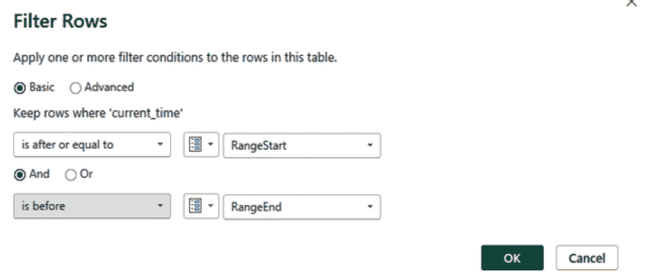

图 6-26. 基于范围参数筛选 Date/Time 列

现在，你需要创建一个在模型发布后使用的策略。拥有此策略对于创建和管理表分区以及执行刷新操作至关重要。要定义该策略，你在 Power BI 中打开模型视图，然后右键单击你的表或单击三个点。你会看到一个标记为“增量刷新”的选项，点击后会打开一个弹出窗口（见图 6-27）。

当你配置增量刷新时，有多个选项可用：

### Archive data starting ____ before refresh date

在此处，你定义想要保留多少历史数据（例如五年）。旧数据将被自动删除。

### Incrementally refresh data starting ____ before refresh date

在此处，你定义想要刷新的最近数据的范围（例如最近七天）。

### Get the latest data in real time with DirectQuery (Premium only)

你可以选中此框以添加 DirectQuery 分区来获取超出刷新周期之外的最新更改。

### Only refresh complete days

你可以选中此框以确保仅刷新完整的日期。这可防止部分更新，如果你的指标依赖于完整的每日数据，这一点很重要。

### Detect data changes

你可以选中此框以使 Power BI 仅刷新发生更改的期间，基于单独的 Last modified 列。如果数据稳定，这可以进一步减少刷新时间。

## 增量刷新和实时数据

1. Select table

Incremental

2. Set import and refresh ranges

Incrementally refresh this table

Archive data starting 7 Days before refresh date

Data imported from 1/25/2026 to 1/31/2026 (inclusive)

Incrementally refresh data starting 1 Days before refresh date

Data will be incrementally refreshed from 2/1/2026 to 2/1/2026 (inclusive)

3. Choose optional settings

- Get the latest data in real time with DirectQuery (Premium only) Learn more
- Only refresh complete day Learn more
- Detect data changes Learn more

4. Review and apply

Archived
Incremental Refresh
7 days before refresh date
1 day before refresh date
Refresh date

Apply

Cancel

图 6-27. 配置增量刷新

## 发布

设置增量刷新后，你将模型发布到 Power BI 服务。你应该手动执行第一次刷新，以便监控其进度。由于分区被创建、历史数据被加载、关系和层次结构被重建，以及计算被处理，此初始刷新可能需要一段时间。

第一次刷新后，后续刷新会快得多，因为只有增量分区会被更新。

## 限制

在使用 Power BI 中的增量刷新时，有几件重要的事情需要牢记。一旦语义模型发布到 Power BI 服务，就无法再将其下载为 .pbix 文件。然而，当你使用 Power BI 项目文件（.pbip）时，此限制并不适用。Power BI 项目文件可以从服务中下载，因为它们不包含物理分区；它们仅包含刷新策略定义。这意味着即使配置了增量刷新，你也可以在本地打开和管理项目，而不会丢失模型结构。

如果你重新发布带有增量刷新的 .pbix 文件，服务中的模型将被覆盖，并且所有分区和先前加载的数据将被删除，并在下次刷新期间重建。这意味着刷新操作可能非常消耗资源。事实上，在 Power BI Pro 工作区中，刷新最多可运行两个小时，而在 Fabric 容量（FSKU）中，计划刷新的限制增加到五小时。然而，当刷新通过 XML for Analysis（XMLA）端点触发时，此限制不适用。

最后，使用 DirectQuery 的实时数据仅在 Fabric 容量工作区中受支持。即使启用了增量刷新，在非容量工作区中也不可用。

## 总结

在本章中，你学习了如何提高 Power BI 中大型语义模型的性能。你首先使用 INFO.VIEW 函数来检查模型的元数据并发现潜在的瓶颈。你还使用 Power BI Desktop 中的性能分析器来衡量视觉对象加载所需的时间以及延迟发生的位置。你练习了优化 DAX 度量以使其更快。你还探索了 Direct Lake 存储模式，该模式对于大型模型很有用，因为它减少了内存压力并加快了查询速度。最后，你学习了如何设置增量刷新，以便仅更新新数据，从而避免不必要的完全刷新并节省时间。
