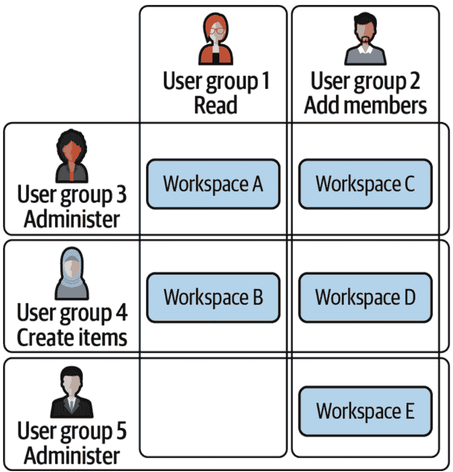
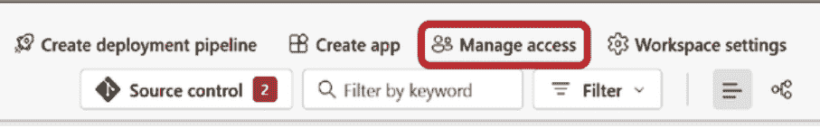
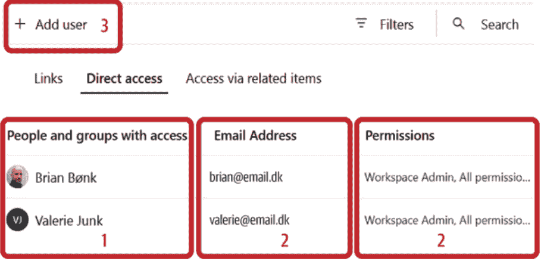
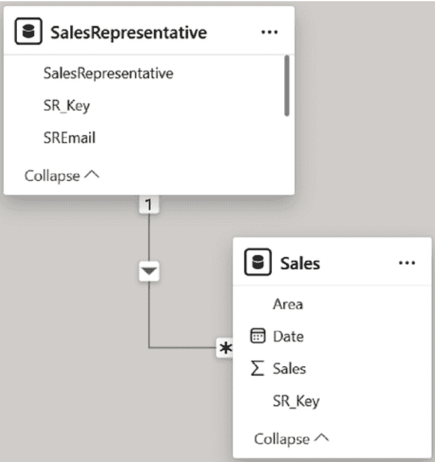
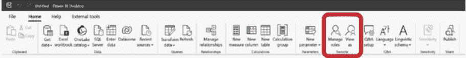
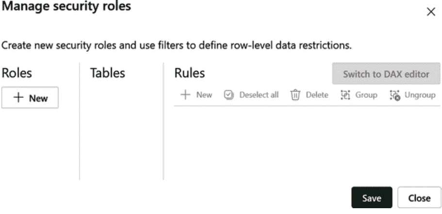
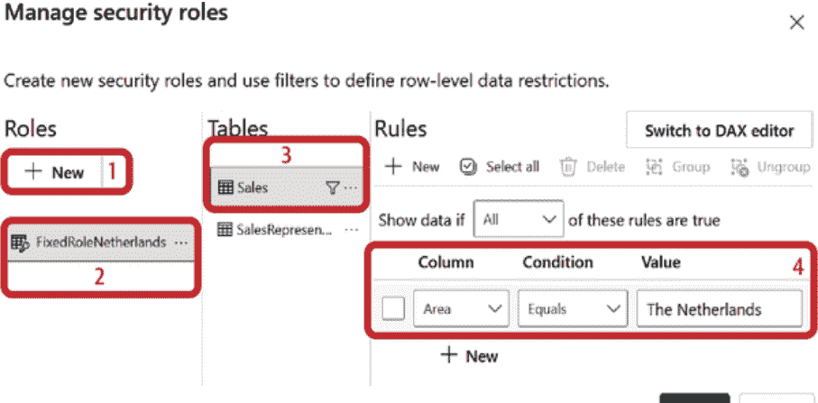
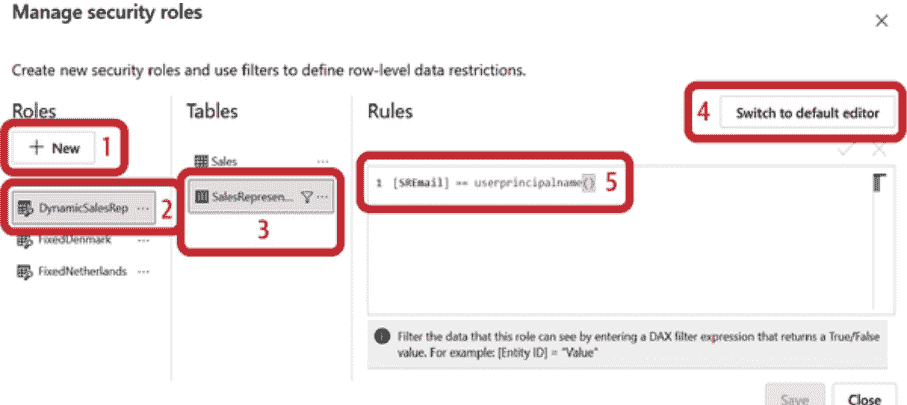
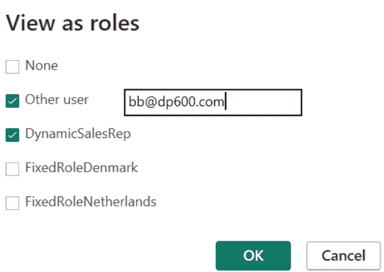

## 第 7 章. 实施安全和治理

Microsoft Fabric 提供了强大的工具和功能来帮助你有效处理安全和治理，本章将引导你了解它们。我们将首先探讨如何实施工作区级访问控制，该控制管理谁可以访问和在你的 Fabric 工作区中工作。接下来，我们将转向更精细的控制，通过实施项目级访问控制和管理对计算资源的访问控制。然后，我们将深入研究高级数据安全，包括行级、对象级和文件级访问控制，以确保用户只能查看其有权查看的特定数据。之后，我们将学习如何应用敏感性标签来分类和保护你最敏感的数据项。最后，我们将介绍如何认可项目，这是一个建立信任并在整个组织中推广使用高质量、经过验证的数据的过程。

## 实施工作区级访问控制

你可以配置对 Microsoft Fabric 中每个工作区的访问。考虑图 7-1 中的场景。

这是一个演示设置，你有五个不同的工作区（工作区 A 至 E）和具有五种不同访问控制要求的用户组（用户组 1 至 5）。此设置并非详尽无遗，仅显示了可能的各种组合的一个子集。用户组 1


has read access to Workspace A and Workspace B, User group 4 has the access it needs to create items in Workspace B and Workspace D, etc.



Figure 7-1. Example scenario of workspace access setup

作为最佳实践和经验法则，您应使用 Entra ID 中的组来授予工作区访问权限。这样，您就可以将访问维护转移给 IT 部门，该部门已为此建立了流程。然后，您作为开发人员，将能够专注于设置和内容创建。

在设置工作区访问控制时，您有四个主要角色可供选择：

- Administrator
- Member
- Contributor
- Viewer

大多数这些角色在它们可以执行的操作上都有一些开箱即用的限制。表 7-1 总结了这些限制，表后的列表将详细介绍。

Table 7-1. The four main roles in a workspace and their high

|  | Administrator | Member | Contribut |
|---|---|---|---|
| Maintaining and deleting workspaces |  |  |  |
| Adding members to a workspace |  |  |  |
| Writing data to items and OneLake |  |  |  |
| Creating new items in a workspace |  |  |  |
| Reading data from the items in a workspace |  |  |  |

## Maintaining and deleting workspaces

此功能仅对工作区的管理员可用。它使用户能够维护工作区的各个方面，从工作区设置（见第 1 章所述）到工作区中全部四个角色的配置。这也意味着能够删除工作区并更改图标、描述等。

## Adding members to a workspace

此功能是成员角色的一部分，并且是成员角色与贡献者角色之间唯一的差异。它使用户能够维护工作区中的角色（管理员角色除外），通过添加和删除这些角色的已定义成员。此功能还包括能够在工作区内与其它用户共享项目的能力。（另请参阅本章后面的“Implementing Item-Level Access Controls”部分）。

## Writing data to items and OneLake

“Write data”功能允许用户在工作区内的数据库、数据库镜像、湖仓和仓库中创建或修改项目。它还允许用户通过 Fabric API 从快捷方式、湖仓和仓库中读取数据并订阅 OneLake 事件。

## Creating new items in a workspace

此功能允许用户在工作区中创建和删除项目并设置执行和作业计划。

## Reading data from the items in a workspace

此功能是权限最少的功能。任何四个角色中的用户都可以从工作区中的项目读取数据，连接到 SQL Analytics 端点，并使用 TDS 端点从湖仓、仓库和快捷方式读取数据。

## Configuring Role Access in a Workspace

您使用与配置所有其它角色相同的工具来配置工作区中的角色。在每个工作区的顶部，您会找到“Manage access”设置（见 Figure 7-2）。



Figure 7-2. “Manage access” setting in each workspace

点击它以调出角色的设置窗格（见 Figure 7-3）。

## Manage access

Dp-600 Guide

+ Add people or groups

Search within workspace

Brian Bønk

Admin

Valerie Junk

Viewer

Figure 7-3. Settings pane for roles in the workspace

它会向您显示现有角色的列表以及一个“Add people or groups”按钮，您可以点击它来执行此操作。

## Changing Existing Roles in a Workspace

要更改工作区中现有的访问控制，您可以通过点击每个成员或组的当前角色并选择新角色来选择其角色。角色列表与 Figure 7-4 中的区域 3 所示相同。

## Adding People or Groups to a Role in a Workspace

点击 Figure 7-3 所示屏幕上的“Add people or groups”会调出 Figure 7-4 所示的选项屏幕。

我们在此屏幕上突出显示了一些关键区域（编号 1–4）：

*您可以添加新人员或组的区域（区域 1）*

在这里，您可以输入要添加到工作区的人员或组。您一次只能创建一个角色，但随后可以向该角色添加更多人员或组。

*所列用户或组的默认角色选择（区域 2）*

这始终是权限最少的角色：viewer。要选择不同的角色，请点击默认角色名称以调出区域 3 中的列表。

*可供选择的角色列表（区域 3）*

此列表包含全部四个角色可供选择，但如果您是此工作区的成员，则无法选择管理员角色，因为您没有权限。

*Add 按钮（区域 4）*

您点击此按钮以将新角色提交到工作区。

## Add people

DP-600 study guide

Admins, members, and contributors have edit and view access. Viewers only have view access. Learn more

Valerie Junk

Viewer

Add

- Admin
- Member
- Contributor
- Viewer

Figure 7-4. Add new people or groups to a workspace

## THE FIRST ADMINISTRATOR OF THE WORKSPACE

任何通过 Fabric UI 在 Web 体验上创建工作区的人都将成为第一个管理员，并且他们可以在创建工作区后将其他人员或组添加到角色中。

如果您使用 Fabric 的 API 创建工作区，则可以在创建者不是第一个管理员的情况下执行此过程。这超出了本次考试的范围。

工作区访问控制仅限于四个角色，易于维护和开发。项目级访问控制的额外选项增加了复杂性，我们将在下一节中介绍。

## Implementing Item-Level Access Controls

虽然工作区级访问控制是基础性的，但对于企业级安全而言，它通常过于粗粒度。强大的安全架构的核心原则是*最小权限*原则，该原则规定用户应仅被授予执行其任务所需的最低权限。

Microsoft Fabric 中的*项目级访问控制*是执行此原则的主要机制。它允许对工作区内单个项目的权限进行精确、细致的管理。它代表了预定义工作区角色（管理员、成员、贡献者和查看者）之外的重要一步，并为您提供灵活性，以构建高度安全且合规的数据环境。

## Permission Types

项目级权限与工作区角色不同，可以分配给单个用户、安全组或分发列表。这些权限可以补充或在某些情况下覆盖工作区角色授予的默认访问权限。关键权限类型如下：

### Read

这是一个以消费为重点的权限。具有 Read 访问权限的用户可以查看项目，例如 Power BI 报表或湖仓。Read 访问权限还允许用户查看基于语义模型的报表，但不能在 Power BI Desktop 中连接它或从头创建新报表。在湖仓中，具有 Read 访问权限的用户可以查看表和文件，但不能查询或写入数据。

## Build

这是实现自助服务和下游分析的关键权限。在语义模型上授予 Build 权限允许用户在 Power BI Desktop、Excel 和其他报表应用程序等工具中连接该模型。它还使用户能够从策划的数据模型创建新的报表和可视化。在湖仓中，Build 权限允许用户连接到 SQL 端点，使他们能够对湖仓表编写 SQL 查询并将其用作其自己的数据管道的源。用户可以在没有 Build 访问权限的情况下拥有 Read 访问权限，但他们不能在没有 Read 访问权限的情况下拥有 Build 访问权限。

## Write

此权限面向创建者和开发人员，允许用户修改或删除项目。例如，具有 Power BI 报表 Write 权限的用户可以打开它


Power BI desktop，做出更改，然后重新发布它。在 Dataflow Gen2 中，Write 权限允许用户编辑数据转换逻辑。

## Reshare

此强大的权限赋予用户将项目与他人共享的能力。例如，如果报表使用者对特定报表拥有 Reshare 权限，他们可以将该报表的链接与其同事共享。然而，这可能是一把双刃剑，你应谨慎授予 Reshare 权限的对象，以维持对数据传播的控制。

## Configuring Item-Level Access for Users or Groups

如果你点击工作区中大多数项目上找到的三点菜单（也称为 *context menu*），你会在下拉列表中看到“Manage permissions”选项（见图 7-5）。

Name
Git status
Type
SemanticModel
• Uncommitted
Semantic mc
Explore this data (preview)
Analyze in Excel
Create report
Auto-create report
Create paginated report (preview)
Delete
Security
Rename
Open data model
Settings
Refresh history
Manage permissions
View workspace lineage
View item lineage
Move to
Write DAX queries
Version history

Figure 7-5. Context menu of a semantic model

### TIP

请注意，工作区中不同项目的上下文菜单各不相同，因此“Manage permissions”可能出现在下拉列表的不同位置。

还请注意，某些项目（例如 Dataflow Gen1、Dataflow Gen2、eventstreams）没有此选项，因此你无法单独将它们共享给用户。用户必须位于“Implementing Workspace-Level Access Controls”部分中列出的角色之一中。

当你选择“Manage permissions”选项时，它会弹出如图 7-6 所示的窗口。



Figure 7-6. “Manage permissions” window and options

窗口可能因项目类型而异，但它将包含我们在图中编号为 1–3 的三个区域。你将看到当前直接访问此项目的用户列表（区域 1）。你还会看到此项目的权限列表（区域 2）。在此情况下，区域 1 中列出的两个用户都可以访问该项目，因为他们是工作区的管理员角色。

如果你想将此项目与其它用户或组共享，你必须点击“+ Add user”按钮（区域 3），这将弹出图 7-7 中的窗口。

## Grant people access

Warehouse

People you share this warehouse with can connect to it. To give additional permissions, select them from the list.

Enter a name or email address

### Additional permissions

- Read all data using SQL (ReadData) ⓘ
- Read all OneLake data (ReadAll) and subscribe to events (SubscribeOneLakeEvents) ⓘ
- Build reports on the default semantic model (Build) ⓘ
- Monitor queries (Monitor) ⓘ
- Audit queries (Audit) - PREVIEW ⓘ
- Share granted permissions (Reshare) ⓘ

### Notification Options

Notify recipients by email

Add a message (optional)

> 要为仓库中特定对象的细粒度对象级安全性（OLS）进行定义，请在 T-SQL 中使用 GRANT 和 DENY 语句。

Figure 7-7. Settings for sharing an item

此弹出窗口来自仓库项目，它具有项目的所有可能设置。（请注意，工作区中的其它项目可能具有不同的设置窗口）。我们在弹出窗口中突出了三个主要区域（编号为 1-3）：

### Input field (area 1)

你使用此字段添加应有权访问此单个项目的用户或组。

### List of options for sharing this item (area 2)

请注意这里的 Reshare 选项，我们之前说过你应谨慎授予。用户不受限制地重新共享可能会导致你在组织中失去对重新共享的控制以及对访问策略的治理。

### Notification options (area 3)

在这里，你可以确定添加的用户或组是否会通过电子邮件收到共享通知以及自定义文本。

## Permissions for an Item

如本章前面所述，项目级访问控制在工作区中的项目之间有所不同。表 7-2 提供了项目级访问控制的不同权限的汇总列表。

Table 7-2. Permissions for item-level access control

| Permission granted while sharing | Effects |
|---|---|
| Read | 接收者可以在数据中心发现该项目，打开它，并连接到湖屋或仓库的仓库或 SQL 分析端点。 |
| Edit | 接收者可以编辑项目或其内容。 |
| Share | 原始接收者可以共享项目并向新接收者授予其（原始接收者）拥有的全部或部分相同权限。例如，如果原始接收者拥有 Share、Edit 和 Read 权限，则原始接收者最多可以向新接收者授予 Share、Edit 和 Read 权限。 |
| Read All with SQL analytics endpoint | 接收者可以通过 TDS 端点从湖屋或仓库数据的 SQL 分析端点读取数据。 |
| Read all with Apache Spark | 接收者可以通过 OneLake API 和 Spark 读取湖屋或数据仓库数据，并且他们还可以通过湖屋资源管理器读取湖屋数据。 |
| Subscribe to OneLake events | 接收者可以订阅湖屋、数据仓库、镜像数据库、SQL 数据库和 KQL 数据库的 OneLake 事件。 |
| Build | 接收者可以在语义模型上构建新内容。 |
| Execute | 接收者可以执行或取消项目的执行。 |

总之，项目级访问控制是实现可扩展、安全且可管理的 data 环境的强大工具。通过将其与更广泛的工作区角色结合使用，你可以有效地管理谁可以在你的 Microsoft Fabric 租户中看到什么。

然而，它也增加了整个设置的复杂性。你可以在工作区中为项目配置显式访问，而被授予权限的用户可能无权访问工作区。想象一下企业设置中配置了这些访问控制，你可以迅速想象出其对治理和维护设置的影响。

## Controlling Access to Compute

访问工作区和特定项目是一回事，但你也可以允许特定用户访问底层计算，即 Fabric 的容量单元。

你有两种访问 Fabric 计算引擎的选项：

### *Through the SQL Analytics endpoint*

SQL 分析端点提供对 OneLake 中表的直接 SQL 访问，你可以通过 SQL 命令在其中原生配置安全性。这些权限仅适用于通过 SQL 发出的查询。

### *Through the Spark engine for the lakehouse*

访问 Spark 引擎可通过 Fabric API 或你在处理笔记本时使用的 Spark 引擎访问底层数据。

> **TIP**
> 
> 目前，OneLake 数据访问控制级别处于预览中，它提供了一个集中位置来控制对数据的访问。由于它目前处于预览阶段，我们不会在本书中介绍它。相反，我们将把你引向 Microsoft Learn，其中包含此信息：
> 
> *OneLake security uses role assignments to apply permissions to its members. You can either assign roles to individuals or to security groups, Microsoft 365 groups, and distribution lists. Every member in the user group gets the assigned role. If someone is in two or more security groups or Microsoft 365 groups, they get the highest level of permission that is provided by the roles. If you nest user groups and assign a role to a group, all of the contained users have permissions.*

## Implementing Row-Level, Column-Level, Object-Level, and File-Level Access Control

当向整个数据环境中的最终用户授予数据访问权限时，你可以根据特定需求和要求从四种特定的访问方法中进行选择：

### *Row-level access control*

最终用户受制于对数据行强制且不可更改的筛选。此类用户可能是销售代表，每个人只能查看自己的个人销售和客户。

### *Column-level access control*

最终用户仅允许查询或获取对数据库中特定列的洞察，这些列包含诸如社会安全号码、信用卡号码等信息。

### *Object-level access control*

最终用户可能完全被阻止访问数据库中的特定对象。这可能适用于一组不允许查看员工表上个人身份信息的最终用户，该表配置为仅供人力资源部门查看和使用。

### *File-level access control*

这特定于可以访问 OneLake 中底层文件的目标用户：delta parquet 文件。在这里，你可以选择授予或移除对特定文件、文件集或 OneLake 结构中文件夹的访问权限。

> **NOTE**
> 在撰写本文时，你无法通过应用程序本身在 Power BI 中创建列级和对象级安全性。你可以用第三方工具实现，但这些工具不属于考试范围，因此也不属于本书。


## Power BI 安全

虽然 Microsoft Fabric 为整个数据环境提供了强大的安全层，但 Power BI 需要一种专门的方法来确保正确的洞察传递给正确的人，同时不损害敏感信息。
保护 Power BI 不仅仅是关于谁可以打开报表；它关乎在他们进入后能看到的确切数据。

在本节中，我们重点关注保护 Power BI 资产的机制。我们首先探讨行级安全性（RLS）和对象级安全性（OLS），它们允许您根据用户的身份过滤数据并隐藏特定的表或列。然后我们将介绍如何在 Fabric 门户中管理这些角色，以确保在网页和桌面体验中无缝执行。最后，我们将介绍 *敏感性标签* 的使用，它通过对内容进行分类和加密提供额外的保护层，确保您组织最重要的数据即使在导出或在工作区外共享时仍然安全。

## Power BI 中的行级安全性

如前所述，行级安全性涉及对一组用户在数据的行上强制执行特定过滤器（尽管不一定只有一个过滤器）。这也不必只针对一个表，因为您可以根据模型中的关系在整个语义模型中强制执行过滤器。

一个例子可以是包含销售事实表和销售代表维度表的语义模型。两个表基于一个键相互关联，因此我们配置销售代表表以根据最终用户的凭据强制执行过滤器。从中，整个语义模型将强制所有最终用户在其用户名上对销售代表表进行过滤。此外，通过关系，销售表将被过滤。最终用户无法更改此实现。图 7-8 说明了语义模型中行级安全性的此设置。



| SalesRepresentative | SR_Key | SREmail |
|---|---|---|
| Brian Bønk | BB | bb@dp600.com |
| Valerie Junk | VJ | vj@dp600.com |

| Date | SR_Key | Sales | Area |
|---|---|---|---|
| Wednesday, 1 January 2025 | BB | 100 | Denmark |
| Wednesday, 1 January 2025 | VJ | 200 | Denmark |
| Saturday, 1 February 2025 | BB | 300 | The Netherlands |
| Saturday, 1 February 2025 | VJ | 600 | The Netherlands |
| Saturday, 1 March 2025 | BB | 100 | The Netherlands |
| Saturday, 1 March 2025 | VJ | 200 | Denmark |

图 7-8. 一个简单的语义模型中的 SalesRepresentative 维度表和 Sales 事实表，以及本节中我们使用的演示数据的快照

在此图中，您还可以看到两个表之间的关系。它在 SR_Key 列中，这是每个表中销售代表的键。

要在关系更改后在语义模型上创建行级安全性，您必须找到 Power BI 桌面屏幕顶部主菜单中的安全部分（见图 7-9）。



图 7-9. Power BI Desktop 中主菜单的安全部分

接下来，单击“管理角色”以打开图 7-10 所示的弹出窗口。



图 7-10. Power BI Desktop 中的“管理角色”弹出窗口

然后，您就可以准备在模型上创建行级安全性了。

创建行级安全性有两种选项：固定或动态。固定行级安全性使用基于编辑器中 DAX 表达式的固定过滤器。动态行级安全性根据当前用户的登录凭据过滤数据。我们将在以下各节中深入探讨这两种方法。

### 固定行级安全性

您可以在“管理安全角色”屏幕上创建固定行级安全性（见图 7-11）。



图 7-11. 在 Power BI 中创建固定行级安全角色

我们在图中突出显示了您在创建过程中使用的区域（编号 1-4）：

### + 新建按钮（区域 1）

单击此按钮创建新的固定行级安全角色。

### 角色名称框（区域 2）

默认情况下，角色名称为 Untitled，但您可以通过双击该框或从三点菜单中选择“重命名”来更改它。在图中，我们已输入“FixedRoleNetherlands”作为角色的新名称。

### 表选择框（区域 3）

在这里，您可以选择要过滤的表。在我们的示例中，我们希望将销售表过滤为仅显示来自荷兰的数据。

### 列、条件和值选择区域（区域 4）

在这里，您可以向安全设置添加所需的业务逻辑。您通过选择列、选择条件并输入过滤器的值来配置规则。从此区域的顶部菜单中，您还可以将元素分组以进行分组逻辑，并且以这种方式，您可以根据需要创建简单和复杂的逻辑用于安全。

在这里，我们从列下拉菜单中选择了 Area，从条件菜单中选择了 Equals，并将“The Netherlands”输入到值字段中。

填写这些区域后，您可以单击保存以创建名为 FixedRoleNetherlands 的固定行级安全角色。

要测试该角色，您可以返回 Power BI 窗口并单击图 7-9 中的“查看为”按钮以调出图 7-12 所示的窗口。

### 查看为角色

- None
- Other user
- FixedRoleNetherlands

图 7-12. 来自 Power BI 桌面的“查看为角色”窗口

此窗口将显示您刚刚创建的角色，您可以选择该角色并单击确定以生成图 7-13 所示的过滤报表。

| SalesRepresentative | Area | Sum of Sales |
|---|---|---|
| Brian Bønk | The Netherlands | 400 |
| Valerie Junk | The Netherlands | 600 |
| Total |  | 1000 |

图 7-13. Power BI Desktop 中固定角色的结果

您可以看到报表已过滤为仅显示来自荷兰地区的数据。

在部署到 Microsoft Fabric 中的工作区后，您可以将用户或安全组添加到行级安全组（见图 7-14）。

| Name | Type | Task |
|---|---|---|
| dp600 | Semantic model | — |

- Explore this data (preview)
- Analyze in Excel
- Create report
- Auto-create report
- Create paginated report (preview)
- Delete
- Quick insights
- Security
- Rename
- Open data model

### Row-Level Security

FixedRoleNetherlands (0)

### Members (0)

People or groups who belong to this role

Enter email addresses

Add

图 7-14. 部署后在报表上设置安全

在此图中，您可以看到名为 Security 的上下文菜单选项，以及将用户或安全组添加到语义模型中的角色的选项。右侧的文本框是您输入应有权访问数据的用户或安全组的位置，基于标记的角色。

您也可以创建类似的角色来仅过滤来自丹麦的数据，如果您想这样做的话。

在本书中，我们教您如何以简单的方式创建角色。然而，UI 也为您提供了将元素分组在一起并对过滤器组应用“任意”或“全部”逻辑的选项。这可能涉及对角色的广泛设置以及确定每个角色有权访问的数据的确定。正如您可能预期的那样，如果您只有几个用户、区域或其他需要过滤数据的元素，手动在语义模型中创建此类角色将花费大量时间。

这就是动态行级安全性发挥作用的地方。

### 动态行级安全性

要创建动态行级安全性，您需要在“管理安全角色”屏幕上进行选择并输入数据（见图 7-15）。



图 7-15. 创建动态行级安全角色


我们已在图中（编号 1–5）突出显示了你在创建过程中使用的区域：

+ New button (area 1)

点击此按钮可创建一个新的动态行级安全角色。

Role name box (area 2)

默认情况下，角色名称为 Untitled，但你可以通过双击该框或从三点菜单中选择“rename”来更改它。在图中，我们已将“DynamicSalesRep”输入为角色的新名称。

Table selection box (area 3)

在这里，你可以选择要过滤的表。在我们的示例中，我们希望根据当前用户的登录信息过滤 SalesRepresentatives 表。

Switch to DAX editor button (area 4)

实现这种动态方法最简单的方式是将其作为 DAX 表达式创建，因此我们点击“Switch to DAX editor”按钮。

请注意，在默认模式下，如你在之前的方法中所见，此按钮显示为“Switch to DAX editor”。然而，当我们点击它时，文字会更改为“ Switch to default editor”。这在图 7-15 中显示，该图描绘了我们点击按钮后的屏幕。

DAX expression window (area 5)

在这里，你可以输入 DAX 表达式来过滤你的数据。

图中区域 5 中输入的 DAX 表达式使用了 Power BI 中的 UserPrincipalName() 表达式。

在 Power BI 中，我们有两种获取用户登录信息的方式：使用 UserName() 表达式或 UserPrincipalName() 表达式。这两个表达式（或函数）以两种方式返回用户的登录信息：UserName() 返回 UserID（用户的信息采用 <domain>\<username> 格式），而 UserPrincipalName() 返回用户名（用户的信息采用 <username>@<domain> 格式）。在这种情况下，我们拥有销售代表的电子邮件，因此我们可以使用 UserPrincipalName() 函数在过滤上下文中获取当前用户的信息。这给出了图中区域 5 的 DAX 表达式：

```
[SREmail] == userprincipalname()
```

要测试此角色，我们可以返回 Power BI 窗口并点击图 7-9 中的“View as”按钮，以调出图 7-16 所示的窗口。



图 7-16. Power BI Desktop 中的“View as”窗口

我们需要选中“Other user”复选框，以便输入我们想要测试报告的用户的电子邮件。我们还需要选中“DynamicSalesRep”角色的复选框以使用该角色进行测试。然后，我们可以点击 OK 生成仅包含电子邮件为 bb@dp600.com 的销售代表数据的报告（见图 7-17）。

| SalesRepresentative | Area | Sum of Sales |
|---|---|---|
| Brian Bønk | Denmark | 100 |
| Brian Bønk | The Netherlands | 400 |
| Total |  | 500 |

图 7-17. 基于当前用户的动态过滤生成的报告

在我们完成部署到工作区后，可以通过遵循图 7-15 所示的相同流程添加更多人员和用户到该角色。

你也可以修改使用 UserPrincipalName() 作为单一过滤表达式的简单方法，并将其修改以满足你的确切需求。表达式不必引用单个表。它可以是你需要的任意复杂的 DAX 表达式。

这些示例仅代表 Power BI 中行级安全的冰山一角。存在许多机制和实现方法。你可以拥有包含数十个表和关系的完整语义模型，并且设置和实现可能会迅速变得复杂，并需要对方法进行深入分析。哪种方法是“正确”的，取决于你组织的需要和要求。

## Warehouse Security

在 Microsoft Fabric 中在仓库中实现安全性与在 Power BI 中完全不同。我们使用 *security policy* 来实现，它使用 SQL analytics endpoint。安全策略是一组 T-SQL 语句，共同定义在使用 SQL analytics endpoint 时对一个或多个表的访问。方法几乎与语义模型相同，尽管场景需要更多代码，因为表之间的关系在安全函数本身中并未强制执行。开发人员需要基于自己的知识显式处理所有内容。

## Row-Level Security in a Warehouse

安全策略由 SECURITY POLICY 语句和谓词组成。*predicate* 是一个函数，根据当前登录的用户过滤特定表上的数据。我们将此函数创建为 SCHEMA bound function，并使用 SECURITY POLICY 语句设置谓词与用户之间的关系。

例如，一个 SCHEMA bound function 查看 User_Name() 来过滤行，并且该函数随后通过 SECURITY POLICY 语句绑定到表。这里的主要要点是，你需要非常明确。如果用户拥有一个角色，允许他们查看一个表中的特定数据集，并且此数据与另一个表相关，那么你必须在两个表上都实现安全性。安全性不会自动级联。

这里有一个简单的示例。首先，你需要创建将充当谓词的函数。此函数将根据当前用户名过滤行：

```
CREATE FUNCTION Security.fn_user_security_predicate(@Username AS sysname)
RETURNS TABLE WITH SCHEMABINDING AS
RETURN SELECT 1 AS result WHERE @Username = USER_NAME();
```

接下来，你将创建安全策略本身，将其绑定到谓词函数和你想要保护的表：

```
CREATE SECURITY POLICY Product.ProductSecurityPolicy
ADD FILTER PREDICATE Security.fn_user_security_predicate(
    CAST(USER_NAME() AS sysname)
)
ON Product.DimProduct;
```

通过这两个语句，你创建了一个策略，确保用户只能查看 DimProduct 表中 UserName() 与其自身匹配的行。

> **NOTE**
> 
> Fabric 仓库中的行级安全是在查询时评估的。这意味着每次用户运行查询时，安全谓词都会作为过滤器应用。这与 Power BI 语义模型中的情况不同，在语义模型中，安全角色在模型刷新和部署时应用，然后根据分配给用户的角色过滤数据。

此过程涉及创建函数，然后创建策略，最后将其应用于表。也可以将多个策略添加到单个表。这不仅仅是单个安全策略定义访问。所有作用于该表的策略的组合才定义访问。

这种方法的优点是它非常灵活，你可以用它来实现非常复杂的安全模型。缺点是它要求你对 T-SQL 和仓库本身的安全模型有深入的理解。

## Column-Level Security in a Warehouse

使用仓库，你也可以显式处理列级安全。

虽然行级安全是关于过滤用户可以看到哪些行，列级安全是关于控制他们可以访问哪些列。你通过使用标准的 SQL GRANT、REVOKE 和 DENY 语句来处理此事：GRANT 让你授予用户对列的访问权限，REVOKE 让你移除 GRANT 语句，而 DENY 让你明确拒绝用户对表中列的访问。这意味着你可以授予特定用户或用户组访问表的特定列的权限。例如，你可能希望授予一组用户访问像 CreditCardNumber 这样敏感列的权限，或根据他们是否需要查看而将其隐藏。

这是一种直接的方法，但它要求你对数据模型和用户角色进行仔细分析，因为你必须显式定义每个用户和他们应有权访问的每列。这种方法功能强大，但在你拥有大量表和用户时，管理起来可能有点负担。

以下是授予和拒绝对列访问的简单代码示例：

```
-- Grant SELECT permission on the DimProduct table to a user
GRANT SELECT ON Product.DimProduct TO [john.doe@contoso.com];
-- Deny SELECT permission on the Cost column to the same user
DENY SELECT ON OBJECT::Product.DimProduct(Cost) TO [john.doe@contoso.com];
```

此过程与处理行级安全的方式非常不同。对于列级安全，不需要函数或安全策略。你使用简单的 GRANT 或 DENY 语句。关键是要非常精确并确保


你对用户角色和数据有清晰的理解。对此安全的管理需要成为你整体治理策略的一部分。

## 数据仓库中的对象级安全

对象级安全是关于控制对整个数据对象的访问。这是你在仓库中可以实现的最宽泛的安全级别，并且你使用与列级安全相同的 GRANT 和 DENY 语句来处理它。但列级安全是关于特定列，而对象级安全是关于整个对象，如表、视图，甚至是架构。

最基本的对象级安全场景是向用户或组授予对表的访问权限。如果他们没有此权限，他们甚至无法知道表是否存在。实施对象级安全是管理广泛访问权限的一种简单而有效的方法。你可以授予不同的权限，例如 SELECT、INSERT、UPDATE 或 DELETE，以对用户对整个对象可以执行的操作进行非常细粒度的控制。

下面是一个代码示例，展示如何授予和拒绝对整个表的访问权限：

```
-- Grant SELECT permission on the FactSales table to a role
GRANT SELECT ON FactSales TO SalesTeamRole;
-- Deny all permissions on the sensitive Customers table to a user
DENY ALL ON Customer.DimCustomer
```

这种方法简单但功能强大。通过结合对象级、列级和行级安全，你可以构建一个非常强大的安全模型，可以适应几乎任何场景。这有点管理负担，但它能让你完全控制你的数据。

## Lakehouse 安全

在 Microsoft Fabric 生态系统中，并非所有安全都处理在 SQL 或语义模型层。平台的核心部分是 lakehouse，它位于 OneLake 之上。

在这里，数据只是文件，文件夹中的普通文件。这就是你进行数据工程、加载原始数据并在数据看到 SQL 端点之前对其进行转换的地方。由于它只是文件，因此你在更低的层级处理安全。

这里的安全模型完全是关于对文件和文件夹的访问，并且比我们一直在查看的复杂 T-SQL 语句简单得多。你不是为单个列定义复杂的谓词或 GRANT 语句。相反，你在文件或文件夹级别授予权限。

你通过 Fabric 用户界面通过向用户或组分配权限来管理此安全。权限本身非常直接，并且围绕三个核心权利构建：

### Read

使用此权限，用户可以查看文件或文件夹并读取其内容。他们不能进行任何更改、重命名任何内容或删除任何内容。这是访问的最简单形式，通常用于仅需要读取数据集的消费者。

### Read and write

此权限使用户不仅能够读取数据，还能够创建新文件、修改现有文件或删除它们。对于负责维护 lakehouse 中数据的工程师和开发人员来说，这是关键权限。

### Read, write, and execute

当我们谈论文件时，*execute* 这个词可能看起来很奇怪，但把它想成 *完全控制*。具有此权限的用户可以做读和写用户能做的一切，但他们还拥有执行其他命令（如管理文件权限）的权限。这通常保留给管理员或数据所有者。

你可以直接在 lakehouse 文件和文件夹中分配这些权限，通常通过主 Fabric 门户进行管理。你可以在 UI 中找到任何文件或文件夹的权限对话框，并且这是一个快速分配用户及其角色的过程。

> **NOTE**
> 很重要的是要记住，这些权限不同于工作区角色（管理员、成员、贡献者和查看者）。虽然工作区角色提供了对工作区中项目整体的访问权限，但文件级访问控制用户实际上可以对 lakehouse 中的文件执行的操作。例如，一个在工作区中具有查看者角色的用户，可能会被授予对 lakehouse 中特定文件夹的“读和写”访问权限，允许他们加载数据但不能修改工作区中的其他项目。

你直接在对象上管理权限。只需在 lakehouse 资源管理器中导航到对象（如文件夹）并设置权限即可。这与语义模型形成对比，在语义模型中，安全性由角色定义，并且是模型本身的一部分。在 lakehouse 中，权限是位于文件之上的独立层。这两个安全层共同作用为你提供了一个非常强大的模型，但它们彼此完全独立。

## 对项目应用敏感性标签

虽然行、列和对象安全都是关于控制谁可以看到什么数据，但还有另一层安全处理数据本身，无论它在哪里。这就是 *敏感性标签* 发挥作用的地方。把敏感性标签看作是分类数据并对其应用一组规则和策略的方式。

概念很简单：你根据数据的敏感程度对其进行标记，然后标签强制执行保护设置。这关乎数据治理，并确保敏感信息在其整个生命周期中得到正确处理。这不仅仅是 Fabric 独有的东西；这些标签是 Microsoft Purview Information Protection 更广泛平台的一部分，这意味着你在 Fabric 中使用的标签与组织在 SharePoint、Teams 和 Power BI 中使用的标签相同。目标是拥有一致和统一的数据分类方法。

### 不同的敏感性标签

你可以应用的标签并不是微软固定的列表。它们由你组织的治理团队定义，并反映你公司对数据分类的特定需求。一个典型的标签集可能看起来像这样：

*Public*

这是用于可以自由共享的数据，例如面向公众的报告或没有敏感信息的数据集。

*General*

这是大多数内部数据的默认标签。它适用于日常业务数据，不太敏感，但不应与外部方共享。

### Confidential

这是用于包含不供一般消费的信息的数据，例如内部财务报告和个人数据。

### Highly confidential

这是用于你最敏感的数据，例如商业秘密、员工记录和业务收购计划。此标签通常附带严格的保护规则。

其中一些标签甚至可能有子标签。例如，Confidential 标签可能有 Confidential - Finance 或 Confidential - HR 等子标签，允许进行更细粒度的分类，而无需创建冗长的顶级标签列表。关键在于标签是开发人员可以用来标记数据的工具，而规则则由系统强制执行。

## 如何使用它们

应用敏感性标签的过程非常简单，并且是开发人员在创建新项目时应执行的基本步骤。例如，当你在工作区中创建一个新的语义模型时，属性中会出现一个下拉框，你可以在其中选择敏感性标签。这是一个简单的手动过程。

魔力发生在幕后。一旦你标记了一个项目，该标签就会“级联”到所有连接的项目。如果你创建一个语义模型并将其标记为 Confidential，你在该语义模型之上构建的任何报告都会自动继承 Confidential 标签。这是一个关键点。开发人员可能甚至不需要考虑对报告应用标签；它是从底层数据源继承的。

这种继承使敏感性标签对于治理如此强大。如果组织有一项政策，即 Confidential 报告不能导出为 PDF 文件或打印，Fabric 将对所有带有该标签的项目强制执行该规则。开发人员的工作是应用正确的标签，平台会处理其余部分。这创建了一个难以规避的非常强大的治理模型。

> **NOTE**
> 
> 敏感性标签全部关乎分类和治理。它们不能替代行级或列级安全。标签可以强制执行阻止用户导出报告的策略，但它不会过滤用户可以看到的数据。这两个安全层协同工作：一个控制谁可以看到什么，另一个控制数据如何被使用。

## 认可项目

在一个每个人都在创建报告、数据集和其他项目的组织中，很快就会变得难以弄清事情的来龙去脉。你如何知道某个特定报告是你应该用于业务决策的“官方”报告？你如何知道它是准确可靠的？这就是认可发挥作用的地方。

*Endorsements* 提供了一种在 Fabric 中显示项目质量和可靠性的方式。它们是简单的视觉提示，告诉用户此特定报告、语义模型或其他工件已被审核和批准。把它们看作是拥有该


data. 它们能让其他用户更容易发现并使用正确的数据，而无需猜测或到处询问。它们是数据治理和在组织内部建立信任的重要组成部分。

## 不同的背书

在 Microsoft Fabric 中，你可以对项目应用三种类型的背书：Promoted、Certified 和 Master Data。它们含义不同，用途也不同：

### Promoted

这是最常见的背书，它是用户正式推荐项目的一种方式。你会将它用在对团队来说是良好起点或团队经常使用的项目上。应用 Promoted 背书就是数据创建者的一种说法：“嘿，这就是你应该使用的。它已准备好供一般使用。” 例如，你可以推广一份经过测试并准备与更广泛受众分享的报表或语义模型。关键在于该项目是由其所有者或团队成员推荐的。

### Certified

这种背书的分量很重。只有被授予认证权限的团队，例如数据治理团队或卓越中心，才能认证项目。认证意味着该项目已符合组织的严格质量标准，并且已在准确性、安全性和性能方面得到验证。你会将它应用于最关键且最值得信赖的数据集，这些数据集用于官方报告和业务关键决策。

### Master data

当项目带有 Master data 徽章时，表示该项目中的数据是组织数据的核心来源。Master data  designation 通常用于表示某个数据项应被视为某些组织或业务数据的权威、单一事实来源，例如产品代码和客户名单。你只能将 Master data 标签应用于包含数据的项目，例如湖仓和语义模型。只有由 Fabric 管理员指定的用户才能将数据项标记为 Master data。

这些背书之间的差异归结为信任和权威问题。Promoted 项目是由用户推荐的，而 Certified 项目是由组织正式批准的。

**NOTE**
虽然背书不会改变项目上的任何权限，但它会改变项目的可发现性。已背书的项目在搜索结果中会被优先显示，且其他用户更容易找到并使用。用户可能由于权限不足而无法查看报表，但如果他们被授予访问权限，就能很容易地看到它已被标记为 Promoted 或 Certified。

## 如何使用它们

应用背书的过程很简单，你可以直接在项目的设置中操作。你可以在项目的详细信息窗格或其设置中找到背书选项。这是一个手动过程，你需要选择项目，然后从背书选项中选择 Promoted 或 Certified。这是一个简单的操作，但也意味着你有责任确保数据符合你所声称的标准。

如果你是项目的拥有者，你可以将其设为推广。要认证项目，你必须是管理员设置的认证背书组成员。这确保只有合适的人才能认证项目。目标是确保用户能够信任他们使用的数据，并且组织中每个项目都有清晰的权限和责任线。背书的使用是良好数据治理策略的重要组成部分。

## 摘要

在数据驱动的世界中，组织的数据是其最宝贵的资产之一。但随之而来的是确保其安全且只有合适的人才能访问的巨大责任。在像 Microsoft Fabric 这样全面的平台上，各种用户与各种数据项目交互，控制访问至关重要。你不能仅依赖善意；你需要强大的工具来处理它。

本章带你了解了这些基本的安全和治理功能。我们首先介绍了如何处理工作区和项目级别的访问，然后，我们转向了保护数据本身所需的更深层次、更细粒度的控制，包括行级、对象级和文件级访问。随后，我们探讨了如何使用敏感性标签对敏感数据进行分类和保护，以及如何通过使用背书来建立可信的环境。

了解如何实施这些安全和治理功能是你角色的关键部分。它将帮助你满足合规要求、维护数据完整性，并在组织内部培养信任文化。
