## 第 8 章. 维护分析开发生命周期

Power BI 报表发布到工作区后，很少保持不变。它会得到更新，数据模型会发生变化，并且经常会出现新的需求。这是一件好事，因为这意味着用户正在使用报表，我们可以改进它以提供更好的洞察。

然而，虽然对单个报表进行更改似乎很容易，但在大型组织中，我们通常管理许多报表或数据模型。我们不能只是把所有更改都记在脑子里。组织以清晰、有条理的方式跟踪更改非常重要，这样即使我们离开一年后再回来，也能理解在我们缺席期间对报表做了什么。此外，我们有时需要将报表或数据集移动到其他工作区。例如，我们可能为开发、测试和生产分别设置工作区。此外，重复使用报表或模型的部分可以节省我们的时间和精力，因为我们不必每次都从头开始。

在本章中，我们将探讨如何处理所有这些任务。

我们首先从工作区的版本控制开始，它有助于我们跟踪更改并保持工作有序。接下来，我们探讨 Power BI 项目（.pbip）文件格式，它使我们能够更高效地管理报表文件和相关资源。之后，我们查看可重用资源，例如模板文件（.pbit）、数据源文件（.pbids）和共享语义模型。然后，我们转向部署管道，它有助于以受控和可靠的方式将内容从开发环境推广到测试和生产环境。我们还涵盖影响分析，以便在你做出更改之前确定哪些下游项目会受到影响，例如湖仓、仓库、数据流和语义模型。最后，我们探讨如何使用 XMLA 端点部署和管理语义模型。

## 为工作区配置版本控制

在较长时间内或与多位同事一起处理数据时，版本控制非常方便。让我们想象一下，我们正在编辑报表或数据模型，某时出现了故障或行为异常。除了想知道发生了什么之外，我们还想知道它是否在之前发生过（例如在上次更改期间）。我们可能还想知道是谁做了导致问题的更改，并与他们讨论为什么要做这些更改，而不是简单地回滚。

有了版本控制，我们不仅可以保存所做的更改，还可以查看已做过哪些更改，并回滚那些不是我们或同事所期望的更改。版本控制也是一个很好的文档方法，并且是一种确保即使在很长一段时间后，我们也能知道做了什么以及由谁做的。

在 Fabric 中，你有两个版本控制选项：Azure DevOps 和 GitHub。你可以为每个工作区选择其中一个使用，并根据你的偏好或组织的标准进行设置。这两个选项都让你能够将熟悉的源代码控制工具和流程应用于 Fabric 项目，从而更轻松地保持工作有序、安全，并在需要时能够回滚。

## 设置 GitHub 和 Azure DevOps 版本控制

我们可以在 Fabric 中在工作区级别配置版本控制。为此，我们打开要启用版本控制的工作区并进入“Workspace settings”。然后，在设置菜单中，我们会找到一个名为“Git integration”的部分，在那里我们可以选择并设置 GitHub 或 Azure DevOps（见图 8-1）。每个工作区一次只能链接其中一个选项，因此我们需要选择最适合我们环境或组织的那个。

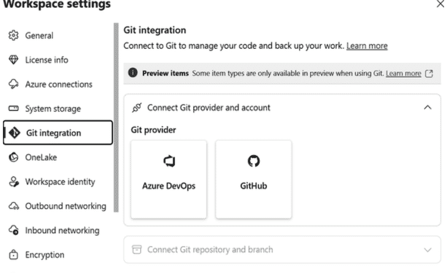

图 8-1. Fabric 工作区设置中的 Git integration 部分

我们将从设置 GitHub 集成开始。


## 设置 GitHub 版本控制

当我们第一次打开 Git 集成菜单时，GitHub 图标可能呈灰色，因为默认情况下就是如此（见图 8-2）。

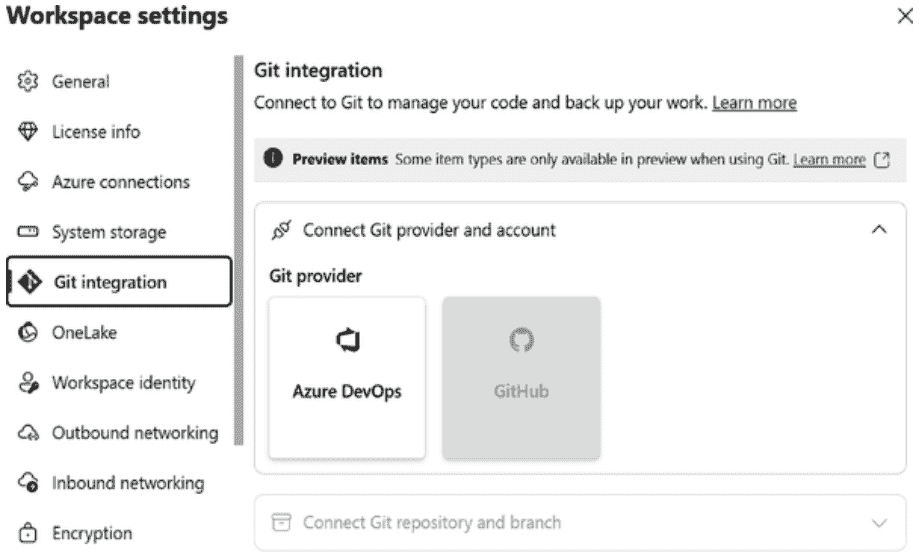

图 8-2. 在工作区设置中，GitHub 集成默认呈灰色

如果将鼠标悬停在灰色的 GitHub 选项上，我们会看到一条消息，提示我们联系 Fabric 管理员为我们启用 GitHub。为此，管理员需要进入管理门户并搜索 Git 集成部分。最后一个选项“用户可以将工作区项目与 GitHub 仓库同步”在每个租户中默认处于禁用状态，但 Fabric 管理员可以为特定用户或整个组织打开此设置（见图 8-3）。一旦他们这样做，变更生效可能需要长达 15 分钟，因此如果按钮不能立即使用，也无需担心。

## Git 集成

+ > 用户可以将工作区项目与其 Git 仓库同步
+ *已为整个组织启用*
+ 
+ > 用户可以将项目导出到其他地理位置的 Git 仓库
+ *已为整个组织启用*
+ 
+ > 用户可以将应用了敏感性标签的工作区项目导出到 Git 仓库
+ *已为整个组织启用*
+ 
+ > 用户可以将工作区项目与 GitHub 仓库同步
+ *已为整个组织禁用*

图 8-3. 在管理员设置中，与 GitHub 的同步默认处于禁用状态

图 8-4 显示了在“用户可以将工作区项目与 GitHub 仓库同步”下用于启用 GitHub 集成的具体选项。

## 用户可以将工作区项目与其 Git 仓库同步

已为整个组织启用

用户可以将工作区项目导入和导出到 Git 仓库以进行协作和版本控制。关闭此设置可防止用户将工作区项目与其 Git 仓库同步。了解更多

已启用

应用范围：

- 整个组织
- 特定安全组
- 除特定安全组外

委派设置给其他管理员

选择可以查看和更改此设置的管理员，包括您所做的任何安全组选择。

- 容量管理员可以启用/禁用
- 工作区管理员可以启用/禁用

图 8-4. 在“用户可以将工作区项目与 GitHub 仓库同步”下用于启用 GitHub 集成的具体选项

管理员可以将 Git 集成设置应用于整个组织，将其限制为特定安全组，甚至排除某些安全组。根据组织的架构，一种方法可能比另一种更实用。

还可选择将这些设置委派给其他管理员，例如容量管理员或工作区管理员。在职责共享的大型环境中，这可能很有用。

一旦 GitHub Git 集成按钮变为可点击，我们就可以添加一个账户。我们可以在此处添加任何 GitHub 账户，甚至是个人账户，因此必须小心确保只有合适的人员获得访问权限并允许

连接 GitHub 账户。图 8-5 显示了我们在 Fabric 工作区设置中点击 GitHub 选项时看到的屏幕。

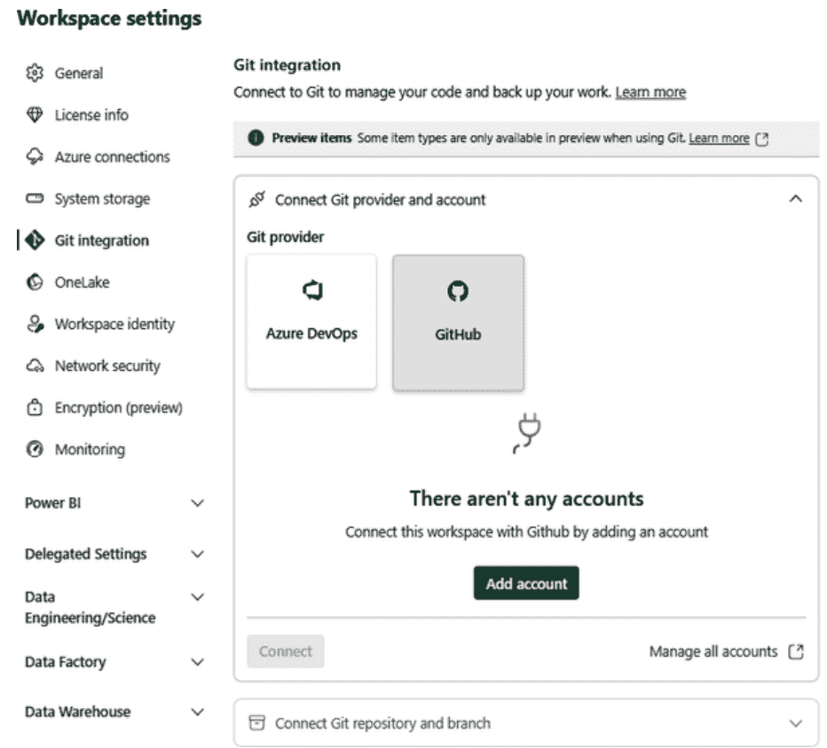

图 8-5. 在工作区设置中添加 GitHub 账户以连接

在点击“添加账户”后，我们需要提供一些信息，以便 Fabric 能够连接到 GitHub。首先，我们选择一个显示名称，仅供 Fabric 内部参考。接下来，我们添加来自 GitHub 的个人访问令牌，我们可以在 GitHub 的开发者设置中生成。该令牌授权 Fabric 安全地连接到我们的 GitHub 账户。最后，我们提供要链接到此工作区的

仓库的 URL。图 8-6 显示了我们需要提供的信息的屏幕截图。填写完所有详细信息后，我们可以保存并将工作区连接到 GitHub。

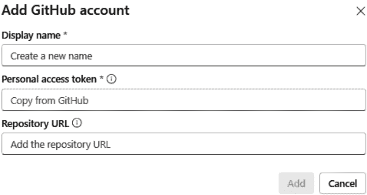

图 8-6. 提供访问令牌和仓库 URL 以连接 GitHub 账户的屏幕

一旦我们点击添加，工作区的内容将从工作区同步到 Git。从那时起，在工作区中进行的任何更改都可以在 Git 中同步和跟踪。图 8-7 显示了点击添加后立即收到的确认消息，表明同步过程已开始。

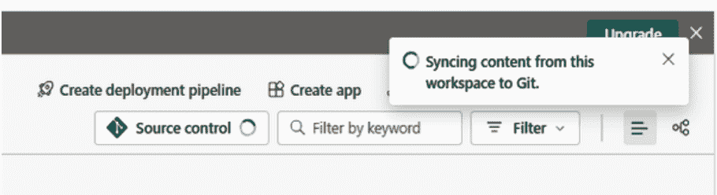

图 8-7. 点击添加后收到的消息，确认对工作区内容所做的更改将被同步并在 Git 中跟踪

## 设置 Azure DevOps 版本控制

使用 Azure DevOps 进行版本控制的工作方式与使用 GitHub 类似，主要区别在于设置过程。在 Azure DevOps 中，您需要指定组织、项目、Git 仓库、分支以及（可选）Git 文件夹。图 8-8 显示了输入这些信息的设置屏幕。配置完成后，同步和版本跟踪的工作方式与 GitHub 相同。

## 工作区设置

常规
许可证信息
Azure 连接
系统存储
Git 集成
OneLake
工作区标识
网络安全
加密（预览）
Power BI
委派设置

## Git 集成

连接到 Git 以管理代码并备份您的工作。了解更多

预览项目 使用 Git 时，部分项目类型仅在预览中可用。了解更多

连接 Git 提供程序和账户
提供程序
Azure DevOps
AAD 账户
valerie@porcubi.nl
注销
管理所有账户

连接 Git 仓库和分支
组织 *
组织
项目 *
项目
Git 仓库 *
Git 仓库
分支 *
分支
Git 文件夹
输入文件夹名称
连接并同步
取消

图 8-8. 在 Fabric 工作区中将 Azure DevOps 配置为 Git 集成

要执行此配置，我们必须有权访问 Azure DevOps 组织。我们需要选择组织、项目、该项目中的 Git 仓库以及我们要使用的分支。我们还可以选择 Git 文件夹，但它是可选的。设置完成后，我们点击“连接并同步”。这将弹出与完成 GitHub 连接时相同的确认消息，显示在屏幕右上角。

## 在 Fabric 中使用版本控制

配置版本控制后，在 Azure DevOps 和 GitHub 中的工作方式相同。我们将在 Fabric 工作区右上角看到一个新的“源代码管理”按钮（见图 8-9），它为我们提供了重要信息。

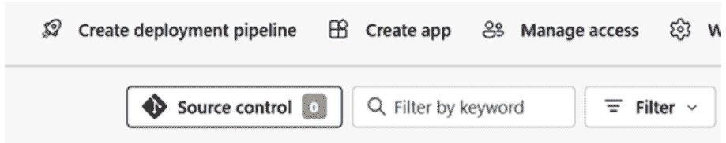

图 8-9. 成功 Git 集成后出现的“源代码管理”按钮

“源代码管理”按钮中的数字告诉我们有多少更改尚未同步。在工作区内部，我们还可以看到每个项目是否已同步或是否有未同步的更改。图 8-10 显示了一个示例，其中所有项目都已完全同步，因此“源代码管理”按钮显示为 0。

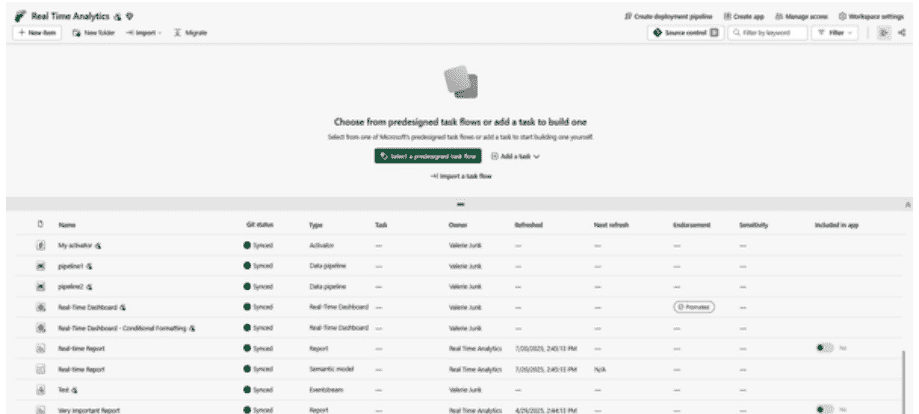

图 8-10. 显示工作区中所有项目均已同步的“源代码管理”按钮屏幕

当您对项目进行更改时，例如在工作区中编辑笔记本，“源代码管理”按钮会更新以显示尚未提交的更改数量。您还会在项目本身旁边看到一条消息，表明它有未提交的更改。图 8-11 显示了一个笔记本文件被标记为未提交更改的示例。

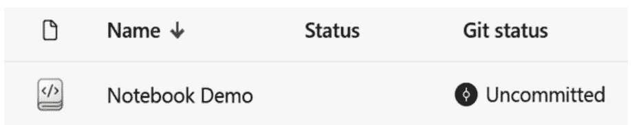

图 8-11. 带有未提交更改的笔记本文件

图 8-12 显示“源代码管理”按钮显示为 1。即使我们还不知道确切更改了哪个项目，这也告诉我们有新内容或更新需要我们关注。这是一个明确的信号，表明存在待同步的更改，因此我们可以先审查并提交它们，然后再继续。


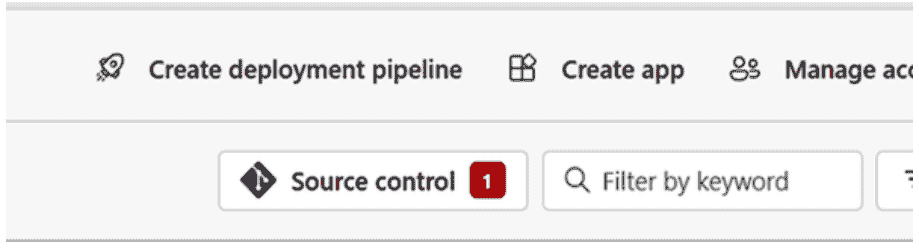

图 8-12. Fabric 工作区中显示一个未提交更改的“源代码控制”按钮

当我们点击“源代码控制”按钮时，工作区中会打开一个名为“源代码控制”的侧边窗口。在那里，我们会看到当前分支，在本例中为“main”，但也可能是选择的任何分支。其下方有一个自由文本字段，我们可以在其中编写提交信息，用来描述即将提交的更改。这很重要，尤其是在与其他人协作时，因为它有助于每个人了解每次同步包含的内容。我们还会看到项目及其状态的列表（见图 8-13）。

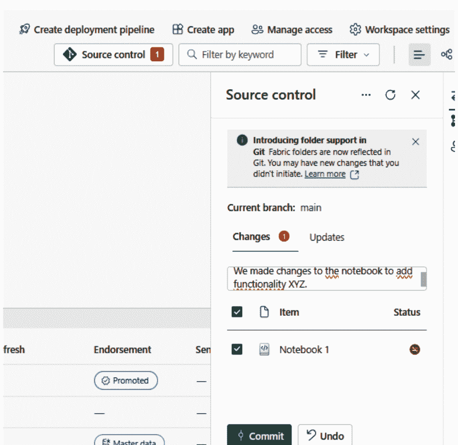

图 8-13. “源代码控制”窗口，可在此查看所有已更改的项目

当我们点击提交时，更改会保存到 Git 仓库。从那一刻起，包含所有详细信息和更改的提交就会存储在版本控制中。这意味着我们可以查看更改了什么、何时更改以及由谁更改。图 8-14 显示了 Git 仓库中提交的一个示例。

## 提交

图 8-14. 在 Git 仓库中进行的提交

## 版本控制的优点和局限性

版本控制不仅仅是一个锦上添花的功能。对于 Power BI 和 Fabric 项目的协作、审计和保持质量而言，它非常重要。知道谁在何时更改了什么，可以加快故障排除速度，并使每个人保持一致。即使我们是唯一在项目上工作的人，随着时间的推移，仅靠记忆做笔记也不够。版本控制充当内置的历史记录和文档系统，将在未来为我们节省时间和麻烦。

但在结束本节之前，我们还需要了解 Fabric 中版本控制的局限性：

- 在 GitHub 中，仅支持云版本；本地部署不支持。此外，你一次不能提交大于 50 MB 的文件。如果你的更改超过该大小，则需要将其拆分为较小的提交。此外，GitHub 不支持跨地域检查，如果你的团队在不同区域工作，这可能会导致问题。
- 在 Azure DevOps 中，你连接时使用的用户必须与在 Fabric 中使用的用户相同。如果你的公司使用某些安全策略，如 IP 条件访问，则此连接也将无法工作。如果你的工作区和 Git 仓库位于不同区域，则管理员必须允许数据在它们之间移动。提交大小限制为 125 MB。

表 8-1 提供了这些局限性的概览。

## 表 8-1. GitHub 和 Azure DevOps 中版本控制局限性的比较

| 局限性 | GitHub | Azure DevOps |
|---|---|---|
| 云或本地部署 | 仅在云版本中可用 | 可作为云和本地部署使用 |
| 最大提交大小 | 50 MB | 125 MB（使用连接器时为 25 MB） |
| 跨地域支持 | 不支持跨地域验证 | 管理员必须启用跨地域导出 |
| 用户账户 | 任何 Git 账户都可以使用 | 用户在 Fabric 和 Azure DevOps 中必须相同 |
| IP 条件访问策略 | 支持 | 如果启用则不支持 |

在 Fabric 中设置版本控制时，请记住只有工作区管理员才能连接或断开 Git 仓库。一旦连接，任何有权访问工作区的人都可以处理内容。此外，已安装模板应用的工作区无法使用 Git 集成。

了解这些局限性有助于你更好地规划版本控制，并在协作和部署过程中避免意外。

## Power BI 项目文件

使用数据和分析不仅仅是构建报表并发布它。你需要管理更改、跟踪已完成的工作，并确保多人可以在同一解决方案上工作而不破坏任何内容。你可能也已经知道，多个人无法同时在同一个 Power BI .pbix 文件上工作。这就是 Power BI 项目文件（.pbip）的用武之地。它们将报表和语义模型分离到不同的文件中，这使得多人可以更轻松地同时处理同一事物，通过使更改更可见来改进版本控制，允许重用项目的一部分，并总体上使协作更高效。

## 保存 Power BI 项目文件

我们在 Power BI Desktop 中保存 Power BI 文件有三种选项：作为 Power BI 文件（.pbix）、作为 Power BI 模板文件（.pbit）或作为 Power BI 项目文件（.pbip）。本节将介绍这些选项。图 8-15 显示了保存 Power BI 文件时出现的菜单，你可以在其中从这些选项中进行选择。

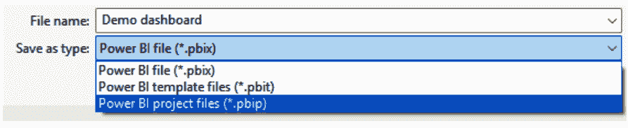

图 8-15. 保存 Power BI 文件的三个选项

将 Power BI 报表保存为 .pbix 文件会创建一个单一文件，其中报表及其语义模型合并在一起。Power BI 项目的工作方式不同。将报表保存为 Power BI 项目文件会创建一个包含两个子文件夹的文件夹，一个用于报表，一个用于语义模型，以及一个 .gitignore 文件和 .pbip 文件本身（见图 8-16）。

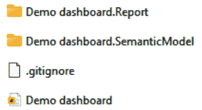

图 8-16. 保存报表为 Power BI 项目文件时创建的文件夹内容

在我们的示例中，项目名为“Demo dashboard”，此名称会自动应用于报表和模型子文件夹。文件夹结构中的每个部分代表项目的单独组件，这允许更灵活地管理文件。

在进一步了解 .pbip 文件之前，你需要知道此功能仍处于预览状态。这意味着你首先需要在 Power BI Desktop 中激活它，方法是转到 文件 > 选项和设置 > 选项 > 预览功能。然后，在功能列表中选择“Power BI 项目（.pbip）保存选项”并保存更改。然后，重新启动 Power BI Desktop 并将你的工作保存为项目文件（见图 8-17）。

## 选项

## 预览功能

以下功能可供你在本版本中尝试。预览功能可能会发生变化

- 使用新的 Databricks 连接器实现 了解更多
- 使用新的 Google BigQuery 连接器实现 了解更多
- 使用旧版 Snowflake 连接器实现 了解更多
- 形状地图视觉对象 了解更多
- Q&A 的西班牙语支持 了解更多
- Q&A 用于实时连接的 Analysis Services 数据库 了解更多
- 将你的指标导入到你的报表中 了解更多
- 连接到与我共享的外部语义模型 了解更多 | 分享反馈
- 现代视觉工具提示 了解更多 | 分享反馈
- 指标视觉对象 了解更多
- 对象交互 了解更多 | 分享反馈
- 在导出的 PDF 上设置敏感性标签 了解更多
- 保存到 OneDrive 和 SharePoint 了解更多
  - 分享到 OneDrive 和 SharePoint 了解更多
  - 保存到 OneDrive 和 SharePoint 会在后台上传文件 了解更多
  - 显示新的文件保存和打开体验 了解更多
- 增强的发布对话框 了解更多
- 发布对话框支持文件夹选择 了解更多
- Power BI 项目（.pbip）保存选项 了解更多
  - 使用 TMDL 格式存储语义模型 了解更多
- 使用增强的元数据格式（PBIR）存储报表 了解更多
- 使用增强的元数据格式（PBIR）存储 PBIX 报表 了解更多

GLOBAL
Data Load
Power Query Editor
DirectQuery
R scripting
Python scripting
Security
Privacy
Regional Settings
Updates
Usage Data
Diagnostics
Preview features
Save and Recover
Report settings
Copilot (preview)
CURRENT FILE
Data Load
Regional Settings
Privacy
Auto recovery
Published semantic model ...
Query reduction

图 8-17. 在 Power BI 设置中激活 Power BI 项目文件，因为它们处于预览状态

在将 Power BI 报表保存为 Power BI 项目并再次打开文件后（例如，通过点击你创建的文件夹中的 .pbip 文件），在屏幕顶部 Power BI Desktop 屏幕顶部文本行的末尾，你会看到一个括号注释：“（Power BI Project）”。这表示已打开一个 Power BI 项目文件（见图 8-18）。


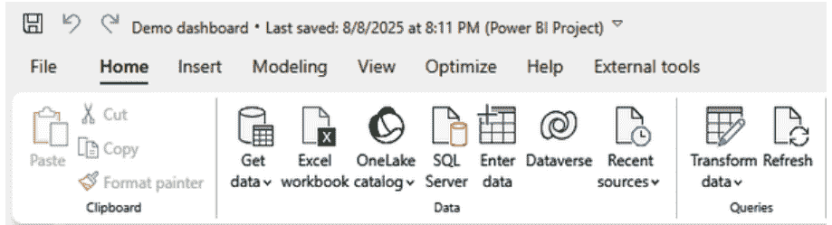

Figure 8-18. What we see at the top of the page if we open a Power BI project file

点击括号说明右侧的小箭头会显示有关文件的更多详细信息，包括报表和语义模型的位置（见图 8-19）。直接点击任何文件路径即可打开文件夹位置。

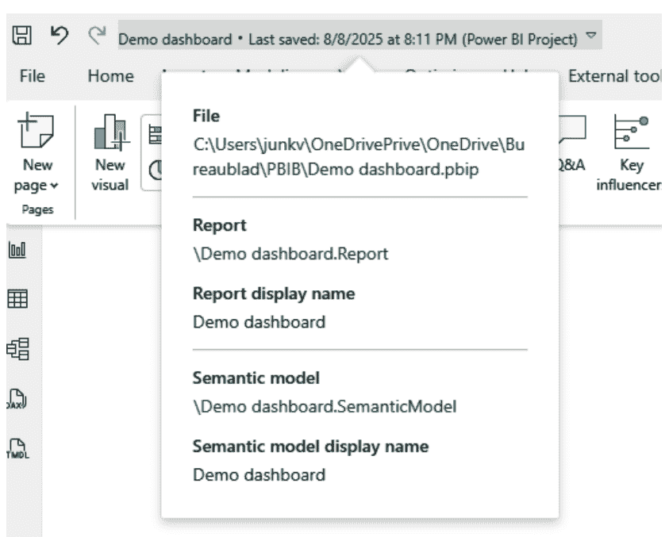

Figure 8-19. Clicking the project name to open a pop-up with file and folder details

## Benefits of Using Power BI Project Files

那么为什么要使用 Power BI 项目文件呢？主要好处之一是它让你可以在 Power BI Desktop 之外进行更改。因为报表和语义模型是分开存储的，所以你可以使用像 Visual Studio Code（VS Code）这样的工具直接编辑文本定义。当你更新多个度量值或进行广泛更改时，这尤其有用，因为你无需在 Power BI Desktop 中逐个点击所有项目。

另一个好处是文件夹结构使版本控制变得更容易。当所有内容都存储在一个 .pbix 文件中时，在 Git 中跟踪小的更改几乎是不可能的。但使用 Power BI 项目时，文件会被拆分，这样你就可以更轻松地看到一次提交中到底发生了什么变化：模型、报表，或两者兼有。

最后，使用项目文件使重用变得更直接。你可以将项目的一部分，例如报表页面或模型对象，复制到另一个项目中，而无需从头重建。

同时也需要注意，使用项目文件不会改变最终用户的体验。保存为 .pbix 文件的报表和保存为 .pbip 文件的报表在 Power BI Desktop 和服务中的外观和行为都相同。区别在于文件如何存储、管理和维护，这对开发人员尤其相关。

## Limitations of Power BI Project Files

在使用 Power BI 项目文件时，你还需要意识到一些实际限制。Power BI Desktop 不会自动检测使用外部工具所做的更改，因此你在 Desktop 之外进行的任何编辑都只有在重新启动应用程序后才会显示。诸如敏感性标签和报表页面同义词等功能不受支持，这可能会影响治理和元数据管理。.pbip 文件默认的最大路径长度为 260 个字符，因此你需要使用较短的文件夹路径以避免保存错误。此外，你不能直接将 .pbip 文件保存到 OneDrive 或 SharePoint；这样做可能会导致同步问题并可能引发保存操作失败。

## Reusable Assets in Power BI

在使用 Power BI 时，我们经常创建多个报表、构建不同的语义模型，并反复设置数据连接。其中许多内容无需每次都重建，我们也不希望每次都从头开始。

更好的方法涉及使用 *可重用资产*，这些是文件或对象，用于捕获我们工作的一部分，例如报表模板、数据源定义和现有的语义模型。我们可以在其他项目中重用这些资产，这不仅节省时间，还能保持团队和环境之间的一致性。

在本节中，我们将探讨三种类型的可重用资产：Power BI 模板文件（.pbit）、Power BI 数据源文件（.pbids）和共享语义模型。每种都有不同的用途，但它们都能使 Power BI 开发更高效、更有条理。

## Power BI Template Files

在 Power BI Desktop 中，我们可以将报表保存为模板文件。*模板* 捕获了报表结构，允许我们或组织中的其他人将其用作新报表的起点。当我们需要反复使用相同的布局、模型或查询时，这很有帮助。当我们将 Power BI 报表保存为 Power BI 模板时，我们会得到一个单一文件（.pbit），其中包含报表以下部分：

- Report pages, visuals, and other visual elements
- The semantic model definition, including schema, relationships, and measures
- Power Query definitions (including parameters)

模板包含报表结构（页面、可视化对象、模型和查询），但不包含数据本身。当我们打开 Power BI 模板文件时，Power BI 会要求我们连接到数据源以加载数据。因此模板对于重用和标准化非常有用。

## Creating a Power BI Template File

要从 Power BI 报表创建模板文件，只需将其另存为 .pbit 文件而不是 .pbix 文件即可。这不会覆盖 .pbix 文件，但会创建一个新文件。图 8-20 显示了保存报表时看到的菜单选项。

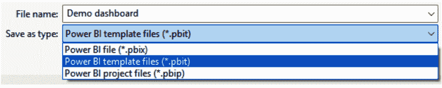

Figure 8-20. The Power BI option for saving a template file

然后，你点击保存，Power BI 会弹出一个屏幕，让你在系统保存之前为模板写一个描述（见图 8-21）。与往常一样，我们建议你写一个清晰的描述，为了你同事和你自己的利益，因为在你再次查看该文件之前可能已经一年或更长时间了。

### Export a template

Template description

Monthly operations report template

Figure 8-21. Screen where you can write a description of a template file before it’s saved

## Using Report Templates

要使用 Power BI 报表模板，你可以在 Power BI Desktop 中打开该文件，要么直接启动 Power BI Desktop，要么双击该文件。如果在你保存为 Power BI 模板的 Power BI 文件中使用了任何参数，你会看到的第一条消息会指示你填写参数值（见图 8-22）。

### Operations Analytics

Country

Figure 8-22. Screen where you can fill in parameter values if any parameters were used in the source file

填写参数后，Power BI 会要求提供数据源的位置。此时，你可以使用自己的凭据连接数据。图 8-23 显示了打开文件并连接到 Power BI 模板时针对 Web 源的凭据提示。

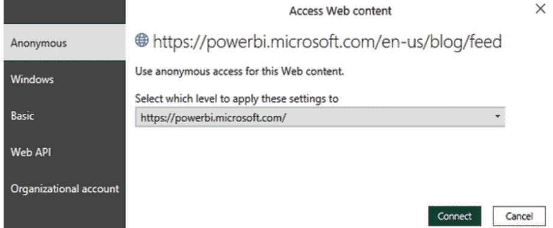

Figure 8-23. Filling in your own user credentials when opening a file and connecting to a Power BI template

> **NOTE**
> You should know that when you try this with your own file, Power BI may not ask for your credentials if the original data source connection permission is still present. To test this whole process, remove the data source permission from the source file and then export the template. After that, Power BI will prompt you to enter credentials when you open the template.

使用报表模板是重用报表结构而无需复制数据的一种简便方法。它节省时间，有助于保持一致性，并简化了与他人共享标准起点的过程。在我们的日常工作中，我们主要使用 .pbix 文件，但在需要反复使用相同布局、模型或查询时，.pbit 模板非常方便。

## Power BI Data Source (.pbids) Files

Power BI 模板文件对于重用相同的报表布局和语义模型关系非常有用，但有时，我们只想重用 Power BI 文件中的连接。我们可以通过保存然后导入数据源连接作为 Power BI 数据源文件（.pbids）来实现。

在 .pbids 文件中，我们没有像 Power BI 模板文件那样的可视化对象；.pbids 文件是一个 JSON 文本文件，保存数据源连接。它不包含数据或查询，只包含以下连接信息：

- The type of data source (for example, Excel or SharePoint)
- The connection details (such as a database or file path)
- Optional authentication settings, depending on the data source

这是一个 .pbids 文件的示例：

```
{
  "version": "0.1",
  "connections": [
    {
      "details": {
        "protocol": "sharepoint-list",
        "address": {
          "url": "https://[url]"
        },
      }
    }
  ]
}
```


这段代码来自一个 Power BI 数据源文件，其数据源为 SharePoint 列表。

## 创建 Power BI 数据源文件

要创建 Power BI 数据源文件，我们可以从现有文件之一导出现有的数据源连接。为此，我们需要打开 Power BI Desktop 中的 Power BI 报表，转到“开始”>“转换数据”，然后选择“数据源设置”[见图 8-24]。

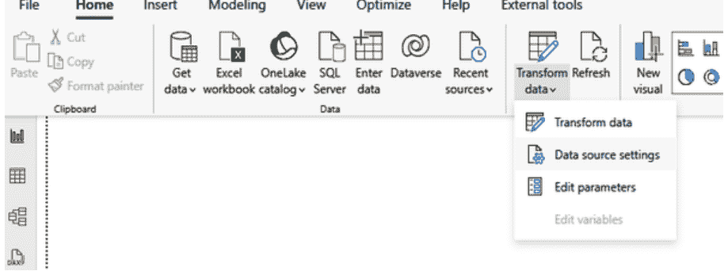

图 8-24. 打开数据源设置以创建 .pbids 文件

这将列出当前文件中的所有数据源以及全局权限。如果我们想导出当前文件中的某个数据源，可以单击该数据源，然后单击页面底部的“导出 PBIDS”按钮[见图 8-25]。

## 数据源设置

管理使用 Power BI Desktop 连接的数据源的设置。

当前文件中的数据源
全局权限

搜索数据源设置

- Azure Data Explorer (Kusto)
- https://porcubi.sharepoint.com/sites/PorcuBI

更改源...
导出 PBIDS
编辑权限...
清除权限
编辑表

关闭

图 8-25. 在数据源设置中导出 .pbids 文件

保存导出后，它将以 .pbids 文件的形式存储。图 8-26 显示了此类导出的示例。如果在文本编辑器中打开该文件，你会看到其 JSON 结构，其中定义了数据源的连接信息。


图 8-26. .pbids 导出在文件夹中的样子

执行导出后，我们可以通过双击轻松重用 .pbids 文件。即使在我们的例子中，.pbids 文件可能不像典型的 Power BI 文件，我们也可以双击它并选择 Power BI 作为工具。然后，Power BI 将自动建立文件中定义连接，因此我们无需手动设置。

> 注意
> 使用 Power BI 数据源文件是共享和重用数据源设置的简单方法。然而，存在一些限制。目前，.pbids 文件只能包含单个数据源，尝试在一个文件中包含多个数据源将导致错误。

Power BI 数据源文件使在多个报表之间重用和共享数据源连接变得容易。它们节省时间，确保一致性，并在设置连接时减少出错的可能性。

## 共享语义模型

现在我们已经了解了 Power BI 模板文件和 Power BI 数据源文件，让我们简要探索另一种可重用资源：共享语义模型。虽然这些模型看起来像 Power BI 模板，但数据源连接是与数据源文件一起的。但共享语义模型允许多个报表使用相同的底层数据模型，包括表、关系和度量。这不仅有助于你避免重复工作，还能确保报表之间的一致性。例如，共享语义模型可以作为公司内的“单一事实来源”，其中每个人创建报表时都连接到同一个语义模型。

## 连接到共享语义模型

如果你想知道在哪里可以找到共享语义模型，请注意，你可以使用并导入发布到你拥有访问权限和编辑权限的 Power BI 工作区中的所有语义模型。要查看有哪些语义模型可用，请转到“开始”>“获取数据”>“Power BI 语义模型”[见图 8-27]。

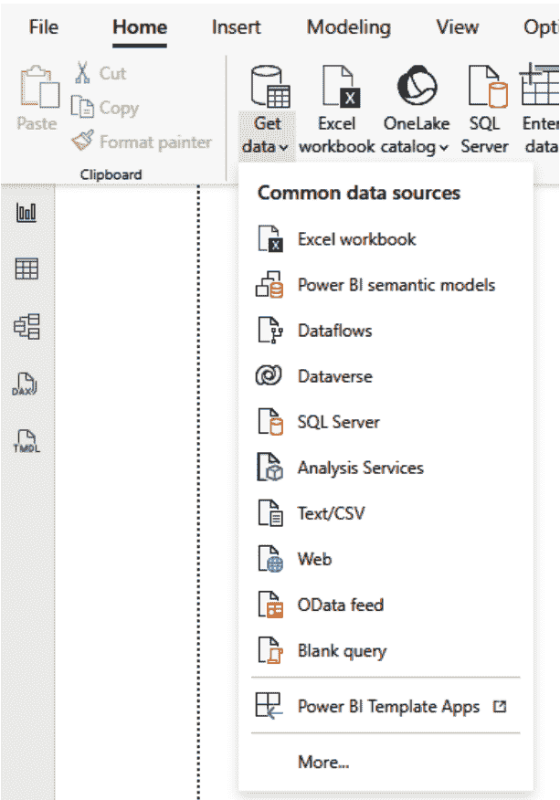

图 8-27. 单击“获取数据”>“Power BI 语义模型”

这将显示所有可连接的语义模型。在我们的示例中，一些模型具有“主数据”背书[见图 8-28]。正如我们在第 7 章中所提到的，此背书表示该模型被视为组织内的核心、可信数据。只有管理员授权的用户或组才能分配此背书，这表明该模型是可靠的并已获批准可在报表中使用。

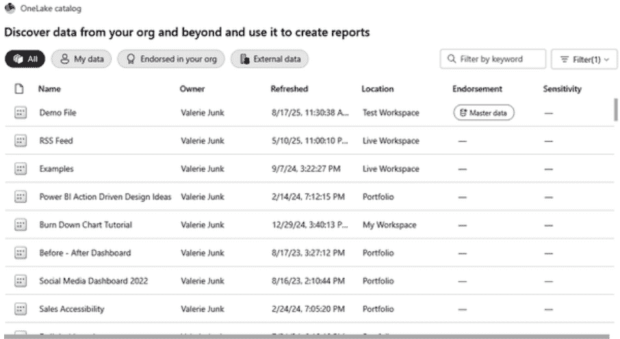

图 8-28. 可用的语义模型，其中一个具有“主数据”背书

还请记住第 7 章中提到的内容，语义模型还可以具有其他背书，如推广或认证，这有助于用户识别推荐或符合组织质量标准的模型[见图 8-29]。

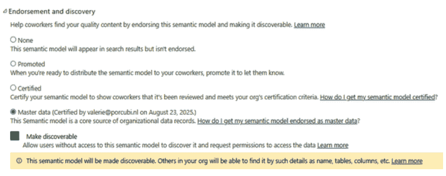

图 8-29. 可分配给每个语义模型的不同背书类型

使用共享语义模型，团队可以快速构建报表和视觉对象，而无需重新创建底层数据逻辑。模型确保多个报表中表、关系和计算的一致性。我们可以根据需要创建额外的度量，但更改不会影响原始模型。

另一方面，使用共享语义模型时我们会遇到一些限制。因为连接是实时的，我们无法编辑模型本身——我们不能更改关系、查询或现有计算。我们可以在报表中创建额外的 DAX 度量，但这些更改不会保存回原始模型。以这种方式添加太多度量会慢慢使报表变成单独的版本，从而降低一致性。

## 部署管道

在工作区中创建项目只是方程式的一部分。另一部分是在开发环境中工作，在那里你将为开发周期中的每个阶段拥有不同的工作区。这可能是例如分别为开发、测试和生产各一个工作区。

你可以使用 Microsoft Fabric 内置的部署管道在工作区之间移动和部署项目。如果你有 Azure DevOps 的经验，你会注意到 Fabric 中的部署管道和 Azure DevOps 中的部署管道几乎以相同的方式工作。主要区别在于，你在 Fabric 中通过 UI 构建部署管道并用鼠标配置它们，而在 Azure DevOps 中主要用 YAML 代码配置管道。

## 示例场景

为了帮助你理解部署管道的工作原理，我们创建了以下开发场景，该场景由三个步骤组成：开发、测试和生产。在测试和生产步骤中，你必须从上一步部署项目，以使流程朝着将最终版本投入生产的方向发展。图 8-30 提供了此场景的说明。

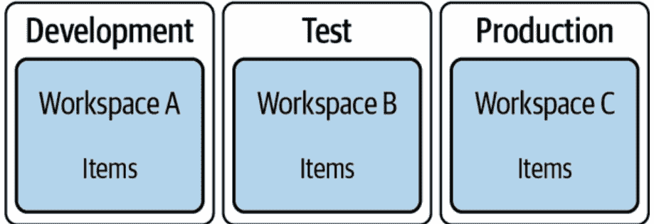

图 8-30. 部署管道的示例场景

我们使用工作区 A、B 和 C 分别用于开发、测试和生产。最初，只有工作区 A 包含以下项目：

- 一个语义模型
- 一个复制作业
- 一个湖仓

我们将在本节中贯穿使用此场景，以帮助你了解如何在 Microsoft Fabric 中创建、配置和使用部署管道。

## 创建部署管道

你在 Microsoft Fabric 中“在工作区之外”创建部署管道。部署管道不能存在于工作区内部，因为它会从工作区复制项目和内容。如果它存在于工作区内部，它将在每次部署时复制自身。

你可以在 Microsoft Fabric 的主菜单中找到“部署管道”按钮[见图 8-31]。

Home
Workspaces
OneLake catalog
Monitor
Deployment pipelines
Real-Time
Workloads
My workspace

图 8-31. Microsoft Fabric 主菜单中的“部署管道”按钮

如果看不到“部署管道”按钮，请单击底部的三点上下文菜单。单击其中任何一个都会显示图 8-32 所示的启动屏幕，除非你已经创建了部署管道。在这种情况下，你会看到它们的列表而不是启动屏幕。

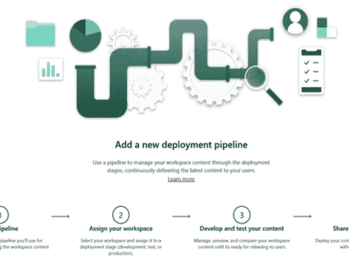

图 8-32. 如果你尚未创建部署管道会看到的启动屏幕

启动屏幕详细说明了构建部署管道必须经历的四个步骤：

1. 新管道：创建新的部署管道。
2. 分配你的工作区：选择分配给流程中每个阶段的工作区。
3. 开发和测试你的内容：进行日常工作并开发满足业务需求的项目和内容。


4. 与你的用户共享：将项目和内容部署到工作区以与你的用户共享。

步骤 4 隐含地承认你不会与用户共享你的开发工作区——他们只能访问测试和生产工作区。

要开始此流程，请点击图 8-32 中的“New pipeline”按钮。它将带你进入图 8-33 所示的屏幕。

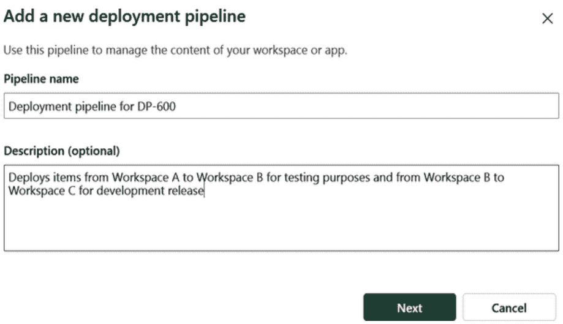

图 8-33. 创建新的部署管道

然后，在相应的框中输入管道的名称和描述。在我们的示例中，我们输入了符合本培训指南格式的演示名称和描述，但你应使用自己的名称和描述。

然后，点击 Next 按钮进入部署管道配置屏幕（见图 8-34）。

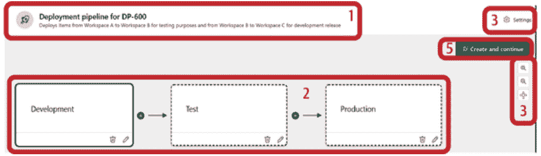

图 8-34. 部署管道配置屏幕

我们在图中突出显示了一些重要区域（编号 1–5）：

## 管道名称和描述（区域 1）

这些是我们创建部署管道时刚刚输入的内容。

## 部署管道的阶段（区域 2）

这些是部署管道中的三个默认阶段，每个阶段都有一个垃圾桶和一个编辑铅笔。你可以点击垃圾桶删除该阶段，也可以点击编辑铅笔进入可以更改每个阶段设置的屏幕（见图 8-35）。

## 设置（区域 3）

在这里，你只能更改部署管道的名称和描述。

## 缩放和平移按钮（区域 4）

你可以使用这些按钮放大、缩小和平移部署管道画布。

## “Create and continue”按钮（区域 5）

你点击此按钮以完成管道创建过程。

### NOTE

每个部署管道必须至少有 2 个阶段，最多 10 个阶段。因此，如果你从默认的三个阶段中删除一个阶段且未添加新阶段，就无法再删除第二个阶段。

## 阶段设置

阶段名称 *

Development

描述

Add a description...

设为公开

No

保存

关闭

图 8-35. 可编辑阶段设置的屏幕

阶段设置屏幕包含可查看和更改阶段名称和描述的字段，以及一个“Set as public”滑块，可用于使阶段对公众可见或不可见。默认情况下，管道的最后阶段是公开的。没有访问管道权限的公开阶段消费者会将其视为普通工作区，在工作区名称旁的工作区页面上不会显示阶段名称和部署管道图标。你可以拥有任意数量的公开阶段，也可以一个都没有。

在我们的示例中，我们没有更改任何设置，因此我们只需点击“Create and continue”按钮创建部署管道并使其可见（见图 8-36）。接下来，我们可以开始配置阶段和部署过程。

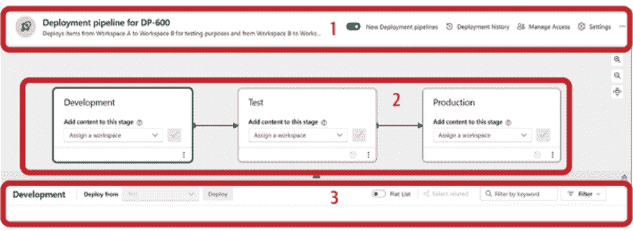

图 8-36. 部署管道，准备进行阶段配置

在图中，我们突出显示了一些区域（编号 1–3）以便关注。我们将在以下各节中详细介绍它们。

## 顶部菜单（区域 1）

在顶部菜单中，你可以找到部署管道的选项和主要设置，包括 Deployment history、Manage Access、Settings 和 Delete pipeline（后者位于右侧溢出上下文菜单中）。

## 新部署管道

此选项在撰写本文时可用，启用后你可以使用更新的 UI 来处理和配置部署管道。我们预计此选项将在未来版本的 Microsoft Fabric 中移除。

## 部署历史

点击此选项可查看此特定部署管道的使用历史。稍后在本节中，我们将深入了解其内容细节。

## 管理访问

点击此选项可进入可配置谁有权访问部署管道的屏幕（见图 8-37）。

## 添加人员

DP-600 的部署管道

输入姓名或电子邮件地址

管理员

添加

访问管道不会授予对所分配工作区的权限。要添加工作区权限，请打开切换按钮并选择权限级别。了解更多

添加或更新工作区权限。

关闭

图 8-37. 部署管道访问控制

此屏幕还为你提供了将新人员或组添加到部署管道的选项。请注意，部署管道只有一个角色（Admin）。

此外，还有一个“Add or update workspace permissions”滑块，可让你授予对部署管道中工作区的访问权限。此设置默认关闭，这意味着管理员可以管理部署管道而无需访问每个工作区中的底层项目或数据。如果你希望此部署管道的管理员也能访问同一部署管道中的工作区，则在添加这些管理员时将滑块设置为开启位置。

## 设置

点击此选项可更改部署管道的名称和描述。

## 画布（区域 2）

此区域显示三个已配置的阶段：Development、Test 和 Production。然而，每个阶段尚未配置工作区，因此你可以使用每个阶段中的下拉菜单进行配置（见图 8-38）。

## Development

向此阶段添加内容

分配工作区

搜索

- OneLake security
- Real Time demo
- Sandbox
- Workspace A
- Workspace B
- Workspace C

图 8-38. 部署管道中为开发阶段选择工作区的下拉菜单

此图包含六个工作区的列表，我们选择 Workspace A，因为它是场景中需要使用的那个。

然后，我们点击复选标记，这将弹出一个警告（见图 8-39）。

## ⚠ 工作区包含不受支持的项目

此工作区可以分配，但某些项目不会部署到下一阶段。了解更多

以下项目不受支持：

- Model

图 8-39. 警告工作区中存在不受支持的部署管道项目

此警告表明某些项目不受 Microsoft Fabric 中内置部署管道的支持。在 Workspace A 中，我们有本小节开头列出的三个项目。但名为“Model”的语义模型不受部署管道支持。

部署管道中受支持的项目列表可在 Microsoft Learn 上的 Introduction to Deployment pipelines 链接中找到。在该链接中，我们可以读到语义模型仅在（撰写本书时处于预览中）源自 .pbix 文件且不是 Push 数据集时才受支持。另请注意，我们直接在 Fabric UI 中从场景创建了此特定语义模型，以向你展示一些当前不受支持的项目示例。

## 开发阶段详情（区域 3）

当你在警告屏幕上点击 Continue 按钮时，图 8-36 中的区域 3 将更新为图 8-40 所示的信息。

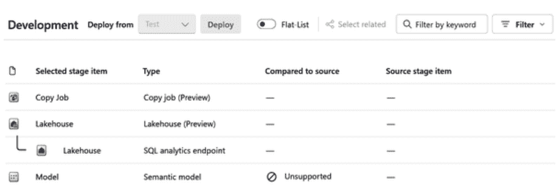

图 8-40. 已分配工作区的阶段的开发阶段详情区域

区域 3 显示来自 Workspace A 的项目，对于语义模型，“Compared to source”列中的状态为 Unsupported。

区域 3 顶部的选项可让你显示整个部署管道中的所有项目，并新增一列显示位置（工作区）。你可以在顶部菜单最右侧的 Filter 下拉菜单中找到此选项。你还可以在 Filter 菜单旁边的字段中按名称搜索项目。此外，你还可以使用 Filter 选项按项目类型和当前阶段的状态（与上一个阶段，即源的状态相比）查找项目。

对 Test 和 Production 分别分配 Workspaces B 和 C 并完成你的部署管道创建，执行所有相同的步骤。

## 配置部署管道

我们已经涵盖了配置部署管道的一些高层方面，例如安全性和阶段。但我们也有为每个阶段配置规则、使用部署管道在阶段之间复制项目并将其提升到下一个开发的选项


stage。 例如，我们可以为每个阶段分配不同的数据库或不同的查询参数。 开发阶段可能会查询数据库中的示例数据，而测试和生产阶段可能会查询整个数据库。

当你在管道阶段之间部署内容时，配置部署规则可以让你在保持某些设置不变的同时允许对内容进行更改。 例如，你可以在生产阶段为语义模型定义一条规则，使其指向生产数据库。 一旦你成功定义或更改了规则，就重新部署内容。 部署的内容将继承部署规则中定义的值，并且只要规则未更改且有效，就会始终应用该规则。

只有工作区中的一部分项目才有资格对其应用规则。 表 8-2 列出了这些项目。

## 表 8-2. 可以和不可以对其应用特定部署规则的项目

| 项目 | 数据源规则 | 参数规则 | 默认湖屋规则 | 详细信息 |
|---|---|---|---|---|
| Dataflow Gen1 |  |  |  | 使用特定数据流 Gen1 的数据源参数的详细信息 |
| 语义模型 |  |  |  | 使用特定语义模型的数据源参数的详细信息 |
| 分页报表 |  |  |  | 这定义了每个分页报表项目的来源 |
| 镜像数据库 |  |  |  |  |
| 笔记本 |  |  |  |  |

> NOTE
> 要在部署管道中使用规则，你必须是正在尝试配置的工作区中该项目的拥有者。 这是成为部署管道管理员的一个小限制。

当你创建新规则时，你会在阶段中看到一个小的闪电图标（见图 8-41）。

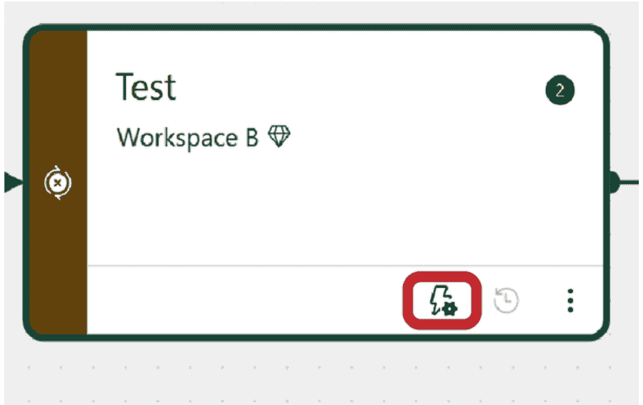

图 8-41. 部署管道中阶段的规则设置

单击该图标以调出“设置部署规则”屏幕（见图 8-42）。

## 设置部署规则

创建在部署此项目时运行的规则。 了解更多

### 数据源规则

定义将连接到此项目的的数据源。 了解更多

尚未添加任何规则

+ 添加规则

### 参数规则

定义要应用于此项目的参数值。 了解更多

尚未添加任何规则

+ 添加规则

图 8-42. 在部署管道中为项目添加规则的屏幕

在这里，你可以开始向项目添加规则。 我们从 .pbix 文件创建了一个新的语义模型，以向你展示此特定项目的设置。 每个受支持项目的设置都不同。

你可以添加两种类型的语义模型规则：数据源规则和参数规则。 要添加并定义数据源规则，请单击屏幕“数据源规则”区域中的“+ 添加规则”按钮，然后执行以下操作之一：

- 从列表中选择一个数据源。
- 选择“其他”并手动添加新的数据源。 请注意，你只能选择相同类型的数据源。

要配置参数规则，请按照相同的流程操作：单击图 8-42 屏幕“参数规则”部分中的“+ 添加规则”，从参数列表中选择一个参数，并选择在每次部署后要应用的参数值（见图 8-43）。 屏幕将显示当前参数值，你可以将其更改为每次部署后生效的任何值。

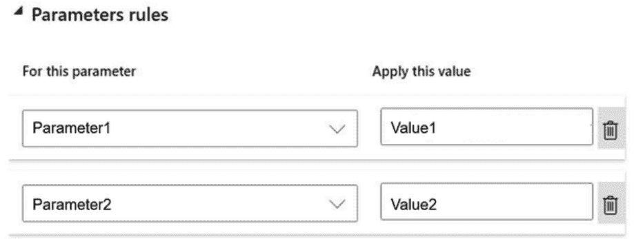

图 8-43. 在部署管道中配置参数规则

> NOTE
> DP-600 考试不涵盖如何为项目定义参数，因此只需知道你可以在部署管道的每个阶段设置参数值即可。

设置部署规则后，部署管道将完全配置好并可供使用。 下一节将介绍如何使用部署管道，并将深入探讨部署管道执行的历史记录。

## 在阶段之间部署

创建部署管道后，你就可以开始使用它来提升项目。 你可以一次性完成整个过程，也可以采用挑选过程，只选择要部署的特定项目。

例如，你可以从部署管道中选择测试阶段，以调出图 8-44 所示的屏幕。

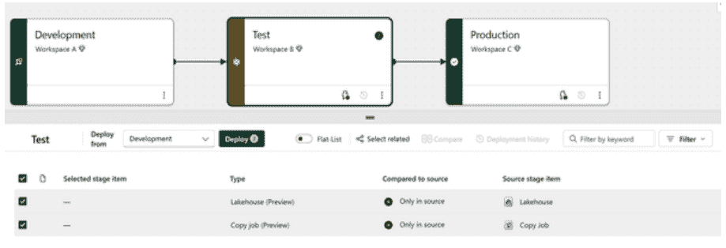

图 8-44. 选择测试阶段进行部署

然后，你可以选择要部署的项目，这将使部署按钮变为可点击状态。 （图中已完成此操作）。 只选择部分可用项目的做法称为挑选。

注意测试阶段中的小圆圈 2。 它表示测试阶段在项目数量上与前一阶段（开发）和当前阶段（测试）不同步。

在“部署自”下拉菜单中，你可以选择要从哪个阶段读取项目的阶段。 在本例中，你希望从开发阶段部署到测试阶段。

然后，单击部署按钮以进入类似图 8-45 所示的屏幕。

## 部署到此阶段

你即将从“开发”部署到“测试”。 即将部署的项目如下：

### 新建 (2)

- 复制作业
- 湖屋

添加备注

继续部署即使 1 个或多个项目失败 了解更多

部署

取消

图 8-45. 定义部署

在这里，你可以输入有关部署的任何备注。 如果愿意，你还可以勾选一个框，表明你希望在出现一个或多个项目失败时继续部署。 是否应勾选该框取决于你的业务需求和部署要求。

然后，单击部署按钮以启动部署管道并将项目从源阶段移动到目标阶段。

部署需要几分钟时间，然后，我们场景中的工作区 B 将拥有来自设置的两个受支持项目：复制作业和湖屋（见图 8-46）。

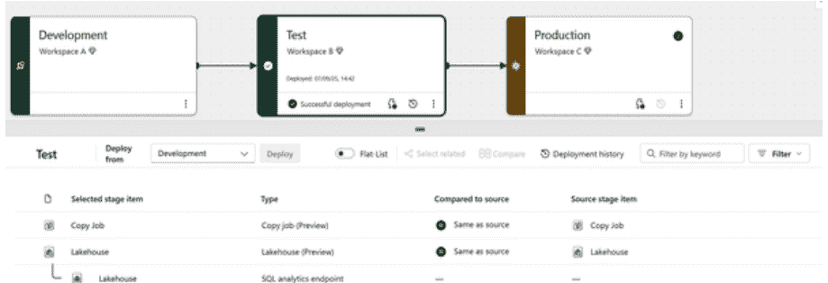

图 8-46. 显示部署管道成功部署的屏幕

屏幕显示部署到测试阶段的状态为“成功部署”，并且还显示了从测试部署到生产的操作选项。

## 部署历史

每次执行部署管道时，都会在历史记录中添加一行以供后续治理和日志分析。

图 8-47 描绘了“部署历史”屏幕，显示了我们刚刚进行的部署的历史记录。

## 部署历史

选择一个阶段查看部署历史：

全部

部署到
日期和时间
部署者
项目
备注
ID
状态

测试
07/09/25, 14:42
Brian Bønk
+ 2
07/09/25, 14:42 测试部署
从开发阶段部署到测试阶段

图 8-47. 当前部署管道的历史记录

在“部署历史”屏幕上，你可以看到以下内容：

- 项目已部署到的阶段
- 部署的日期和时间
- 谁进行了部署
- 你可以单击以查看已部署项目列表的图标
- 你可以单击以查看部署备注的图标（例如，“从开发部署到测试阶段”，如图所示）
- 部署的唯一 ID（名称）
- 部署状态

你还可以使用右上角的下拉列表通过选择“全部”或特定的目标阶段来筛选历史记录。

至此，你已创建了完整的部署管道，对其进行了配置，并执行了从开发阶段到测试阶段的首次部署。

部署管道是在工作区中处理项目开发周期时非常好的资产。 你可以将阶段间的部署外包，并消除处理不同阶段版本的手工工作。 一旦创建了部署管道，最终用户只需点击几下鼠标即可执行部署。

## 执行下游依赖项的影响分析

将工作区中的每个项目，从数据流到语义模型，都视为更大拼图的一部分是有帮助的。 它们彼此依赖，改变拼图中的一块可能会导致问题，如果它不合适或看起来不对。 因此，当你更新一块时，你需要了解哪些其他块会受到影响——否则你可能会修复一个小问题，却无意中破坏了十个其他问题。 这是 DP-600 考试的关键技能，但对你作为 Fabric 专业人士的实际工作来说更为重要。

好消息是，Microsoft Fabric 为你提供了很好的工具来帮助解决这个问题：*血缘视图*，它是一种可视化工作区内所有依赖关系的方式。 你可以看到哪个数据流为湖屋提供数据，哪个湖屋为语义模型提供数据，以及哪个语义模型用于哪个报表。 血缘视图显示了数据项目之间的连接，以便你可以在更改之前查看全貌。

让我们通过几个简单的更改列表来了解它们可能带来的巨大影响：

*更改数据流*


想象一下你有一个用于拉取销售数据的数据流。你决定将一列的名称从 customerId 改为 customerId 以符合新的命名规范。这看起来像是微小的外观更改，但它可能会破坏每个依赖于该特定列名称的语义模型、报表和仪表板。血缘视图会显示引用该数据流的每个项目，因此你会确切地知道在哪里检查损坏的依赖项。

## 修改语义模型

假设你有一个包含大量度量的语义模型，这些度量用于计算利润。你决定调整其中一个度量的 DAX 公式，但如果报表或其他语义模型正在使用该度量，数字将会改变——这可能导致错误的分析。

## 从湖屋或数据仓库中删除一列

这可能是你能做的最具潜在危害的更改。如果你删除一个正在被报表使用的仓库中的列，该报表将直接中断并显示错误。但借助血缘视图，你可以识别所有受影响的项目，并制定计划来更新它们或通知其所有者。

归根结底，进行影响分析就是要预见你行为的后果。因此，在你点击应用或发布之前，你需要问自己：“这次更改还会影响到什么？” Fabric 中的血缘视图旨在以简单、直观的方式帮助你回答这个问题。

## 使用血缘视图

在 Microsoft Fabric 中的每个工作区中，你都有两种查看项目的方式：默认列表或血缘视图。

血缘视图按钮位于工作区右上角。图 8-48 显示了完整的血缘视图。

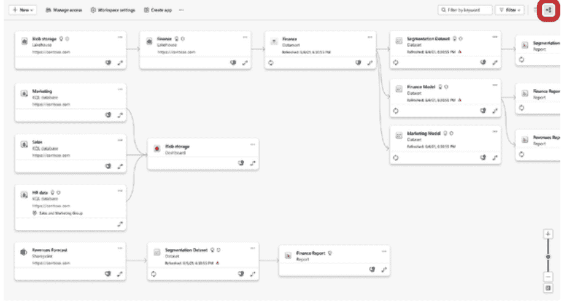

图 8-48. Microsoft Fabric 中的血缘视图

血缘视图会显示工作区中的每个项目，以及它们之间的依赖关系。例如，左上角的 Blob 存储会将数据馈送到其右侧的 Finance 湖屋。

你可以选择血缘视图中的任何项目以突出显示其连接和依赖项（见图 8-49）。

在图中，我们选择了前面提到的 Blob 存储项目，血缘视图向我们展示了从它开始的整个依赖流。至少有八个项目依赖于 Blob 存储，因此更改它可能会影响从它下游的全部八个项目。

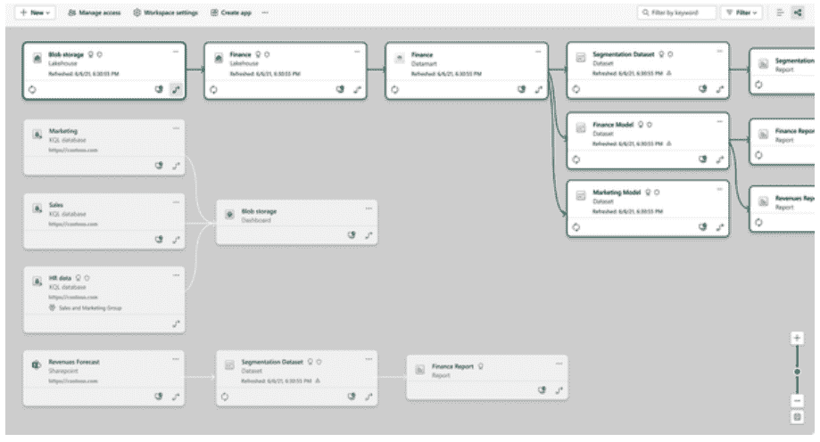

图 8-49. 在血缘视图中选择特定项目

## 使用影响分析

有时，血缘视图可能会让人不知所措，你可能更喜欢查看受特定项目影响的项目的简单列表。要获取血缘视图中特定项目的此列表，你可以点击该项目中的影响分析图标（见图 8-50）。


图 8-50. 血缘视图中项目中的影响分析图标

点击该图标将打开图 8-51 中的影响分析概览。

## 受此数据集影响

子项目

所有下游项目

34
受影响的子项目

2
工作区

按项目类型浏览

- Report 5
  - Marketing Model
  - Sales Report 3
  - Sales Leads
  - Sales Report 2
  - Marketing Promotions
- Dashboard 3
  - Marketing Dashboard
  - Sales Dashboard
  - Sales Team Dashboard

进行更改？通知 Marketing Model 受影响项目的联系人列表

通知联系人

图 8-51. 按项目类型进行的影响分析

在这里，我们可以看到语义模型有 34 个子项目使用它作为源。

此示例按项目类型显示项目，但你也可以选择按工作区查看同一列表，只需点击图 8-51 所示屏幕上“按项目类型浏览”最右侧的图标即可。图 8-52 显示了点击此图标的结果。

## 受此数据集影响

子项目

所有下游项目

34
受影响的子项目

2
工作区

按工作区浏览

- Sales and Marketing Group
  - Marketing Model
  - Sales Team Dashboard
- Finance Corporate
  - Sales Report 3
  - Sales Leads
  - Sales Report 2
  - Marketing Promotions
  - Marketing Dashboard
  - Sales Dashboard

进行更改？通知 Marketing Model 受影响项目的联系人列表

通知联系人

图 8-52. 按工作区进行的影响分析

在图 8-51 和图 8-52 所示的屏幕上，你可以点击“通知联系人”按钮来通知任何未来更改的联系人。这将打开图 8-53 所示的屏幕。

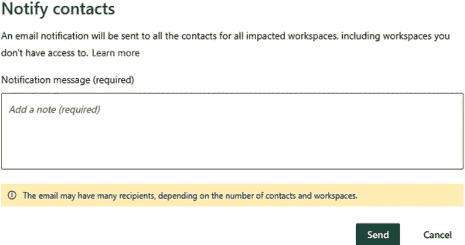

图 8-53. “通知联系人”屏幕

在这里，你撰写通知消息给你的联系人，然后点击发送按钮以通知所有联系人工作区的任何更改。

NOTE
你应该为每个特定的 Microsoft Fabric 工作区配置一个或多个联系人，可在工作区设置中或创建工作区时进行配置。这是一个总体治理问题，因此超出了本书的范围。

## 使用 XMLA 端点部署和管理语义模型

当你在 Microsoft Fabric 中构建语义模型时，你使用 UI 来创建表、关系和度量。这对于开发来说很棒，但如果需要执行更高级的任务怎么办？如果需要自动化部署或处理表的单个分区怎么办？这就是 XMLA 端点发挥作用的地方。

简单来说，*XMLA 端点*是 Microsoft Analysis Services 使用的通信协议。它就像通往语义模型核心引擎的直接线路。在 Fabric 中，此端点允许你从为高级管理和开发而设计的外部工具连接到你的语义模型。图 8-54 显示了这可能是什么样子。

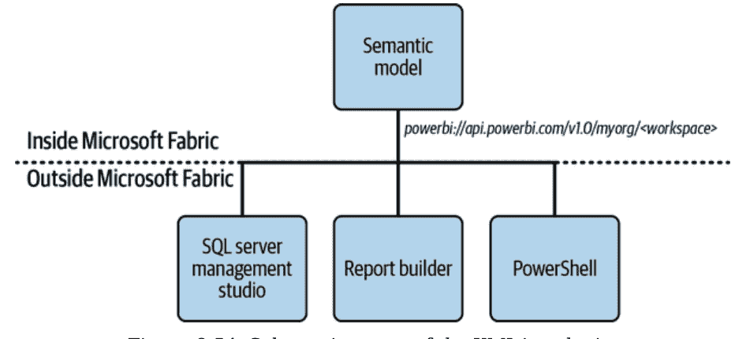

*图 8-54. XMLA 端点的示意用法*

在图 8-54 中，你还可以看到默认连接到工作区的连接字符串是使用以下语法构建的：

```
powerbi://api.powerbi.com/v1.0/myorg/<workspace>
```

TIP
你可能会问为什么在连接字符串中看不到组织名称或用户名。这是因为底层 API 的特性，它会根据你的凭据自动过滤你有权访问的对象。因此，即使你有一个与不同组织同名的 workspace，你也只能访问自己的 workspace。

XMLA 端点开启了无限的可能性，包括以下内容：

## 高级部署

虽然使用 Fabric 部署管道是在工作区之间移动项目的好方法，但 XMLA 端点给了你更多控制权。你可以使用 Visual Studio 配合 Analysis Services 项目扩展或 Tabular Editor 等工具来开发语义模型，然后通过端点将其部署到 Fabric 工作区。这在企业环境中是一种常见做法。

## 脚本和自动化

你可以使用 SQL Server Management Studio 等工具编写和执行针对语义模型的 XMLA 脚本。这非常适合自动化数据刷新、备份数据以及执行单个表分区的部分刷新等任务。例如，如果你有一个巨大的表，你可以使用 XMLA 仅刷新最近一个月的数据，而不是刷新整个表。

## 第三方工具

XMLA 端点正是 Tabular Editor 和 DAX Studio 等强大的第三方工具能够连接到服务中的语义模型的原因。这些工具提供了在 Fabric UI 中无法直接获得的高级功能，用于编辑数据模型、管理 DAX 表达式以及排查性能问题。

简而言之，XMLA 端点是将你的工作从简单开发提升到专业管理的关键。它是连接易于使用的 Fabric 界面与外部工具强大功能之间的桥梁。


### 提示

许多人每天都在使用外部工具来使用 Fabric，但这些工具超出了 DP-600 考试的范围。你只能得到基于 Microsoft 标准应用程序和软件的问题。

## 设置 XMLA 端点

XMLA 端点使你能够使用第三方工具并使用 Microsoft Fabric 进行离线工作。它是允许客户端应用程序和底层引擎处理语义模型、治理、生命周期和数据管理的通信协议。此过程中的所有通信都是完全加密的。

默认情况下，XMLA 端点对于语义模型工作负载设置为“只读”，这意味着你只能查询数据而不能更改数据。但在你创建 Fabric 容量（或开始 Fabric 试用）后，可以按照以下步骤在本地环境中启用 XMLA 端点以实现*读写*：

- 1. 在 Fabric 门户中，点击右上角的设置选项。
- 2. 选择“管理员门户”。
- 3. 选择“Fabric 容量”。
- 4. 点击你的容量名称。
- 5. 展开“Power BI 工作负载”。
- 6. 找到“XMLA 端点”设置。
- 7. 选择“读写”。

### 提示
管理员门户包含大量 Fabric 容量设置、预览功能等。这些设置超出了本书和认证考试的范围，我们在这里也不会深入介绍。

## 从 XMLA 端点管理语义模型

在本示例中，我们将使用 SSMS 来展示如何管理语义模型。

首先，我们需要从工作区设置中连接到端点。在 SSMS 中，连接到 XMLA 端点的连接是 Analysis Services 连接，因此你选择该服务器类型并在“连接到服务器”屏幕上输入你的信息（见图 8-55）。

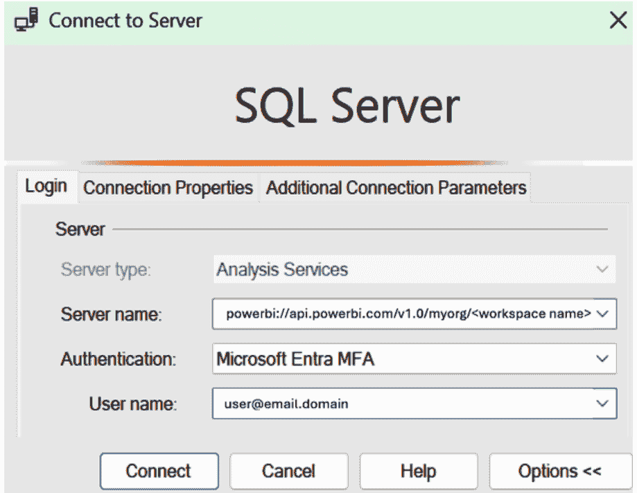

图 8-55. 从 SSMS 登录到 XMLA 端点

在图中，我们出于安全原因在输入字段中输入了通用文本。你应该在服务器名称和用户名字段中输入自己的信息。

如果系统提示你使用 Microsoft 标准多因素身份验证（MFA）进行用户身份验证，请按照屏幕提示操作。

成功连接到 XMLA 端点后，左侧窗格中会出现数据库列表。这些不是实际数据库，而是你有权访问的模型。

### 提示

如果你的工作区中有湖仓，这些也会显示为数据库，即使它们不包含任何分析服务数据库对象。

图 8-56 显示了连接到名为 Workspace A 的工作区时左侧窗格的内容。

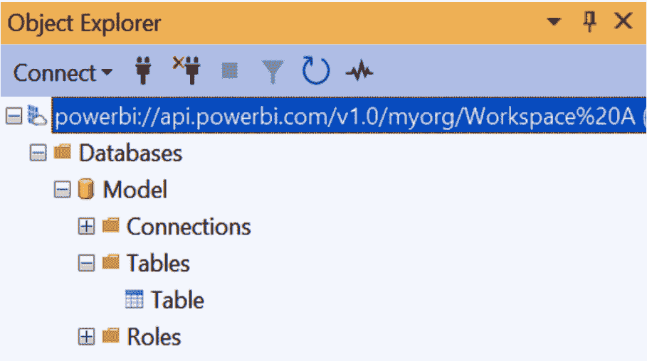

图 8-56. 包含语义模型的工作区内容

在左侧窗格中，你现在可以直接在 SSMS 应用程序中开始管理语义模型。

## 处理语义模型

如果我们想处理模型（如果它是导入模式模型），我们可以通过右键单击左侧窗格中的模型并选择“处理数据库”（见图 8-57）来完成此操作。

图 8-57. 在 SSMS 中选择“处理数据库”选项

这会打开图 8-58 所示的屏幕。

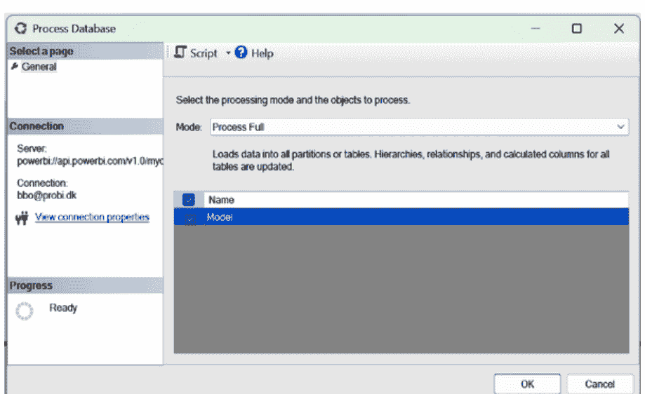

图 8-58. SSMS 中的“处理数据库”屏幕

在“模式”字段中，选择“完全处理”选项，否则模型只会处理元数据，而不会将新数据加载到语义模型中。然后，点击“确定”按钮，语义模型将开始加载新数据。

你可以使用 XMLA 端点来自动化开发语义模型所涉及的几乎所有流程。我们无法全部介绍，但只要你知道 XMLA 端点和与这些功能一起使用的选项存在，对于考试来说就足够了。

## 摘要

一旦 Power BI 报表发布到工作区，它通常会不断演进。报表会更新，数据模型会发生变化，并会出现新的需求。这是一个好兆头，因为这意味着人们正在使用报表，我们可以改进它以提供更好的洞察。

更新一个报表很简单，但在大型组织中，你通常会处理许多报表和语义模型。你不能仅靠记忆来跟踪更改，因此你需要有一种清晰且结构化的方式来记录它们，以便即使一年后，你也能理解所做的工作。

在某些情况下，你还需要将内容在工作区之间移动，例如从开发到测试再到生产。此外，重用报表或语义模型的部分内容可以节省时间，避免每次都从头开始。

本章介绍了使用 GitHub 和 Azure DevOps 的版本控制，这有助于团队记录和回滚更改。我们探讨了 Power BI 项目（.pbip）文件，它将报表和模型组件分开以支持协作和版本控制。我们还介绍了可重用资产，如模板（.pbit）文件、数据源（.pbids）文件和共享语义模型，以简化开发并促进一致性。

我们随后介绍了部署管道，它允许在开发、测试和生产阶段之间结构化地推广内容。我们还介绍了影响分析工具，如血缘视图，它有助于在进行更改之前识别下游依赖关系。最后，我们研究了 XMLA 端点，它使用外部工具实现语义模型的先进管理和自动化。

了解如何维护分析生命周期将有助于你标准化工作，在项目之间共享工作，并在构建新报表时节省时间。
