# 配置 Power BI 工具

Power BI 是一套业务分析工具和服务，它们协同工作以访问数据源、塑造、分析和可视化数据并共享见解。虽然并非所有工具都适用于所有 Power BI 项目或部署，但通过利用多个工具的独特功能作为集成解决方案的一部分，可以实现协同效应，该解决方案涵盖多样化的数据源和可视化类型。

在本章中，我们将介绍 **业务智能 (BI)** 专业人员用于设计和开发 Power BI 内容的主要工具和服务的安装与配置。这包括官方 Microsoft 工具，如 Power BI Desktop、本地数据网关和 Analyze in Excel，以及第三方工具，如 DAX Studio、ALM Toolkit 和 Tabular Editor。由于 Power BI 工具和服务会定期更新新功能和增强功能，因此会确定资源以保持最新并充分利用这些工具用于您的项目。

本章的食谱如下：

- 安装和配置 Power BI Desktop
- 创建本地数据网关
- 从 Power BI 服务安装 Analyze in Excel
- 安装和配置其他工具

## 技术要求

假定读者拥有 Power BI Pro 许可证，有权在其机器上下载和安装开发工具，并且拥有在 Power BI 服务中部署和管理内容以及使用 Power BI 移动应用程序所需的访问权限和权限。

# 如何安装和配置 Power BI Desktop

实际上 Power BI Desktop 应用程序有三种不同的版本，如下所示：

- Power BI Desktop（Microsoft Store 应用）
- Power BI Desktop（Microsoft 安装程序）
- Power BI Desktop RS（Report Server 版本）

首选的安装方法是使用 Microsoft Store 应用。要从 Microsoft Store 安装 Power BI Desktop，请执行以下操作：

1. 打开 Microsoft Store 应用并搜索 Power BI Desktop。或者，您也可以在任何浏览器栏中输入 `https://aka.ms/pbidesktop`，Microsoft Store 应用将自动打开到 Power BI Desktop 应用，如 *图 1.1* 所示。
2. **务必确保您获取的是 Power BI Desktop 应用，而不是仅 Power BI 应用。Power BI 应用仅用于查看发布到 Power BI 服务的报表。**

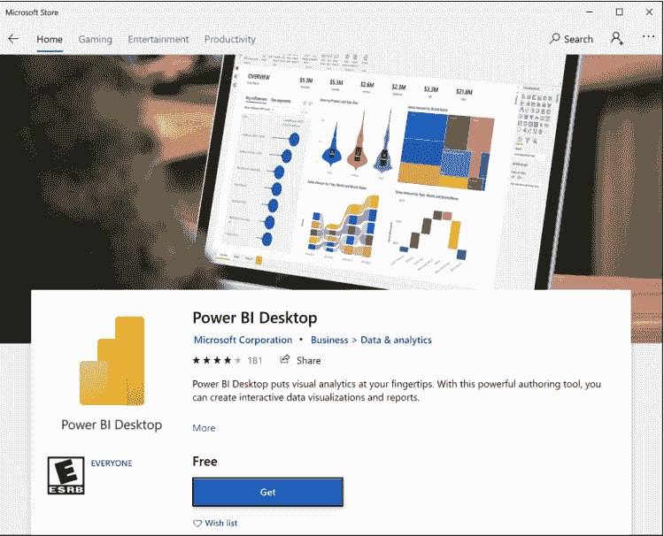

图 1.1：Microsoft Store 中的 Power BI Desktop 应用

3. 点击 **Get** 按钮。
4. 下载和安装完成后，点击 **Launch** 按钮。

由于各种原因，可能无法安装 Microsoft Store 应用版本的 Power BI Desktop。这可能是因为运行的是较旧版本的 Windows、企业策略，或希望使用 Power BI Desktop 的 32 位版本（Microsoft Store 应用仅为 64 位）。在这种情况下，您可以安装 **Microsoft Installer (MSI)** 版本。要安装 MSI 版本，请按照以下步骤操作：

1. **Microsoft Installer (MSI)** 版本的 Power BI Desktop 可以在 Power BI 下载页面下载：https://powerbi.microsoft.com/downloads。
2. 在 **Microsoft Power BI Desktop** 下，选择 **Advanced download options.**

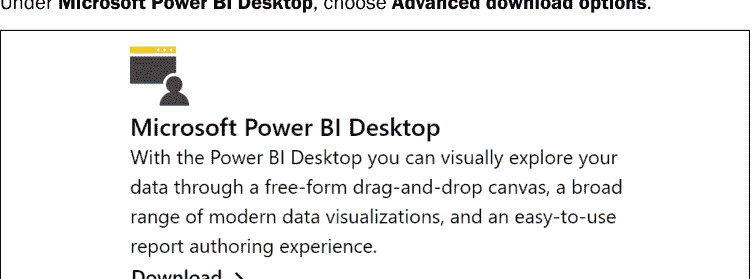

图 1.2：使用高级下载选项下载 MSI 版本

3. 选择您的语言偏好并点击 **Download** 按钮。
4. 选择 64 位版本（PBIDesktopSetup_x64.exe）或 32 位版本（PBIDesktopSetup.exe），然后点击 **Next** 按钮。
5. 文件下载后，点击 **Open file**。
6. Microsoft Power BI Desktop 安装向导将启动。选择一种语言并点击 **Next** 按钮。
7. 完成安装向导的其余部分，包括接受许可条款和目标文件夹，每次都点击 **Next** 按钮。
8. 在最后一屏，点击 **Install** 按钮。
9. 安装完成后，点击 **Finish** 按钮。

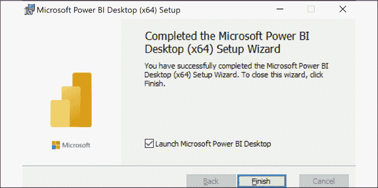

图 1.3：Power BI Desktop（MSI）成功安装

如果您使用的是 Power BI Report Server（本地），则需要下载针对 Report Server 优化的 Power BI Desktop 对应版本（RS 版本）。Power BI Report Server 每季度发布更新，同时会发布特定版本的 Power BI Desktop，与每个季度版本优化兼容。安装与 MSI 版本相同。但是，要找到 RS 版本的下载，请按照以下步骤操作：

1. 使用浏览器导航至 `https://powerbi.microsoft.com/report-server`。
2. 使用 **DOWNLOAD FREE TRIAL** 按钮正下方的 **Advanced download options** 链接。

图 1.4：使用高级下载选项下载 RS 版本

# 其工作原理

Power BI Desktop 支持丰富的配置选项，既适用于当前打开的文件，也适用于给定设备上所有 Power BI Desktop 实例。这些选项控制预览功能和最终用户功能的可用性，并定义默认行为、资源使用、安全性以及数据源的隐私/隔离。

无论安装了哪个版本的 Power BI Desktop，这些选项都可以通过功能区中的文件菜单，然后选择选项和设置，然后选择选项来使用，如图 1.5 所示。

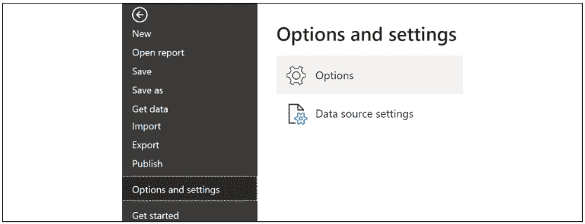

图 1.5：Power BI Desktop 选项和设置

选择选项会打开选项窗口，如图 1.6 所示。

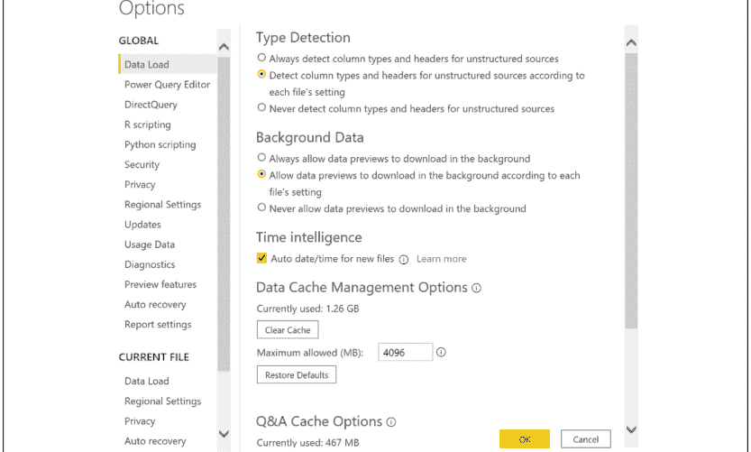

图 1.6：Power BI Desktop 选项（2021 年 2 月）

全局选项适用于用户创建或访问的所有 Power BI Desktop 文件，而当前文件选项必须为每个 Power BI Desktop 文件单独定义。以下步骤是针对全局选项的推荐操作：

- 1. 在 **Data Load** 选项卡下，在 **Data Cache Management Options** 下，确认当前使用的数据缓存低于 **Maximum allowed (MB)** 设置。如果接近限制且本地磁盘空间充足，请增加 **Maximum allowed (MB)** 的值。不要清除缓存，除非本地磁盘空间不可用，因为这将需要执行额外的、通常是不必要的查询。

图 1.7：全局数据加载选项

此外，在 **Time intelligence** 标题下，考虑关闭 **Auto date/time for new files**。虽然为日期列提供开箱即用的日历层次结构功能很方便，但这也可能显著增加数据模型的大小，并且强烈建议使用通用的日期维度表，最好来自企业数据仓库源。最后，在 **Type Detection** 标题下，建议选择 **Never detect column types and headers for unstructured sources** 选项。从非结构化源（如文本或 Excel 文件）默认检测列类型会创建对源文件中列名称的硬编码依赖。此外，此默认转换将在任何筛选表达式之前应用，因此刷新时可能需要更多时间和资源。

- 2. 在 **Power Query Editor** 选项卡下，在 **Layout** 标题下，确保 **Display the Query Settings pane** 和 **Display the Formula Bar** 均已勾选，如图 1.8 所示。

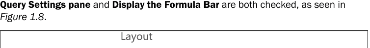

图 1.8：Power Query Editor 布局设置

- 3. 在 **Security** 选项卡下，在 **Native Database Queries** 标题下，选择 **Require user approval for new native database queries** 选项。本地查询是指用户指定的 SQL 语句传递给数据源，而不是 Power BI 内部生成的查询。

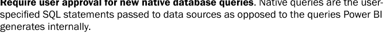

图 1.9：Native Database Queries 的安全选项

- 6. 使用 **Preview features** 选项卡启用预览功能以供评估目的。**Preview features** 下的选项会随着新版本而变化，因为某些先前的选项变得普遍可用，同时引入了新的预览功能。每月 Power BI Desktop 更新视频和博客文章（见 https://powerbi.microsoft.com/en-us/blog/）提供了这些新功能[content]

- 1. 在 **Data Load** 选项卡下，在 **Data Cache Management Options** 下，确认当前使用的数据缓存低于 **Maximum allowed (MB)** 设置。如果接近限制且本地磁盘空间充足，请增加 **Maximum allowed (MB)** 的值。不要清除缓存，除非本地磁盘空间不可用，因为这将需要执行额外的、通常是不必要的查询。

图 1.7：全局数据加载选项

此外，在 **Time intelligence** 标题下，考虑关闭 **Auto date/time for new files**。虽然为日期列提供开箱即用的日历层次结构功能很方便，但这也可能显著增加数据模型的大小，并且强烈建议使用通用的日期维度表，最好来自企业数据仓库源。最后，在 **Type Detection** 标题下，建议选择 **Never detect column types and headers for unstructured sources** 选项。从非结构化源（如文本或 Excel 文件）默认检测列类型会创建对源文件中列名称的硬编码依赖。此外，此默认转换将在任何筛选表达式之前应用，因此刷新时可能需要更多时间和资源。

- 2. 在 **Power Query Editor** 选项卡下，在 **Layout** 标题下，确保 **Display the Query Settings pane** 和 **Display the Formula Bar** 均已勾选，如图 1.8 所示。

图 1.8：Power Query Editor 布局设置

- 3. 在 **Security** 选项卡下，在 **Native Database Queries** 标题下，选择 **Require user approval for new native database queries** 选项。本地查询是指用户指定的 SQL 语句传递给数据源，而不是 Power BI 内部生成的查询。

图 1.9：Native Database Queries 的安全选项

- 6. 使用 **Preview features** 选项卡启用预览功能以供评估目的。**Preview features** 下的选项会随着新版本而变化，因为某些先前的选项变得普遍可用，同时引入了新的预览功能。每月 Power BI Desktop 更新视频和博客文章（见 https://powerbi.microsoft.com/en-us/blog/）提供了这些新功能的详细信息和示例。

- 7. 通常在激活新的预览选项后需要重新启动 Power BI Desktop 应用程序。

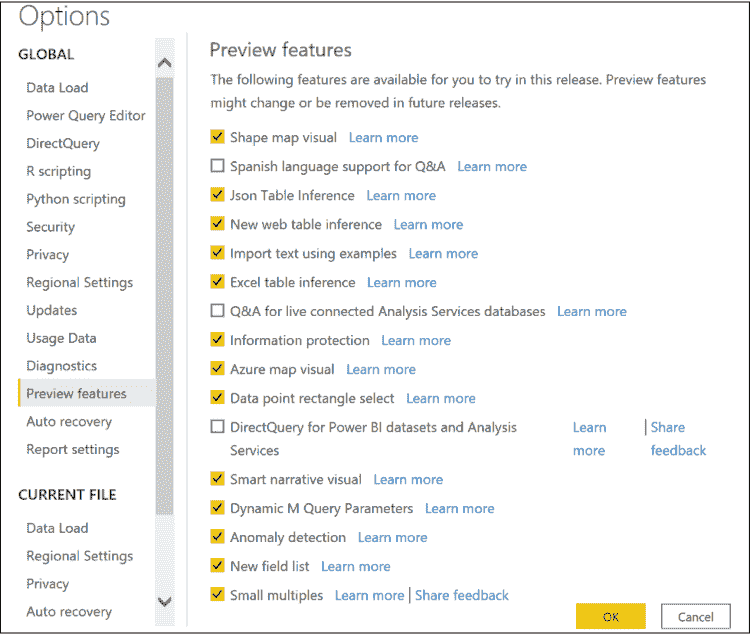

图 1.12：Power BI Desktop 2021 年 2 月版中可用的预览功能

- 8. 在 **Data Load** 选项卡下的 **CURRENT FILE** 中，经验更丰富的用户应禁用 **Type Detection** 和 **Relationships** 标题下的所有选项；这些模型设计决策应由了解源数据的 Power BI 开发人员明确实施。

另请注意，如果您未在 **GLOBAL** 级别禁用此选项，则可以在此处按单个文件为 **Auto date/time** 禁用。

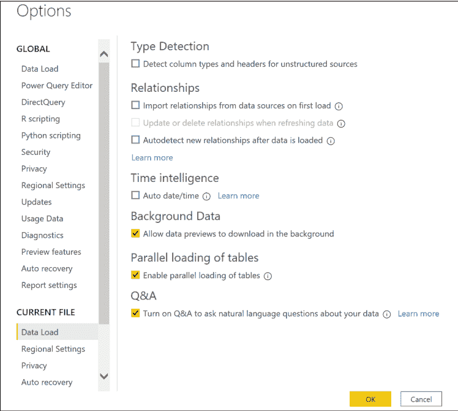

图 1.13：当前文件数据加载选项

## There's more...

作为现代的云和服务导向的分析平台，Power BI 每月在其工具集中提供新功能和改进功能。这些 Power BI Desktop、Power BI 服务、本地数据网关、Power BI 移动应用程序等的定期发布和更新反映了客户反馈、行业趋势以及 Power BI 团队的内部想法和产品路线图。

负责开发和管理 Power BI 内容的 BI 专业人员既可以了解这些更新，也可以通过 Microsoft Power BI 博客（http://bit.ly/20bcQb4）、Power BI 文档（http://bit.ly/2O22qi4）和 Power BI 社区（http://bit.ly/2mq iuxP）查看有关实施功能的详细文档和指导。

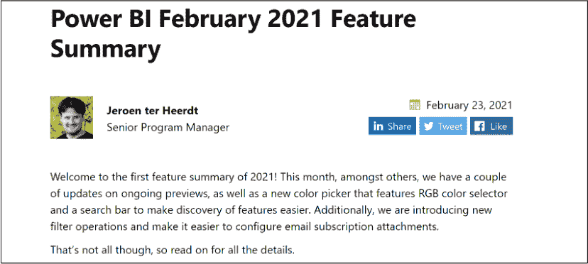

Power BI 社区门户提供了一个强大的、可搜索的信息中心，涵盖常见主题，以及活跃的、经过审核的用户经验和故障排除论坛。社区还维护自己的博客，其中包含来自顶级社区贡献者的示例和用例，以及链接到本地 **Power BI User Groups (PUGs)**、相关活动如 **Microsoft Business Applications Summit (MBAS)**，以及各种画廊，如主题画廊、数据故事画廊、R 脚本展示和快速度量画廊。

Power BI Ideas 论坛（https://ideas.powerbi.com）是识别请求的功能和增强功能及其相对于未来版本的状态的宝贵来源。想法会被分配状态，例如“Planned”、“Under Review”或“Needs Votes”。搜索功能允许按这些状态详细信息进行筛选。筛选 **Planned** 想法，特别是社区投票数较高的想法，可以了解在更长的时间范围内将发布的具有影响力的更新。

## See also

有关本食谱中涵盖主题的更多信息，请参阅以下链接：

- Power BI Security white paper: http://bit.ly/22NHzRS
- Data source privacy levels: http://bit.ly/2nC0Lmx
- Power BI Auto date/time: http://bit.ly/3bH59cn
- Change settings for Power BI reports: http://bit.ly/20P8m0F

## Creating an On-Premises Data Gateway

Microsoft 本地数据网关（或简称网关）是在本地环境或在云中运行的 **infrastructure-as-a-service (IaaS)** 数据源中运行的 Windows 服务，例如运行 SQL Server 数据库的虚拟机。网关的唯一目的是支持本地和 IaaS 数据源与 Microsoft Azure 服务（如 Power BI、Power Apps、Power Automate 和 Azure Logic Apps）之间通过到 Azure Service Bus 的出站连接进行安全（加密）和高效的数据传输。需要注意的是，如果 Power BI 报表使用的所有数据源都在云中（因此不是本地的）并且可由 Power BI 服务访问，则不需要 Microsoft 本地数据网关，因为 Power BI 服务将使用本地云网关来访问本地云数据源；这可能是 Azure SQL Database 或 Azure SQL Managed Instances 等。

安装后，网关可用于安排导入的 Power BI 数据集的数据刷新，以支持使用 DirectQuery 构建的 Power BI 报表和仪表板，以及对 **Analysis Services** 数据库的实时连接。

单个本地数据网关可以支持多个数据源的刷新和查询活动，并且网关的使用权限可以与多个用户共享。目前，网关通过计划导入支持所有常见数据源，包括 **Open Database Connectivity (ODBC)** 连接，以及通过实时连接和 DirectQuery 支持许多最常见的数据源。

### Getting ready

网关所需硬件资源取决于连接类型（导入与实时连接）、Power BI 服务中报表和仪表板的使用情况，以及网关处理的数据量与本地源系统处理的比例。建议从 8 核 CPU、8 GB RAM 服务器和 Windows 2012 R2 或更高版本的操作系统开始。此机器不能是域控制器，并且为了保持 Power BI 内容的可用性，网关服务器应始终开启并连接到互联网。

网关的另一个主要考虑因素是网关服务器相对于 Power BI 租户和网关支持的数据源的位置。例如，如果 SQL Server 数据库是主要网关源并且运行在美国西部的一台服务器上，并且组织的 Power BI 租户位于 West US Azure 区域，则网关应安装在 West US Azure 区域的服务器或潜在的 Azure **virtual machine (VM)** 上，或美国西部的位置。

根据当前和预计工作负载的分析，可以向上或向下扩展网关资源，并且可以选择在单独的服务器上安装额外的网关以分发整体 Power BI 刷新和查询部署工作负载。

例如，可以将一个网关服务器专用于计划刷新/导入工作负载，从而将此活动与负责 DirectQuery 和实时连接查询的独立网关服务器隔离开来。

网关不需要打开入站端口，默认使用 HTTPS，但也可以强制使用 TCP。对于默认通信模式，建议在防火墙中将数据区域的 IP 地址加入白名单。该列表每周更新，可通过 Microsoft Azure 数据中心 IP 列表 (http://bit.ly/2oeAQyd) 获取。

## 如何创建网关

网关有两种模式：标准模式和个人模式。个人模式仅供个人使用，因此不能在企业内部用户之间共享。我们将重点介绍标准模式，因为个人模式的安装和配置基本相同：

1. 从 https://powerbi.microsoft.com/downloads/ 下载最新的 Microsoft 本地数据网关

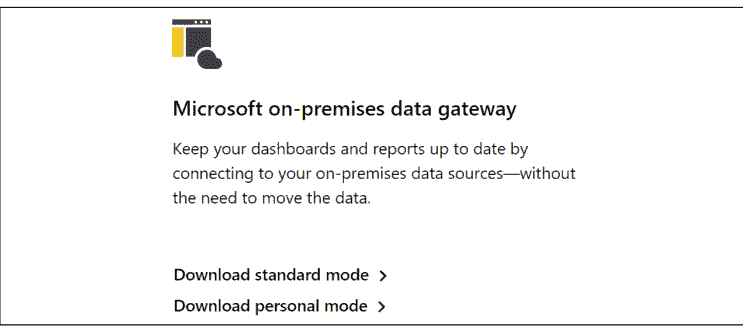

图 1.15：下载 Microsoft 本地数据网关

2. 选择“下载标准模式”链接。

3. 下载完成后，选择“打开文件”以运行 GatewayInstall.exe。

图 1.16：GatewayInstall.exe

4. 选择安装文件目录，接受使用条款和隐私协议，然后单击“安装”按钮。

### 配置 Power BI 工具

5. 登录 Power BI 服务以注册网关：

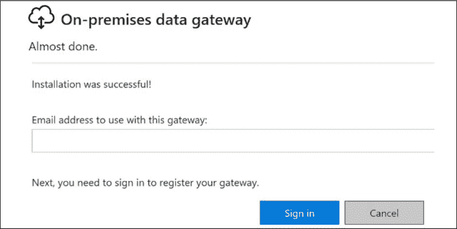

图 1.17：注册网关

6. 登录后的下一个屏幕上，选择**在这台计算机上注册新网关**，然后单击**下一步**按钮。

7. 为网关输入一个易于识别的名称和恢复密钥，然后单击**配置**按钮。

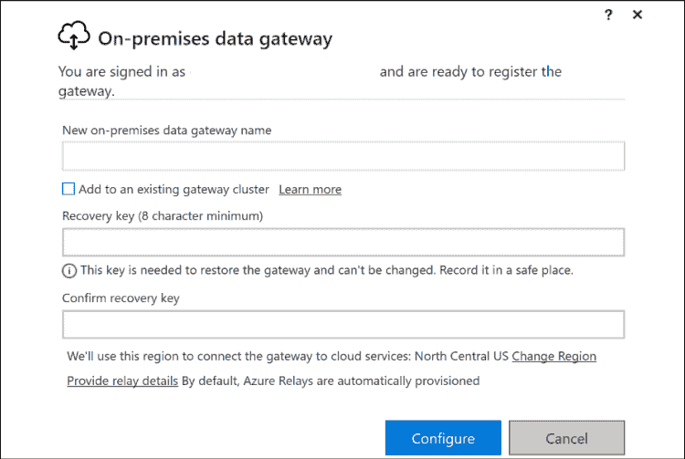

图 1.18：网关的最终配置信息

网关安装并注册后，可以将数据源、网关管理员和授权的数据源用户添加到 Power BI 服务。Power BI 服务中的齿轮图标下将出现“管理网关”选项。有关此过程的详细信息，请参阅第 12 章“部署和分发 Power BI 内容”中的“配置本地网关数据连接”操作指南。

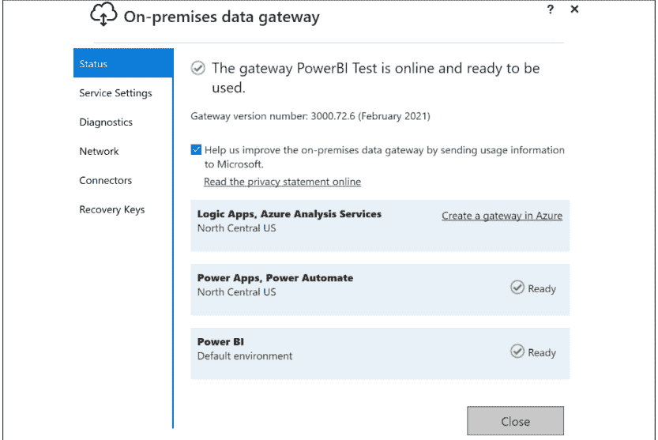

图 1.19：成功安装网关

### 工作原理

当有新版本的网关可用时，本地数据网关 UI 的“状态”选项卡中会显示通知，如图 1.19 所示。Power BI 网关团队建议在更新可用时立即安装。

本书中创建的 DirectQuery 数据集以及在 Microsoft 业务应用平台中使用其他 Azure 服务，都需要标准模式本地数据网关，而非个人模式网关。

Power BI 服务与本地源之间使用只读连接，但其他服务（例如 Power Apps）可以使用该网关写入、更新和删除这些源。

恢复密钥用于生成对称密钥和非对称密钥，这些密钥对数据源凭据进行加密并将其存储在云中。凭据区域仅由网关计算机在响应刷新或查询请求时解密。在以下场景中将需要恢复密钥：

- 将网关及其配置的数据源迁移到另一台计算机。
- 恢复网关以在不同域帐户下运行服务，或从崩溃的计算机中恢复网关。
- 从现有网关管理员处接管现有网关的所有权。
- 将网关添加到现有群集。

务必将恢复密钥存储在 BI/IT 组织可访问的安全位置。此外，应在 Power BI 服务中分配多个用户作为网关管理员，以提供冗余。

### 更多内容...

图 1.18 所示的 Microsoft 本地数据网关的最终配置屏幕提供了几个高级选项，包括：

- 添加到现有网关群集
- 更改区域
- 提供中继详细信息

网关群集消除了本地数据访问的单点故障。由于一台计算机只能安装一个标准网关，因此每个额外的网关群集成员必须安装在不同的计算机上。如果主网关不可用，数据刷新请求将路由到其他网关群集成员。使用网关群集时，务必确保所有网关群集成员运行相同的网关版本，并移除或禁用离线的网关群集成员——离线的网关群集成员会对性能产生负面影响。

默认情况下，网关安装在 Power BI 服务中与你的 Power BI 租户相同的 Azure 区域。在几乎所有情况下，都不应更改此设置。但是，借助 Power BI Premium 中的多地理区域支持，可能有必要在不同 Azure 区域安装网关。“更改区域”选项提供了这种灵活性。

安装时，会自动为已安装的网关预配 Azure 中继。但是，如果你希望将中继与你的 Azure 订阅关联并管理中继的发送方和侦听方密钥，则**提供中继详细信息**选项允许你提供自己的中继详细信息。这是一个非常高级的选项，在尝试此配置之前，你应该充分了解 Azure 中继以及你想要实现的目标。需要注意的是，此功能仅支持使用 NetTcp 的 WCF 中继。

### 另请参阅

- 有关通过本地网关配置和管理数据源的详细信息，请参阅*第 12 章“部署和分发 Power BI 内容”*
- 为本地数据网关设置 Azure 中继：`http://bit.ly/3rMJMvP`

## 从 Power BI 服务安装 Analyze in Excel

基于 Excel 的数据分析和报告内容（例如数据透视表、图表以及带有自定义格式的单元格区域公式表达式）在组织中仍然非常普遍。尽管这些内容及其支持流程的很大一部分可以迁移到 Power BI，而且这种迁移可以带来许多附加功能和好处，但 Power BI 并不是要取代所有基于 Excel 的报告。组织，尤其是那些广泛使用 Excel 的部门（如财务和会计），可能更愿意利用这些现有资产，并通过将 Excel 内容部署到 Power BI 以及从 Excel 内部分析 Power BI 托管的数据，快速从 Power BI 中获取价值。

Power BI 服务的“Analyze in Excel”功能取代了已弃用的 Microsoft Power BI Publisher for Excel。“Analyze in Excel”功能允许你在 Excel 中使用 Power BI 数据集，并使用数据透视表、图表和切片器等 Excel 功能与数据集进行交互。

### 准备工作

要准备安装和使用 Power BI 服务的“Analyze in Excel”功能，请确保你的计算机上安装了 Microsoft Excel，然后登录 Power BI 服务。

### 如何安装 Analyze

1. 在任意 Power BI 服务页面的右上角，单击省略号，然后依次选择**下载**和**Analyze in Excel 更新**。
2. 在出现的启动屏幕上，选择**下载**按钮。
3. 文件下载后，选择**打开文件**链接或从**下载**文件夹中运行该文件。
4. 将启动**Microsoft Analysis Services OLE DB Provider 安装程序**的安装向导。单击**下一步**按钮。
5. 接受许可条款，然后单击**下一步**按钮。

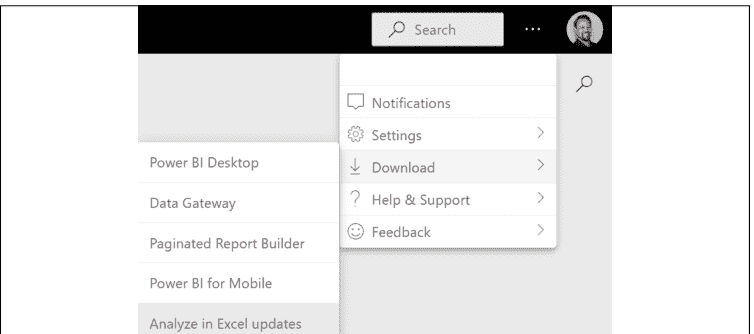

图 1.20：下载 Analyze in Excel

图 1.21：Analyze in Excel 安装程序

6. 点击**安装**按钮开始安装。
7. 安装完成后，点击**完成**按钮。

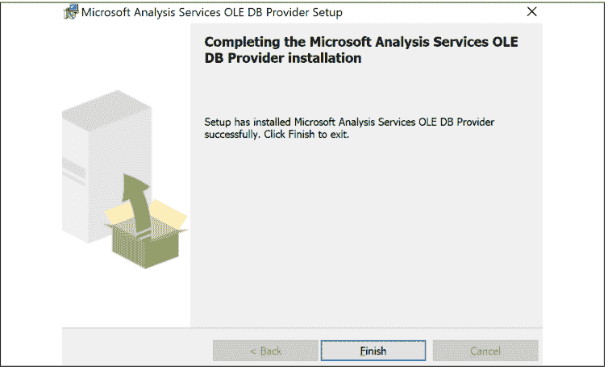

图 1.22：成功安装“在 Excel 中分析”功能

## 工作原理

现在，Microsoft Analysis Services OLE DB 提供程序已安装在本地计算机上，您可以在报表中使用**在 Excel 中分析**功能。要使用**在 Excel 中分析**，请按照以下步骤操作：

- 1. 点击任意工作区，查看该工作区中可用的仪表板、报表和数据集。

## 配置 Power BI 工具

- 2. 将鼠标悬停在报表或数据集上，点击“更多”菜单（三个垂直点），然后选择**在 Excel 中分析**。

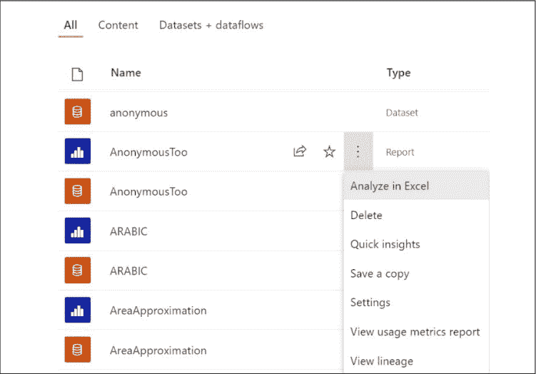

图 1.23：在 Excel 中分析

- 3. 如果收到提示您需要某些 Excel 更新的启动屏幕，请点击**我已安装这些更新**链接。
- 4. Power BI 服务会创建并下载一个专为**在 Excel 中分析**设计和构建的 Excel 文件。该 Excel 文件的名称将与生成该文件的 Power BI 报表或数据集的名称一致。
- 5. 使用**打开文件**链接打开 Excel 文件，或从**下载**文件夹中打开该文件。
- 6. 请务必点击 Excel 中的**启用编辑**按钮，因为该文件将在**受保护的视图**中打开。
- 7. 最后，点击**启用内容**按钮以激活外部数据连接。

该 Excel 文件包含一个与生成该文件的报表或数据集同名的页面/选项卡。此页面包含一个名为 **PivotTable1** 的数据透视表，它与 Power BI 服务中的 Power BI 数据集相关联。点击数据透视表，将在数据透视表的**字段**窗格中显示数据集表、列和度量。

## 更多内容...

根据 Office 许可证的不同，用户还可以通过 Excel 中的**插入数据透视表**选项和**数据 - 获取数据体验**连接到 Power BI 数据集。

*表 1.1 列出了许多包含 Power BI 工具和功能相关文章和示例的博客。*

| 博主 | 博客 | URL |
|---|---|---|
| Michael Carlo Seth Bauer | PowerBI.Tips | http://powerbi.tips |
| Chris Webb | Crossjoin | https://blog.crossjoin.co.uk |
| Rob Collie and others | P3 Adaptive | https://powerpivotpro.com |
| Alberto Ferrari Marco Russo | SQL BI | http://www.sqlbi.com |
| Kasper De Jonge | Kasper On BI | https://www.kasperonbi.com |
| Matt Allington | ExceleratorBI | http://exceleratorbi.com.au/blog |
| Ruth Martinez | Curbal | https://curbal.com/blog |
| Reza Rad | RADACAD | http://radacad.com/blog |
| Imke Feldman | The BIccountant | http://www.thebiccountant.com |
| Brett Powell | Insight Quest | https://insightsquest.com |
| Gilbert Quevauvilliers | Fourmoo | https://www.fourmoo.com/blog |
| Tom Martens | Mincing Data | https://www.minceddata.info/blog |
| Nicky van Vroenhoven | Power BI, Power Platform, Data Platform | https://www.nickyvv.com/ |
| Debbie Edwards | Debbie's Microsoft Power BI, SQL and Azure Blog | http://bit.ly/3eQsb2G |
| Zoe Douglas | DataZoe | https://www.datazoepowerbi.com/blog |
| Ibarra u | LaDataWeb (Spanish) | https://blog.ladataweb.com.ar/ |
| Various | Power BI Community Blog | http://bit.ly/3qIoD19 |
| Various | Power BI Weekly | https://powerbiweekly.info/ |

表 1.1：详细说明 Power BI 功能和工具及其使用示例的博客列表。

除 *Kasper On BI* 外，所有这些博客均来自非微软员工，因此不一定代表微软的观点或对其产品的推荐做法。此外，其中一些博客并非只关注 Power BI；它们还可能涵盖其他 MSBI、Azure、SQL Server 和 Office 365 工具和服务。

另一个学习和部署 Power BI 的资源是 Adam Saxton 和 Patrick LeBlanc 的 *Guy in a Cube* 视频频道 (http://bit.ly/2o2lRqU)。这些视频提供简洁、动手实践的评论，以及对常见问题和场景的解决方案。它们还提供对 Power BI 近期更新和发布的高层总结。作为微软员工，Adam 和 Patrick 能够结合微软产品和技术团队的具体指导，并且定期识别来自更广泛 Power BI 社区的最新博客文章。强烈建议您订阅该频道，以便随时了解新文章！

## 另请参阅

- 在 Excel 中分析：http://bit.ly/3bIMSeM
- 在 Excel 中分析 – 高级方法：https://bit.ly/3bLbpzG

## 安装和配置其他工具

负责开发语义模型（数据集）的 Power BI 专业人员通常使用 Power BI Desktop 之外的其他工具来创建和管理模型。例如，他们使用 Tabular Editor 快速实施度量值更改或添加新对象，如透视和计算组。同样，ALM Toolkit 通常用于向 Power BI 部署增量更改和仅元数据更改。

**另一个此类工具是 DAX Studio**，这是一个第三方工具，用于查询数据模型、编辑和格式化代码、浏览数据模型的结构和元数据，以及分析 DAX 查询的性能和执行特征。对于更大、更复杂的数据模型和表达式，以及涉及多个模型的项目，DAX Studio 成为开发和性能调优过程的重要补充。

**DAX（数据分析表达式）**是“Power BI 的语言”，因为它用于创建在 Power BI 报表和仪表板中可视化的度量值和查询。Power BI 根据可视化的结构、用户选择和筛选器生成 DAX 查询并将其提交到源数据模型——正如 Excel 等其他工具根据工作簿中数据透视表和切片器的选择和结构生成 MDX 查询一样。DAX 表达式还用于定义安全角色，并且可以选择用于基于模型中的其他表和列在数据模型中创建列和表，这些列和表可以在处理时刷新并被度量值和查询使用。DAX 在 Azure Analysis Services (AAS) 和 SQL Server Analysis Services (SSAS) 表格模型以及 Power Pivot for Excel 模型中同样发挥着作用，因此 BI 专业人员必须拥有一个强大的工具来开发和解析 DAX 代码以及包含这些表达式的数据模型。

## 如何安装和配置其他工具

- 1. 从 DAX Studio 网站下载最新版本：https://daxstudio.org/downloads/。安装程序版本是单个文件，提供基于向导的安装和设置，而便携版是 ZIP 文件，不提供基于向导的安装。
- 2. 使用“打开文件”链接或从“下载”文件夹运行该文件。
- 3. 安装开始后，选择“为所有用户安装”（推荐）选项。
- 4. 接受许可协议，然后点击“下一步”按钮。
- 5. 选择用于安装工具的文件夹路径，然后点击“下一步”按钮。
- 6. 选择是否同时安装适用于 Excel 的 DAX Studio 加载项。点击“下一步”按钮。请注意：
  - 连接 Power Pivot for Excel 数据模型需要 Excel 加载项。
  - 此外，当从 Excel 打开 DAX Studio 时，查询结果可以直接导出到 Excel 表格中。
- 7. 选择“开始”菜单文件夹（默认为 DAX Studio），然后点击“下一步”按钮。
- 8. 勾选“创建桌面快捷方式”复选框，然后点击“下一步”按钮。
- 9. 最后，点击“安装”按钮。

图 1.24：DAX Studio 安装文件

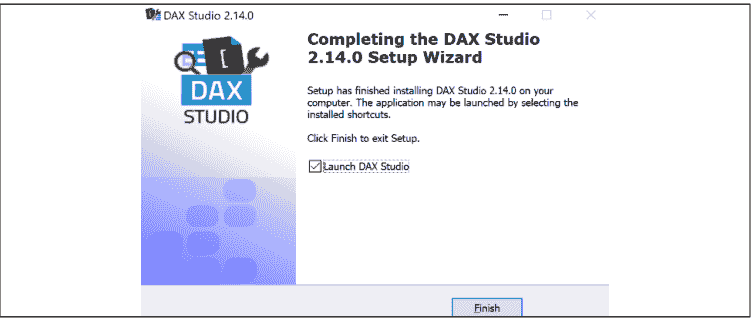

图 1.25：DAX Studio 安装成功

## 工作原理

完成完整安装（包括 Excel 加载项）后，Excel 功能区中的“加载项”选项卡上会出现一个 DAX Studio 图标，如图 1.26 所示。

建议进行完整安装（包括 Excel 加载项），因为这样可以启用将 DAX 查询结果直接输出到 Excel 工作簿表格的功能，并且也是连接 Power Pivot 数据模型所必需的。要使 Power Pivot 可用，必须使用 Excel 中的“文件”菜单启用 Microsoft Power Pivot for Excel COM 加载项，然后选择“选项”。点击“加载项”选项卡。在对话框底部的下拉控件中选择“COM 加载项”，然后选择“转到...”按钮。可以使用相同的界面停用 DAX Studio 加载项。为了演示其在 Excel 中的工作方式，请按照以下步骤操作：

- 1. 打开 Excel 工作簿。
- 2. 打开 Power BI Desktop 文件。
- 3. 在 Excel 工具栏的“加载项”选项卡中，激活 DAX Studio。

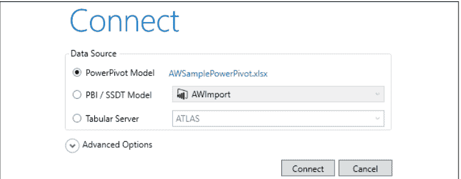

- 4. 现在，点击“取消”按钮，然后关闭 Excel 工作簿。

DAX Studio 也可以作为独立应用程序在 Excel 之外使用。独立应用程序提供与 Excel 加载项相同的功能，但不包括对 Power Pivot for Excel 数据模型的连接和 Excel 输出选项。为了演示这一点，请按照以下步骤操作：

- 5. 启动 DAX Studio 独立的 Windows 应用程序。
- 6. 连接到 Power BI Desktop 文件或 SSAS 多维数据集实例。

**Connect** 对话框的 **Advanced Options** 设置允许你精确控制 DAX Studio 如何连接到模型，例如在定义与数据模型的连接以及分析与 DirectQuery 数据模型相关联的跟踪事件时，指定安全角色、有效用户名称标识以及 **locale** 的能力（即生成的 SQL 语句并传递给源）。

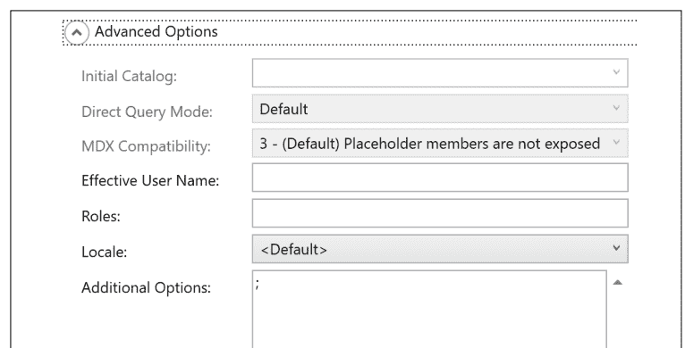

图 1.28：DAX Studio 高级连接选项

### There's more...

对于 Power BI 来说，还有两个有用的额外工具。分别是：

- ALM Toolkit
- Tabular Editor

ALM Toolkit 是来自 MAQ Software 的第三方工具，提供高级功能，例如 Power BI 数据集比较、代码合并、部分部署和错误修复、数据集元数据的源代码控制集成，以及在多维模型之间重用定义。要下载并安装 ALM Toolkit，请按照以下步骤操作：

- 1. 在浏览器中，导航到 http://alm-toolkit.com。
- 2. 在页面顶部附近，点击 **DOWNLOAD LATEST VERSION** 按钮。
- 3. 使用 **Open file** 链接启动 AlmToolkitSetup.msi 或从你的 **Downloads** 文件夹打开该文件。

图 1.29：ALM Toolkit 安装程序

- 4. 在初始安装屏幕上点击 **Next** 按钮。
- 5. 接受许可协议并点击 **Next** 按钮。
- 6. 选择一个 **Folder** 路径并点击 **Next** 按钮。
- 7. 在最终安装屏幕上，点击 **Next** 按钮开始安装。

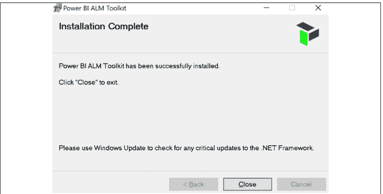

图 1.30：成功安装 ALM Toolkit

Power BI ALM Toolkit 现在可以从 Windows 开始菜单启动。

另一个强大的工具是 Tabular Editor。在本书出版时，Tabular Editor 有两个版本，免费的开源版本 2 和商业版 3。Tabular Editor 是 **SQL Server Data Tools (SSDT)** 的替代方案，用于为 Analysis Services 编写和编辑多维模型。Tabular Editor 提供你多维模型元数据中对象的层次视图，例如列、度量和层次结构。Tabular Editor 与 Power BI Desktop 集成，允许对 DAX 度量进行批量更改，并启用高级功能，例如计算组和透视。最后，Tabular Editor 还通过允许你直接从 Model.bim 文件打开多维模型来启用离线编辑功能。要安装和使用 Tabular Editor，请按照以下步骤操作：

- 1. 从此处下载最新版 Tabular Editor：https://bit.ly/3bJFBv1。
- 2. 滚动到页面底部并点击 **TabularEditor.Installer.msi** 的链接。
- 3. 文件下载完成后，使用 Open file 链接打开或从 Downloads 文件夹打开该文件。

图 1.31：Tabular Editor 安装程序

- 4. 在初始安装屏幕上点击 Next 按钮。
- 5. 接受许可协议并点击 Next 按钮。
- 6. 选择一个 Folder 路径并点击 Next 按钮。
- 7. 勾选 Create Desktop shortcut 和 Create Program Menu shortcut 复选框，然后点击 Next 按钮。
- 8. 在最终安装屏幕上，点击 Next 按钮开始安装。

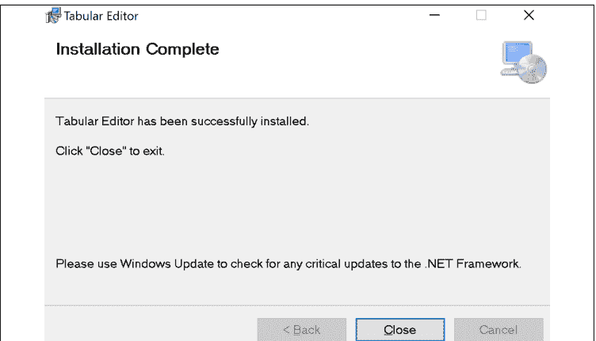

图 1.32：成功安装 Tabular Editor

Tabular Editor 现在可以从 Windows 开始菜单启动。

### See also

- DAX Studio 教程和文档：https://daxstudio.org
- ALM Toolkit 文档：http://alm-toolkit.com/HowToUse
- Tabular Editor 文档：https://docs.tabulareditor.com/

## Conclusion

在本章中，我们介绍了 BI 专业人员用于设计和开发 Power BI 内容的主要工具的安装和配置，包括官方 Microsoft 工具，例如 Power BI Desktop、本地数据网关和 Analyze in Excel，以及第三方工具，例如 DAX Studio、ALM Toolkit 和 Tabular Editor。这些工具与 Power BI 服务相结合，是 BI 专业人员高效使用 Power BI 所需的主要资源。本书后面的章节将探讨在开发和增强 Power BI 解决方案中使用这些工具。
