## Accessing and Retrieving Data

- Applying Multiple Filters
- Selecting and Renaming Columns
- Transforming and Cleansing Source Data
- Creating Custom Columns
- Combining and Merging Queries
- Selecting Column Data Types
- Visualizing the M Library
- Profile Source Data
- Diagnosing Queries

### Technical Requirements

完成本章中的配方需要以下条件：

- Power BI Desktop
- SQL Server 2019 或更新版本，并安装了 **AdventureWorksDW2019** 数据库。此数据库及其安装说明可在以下位置获取：http://bit.ly/20VQfG7

### Viewing and Analyzing M Functions

每当你点击按钮连接到 Power BI Desktop 支持的任何数据源，或对数据源对象应用任何转换，例如更改列的数据类型时，就会创建一个或多个反映你选择的 M 表达式。这些 M 表达式会自动写入专用的 M 文档中，如果保存，则存储在 Power BI Desktop 文件中作为查询。M 是一种像 F# 一样的函数式编程语言，对于 Power BI 开发人员来说，了解、理解 M 代码并最终编写和增强支持其查询的 M 代码非常重要。

### Getting ready

为准备本配方，我们将首先通过用户界面构建一个查询，该查询连接到 **AdventureWorksDW2019** SQL Server 数据库，检索 **DimGeography** 表，然后将此表过滤为单个国家，例如美国：

- 1. 打开 Power BI Desktop 并从功能区的 **Home** 选项卡点击 **Get Data**。从数据库源列表中选择 **SQL Server**。供将来参考，如果数据源未列在 **Common data sources** 中，可以通过点击列表底部的 **More...** 来获取更多数据源。
- 2. 将显示一个对话框窗口，要求输入连接信息。确保 **Data Connectivity mode** 设置为 **Import**。输入你的 SQL Server 名称以及 **AdventureWorksDW2019** 数据库。在 *Figure 2.1* 中，我的 SQL Server 安装在本地并在实例 **MSSQLSERVERDEV** 下运行。因此，我将服务器设置为 **localhost\MSSQLSERVERDEV** 以指定服务器（localhost）和实例。如果你将 **Database** 字段留空，这只会导致额外的一步导航来选择所需的数据库。

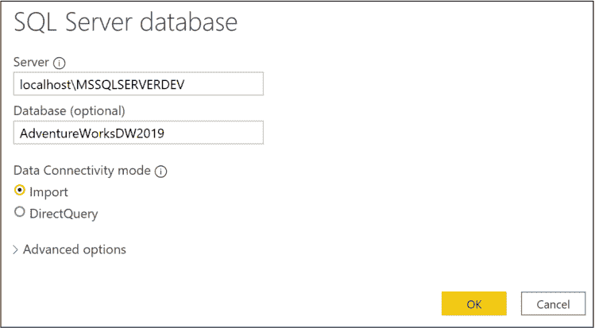

图 2.1：SQL Server 获取数据对话框

- 3. 如果这是第一次从 Power BI 连接到此数据库，你可能会被提示输入一些凭据。此外，你还可能收到无法与服务器建立加密连接的警告。只需输入正确的连接凭据并点击 **Connect** 按钮。对于加密警告，只需点击 **OK** 按钮继续。
- 4. 将出现一个导航窗口，其中显示数据库的不同对象和架构。从 **Navigator** 窗口中选择 **DimGeography** 表并点击 **Transform Data** 按钮。
- 5. Power Query Editor 在新窗口中启动，查询名为 **DimGeography**；该表的预览数据显示在窗口中央。在 Power Query Editor 窗口中，使用中央显示区域底部的滚动条找到名为 **EnglishCountryRegionName** 的列。你也可以选择一列，然后在 **View** 菜单的功能区中点击 **Go to Column** 以快速搜索并导航到列。点击该列标题旁的小按钮以显示排序和筛选下拉菜单。


## 访问和检索数据

取消勾选**（全选）**选项以取消选择所有值，然后勾选某个国家/地区旁边的复选框，例如**美国**，再单击**确定**按钮。

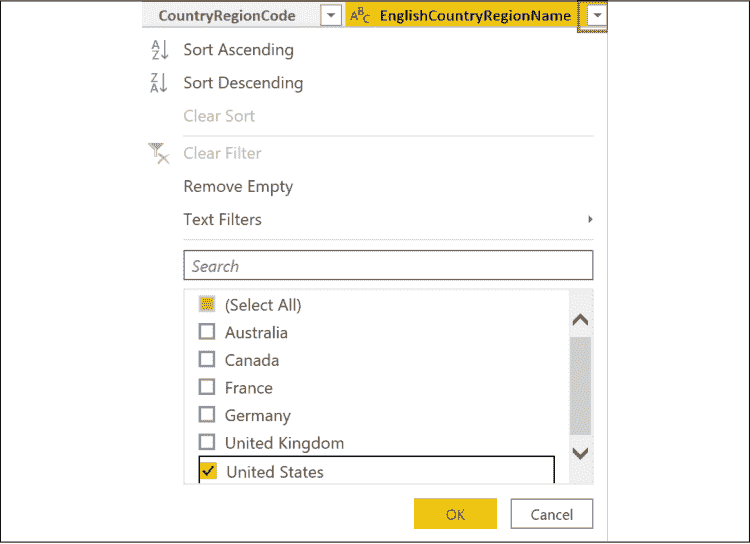

图 2.2：在查询编辑器中仅筛选美国

注意，**EnglishCountryRegionName** 列的按钮会变为显示一个漏斗图标。另外，请注意，在窗口右侧的**查询设置**窗格中，**已应用步骤**下出现了一个名为**筛选的行**的新选项。

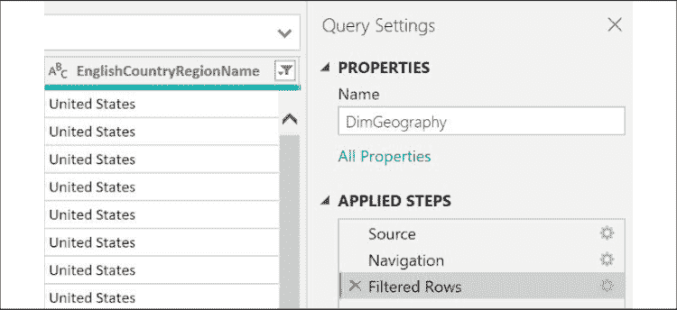

图 2.3：查询编辑器中的“查询设置”窗格

### 如何查看和分析 M 函数

查看和分析构成查询的 M 函数有两种方法，如下所示：

- 公式栏
- 高级编辑器

公式栏只显示当前步骤的 M 函数。此公式栏出现在窗口中央区域预览数据的列标题上方。如果看不到此公式栏，请单击**视图**选项卡，并在功能区**布局**部分中勾选**公式栏**旁边的复选框。所有这些相关区域在*图 2.4*中以红色框标出。

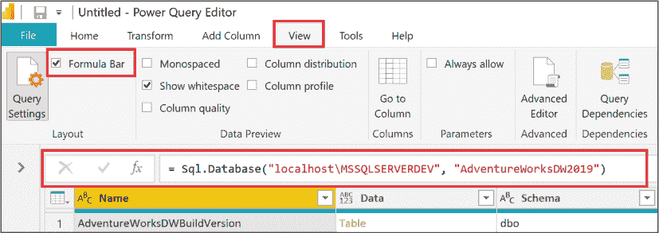

*图 2.4：Power Query 编辑器公式栏*

当在**查询设置**窗格的**已应用步骤**下选择**源**步骤时，如*图 2.3*所示，我们会看到在选择**获取数据**再选择 **SQL Server** 之后初始对话框中指定的连接信息。使用的 M 函数是 `Sql.Database`。此函数接受两个参数：服务器名称 `localhost\MSSQLSERVERDEV` 和数据库名称 AdventureWorksDW2019。单击**已应用步骤**下的其他步骤会显示这些步骤的公式，这些公式从技术上讲是单独的 M 表达式。

公式栏有助于快速理解特定查询步骤背后的 M 代码。然而，在一个集中式窗口中查看和编辑所有表达式通常更方便，也常常必不可少。这就是**高级编辑器**的用途。要启动**高级编辑器**，请按照以下步骤操作：

1. 单击**开始**选项卡，然后从功能区**查询**部分选择**高级编辑器**，如*图 2.5*所示。或者，也可以从*图 2.4*所示的**视图**选项卡访问**高级编辑器**。

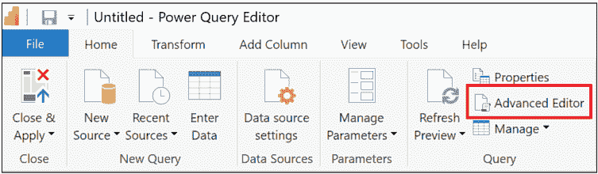

图 2.5：查询编辑器“开始”选项卡上的高级编辑器

2. 显示“高级编辑器”对话框，展示构成查询的所有 M 函数和注释。可以直接在此对话框中编辑 M 代码。

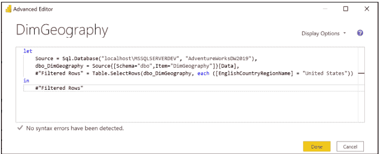

图 2.6：DimGeography 查询的高级编辑器视图

如图 2.6 所示，使用高级编辑器意味着构成查询的所有 Power Query 代码都可以在一个位置查看。

### 工作原理

如本配方所述，为 Power BI 创建的大多数查询都遵循 let...in 结构。在 let 块中，有多个步骤，这些步骤之间存在依赖关系。例如，第二步 dbo_DimGeography 引用了前一步 Source。各个表达式用逗号分隔，in 关键字后引用的表达式是查询返回的表达式。各个步骤表达式在技术上被称为“变量”。

在 M 表达式中，变量名不能包含空格，除非变量名前面有井号并用双引号括起来。使用查询编辑器图形界面创建 M 查询时，会自动应用此语法，并附带一个描述所应用的 M 转换的名称。可以在图 2.6 的“筛选的行”步骤中看到此行为。使用简短的、描述性的变量名（不含空格）可以提高 M 查询的可读性。

注意 `let` 语句下方的三行。这三行对应于查询中的三个**已应用步骤**：**源**、**导航**和**筛选的行**。查询返回最后一个步骤**筛选的行**的信息。随着应用更多步骤，这些步骤将插入到 `in` 语句上方，而 `in` 语句下方的行将更改为引用查询中的最终步骤。

M 是一种区分大小写的语言。这包括在 M 表达式中引用变量（`RenameColumns` 与 `Renamecolumns`）以及 M 查询中的值。例如，值 "Apple" 和 "apple" 在 M 查询中被视为不同的值。

建议在开始新查询和学习 M 语言时使用 Power Query 编辑器用户界面。在应用了几个步骤之后，使用**高级编辑器**来检查并可选地增强或自定义 M 查询。由于 M 是一种丰富的函数式编程语言，有许多 M 函数和可选参数未通过 Power Query 编辑器的图形用户界面公开。超越 Power Query 编辑器的限制可以实现更强大的数据检索、集成和数据混合流程。

M 引擎还具有强大的“惰性求值”逻辑，用于忽略任何冗余或不必要的变量，以及在结果确定时进行短路求值（计算），例如当 OR 逻辑运算符的一侧（操作数）被计算为 True 时。惰性求值允许 M 查询引擎通过忽略任何不必要或冗余的步骤（变量）来减少给定查询所需的资源。表达式的求值顺序在运行时确定——不必自顶向下按顺序进行。

在*图 2.7*所示的以下示例中，添加了一个用于检索加拿大的步骤，并忽略了用于筛选美国结果的“筛选的行”步骤。由于 CanadaOnly 变量满足查询的整体 `let` 表达式，因此只有加拿大查询被发送到服务器，就好像“筛选的行”步骤已被注释掉或省略一样。

```
let
    Source = Sql.Database("localhost\\MSSQLSERVERDEV", "AdventureWorksDW2019"),
    dbo_DimGeography = Source{[Schema="dbo",Item="DimGeography"]}[Data],
    CanadaOnly = Table.SelectRows(dbo_DimGeography, each ([EnglishCountryRegionName] = "Canada")),
    #"Filtered Rows" = Table.SelectRows(dbo_DimGeography, each ([EnglishCountryRegionName] = "United States"))
in
    CanadaOnly
```

图 2.7：修订后的查询，忽略“筛选的行”步骤，仅对加拿大进行求值

作为到目前为止所涵盖概念的回顾以及将来的参考，*表 2.1* 列出了本书中使用的 M 语言主要概念的术语表。

| 术语 | 定义 |
| --- | --- |
| 表达式 | 求值后产生单个值的公式。表达式可以引用其他值（如函数），并且可以包含运算符。 |
| 值 | 对表达式求值的结果。值可以分为类型，这些类型既可以是基本类型（如文本（"abc"）），也可以是结构化类型（如表和列表）。 |
| 函数 | 一种值，根据输入值到函数参数的映射生成新值。可以通过传递参数值来调用函数。 |
| 类型 | 对其他值进行分类的值。值的结构和行为根据其类型分类（如 Record、List 或 Table）而受到限制。 |
| `let` | 一种表达式，允许将一组唯一表达式赋名（变量），并在对 `let...in` 构造中 `in` 表达式之后的表达式进行求值时（如有必要）对其进行求值。 |
| 变量 | 环境中的唯一命名表达式，将按条件进行求值。变量在查询编辑器中表示为已应用步骤。 |
| 环境 | 一组待求值的变量。包含 M 库的全局环境对根表达式公开。 |
| 求值 | 表达式的计算。对在 let 表达式内定义的表达式应用惰性求值；仅在需要时进行求值。 |
| 运算符 | 表达式中用于定义计算的一组符号。运算符的求值取决于要操作的值。 |

表 2.1：M 语言元素

### 更多内容...

M 查询并非旨在替代通常由企业数据集成和编排工具（如 **Azure 数据工厂（ADF）**、Azure Databricks 或 **SQL Server 集成服务（SSIS）**）处理的数据加载和转换工作负载。然而，正如 BI 专业人员仔细审查逻辑并测试支持其各种多维数据集和报表环境的 SQL 存储过程和 ETL 包的性能一样，他们也应该审查为支持 Power BI 模型和报表而创建的 M 查询。在为 Power BI 模型开发检索流程时，请考虑以下常见 ETL 问题：

- 查询如何影响源系统？
- 我们能否让查询对源数据的变化更具弹性，从而避免失败？
- 我们的查询是否高效且易于理解和维护，还是存在不必要的步骤和查询？
- 我们的查询是否为 BI 应用程序提供了足够的性能？
- 我们的流程是否灵活，以便我们能够快速应用数据源和逻辑的更改？
- 能否在源系统中实现部分或全部所需的转换逻辑，例如数据仓库表的加载过程或 SQL 视图？


M查询引擎最突出的性能和可扩展性特性之一是查询折叠（Query Folding）。在可能的情况下，Power BI Desktop中开发的M查询会被转换（“折叠”）为SQL语句，并传递给源系统进行处理。

如果我们使用本配方中的原始版本查询，如图2.6所示，就能看到查询折叠的实际运作。本配方中的查询被折叠为以下SQL语句，并发送到服务器进行处理，而不是由M查询引擎在本地执行处理。要了解其工作方式，请执行以下操作：

- 1. 右键单击**查询设置**窗格中**应用的步骤**部分里的**筛选行**步骤，然后选择**查看本机查询**。

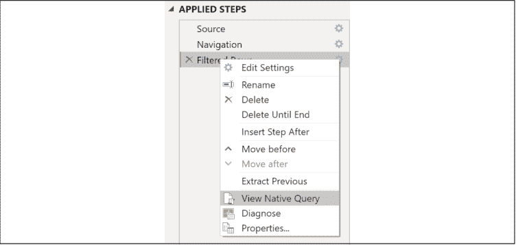

图2.8：在查询设置中查看本机查询

- 2. 随后会显示**本机查询**对话框，如图2.9所示。

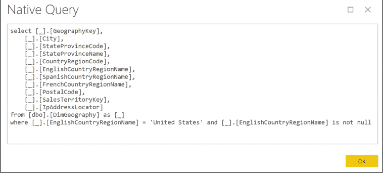

```
select [__].[GeographyKey],
[__].[City],
[__].[StateProvinceCode],
[__].[StateProvinceName],
[__].[CountryRegionCode],
[__].[EnglishCountryRegionName],
[__].[SpanishCountryRegionName],
[__].[FrenchCountryRegionName],
[__].[PostalCode],
[__].[SalesTerritoryKey],
[__].[IpAddressLocator]
from [dbo].[DimGeography] as [__]
where [__].[EnglishCountryRegionName] = 'United States' and [__].[EnglishCountryRegionName] is not null
```

图2.9：由DimGeography M查询生成的SQL语句

## 访问和检索数据

查找并修改未折叠到源系统的查询，是优化大型Power BI数据集的首要技术。有关此过程的示例，请参阅第11章*增强和优化现有Power BI解决方案*中的*将查询处理推回源系统*配方。

M查询引擎还支持部分查询折叠。查询可以“部分折叠”，此时会生成一条只解析整体查询中一部分的SQL语句。该SQL语句的结果将返回到Power BI Desktop（或本地数据网关），其余逻辑则使用M的内存引擎和本地资源进行计算。

通过在查询过程中尽早使用查询折叠支持的标准表达式，可以设计M查询以最大限度地利用源系统资源。最大限度地减少本地或本地数据网关资源的使用，是提升查询性能的首要考虑因素。

不过，查询折叠也存在一些限制。例如，一旦将本机SQL查询传递给源系统，就不会再发生折叠，例如通过**获取数据**对话框中的**高级选项**直接传递SQL查询时。*图2.10*显示了在**获取数据**对话框中指定的查询，该查询包含在**源**步骤中。

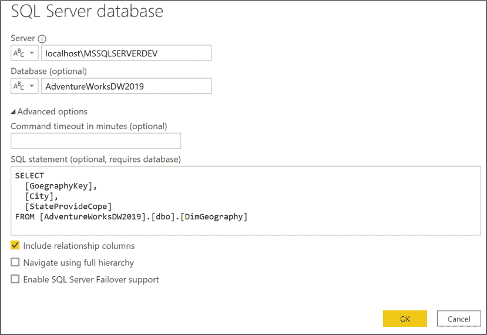

图2.10：提供用户定义的本机SQL查询

在此本机查询之后应用的任何转换都将使用本地系统资源。因此，对于使用本机或用户自定义SQL查询进行查询开发，一般的建议是：如果使用它们，请尽量包含所有必需的转换（即联接和派生列），或者利用它们来调用源数据库中未被折叠查询使用的重要功能，例如索引。

关于查询折叠，还需要注意以下几点：

- ► 并非所有数据源都支持查询折叠，例如文本文件和Excel文件。
- ► 查询编辑器或通过M函数提供的所有转换，并非都能直接得到所有数据源的支持。
- ► 为数据源定义的隐私级别也会影响是否使用折叠。
- ► SQL语句在发送到源系统之前不会被解析。
- ► 可以使用Table.Buffer函数来避免查询折叠。该函数的表输出会加载到本地内存中，对其进行的转换将保留在本地。

## 另请参阅

- ► Power Query M语言规范：http://bit.ly/2oaJwvv
- ► Power Query M函数参考：http://bit.ly/3bLKJ1M

## 管理查询和数据源

Power BI中的查询包含两个主要组成部分：数据源和针对该数据源执行的查询逻辑。数据源包括连接方法（**DirectQuery**或**导入**）、隐私设置以及身份验证凭据。查询逻辑由M表达式组成，这些表达式在查询编辑器中以查询形式表示，并在内部以M文档形式存储。

在典型的商业智能工具（如**SQL Server Reporting Services（SSRS）**）中，数据源属性（如服务器和数据库名称）与引用它们的查询是分开定义的。然而，在Power BI Desktop中，默认情况下，每个显式创建的查询都会直接引用特定的数据源（例如服务器A和数据库B）。如果确实需要更改源环境或数据库，这就形成了逐个手动修改查询的繁琐流程。

以下步骤通过使用专用M查询来集中管理并将数据源信息与各个查询隔离开，从而解决此问题。此外，还提供了有关管理源凭据和数据源隐私级别的详细信息和参考信息。

## 准备工作

为准备本配方，我们将根据数据库创建一个查询，通过上一配方中描述的标准“获取数据”和Power Query编辑器体验，该查询将作为其他查询的源。要创建此查询，请执行以下步骤：

- 1. 打开Power BI Desktop。
- 2. 如果已经连接到SQL Server，可以在“开始”选项卡的“最近使用的源”下找到该连接。否则，请在“开始”选项卡中，从功能区选择“获取数据”，然后选择SQL Server。
- 3. 选择表或视图，并单击“转换数据”以导入数据。
- 4. 将启动Power Query编辑器窗口，并显示数据预览。在此示例中，我们从本地SQL Server实例MSSQLSERVERDEV上的AdventureWorksDW2019数据库中选择了DimEmployee表。查询的完整代码可以在“高级编辑器”窗口中查看，也显示在下方。
- 5. 仅复制“源”行（在上一步中已加粗）。
- 6. 点击“取消”按钮关闭“高级编辑器”窗口。
- 7. 停留在Power Query编辑器窗口中。

```
let
    Source = Sql.Database("localhost\MSSQLSERVERDEV",
    "AdventureWorksDW2019"),
    dbo_DimEmployee = Source[{Schema="dbo",Item="DimEmployee"}][Data]
in
    dbo_DimEmployee
```

## 如何管理查询和数据源

在此示例中，我们创建了一个单独的数据源连接查询，并由各个查询使用。通过将多个单独查询关联到一个（或少量）数据源查询，可以轻松更改源系统或环境，例如在从开发环境切换到用户验收测试（UAT）环境时。然后，我们将使用查询组进一步分离数据源查询和数据加载查询。要开始将数据源查询与数据加载查询隔离，请执行以下步骤：

- 1. 通过从“开始”选项卡的功能区选择“新建源”，然后选择“空白查询”，创建一个新的空白查询。

- 2. 打开**高级编辑器**，并将**源**行替换为从**准备工作**中创建的查询复制的那一行。务必删除行尾的逗号（,）。`in`关键字之前的那一行末尾不应有逗号。查询应如下所示：

```
```powerquery
let
    Source = Sql.Database("localhost\\MSSQLSERVERDEV", "AdventureWorksDW2019")
in
    Source
```
```

- 3. 点击**完成**按钮关闭**高级编辑器**窗口。

- 4. 通过单击查询并在**查询设置**窗格中编辑**名称**来重命名查询。或者，在**查询**窗格中，右键单击该查询并选择**重命名**。为源查询指定一个直观的名称，例如AdWorksDW。

- 5. 现在点击上面*准备工作*部分中创建的原始查询。打开**高级编辑器**。将查询的**源**步骤表达式替换为新查询的名称。在键入查询名称**AdWorksDW**时，您会注意到IntelliSense会提示可能的值。查询现在应如下所示：

```
```powerquery
let
    Source = AdWorksDW,
    dbo_DimEmployee = Source{[Schema="dbo",Item="DimEmployee"]}[Data]
in
    dbo_DimEmployee
```
```

- 6. 点击**完成**按钮退出**高级编辑器**。预览数据将刷新，但继续显示与之前相同的数据。

通过将查询组织到查询组中，我们可以进一步推进这种将数据源查询与数据加载查询隔离的理念。您还应该使用查询组来帮助将数据源和暂存查询与加载到数据集中的查询隔离开。要了解查询组如何工作，请执行以下步骤：

- 1. 复制在**准备工作**中创建的用于加载**DimEmployee**表的修订后数据加载查询。只需右键单击**查询**窗格中的该查询，并选择**复制**。

- 2. 在**查询**窗格中选中新查询后，点击**查询设置**窗格中**应用的步骤**区域中**导航**步骤旁边的齿轮图标。

- 3. 选择其他维度表或视图，例如**DimAccount**，然后点击**确定**按钮。维度表和视图以“Dim”开头。


+   4. 重命名这个新查询，以反映正在加载的新表或视图。
+   5. 在**查询**窗口的空白区域右键单击，然后选择**新建组...**，创建一个新组。
+   6. 在**新建组**对话框中，将组命名为**数据源**，然后点击**确定**按钮。
+   7. 创建另一个新组，并将该组命名为**维度**。
+   8. 通过拖放或右键单击查询并选择**移动到组...**，将**AdWorksDW**查询移动到**数据源**组。
+   9. 将其它查询移动到**维度**组。
+   10. 最后，确保**数据源**组中的查询实际上没有作为单独表加载到数据模型中。右键单击查询并取消选中**启用加载**选项。这使该查询可用于支持数据检索查询，但对模型和报表层不可见。该查询名称现在将在**查询**窗格中变为斜体。

您的**查询**窗格现在应类似于*图2.11*所示：

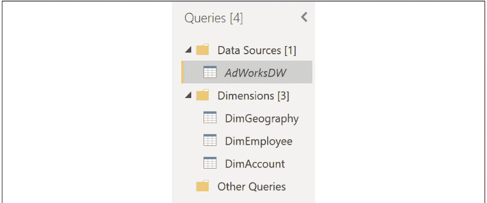

图 2.11：按查询组组织的查询

## 工作原理

Power Query中的**查询依赖项**视图提供了各查询之间关系的可视化表示。您可以使用**视图**选项卡，然后在功能区中选择**查询依赖项**来访问此对话框。

## 查询依赖项

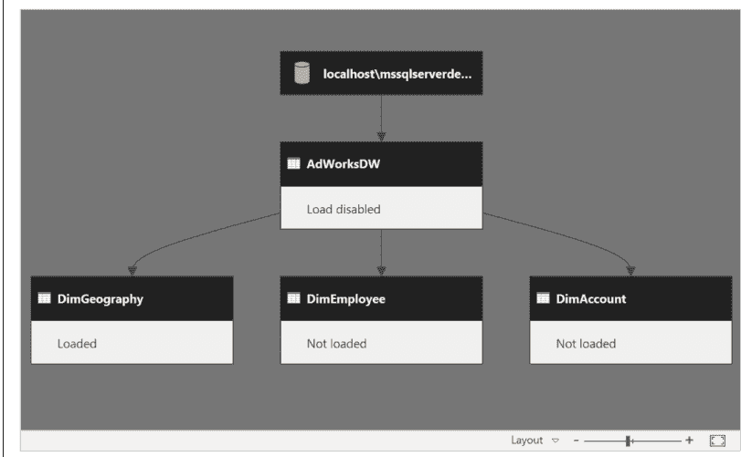

图 2.12：查询编辑器中的查询依赖项视图

在此示例中，一个仅包含一个表达式的单一查询被多个查询使用，但可以设计更复杂的相互依赖关系来管理检索和分析查询的行为与功能。本配方演示了后续配方中使用的更广泛概念——“可组合性”，即函数调用其他函数；这是M、DAX、R和F#等函数式编程语言的主要优势之一。

## 更多内容...

Power BI Desktop会为每个定义的数据源保存凭据以及该源的隐私级别。随着密码变化，通常需要修改这些凭据。此外，为数据源设置隐私级别有助于防止机密信息在查询折叠过程中暴露给外部源。数据源凭据和设置不存储在PBIX文件中，而是存储在已安装应用程序的计算机上。

要管理数据源凭据和隐私级别，请执行以下步骤：

+   1. 在Power BI Desktop（而非Power Query编辑器）中，单击菜单中的**文件**，然后点击**选项和设置**，最后点击**数据源设置**。
+   2. 点击**全局权限**单选按钮，使您的设置持久化到其他Power BI Desktop报表中。
+   3. 选择数据源。
+   4. 点击**编辑权限**按钮。
+   5. 在**编辑权限**对话框中，您可以点击**凭据**标题下的**编辑**按钮来设置数据源的身份验证凭据。此外，您可以使用**隐私级别**标题下的下拉列表来设置数据源的隐私级别。点击**确定**保存您的设置。

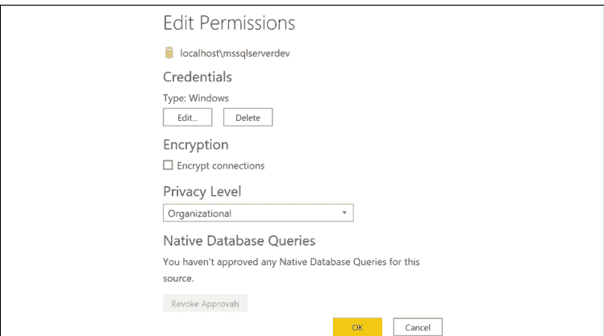

图 2.13：编辑数据源的凭据和隐私级别

可用的**隐私级别**设置定义见*表2.2*。

| 隐私设置 | 描述 |
|---|---|
| None | 未定义隐私级别。 |
| Private | 私有数据源在查询检索期间与其他数据源完全隔离。例如，将文本文件标记为Private会阻止该数据在外部服务器上处理。 |
| Organizational | 组织数据源与所有公共数据源隔离，但在检索期间对其他组织数据源可见。 |

## 访问和检索数据

-   存在一个高性能和/或读取优化的系统来服务报表查询，例如SQL Server或Azure SQL数据库，并对事实表应用了聚集列存储索引。

本配方介绍了在Power BI Desktop中设计支持DirectQuery模型的数据访问层的主要步骤。由于这些模型不会缓存到内存中，并且会将来自报表可视化的DAX查询动态转换为SQL语句，因此需要提供指导以维持性能。文中还包含关于DirectQuery当前限制以及与默认导入模式比较的更多细节、资源和文档，以帮助您做出设计决策。

## 准备工作

+   1. 选择一个数据库作为DirectQuery数据模型的源。
+   2. 创建模型的事实表和维度表的逻辑和物理设计，包括关系键和事实的粒度。AdventureWorksDW数据库是一个以这种方式设计数据的良好示例。
+   3. 确定或确认每个事实到维度关系都具有引用完整性。将此信息提供给DirectQuery模型可以获得更高性能的内连接查询。
+   4. 在源数据库中创建视图对象，以提供对物理设计中定义的维度和事实的高效访问。

请注意，DirectQuery模型仅限于单一源数据库，并且并非所有数据库都支持DirectQuery。如果需要多个数据源，例如SQL Server和Oracle，或Teradata和Excel，那么默认的“导入”模式模型（通过计划刷新到Power BI服务）将是唯一选择。

## 如何使用DirectQuery

对于本配方，我们将使用本章迄今为止一直使用的**AdventureWorksDW2019**数据库。要实现本配方，请按照以下步骤操作：

+   1. 创建一个新的Power BI Desktop文件。
+   2. 在**主页**选项卡中，点击功能区上的**获取数据**，然后点击**SQL Server**。
+   3. 在**数据连接模式**部分，选择**DirectQuery**单选选项。

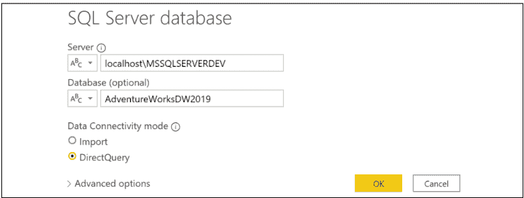

图 2.14：创建DirectQuery数据源

+   4. 通过导航器对话框选择模型要使用的表或视图，例如“FactResellerSales”表，然后点击“转换数据”按钮。
+   5. 复制初始查询并修改“导航”步骤以引用支持模型的附加视图，例如“DimReseller”。可以通过在公式栏中编辑“Item”，或点击“查询设置”窗格中“已应用步骤”下“导航”步骤旁边的齿轮图标来完成此操作。同时，重命名此查询以反映所引用的数据。

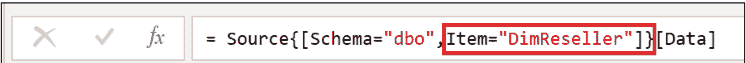

图 2.15：在公式栏中编辑“导航”步骤

+   6. 对所有必需的事实和维度重复步骤5。例如：
+   ► DimEmployee
+   ► DimPromotion
+   ► DimCurrency
+   ► DimSalesTerritory
+   7. 点击**关闭并应用**按钮。

报表画布视图将通过右下角的状态栏确认模型处于DirectQuery模式（见图2.16）。此外，左侧窗格中的“数据”视图（对导入模型可见）将不可见。


图 2.16：Power BI Desktop中的DirectQuery状态

## 工作原理

DirectQuery中支持的M转换函数受源系统兼容性的限制。当转换在DirectQuery模式下不受支持时，Power Query编辑器会发出提示，参见图2.17。

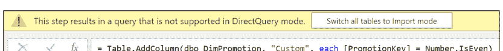

图 2.17：查询编辑器中的警告，提示IsEven函数在DirectQuery模式下不受支持

鉴于这一限制以及基于M的转换为解决方案带来的额外复杂性，建议您将所有必要的逻辑和转换嵌入到源关系层中。理想情况下，源数据库中的基表本身应反映这些需求。作为次要选项，可以创建一层视图来支持DirectQuery模型。

如果无法修改数据库对象本身，可以使用Value.Native M函数将SQL语句直接从Power BI Desktop传递到源数据库，参见图2.18。

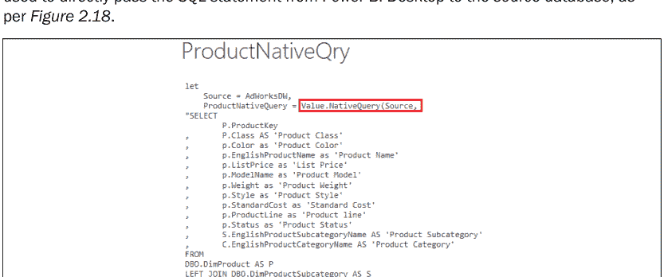

图 2.18：使用Value.Native函数将SQL语句传递给源系统

当报表可视化在Power BI中刷新或交互时，来自每个可视化的DAX查询会被转换为SQL语句，并利用源SQL语句返回结果。请注意，Power BI确实会在DirectQuery模型中缓存查询结果。因此，当访问最近使用过的视觉对象时，可能会使用本地缓存，而不是向源发送新查询。

从Power BI传递到DirectQuery数据源的SQL语句包括视觉对象引用的表中的所有列。


例如，一个 Power BI 视觉对象，使用 **FactResellerSales** 表中的 **SalesAmount**（销售额）按 **DimReseller** 中的 **ResellerName**（经销商名称）分组，将生成一条 SQL 语句，该语句从两个表中选择列，并实现在模型中定义的联接。然而，由于传入的 SQL 语句将这些源视图作为派生表嵌入，关系引擎能够生成一个查询计划，该计划仅扫描支持联接和聚合所需的列。

## 更多内容...

DirectQuery 模型的性能和可扩展性主要取决于关系数据源。如果不需要近乎实时的可见性，建议使用具有引用完整性的反规范化星型架构，并且该系统应与 OLTP 工作负载隔离。此外，对于报告和分析查询，建议使用受支持的 DirectQuery 源提供的内存和列式功能。

默认情况下，DirectQuery 模型会生成外联接 SQL 查询，以确保即使没有相关的维度，度量值也能返回正确的值。但是，您可以将 DirectQuery 模型配置为发送内联接查询。这可以通过在建模视图中编辑表之间的关系，勾选**假设引用完整性**设置来完成（参见*图 2.19*）。与源系统资源一样，这是影响 DirectQuery 模型性能的首要因素之一。

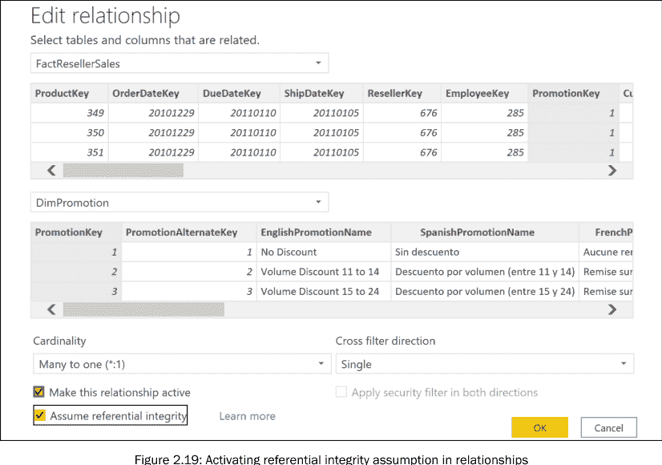

当然，在启用此设置之前，您应确保源中存在引用完整性；否则，可能会返回不正确的结果。

当然，源关系模式的设计和该系统的硬件资源也会极大地影响 DirectQuery 模型的性能。

建议采用具有反规范化表的经典星型架构设计，以减少查询时所需的联接操作。使用列存储技术（例如 SQL Server 的聚集列存储索引）和表分区来优化关系事实表，也将显著有利于 DirectQuery 模型。

## 另请参阅

- Power BI Desktop DirectQuery 文档：http://bit.ly/2nUoLG
- Power BI 数据源文档提供了按支持的连接选项分类的详细数据源列表：http://bit.ly/30N5oFG

## 导入数据

导入是 Power BI Desktop 的默认数据连接模式。在 Power BI Desktop 中创建的导入模型使用与 Analysis Services 表格 2016+ 导入模型相同的内存、列式压缩存储引擎（VertiPaq）。导入模式模型支持集成不同的数据源（例如 SQL Server 和 DB2），并通过完全支持所有 DAX 函数，在开发指标和行级安全角色方面提供更大的灵活性。

然而，导入模式数据集存在一些限制。例如，Power BI Pro 许可证用户无法将大于 1GB 的 Power BI Desktop 文件发布到 Power BI 服务中的共享容量。Power BI Premium（专用、隔离的硬件）支持 10GB 及更大的数据集（启用大型数据集后，数据集大小受 Premium 容量大小或管理员设置的最大大小限制）。对于如此大的数据集，重要的是考虑采用增量刷新，只刷新和导入新的和更改的数据，而不是刷新整个数据集。

本食谱描述了使用 M 和查询编辑器为标准星型架构分析模型开发导入模式查询的过程。引入了一种暂存查询方法，作为有效增强模型维度的一种手段。此外，还包含了一些技巧，用于在刷新期间使用更少的资源，并避免因修订后的源数据而导致的刷新失败。这些方法的更多细节包含在本章的其他食谱中。

## 准备就绪

在此示例中，来自 **AdventureWorksDW2019** 数据库的 **DimProduct**、**DimProductSubcategory** 和 **DimProductCategory** 表被集成到一个导入查询中。此查询包括所有产品行，仅包含英语列，并使用用户友好的名称。源数据库中已定义了多对一关系。

要为此食谱做准备，请执行以下操作：

- 1. 打开 Power BI Desktop。
- 2. 创建一个名为 **AdWorksDW** 的导入模式数据源查询。此查询应类似于以下内容：
- 3. 将此查询隔离在名为 **Data Sources** 的查询组中。
- 4. 禁用此查询的加载。

```
let
    Source = Sql.Database("localhost\MSSQLSERVERDEV", "AdventureWorksDW2019")
in
    Source
```

有关执行这些步骤的更多详细信息，请参阅本章中的*管理查询和数据源*食谱。

## 如何导入数据

要实现此食谱，请执行以下步骤：

- 1. 右键单击 **AdWorksDW**，然后选择**引用**。这将创建一个以 **AdWorksDW** 查询作为其源的新查询。
- 2. 选择此新查询，在预览数据中，于 **Name** 列中找到 **DimProduct** 表。单击此行 **Data** 列中的 **Table** 链接。
- 3. 将此查询重命名为 **DimProduct**。
- 4. 对 **DimProductCategory** 和 **DimProductSubcategory** 表重复步骤 1 – 3。
- 5. 创建一个名为 **Staging Queries** 的新查询组。
- 6. 将 **DimProduct**、**DimProductCategory** 和 **DimProductSubcategory** 查询移动到 **Staging Queries** 组。

## 访问和检索数据

- 7. 禁用 **Staging Queries** 组中所有查询的加载。您完成的查询集应类似于*图 2.20*。


*图 2.20：暂存查询*

斜体表示这些查询不会加载到模型中。

- 8. 创建一个新的**空白查询**，并将其命名为 **Products**。
- 9. 打开 **Products** 查询的**高级编辑器**。
- 10. 在 **Products** 查询中，使用 `Table.NestedJoin` 函数联接 `DimProduct` 和 `DimProductSubcategory` 查询。这与在**主页**选项卡的功能区中选择**合并查询**选项时使用的函数相同。需要左外联接来保留所有 DimProduct 行，因为指向 DimProductCategory 的外键列包含空值。
- 11. 添加一个 `Table.ExpandColumns` 表达式，从 `DimProductSubcategory` 表中检索必要的列。**Products** 查询现在应具有以下代码：

```
```powerquery
let
    ProductSubCatJoin =
        Table.NestedJoin(
            DimProduct,"ProductSubcategoryKey",
            DimProductSubcategory,"ProductSubcategoryKey",
            "SubCatColumn",JoinKind.LeftOuter
        ),

    ProductSubCatColumns =
        Table.ExpandTableColumn(
            ProductSubCatJoin,"SubCatColumn",
            {"EnglishProductSubcategoryName","ProductCategoryKey"},
            {"Product Subcategory", "ProductCategoryKey"}
        )
in
    ProductSubCatColumns
```
```

NestedJoin 函数将联接结果以表值的形式插入到一个列（SubCatColumn）中。第二个表达式将这些表值转换为 DimProductSubcategory 查询中的必要列，并提供简单的 Product Subcategory 列名，如图 2.21 所示。

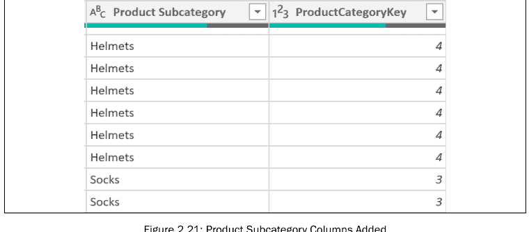

图 2.21：已添加产品子类别列

Power Query 编辑器中的查询预览将在预览数据的最右侧显示新列。

- 12. 在 ProductSubCatColumns 表达式下方添加另一个表达式，使用 Table.NestedJoin 函数将上一个表达式（产品与子类别的联接）与 DimProductCategory 查询联接起来。
- 13. 与步骤 8 一样，在一个新表达式中使用 Table.ExpandTableColumn 函数来展示所需的产品类别列。

```
),

ProductCatJoin =
    Table.NestedJoin(
        ProductSubCatColumns,"ProductCategoryKey",
        DimProductCategory,"ProductCategoryKey",
        "ProdCatColumn",JoinKind.LeftOuter
    ),

ProductCatColumns =
    Table.ExpandTableColumn(
        ProductCatJoin,"ProdCatColumn",
        {"EnglishProductCategoryName"}, {"Product Category"}
    )
in
    ProductCatColumns
```


## 访问和检索数据

请确保在 ProductCatColumns 表达式后添加一个逗号。此外，请确保将 `in` 关键字下方的行更改为 ProductCatColumns。

ProductCatJoin 表达式将连接的结果添加到 DimProductCategory（右表）并将其添加到新列（ProductCatColumn）。下一个表达式 ProductCatColumns 添加所需的 **产品类别** 列，并将 EnglishProductCategoryName 列修订为产品类别。在此连接操作中也需要左外部连接，因为 DimProductSubcategory 上的产品类别外键列允许空值。

14. 在 ProductCatColumns 表达式之后添加一个表达式，使用 Table.SelectColumns 函数选择加载到数据模型所需的列。

15. 此外，添加一个最终表达式，通过 Table.RenameColumns 重命名这些列，以消除对英语的引用并在单词之间提供空格。

```
),
SelectProductColumns =
    Table.SelectColumns(ProductCatColumns,
        {
            "ProductKey", "EnglishDescription",
            "EnglishProductName", "Product Subcategory",
            "Product Category"
        }
    ),
RenameProductColumns =
    Table.RenameColumns(SelectProductColumns,
        {
            {"EnglishDescription", "Product Description"},
            {"EnglishProductName", "Product Name"}
        }
    )
in
    RenameProductColumns
```

请确保在 ProductCatColumns 表达式后添加一个逗号。此外，将 `in` 关键字下方的行更改为 RenameProductColumns。

**Power Query 编辑器** 中 **产品** 查询的预览现在应与 *图 2.22* 所示相似。

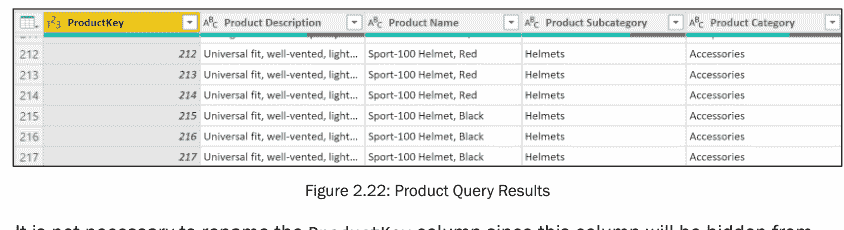

图 2.22：产品查询结果

由于 ProductKey 列将在报表层中隐藏，因此无需重命名该列。实际上，产品维度将包含更多列。关闭并应用更改后，只有 Products 表将被加载到模型中。

反规范化的 Products 表现在支持 Power BI Desktop 模型中的三级层次结构，从而显著改善报表和分析。


图 2.23：产品层次结构

### 其工作原理

Table.NestedJoin 的默认连接类型是左外部连接。然而，由于支持其他连接类型（例如，内部、反向和完全外部），因此建议在表达式中明确指定此参数。Products 表示例中需要左外部连接，因为 DimProduct 和 DimProductSubcategory 上的外键列都允许空值。否则，建议出于性能原因使用 Table.NestedJoin 或 Table.Join 函数实现的内部连接。本章的 Combining and Merging Queries 配方中还涵盖了有关连接函数的更多详细信息以及作为分段查询替代方案设计内联查询的提示。

当查询通过 Table.NestedJoin 或 Table.Join 函数连接两个表时，会向第一个表添加一列，其中包含一个 Table 对象，其中包含来自第二个表的已连接行。此列必须使用 Table.ExpandTableColumn 函数进行扩展，该函数会根据连接操作生成额外的行。

一旦通过连接和列扩展操作生成了所有行，就可以使用 Table.SelectColumns 操作指定最终结果中所需的特定列；然后可以使用 Table.RenameColumns 函数按需重命名这些列。

### 还有更多...

使用导入模式，我们可以做很多事情来增强查询以帮助报表开发和显示。其中一个例子是，我们可以添加额外的列来提供报表视觉对象中属性的自动排序。具体来说，假设我们希望美国区域组织默认在可视化中彼此相邻显示。默认情况下，由于 AdventureWorksDW2019 中 DimOrganization 表中的 Organization 列是文本列，中央分部（美国的一部分）会根据文本列的默认字母排序出现在加拿大和法国之间。我们可以修改一个从 DimOrganization 表提取的简单查询，以添加一个数字排序列。要了解其工作原理，请按照以下步骤操作：

1. 使用本配方中使用的同一 Power BI 文件，打开 Power Query 编辑器，右键单击 AdWorksDW 查询并选择引用。
2. 选择 DimOrganization 表并将查询重命名为 DimOrganization。
3. 打开 DimOrganization 查询的高级编辑器窗口。
4. 向 DimOrganization 维度的导入查询添加 Table.Sort 表达式。排序的列应位于层次结构的父级或更高级别。
5. 添加一个使用 Table.AddIndexColumn 函数的表达式，该函数将根据上一步中应用的表排序添加基于顺序的整数。完成的查询应如下所示：

```
let
    Source = AdWorksDW,
    dbo_DimOrganization = Source{[Schema="dbo",Item="DimOrganization"]}[Data],
    OrgSorted = Table.Sort(
        dbo_DimOrganization,
        {
            {"ParentOrganizationKey", Order.Ascending},
            {"CurrencyKey", Order.Ascending}
        }
    ),
    OrgSortIndex = Table.AddIndexColumn(OrgSorted,"OrgSortIndex",1,1)
in
    OrgSortIndex
```

6. 最后，按住 Ctrl 键，通过单击其列标题选择 OrganizationKey、OrganizationName 和 OrgSortIndex 列。右键单击 OrgSortIndex 列并选择删除其他列。预览数据现在应显示为图 2.24 所示。

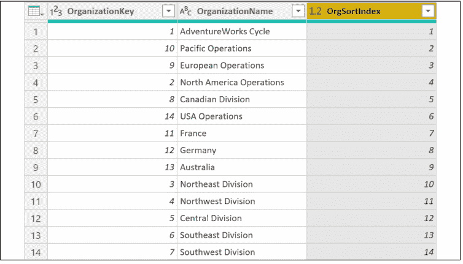

图 2.24：修改后的组织维度查询

使用此表达式，表首先按 ParentOrganizationKey 列排序，然后按 CurrencyKey 列排序。新的索引列从此排序表的第一行开始，按每行递增一个进行增长。净效果是所有美国部门都分组在表的末尾。

我们现在可以使用此新的索引列来调整 OrganizationName 列的默认字母数字排序行为。要了解其工作原理，请执行以下步骤：

1. 选择关闭并应用以退出 Power Query 编辑器以加载 DimOrganization 表。
2. 在数据视图中，选择 OrganizationName 列。
3. 从列工具选项卡中，将排序依据列下拉菜单设置为 OrgSortIndex 列。

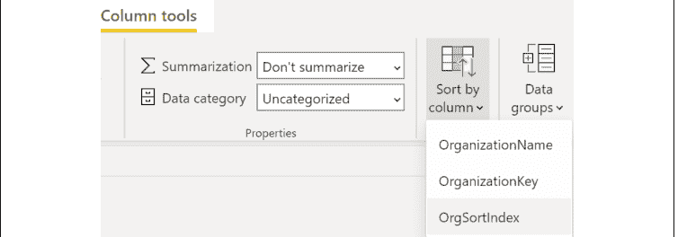

图 2.25：数据视图中的排序依据

4. 最后，右键单击 **OrgSortIndex** 列并选择 **隐藏在报表视图中**。

使用 OrganizationName 列的视觉对象现在将按其父组织对值进行排序，使得美国组织一起出现（但不按字母顺序）。

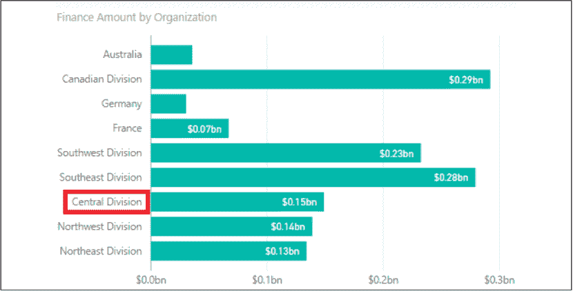

图 2.26：组织自动排序

### 另请参阅

- Power BI 服务中的数据集模式：http://bit.ly/30P2HKF
- 导入建模的数据缩减技术：http://bit.ly/30RsMZI

### 应用多个筛选器

精确且通常复杂的筛选条件的应用一直是商业智能的核心，Power BI Desktop 在其查询、数据模型和可视化组件中支持丰富的筛选功能。在许多场景中，通过查询编辑器和 M 函数在查询级别进行筛选是最佳选择，因为这可以减少导入和 DirectQuery 数据模型的负载，并消除在多个报表或可视化中重新应用相同筛选逻辑的需要。

虽然查询编辑器图形界面可用于配置筛选条件，但本配方演示了 M 的核心筛选函数以及 M 在常见多条件筛选场景中的使用。本配方中构建的 M 表达式查询旨在突出最常见的筛选用例。


请注意，将数据转换作为数据仓库 ETL（提取-转换-加载）或 ELT（提取-加载-转换）流程的一部分进行应用，通常比使用 Power Query（M）更为可取。BI 团队和开发人员应注意避免创建与现有“事实来源”显著偏离的 Power BI 数据集。

本食谱中将开发以下八个筛选查询：

- 仅美国客户
- 拥有三个或以上子女的客户
- 中间名或职称列中存在空值的客户
- 首次购买日期在 2012 年至 2013 年之间的客户
- 管理层且性别为女性或教育程度为学士的客户
- 按收入排名前 100 的客户
- 不同销售区域国家的列表
- 日期小于或等于当前日期且早于当前日期十多年以上的日期

## 准备工作

为准备本食谱，请从 **AdventureWorksDW2019** 数据库导入 `DimCustomer` 和 **DimDate** 表，操作如下：

- 1. 打开 Power BI Desktop，并在 **Home** 选项卡的 ribbon 中选择 **Transform data** 以打开 **Power Query Editor**。
- 2. 创建一个名为 AdWorksDW 的 **Import** 模式数据源查询。该查询应类似于以下内容：

   ```m
   let
       Source = Sql.Database("localhost\\MSSQLSERVERDEV", "AdventureWorksDW2019")
   in
       Source
   ```

- 3. 将此查询隔离到名为 **Data Sources** 的查询组中。
- 4. 右键单击 AdWorksDW 并选择 **Reference**。
- 5. 选择 DimCustomer 表并将查询重命名为 DimCustomer。
- 6. 对 DimDate 表重复步骤 4 和 5。
- 7. 将维度查询分组到名为 **Base Queries** 的查询组中。
- 8. 禁用所有查询的加载。
- 9. 对于 DimCustomer 查询，找到 DimGeography 列。在列标题中，单击发散箭头图标，取消选中（Select All Columns），然后选中 CountryRegionCode 和 DimSalesTerritory 旁边的复选框，然后单击 OK 按钮。

   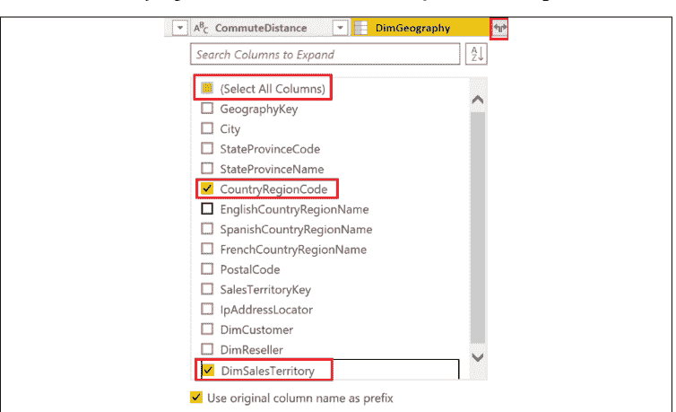

   图 2.27：展开 DimGeography 以包含 CountryRegionCode 和 DimSalesTerritory

- 10. 现在展开 DimGeography.DimSalesTerritory 并且仅选择 SalesTerritoryCountry 列。
- 11. 将 DimGeography.CountryRegionCode 列重命名为 CountryCode，并将 DimGeography.DimSalesTerritory.SalesTerritoryCountry 列重命名为 SalesTerritoryCountry。

有关执行这些步骤的更多详细信息，请参阅本章中的 Managing Queries and Data Sources 食谱。

## 如何应用多个函数

要实现本食谱，请使用以下步骤：

- 1. 右键单击 DimCustomer 查询，选择 Reference，然后打开此查询的 Advanced Editor 窗口。使用 Table.SelectRows 函数应用 US 查询谓词并将查询重命名为 United States Customers。完成的查询应与以下内容相同：

   ```
   let
       Source = DimCustomer,
       USCustomers = Table.SelectRows(Source, each [CountryCode] = "US")
   in
       USCustomers
   ```

- 2. 重复步骤 1，但这次在 TotalChildren 列上按 >= 3 进行筛选并将此查询重命名为 **Customers w3+ Children:** 

   ```
   let
       Source = DimCustomer,
       ThreePlusChildFamilies = Table.SelectRows(Source, each [TotalChildren] >=3)
   in
       ThreePlusChildFamilies
   ```

- 3. 重复步骤 1，但这次使用条件逻辑运算符 or 来定义 MiddleName 或 Title 列中空白值的筛选条件。使用小写文字 null 表示空白值。将此查询命名为 **Missing Titles or Middle Names:** 

   ```
   let
       Source = DimCustomer,
       MissingTitleorMiddleName =
           Table.SelectRows(
               Source, each [MiddleName] = null or [Title] = null
           )
   in
       MissingTitleorMiddleName
   ```

- 4. 重复步骤 1，但这次使用 #date 文字来对 DateFirstPurchase 列应用 **2012-2013** 筛选。将此查询重命名为 **2012-2013 First Purchase Customers:** 

   ```
   let
       Source = DimCustomer,
       BetweenDates =
           Table.SelectRows(
               Source,
               each [DateFirstPurchase] >= #date(2012,01,01) and [DateFirstPurchase] <= #date(2013,12,31)
           )
   in
       BetweenDates
   ```

- 9. 通过引用 DimDate 创建一个新查询并打开 Advanced Editor。使用 DateTime.LocalNow、DateTime.Date 和 Date.Year 函数从当前日期检索过去十年的数据。将此查询重命名为 Trailing Ten Years from Today 并将其放置在其自己的组 Date Filter Queries 中。

   ```
   let
       Source = DimDate,
       TrailingTenYearsFromToday =
           Table.SelectRows(
               Source,
               each
                   [FullDateAlternateKey] <= DateTime.Date(DateTime.LocalNow) and
                   [CalendarYear] >= Date.Year(DateTime.LocalNow) - 10
           )
   in
       TrailingTenYearsFromToday
   ```

## 工作原理

Table.SelectRows 函数是 M 语言中主要的表格筛选函数，其功能与 SQL 的 FROM 和 WHERE 子句相对应。请注意，变量名被用作 M 函数的输入，例如 Source 行被用作 Table.SelectRows 函数的第一个参数。

读者不必担心 Table.SelectRows 函数的 each 语法。在许多语言中，这似乎暗示逐行迭代，但在可能的情况下，M 引擎会将该函数折叠到提交给源系统的 SQL 查询的 WHERE 子句中。

在 United States Customers、Customers w3+ Children、Missing Titles or Middle Names 和 Management and Female or Bachelors 查询中，请注意 each 选择条件的各种形式。语法支持多种比较运算符以及复杂的逻辑，包括使用括号来隔离逻辑测试。

在 2012-2013 First Purchase Customers 查询中，#date 文字函数用于生成比较值。DateTime（#datetime）、Duration（#duration）、Time（#time）和 DateTimeZone（#datetimezone）也提供文字。

在 Top US Customers by Income 查询中，Table.Sort 函数用于按指定列和排序顺序对行进行排序。Table.Sort 函数还支持多个列，如本章中 Importing Data 食谱所述。然后使用 Table.FirstN 函数返回从已排序表格的顶部开始的 100 行。在此示例中，由于收入存在并列，返回的集合不是确定的。

**Filter Rows** 对话框的 **Basic** 选项仅允许您使用当前选定的列进行操作。但是，通过单击 **Advanced** 单选按钮，您可以使用表格中的任何列。

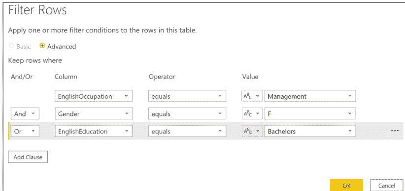

图 2.29：查询编辑器中的高级筛选行对话框

尽管如此，即使是 **Filter Rows** 对话框的 **Advanced** 版本也不提供对逻辑筛选条件进行分组的能力。虽然图 2.29 中的对话框看起来像是重建了 **Management and Female or Bachelors** 的查询，但生成的 M 代码不包含对 **Gender** 和 **EnglishEducation** 子句进行分组的括号。因此，生成代码必须在 **Advanced Editor** 中手动编辑，才能返回与原始 **Management and Female or Bachelors** 查询相同的结果。图 2.29 中所示的 **Filter Rows** 对话框生成的 M 代码如下：

```
Table.SelectRows(
    Source,
    each
    [EnglishOccupation] = "Management" and
    [Gender] = "F" or
    [EnglishEducation] = "Bachelors"
)
```

## 另请参阅

- Table.SelectRows: http://bit.ly/3bSkEyj
- Table.Sort: http://bit.ly/3qPaeUo
- Table.FirstN: http://bit.ly/3ttb0In
- List.Distinct: http://bit.ly/3lnCqwq

## 选择和重命名列

数据检索查询中选择的列会影响导入和 DirectQuery 数据模型的性能和可扩展性。对于 Import 模型，刷新过程所需资源和压缩数据模型的大小直接受列选择的影响。具体而言，列的基数决定了其各自的内存占用和每列内存。这与这些列在度量和报表可视化中被引用时的查询持续时间密切相关。对于 DirectQuery 模型，报表查询的性能直接受到影响。无论模型类型如何，检索过程的实现方式也会影响检索过程的稳健性。此外，分配给列的名称（或从源接受的名称）直接影响 Q&A 或自然语言查询体验。

本食谱确定在数据检索过程中包含或排除的列，并演示如何选择这些列以及这些选择对数据模型的影响。此外，还提供了有关应用用户友好名称以及选择检索或消除数据列以供检索的其他考虑因素的示例。

### 准备工作

为准备本食谱，请从 AdventureWorksDW2019 数据库导入 DimCustomer 表，操作如下：

- 1. 打开 Power BI Desktop，并在 Home 选项卡的 ribbon 中选择 Transform data 以打开 Power Query Editor。
- 2. 创建一个 Import 模式数据源查询，名为 AdWorksDW。该查询应类似于以下内容：

   ```
   let
       Source = Sql.Database("localhost\\MSSQLSERVERDEV", "AdventureWorksDW2019")
   in
       Source
   ```

- 3. 将此查询隔离到名为 Data Sources 的查询组中。
- 4. 右键单击 AdWorksDW 并选择 Reference。
- 5. 在数据预览区域中选择 DimCustomer 表并将此查询重命名为 DimCustomer。


有关执行这些步骤的更多详细信息，请参阅本章中的“管理查询和数据源”配方。

## 如何选择和重命名列

要实现此配方，请在高级编辑器中执行以下步骤：

- 1. 通过 Table.AddColumn 函数，从名字和姓氏创建一个名称列。

  ```powerquery
  CustomerNameAdd = Table.AddColumn(
      dbo_DimCustomer, "Customer Name",
      each [FirstName] & " " & [LastName],
      type text
  )
  ```

- 2. 使用 Table.SelectColumns 函数，从 DimCustomer 表现有的 30 列中选择 10 列。

  ```powerquery
  SelectCustCols = Table.SelectColumns(CustomerNameAdd,
      {
          "CustomerKey", "Customer Name", "Annual Income",
          "Customer Gender", "Customer Education",
          "MaritalStatus",
          "Customer Phone Number", "CommuteDistance",
          "AddressLine1",
          "TotalChildren"
      }, MissingField.UseNull
  )
  ```

请注意，指定的某些列名实际上并不存在。这是故意的，将在下一步中修复。但请注意，这些列不会生成错误，而是显示 null 值。

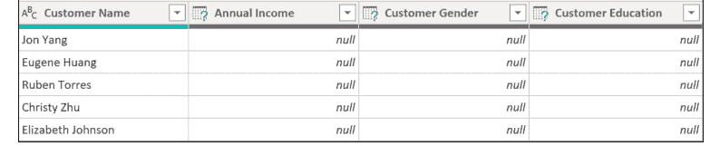

## 访问和检索数据

使用 Table.RenameColumns 函数为用户应用直观的名称，并有助于 Q&A 引擎进行自然语言查询。将此语句插入到 SelectCustCols 语句上方，并进行相应调整。完整查询现在应类似于以下内容：

```powerquery
let
    Source = AdWorksDW,
    dbo_DimCustomer = Source{[Schema="dbo",Item="DimCustomer"]}[Data],
    CustomerNameAdd =
        Table.AddColumn(
            dbo_DimCustomer, "Customer Name",
            each [FirstName] & " " & [LastName],
            type text
        ),
    #"Renamed Columns" =
        Table.RenameColumns(CustomerNameAdd,
            {
                {"YearlyIncome", "Annual Income"},
                {"Gender", "Customer Gender"},
                {"EnglishEducation", "Customer Education"},
                {"Phone", "Customer Phone Number"}
            }
        ),
    SelectCustCols =
        Table.SelectColumns(#"Renamed Columns",
            {
                "CustomerKey", "Customer Name", "Annual Income",
                "Customer Gender", "Customer Education",
                "MaritalStatus",
                "Customer Phone Number", "CommuteDistance",
                "AddressLine1",
                "TotalChildren"
            }, MissingField.UseNull
        )
in
    SelectCustCols
```

### 工作原理

Table.AddColumn 函数将 FirstName 和 LastName 列连接起来，并包含一个可选的最后一个参数，该参数将列类型指定为文本。

Table.SelectColumns 函数指定要从数据源检索的列。未指定的列将从检索中排除。

实现相同效果的另一种方法是使用 Table.RemoveColumns 函数。但是，在这种情况下，需要删除 20 列，而不是显式定义要保留的 10 列。为了避免在某个源列更改或缺失时查询失败，最好指定并命名 10 列而不是 20 列。通过使用 Table.SelectColumns 的可选参数 MissingField.UseNull，可以进一步提高查询的弹性。使用此参数时，如果所选列不可用，查询仍会成功，只需在所有行中为该列插入 null 值即可。

使用 Table.SelectColumns 函数的另一个优点是，可以在检索所选列时按指定顺序重新排序列。这有助于查询设计过程，并避免使用 Table.ReorderColumns 函数编写额外表达式的需要。在数据视图中，加载到数据模型的查询的初始列顺序会得到保留。但是，在 Power BI Desktop 的报表视图和数据视图中，“字段”窗格中显示的字段列表会自动按字母顺序排列。

对于导入数据模型，您可以考虑删除表示同一表中其他列的简单表达式的列。例如，如果 Extended Amount 列等于 Unit Price 和 Order Quantity 列的乘积，则可以选择仅导入后两列。DAX 度量值可以改为计算 Extended Amount 值。这样做可能是为了保持较小的模型大小。但是，不建议对 DirectQuery 模型使用此技术。

使用 Table.RenameColumns 函数重命名列，以删除任何源系统指示符，在非键列的单词之间添加空格，并应用特定于维度的名称，例如 Customer Gender 而不是 Gender。Table.RenameColumns 函数还提供了 MissingField.UseNull 选项。

### 更多内容...

导入模型在内部以列式压缩格式存储。每列的压缩数据都会增加文件的总磁盘大小。数据大小的主要因素是列的基数（cardinality）。具有许多唯一值的列无法很好地压缩，因此会占用更多空间。消除高基数列可以减小数据模型的大小，从而减小 PBIX 文件的整体大小。然而，对于导入模型，查询性能（除其他因素外）取决于查询所访问的各个列的大小。

### 另请参阅

- Table.SelectColumns: http://bit.ly/38Qk7Lt
- Table.RenameColumns: http://bit.ly/3rTVfd4
- Table.RemoveColumns: http://bit.ly/3cJju7p
- Table.ReorderColumns: http://bit.ly/3cEo0Jg
- Table.AddColumn: http://bit.ly/3vGJZ6b
- Power BI 文档：为 Q&A 准备数据: http://bit.ly/2nBLAGc

## 转换和清理数据

在 Power BI 的 M 查询中应用的转换用于保护数据模型的完整性，并支持增强的分析和可视化。要实施的具体转换因数据质量、集成需求和整体解决方案的目标而异。但是，开发人员至少应设法保护模型关系的完整性，并通过反规范化和标准化来简化用户体验。此外，开发人员应与数据源所有者核实，以确定某些必需的转换是否可以在源中实施，或者是否可以通过 SQL 视图对象提供，从而无需使用 Power Query (M) 表达式。

本配方演示如何保护模型免受源数据中重复值的影响，这些重复值可能会阻止在数据模型中形成正确的关系，甚至可能导致查询失败。虽然这里使用了一个简单场景，但本配方演示了在尝试合并多个数据源和消除重复项时可能遇到的情况。

### 准备工作

要开始准备，请通过执行以下操作从 AdventureWorksDW2019 数据库中导入 DimProduct 和 FactResellerSales 表：

- 1. 打开 Power BI Desktop，然后从“开始”选项卡的功能区中选择“转换数据”以打开 Power Query 编辑器。
- 2. 创建一个名为 AdWorksDW 的“导入”模式数据源查询。此查询应类似于以下内容：

  ```powerquery
  let
      Source = Sql.Database("localhost\MSSQLSERVERDEV",
      "AdventureWorksDW2019")
  in
      Source
  ```

- 3. 将此查询隔离在名为“数据源”的查询组中。
- 4. 右键单击 AdWorksDW 并选择“引用”，在数据预览区域中选择 DimProduct 表，然后将此查询重命名为 DimProduct。右键单击 EnglishProductName 列并选择“删除其他列”。
- 5. 重复上一步，但这次选择 FactResellerSales。展开 DimProduct 列，仅选择 EnglishProductName。将此列重命名为 EnglishProductName。


),

GroupedRows =
    Table.Group(
        UpperCase, {"EnglishProductName"},
        {{"Rows", each Table.RowCount(_), Int64.Type}}
    ),
Duplicates = Table.SelectRows(GroupedRows, each [Rows] > 1)
in
    Duplicates

EnglishProductName 列被选中、修剪、转换为大写、分组并进行筛选，以始终检索任何重复的键值。请禁用此查询的加载，因为此查询仅用于故障排除。

## 另请参阅

- Table.SelectColumns: http://bit.ly/38Qk7Lt
- Table.RemoveColumns: http://bit.ly/3cJju7p
- Table.TransformColumns: http://bit.ly/3tsdxm2
- Table.DuplicateColumn: http://bit.ly/3cIF63X
- Table.Distinct: http://bit.ly/38V8mmN
- Text.Trim: http://bit.ly/3eUmAZ0
- Text.Upper: http://bit.ly/3vFw2R6
- 面向文本的 M 函数参考: http://bit.ly/2nUYjnw

## 创建自定义列

业务用户通常通过附加列来扩展现有报表和数据模型的输出，以帮助他们分析和呈现数据。这些列的逻辑通常通过 Excel 公式或计算 DAX 列来实现。更出色的解决方案是通过 Power Query 编辑器和 M 语言创建这些列，尤其是在逻辑无法快速迁移到数据仓库或 IT 资源的情况下。

开发自定义列还可以显著提高数据模型及其支持的可视化效果的易用性和分析能力。在本方案中，我们将创建列以应用自定义命名格式，并通过现有列简化客户维度的分析。

## 准备工作

要准备本方案，请按以下步骤从 **AdventureWorksDW2019** 数据库中导入 **DimCustomer** 表：

- 1. 打开 Power BI Desktop，在 **开始** 选项卡的功能区中选择 **转换数据**，以打开 **Power Query 编辑器**。
- 2. 创建一个名为 AdWorksDW 的导入模式数据源查询。该查询应类似于以下内容：

```powerquery
let
    Source = Sql.Database("localhost\\MSSQLSERVERDEV", "AdventureWorksDW2019")
in
    Source
```

- 3. 将此查询单独放入名为 **数据源** 的查询组中。
- 4. 右键单击 AdWorksDW 并选择 **引用**，在数据预览区域选择 DimCustomer 表，然后将此查询重命名为 DimCustomer。

有关执行这些步骤的其他详细信息，请参阅本章中的*管理查询和数据源*方案。

## 如何创建自定义列

要实现本方案，请执行以下步骤：

- 1. 使用 `Table.SelectColumns` 从 DimCustomer 表中检索所需的源列：FirstName、LastName、MiddleName、Title 和 BirthDate。

```powerquery
let
    Source = AdWorksDW,
    dbo_DimCustomer = Source{[Schema="dbo",Item="DimCustomer"]}[Data],
    SelectColumns =
        Table.SelectColumns(dbo_DimCustomer,
            {"FirstName", "LastName", "MiddleName", "Title",
             "BirthDate"}
        )
in
    SelectColumns
```

- 2. 编写一个 `Table.AddColumns` 函数，并使用 `if...then` 表达式来处理给定目标格式 Mr. John A. Doe 的不同场景：

```powerquery
NameFormatTbl =
    Table.AddColumn(
        SelectColumns,"Formatted Name", each
```

```
if [Title] = null and [MiddleName] = null
    then [FirstName] & " " & [LastName]
    else if [Title] = null
        then [FirstName] & " " & Text.Range([MiddleName],0,1) & ". " & [LastName]
    else
        [Title] & " " & [FirstName] & " " & Text.Range([MiddleName],0,1) & ". " & [LastName]
)
```

- 3. 添加变量，使表达式能够支持当前系统日期与 BirthDate 列之间的比较。

```
let
    CurrentDate = DateTime.Date(DateTime.LocalNow()),
    CurrentYear = Date.Year(CurrentDate),
    CurrentMonth = Date.Month(CurrentDate),
    CurrentDay = Date.Day(CurrentDate),

    Source = AdWorksDw,
```

- 4. 使用 Table.AddColumn 函数基于 BirthDate 列创建 Customer Year、Customer Month 和 Customer Day 列。

```
AddCustomerYear =
    Table.AddColumn(
        NameFormatTble, "Customer Year", each Date.Year([BirthDate]),
        Int64.Type
    ),
    AddCustomerMonth =
        Table.AddColumn(
            AddCustomerYear, "Customer Month", each Date.Month([BirthDate]),
            Int64.Type
        ),
    AddCustomerDay =
        Table.AddColumn(
            AddCustomerMonth, "Customer Day", each Date.Day([BirthDate]),
            Int64.Type
        )
```

NameFormatTble 表达式中的三个 if...then 条件涵盖了返回格式化姓名的所有场景，因为查询必须处理 Middle Name 和 Title 列中的 null 值，以及 Middle Name 列中的不同值。Text.Range 用于提取中间名的首字符。

对于 CurrentDate、CurrentYear、CurrentMonth 和 CurrentDay 变量，使用 DateTime.LocalNow 函数作为当前日期的来源；然后将其用于年、月、日。

对于 AddCustomerYear、AddCustomerMonth 和 AddCustomerDay 表达式，将 Int64.Type 值传递给 Table.AddColumn 的可选 type 参数，以将新列设置为整数。

对于 CustomerAge 和 CustomerSegment 表达式，使用了嵌套的 if...then 表达式。使用此方法是因为目前 M 中尚无可用于年、月、周等日期间隔的 DATEDIFF 函数（T-SQL、DAX）的等效实现。Duration.Days 函数可用于日间隔，其他 duration 函数可用于小时、分钟和秒间隔。

CustomerAge 表达式将 CurrentMonth 和 CurrentDay 变量与 AddCustomerMonth 和 AddCustomerDay 表达式创建的客户列的值进行比较，以便使用 CurrentYear 变量和 AddCustomerYear 表达式创建的列来计算客户的年龄。然后，由 CustomerAge 列创建的列用于 CustomerSegement 表达式，以得出年龄段分割列。新的自定义列可用于支持基于客户年龄和分段的多种可视化效果。

## 更多内容

Power Query 编辑器提供了用于添加列的图形用户界面。这些界面提供了一种添加列的方法，作为手动编写代码的替代方案。本质上，添加列的 M 代码是由这些界面作为输出生成的。

其中一种界面是“从示例创建列”（Column From Examples）功能，它允许用户直接输入所需列输出的示例。引擎会确定要添加到查询中的 M 函数和一系列步骤，以返回与提供的示例一致的结果。若要探索此功能，请按照以下步骤操作：

- 1. 创建引用 AdWorksDW 查询的新查询。
- 2. 选择 DimCustomer 表。
- 3. 选择 Title、FirstName、MiddleName、LastName 和 BirthDate 列，并删除所有其他列。
- 4. 选择“添加列”选项卡，然后在功能区中选择“从示例创建列”按钮。

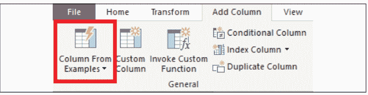

图 2.33：从示例创建列功能

- 5. 在第一行中输入客户的 FirstName、MiddleName 和 LastName 值，然后按 Enter 键。请注意，其余行将根据第一行自动计算。

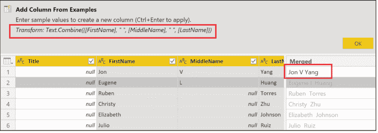

图 2.34：从示例创建列界面

- 6. 单击“确定”按钮以接受转换。

另一种添加列的界面是“条件列”（Condition Column）功能。此功能提供了一种创建条件列的方法，作为编写 if...then 表达式的替代方案。若要查看此功能的运作方式，请按照以下步骤操作：

- 1. 选择“添加列”选项卡，然后在功能区中选择“条件列”。


图 2.35：条件列功能


## 访问和检索数据

- **2.** 在“添加条件列”对话框中填写字段，使用“添加子句”按钮添加额外的 else if 语句；点击“确定”按钮退出对话框并创建新列。

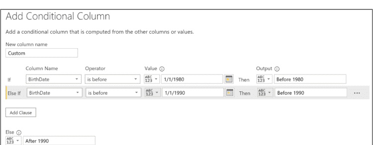

图 2.36：添加条件列对话框

可以引用表中的任何列，并使用省略号 (...) 将多个已创建的步骤上下移动以调整求值顺序。打开高级编辑器以检查所创建的代码。

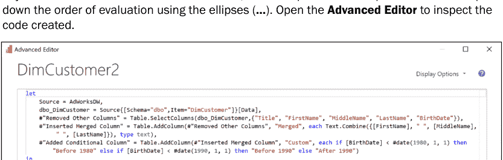

图 2.37：已添加的条件列 M 代码

### 另请参阅

- Table.AddColumn: http://bit.ly/3vGJZ6b
- Table.SelectColumns: http://bit.ly/38Qk7Lt
- DateTime functions: http://bit.ly/3tPtKlJ
- Add Column From examples: http://bit.ly/3eWTLv6

## 组合和合并查询

Power BI 查询能力的全部威力在于通过其合并和追加转换将代表不同数据源的不同查询进行整合。检索过程可以高效且安全地开发，以整合来自多个网络位置的文件或整合来自多个数据源的数据。此外，SQL 和 ETL 开发人员熟悉的相同连接类型和数据转换模式也可以通过 M 语言实现。本食谱提供了将源组合成单个查询的示例，并利用 M 的表连接函数来支持常见的转换场景。

### 准备工作

要跟随本食谱，你可以使用 Power Query 编辑器“开始”选项卡上的“合并查询”和“追加查询”图标来生成本食谱中使用的连接表达式。然而，由于连接查询是检索过程的基础，因此建议学习如何使用 Table.Join、Table.NestedJoin 和 Table.Combine 函数。

为准备本食谱，请通过执行以下操作从 AdventureWorksDW2019 数据库导入 DimCustomer 和 FactCallCenter 表：

- **1.** 打开 Power BI Desktop 并从“开始”选项卡的功能区中选择“转换数据”以打开 Power Query 编辑器。
- **2.** 创建一个名为 AdWorksDW 的导入模式数据源查询。此查询应类似于以下内容：

  ```
  let
      Source = Sql.Database("localhost\MSSQLSERVERDEV", "AdventureWorksDW2019")
  in
      Source
  ```

- **3.** 在名为 Data Sources 的查询组中隔离此查询。
- **4.** 右键单击 AdWorksDW 并选择“引用”，在数据预览区域中选择 DimEmployee 表，并将此查询重命名为 DimEmployee。
- **5.** 重复步骤 4 但选择 FactInternetSales 表并将此查询命名为 Sales2011。筛选 OrderDate 列，使其介于 2011 年 1 月 1 日和 2011 年 12 月 31 日之间。

  ```
  let
      Source = AdWorksDW,
      dbo_FactInternetSales = Source{[Schema="dbo",Item="FactInternetSales"]}[Data],
      #"Filtered Rows" =
          Table.SelectRows(
  ```

- **7.** 复制 **DimEmployee** 查询并将此新查询称为 **Managers**。
- **8.** 禁用 **Managers** 查询的加载。
- **9.** 在 **高级编辑器** 中打开 **Managers** 查询。
- **10.** 使用 Table.AddColumn 函数添加 **Manager Name** 列。

  ```
  ManagerName =
      Table.AddColumn(
          dbo_DimEmployee,
          "Manager Name", each [FirstName] & " " & [LastName]
      )
  ```

- **11.** 使用 Table.SelectColumns 函数仅选择 **EmployeeKey**、**Manager Name** 和 **Title** 列。

  ```
  SelectCols =
      Table.SelectColumns(
          ManagerName,
          { "EmployeeKey", "Manager Name", "Title" }
      )
  ```

- **12.** 在 **Other Queries** 组中创建一个新的 **空白** 查询并将此查询称为 **Employees**。
- **13.** 在 **高级编辑器** 中打开 **Employees** 查询。
- **14.** 使用 Table.NestedJoin 函数或功能区中的 **合并查询** 功能将 Managers 查询和 DimEmployee 查询连接起来。

  ```
  let
      Source =
          Table.NestedJoin(
              DimEmployee, "ParentEmployeeKey", Managers, "EmployeeKey",
              "ManagerColumn", JoinKind.LeftOuter
          )
  in
      Source
  ```

- **15.** 使用 Table.ExpandTableColumn 函数添加 Manager Name 和 Manager Title 列。

  ```
  ManagerColumns =
      Table.ExpandTableColumn(
          Source, "ManagerColumn",
          { "Manager Name", "Title" },
          { "Manager Name", "Manager Title" }
      )
  ```

连接是在 **DimEmployee** 查询中的 `ParentEmployeeKey` 列与 **Managers** 查询中的 `EmployeeKey` 列之间执行的。此步骤之后，**Managers** 表中匹配的所有行都作为表对象存储在行中的 **ManagerColumn** 列中。当使用 `Table.ExpandTableColumn` 函数展开 **ManagerColumn** 列时，**Manager Name** 列可以保留相同的名称，但 **Title** 列被重命名为 **Manager Title**，以避免与 **DimEmployee** 查询中的 **Title** 列冲突。

在实现表连接时，你可以选择使用 `Table.Join` 和 `Table.NestedJoin` 函数。两种函数都支持全部六种连接类型——内连接、左外连接、右外连接、全外连接、左反连接和右反连接。`Table.NestedJoin` 函数将连接的结果（右表或第二个表）输入到一个包含表值的新列中，并将使用本地资源执行连接操作，除非使用 `Table.ExpandTableColumn` 函数用来自右表的列替换此新列。如果未指定 `JoinKind` 参数，则左外连接类型为默认值。出于性能原因，不应在使用 `Table.ExpandTableColumn` 函数移除表列的情况下使用 `Table.NestedJoin`。

相反，`Table.Join` 函数会自动将左表与来自右表输入的列展开（扁平连接），如果未指定 `JoinKind` 参数，则默认为内连接。`Table.Join` 函数可折叠到源而无需任何其他函数，但要求在 `JoinKind` 不为内连接时，连接的表之间没有匹配的列名。对于内连接，必须在连接键参数中指定来自两个表的匹配列名。需要 `Table.SelectColumns` 函数来排除通过连接添加的来自右表的任何列。

无论是通过 `Table.NestedJoin` 还是 `Table.Join` 实现，开发人员都应考虑在源表具有参照完整性时使用内连接，例如外键约束，并且这是否满足要求。对于较大表的连接，开发人员应确认查询折叠是否发生，并可以根据性能评估不同查询计划生成的替代检索设计。

请注意，Rob Walters 的两行记录是由于源数据库中应用了 **缓慢变化维度 (SCD)** 类型 2 过程所致。有关 SCD 的更多信息，请参阅此维基百科文章：https://bit.ly/3yIQeI5。

### 还有更多...

而不是创建单独的查找/连接暂存查询，可以将这些表达式合并为单个 let...in M 表达式。例如，以下单个查询返回的结果与 **Sales2011**、**Sales2012**、**Sales2013** 和 **FactInternetSales2011to2013** 查询完全相同：

```
let
    Source = AdWorksDW,
    Sales = Source{[Schema="dbo",Item="FactInternetSales"]}[Data],
    Sales2011Rows =
        Table.SelectRows(
            Sales, each
                [OrderDate] >= #datetime(2011, 1, 1, 0, 0, 0) and
                [OrderDate] <= #datetime(2011, 12, 31, 0, 0, 0)
        ),
Sales2012Rows =
        Table.SelectRows(
            Sales, each
                [OrderDate] >= #datetime(2012, 1, 1, 0, 0, 0) and
                [OrderDate] <= #datetime(2012, 12, 31, 0, 0, 0)
        ),
Sales2013Rows =
        Table.SelectRows(
            Sales, each
                [OrderDate] >= #datetime(2013, 1, 1, 0, 0, 0) and
                [OrderDate] <= #datetime(2013, 12, 31, 0, 0, 0)
        ),
Append = Table.Combine( {Sales2011Rows, Sales2012Rows, Sales2013Rows} )
in
    Append
```

内联查询方法有助于限制查询数量，但你会失去组文件夹和“查询依赖项”视图提供的管理优势。图形支持使得解释和快速排查数据检索过程比单个但复杂的 M 表达式更容易。暂存查询建议用于除最简单项目和检索过程之外的所有情况。暂存查询通常永远不应加载到数据模型中，因为暂存表既会让用户困惑，又会要求数据模型使用额外资源来处理和存储额外数据。

同样，合并查询也可以合并为单个查询。下表分解了可在 Table.NestedJoin 和 Table.Join 函数中指定的六种不同连接类型。参数和参数值都可以使用，但本书记的食谱使用参数，因为这样表达式更容易遵循。

| Join type | Parameter | Parameter value |
|---|---|---|
| Inner | JoinKind.Inner | 0 |
| Left Outer | JoinKind.LeftOuter | 1 |
| Right Outer | JoinKind.RightOuter | 2 |
| Full Outer | JoinKind.FullOuter | 3 |
| Left Anti | JoinKind.LeftAnti | 4 |
| Right Anti | JoinKind.RightAnti | 5 |

表 2.3：Power Query (M) 连接类型、参数和参数值


最后需要注意的是，对于存储在同一个网络目录文件夹中且结构相同的数据源文件，Power BI 提供了**合并二进制文件**转换，可用于文本、CSV、Excel、JSON 和其他文件格式。此功能在创建**文件夹**查询时可以使用。**合并二进制文件**功能会自动创建一个示例查询和一个与此查询关联的函数，这样对源文件进行的任何必要修改都可以应用到所有文件，并且可以轻松修改文件的源位置。

## 另请参阅

- `Table.Combine`: http://bit.ly/3c6L2o0
- `Table.NestedJoin`: http://bit.ly/30Z03jZ
- `Table.Join`: http://bit.ly/31xMRh7
- `Table.ExpandTableColumn`: http://bit.ly/3eY6u0z
- `Table.AddColumn`: http://bit.ly/3vGJZ6b
- `Table.SelectColumns`: http://bit.ly/38Qk7Lt
- `Table.RenameColumns`: http://bit.ly/3rTVfd4
- M 表函数参考：http://bit.ly/2Oj0k0I
- 在 Power BI Desktop 中合并二进制文件：http://bit.ly/2oL2nM4

## 选择列数据类型

在 Power BI Desktop 中设置列数据类型通常是数据检索查询的最后一步，并且对解决方案的所有层都有重大影响，包括数据刷新、数据建模和可视化。选择合适的数据类型可以降低刷新失败的风险，确保报告结果一致，并为数据模型和可视化层提供分析灵活性。

本方法演示如何选择并定义要加载到 Power BI Desktop 的数据类型。有关数据类型及数据类型对 Power BI 开发影响的更多详细信息，请参阅这些示例后面的章节。

## 准备工作

为准备本方法，请通过以下步骤从 **AdventureWorksDW2019** 数据库导入 `FactCallCenter` 表：

- 1. 打开 Power BI Desktop，从**主页**选项卡的功能区中选择**转换数据**，以打开**Power Query 编辑器**。
- 2. 创建一个名为 AdWorksDW 的导入模式数据源查询。此查询应与以下内容类似：
- 3. 将此查询隔离在名为 Data Sources 的查询组中。
- 4. 右键单击 AdWorksDW 并选择“引用”，在数据预览区域选择 FactFinance 表，然后将此查询重命名为 FactFinance。
- 5. 将 FactFinance 查询移动到 Other Queries 组。

```
let
    Source = Sql.Database("localhost\MSSQLSERVERDEV",
    "AdventureWorksDW2019")
in
    Source
```

有关执行这些步骤的更多详细信息，请参阅本章中的“管理查询和数据源”方法。

## 如何选择列数据类型

要实现本方法，请执行以下步骤：

- 1. 使用 `Table.TransformColumnTypes` 函数将数字整数 FinanceKey 列的类型修改为文本。请注意，FinanceKey 列的列标题最初带有 123 图标，然后变为 ABC 图标。另请注意，行值最初左对齐且为斜体，转换为文本后右对齐且非斜体。
- 2. 使用 `Number.FromText` 和 `Table.AddColumn` 函数，从存储为文本的源列添加一个数字列。

```
let
    Source = AdWorksDW,
    dbo_FactFinance = Source[{Schema="dbo",Item="FactFinance"}][Data],
    FinanceKeyText =
        Table.TransformColumnTypes(
            dbo_FactFinance, {{"FinanceKey", Text.Type}}
        )
in
    FinanceKeyText
```

```
FinanceKeyNum =
    Table.AddColumn(
        FinanceKeyText, "FinanceKeyNum",
        each Number.FromText([FinanceKey]),Int64.Type
    )
```

3. 使用 `Table.TransformColumnTypes` 函数将固定小数 Amount 列改为货币。请注意，列标题图标从最初的 1.2 变为美元符号 $。

```
Currency =
    Table.TransformColumnTypes(
        FinanceKeyNum, {{"Amount", Currency.Type}}
    )
```

## 工作原理

对于 FinanceKeyText 表达式，`Table.TransformColumnTypes` 函数接受两个参数。第一个参数是要操作的表；第二个参数是包含列名和转换数据类型的列表对的列表。可以以以下形式包含多个对：

```
{ { "Column1", type }, { "Column2", type } }
```

type 参数的其他有效值包括以下内容：

- `Currency.Type` 将列设置为保留两位小数的固定小数。
- `Decimal.Type` 或 `type number` 将新列设置为十进制数。
- `Percentage.Type` 将列设置为百分比数据类型。与整数、固定小数和十进制数不同，此类型在数据模型中没有对应的类型。加载到数据模型后，百分比数据类型表示为十进制数类型。
- `Text.Type` 或 `type text` 将列设置为文本数据类型。
- `Date.Type` 或 `type date` 将列设置为日期数据类型。
- `DateTime.Type` 或 `type datetime` 将列设置为日期时间数据类型。
- `DateTimeZone.Type` 或 `type datetimezone` 将列设置为日期/时间/时区数据类型。
- `Time.Type` 或 `type time` 将列设置为时间数据类型。
- `Duration.Type` 或 `type duration` 将列设置为持续时间数据类型。
- `Logical.Type` 或 `type logical` 将列设置为 True/False 数据类型。
- `Binary.Type` 或 `type binary` 将列设置为二进制数据类型。

与所有 M 表达式一样，数据类型声明区分大小写。

对于 FinanceKeyNum 表达式，`Table.AddColumn` 函数的类型参数是可选的。将此参数留空将导致 Any 数据类型，该类型在数据模型中会作为文本数据类型加载。通过将 `Int64.Type` 指定为 `Table.AddColumn` 的可选类型参数，新列将存储整数而不是文本。

在选择数据类型时应格外小心。例如，如果需要一致的舍入结果，请将**十进制数**转换为**固定小数**数据类型。此外，从**十进制数**转换为**固定小数**可以略微改善数据压缩和查询性能。**十进制**数据类型是近似值，由于舍入可能会产生不一致的报告结果。**十进制数**数据类型是浮点（近似）数据类型，精度为 15 位。**固定小数**数据类型存储 19 位精度和四位小数有效数字。**整数**数据类型最多存储 19 位精度。

将**文本**数据类型修改为**数字**数据类型会影响可编写的 DAX 度量值。例如，如果 Calendar Year 列存储为**文本**数据类型，则由于数字 2016 的类型不兼容，以下 DAX 度量值将失败：

```
Sales in 2016 and Later = CALCULATE([Internet Sales], 'Date'[Calendar Year] >= 2016)
```

图 2.38：DAX 度量表达式

将 Calendar Year 修改为整数类型可避免在每个 DAX 度量值中使用 VALUE 或 FORMAT 函数。Power BI Desktop 为**日期**数据类型的列提供了丰富的分析功能，包括下钻层次结构、用于筛选器的可视化日历选取器、切片器中的自定义日期筛选逻辑，以及诸如最早和最新日期等计算。鉴于这些功能以及 DAX 对**日期**数据类型的支持，将**文本**和**数字**类型转换为**日期**数据类型可以为开发 Power BI 内容提供更多选项。

## 更多内容

虽然关于 Power Query 中的数据类型可以讨论许多主题，但有两个值得更详细地探讨：**自动数据类型检测**和**带区域设置的日期**。启用后，自动数据类型检测在使用非结构化数据源（如平面文件和 Excel 工作簿）时发生。导入此类数据时，会添加一个**更改的类型**步骤，该步骤使用每个源列的抽样或预览来确定合适的类型。


图 2.39：自动数据类型选择步骤

如果数据样本无法反映该列的完整或未来值集，则选择的数据类型可能不正确。自动类型检测不用于诸如 SQL Server 之类的结构化关系数据库系统。

您可以通过**文件 | 选项和设置 | 选项**对话框中的**数据加载**选项来避免自动类型检测。


由于自动检测仅作为**当前文件**选项，且该设置在默认情况下是启用的，因此你目前需要为每个新文件禁用此自动类型检测。建议你为每个文件禁用此功能，或手动移除**更改类型**步骤，并自行决定数据类型转换。

Power Query 还支持不同的区域设置或区域性。如果**日期**数据类型可能来自与本地系统日期标准不同的区域，则应对 Table.TransformColumnTypes 函数应用**区域设置**选项；例如，当日期列以 dd/mm/yyyy 格式存储日期值，而本地系统使用 mm/dd/yyyy 格式时。尝试在配置为美国英语的桌面上直接转换此日期会导致错误，因为前两位数字大于 12。但是，在转换表达式中指定源区域设置可以成功转换。查询编辑器为源区域设置提供了一个简单的界面。只需右键单击该列，展开**更改类型**，然后选择**使用区域设置....**。

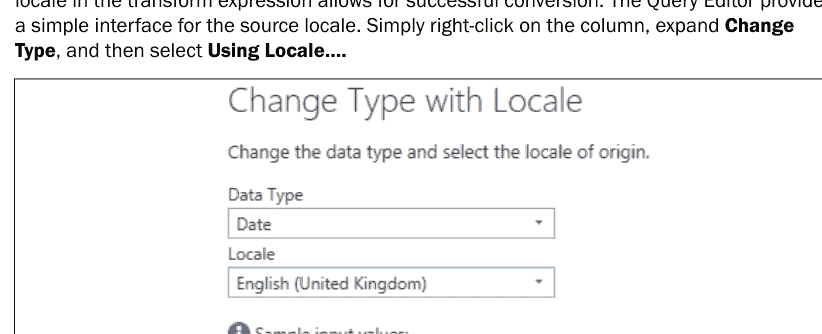

图 2.40：带区域设置的更改类型界面

或者，你也可以直接将区域设置添加到表达式本身：

```
DateLocale =
    Table.TransformColumnTypes(
        PreviousStep, {{ "Date", type date }}, "en-GB"
    )
```

## 另请参阅

- Table.AddColumn: http://bit.ly/3vGJZ6b
- Table.TransformColumnTypes: http://bit.ly/3s5AfjC
- Power Query 中的数据类型: http://bit.ly/392iWIP
- 语言 ID 和标记参考: http://bit.ly/3cXpPfw
- 你在 #PowerBI #PowerQuery 中常犯的 10 个错误 – 陷阱 #2: http://bit.ly/2otDbcU
- 在 DAX 中选择数值数据类型: http://bit.ly/2n0WYAm

## 可视化 M 库

要实现复杂且不常见的数据转换需求，通常需要浏览 M 库以查找特定函数或查看特定函数的参数。

这个简短的方法提供了一个预构建的 M 查询表达式，你可以使用它将 M 库检索到一个表中，以便在 Power BI Desktop 中进行分析。此外，还提供了一个示例，说明如何在 Power BI 报告画布上可视化和交叉筛选此函数表。

### 准备工作

要为此方法做好准备，请执行以下操作：

- 1. 打开 Power BI Desktop。
- 2. 单击“开始”选项卡功能区中的“转换数据”图标。
- 3. 创建一个新的“空白查询”，并将其命名为 MLibrary。

### 如何可视化 M 库

要实现此方法，请执行以下步骤：

- 1. 在高级编辑器中输入以下 M 代码：

```
let
    Source = Record.ToTable(#shared),
    Rename = Table.RenameColumns(Source, {{"Name", "Function"}}),
    Sort = Table.Sort(Rename, {{"Function", Order.Ascending}}),
    Dupe = Table.DuplicateColumn(Sort, "Function", "Function2"),
    Split =
```

```powerquery
Table.SplitColumn(
    Dupe, "Function2",
    Splitter.SplitTextByDelimiter(".", QuoteStyle.Csv),
    {"Group", "Detail"}
),
MLibraryTable =
    Table.TransformColumnTypes(
        Split, {{"Group", Text.Type}, {"Detail", Text.Type}}
    )
in
    MLibraryTable
```

- 2. 单击**确定**按钮关闭**高级编辑器**。预览区域现在应类似于*图 2.41* 中所示。

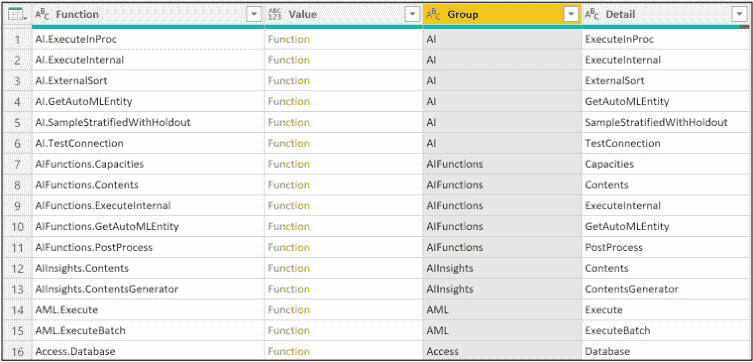

*图 2.41：查询编辑器中的库表函数视图*

- 3. 在查询编辑器中单击**关闭并应用**。
- 4. M 库中的 1,000 多行现在已加载到**数据**模式。
- 5. 创建一个使用“函数组”列进行筛选的可视化效果。

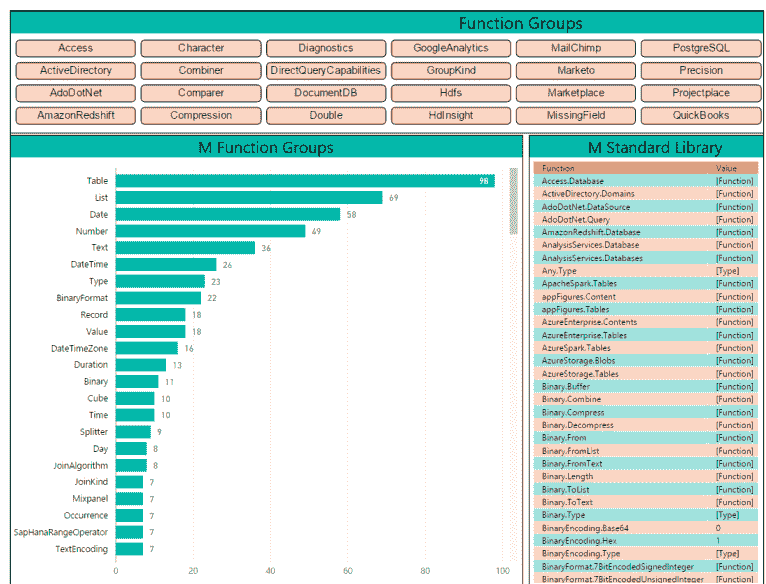

图 2.42：M 标准库的报告页

### 工作原理

该 M 表达式利用了 #shared 变量，该变量返回当前作用域中的名称和值的记录。该记录被转换为表值，然后根据句点分隔符拆分 Function 列（在库上下文中原本为 Name），以生成 Group 列。

### 更多内容...

通过输入不带任何参数的函数，可以查看每个函数的 M 库详细信息。

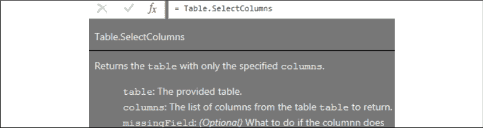

图 2.43：库函数详细信息

## 另请参阅

- Power Query 函数参考: `http://bit.ly/3bLKJ1M`

## 源数据分析

数据质量这一主题涉及数据集的整体实用性，以及轻松处理数据并将其用于特定目的（包括分析和报告）的能力。数据质量是数据治理的重要组成部分，可确保业务数据准确、完整、一致且有效。良好的数据质量是任何数据分析和报告工作的重要组成部分。糟糕的数据质量可能导致业务分析和决策出现错误——因此有“垃圾进，垃圾出”的说法。幸运的是，Power Query 编辑器提供了强大的数据剖析工具，可帮助你快速确定正在处理的数据的质量。此方法演示了如何解锁 Power Query 编辑器中用于分析列并了解所处理数据质量的功能强大的工具。

### 准备工作

要为此方法做好准备，请通过执行以下操作从 **AdventureWorksDW2019** 数据库导入 `FactCallCenter` 表：

- 1. 打开 Power BI Desktop，然后从**开始**选项卡的功能区中选择**转换数据**以打开 **Power Query 编辑器**。
- 2. 创建一个名为 AdWorksDW 的**导入**模式数据源查询。此查询应类似于以下内容：

```powerquery
let
    Source = Sql.Database("localhost\\MSSQLSERVERDEV", "AdventureWorksDW2019")
in
    Source
```

- 3. 将此查询隔离在名为**数据源**的查询组中。
- 4. 右键单击 AdworksDW 并选择**引用**，在数据预览区域中选择 **FactFinance** 表，然后将此查询重命名为 **FactFinance**。
- 5. 将 **FactFinance** 查询移动到**其他查询**组。

有关执行这些步骤的其他详细信息，请参阅本章中的*管理查询和数据源*方法。

### 如何分析源数据

要实现此方法，请执行以下步骤：

- 1. 选择 **FactFinance** 查询。
- 2. 在**视图**选项卡中，勾选功能区**数据预览**区域中的**列分析**复选框。
- 3. 选择一列以查看与*图 2.44* 中类似的列统计信息：

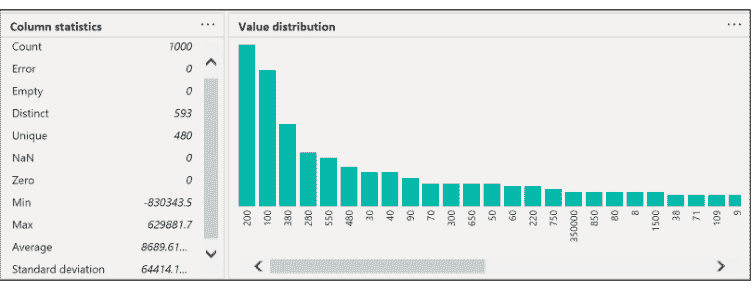

图 2.44：列分析信息

### 工作原理

默认情况下，M 查询引擎从指定的数据源提取前 1,000 行数据。这些数据用于数据预览区域。默认仅使用前 1,000 行数据，可通过单击右下角状态栏中的**基于前 1000 行的列分析**，然后选择**基于整个数据集的列分析**来更改。系统会收集数据源中每一列的统计信息。启用**列分析**功能后，选择某一列会使列统计信息和值分布显示在数据预览区域的下半部分，包括错误计数、不同值和唯一值的数量、最小值、最大值，以及取决于列数据类型的其他信息，如*图 2.44* 所示。

### 更多内容...

Power Query 编辑器中还有其他数据质量对话框。在**视图**选项卡中，勾选**列质量**和**列分布**旁边的复选框。列标题下方会出现小型可视化效果。将鼠标悬停在此区域上会弹出一个对话框，其中提供建议操作以及通过省略号菜单 (...) 执行的常见数据清理活动。

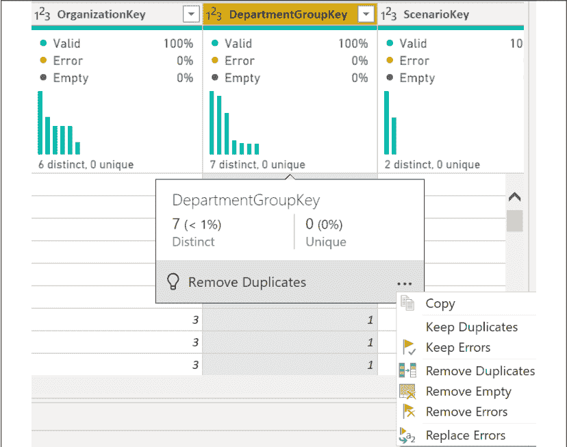

图 2.45：列质量和列分布可视化效果

## 另请参阅

- 使用数据剖析工具: http://bit.ly/3c465g


# 诊断查询

Power Query M 引擎是一个极其强大且快速的数据转换和数据准备引擎，用于一系列产品中，包括：

- Excel for Windows
- Excel for Mac
- Power BI
- Power Apps
- Power Automate
- Azure Data Factory
- SQL Server Integration Services
- SQL Server Analysis Services
- Dynamics 365 Customer Insights

虽然速度快且功能强大，但在某些情况下，你可能会发现某个查询的性能不如预期。在这些情况下，查询诊断可以帮助你精确定位有问题的表达式，并更好地了解 Power Query 的运行方式，以便识别查询优化的区域。本食谱演示了用户如何使用查询诊断来排查查询并识别如何优化查询以获得更好的性能。

## 准备工作

要准备工作，请通过执行以下操作从 AdventureWorksDW2019 数据库导入 FactCallCenter 表：

1. 打开 Power BI Desktop 并从“开始”选项卡的“功能区”中选择“转换数据”，以打开 Power Query 编辑器。
2. 创建一个名为 AdWorksDw 的导入模式数据源查询。此查询应类似于以下内容：
```
let
    Source = Sql.Database("localhost\MSSQLSERVERDEV", "AdventureWorksDW2019")
in
    Source
```
3. 将此查询隔离到名为“数据源”的查询组中。
4. 右键单击 AdworksDW 并选择 **Reference**；在数据预览区域中选择 **FactCurrencyRate** 表，并将 AdWorksDW 查询重命名为 **FactCurrencyRate**。
5. 将 **FactCurrencyRate** 查询移动到 **Other Queries** 组。
6. 在 **Power Query Editor** 中，选择 **Tools** 选项卡，然后选择 **Diagnostic Options**。
7. 确保选中 **Enable in Query Editor (does not require running as admin)** 的单选按钮，并勾选 **Diagnostics Level** 和 **Additional Diagnostics** 子标题下的所有复选框。

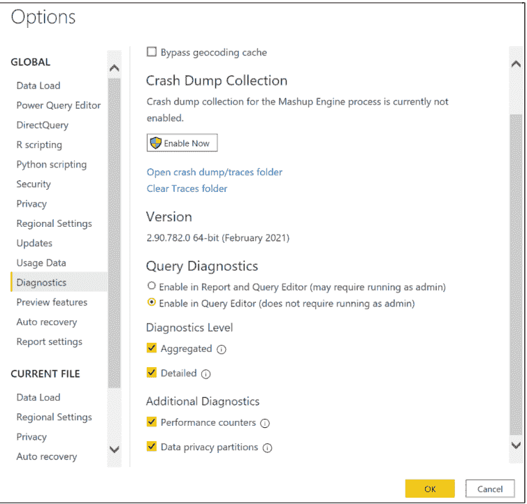

图 2.46：查询诊断选项

有关执行这些步骤的更多详细信息，请参阅本章中的 *Managing Queries and Data Sources* 食谱。

## 如何诊断查询

要实现本食谱，请执行以下步骤：

1. 选择 **FactCurrencyRate** 查询，打开 **Advanced Editor**，并修改查询以计算货币汇率的日变化。

```
let
    Source = AdWorksDW,
    dbo_FactCurrencyRate = Source{[Schema="dbo",Item="FactCurrencyRate"]}[Data],
    Sort =
        Table.Sort(
            dbo_FactCurrencyRate,
            {{"CurrencyKey", Order.Ascending}, {"DateKey", Order.Ascending}}
        ),
    Index =
        Table.TransformColumnTypes(
            Table.AddIndexColumn(Sort, "Row Index", 1, 1),
            {{ "Row Index", Int64.Type }}
        ),
    PrevIndex =
        Table.TransformColumnTypes(
            Table.AddIndexColumn(Index, "Prev Index", 0, 1),
            {{ "Prev Index", Int64.Type }}
        ),
    SelfJoin =
        Table.NestedJoin(
            PrevIndex, {"Prev Index"}, PrevIndex, {"Row Index"},
            "NewColumn", JoinKind.LeftOuter
        ),
    PrevColumns =
        Table.ExpandTableColumn(
            SelfJoin, "NewColumn",
            {"EndOfDayRate", "CurrencyKey"}, {"PrevRate", "PrevKey"}
        ),
    AddChange =
        Table.AddColumn(
            PrevColumns, "Daily Change", each
            if [CurrencyKey] = [PrevKey] then [EndOfDayRate] - [PrevRate]
```
```
```m
else null, type decimal
),
SelectColumns =
    Table.SelectColumns(
        AddChange,
        {"CurrencyKey", "EndOfDayRate", "Date", "Daily Change"}
    )
in
    SelectColumns
```
```

2. 你可能需要等待几分钟才能显示预览数据。要调查正在发生的情况，请单击 **Tools** 选项卡，然后单击 **Start Diagnostics**。
3. 单击返回 **Home** 选项卡并单击 **Refresh Preview**。
4. 等待预览数据刷新，然后单击返回 **Tools** 选项卡并单击 **Stop Diagnostics**。


图 2.47：诊断处理显示

5. 当 **Diagnostics** 处理完成时，你将有一个名为 **Diagnostics** 的新查询组，其中包含四个查询：**Diagnostics_Counters**、**Diagnostics_Detailed**、**Diagnostic_Aggregated** 和 **Diagnostic_Partitions**。每个查询都以运行诊断时的日期和时间戳为后缀，并且每个查询的加载均已禁用。


图 2.48：诊断查询

6. 单击 **Diagnostics_Aggregated** 查询。选择 **Step**、**Category**、**Start Time**、**End Time**、**Exclusive Duration (%)** 和 **Exclusive Duration** 列并删除其他列。
7. 按降序对 **Exclusive Duration** 列进行排序。

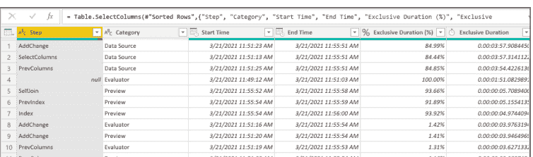

图 49：诊断结果

8. 查找 **Exclusive Duration** 列中的大幅跳跃；我们在第 3 行和第 4 行之间，以及第 4 行和第 5 行之间看到了两次这样的跳跃，其中第 3 行和第 4 行之间的跳跃更大。此外，请注意第 3 行的 **Exclusive Duration (%)** 值很高。
9. 查看第 3 行的 **Start Time** 和 **End Time** 列，注意到此操作花费了 4 分钟 26 秒完成。**Step** 列显示第 3 行的查询步骤是 **PrevColumns** 步骤。
10. 在确定了查询的 **PrevColumns** 步骤后，单击 **Diagnostics_Detailed** 查询并将 **Step** 列过滤为仅显示 **PrevColumns**。如果在过滤对话框中未出现 **PrevColumns** 值，请使用 **Load More** 链接或在 **Advanced Editor** 中编辑查询以手动添加 **Table.SelectRows** 表达式：Table.SelectRows(#"Changed Type", each [Step] = "PrevColumns")。
11. 按 **Exclusive Duration (%)** 列按 **Descending** 顺序对查询进行排序。
12. 注意顶部行的 **Operation** 列为 **DbDataReader**。

此时，应该很明显，此查询最好在源数据库系统中作为视图或存储过程完成。

## 其工作原理

**FactCurrencyRate** 查询将基表与其自身连接，以便比较数据的后续行。目标是比较一行与前一行中的值，以便计算货币汇率在天之间的变化值。这是通过使用 Table.Sort 函数按货币然后按日期对表进行排序来完成的。接下来，使用 Table.AddIndexColumn 函数两次，一次添加从 1 开始的索引列（**Row Index** 列），第二次添加从 0 开始的索引列（**Prev Index** 列）。然后，这两个索引列在 Table.NestedJoin 函数中用于将表与其自身连接。使用 Table.ExpandTableColumn 函数来公开前一行的 **CurrencyKey** 和 **EndOfDayRate** 列。此信息可用于使用 Table.AddColumns 函数创建 **Daily Change** 列，最后使用 Table.SelectColumns 函数仅选择必要的列。

当你启动查询诊断时，查询诊断信息将记录到存储在应用程序目录中的 JSON 和 CSV 文件中。这些文件可以通过查看聚合、详细和分区诊断查询的 **Source** 步骤以及 **Counters** 诊断查询的 **CsvFiles** 步骤来定位。对于 Power BI Desktop Store App，路径应类似于以下内容：

```
C:\Users\[user]\Microsoft\Power BI Desktop Store App\Traces\Diagnostics
```

这些文件记录了查询引擎在刷新预览数据等过程中执行的诊断信息。停止查询诊断将结束诊断数据的记录并为每个启用的查询诊断功能生成查询：**Aggregated, Detailed, Performance counters,** 和 **Data privacy partitions**。由于诊断日志记录在性能和系统资源方面成本高昂，因此建议仅在排查查询性能时使用查询诊断。此外，仅启用识别问题所需的最小诊断日志记录量——例如，通常仅从 **Aggregated** 诊断数据开始就足以识别有问题的步骤。

## 还有更多...

还有一个 **Diagnose Step** 功能可用于查询诊断。要了解如何使用 **Diagnose Step**，请按照以下步骤操作：

1. 从 Tools 选项卡的功能区中打开 **Diagnostic Options** 并取消选中 **Performance counters** 和 **Data privacy** 分区。
2. 在 **Query Settings** 窗格中，选择 **SelfJoin** 步骤。你现在可以右键单击 **SelfJoin** 步骤并选择 **Diagnose**，或在 **Tools** 选项卡的功能区中选择 **Diagnose Step**。
3. 完成后，将在 Diagnostics 查询组中添加两个额外的查询，**FactCurrencyRate_SelfJoin_Detailed** 和 **FactCurrencyRate_SelfJoin_Aggregated**，每个都以日期和时间戳为后缀。
4. 单击 **FactCurrencyRate_SelfJoin_Aggregated** 查询。
5. 添加一个 **Index** 列。
6. 按降序对 **Exclusive Duration** 列进行排序。
7. 在这里我们可以看到，最昂贵的操作发生在过程的早期，在 3,000 多行中的索引 15 处，似乎是使用以下数据源查询进行初始列选择：

```
select [_].[CurrencyKey],
    [_].[DateKey],
    [_].[AverageRate],
    [_].[EndOfDayRate],
    [_].[Date]
```


# 访问和检索数据

```sql
from [dbo].[FactCurrencyRate] as [_]
order by [_].[CurrencyKey],
         [_].[DateKey]
```

可以明显看出，诊断查询的单个步骤比分析整个查询更快，并且消耗的系统资源更少。因此，建议仅对整个查询运行 **Aggregated** 诊断以识别有问题的步骤，然后对这些步骤单独运行 **Detailed** 诊断。如果查看 **FactCurrencyRate_SelfJoin_Detailed**，最昂贵的操作在第 **60** 行，是 **DbDataReader** 操作。标识的 SQL 语句实际上在第 **59** 行，操作为 **Execute Query**。因此，我们可以得出结论，执行的最昂贵操作并非在执行查询，而是在读取查询生成的数据。

## 另请参阅

- 在 Power BI 中记录查询诊断： http://bit.ly/2ND2yqF
- 查询诊断： http://bit.ly/31Fz8ET
- 读取查询诊断： http://bit.ly/3s8IFXA

## 结论

在本章中，我们深入探讨了 Power BI Desktop 的获取数据体验，并逐步介绍了建立和管理数据源连接和查询的过程。能够摄取和访问数据对于每个 BI 项目都至关重要。在 Power BI 中，这种数据摄取和访问由功能强大的函数式语言和查询引擎 M 驱动。Power Query M 语言为数据检索、清理和转换提供了稳健、可扩展且灵活的引擎。

# 3
