# 构建 Power BI 数据模型

> “数据模型是为 Power BI 提供动力和支持的东西。”
> - Kasper de Jonge，微软高级项目经理

在 Power BI Desktop 中开发的数据模型位于 Power BI 项目的核心。这些数据模型支持数据探索并驱动报告和仪表板中可视化的分析查询。设计良好的数据模型利用第 2 章《访问和检索数据》中描述的数据连接和转换功能，为不同的业务流程和实体提供集成视图。此外，数据模型包含预定义的计算、层次结构和分组，以及元数据，从而大大增强数据集的分析能力和易用性。访问和检索数据与数据模型中可用的额外增强功能相结合，为 Power BI 的 BI 和分析能力奠定了基础。

在本章中，我们将探讨设计和开发稳健数据模型的主要流程。维度建模中的常见挑战被映射到 Power BI Desktop 中的相应功能和方法，包括多粒度关系和多对多关系。还提供了如何嵌入业务逻辑和定义、使用 DAX 语言开发分析计算以及配置元数据设置以提高模型价值和可持续性的示例。

在本章中，我们将介绍以下配方：

- 设计数据模型
- 实现数据模型
- 创建关系
- 配置模型元数据
- 隐藏列和表
- 使用 DAX 丰富模型
- 支持虚拟表关系
- 创建层次结构和组
- 设计列级安全性
- 利用聚合表

## 技术要求

要完成本章中的配方，需要以下内容：

- Power BI Desktop
- Tabular Editor
- 安装了 AdventureWorksDW2019 数据库的 SQL Server。该数据库及其安装说明可在以下位置获得： http://bit.ly/20Vqfg7
- 代码示例和其他材料可从以下 GitHub 仓库下载： https://github.com/PacktPublishing/Microsoft-Power-BI-Cookbook-Second-Edition

## 设计数据模型

Power BI Desktop 适用于快速、敏捷的开发，即使在数据源不完美且对业务需求和用例的理解不完整的情况下，也能快速获得重要的数据洞察。然而，仓促设计阶段会削弱解决方案的可持续性，因为在不修改模型结构或使用复杂的变通方法的情况下无法满足未来的需求。在设计阶段进行平衡，在分析基本决策（例如 DirectQuery 与内存中）时，同时使用有限的原型模型生成可视化和业务反馈，可以解决短期和长期需求。

本配方描述了设计数据模型的过程，并确定了在设计过程中需要考虑的一些主要问题和因素。

### 准备工作

Power BI 报告功能令人印象深刻的视觉和分析示例通常会导致利益相关者低估数据集成和数据建模相关的努力和复杂性。

重要的是要遏制任何不切实际的期望并确认可行性。Power BI 并非适用于所有任务，因此以有条不紊的设计方法来处理任务非常重要。需要确定当前状态下的主要痛点和任何未解答的业务问题。将此输入与可行性和复杂性评估（例如数据质量和分析需求）进行对比，并以现实和可持续的交付成果为目标。良好的设计流程正是如此。

维度建模最佳实践和星型模式设计直接适用于 Power BI 数据模型。可以与主题专家和主要利益相关者安排简短的协作建模会议。在模型设计到位后，可以在开发之前就模型的数据模式（导入或 DirectQuery）做出明智的决定。四步维度设计流程如下：

1. **选择业务流程：** 要包含的流程数量和性质取决于源的规模和项目的范围。业务流程可能包括规划、销售、时间报告、总账等。

2. **声明粒度：** 对于每个要建模的业务流程（或事实），定义每一行的含义。这些应该是清晰简洁的业务定义，每个事实表只能包含一种粒度。考虑 Power BI Desktop 的可扩展性限制，并在细节和历史之间取得平衡，例如选择更大的历史但更少的粒度。示例包括：
   - 每笔销售订单行
   - 每笔总账账户余额每月

在第一个示例中，粒度为销售订单行，而非也许采购订单头；在第二个示例中，粒度为财政月，而非每天或财政季度。

不同的业务流程，例如规划和销售，永远不应集成到同一个表中。同样，单个事实表不应包含不同的流程，例如发货和收货。事实表可以与公共维度相关，但通常不应在数据模型中相互关联（例如，**PO Header** 和 **Line level**）。

3. **识别维度：** 维度应与给定粒度下的业务流程或事件具有自然关系。将维度与组织中现有的任何维度和层次结构进行比较（例如，**Store**）。如果存在，则确定是否存在冲突，或是否需要额外的列。要意识到大型高基数维度（如客户表超过两百万行）带来的查询性能影响。可能需要在模型中或使用此关系创建的度量和查询中优化此关系。有关更多详细信息，请参阅 *第 11 章，增强和优化现有 Power BI 解决方案*。

2. **创建实现总线矩阵：** 模型设计过程的成果应包括更详细的实现总线矩阵。对事实表的粒度、主要度量的定义以及所有维度的清晰度和批准，可以在进入开发阶段时提供信心。

| 业务流程 | 行粒度 | 度量 | 日期 | 客户 | 产品 | 促销 | 经销商 | 销售区域 | 员工 | 账户 | 组织 | 部门 |
|---|---|---|---|---|---|---|---|---|---|---|---|---|
| 互联网销售 | 销售订单行（SKU） | 互联网销售额和单位，客户和产品数量 | ✓ | ✓ | ✓ | ✓ |  | ✓ |  |  |  |  |
|  |  | 毛销售额和净销售额，折扣， |  |  |  |  |  |  |  |  |  |  |
| 经销商销售 | 销售订单行（SKU） | 利润金额和 % | ✓ |  | ✓ |  | ✓ | ✓ | ✓ |  |  |  |
| 总账 | GL 账户实体 | 账户余额金额 | ✓ |  |  |  |  |  |  | ✓ | ✓ | ✓ |

图 3.2：实现总线矩阵：互联网销售、经销商销售和总账

Power BI 查询（M）和分析逻辑（DAX）不应被视为数据质量、主数据管理和数据仓库问题的长期替代方案。如果必须继续前进，请记录所产生的“技术债务”，并考虑长期解决方案，例如 **Master Data Services (MDS)**。

3. **选择数据集存储模式——导入、DirectQuery 或复合：** 在模型的逻辑设计到位后，最重要的设计问题之一是是否以 DirectQuery 模式还是默认的导入内存模式实现此模型。

默认的导入模式针对查询性能进行了高度优化，并支持使用 DAX 函数进行额外的建模和开发灵活性。通过压缩、列式存储、并行查询计划和其他技术，导入模式模型能够支持大量数据（例如 5000 万行），并在复杂的分析表达式下仍能良好运行。可以访问和集成多个数据源到单个数据模型中，并且所有 DAX 函数都支持度量、列和角色安全性。导入模式的主要缺点是数据集大小限制（Pro 为 1 GB，Premium 为 10 GB），并且数据刷新必须按计划进行（Pro 每天 8 次，Premium 每天 48 次）。Power BI 服务中计划刷新的一种替代方案是使用 REST API 触发已发布数据集的数据刷新。例如，可以将对 Power BI REST API 的 HTTP 请求调用以刷新数据集添加到夜间更新或 ETL 流程脚本的末尾，以便已发布的 Power BI 内容与源系统保持一致。

DirectQuery 模式模型为用户提供相同的语义层界面，并包含驱动模型行为的相同元数据，如导入模式模型一样。然而，DirectQuery 模型的性能取决于源系统以及数据如何呈现给模型。通过消除导入或刷新过程，DirectQuery 提供了一种在数据发生变化时将报告和仪表板公开给源数据的方法。


这还避免了导入模式模型的文件大小限制。然而，使用 DirectQuery 时需要注意几个限制和约束：

- DirectQuery 模型只能使用单个受支持数据源中的单一数据源。
- 当广泛部署时，可能会产生大量网络流量，从而影响性能，因为 Power BI 可视化将需要查询源系统，且可能通过本地数据网关进行。
- 某些 DAX 函数不能用于计算列或角色安全性。此外，一些常见的 DAX 函数也未针对 DirectQuery 性能进行优化。
- 许多 M 查询转换函数不能与 DirectQuery 一起使用。
- 支持 MDX 客户端应用程序（如 Excel），但公开的元数据较少（例如层次结构）。

鉴于这些限制以及 Power BI 中“思维速度”式用户体验的重要性，DirectQuery 通常应仅用于集中且规模较小的项目，在这些项目中，源数据更新的可见性至关重要。如果有受支持的 DirectQuery 系统（例如 Teradata 或 Oracle），则应测试核心度量和查询的性能。此外，请确认源数据库中的引用完整性，并在 DirectQuery 模式模型中使用**假设引用完整性**关系设置。这将针对源数据库生成更高效的内连接 SQL 查询。

复合模型允许混合使用 DirectQuery 和导入数据源，甚至可以混合多个 DirectQuery 数据源。虽然更为复杂，但只要配置正确，复合模型可以将从 DirectQuery 源检索近实时数据的能力与导入模型的高查询性能结合起来。使用复合模型时，可以在模型中指定每个表的存储模式。最好将维度类型的表指定为**导入**或**双**存储模式，将事实类型的表指定为**DirectQuery**模式。

例如，考虑本方案中的一个模型，它包含事实表：Reseller Sales（经销商销售）、Internet Sales（网络销售）和 General Ledger（总账），以及 Product（产品）和 Sales Territory（销售区域）等维度。将维度表设置为双模式，将 Internet Sales 事实表设置为 DirectQuery 模式，就可以从内存（导入）模型中快速高效地检索维度表以在切片器中呈现，同时 Internet Sales 表可以结合相关维度表使用 DirectQuery 模式，通过一个高效的原生 SQL 查询实现实时销售报告。

## 工作原理

Power BI 可以由企业 BI 专业人员从数据检索到可视化再到内容分发进行完整的交付和管理。

一些 BI 和分析组织还采用混合方式，由不同团队开发和拥有 Power BI 的不同组件，例如 BI/IT 团队提供优化的数据源、配套的 ETL 流程以及分析数据模型（包括其度量定义、关系和数据刷新流程）。

然后，业务团队可以利用这些资产来开发 Power BI 报表和仪表板，并且可选地开发 Excel 报表。

由于 Power BI 项目可能有千差万别且经常重叠的需求（例如安全性、数据刷新和可伸缩性），因此采用一个流程来分配适当的资源并规划长期部署非常重要，例如将重要的、相对成熟的 Power BI 数据集迁移到 **Analysis Services** 表格模型。

Power BI 数据集和 **SSAS** 共享相同的数据库引擎和体系结构。这两个工具都支持导入和 DirectQuery 数据模型，以及 DAX 和 MDX 客户端应用程序，例如 Power BI (DAX) 和 Excel (MDX)。DAX 查询引擎由一个公式引擎和一个存储引擎组成，分别服务于导入和 DirectQuery 模式。公式引擎生成查询计划，向存储引擎请求数据，并针对这些数据执行存储引擎不支持的任何剩余复杂逻辑。

在 DirectQuery 模型中，源数据库就是存储引擎——它接收来自公式引擎的 SQL 查询并将结果返回给公式引擎。对于内存（导入）模型，已导入并压缩的列式内存缓存就是存储引擎。更多详细信息，请参阅*第11章：增强和优化现有 Power BI 解决方案*。

## 更多内容...

一些主题和具体问题非常常见，因此可以创建标准的“项目输入”表单或文档来支持设计和规划会议。这些主题和问题包括：

- **数据源**：给定系统是否包含所需的所有数据？还需要或当前使用哪些其他数据源？
- **安全性**：数据模型是否包含 PCI 或敏感数据？是否需要保护某些数据不被特定用户访问？
- **版本控制**：是否已存在具有相同度量的报表或模型？
- **复杂性**：源数据可以直接使用，还是需要转换？
- **分析**：是否需要任何自定义或高级分析（例如异常度量、统计分析）？
- **数据刷新**：是否需要实时访问？如果不需要，数据需要多久刷新一次？

## 构建 Power BI 数据模型

```
select [ProductKey] as [ProductKey],
       [ProductSubcategoryKey] as [ProductSubcategoryKey2],
       [EnglishProductName] as [EnglishProductName],
       [Color] as [Color],
       [ListPrice] as [ListPrice],
       [Weight] as [Weight],
       [DaysToManufacture] as [DaysToManufacture],
       [EnglishDescription] as [EnglishDescription]
from [dbo].[DimProduct] as [$Table]
) as [$Outer]
left outer join [dbo].[DimProductSubcategory] as [$Inner] on
([$Outer].[ProductSubcategoryKey2] = [$Inner].[ProductSubcategoryKey])
) as [$Outer]
left outer join [dbo].[DimProductCategory] as [$Inner] on
[$Outer].[ProductCategoryKey] = [$Inner].[ProductCategoryKey]
```

如果要支持 DirectQuery 模型，定义 SQL 视图尤其重要。对于 DirectQuery 模型视图，请评估查询计划的效率以及各视图之间的引用完整性，以支持内连接 DirectQuery 查询。

- 2. 打开 Power BI Desktop。
- 3. 创建一个名为 AdWorksDW 的导入模式数据源查询。该查询应类似于以下内容：

    ```
    let
        Source = Sql.Database("localhost\\MSSQLSERVERDEV", "AdventureWorksDW2019")
    in
        Source
    ```

- 4. 将此查询隔离到名为**数据源**的查询组中，并禁用加载。
- 5. 这两种操作都可以通过在**查询**窗格中右键单击查询来完成。
- 6. 右键单击 AdWorksDW，然后选择**引用**。
- 7. 为每个访问*步骤 1*中定义的 SQL 视图的维度和事实表构建一个 M 查询。在此示例中，AdWorksDW 查询包含数据源信息，并访问 **vCH3R2_Products** 视图：

    ```
    let
        Source = AdWorksDW,
        Data = Source{[Schema="dbo",Item="vCH3R2_Products"]}[Data]
    in
        Data
    ```

- 8. 复制此查询，并将 Item 参数替换为每个剩余事实表和维度表的源视图。
- 9. 将事实查询分隔到**事实**查询组中。
- 10. 将维度查询分隔到**维度**查询组中。

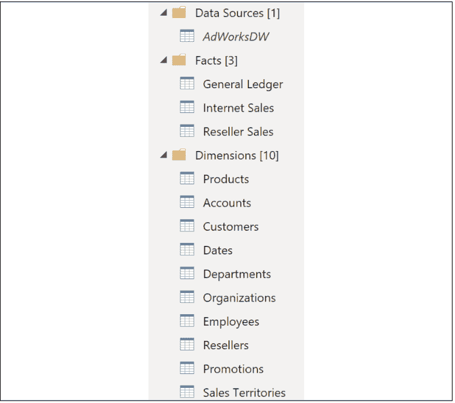

图 3.3：Power Query 编辑器中的维度、事实和数据源查询

- 11. 确认列数据类型与设计一致（例如，使用定点小数以避免舍入问题）。
- 12. 关闭 Power Query 编辑器，并通过选择**开始**选项卡功能区中的**关闭并应用**将表加载到 Power BI 模型中。

### 如何实现数据模型

要实现本方案，请使用以下步骤：

- 1. 在 Power BI Desktop 中，从**报表**视图的**建模**选项卡或**数据**视图的**表工具**选项卡中选择**管理关系**，然后单击**新建**按钮。


## 构建 Power BI 数据模型

2. 从每个事实表到其对应的维度表创建多对一、单向关系。双向关系应仅在明确指导和评估后实施。日期表的关联应使用日期数据类型列。

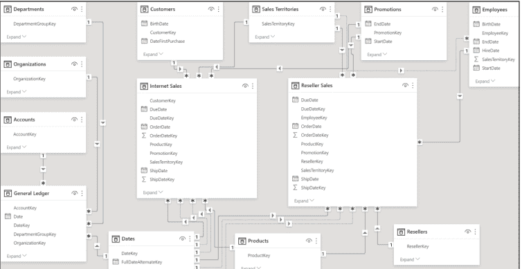

图 3.4：多事实数据模型的“关系”视图

3. 编写规划阶段确定的每个事实表的核心度量并验证其准确性。如果核心度量需要复杂的 DAX 表达式，则应审查其来源和检索方式。为每个度量提供直观的名称和标准格式（例如，两位小数、千位分隔符）。

4. 在常用的维度表中添加多级层次结构，如产品和日期。层次结构本质上只是列的分组，可让报表作者更轻松地在不同详细级别之间导航或下钻。

5. 设置列的默认汇总和排序，例如按月份编号对月份名称进行排序。

6. 为地址或邮政编码等列分配数据类别以支持地理可视化。

7. 隐藏事实表中的列，使其仅显示度量组。

8. 验证和用户测试应在实施后进行。

9. 可以通过动态管理视图（DMVs）开发模型文档，为用户提供定义和关系。有关此模式的详细示例，请参阅第 10 章《管理与监控 Power BI》中的“导入和可视化动态管理视图（DMV）数据”配方。

### 工作原理

本配方中的步骤与模型开发的逻辑流程一致，可以在团队之间或由单个 Power BI 开发人员分阶段离散实施。鉴于模型各组件的不同交付时间，推进更成熟或更简单的组件是有利的，以便业务团队在增强功能和其他组件部署时参与并提供反馈。

本章中的以下配方包含了所有主要元数据设置的详细信息：

- 配置模型元数据
- 隐藏列和表
- 创建层次结构和组

所有这些设置都会影响数据模型的可用性和功能，不应被忽视。

### 还有更多...

如果模型的源视图与其他应用程序共享并且可能更改或包含模型不需要的列，则可以使用 `Table.SelectColumns()` M 函数：

```
let
    Source = AdWorksDW,
    InternetSales = Source{[Schema="dbo",Item="vInternetSales"]}[Data],
    SalesColumns =
        Table.SelectColumns(
            InternetSales,{"ProductKey","OrderDateKey"},MissingField.UseNull
        )
in
    SalesColumns
```

每个模型表中所需的列都明确选择，并且 `MissingField.UseNull` 参数允许在指定列缺失时查询仍能成功刷新——例如当列名已更改时。

### 另请参阅

- Create SQL Views: https://bit.ly/2T3FzHF
- Create and manage relationships in Power BI: http://bit.ly/3tLwcJM
- Model view in Power BI: http://bit.ly/3vUXwag
- Model data in Power BI: http://bit.ly/3f8p7yT
- Design a data model in Power BI: http://bit.ly/3d28LVW

```
let
    Source = AdWorksDW,
    Navigation = Source{[Schema="dbo",Item="DimProduct"]}[Data],
    Subcategory =
        Table.ExpandRecordColumn(
            Navigation, "DimProductSubcategory",
            {"EnglishProductSubcategoryName", "DimProductCategory"},
            {"Product Subcategory", "DimProductCategory"}
        ),
    Category =
        Table.ExpandRecordColumn(
            Subcategory, "DimProductCategory",
            {"EnglishProductCategoryName"}, {"Product Category"}
        )
in
    Category
```

8. 右键单击查询窗格中的查询，将事实查询 **Internet Sales** 分到 **Facts** 查询组，选择“移动到组”然后选择“新建组”

9. 将维度查询 **Customers**、**Dates** 和 **Products** 分到 **Dimensions** 查询组。

10. 在 **Other Queries** 组中创建一个名为 **Calculations** 的 **空白查询**。

11. 在 **Home** 选项卡的 ribbon 中选择 **关闭并应用** 以将表加载到数据模型。

## 如何创建关系

要实施本配方，请使用以下步骤：

1. 在 **Products** 表与 **Internet Sales** 表之间创建关系。这可以在 **Model** 视图中通过将 **Products** 表中的 **ProductKey** 列拖放到 **Internet Sales** 表中的 **ProductKey** 列来完成。或者，在 **Report** 视图中选择 **Modeling** 选项卡的 ribbon 中的 **管理关系**，或在 **Data** 视图中从 **Table tools** 选项卡的 ribbon 中选择。该关系应在 **Products** 表为 **一** 方、**Internet Sales** 表为 **多** 方之间建立一对多关系。**交叉筛选方向** 应设置为 **单向**。

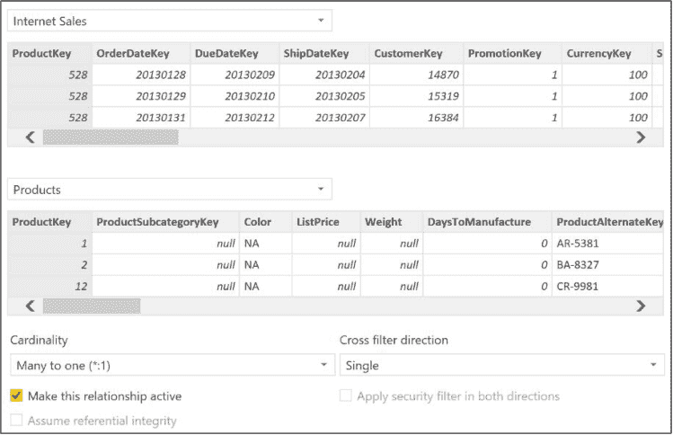

2. 在其他维度表与 **Internet Sales** 表之间创建其他关系，直到 **管理关系** 对话框中勾选的关系与 *图 3.6* 中显示的相同。

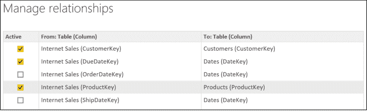

3. 数据集的 **Model** 视图现在应如 *图 3.7* 所示呈现：

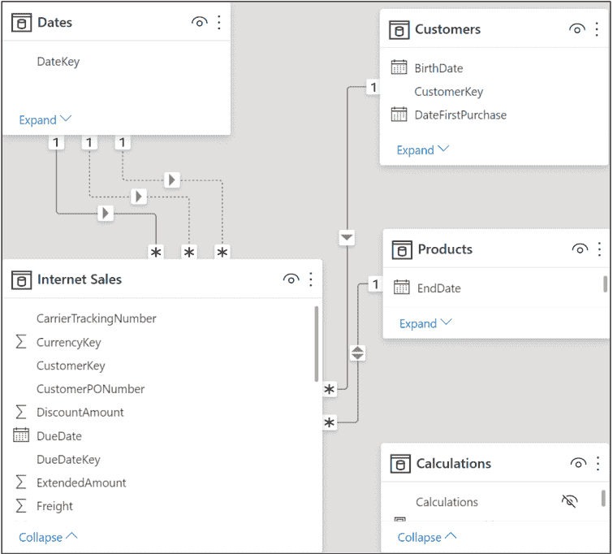

图 3.7：关系的模型视图

4. 右键单击 **Dates** 表并选择 **标记为日期表**，使用 **FullDateAlternateKey** 作为 **日期** 列。

5. 通过右键单击 **Data** 视图中的 **Calculations** 表并选择 **新建度量**，创建以下四个 DAX 度量：

```
Sales Table Rows = COUNTROWS('Internet Sales')
```

```
Customers Table Rows = COUNTROWS('Customers')
```

```
Dates Table Rows = COUNTROWS('Dates')
```

```
Products Table Rows = COUNTROWS('Products')
```

6. 右键单击 **Calculations** 表中的 **Calculations** 列并选择 **隐藏在报表视图中。**

7. 使用 **多行卡片** 可视化对象显示这四个度量。

8. 为 **Dates** 表中的 **CalendarYear**、**Products** 表中的 **Product Category** 和 **Customers** 表中的 **Gender** 添加 **切片器** 可视化对象。

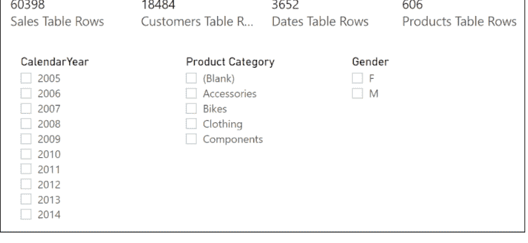

图 3.8：关系和交叉筛选测试可视化对象

9. 在 **切片器** 可视化对象中选择切片器值，注意在单向关系下，对任何切片器的选择仅会影响切片器中使用的表和 **Internet Sales** 表中的行计数。

10. 打开 **管理关系** 对话框并编辑 **Internet Sales** 与 **Products** 表之间关系的 **交叉筛选方向**。

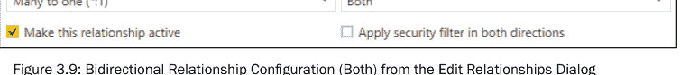

图 3.9：来自“编辑关系”对话框的双向关系配置（两者）

11. **CalendarYear** 和 **Gender** 的切片器选择现在也会筛选 Products 表。

12. 创建一个 DAX 度量，对模型中的关系应用替代交叉筛选行为：

```
Products Table Rows (CF) =
    CALCULATE([Products Table Rows],
        CROSSFILTER('Internet Sales'[ProductKey],'Products'[ProductKey], OneWay) )
```

13. 将此度量添加到多行卡片可视化对象中，并观察此度量不受 Gender 和 CalendarYear 切片器的影响。

14. 编写一个 DAX 度量以传播筛选上下文。以下度量会尊重应用于 Internet Sales 表的筛选器，例如 Customer Gender = "M"：

```
Products Rows (Sales) = CALCULATE(COUNTROWS('Products'),'Internet Sales')
```

15. 将此度量添加到多行卡片可视化对象中，并观察此度量在选择 Gender 和 CalendarYear 切片器值时返回的结果与双向关系相同，除了完全没有切片器选择时——此时度量返回 158。

16. 编写一个 DAX 度量以使用 Dates 与 Internet Sales 表之间的非活动关系：

```
Sales Table (Orders) =
    CALCULATE([Sales Table Rows],
        USERELATIONSHIP('Dates'[DateKey],'Internet Sales'[OrderDateKey])
    )
```

17. 将此度量添加到多行卡片可视化对象中，注意当选择 CalendarYear 2010 或更高时，与 Sales Table Rows 度量返回的数字不同。

### 工作原理

单向交叉筛选关系仅在关系的方向上传播筛选器。因此，当 Products 设置为单向筛选 Internet Sales 时，影响 Internet Sales 的其他筛选器不会传播到 Products 表。使用双向交叉筛选关系时，影响关系一侧的筛选器始终会传播到关系的另一侧，除非 DAX 度量使用 `CROSSFILTER()` 等函数覆盖模型关系定义的默认行为。

当给定维度表也与其他事实表相关时，事实表与维度表之间的双向关系通常应避免。这可能导致过度筛选或意外的筛选上下文。然而，双向关系是解决常见（且否则复杂）建模场景的高效解决方案的组成部分，例如实际值与预算以及经典的多对多场景。

关于日期表关系，DAX 时间智能函数，如 `DATESYTD`、`DATEADD` 和 `SAMEPERIODLASTYEAR`，都要求基于日期数据类型的关系或标记为日期表的设置。由于日期表的关联是基于代理键（20150101）形成的，因此需要将日期表标记为日期表，以便 DAX 时间智能函数正常运行。


度量值 **Product Table Rows (CF)** 覆盖双向关系，以使用 DAX 函数 CROSSFILTER 应用单向交叉筛选。尽管仅限于特定度量值，CROSSFILTER 函数可以为模型中定义的关系交叉筛选提供简单而强大的补充。CROSSFILTER 函数需要一个已存在的关系（活动或非活动），并且始终覆盖模型的关系设置。第三个参数接受以下值：

- Oneway
- Both
- None

双向关系和 CROSSFILTER 函数都可与 DirectQuery 模型一起使用。**Global DirectQuery** 设置 **Allow unrestricted measures** 需要启用才能使用 CROSSFILTER。

**Products Rows (Sales)** 度量值通过使用 CALCULATE 函数在 **Internet Sales** 表的上下文中计算 **Products** 表，从而在 **Products** 和 **Internet Sales** 表之间实现双向交叉筛选。因此，影响 **Internet Sales** 表的筛选器也会影响对 **Products** 表的 COUNTROWS 函数的结果。即使没有任何切片器的选择也是如此，这就是为什么 **Product Rows (Sales)** 度量值返回 **158**，因为仅有 **158** 种产品通过互联网销售。请记住，关系本身仅在表上传播活动筛选器。这就是为什么在没有切片器选择时，**Products Table Rows** 度量值会返回全部 **606** 种产品。

**Sales Table (Orders)** 度量值使用 USERELATIONSHIP 函数来利用模型中的非活动关系。Power BI 数据模型会拒绝模棱两可的关系，即在两个表之间存在多个可能的交叉筛选路径。这些重复关系被设置为非活动状态，但在 DAX 中仍可使用。与 CROSSFILTER 函数一样，USERELATIONSHIP 函数需要一个已存在的关系（活动或非活动），并且始终覆盖模型的关系设置。

## There's more...

在 *Figure 3.10* 所示的多对多模型中，多个客户与给定的账户相关联，并且某些客户拥有多个账户。

## Configuring Model Metadata

元数据是关于信息的信息。Power BI 数据模型中有许多元数据设置，例如列名、数据类型、对象描述等。对于在 Power BI 报表画布上可见的任何列，四个重要的元数据属性需要配置的是格式、数据类别、默认汇总以及按列排序的选项。数据格式应在数据类型之间保持一致，并有效地传达适当的详细程度。数据类别通过为 Power BI 提供指导其可视化的信息来增强数据探索体验。默认汇总决定了将列添加到报表画布时应应用的聚合（如果有）。**Sort by Column** 功能可使列中的值根据另一列的顺序显示。尽管所有这些设置都相对简单易于配置，但仔细关注这些属性有助于提供更高质量的 Power BI 可视化以及更用户友好的自助服务平台。

在本配方中，我们演示如何为数据模型中的列和度量值配置格式、数据类别、默认汇总和 **Sort by Column** 选项——并展示这些设置对可视化的影响。

## Getting ready

为准备本配方，请执行以下步骤：

- 1. 打开 Power BI Desktop。
- 2. 创建一个名为 AdWorksDW 的导入模式数据源查询。此查询应类似于以下内容：
```
let
    Source = Sql.Database("localhost\MSSQLSERVERDEV", "AdventureWorksDW2019")
in
    Source
```
- 3. 将此查询隔离到名为 **Data Sources** 的查询组中并禁用加载。
- 4. 右键单击 AdWorksDW 并选择 **Reference**。
- 5. 选择 **FactFinance** 表并将此查询命名为 **General Ledger**。
- 6. 重复步骤 4 和 5 以创建导入 **DimDate** 的 **Dates** 查询和导入 **DimDepartmentGroup** 的 **Departments** 查询。

```
let
    Source = Sql.Database("localhost\MSSQLSERVERDEV", "AdventureWorksDW2019")
in
    Source
```

- 7. 重复步骤 4 和 5 以创建导入 **DimCustomer** 的 **Customers** 查询。

```m
let
    Source = AdWorksDW,
    Data = Source{[Schema="dbo",Item="DimCustomer"]}[Data],
    #"Expanded DimGeography" =
        Table.ExpandRecordColumn(
            Data, "DimGeography",
            {"City", "StateProvinceName",
             "EnglishCountryRegionName", "PostalCode"},
            {"City", "StateProvinceName",
             "CountryRegionName", "PostalCode"}
        )
in
    #"Expanded DimGeography"
```

- 8. 将维度查询 **Customers** 和 **Dates** 分离到 **Dimensions** 查询组中，并将 **General Ledger** 查询放入名为 **Facts** 的查询组中。
- 9. 在 **Other Queries** 组中创建一个名为 **Calculations** 的 **Blank Query**。
- 10. 在 **Home** 选项卡的 ribbon 上选择 **Close & Apply** 以将表加载到数据模型中。
- 11. 使用 **Manage relationships** 对话框创建 *Figure 3.11* 中所示的关系。

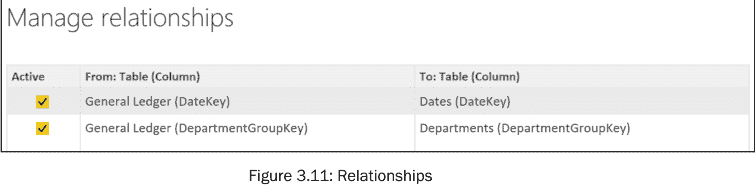

## How to Configure Model Metadata

要实现本配方，请使用以下步骤：

- 1. 选择 **Data** 视图。
- 2. 使用右侧的 **Fields** 列表导航到 **Dates** 表并选择 **FullDateAlternateKey** 列。

## Building a Power BI Data Model

- 3. 使用 **Column tools** 选项卡 ribbon 上的 **Format** 下拉菜单将格式更改为 **3/14/2001 (m/d/yyyy)** 或其他格式。

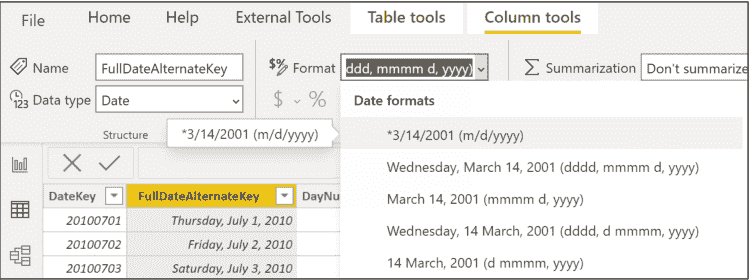

Figure 3.12: Column Formatting

- 4. 右键单击 **Calculations** 表并单击 **New measure** 以创建具有以下代码的度量值：

```DAX
Finance = SUM('General Ledger'[Amount])
```

- 5. 选择 **Finance** 度量值并使用 **Measure tools** 选项卡中的 **Format** 选项将其格式更改为 **Currency**。

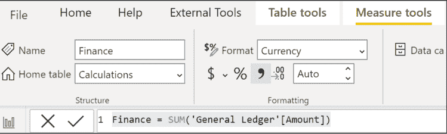

Figure 3.13: Measure Formatting

- 6. 右键单击 **Calculations** 表中的 **Calculations** 列并选择 **Hide in report view**。
- 7. 在仍处于 **Data** 视图时，选择 **Customers** 表中的 **StateProvinceName** 列，并从 **Column tools** 选项卡将 **Data category** 更改为 **State or Province**。

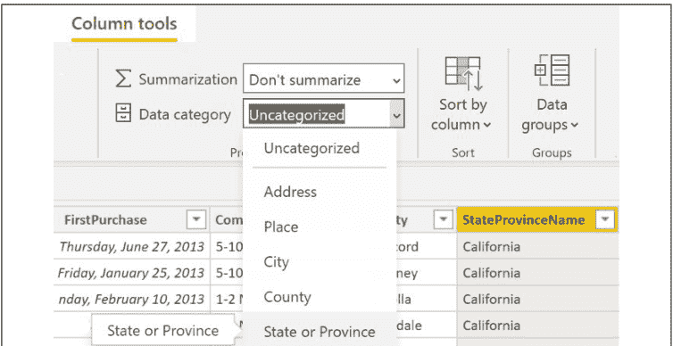

Figure 3.14: Data Category Selection

- 8. 重复此过程，将 City 列设置为 City，将 CountryRegionName 列设置为 Country，并将 PostalCode 列设置为 Postal code。请注意，字段列表中所有这些列旁边都会出现一个地球图标。
- 9. 切换到 Report 视图并创建地图可视化，将 CountryRegionName 和 PostalCode 放在 Location 区域，将 CustomerKey 放在 Size 区域。你可以向下钻取到邮政编码级别并放大以调查特定区域有多少客户。

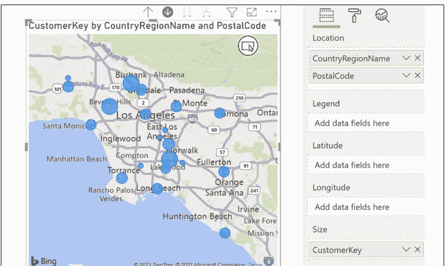

Figure 3.15: Default Visual of the Geographical Data Category

## Building a Power BI Data Model

- 10. 在仍处于 **Report** 视图时，创建仅包含 **EnglishMonthName** 列的 **Table** 可视化。请注意，月份名称在表中按字母顺序出现。
- 11. 在 **Fields** 列表中选择 **EnglishMonthName** 列，并从 **Column tools** 选项卡将 **Sort by column** 更改为 **MonthNumberOfYear** 列。执行此操作后，月份名称将按正确的日历顺序排序。

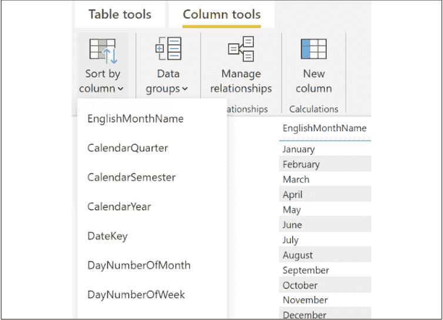

Figure 16: Sort by column

- 12. 切回 **Data** 视图并从 **General Ledger** 表中选择 **AccountKey** 列。
- 13. 在 **Column tools** 选项卡上，将默认 **Summarization** 从 **Count** 更改为 **Don't summarize**。

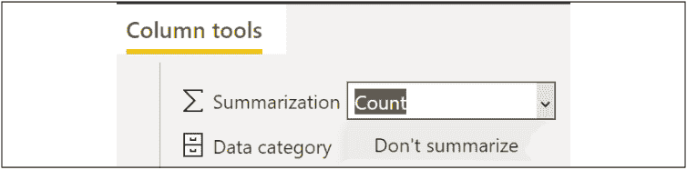

Figure 3.17: Default Summarization for Columns


默认情况下，**整数**、**小数**和**固定小数位数**的默认汇总方式均为**求和**。对于应用了默认汇总方式的数字列，在报表可视化中使用时，字段列表会应用一个求和符号，并根据默认汇总设置聚合该列的值。无论配置了何种默认汇总方式（例如，**平均值**和**计数**），都会显示相同的符号。

简单的 DAX 度量值可以提供所有**默认汇总**选项（**求和、最小值、最大值、平均值、计数**和**非重复计数**）。此外，命名度量值（如 **Count of Products**）有助于消除关于默认汇总图标的混淆。正是出于这个原因，许多 BI 专业人士倾向于用度量值替换事实列。简单的 DAX 表达式用于执行数据模型所需的各种聚合或汇总；然后隐藏事实列。当所有事实列都隐藏时，相关度量值会显示在**字段**列表的顶部。此外，使用度量值还可以应用业务逻辑，例如包含或排除某些值。

### 更多内容...

在微软实习期间，Chelsie Eiden 通过在 Power BI Desktop 的 2019 年 9 月版本中实现自定义格式字符串，解决了一个长期存在的与 Power BI 持续时间相关的问题。自 Power BI Desktop 发布以来，一直存在一个问题：如何聚合持续时间并以 *HH:MM:SS* 格式显示。这是因为模型引擎不像 M 查询引擎那样包含真正的 **Duration**（持续时间）数据类型。你可以将持续时间转换为秒来聚合，但无法在视觉对象中显示以数字形式正确聚合并以 *小时:分钟:秒* 格式显示的聚合持续时间。原因是没有针对持续时间的数字格式选项，而使用 DAX FORMAT 函数会将数字转换为文本。自定义格式字符串解决了这个问题，它允许列保持为数字，同时允许创建自定义格式用于显示。可以使用**模型**视图的**属性**窗格将自定义格式字符串应用于列或度量值，如*图 3.18*所示。

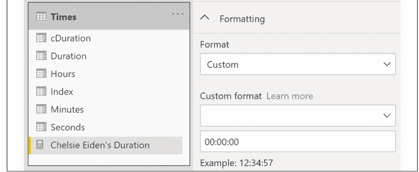

图 3.18：自定义格式字符串

DAX 可用于协助解决排序问题；例如，可以创建一个 DAX 计算列来支持对 **Calendar Yr-Mo** 列（包含如 *2016-Jan* 等值）进行排序。创建 **CalYr-Mo Sort** 列的 DAX 公式如下：

```
CalYr-Mo Sort = YEAR('Dates'[Date]) * 100 + MONTH('Dates'[Date])
```

该计算会生成如 *201601* 这样的值。对 **Date** 列应用 YEAR 函数，再乘以 100 以增加两位数字。然后将该乘积与对 **Date** 列应用 MONTH 函数的结果相加，MONTH 函数返回 1 到 12 之间的值。虽然这种方法实现简单且资源消耗低，但新列的数值不是连续的，因此限制了该列在时间智能度量值（例如，过去 3 个月）中的使用。为日期维度的每个粒度创建连续的代理键列，包括会计日历，是构建稳健的日期智能逻辑的重要组成部分。

DAX 的 RANKX 函数也可用于排序。例如，使用以下 DAX 代码在 **Departments** 表中创建一个排名列，该排名基于每个 **Department Group** 在 **General Ledger** 中获得的资金。

```
DeptGroupRank = RANKX('Departments',[Finance])
```

该排名基于本方案中创建的 **Finance** 度量值。**DeptGroupRank** 列会在每次刷新时重新计算，因此排序顺序可能会发生变化以反映源数据。

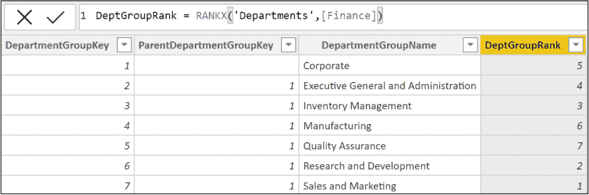

现在，**DepartmentGroupName** 列可以指定**按列排序**为 **DeptGroupRank**，以按资金对部门进行排序，其中 **Sales and Marketing** 排名第一（资金最多），**Quality Assurance** 排名最后（资金最少）。

### 另请参阅

- 在 Power BI Desktop 中指定数据类别：http://bit.ly/2peNqPm
- 标记条码字段以在移动应用中启用条码扫描筛选：http://bit.ly/3re4dAV
- 向表或矩阵添加超链接（URL）：http://bit.ly/39dxJ3r
- 在报表的表或矩阵中显示图像：http://bit.ly/2Pkx1dE
- 在 Power BI Desktop 中按列排序：http://bit.ly/2pFXhgh
- Chelsie Eiden 的 Duration 文章：http://bit.ly/31KFUtf
- 自定义格式字符串：http://bit.ly/3sj648B
- 在 Power BI Desktop 中使用自定义格式字符串：http://bit.ly/3cXAW8o

## 隐藏列和表

数据模型必须平衡功能、范围与可用性之间的相互冲突的需求。随着为了满足各种分析需求而添加更多的表、列、度量值和其他结构，模型很快就会让最终用户感到困惑。因此，尽量减少列和表的可见性以提供直观的界面非常重要。

在本方案中，我们演示如何对报表使用者隐藏列，甚至隐藏整个表。

### 准备工作

要准备本方案，请执行以下步骤：

1. 打开 Power BI Desktop。
2. 创建一个名为 AdWorksDW 的导入模式数据源查询。该查询应类似于以下内容：

```
let
    Source = Sql.Database("localhost\\MSSQLSERVERDEV", "AdventureWorksDW2019")
in
    Source
```

3. 将此查询隔离到名为 **Data Sources** 的查询组中，并禁用加载。
4. 右键单击 AdWorksDW 并选择**引用**（Reference）。
5. 选择 **FactInternetSales** 表，并将此查询命名为 **Internet Sales**。
6. 重复步骤 4 和 5，创建一个导入 **DimDepartmentGroup** 的 **Departments** 查询和一个导入 **DimAccount** 的 **Accounts** 查询。
7. 使用以下代码，基于 **DimProduct**、**DimProductCategory** 和 **DimProductSubcategory** 表创建一个 **Products** 查询。也可以使用本章先前方案*实施数据模型*中的 SQL 视图来获取产品。

```
let
    Source = AdWorksDW,
    Navigation = Source{[Schema="dbo", Item="DimProduct"]}[Data],
    Subcategory =
        Table.ExpandRecordColumn(
            Navigation, "DimProductSubcategory",
            {"EnglishProductSubcategoryName", "DimProductCategory"},
            {"Product Subcategory", "DimProductCategory"}
        ),
    Category =
        Table.ExpandRecordColumn(
            Subcategory, "DimProductCategory",
            {"EnglishProductCategoryName"}, {"Product Category"}
        ),
    RemoveColumns =
        Table.SelectColumns(
            Category,
            {"ProductKey", "EnglishProductName", "DaysToManufacture",
             "Product Subcategory", "Product Category"}
        )
in
    RemoveColumns
```

8. 将 **Internet Sales** 查询移动到一个名为 **Facts** 的查询组，并将 **Departments**、**Accounts** 和 **Products** 查询移动到一个名为 **Dimensions** 的查询组。

9. 在**开始**选项卡的功能区中单击**关闭并应用**，将表加载到数据模型。

10. 基于 **Products** 表和 **Internet Sales** 表的 **ProductKey** 列创建关系。

11. 在 **Internet Sales** 表中创建以下四个度量值：

```
Internet Sales = SUM('Internet Sales'[SalesAmount])

Internet Sales Freight = SUM('Internet Sales'[Freight])

Internet Sales Order Quantity = SUM('Internet Sales'[OrderQuantity])

Internet Sales Distinct Products =
    COUNTROWS(DISTINCT('Internet Sales'[ProductKey]))
```

### 如何隐藏列和表

要实现本方案，请使用以下步骤：

1. 在**数据**视图的**字段**窗格中，右键单击 **Internet Sales** 表中的某一列，然后选择**在报表视图中隐藏**。注意，**字段**窗格中该列的右侧会显示带删除线的“可见”图标。此外，这些列在数据查看区域中会变灰。

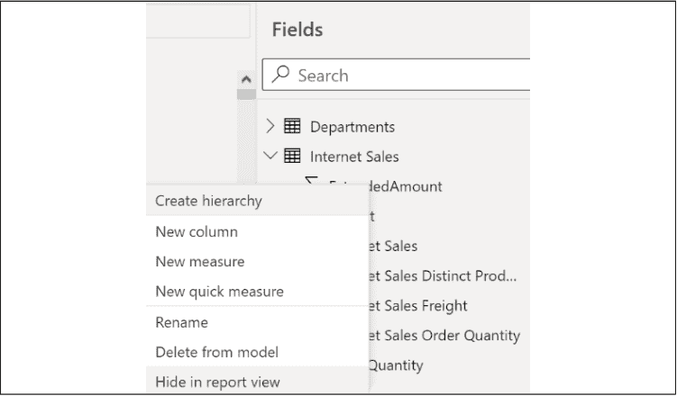

图 3.20：在报表视图中隐藏

2. 对 **Internet Sales** 表中的所有列（但不包括度量值）重复此过程。

3. 当所有列都隐藏后，切换到**报表**视图，会看到 **Internet Sales** 表现在显示在其他两个表的上方，不按字母顺序排列。此外，该表的图标是计算器而不是表。


图 3.21：报表视图字段列表中的度量值表


简化“字段”列表的一个选项是将度量值合并到更少的主表中，并隐藏未使用的表。可以创建专用的度量组表来组织和分组相似的度量值。专用度量组是通过不返回行或引用其他源、也不需要刷新的查询创建的空表。创建专用度量组表的一种方法是创建一个名为“Calculations”之类的空白查询，然后将其加载并应用到模型中。在 Desktop 中，在此表中至少创建一个度量值，并隐藏查询自动创建的、与查询/表同名的单个列。度量值可以直接在此表中创建，也可以通过“度量工具”选项卡功能区中的“主表”属性，将现有度量值关联到模型的任意表。


### 更多内容...

在包含多个页面的报表中，也可以向报表阅读者隐藏页面。要隐藏页面，请右键单击“页面”选项卡并选择“隐藏页面”。这在保留开发和故障排除期间使用的页面，或使用工具提示页面时非常有用。

透视表本质上是模型的视图定义，这样仅将模型中定义好的表、列和度量值集合公开给给定视图。Power BI Desktop 支持透视表，但必须使用外部工具（如 Tabular Editor）创建。要了解如何创建和使用透视表，请按照以下步骤操作：

1.  在“报表”视图中，从“外部工具”选项卡的功能区中选择“Tabular Editor”。
2.  在 Tabular Editor 中，请注意仅显示可见的表——“Departments”表缺失。您可以通过从“视图”菜单中选择“隐藏对象”来查看隐藏的对象。
3.  右键单击“Perspectives”文件夹，选择“新建透视表”，并将透视表命名为“New Perspective”。
4.  在“Tables”文件夹中，右键单击“Internet Sales”表，选择“在透视表中显示”，然后选择“所有透视表”。
5.  对“Products”表重复步骤 4。
6.  展开“Products”表，右键单击“DaysToManufacture”列，选择“在透视表中隐藏”，然后选择“New Perspective”。

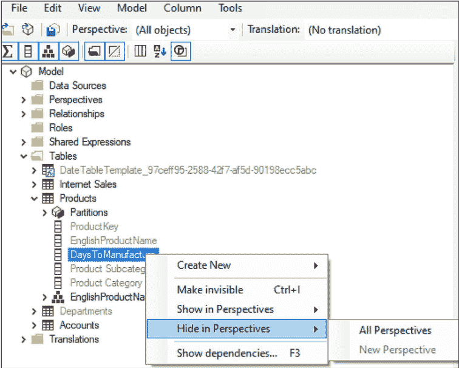

*图 3.23：Tabular Editor*

7.  右键单击“Accounts”表，选择“在透视表中隐藏”，然后选择“所有透视表”。
8.  从“文件”菜单中选择“保存”。
9.  关闭 Tabular Editor。
10. 返回 Power BI Desktop，创建第二个页面，然后保存报表。
11. 从“文件”菜单中选择“选项和设置”，然后选择“选项”。
12. 在“报表设置”下的“当前文件”中，打开“允许报表阅读者按需个性化视觉对象”选项。
13. 在第二个页面的“可视化”窗格的“格式”部分，注意新的“个性化视觉对象”区域。
14. 将“报表阅读者透视表”设置为“New Perspective”。

作为报表编辑者，在 Power BI Desktop 的“报表”视图中，您将继续看到模型中未隐藏的所有表和列。但是，当用户在 Power BI 服务中个性化 Page 2 上的视觉对象时，用户将看不到透视表中未包含的任何表和列。请注意，透视表在任何情况下都不应被视为安全机制。

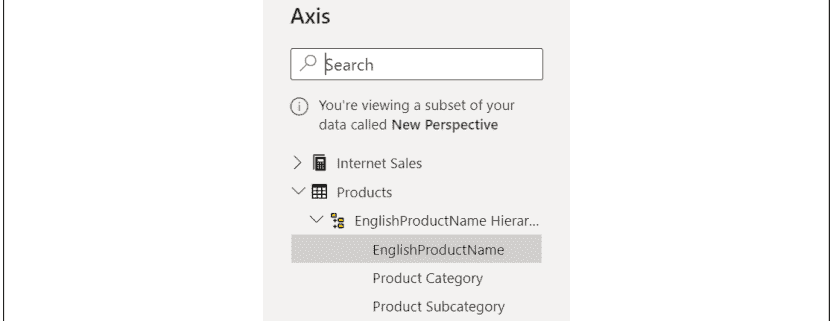

### 另请参阅

-   允许用户在报表中个性化视觉对象：http://bit.ly/3cljuvm
-   在报表中个性化视觉对象：http://bit.ly/2OZX8a8

## 使用 DAX 丰富模型

为了推动用户采用并为支持更高级的分析奠定基础，嵌入在核心或“基础”DAX 度量值中的逻辑必须准确反映业务定义，这一点至关重要。这些基础度量值可跨从数据模型构建的众多报表提供版本控制，并避免在报表层应用额外逻辑。应记录所需业务指标的清晰定义，并在使用这些新度量值将任何报表部署到生产环境之前，验证相应 DAX 度量值的准确性。

性能、可用性和版本控制是有效数据模型的基本特征，但通常是额外的分析上下文使模型脱颖而出。一旦实现了基础度量值，就可以开发额外的 DAX 度量值来支持常见和高优先级的业务分析。这些度量值通常可以取代业务用户的临时和手动数据分析，以及 BI 组织维护的专用自定义报表。由于度量值存储在数据模型内，因此可以在各种组合和未来的项目中重用该逻辑。

在开发这些指标时，重要的是要确定要创建的基础度量值集、要验证的数据源以及主题专家。协调源系统定义与报表中应用的任何自定义逻辑之间的差异。请求业务组织的项目发起人审查和批准定义和验证。最后，识别与现有业务定义的任何冲突，并就实现度量值的复杂性提出建议。

在本节中，将创建 DAX 度量值来表示业务定义并支持更深入的分析。

### 准备工作

为准备本节内容，请按照以下步骤操作：

1.  打开 Power BI Desktop。
2.  创建一个名为 `AdWorksDW` 的 Import 模式数据源查询。此查询应类似于以下内容：

    ```powerquery
    let
        Source = Sql.Database("localhost\MSSQLSERVERDEV", "AdventureWorksDW2019")
    in
        Source
    ```

3.  将此查询隔离在名为“Data Sources”的查询组中，并禁用加载。
4.  右键单击 `AdWorksDW` 并选择“引用”。
5.  选择 `FactResellerSales` 表，并将此查询命名为“Reseller Sales”。
6.  重复步骤 4 和 5，创建一个导入 `FactCurrencyRates` 的“Currency Rates”查询，一个导入 `FactInternetSales` 的“Internet Sales”查询，一个导入 `DimDate` 的“Dates”查询，以及一个导入 `DimCustomer` 的“Customers”查询。
7.  向“Currency Rates”查询添加一个从 1 开始的“索引列”，并将“CurrencyKey”列筛选为 98。
8.  使用以下代码，基于 `DimProduct`、`DimProductCategory` 和 `DimProductSubcategory` 表创建一个“Products”查询。或者，使用本章先前配方“实现数据模型”中的产品 SQL 视图。

    ```powerquery
    let
        Source = AdWorksDW,
        Navigation = Source{[Schema="dbo",Item="DimProduct"]}[Data],
        Subcategory =
            Table.ExpandRecordColumn(
                Navigation, "DimProductSubcategory",
                {"EnglishProductSubcategoryName", "DimProductCategory"},
                {"Product Subcategory", "DimProductCategory"}
            ),
        Category =
            Table.ExpandRecordColumn(
                Subcategory, "DimProductCategory",
                {"EnglishProductCategoryName"}, {"Product Category"}
            )
    in
        Category
    ```

9.  将**Reseller Sales**、**Internet Sales** 和 **Currency Rates** 查询移动到一个名为 **Facts** 的查询组，并将 **Dates**、**Products** 和 **Customers** 查询移动到一个名为 **Dimensions** 的查询组。
10. 在 **Other Queries** 组中创建四个空白查询，分别命名为 **Reseller Measures**、**Pricing Measures**、**Customer Measures** 和 **Currency Measures**。
11. 单击 **Home** 选项卡功能区中的 **Close & Apply**，将表加载到数据模型中。
12. 创建 *图 3.25* 所示的关系。

| 活动 | 从：表（列） | 到：表（列） |
|---|---|---|
| ☑ | Currency Rates (DateKey) | Dates (DateKey) |
| ☑ | Internet Sales (CustomerKey) | Customers (CustomerKey) |
| ☐ | Internet Sales (DueDateKey) | Dates (DateKey) |
| ☑ | Internet Sales (OrderDateKey) | Dates (DateKey) |
| ☑ | Internet Sales (ProductKey) | Products (ProductKey) |
| ☐ | Internet Sales (ShipDateKey) | Dates (DateKey) |
| ☐ | Reseller Sales (DueDateKey) | Dates (DateKey) |
| ☑ | Reseller Sales (OrderDateKey) | Dates (DateKey) |
| ☑ | Reseller Sales (ProductKey) | Products (ProductKey) |
| ☐ | Reseller Sales (ShipDateKey) | Dates (DateKey) |

*图 3.25：模型关系*

13. 所有这些关系的交叉筛选方向应为**单**，除了 **Internet Sales 到 Customers** 关系，该关系应设置为**两者**。
14. 切换到**数据**视图，隐藏 **Reseller Measures**、**Pricing Measures**、**Customer Measures** 和 **Currency Measures** 表中的单个列。
15. 右键单击 **Dates** 表，选择**标记为日期表**，使用 **FullDateAlternateKey** 作为**日期**列。


## 如何通过DAX丰富模型

要实现本方案，请按照以下步骤操作：

1. 切换到 **数据** 视图。

2. 在 **经销商度量值** 表中创建以下八个销售和成本DAX度量值。

```
Reseller Discount Amount = SUM('Reseller Sales'[DiscountAmount])

Reseller Gross Sales =
    SUMX('Reseller Sales',
        'Reseller Sales'[UnitPrice] * 'Reseller Sales'[OrderQuantity])

Reseller Net Sales =
    CALCULATE ( [Reseller Gross Sales] - [Reseller Discount Amount],
        'Reseller Sales'[ShipDate] <> DATEVALUE("12/31/2099") )

Reseller Product Cost =
    SUMX('Reseller Sales',
        'Reseller Sales'[OrderQuantity]*'Reseller Sales'[ProductStandardCost])

Reseller Gross Margin % =
    DIVIDE([Reseller Gross Sales] - [Reseller Product Cost],
        [Reseller Gross Sales])

Reseller Margin % =
    DIVIDE([Reseller Net Sales] - [Reseller Product Cost],
        [Reseller Net Sales])

Reseller Count of Products Sold =
    CALCULATE(DISTINCTCOUNT('Products'[ProductAlternateKey]),
        'Reseller Sales')

Reseller Count of Sales Orders = DISTINCTCOUNT('Reseller Sales'[SalesOrderNumber])
```

3. 在 **定价度量值** 表中创建以下七个销售和成本DAX度量值：

```
Effective Unit Price =
    DIVIDE(SUM('Reseller Sales'[ExtendedAmount]),
        SUM('Reseller Sales'[OrderQuantity]) )

25th Percentile Unit Price = PERCENTILE.INC('Reseller Sales'[UnitPrice],.25)

75th Percentile Unit Price = PERCENTILE.INC('Reseller Sales'[UnitPrice],.75)

Maximum Unit Price = MAX('Reseller Sales'[UnitPrice])

Median Unit Price = MEDIAN('Reseller Sales'[UnitPrice])

Minimum Unit Price = MIN('Reseller Sales'[UnitPrice])

Range of Unit Prices = [Maximum Unit Price] - [Minimum Unit Price]
```

4. 在 **定价度量值** 表中创建以下三个销售和成本DAX度量值：

```
Count of Accessory But Not Bike Customers =
VAR BikeCustomers =
    SUMMARIZE(
        CALCULATETABLE('Internet Sales','Products'[Product Category] = "Bikes"),
        'Customers'[CustomerAlternateKey])
VAR AccessoryCustomers =
    SUMMARIZE(
        CALCULATETABLE('Internet Sales',
            'Products'[Product Category] = "Accessories"),
        'Customers'[CustomerAlternateKey])
RETURN
    CALCULATE(
        DISTINCTCOUNT('Customers'[CustomerAlternateKey]),
        EXCEPT(AccessoryCustomers,BikeCustomers) )

Count of Bike Only Customers =
VAR BikeCustomers =
    SUMMARIZE(
        CALCULATETABLE('Internet Sales','Products'[Product Category] = "Bikes"),
        'Customers'[CustomerAlternateKey]
    )
VAR ClothesAndAccessoryCustomers =
    SUMMARIZE(
        CALCULATETABLE('Internet Sales',
            'Products'[Product Category] IN {"Accessories","Clothing"}
        ), 'Customers'[CustomerAlternateKey])
RETURN
    CALCULATE(
        DISTINCTCOUNT('Customers'[CustomerAlternateKey]),
        EXCEPT(BikeCustomers,ClothesAndAccessoryCustomers) )

Count of Last Year Customers ex Current Year =
VAR CurrentYear = 2012
VAR LastYear = CurrentYear - 1
VAR LYCustomers =
    SUMMARIZE(
        CALCULATETABLE('Internet Sales',
            FILTER(ALL('Dates'),'Dates'[CalendarYear] = LastYear)
        ), 'Customers'[CustomerAlternateKey])
VAR CYCustomers =
    SUMMARIZE(
        CALCULATETABLE(
            'Internet Sales',
            FILTER(ALL('Dates'),'Dates'[CalendarYear] = CurrentYear)
        ), 'Customers'[CustomerAlternateKey])
RETURN
    CALCULATE(
        DISTINCTCOUNT('Customers'[CustomerAlternateKey]),
        EXCEPT(LYCustomers,CYCustomers) )
```

5. 在 **日期** 表中创建以下两个DAX列：

```
YearMonth = [CalendarYear]*100 + [MonthNumberOfYear]

YearMonthIndex =
    COUNTROWS(
        SUMMARIZE(FILTER('Dates',[YearMonth] < EARLIER([YearMonth])),[YearMonth])
    ) + 1
```

6. 在 **货币度量值** 表中创建以下十一个销售和成本DAX度量值：

```
Max Daily Rate = MAX('Currency Rates'[EndOfDayRate])

Last Rate =
    CALCULATE(DISTINCT('Currency Rates'[EndOfDayRate]),
        LASTNONBLANK('Dates'[FullDateAlternateKey],[Max Daily Rate]) )

Previous Daily Rate =
    CALCULATE([Last Rate],
        FILTER(ALL('Currency Rates'),
            'Currency Rates'[Index] = MAX('Currency Rates'[Index]) - 1)
    )

Previous Monthly Rate =
    CALCULATE([Last Rate],
        FILTER(ALL('Dates'),
            'Dates'[YearMonthIndex] = MAX('Dates'[YearMonthIndex]) - 1)
    )

Previous Year Rate =
    CALCULATE([Last Rate],
        FILTER(ALL('Dates'),
            'Dates'[CalendarYear] = MAX('Dates'[CalendarYear]) - 1 )
    )

Daily Change % = DIVIDE([Last Rate],[Previous Daily Rate])
Monthly Change % = DIVIDE([Last Rate],[Previous Monthly Rate])
Yearly Change % = DIVIDE([Last Rate],[Previous Year Rate])
Daily Geometric Return = GEOMEANX('Currency Rates',[Daily Change %])-1
Daily Geometric Change = GEOMEANX('Currency Rates',[Daily Change %])-1
Yearly Geometric Change = GEOMEANX(DISTINCT('Dates'[CalendarYear]),[Yearly Change %])-1
```

### 工作原理

当数据通过数据治理委员会、主数据服务（MDS）、数据质量服务和Azure数据目录等流程和工具进行内部管理时，度量值的定义可以很简单。根据Power BI治理与部署白皮书，Power BI项目以及所有BI项目都能从这些数据清理和信息管理工具中大大受益。本章引用的数据仓库总线矩阵以及第4章“编写Power BI报表”中引用的利益相关者矩阵，有助于将度量值定义过程聚焦于版本控制和透明度。

度量值的名称应当直观且针对业务流程具有特定性。最好遵循命名标准，以平衡名称的详细程度与文本对可视化效果的影响。在真实项目场景中，验证后可能还会创建几个额外的度量值。这些可能包括净销售额占毛销售额的百分比、每订单销售额、每订单数量和未发货销售额。这些度量值以及更高级的度量值都将利用经验证的度量值。

对于经销商度量值，定义了以下业务口径：

- 毛销售额等于单价乘以订单数量，不应用折扣。
- 净销售额为毛销售额减去折扣，且必须已发货。
- 产品成本等于产品标准成本乘以订单数量。

源数据库中存在两个列，分别反映 **经销商毛销售额** 和 **经销商产品成本**。只有通过导入价格和数量列并在度量值内相乘，才能提高性能和内存使用效率。对于 **经销商毛销售额** 度量值，使用SUMX函数遍历第一个参数中指定的表。第二个参数中指定的计算对每一行执行，然后所有行相加。净销售额度量值从毛销售额中扣除折扣，并且只包含已发货的产品。这里假设任何未发货的销售订单都被赋予日期值12/31/2099。

需要反映毛销售额和净销售额（含折扣）的利润率百分比度量值。这些分别是 **经销商毛利率%** 和 **经销商利润率%** 度量值。也可以创建 **利润额** 度量值，并替代 **利润率%** 度量值的分子。DISTINCTCOUNT可以直接用于事实表上的外键关系列和任何退化维度列，例如 **SalesOrderNumber**。始终使用带有可选第三个参数的DIVIDE函数，以避免除以零的错误。

销售订单和已售产品的非重复计数也是许多报表中使用的核心度量值，并被其他度量值引用。这些是 **经销商已售产品计数** 和 **经销商销售订单计数** 度量值。**经销商已售产品计数** 度量值使用事实表筛选上下文中的产品自然键来对唯一产品进行计数。考虑到缓慢变化的维度，使用事实表上的产品键会对一个产品进行多次计数。

**定价度量值** 提供了一个支持更深入的价格趋势分析的示例。这些度量值旨在实现以下目标：

- 描述价格的中心趋势和分布。
- 考虑产品销售组合的影响，以支持有效定价与产品定价的分析。

**有效单价** 度量值考虑了销售数量的影响，并使用现有的销售额和数量指标。百分位数和中位数度量值 **第25百分位单价**、**第75百分位单价** 和 **单价中位数** 有助于更好地描述价格分布。MEDIAN函数返回列中值的第50百分位数。PERCENTILE.INC函数用于第25和第75百分位数。


| 产品类别 | CustomerKey 计数 |
|---|---|
| 配件 | 15114 |
| 自行车 | 9132 |
| 服装 | 6852 |
| 总计 | 18484 |

图 3.27：按产品类别划分的唯一客户

**配件但非自行车客户计数** 和 **仅自行车客户计数** 指标有助于我们确定购买了服装或配件但未购买自行车的客户数量，或仅购买自行车而未购买配件的客户数量，分别。这些指标可用于 **卡片** 可视化，以显示仅自行车客户远少于仅购买服装或配件而未购买自行车的客户。此外，这些指标可用于包含 **CustomerAlternateKey** 列的 **表格** 可视化以识别单个客户；当这些指标在单个客户级别计算时，指标返回零或一，且零值默认会被从 **表格** 可视化中自动过滤。注意，你可以点击 **CustomerAlternateKey** 的 **值** 区域中的下拉箭头并选择 **显示无数据项** 来更改此默认行为。

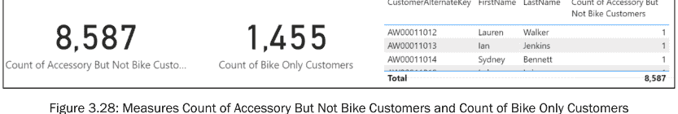

图 3.28：指标 配件但非自行车客户计数 和 仅自行车客户计数

**配件但非自行车客户计数** 指标使用变量 (VAR) 创建虚拟表 BikeCustomers 和 AccessoryCustomers，分别存储与两个产品类别 自行车 和 配件 相关的不同客户键。SUMMARIZE 函数对客户键值进行分组，而 EXCEPT 执行基于集合的操作。对于 **仅自行车客户计数** 指标，语法与第一个指标的结构一致，只是使用了 DAX IN 运算符将配件和服装包含在同一组客户键中。鉴于这些指标的强大功能，它们可能是销售和营销仪表板以及异常报告的候选指标；销售团队可以专注于对仅自行车客户进行交叉销售以及向非自行车客户销售自行车。

**去年客户排除今年客户计数** 指标演示了如何识别去年购买但今年尚未购买的客户。此指标的结构与前两个指标类似，只是使用了 CALCULATETABLE 函数来创建过滤后的表集。在配方中，CurrentYear 变量被硬编码为 2012。在生产数据集中，这可能会改为类似 YEAR(TODAY()) 以获取当前年份或 YEAR(MAX('Dates'[Date])) 以获取上下文中最新的年份。此指标也可用于 **卡片** 或 **表格** 可视化。

**货币指标** 提供了在日、月和年粒度上计算几何平均值的示例。在 **上次汇率** 指标中，需要 LASTNONBLANK 函数来处理数据中可能没有记录汇率的天数。此指标用于计算日、月和年粒度下的前一汇率（**前一日汇率**、**前一月汇率** 和 **前一年汇率**）。百分比变化指标 **日变化 %**、**月变化 %** 和 **年变化 %** 是几何平均值计算的源值，因此表示为正数。GEOMEANX 函数在不同粒度上迭代表并为每一行计算 Change % 指标。几何平均值（取 N 次方根的乘积）最后针对此值列表计算。几何变化指标可用于多行卡片可视化，并指定 10 位小数：

| -0.0108542283 | -0.0011481367 | -0.0000349297 |
| 年度几何变化 | 月度几何变... | 日度几何变化 |

图 3.29：几何平均值指标

## 更多内容...

许多数据模型中常见的场景是比较粒度不同的表，例如比较实际值与预算值时，实际值按日报告，而预算按月或季度分配。在这种情况下，可以创建桥接表，其中每个桥接表包含预算表粒度下的维度的唯一值。这些桥接表可以利用模型中用于加载维度表的现有 M 查询。例如，以下 M 表达式引用 **Dates** 表查询作为其源，并仅选择 **Calendar Yr-Mo** 列的唯一值。如果这是预算表的粒度，此单列表可用作桥接表。

```
let Source = Dates,
    YearMonthColumn = Table.SelectColumns(Source,{"Calendar Yr-Mo"}),
    RemoveDuplicates = Table.Distinct(YearMonthColumn)
in RemoveDuplicates
```

或者，可以创建一个简单的 SQL 视图（'Select Distinct [Calendar Yr-Mo] From dbo.DimDate'）来选择该列的唯一值；此视图可从新的桥接表 M 查询中访问。

可以创建从桥接表到预算表的一对多关系，并进行单向交叉筛选。随后在桥接表与其对应的维度表之间创建多对一关系，并进行双向交叉筛选。一个示例最终模型可能与图 3.30 所示相同。

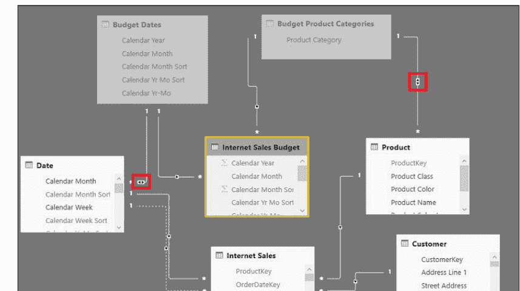

## 图 3.30：互联网销售与预算数据模型

图像中突出的两个双向关系允许对 Date 和 Product 表的筛选传播到 Internet Sales Budget 表，以及 Internet Sales 事实表。

仅剩需要一定程度代码的步骤是避免无效的筛选上下文。例如，Internet Sales 事实表当然可以按单个产品和日期进行筛选，但此粒度对 Internet Sales Budget 表不可用，因此应返回空白值。

可以创建筛选测试指标来测试筛选上下文。筛选测试用于防止对每个事实表应用不同筛选时的无效销售与预算报告。以下指标检查是否在比预算表更高的粒度上应用了筛选：

```
Budget Filter Test =
    VAR CustomerFilter = ISCROSSFILTERED(Customer)
    VAR ProductGrain =
        ISFILTERED('Product'[Product Class]) || ISFILTERED('Product'[Product Color])
    ||
        ISFILTERED('Product'[Product Subcategory]) || ISFILTERED('Product'[Product Name])
    VAR DateGrain =
```

```
ISFILTERED('Date'[Calendar Yr-Wk]) || ISFILTERED('Date'[Date]) || ISFILTERED('Date'[Wk End Date])
RETURN
IF(CustomerFilter = TRUE() || ProductGrain = TRUE() || DateGrain =TRUE(), "Higher Grain", "Common Grain")
```

ISFILTERED 和 ISCROSSFILTERED 函数基于表或列的筛选上下文返回布尔值。ISFILTERED 函数仅限于模型中的单个列，并且特定于给定列。ISCROSSFILTERED 函数可以检查单个列或整个表。来自其他表的筛选也包含在评估中。

Budget Filter Test 指标然后可用于创建预算指标和实际与预算差异指标：

```
Internet Sales Budget =
    VAR BudgetSales = sum('Internet Sales Budget'[Online Sales Budget])
RETURN
IF([Budget Filter Test] = "Common Grain", BudgetSales, BLANK())
```

```
Internet Sales Actual to Budget Variance =
IF(ISBLANK([Internet Sales Budget]),BLANK(), [Internet Sales] - [Internet Sales Budget])
```

在此场景中，需求是仅测试共同粒度，否则返回空白。可以在 DAX 预算指标中构建分配逻辑以考虑更高粒度。一般而言，这些分配规则最好在预算流程本身或通过 ETL 工具和查询语言（如 SQL 和 M）实现。这些指标可用于可视化实际值与预算之间的差异。

| 产品类别 | 2017-Jan | 2017-Feb | 2017-Mar | 2017-Apr | 2017-May | 2017-Jun | 2017-Jul |
|---|---|---|---|---|---|---|---|
| 配件 | ($5,524) | ($462) | $13,281 | ($3,103) | ($16,784) | ($1,876) | $8,120 |
| 自行车 | ($66,393) | $98,532 | ($48,389) | $271,293 | ($336,043) | $465,368 | $385,256 |
| 服装 | ($87) | $2,131 | $2,679 | $5,333 | $266 | ($2,943) | ($5,602) |
| 总计 | ($72,005) | $100,200 | ($32,428) | $273,523 | ($352,562) | $460,549 | $387,774 |

图 3.31：按产品类别和年-月划分的互联网销售实际值与预算

矩阵可视化提供了与 Excel 数据透视表类似的功能，因此是预算与实际值的不错选择。

## 另请参阅

- DAX 函数参考: http://bit.ly/3rrQFlt
- 治理和部署方法: http://bit.ly/1VLwdVg


## 支持虚拟表关系

虚拟表关系是 DAX 表达式，用于在两个表之间不存在关系时从一个表过滤另一个表。然后可以使用这两个表（以及与其相关的表）构建报表可视化，并且 DAX 度量值会像定义了正常关系一样更新。虚拟关系通常用于解决表的不同粒度问题以及利用性能分段表。

尽管物理关系是性能和可管理性方面的长期首选解决方案，但在物理关系不可行时，虚拟关系提供了一个有吸引力的替代方案。在本配方中，我们提供了使用自定义性能分段表和聚合表的虚拟关系示例。

### 准备工作

为准备本配方，请执行以下步骤：

- 1. 打开 Power BI Desktop。
- 2. 创建一个名为 **AdWorksDW** 的导入模式数据源查询。此查询应类似于以下内容：

```powerquery
let
    Source = Sql.Database("localhost\\MSSQLSERVERDEV", "AdventureWorksDW2019")
in
    Source
```

- 3. 将此查询隔离到名为 **Data Sources** 的查询组中并禁用加载。
- 4. 右键单击 AdWorksDW 并选择 **Reference**。
- 5. 选择 **FactInternetSales** 表并将此查询命名为 **Internet Sales**。
- 6. 重复步骤 4 和 5 以创建导入 **DimDates** 的 **Dates** 查询。
- 7. 使用以下代码创建 **Customers** 查询：

```powerquery
let
    Source = AdWorksDW,
    dbo_DimCustomer = Source{[Schema="dbo",Item="DimCustomer"]}[Data],
    Country =
        Table.ExpandRecordColumn(
            dbo_DimCustomer, "DimGeography",
            {"EnglishCountryRegionName"}, {"Country"})
in
    Country
```

- 8. 使用以下代码创建 **Products** 查询：

```powerquery
let
    Source = AdWorksDW,
    Navigation = Source{[Schema="dbo",Item="DimProduct"]}[Data],
    Subcategory =
        Table.ExpandRecordColumn(
            Navigation, "DimProductSubcategory",
            {"EnglishProductSubcategoryName", "DimProductCategory"},
            {"Product Subcategory", "DimProductCategory"}
        )
in
    Subcategory
```

- 9. 将 **Internet Sales** 查询移动到名为 **Facts** 的查询组，并将 **Dates**、**Products** 和 **Customers** 查询移动到名为 **Dimensions** 的查询组。
- 10. 使用 **Enter Data** 查询在 **Other Queries** 组中创建 **GrowthTiers** 查询。

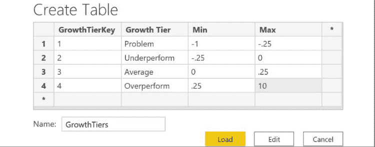

图 3.32：销售增长分段表，GrowthTiers

- 11. 在 **Other Queries** 组中创建 **SubCatPlan** 查询并使用以下代码：

```powerquery
let
    Source = Products,
    Sales =
        Table.ExpandTableColumn(
            Source, "FactInternetSales",
            {"SalesAmount", "OrderDate"}, {"SalesAmount", "OrderDate"}
        ),
    RemoveNulls = Table.SelectRows(Sales, each [SalesAmount] <> null),
    Year =
        Table.AddColumn(
            RemoveNulls, "Calendar Year", each Date.Year([OrderDate])
        ),
    Month =
        Table.AddColumn(
            Year, "Calendar Month", each Date.MonthName([OrderDate])
        ),
    Group =
        Table.Group(
            Month,
            {"Calendar Year", "Calendar Month", "Product Subcategory"},
            {{"SalesAmount", each List.Sum([SalesAmount]), type nullable number}}
        ),
    Index = Table.AddIndexColumn(Group, "Index", 1, 1, Int64.Type),
    Plan =
        Table.AddColumn(
            Index, "Plan Amt",
            each if Number.IsEven([Index])
                then 1/Number.RandomBetween(5,10) * [SalesAmount] + [SalesAmount]
                else (-1 * 1/Number.RandomBetween(5,10) * [SalesAmount]) + [SalesAmount]
        ),
    Remove = Table.RemoveColumns(Plan,{"SalesAmount", "Index"}),
    Currency = Table.TransformColumnTypes(Remove,{{"Plan Amt", Currency.Type}})
in
    Currency
```

- 12. 在 Other Queries 组中创建名为 **Calculations** 的空白查询。
- 13. 在“开始”选项卡功能区的“关闭并应用”中单击以将表加载到数据模型。
- 14. 创建图 3.33 中显示的单个交叉筛选关系；请注意，**GrowthTiers** 或 **SubCatPlan** 表没有关系：

| Active | From: Table (Column) | To: Table (Column) |
| --- | --- | --- |
| ☑ | Internet Sales (CustomerKey) | Customers (CustomerKey) |
| ☐ | Internet Sales (DueDateKey) | Dates (DateKey) |
| ☑ | Internet Sales (OrderDateKey) | Dates (DateKey) |
| ☑ | Internet Sales (ProductKey) | Products (ProductKey) |
| ☐ | Internet Sales (ShipDateKey) | Dates (DateKey) |

图 3.33：模型关系

- 15. 切换到数据视图并隐藏 Calculations 表中的单个列。
- 16. 在 Calculations 表中创建以下度量值：

```DAX
Sales Current Year =
    CALCULATE(SUM('Internet Sales'[SalesAmount]),
        FILTER(ALLEXCEPT('Internet Sales','Customers'),
            YEAR('Internet Sales'[OrderDate]) =
        MAX('Dates'[CalendarYear]) ) )
```

```DAX
Sales Previous Year =
    CALCULATE(
        SUM('Internet Sales'[SalesAmount]),
        FILTER(ALLEXCEPT('Internet Sales','Customers'),
            YEAR('Internet Sales'[OrderDate]) =
        MAX('Dates'[CalendarYear])-1 ) )
```

```DAX
Sales Growth =
    DIVIDE([Sales Current Year] - [Sales Previous Year],
        [Sales Previous Year], BLANK() )
```

- 17. 右键单击 Dates 表并选择使用 FullDateAlternateKey 作为日期列标记为日期表。

### 如何支持虚拟表关系

要实现本配方，请使用以下步骤：

- 1. 在 Calculations 表中创建销售增长层级度量值：

```DAX
Sales Growth Tier =
    VAR Growth = [Sales Growth]
    VAR Level1 =
        CALCULATE(MIN('GrowthTiers'[Max]), 'GrowthTiers'[GrowthTierKey] = 1)
    VAR Level2 =
        CALCULATE(MIN('GrowthTiers'[Max]), 'GrowthTiers'[GrowthTierKey] = 2)
    VAR Level3 =
        CALCULATE(MIN('GrowthTiers'[Max]), 'GrowthTiers'[GrowthTierKey] = 3)
    VAR Level4 =
        CALCULATE(MIN('GrowthTiers'[Max]), 'GrowthTiers'[GrowthTierKey] = 4)
    RETURN
        SWITCH(TRUE(),
            ISBLANK(Growth), BLANK(),
            Growth <= Level1, CALCULATE(DISTINCT('GrowthTiers'[Growth Tier]),
                'GrowthTiers'[GrowthTierKey] = 1),
            Growth <= Level2, CALCULATE(DISTINCT('GrowthTiers'[Growth Tier]),
                'GrowthTiers'[GrowthTierKey] = 2),
            Growth <= Level3, CALCULATE(DISTINCT('GrowthTiers'[Growth Tier]),
                'GrowthTiers'[GrowthTierKey] = 3),
            Growth <= Level4, CALCULATE(DISTINCT('GrowthTiers'[Growth Tier]),
                'GrowthTiers'[GrowthTierKey] = 4
            ), "Unknown")
```

- 2. 在 **Calculations** 表中创建虚拟表关系度量值 **Customer Countries**：

```DAX
Customer Countries =
    CALCULATE(DISTINCTCOUNT('Customers'[Country]),
        FILTER(ALL('Customers'[Country]),
            [Sales Growth] > MIN('GrowthTiers'[Min]) &&
            [Sales Growth] < MAX('GrowthTiers'[Max]) ) )
```

- 3. 创建一个使用 **Dates** 表中 **CalendarYear** 列的 **Slicer** 可视化对象。
- 4. 创建一个 **Matrix** 可视化对象，将 **Customers** 表中的 **Country** 列用作 **Rows**，将度量值 **Sales Growth**、**Sales Current Year**、**Sales Previous Year** 和 **Sales Growth Tier** 用作 **Values**。
- 5. 创建一个 **Clustered column chart** 可视化对象，将 **GrowthTiers** 表中的 **Growth Tier** 列用作 **Axis**，并将 **Customer Countries** 度量值用作 **Values**。

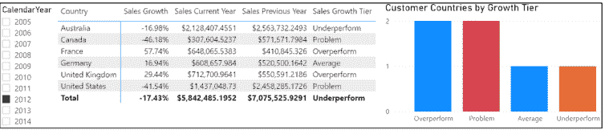

图 3.34：虚拟关系分段示例

- 6. 保存你的工作。

### 工作原理

本配方的目标是将来自未连接的 GrowthTiers 表的 Growth Tier 分段应用于数据模型的度量值。两个度量值用于形成此虚拟关系，Sales Growth Tier 和 Customer Countries。度量值根据分段表阈值和 Sales Growth 度量值应用筛选器。实际上，这些度量值通过执行的计算在数据模型中的表之间形成关系。

Sales Growth Tier 度量值返回指定上下文中 Sales Growth 度量值值的 Growth Tier 列的文本值。现有的 Sales Growth 度量值和四个分段阈值存储在 DAX 变量中（VAR 语句）。SWITCH 函数将销售增长与分段阈值进行比较以分配 Growth Tier 值。将 TRUE() 提供为 SWITCH 函数的第一个参数允许按顺序（从上到下）独立评估逻辑条件。这类似于 SQL 中的 CASE 表达式。Customer Countries 度量值使用简单的 CALCULATE 语句返回按每个 Growth Tier 的 MIN 和 MAX 限制筛选的国家/地区的 DISTINCTCOUNT。

Sales Growth Tier 度量值可用于分析模型的其他维度，并在不同的粒度上使用；例如，如果在 Customers 表中添加 StateProvinceName 并创建层次结构，则可以使用矩阵可视化向下钻取并按州/省查看增长层级。

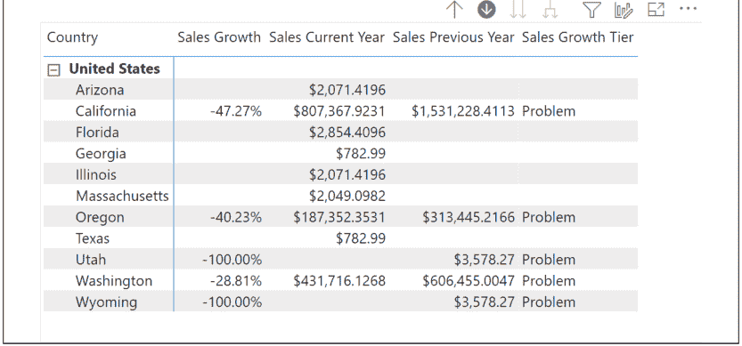

有选项可修改数据模型以支持物理关系，从而避免虚拟关系的限制。例如，可以通过 SQL、M 或 DAX 计算列为每个表创建 Year-Month 等连接列。


或者，使用具有双向交叉筛选关系的桥接表可以为多对多场景提供简单的解决方案。最后，对于小型事实表，可以在支持关系的计算列中使用LOOKUPVALUE函数。

## 更多内容……

DAX TREATAS函数于2017年初添加，与涉及INTERSECT或带CONTAINS函数参数的FILTER的替代虚拟关系方法相比，它提供了更简单的语法和更好的性能。我们可以使用TREATAS函数将汇总表**SubCatPlan**集成到我们的Power BI数据模型中。当企业希望通过他们经常使用的相同的**Products**和**Dates**表来筛选计划数据，并创建实际与计划对比的报告时，这非常有用。SubCatPlan表的粒度是按日历年、日历月划分的产品子类别；如*图3.36*所示。

| 产品子类别 | 日历年 | 日历月 | 计划金额 |
|---|---:|---|---:|
| 山地自行车 | 2013 | 一月 | $313,596.6261 |
| 水壶和笼架 | 2013 | 一月 | $2,284.3156 |

图3.36：用于虚拟关系的计划汇总表

由于多对多关系，无法直接创建从**SubCatPlan**表到**Date**和**Product**表的关系。Power BI中的每个物理关系都基于每个表中的单个列，其中一个关系列唯一标识其宿主表的所有行。这与SSAS表格模型和Excel的Power Pivot模型一致。

要使用DAX创建虚拟表关系，请按照以下步骤操作：

- 1. 在**Calculations**表中创建**Subcat Plan Amt**度量值。该度量值通过**Products**表和**Dates**表筛选子类别计划度量值：

```dax
Subcat Plan Amt =
    VAR ProductSubCats = VALUES('Products'[Product Subcategory])
    VAR DateTbl =
        SUMMARIZE('Dates', 'Dates'[CalendarYear], 'Dates'[EnglishMonthName])
    RETURN
        CALCULATE(
            SUM('SubCatPlan'[Plan Amt]),
            TREATAS(ProductSubCats, 'SubCatPlan'[Product Subcategory]),
            TREATAS(DateTbl, 'SubCatPlan'[Calendar Year], 'SubCatPlan'[Calendar Month])
        )
```

本配方演示了如何利用DAX父级和子级层次结构函数来创建层次结构的列。然后将该层次结构实现到数据模型中，并创建一个组以进一步助力分析。

## 准备工作

要为此配方做准备，请按照以下步骤操作：

- 1. 打开Power BI Desktop。
- 2. 创建一个名为AdWorksDW的导入模式数据源查询。该查询应与以下内容类似：

```m
let
    Source = Sql.Database("localhost\\MSSQLSERVERDEV", "AdventureWorksDW2019")
in
    Source
```

- 3. 将此查询隔离到一个名为**数据源**的查询组中，并禁用加载。
- 4. 右键单击AdWorksDW并选择**引用**。
- 5. 选择**FactInternetSales**表并将此查询命名为**Internet Sales**。
- 6. 重复步骤4和5，创建一个导入**FactFinance**的**总账**查询。
- 7. 使用以下代码创建**Products**查询：

```m
let
    Source = AdWorksDW,
    Navigation = Source{[Schema="dbo",Item="DimProduct"]}[Data],
    Subcategory =
        Table.ExpandRecordColumn(
            Navigation, "DimProductSubcategory",
            {"EnglishProductSubcategoryName", "DimProductCategory"},
            {"Product Subcategory", "DimProductCategory"}
        ),
in
    Subcategory
```

- 8. 使用以下代码创建**Accounts**查询：

```m
let
    Source = AdWorksDW,
    dbo_DimCustomer = Source{[Schema="dbo",Item="DimAccount"]}[Data],
    Parent =
        Table.ExpandRecordColumn(
            dbo_DimCustomer, "DimAccount(ParentAccountKey)",
```

```dax
Account Level 4 =
    VAR __Key = PATHITEM('Accounts'[Path],4,1)
RETURN
    LOOKUPVALUE('Accounts'[AccountDescription],'Accounts'[AccountKey],
__Key)
```

```dax
Account Level 5 =
    VAR __Key = PATHITEM('Accounts'[Path],5,1)
RETURN
    LOOKUPVALUE('Accounts'[AccountDescription],'Accounts'[AccountKey],
__Key)
```

```dax
Account Level 6 =
    VAR __Key = PATHITEM('Accounts'[Path],6,1)
RETURN
    LOOKUPVALUE('Accounts'[AccountDescription],'Accounts'[AccountKey],
__Key)
```

- 2. 在数据视图的字段列表中，右键单击Account Level 1列，然后选择创建层次结构。
- 3. 通过右键单击层次结构并选择重命名，将Account Level 1 Hierarchy重命名为Account Hierarchy。
- 4. 右键单击Account Level 2列，选择添加到层次结构，然后选择Account Hierarchy。
- 5. 依次对Account Level 3、Account Level 4、Account Level 5和Account Level 6列重复步骤4。

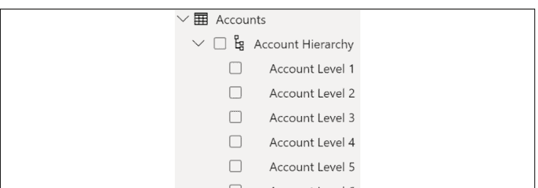

图3.39：字段列表中的层次结构

- 6. 右键单击组成层次结构的各个列，然后选择在报表视图中隐藏。
- 7. 切换到报表视图，创建一个矩阵可视化，将Account Hierarchy作为行，将General Ledger表中的Amount列作为值。

| 账户级别1 | 金额 |
|---|---:|
| 资产负债表 | 1,107,010,918.52 |
| 资产 | 553,505,459.26 |
| 流动资产 | 505,506,336.27 |
| 其他资产 | 6,080,005.58 |
| 不动产、厂房和设备 | 41,919,117.41 |
| 负债和所有者权益 | 553,505,459.26 |
| 净利润 | 239,257,169.18 |
| 统计账户 | 12,372,325.00 |
| 总计 | 1,358,640,412.70 |

图3.40：账户层次结构的矩阵可视化

- 8. 在字段列表中，右键单击Products表中的Product Subcategory列，然后选择新建组。
- 9. 通过编辑名称字段，将组重命名为Product Subcategories。
- 10. 从未分组值区域选择Caps，按Group按钮，并将组命名为Bike Attire Accessories。
- 11. 从未分组值中选择Gloves，从组和成员中选择Bike Attire Accessories，然后点击Group按钮将Gloves添加到Bike Attire Accessories组中。
- 12. 勾选包含其他组复选框，然后点击OK按钮。

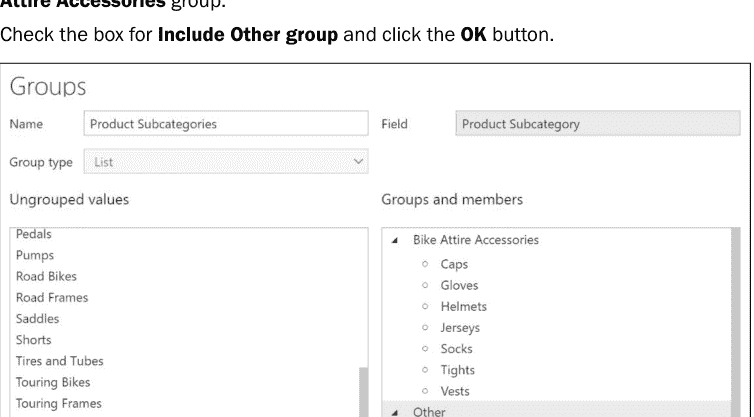

图3.41：组对话框

- 13. 创建聚类柱状图可视化，将Products表中的Product Subcategories组作为轴，将Internet Sales表中的SalesAmount列作为值。

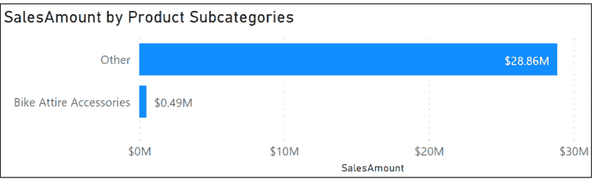

图3.42：启用了其他组的Product Subcategories组

## 工作原理

对于所创建的层次结构，PATH函数将子键列与父键列进行比较，并返回一个包含给定位所有父成员的分隔文本字符串。PATHITEM函数根据位置参数，从最高到最低返回路径中的键值。PATHITEM函数的第三个也是最后一个参数(1)指定以整数形式返回该值。LOOKUPVALUE函数将账户键与PATHITEM函数返回的键进行比较，并返回由第一个参数AccountDescription指定的列。某些行的给定列具有空值，因为该列在结构中级别更高；例如，Balance Sheet账户在第2级到第6级列中没有值。计算列将出现在字段列表中，并带有公式图标。

现在只需单击一下即可将层次结构添加到视觉对象中。可通过向下钻取来浏览所有六列。或者，在矩阵可视化中，可以使用每行开头的展开和折叠控件来查看层次结构。层次结构位于字段列表中，隐藏各个列可能会提高可用性。但是，需要各列来查看不同的列顺序，或在相对的轴上查看层次结构的各个列。

将本配方中创建的层次结构视为自然层次结构，而不是非自然层次结构。自然层次结构为每个父值包含唯一的子值，是推荐的层次结构。例如，Fiscal Year列中的每个唯一值将有12个唯一的子值，例如“2017-Mar”。非自然层次结构会在多个父值中重复相同的子值。

在几乎所有场景中，SQL源视图或M查询是比DAX计算列更可取的替代方案。所使用的DAX父子函数是为该场景开发的，而Accounts表只有100行。


DAX 中的计算列和计算表在处理/刷新操作期间会消耗模型资源，且不会被压缩，从而增加模型的内存占用。因此，应避免在大型事实表上使用计算列。

分组可以使 Power BI 报表和仪表板更加直观，并有助于简化分析。通常，分组用于那些可能使数据可视化的内容变得混乱的不常见维度值。如果某个在 Power BI Desktop 中创建的分组在报表和仪表板中变得普遍，则可能适合在数据仓库或数据模型的检索查询中构建等效的分组。新分组名称“产品子类别”在字段列表中显示为一个由四个相等部分分割的正方形形状图标。此外，新分组的名称还会在“数据”视图中作为一列显示。

默认情况下，“组”对话框中的“包含其他组”选项未启用。如果启用，未包含在某个组中的列的所有其他不同值或成员将被分组到“其他”组中。在“数据”视图中，“其他”组的成员显示为值（空白）。

只有在加载了数据模型的 Power BI Desktop 中，才能创建和编辑组和层次结构。在 Power BI 服务中访问数据模型的用户只能使用现有的组和层次结构。组和层次结构也可以在 DirectQuery 数据模型中创建。在 DirectQuery 模型中也可以创建计算列，但性能可能会受到负面影响。

### 更多内容...

分组也可用于日期和数值数据类型列，并包含“分箱”的概念，即根据落入特定范围的值进行分组。例如，可以将“产品”表中的 ListPrice 列划分为大小相等的箱，以便跨价格范围进行分析。可以选择一个箱的具体大小或一组箱的数量。日期数据类型也可使用类似的对话框。

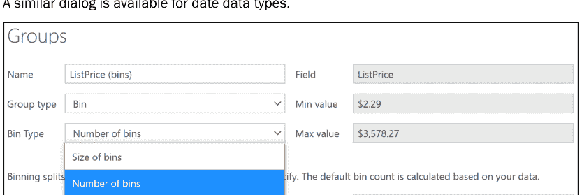

图3.43：数值数据类型列的分箱

## 如何设计列级安全性

要实现本操作，请执行以下步骤：

- 1. 使用两个表中的 **Index** 列在 **Reseller Costs** 和 **Reseller Sales** 表之间创建关系。将此关系设置为一对多，**Reseller Sales** 表位于 **一** 侧，**Reseller Costs** 表位于 **多** 侧。
- 2. 在 **模型** 视图的 **主页** 选项卡或 **报表** 视图的 **建模** 选项卡的功能区中，单击 **管理角色**。
- 3. 使用 **创建** 按钮创建一个 **Sales Person** 角色，该角色在 **Reseller Costs** 表上具有 RLS，使用 DAX 公式 `ISBLANK([Index])`，并 **保存** 该角色。
- 4. 在 **报表** 视图中，使用 **Reseller Sales** 表中的 **SalesOrderNumber** 和 **SalesAmount** 列，以及 **Reseller Costs** 表中的 **ProductStandardCost** 和 **TotalProductCost** 列，创建一个简单的 **表** 可视化。注意，所有列都会显示值。
- 5. 在 **建模** 选项卡的功能区中单击 **查看身份**，选择 **Sales Person**，然后单击 **确定** 按钮。

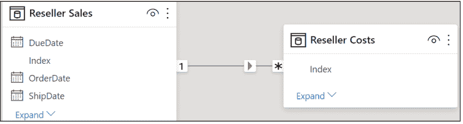

图3.44：所需的多对一关系

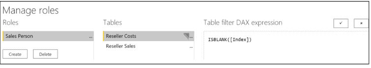

图3.45：管理角色对话框


图3.46：查看身份角色对话框

- 6. 等待可视化刷新，注意 **ProductStandardCost** 和 **TotalProductCost** 列现在为空。

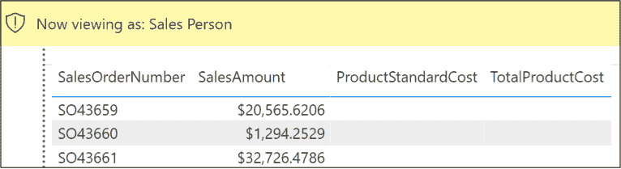

图3.47：以角色身份查看

### 工作原理

本操作的关键在于：在中间查询中实现 **Index** 列，**Reseller Sales** 和 **Reseller Costs** 表之间关系的特性，以及通过 **Sales Person** 角色实现 RLS。

由于 **Index** 列是在一个中间表中创建的，而 **Reseller Sales** 和 **Reseller Costs** 查询均将其引用为 **Source**，因此我们可以确定 **Reseller Sales** 和 **Reseller Costs** 表中的行之间存在一一对应关系。

至关重要的是，**Reseller Sales** 和 **Reseller Costs** 表之间的关系必须是一对多，并且具有 **单个** 交叉筛选方向，尽管从技术上讲，这两个表之间存在一对一关系。原因是一对一关系必须是双向的。这意味着，筛选掉 **Reseller Costs** 表中所有行的 DAX RLS 规则将反过来筛选掉 **Reseller Sales** 表中的所有行，这不是我们期望的结果。

DAX RLS 规则 `ISBLANK([Index])` 会为 **Sales Person** 角色筛选掉 **Reseller Costs** 表中的所有行，因为 **Index** 列永远不会为空。请注意，虽然值被隐藏，但受保护列的元数据在模型中仍然可用。

### 更多内容...

存在其他列级安全性的替代方法。一种方法是使用单个事实表，并使用度量值来实现列安全性。在这种方法中，会创建一个虚拟的 **Security** 表，该表只有一列一行，包含一个值。对于此虚拟表，会为角色创建一个类似的 DAX RLS 规则，例如 `ISBLANK([Column])`。使用此方法，所有需要安全保护的列都会在模型中隐藏，并替换为具有类似于以下语法的度量值：

```dax
IF(ISBLANK(COUNTROWS('Security')),BLANK(),SUM('Reseller Sales'[TotalProductCost]))
```

这种方法可以扩展到处理多个角色，每个角色需要不同的列安全性，方法是在 Security 表中为每个角色设置一行，并设置相应的 RLS 规则，例如 [Column] = "Sales Person"、[Column] = "Marketing" 和 [Column] = "Accounting"。DAX 度量值将相应调整。请注意，虽然值被隐藏，但受保护列的元数据在模型中仍然可用。还可以在 Tabular Editor 中编辑表权限。

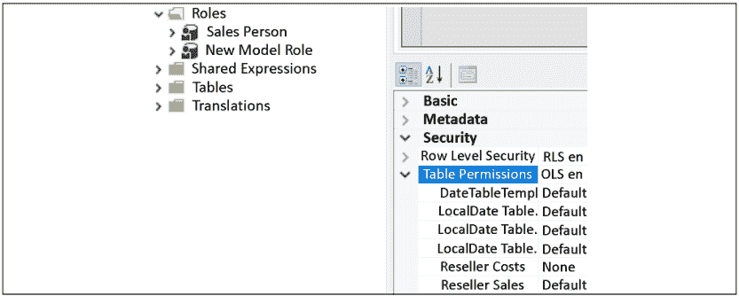

图3.48：Tabular Editor 中角色的表权限

遗憾的是，Power BI Desktop 并未完全支持这一点。

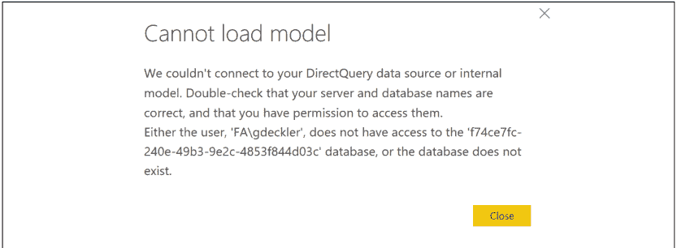

图3.49：Power BI Desktop 中的错误

最后，SSAS 表格 2017 及更高版本实现了真正的 OLS，允许表和列完全对角色屏蔽，包括其元数据。Azure Analysis Services 和 Power BI Premium 也支持 OLS。

### 另请参阅

- 列级安全性：http://bit.ly/2P5Gc20
- Analysis Services 表格模型对象级安全性：http://bit.ly/2PEbCMs
- Analysis Services 2017 中的对象安全性：http://bit.ly/39m1P4S
- 宣布 Power BI 中对象级安全性的公开预览：https://bit.ly/3x182N0

## 利用聚合表

DirectQuery 模式是克服导入模式可伸缩性问题或为业务用户提供实时报表的绝佳工具。但是，DirectQuery 可能很慢，并且会给后端服务器系统带来很大负担，因为每次视觉对象刷新和交互都会向源系统发送查询。聚合表和双模式存储表旨在解决对包含数百万、数十亿和数万亿行的大型数据集使用 DirectQuery 时产生的速度问题。本质上，聚合表预先聚合数据，并将其存储在导入模式中。Power BI 在可能的情况下会在后台使用这些聚合表，以限制发送到数据源的查询数量。

本操作演示如何创建和配置用于 Power BI 报表的聚合表。

### 准备工作

要准备本操作，请执行以下步骤：

- 1. 打开 Power BI Desktop。
- 2. 创建名为 **Internet Sales** 的 DirectQuery 查询，该查询访问 **FactInternetSales** 表。
- 3. 创建名为 **Customers** 的 DirectQuery 查询，该查询访问 **DimCustomers** 表。
- 4. 创建名为 **Dates** 的 DirectQuery 查询，该查询访问 **DimDates** 表。
- 5. 使用以下代码添加一个名为 **Sales Agg** 的查询（编辑 **Source** 行）：

```
let
    Source = Sql.Database("localhost\MSSQLSERVERDEV",
    "AdventureWorksDW2019"),
    Navigation = Source{[Schema="dbo",Item="FactInternetSales"]}[Data],
    Group =
        Table.Group(Navigation, {"OrderDateKey", "CustomerKey"},
        {{"SalesAmount_Sum", each List.Sum([SalesAmount]), type number},
```


```
{"{UnitPrice_Sum}", each List.Sum([UnitPrice]), type number}),
ChangeType = Table.TransformColumnTypes(Group,
    {{"SalesAmount_Sum", Currency.Type},
    {"UnitPrice_Sum", Currency.Type}} )
in
ChangeType
```

+   6. 将 Internet Sales 查询移动到名为 Facts 的查询组中，将 Customers 和 Dates 查询移动到名为 Dimensions 的查询组中，并将 Sales Agg 查询移动到 Other Queries 查询组。
+   7. 在“开始”选项卡的功能区上单击“关闭并应用”以将表加载到数据模型中。
+   8. 在模型中创建以下单向、一对多关系，如图 3.50 所示。

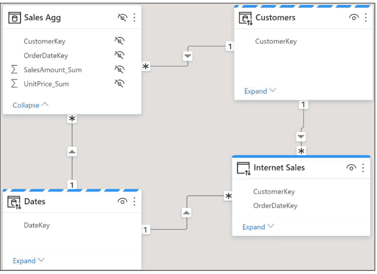

请注意，您可能需要为数据源使用数据库凭据而不是 Windows 凭据。在测试中，我们在尝试使用 Sales Agg 表和维度表创建关系时，使用 Windows 凭据遇到了问题。

# 如何操作

要实现此配方，请使用以下步骤：

+   1. 在 **Model** 视图中，右键单击 **Sales Agg** 表并选择 **Manage aggregations**。
+   2. 为 **Sales Agg** 表创建下面所示的聚合，然后单击 **Apply all** 按钮。

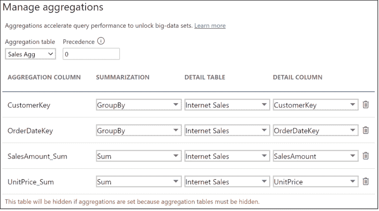

图 3.51：Manage aggregations 对话框

+   3. 在 **Model** 视图中，选择 **Customers** 表，并在 **Properties** 窗格的 **Advanced** 区域中，将 **Storage mode** 设置为 **Dual**。
+   4. 对 **Dates** 表重复 *step 3*。
+   5. 从 SQL Server Management Studio 的 **Tools** 菜单打开 **SQL Server Profiler** 并运行跟踪。
+   6. 创建一个 **Table** 可视化，使用 **Customers** 表中的 **EnglishEducation** 列和 **Internet Sales** 表中的 **SalesAmount** 列。请注意，跟踪中没有任何内容被记录。
+   7. 创建一个 **Clustered column chart**，以 **Dates** 表中的 **CalendarYear** 列作为 **Axis**，以 **Internet Sales** 表中的 **SalesAmount** 列作为 **Values**。同样，没有任何内容被记录。

# 其工作原理

核心事实表 **Internet Sales** 必须设置为 **DirectQuery** 存储模式至关重要，因为聚合表仅适用于设置为 **DirectQuery** 存储模式的明细表。聚合表本身 **Sales Agg** 必须设置为 **Import** 存储模式。与 **Internet Sales** 表和 **Sales Agg** 表都有关系的两个维度表 **Customers** 和 **Dates**，应设置为 **Dual** 存储模式，以便这些表能够在任一模式下最佳运行。配置表的聚合会自动在数据模型中隐藏该表，因为聚合表必须被隐藏。

维度表与聚合表之间必须存在关系。这是因为聚合表在可能的情况下用作详细 **DirectQuery** 模式事实表的替代，因此聚合表应与事实表对维度表具有相同的关系。

在配置聚合时，还必须牢记列数据类型。这是因为 **Manage aggregations** 对话框强制执行 **Detail Column** 必须与 **Aggregation Column** 具有相同数据类型的规则。唯一例外是 **Count** 和 **Count table rows** 的 **Summarizations**。**Count** 和 **Count table rows** 需要整数聚合列，但不要求 **Detail Column** 的数据类型匹配。

其他限制包括链式聚合、由 DAX USERELATIONSHIP 函数支持的非活动关系的使用，以及使用相同的 **Summarization**、**Detail Table** 和 **Detail Column** 的重复聚合。均不支持这些场景。

# 还有更多...

为了正常运行，RLS 表达式应同时过滤明细表和聚合表。事实上，一旦为表设置了聚合，仅过滤聚合表而不过滤关联 **Detail Table** 的 RLS 表达式将不被 **Manage roles** 对话框允许。

**Manage roles** 对话框包括设置 **Precedence** 的功能。这意味着您可以拥有不同粒度级别的多个聚合表，并设置这些聚合表的 **Precedence**，以便它们可以被单个子查询考虑。例如，如果 **Products** 表包含在此模型中，您可能会为 **Product Category** 创建一个聚合表，并为 **Product Subcategory** 创建一个单独的聚合表。您将把 **Product Category** 聚合表的粒度设置为 10，并将 **Product Subcategory** 聚合表的粒度设置为 0。子查询将首先考虑粒度最高的聚合表，如果该粒度级别不足，则会考虑粒度较低的其他聚合表。
