# Authoring Power  
BI Reports

Power BI 报表是仪表板、数据探索以及 Power BI 中内容协作和分发的构建基块。Power BI Desktop 提供了丰富的数据可视化功能和选项，使能够在各种设备上构建高度针对性、用户友好的报表成为可能。由于每个 Power BI Desktop 报表可以包含多个页面，每个页面包含多个视觉对象，因此单个 Power BI 报表可以支持多种用例、受众和业务需求。例如，KPI 视觉对象可以固定到 Power BI 服务中的仪表板，而报表页面可以支持详细、特定领域的分析。这些功能可直接与竞争对手分析平台的可视化产品竞争，并且可以通过自定义视觉对象和报表主题进一步扩展。

报表设计中 Power BI 可视化功能的选型和配置对于从 *Chapter 2, Accessing and Retrieving Data* 和 *Chapter 3, Building a Power BI Data Model* 中涵盖的数据检索和建模过程中获取价值至关重要。在本章中，我们开发并描述了最基本的报表可视化和设计概念。此外，还提供了指导，以增强和控制用户在 Windows 和移动设备上与 Power BI 报表交互和使用时的用户体验。

在本章中，我们将介绍以下配方：

+   - Building Rich and Intuitive Reports
+   - Filtering at Different Scopes
+   - Integrating Card Visualizations
+   - Using Slicers
+   - Controlling Visual Interactions

# Getting ready

利益相关者矩阵可以帮助围绕访问模型和报表的不同各方需求来构建报表设计规划过程。利益相关者或业务部门，例如 Merchandising，出现在列轴上，并取代了第 3 章《Building a Power BI Data Model》中数据仓库总线矩阵中使用的规范化维度（即 Product 或 Vendor）。

|  | Stakeholders |  |  |  |  |  |  |  |
|---|---|---|---|---|---|---|---|---|
| BUSINESS PROCESSES | Executive | Sales | Finance | Marketing | Merchandising | eCommerce | Customer Service | Supply Chain |
| Internet Sales | ✓ | ✓ | ✓ | ✓ | ✓ | ✓ |  |  |
| Internet Sales Plan | ✓ | ✓ |  | ✓ |  | ✓ | ✓ | ✓ |
| Reseller Sales | ✓ | ✓ | ✓ |  | ✓ |  |  |  |
| General Ledger | ✓ |  | ✓ |  |  |  |  |  |
| Inventory |  |  | ✓ | ✓ | ✓ | ✓ |  |  |
| Customer Surveys | ✓ | ✓ | ✓ | ✓ |  | ✓ | ✓ | ✓ |
| Customer Service Calls |  |  | ✓ |  |  |  | ✓ |  |
| Shipping |  |  | ✓ |  | ✓ |  |  | ✓ |

图 4.1：利益相关者矩阵

在此示例中，数据模型包含四个突出显示的事实表：Internet Sales、Internet Sales Plan、Reseller Sales 和 General Ledger。当给定业务职能内可能存在多个具有各自独特需求和用例的利益相关者时，这些利益相关者可以作为列添加到利益相关者矩阵中。在 Power BI 中，有许多选项可使用相同的数据模型和底层检索和数据架构来满足不同利益相关者的独特需求。

# How to Build Reports

虽然报表开发应是一个敏捷过程，在报表设计和开发过程中应定期征求利益相关者的反馈，但在报表开始前进行扎实的规划和设计过程对于了解其范围和要求非常有益。单个报表不应试图解决不相关的业务问题或满足高度多样化用户（如企业财务分析师或商店经理）的需求。多范围报表可能导致复杂的用户体验和报表级定制，这难以维护和扩展。报表规划和设计过程应回答以下五个问题：

+   1. 谁将访问此报表？
+   2. 此报表的首要优先事项在业务问题方面是什么？
+   3. 报表将如何访问和使用？


报告将如何被访问和使用？报告将如何被访问，以及业务用户希望如何与报告交互，是在开始报告开发之前就应该回答的关键问题。报告的访问方式和交互性是报告设计人员应该理解的关键组成部分，以确保报告包含适当的元素、视图、筛选器和度量值。请考虑以下事项：

-   用户是仅查看报告，还是将报告作为进一步分析的起点？
-   如果希望不进行交互或仅进行有限的交互，请计划在报告中嵌入条件逻辑和异常情况。
-   如果交互性较高，请计划使用层次结构、工具提示和切片器来实现数据探索。
-   报告与现有仪表板有何关系？
-   确定报告中将对现有仪表板有所贡献的组件。
-   如果基于该报告创建新仪表板，请确定磁贴和交互方式。
-   报告是仅通过 Web 浏览器访问，还是会定期使用移动设备？
-   如果预期有移动端消费，可以针对这种体验进行报告设计。
-   Power BI 仪表板也可以在 Power BI 服务中针对手机布局进行优化。

所需数据的更新频率是多少？这会影响模型吗？所需数据的更新频率会影响所选择的存储模式，无论是导入模式、DirectQuery 模式、双模式，甚至是流式数据集。导入模式模型对于只需要每天刷新一两次数据的业务用户来说可能已经足够，但对于需要更即时更新频率的业务用户，DirectQuery 模型可能更为合适。其他因素也可能影响修改数据模型的需求，包括：

-   如果某项报告需求对某个利益相关者群体的所有报告都具有系统性影响，请考虑修改模型。
-   如果需要进行复杂的报告级自定义，或者性能不佳，请考虑修改模型。
-   这些修改通常包括新的逻辑属性或新的 DAX 度量值。

最后，理解在 Power BI Desktop 中创建的 Power BI 报告并非适用于所有报告类型，这一点至关重要。多页打印、以各种文件格式附加数据的电子邮件订阅以及像素级完美格式控制等报告需求，与在 Power BI Report Builder 中创建的分页报告更为匹配。同样，涉及单元格级控制和格式设置的自定义布局的财务报表和会计报告通常更适合使用 Excel。幸运的是，Power BI 完全支持另外这两种报告类型，因此可以开发包含全部三种不同报告类型的解决方案。

## 工作原理

在此示例中，利益相关者是欧洲销售区域组，由法国、德国和英国组成。规划过程揭示了两种主要用户类型。第一种用户是欧洲销售组经理，负责管理整个销售区域。第二种用户是负责各个国家的经理。

确定的首要优先级是按国家和产品细分（相对于类别、子类别和型号）查看和分析月度粒度的互联网销售与计划、经销商销售和销售利润率。国家经理希望获得州/省、城市和邮政编码级别的更细粒度地理数据。整个组织在会计核算上采用会计日历，但业务利益相关者希望报告在报告数据时使用日历月而不是会计月。业务方还对随时间比较互联网销售与客户数量感兴趣。

关于报告的访问和使用方式，欧洲销售组经理需要整个欧洲销售区域的关键事实、数据和趋势；预计该经理不会与报告进行大量交互，但仍应有机会在需要时深入查看数据。欧洲销售组经理希望获得一份可以在手机上查看的移动报告，因为此人经常在国家之间出差，始终处于移动状态。各个国家经理希望以高度交互的方式分析自己的数据。国家级经理也对销售计划负责，但他们对更大的自助服务灵活性感兴趣，并且需要一些表格格式的详细报告，以展示多个度量值的具体数值。国家经理预计将通过桌面端 Web 浏览器访问报告。

在数据更新速度方面，销售组经理和国家经理都认为每日刷新一次或两次是可以接受的，因为主要关注的粒度是月度数据。各方还一致认为，使用美式英语名称、描述和货币最能满足该团队的需求。根据规划过程中确定的需求，决定了模型必须包含互联网销售、经销商销售、总账和互联网销售计划的事实表。此外，还需要以下维度：产品、账户、带地理数据的客户、日期、部门、组织、员工、经销商、促销和销售区域。目前没有任何单一模型包含所有所需信息，因此决定开发一个新模型。

需求收集完成后，确定报告将包含两到四个主要报告页，每个国家一个页面（或一个单独的钻取国家页面），以及一个供欧洲销售组经理使用的页面。所有报告页面左上角都将包含相同的四个优先度量值：月度互联网销售、月度互联网利润率%、月度经销商销售和月度经销商利润率%，以及一个按日历年和日历月显示的**互联网销售与计划**图表。对于没有目标或目标值（计划）的度量值，使用过去 6 个月的平均值度量。

考虑到性能和可用性，决定将每页的视觉对象数量限制为四五个，并避免密集的“数据提取或转储”视觉对象。此限制不适用于卡片图、仪表图和 KPI 视觉对象。DAX 查询是为报告视觉对象生成的，与密集视觉对象（如包含许多行和列的表格或矩阵）关联的查询比卡片图和 KPI 视觉对象慢得多。此外，包含许多视觉对象的报告页面可能显得拥挤且难以使用。此外，还将研究在报告和页面级别应用简单筛选器（当前年份或上一年份）的机会，以进一步提高性能。报告将在报告级别按欧洲筛选，并针对这些特定页面在页面级别按各个国家筛选。

报告有效性的一个可靠预测指标是业务见解（度量值、上下文或分析）与用户消费信息所需付出的努力之间的比率。理想情况下，报告应提供开箱即用的分析，用户只需要访问权限以及对术语和领域的基本了解即可。用户需要滚动、点击以及避开不必要的颜色或数据元素的操作越多，报告的有效性就越低。

规划和设计完成后，创建报告页面的线框图，向用户展示，并进行完善。

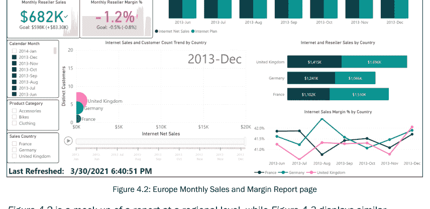

图 4.2：欧洲月度销售和利润率报告页面

图 4.2 是区域级别报告的线框图，而图 4.3 在国家级别显示类似信息。

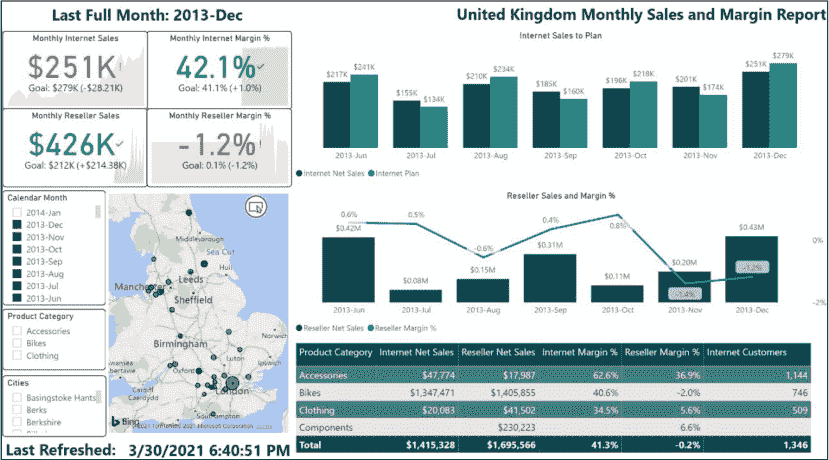

图 4.3：英国报告页面

根据用户反馈，使用带有月度趋势和目标度量值的 KPI 视觉对象，与卡片图或仪表图视觉对象相比，能提供更丰富的上下文。总体而言，选择了一种在视觉感知和额外分析上下文方面具有优势的标准视觉对象类型。例如，使用 KPI 而不是卡片视觉对象；避免使用仪表图、树状图和饼图。对于**互联网销售与计划**，选择了聚集柱形图而不是折线图，因为每个月的单个数值都很重要。一目了然，每个国家报告页面还通过自动更新的 KPI 视觉对象提供数值。

其他设计决策包括以下内容：

- 切片器视觉对象以及散点图上的**播放**轴排列在左侧，以支持用户的筛选选择。
- 将鼠标悬停在地图中的气泡或图表中的条形图上时，会通过工具提示显示其他度量值。
- 页面标题使用文本框，最后刷新日期页脚是卡片视觉对象。检索使用`DateTime.LocalNow`函数的 M 查询，并将其传递给 DAX 度量值，返回文本。
- 图表标题经过自定义，并在可能的情况下移除 y 轴。


本章其他配方中包含了本示例中使用的各个报表组件的更多详细信息。

## There's more...

与 *Chapter 3, Building a Power BI Data Model* 中分享的数据建模简单却重要的细节类似，若干设计实践显著提升了 Power BI 报表的价值和用户采用率：

- **Minimalism:** 任何对理解并非严格必需的报表元素都应移除。示例包括图像、冗余图表轴、冗长文本和不必要的数据图例。
- **Efficient visuals:** 利用在相同空间内提供额外洞察的可视化对象和功能；示例包括 KPI 和组合图表可视化、工具提示、趋势线和颜色饱和度。
- **Meaningful colors:** 颜色应用于传达含义，例如相对于目标或度量的高或低差异。应选择性地使用颜色，避免因颜色种类或密度过多而使用户感到不知所措或分心。
- **Organized:** 报表可视化应保持对齐、分布均匀，并位于相关可视化附近。最重要的可视化应位于画布左上角，空白应分隔可视化。
- **Consistent:** 布局和格式选择，例如可视化放置、字体和文本对齐应保持一致。例如， slicer 可视化应始终放置在可视化的左侧或顶部。

关于一致性，Power BI 支持包含标准调色板、字体、字体大小以及控制报表和可视化默认值的其他元数据元素的报表主题。Power BI 报表默认设置的几乎每个方面都可被控制，包括轴标题是否显示、标签方向、图例标记，以及页面和可视化在 **Format** 选项卡中出现的几乎所有内容。

许多组织将拥有标准报表主题，甚至标准报表布局。通常，这些主题反映了企业品牌和身份。在本示例中，对报表应用了报表主题，以便色觉缺陷的用户能够清晰地理解：

- 从报表主题库下载 **Color Blind Friendly** 主题 https://aka.ms/pbithemes。 使用 ColorblindSafe-Longer.json 文件。
- 在 Power BI Desktop 中打开 CH4_Start.pbix 并将此文件另存为 CH4_R1.pbix。

在 **View** 选项卡的 ribbon 中，单击 **Themes** 区域中的下拉箭头并选择 **Browse for themes**：


浏览到下载的 JSON 文件，选择它并单击 **Open**。 将出现一条消息，说明主题已成功导入。 主题设置将应用于报表。 现在用于格式化可视化的颜色反映了主题的颜色。 保存 CH4_R1.pbix。


主题无法在 Power BI 服务中应用，并且某些自定义可视化不应用报表主题。 此外，报表主题不影响图像的颜色，也不覆盖对可视化中特定数据点应用的任何自定义颜色。 在开发报表时尽早应用主题非常重要，以避免在应用主题后花费数小时的格式设置突然被撤销的情况！

每个报表主题 JSON 文件都具有与 *Figure 4.6* 所示一致的颜色代码映射元素结构。

```json
{
  "name": "ColorBlindSafe-Longer",
  "dataColors": ["#074650", "#009292", "#edc948", "#eb6ba4", "#490091", "#b5d6ff", "#b3dafe", "#6db6ff", "#914800", "#23cfd3"],
  "background": "#FFFFFF",
  "foreground": "#074650",
  "tableAccent": "#f2e6db"
}
```

JSON 文件中仅 **Name** 字段是必需的。可以在 dataColors 字段中输入任意数量的不同代码。

## See also

- ▶ Visualizations in Power BI reports: http://bit.ly/2poUeMv
- ▶ Tips For Power BI Report Design – Best Practices: http://bit.ly/3fmFXPf
- ▶ Power BI Best Practices Guide: http://bit.ly/3cxCs29
- ▶ Power BI Community Themes Gallery: https://aka.ms/pbithmes
- ▶ Use report themes in Power BI Desktop: http://bit.ly/31vBixz
- ▶ Theme generator: https://themes.powerbi.tips/

## Filtering at Different Scopes

过滤器可针对 Power BI 报表的每个架构级别进行配置，包括整个报表、报表页面和单个可视化。由于报表过滤器在设计时配置且不像切片器那样在画布上公开，因此过滤器提供了一种强大而高效的方法，可根据特定需求自定义报表元素。 与访问报表的用户或团队或要分析的特定实体相一致的报表级和页面级过滤器可提供即时关注和一定程度的组织。例如，为一个产品类别构建的报表页面可以为其他产品类别页面复制，每个页面包含不同的页面级过滤器。可视化级过滤器提供更大的灵活性，因为除了报表级和页面级过滤器之外，还可以定义包括度量在内的复杂过滤条件。

在本配方中，提供了在三个不同范围实现过滤器的示例。本节演示了 Top N 可视化级过滤条件，并在 How it works 中分享了过滤器类型生成的 DAX 查询示例。

### Getting ready

为准备本配方，请执行以下步骤：

- 1. 打开 CH4_R1.pbix 文件并将其另存为 CH4_R2.pbix。
- 2. 右键单击页面选项卡并选择 Rename Page，将 Page 1 重命名为 Europe：


Figure 4.7: Page renaming and creation

### Authoring Power BI Reports

- 3. 使用 **+** 图标创建四个额外的报表页面，命名为 **France**、**Germany** 和 **United Kingdom**，以及 **Scratch**：


Figure 4.8: Report pages

- 4. 保存您的工作。

### How to Filter at Different Scopes

要实现本配方，请使用以下步骤：

- 1. 切换到 **Europe** 页面。
- 2. 在 **Fields** 窗格中，将 **Sales Territories** 表中的 **Sales Territory Group** 列拖到 **Filters** 窗格中的 **Filters on all pages** 区域。
- 3. 使用 **Basic filtering** 选择 **Europe**。

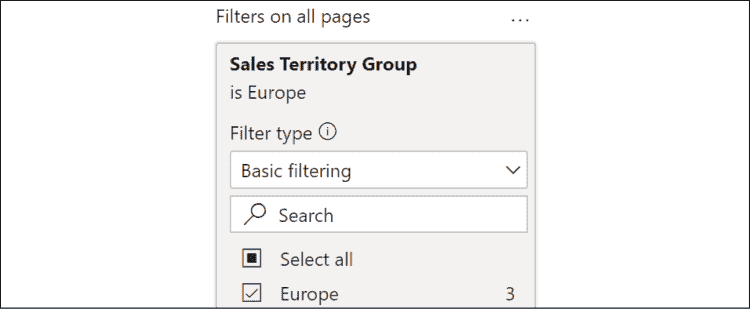

Figure 4.9: Report-level filter for European Sales and Margin Monthly Report

- 4. 同样地，在 **France**、**Germany** 和 **United Kingdom** 的国家页面上，将 **Sales Territories** 表中的 **Sales Territory Country** 列从 **Fields** 窗格拖到 **Filters** 窗格中的 **Filters on this page** 区域，并从 **Basic filtering** 中为页面选择相应的国家。
- 5. 现在选择 **Scratch** 页面。
- 6. 通过从 **Visualizations** 窗格中选择 **Table visual** 创建 **Table visualization**，然后从 **Fields** 窗格中添加 **Sales Territories** 表中的 **Sales Territory Country** 和 **Internet Sales** 表中的 **Internet Gross Sales** 度量。
- 7. 选择 **Table visualization**，并在 **Filters** 窗格中展开 **Filters on this visual** 部分中的 **Internet Gross Sales** 区域。
- 8. 从 **Show items when the value** 下的下拉菜单中选择 **is greater than**，并在下拉菜单下方的字段中输入 `3000000`。
- 9. 单击 **Apply filter** 将过滤器应用于可视化。

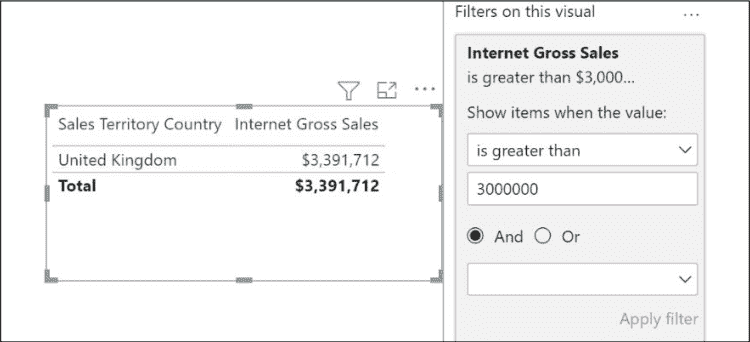

Figure 4.10: Visual-level filter

### How it works

报表级过滤器会影响报表中的所有页面；因此，当过滤器应用于 **Filters** 窗格的 **Filters on all pages** 区域时，只要模型中存在维度关系且 DAX 未覆盖过滤器，所有页面上的所有可视化都会遵守此过滤器。对于上一配方中描述的报表，已确定欧洲团队无需查看其他销售组或国家，因此我们对整个报表（所有页面）按 **Sales Territory Group of Europe** 进行过滤。同样，页面级过滤器仅影响其应用的页面上的可视化。因此，我们将每个国家页面过滤为适当的 **Sales Territory Country**。

报表级和页面级过滤器最常在维度层次结构的相对静态且唯一值较少的不同级别实现，例如本配方中的示例。日期范围过滤器通常应应用于数据检索查询或报表画布中，使用日期切片器等可视化。由于这些过滤器分别应用于报表或页面中的所有可视化，因此应避免对高基数列（如 **ProductKey** 或 **Sales Order Number**）进行过滤。DAX 度量不能用于定义报表级和页面级过滤器。

可视化级过滤器可以基于数据模型中的度量和列。这些度量和列可能存在于可视化中，也可能不存在。


Power BI 创建的 DAX 查询揭示了不同筛选器层的实现方式。使用 DAX Studio，我们可以查看用于存储报表级和页面级筛选器（以及切片器选择）的 DAX 变量：

```
DEFINE
VAR __DS0FilterTable =
TREATAS({"Europe"}, 'Sales Territories'[Sales Territory Group])
```

图 4.11：DAX Studio 中的 DAX 报表级筛选器变量

视觉级筛选器也是变量，但使用报表级和页面级变量作为输入。Power BI 创建的 DAX 查询利用了最新的函数和功能，例如变量、VAR 和 TREATAS。

## 更多内容...

除了基本筛选，还有更高级的筛选选项，包括高级筛选和 Top N 筛选。文本列和数值列均支持 AND 条件和 OR 条件，以创建更复杂的筛选条件。要了解其工作原理，请按照以下步骤操作：

1. 选择在“Scratch”页面上创建的表格可视化。
2. 在“筛选器”窗格中，清除“Internet Gross Sales”中的视觉级筛选器。
3. 展开“此视觉对象上的筛选器”部分中的“Sales Territory Country”区域，并将“筛选器类型”切换为“高级筛选”。
4. 在“当值为下列项时显示项目”下拉列表中选择“包含”，在下方字段中输入字母 a，然后单击“应用筛选器”。United Kingdom 将从表格可视化中消失。
5. 清除此筛选器并将“筛选器类型”更改为“Top N”。
6. 在“显示项目”下，选择“Top”并输入数字 2。
7. 将 Reseller Sales 表中的 Reseller Net Sales 度量值拖到“按值”区域，然后点击“应用筛选器”。此时 Germany 从表格中消失。

如果需要复杂的筛选条件，或者需要对包含许多不同值的列（例如 Sales Order Number）进行筛选，则在数据检索或模型中考虑此逻辑可能会有所帮助，从而简化生成的 DAX 查询。

此外，报表级、页面级和视觉级筛选器可以使用 DAX 度量值覆盖。要了解其工作原理，请在 Sales Territories 表中创建以下度量值：

```
Count Countries = COUNTROWS(ALL('Sales Territories'))
```

在 **Scratch** 页面上使用**卡片可视化**来显示此新度量值，并观察该度量值为 **11**。无论应用何种报表级、页面级和视觉级筛选器，此度量值始终为 **11**。DAX 函数 ALL 会覆盖应用于 **Sales Territories** 表的筛选器。

## 另请参阅

- Power BI 报表中的筛选器和突出显示：http://bit.ly/39y0msh
- Power BI 报表中的筛选器类型：http://bit.ly/3sBkMrQ

## 集成卡片可视化

卡片和多行卡片可视化通常位于报表页面的顶部和左侧区域，因为单个度量值和少量度量值组合很重要。虽然卡片在图形效果和交互性方面不如其他视觉对象，但卡片也是固定到 Power BI 仪表板的最常见磁贴，并且经常用于手机布局中以供移动查看。报表设计中的一个常见做法是，以卡片或 KPI 视觉对象的形式呈现几个高级度量值，然后围绕它们构建其他图表和表格视觉对象。

本教程演示如何使用卡片、多行卡片、KPI 和仪表可视化，以及文本框。

### 准备工作

若要准备本教程，请按照以下步骤操作：

1. 打开 **CH4_R2.pbix** 文件，并将其另存为 CH4_R3.pbix。
2. 切换到 **Scratch** 页面，然后使用 Ctrl-A 和 Delete 删除所有视觉对象。
3. 检查**筛选器**窗格，确保只有 **Europe** 筛选器处于活动状态。

### 如何集成卡片可视化

若要实施本教程，请执行以下步骤：

1. 选择 **Europe** 页面。
2. 使用**可视化**窗格创建**卡片可视化**，然后在**字段**列表中选择 **Calculations** 表中的 **Last Full Month** 度量值。
3. 在**格式**窗格中，将**类别**和**背景**滑块切换为“关闭”。

   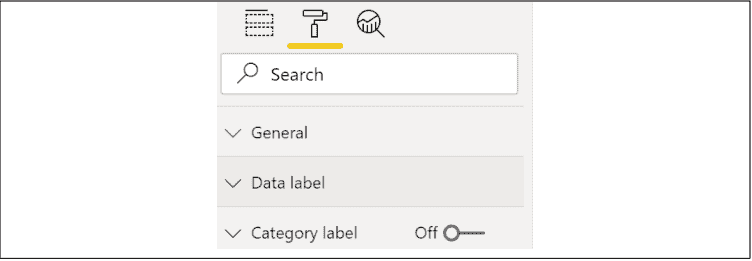

   图 4.12：“格式”窗格

4. 展开**数据标签**部分，将**文本大小**设置为 **18**，将**字体系列**设置为 **Segoe（粗体）**。
5. 展开**常规**部分，将**X 位置**设置为 **0**，**Y 位置**设置为 **0**，**宽度**设置为 **448**，**高度**设置为 **48**。通常建议先设置**宽度**和**高度**，再设置**X 位置**和**Y 位置**。
6. 单击页面画布的空白区域，重复步骤 2、3 和 4 以创建另一个显示 **Date Last Refreshed** 度量值的**卡片可视化**；在**常规**部分中，将**X 位置**设置为 **168**，**Y 位置**设置为 **680**，**宽度**设置为 **305**，**高度**设置为 **36**。
7. 单击页面画布的空白区域，在**插入**选项卡的功能区中选择**文本框**，然后输入 *欧洲每月销售和利润报告*。
8. 使用 **Ctrl-A** 选择所有文本，然后将字体更改为 **Segoe（粗体）**，设置文本大小为 **18**，并使文本右对齐。

   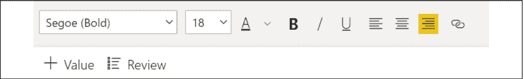

   图 4.13：格式化时要选择的设置

9. 在**设置文本框格式**窗格中，将**背景**滑块切换为“关闭”，并在**常规**部分中将**X 位置**设置为 **624**，**Y 位置**设置为 **0**，**宽度**设置为 **656**，**高度**设置为 **48**。
10. 选择刚刚创建的**文本框**元素，然后使用 **Ctrl-C** 和 **Ctrl-V** 在页面上复制并粘贴该视觉对象。
11. 重新定位新的**文本框**元素，将文本替换为**上次刷新时间：**，并使文本左对齐。
12. 在**设置文本框格式**窗格的**常规**部分中，将**X 位置**设置为 **0**，**Y 位置**设置为 **675**，**宽度**设置为 **190**，**高度**设置为 **45**。
13. 单击画布的空白区域，然后从**可视化**窗格中选择 KPI 可视化。
14. 在**字段**列表中，展开 **Internet Sales** 表，选择 **Internet Monthly Net Sales** 度量值作为**指示器**，选择 **Internet Monthly Sales Goal** 度量值作为**目标**。在 **Dates** 表中，使用 **Year Month** 列作为**趋势轴**。
15. 通过展开**标题**部分、将**标题**重命名为**每月 Internet 销售额**并居中**标题**，来设置刚刚创建的 KPI 视觉对象的格式。
16. 在**指示器**部分中，将**显示单位**设置为**千**，**值小数位数**设置为 **0**，**文本大小**设置为 **40**。
17. 在**常规**部分中，将**X 位置**设置为 **0**，**Y 位置**设置为 **48**，**宽度**设置为 **225**，**高度**设置为 **122**。
18. 将**边框**滑块切换为“打开”，展开**边框**部分，并将**圆角半径**设置为 **5**。
19. 在**目标**部分中，将**标签**从**百分比**更改为**值**。

    

    图 4.14：KPI 可视化

20. 选择 KPI 可视化，然后使用 *Ctrl-C* 和 *Ctrl-V* 复制并粘贴该视觉对象。
21. 在页面上重新定位新的 KPI 视觉对象，并将**指示器**和**目标**分别替换为 **Internet Sales** 表中的 **Internet Monthly Margin %** 和 **Internet Monthly Margin % Goal** 度量值。
22. 设置此新 KPI 可视化的格式：将**标题**更改为**每月 Internet 利润率 %**，将**指示器显示单位**更改为**自动**，并在**常规**部分中将**X 位置**设置为 **224**，**Y 位置**设置为 **48**。
23. 按住 *Ctrl* 键，然后使用鼠标选择两个 KPI 视觉对象。
24. 使用 *Ctrl-C* 和 *Ctrl-V* 复制并粘贴这两个视觉对象，然后在页面上重新定位它们。
25. 对于**每月 Internet 销售额**视觉对象，将**指示器**和**目标**分别替换为 **Reseller Sales** 表中的 **Reseller Monthly Net Sales** 和 **Reseller Monthly Sales Goal** 度量值。
26. 设置此新 KPI 可视化的格式：将**标题**更改为**每月经销商销售额**，并在**常规**部分中将**X 位置**设置为 **0**，**Y 位置**设置为 **168**。


虽然在显示数值时应当优先使用 KPI 可视化效果，但卡片可视化也可以非常有效地用于显示动态文本数据，例如 **Date Last Refreshed** 列和 **Last Refreshed** 度量。**Last Refreshed** 度量的公式如下：

```
Last Full Month = "Last Full Month: " & FORMAT(EOMONTH([Today],-1),"yyyy-mmm")
```

**Date Last Refreshed** 列是使用以下 Power Query 查询创建的：

```
let Source = #table(type table[Date Last Refreshed=datetime], {{DateTime.LocalNow()}}) in Source
```

静态文本信息可以使用简单的**文本框**元素显示，例如右上角的报告/页面标题和左下角的 **Last Refreshed:**。但是，文本框也可以通过问答（Q&A）功能实现动态显示，该功能可以在**文本框**格式对话框的**值**和**查看**对话框中访问。

## 更多内容...

Power BI Desktop 的默认可视化库中还有两种卡片式和 KPI 式可视化效果：**多行卡片**和**仪表**可视化效果。多行卡片通常围绕共同维度和度量进行组织，并常常放置在 **KPI** 或**仪表**可视化的右侧作为补充详细信息。若要查看**多行卡片**可视化效果的实际应用，请按照以下步骤操作：

- 1. 切换到 **Scratch** 页面。
- 2. 在**可视化**窗格中选择**多行卡片可视化**，然后将 **Internet Sales** 表中的 **Internet Customer Count France**、**Internet Customer Count Germany** 和 **Internet Customer Count United Kingdom** 度量放置在可视化的**字段**区域中。


图 4.15：多行卡片可视化

Power BI Desktop 还包含一个**仪表**可视化，它是仪表板中**卡片**和 **KPI** 可视化的流行替代方案。若要查看**仪表**可视化的实际效果，请按照以下步骤操作：

- 1. 从 **Europe** 页面复制 **Monthly Internet Sales KPI** 可视化，并将其粘贴到 **Scratch** 页面。
- 2. 选中 KPI 可视化后，单击**可视化**窗格中的**仪表**可视化，将 KPI 可视化转换为**仪表**可视化。

3. 将**值**设置为 **Internet Monthly Net Sales** 度量，将**目标值**设置为 **Internet Monthly Sales Goal** 度量。


图 4.16：比较两个度量的仪表可视化（值与目标值）

## 另请参阅

- - **关键绩效指标（KPI）** 可视化：http://bit.ly/3rFPxe7
- - Power BI 中的径向仪表图：http://bit.ly/2PgtTjv
- - 卡片可视化（大数字磁贴）：http://bit.ly/3uaMPib
- - 在 Power BI 中复制并粘贴可视化效果：http://bit.ly/39vECNL
- - 开始设置 Power BI 可视化格式：http://bit.ly/3sGqzwm

## 使用切片器

切片器可视化是用户向报表页面的其他可视化应用筛选选择的主要方式，因此其实现方式极大地影响了可用性和分析灵活性。尽管用户与其他可视化的交互也会对其他可视化应用交叉筛选，但切片器提供了定义特定筛选条件（例如三个特定月份和两个产品类别）的最快、最直观的方法。切片器可视化还具有用于定义选择行为的独特格式选项，包括**全选**选项。

切片器的替代方法是使用“筛选”窗格。虽然对最终用户来说可能不那么明显，并且需要特定的培训，但与切片器相比，使用“筛选”窗格确实具有节省画布空间的优势。然而，尽管“筛选”窗格可以提供切片器常见的一些基本使用场景，但切片器在与页面上不同可视化的交互、跨特定页面的切片器同步以及筛选元素相对于其他可视化的布局和位置方面提供了更大的灵活性。

在本节中，我们将探讨切片器的主要用例和报表设计注意事项，包括选择属性和格式选项。我们还将回顾适用于**日期**数据类型的切片器筛选配置，并提供有关文本搜索和替代切片器可视化的更多详细信息。

## 准备工作

若要准备本节内容，请按照以下步骤操作：

- 1. 打开 CH4_R3.pbix 文件，并将文件另存为 CH4_R4.pbix。
- 2. 切换到 Scratch 页面，然后使用 Ctrl-A 再按 Delete 删除所有可视化。
- 3. 检查筛选窗格，确保仅激活 Europe 筛选器。

## 如何使用切片器

若要实现本节内容，请使用以下步骤：

- 1. 选择 Europe 页面。
- 2. 使用可视化窗格创建切片器可视化，然后在字段列表中选择 Dates 表中的 Year Month 列。
- 3. 选中切片器后，使用省略号 (...) 将排序更改为降序排序。

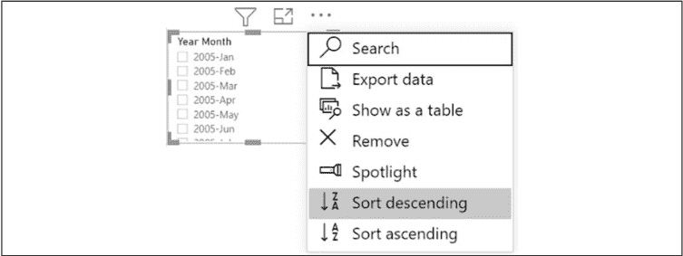

- 4. 在格式窗格中，将切片器标头设置为关闭，将标题设置为开启，并将标题更改为 Calendar Month。
- 5. 在格式窗格中，将边框设置为开启，并将半径设置为 5；在常规部分，将 X 位置设置为 0，Y 位置设置为 295，宽度设置为 160，高度设置为 178。
- 6. 为 Products 表中的 Product Category 列创建第二个切片器。
- 7. 右键单击切片器中的 (Blank) 选项，然后选择排除。对 Components 重复此操作。
- 8. 在格式窗格中，将切片器标头设置为关闭，将标题设置为开启，并将标题更改为 Product Category。

- 9. 另外，在**格式**窗格中，将**边框**设置为**开启**，并将**半径**设置为 **5**；在**常规**部分，将 **X 位置**设置为 **0**、**Y 位置**设置为 **479**、**宽度**设置为 **160**、**高度**设置为 **95**。
- 10. 使用 *Ctrl-C* 和 *Ctrl-V* 复制并粘贴 **Product Category** 切片器。
- 11. 在页面上重新定位新切片器，将切片器的**字段**替换为 **Sales Territories** 表中的 **Sales Territory Country** 列，并将切片器的**标题**编辑为 **Country**。
- 12. 编辑 **Country** 切片器的**常规**设置，将 **X 位置**设置为 **0**、**Y 位置**设置为 **580**、**宽度**设置为 **160**、**高度**设置为 **94**。
- 13. 选择这三个切片器，然后使用 *Ctrl-C* 进行复制。
- 14. 切换到 **France** 页面，使用 *Ctrl-V* 粘贴这些切片器，并在**同步可视化**提示中选择**同步**。
- 15. 在**视图**选项卡的功能区中选择**同步切片器**，选择 **Country** 切片器，然后取消选中 **France** 页面的同步。正确的配置如 *图 4.19* 所示。
- 16. 关闭**同步切片器**窗格，将 **Country** 切片器的**字段**替换为 **Customers** 表中的 **State/ Province** 列，并将**标题**编辑为 **Regions**。
- 17. 将 **Calendar Month** 和 **Product Category** 切片器复制到 **Germany** 和 **United Kingdom** 页面，两次都选择**同步**。
- 18. 将 **Regions** 切片器从 **France** 页面复制到 **Germany** 和 **United Kingdom** 页面，但这次在两个实例中都选择**不同步**。

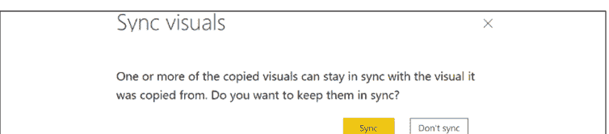

图 4.18：同步可视化提示


图 4.19：同步切片器控件

- 19. 在 **Germany** 页面上，将 **Regions** 切片器的**标题**更改为 **States**。
- 20. 在 **United Kingdom** 页面上，将 **Regions** 切片器的**字段**替换为 **Customers** 表中的 **City** 列，并将**标题**更改为 **Cities**。
- 21. 在 **Europe** 页面的 **Calendar Month** 切片器中选择以下值：**2013-Dec, 2013-Nov, 2013-Oct, 2013-Sept, 2013-Aug,** 和 **2013-Jul**。
- 22. 切换到其他页面时，这些页面上的 **Calendar Month** 切片器也会具有这些选择。
- 23. 保存您的工作。

## 工作原理

切片器是重要的 Power BI 可视化对象，因此在确定切片器列时应仔细考虑。通常，切片器列是父级维度，例如年份或区域，且单个值较少。选择值较少的列可以允许这些项以列表形式在画布上显示，而不是使用下拉列表。使用过多的切片器，或具有过多不同值的切片器，会降低报表页面的可用性。如果没有大量的 DAX 自定义来解释筛选选择，用户可能不确定已应用了哪些筛选器。度量不能用于切片器，但切片器支持在其**字段**区域中使用层次结构和临时层次结构。

建议将切片器放置在页面上所有其他可视化的左侧。使用边框和/或背景颜色设置切片器可视化格式，使切片器在页面上突出显示。关于使用**切片器标头**还是**标题**，请选择其中一个，并在页面上所有切片器中保持一致。**切片器标头**提供**清除选择**选项（橡皮擦图标），并允许您将切片器从**列表**切换为**下拉列表**，反之亦然。


在切片器中选择项会对页面上的其他可视化进行交叉筛选。单击选项旁边的复选框一次以选择该值，然后再次单击同一个复选框以取消选择同一值。按住 **Ctrl** 键可以选择多个值。可以使用**格式**窗格的**选择控件**区域来控制此行为。


激活此选项会在项目列表顶部显示一个 **Search** 搜索栏。**Search** 对于长项目列表非常有用。

切片器也可以在报表页面之间同步。同步的切片器意味着在一个页面上切片器中选择的项目会影响任何其他页面上存在同步切片器的页面。 在页面之间复制和粘贴切片器会提示 **Sync visuals** 同步视觉对象 对话框，但也可以通过 **Sync slicers** 切片器同步 面板进行控制。默认情况下，不同页面上具有相同 **Field** 字段 的切片器会被“分组”，但您可以使用 **Advanced options** 高级选项 来控制这些分组。除了同步之外，**Sync slicers** 切片器同步 对话框还允许您控制切片器在页面上的可见性。将同步切片器与在页面上使切片器不可见相结合可用于释放页面画布空间。

## There's more...

切片器有很多选项。除了迄今为止讨论的选项外，还有特殊类型的切片器，例如水平切片器、范围切片器和相对日期切片器。

水平切片器是一种可通过在 **Format** 格式 面板的 **General**常规 格式部分中更改 **Orientation** 方向 设置来激活的替代设计。水平方向的切片器通常放置在报表页面的顶部，并且对移动消费有益。

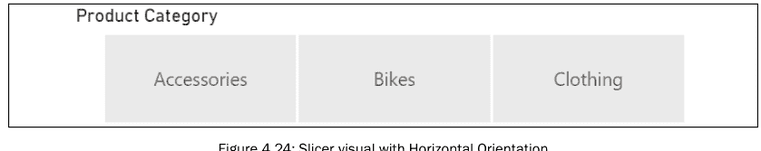

切片器视觉对象在使用 **Date** 日期 数据类型时包含强大的筛选选项，包括图形日期选择、之前/之后条件、相对日期和相对时间。**Date** 日期 数据类型的默认切片器类型是日期范围切片器或 **Between** 之间 切片器。时间线的开始和结束点可以被选中并拖动以修改筛选条件。或者，选择日期输入单元格会显示一个图形日历选择器元素以选择日期。**Before** 之前 和 **After** 之后 筛选选项分别使 **Between** 之间 对话框的开始和结束日期输入单元格变灰。**Relative Date** 相对日期 选项提供三个输入框。第一个输入框允许选择 **Last** 上一个、**Next** 下一个 或 **This** 本。

中间输入框允许输入一个数字，最后一个输入框提供各种日期间隔的下拉菜单；见图 4.25。

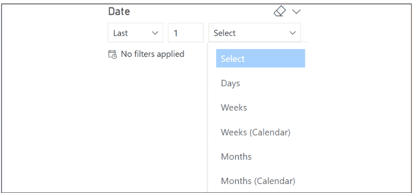

图 4.25：基于日期列的用于相对日期筛选的标准切片器

在 Format 面板中，您可以指定相对日期筛选器中是否包含当前日期以及锚定日期。切片器视觉对象的相对日期筛选选项也可用作报表、页面和视觉级别的筛选器。相对时间选项的功能类似于相对日期选项，只是间隔为分钟和小时。

数值数据类型的默认切片器格式也是 Between 切片器。数值切片器的 Less than or equal to 小于或等于 和 Greater than or equal to 大于或等于 选项类似于日期切片器的 Before 之前 和 After 之后 选项。

## See also

- Slicers in Power BI: http://bit.ly/3mkZcFX
- Using slicers in the Power BI service: http://bit.ly/3fsCdHr

## Controlling Visual Interactions

Power BI 报表页面默认是交互式的，所有视觉对象（切片器除外）都通过应用于一个视觉对象的选择进行交叉筛选。虽然这种动态筛选上下文通常有助于跨维度探索和分析，但通常也需要排除某些视觉对象不受此行为影响。例如，卡片或 KPI 视觉对象中反映的高优先级度量可以配置为忽略来自页面上切片器和其他视觉对象的任何筛选选择。此外，与默认的交叉筛选视觉对象的突出显示相比，专门在其他视觉对象中显示相关值可能更有益。

在本配方中，我们提供了配置视觉对象之间交互性的示例。

## Getting ready

为本配方做准备，请执行以下步骤：

- 1. 打开 `CH4_R4.pbix` 文件并将文件另存为 `CH4_R5.pbix`。
- 2. 切换到 **Scratch** 草稿 页面并使用 **Ctrl-A** 然后 *Delete* 删除 来删除任何视觉对象。
- 3. 检查 **Filters** 筛选器 面板并确保仅 **Europe** 欧洲 筛选器处于活动状态。

## How to Control Visual Interactions

要实现本配方，请使用以下步骤：

- 1. 选择 **Europe** 欧洲 页面。
- 2. 选择任何视觉对象并在 **Format** 格式 选项卡的 ribbon 上单击 **Edit interactions** 编辑交互。
- 3. 选择 **Calendar Month** 日历月份 切片器。

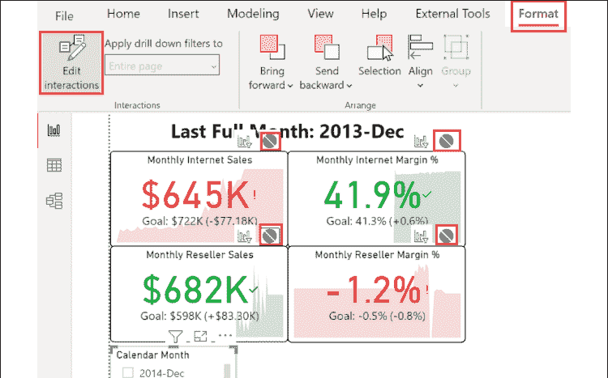

图 4.26：编辑交互

- 4. 对于四个 KPI 视觉对象，单击 **None** 无 圆形图标。
- 5. 对 **Product Category** 产品类别 和 **Country** 国家/地区 切片器重复步骤 3 和 4。
- 6. 对 **France** 法国、**Germany** 德国 和 **United Kingdom** 英国 页面重复步骤 3、4 和 5。
- 7. 选择任何视觉对象并在 **Format** 格式 选项卡的 ribbon 上单击 **Edit interactions** 编辑交互 以关闭编辑交互。
- 8. 保存您的工作。

## How it works

在此示例中，确定 KPI 视觉对象应始终显示所有产品以及所有国家/地区、州/省和城市的最近完整月份的统计数据。为确保这一点，使用 Power BI Desktop 上的 **Edit interactions** 编辑交互 功能，将所有其他视觉对象上的页面与所有其他视觉对象的交互设置为 **None** 无 而不是默认的 **Filter** 筛选。

必须认识到 DAX 度量可以通过使用 ALL、ALL EXCEPT 和 REMOVEFILTERS 等筛选函数来覆盖交叉筛选行为。事实上，根本不需要将日历月份切片器与 KPI 视觉对象之间的交互设置为 **None**，因为驱动 KPI 视觉对象的 DAX 度量在其计算中包含对 **Dates** 日期 表的 ALL 函数的使用。

## There's more...

视觉对象之间的交叉筛选交互具有 **Filter** 筛选、**Highlight** 突出显示 和 **None** 无 的选项——某些视觉对象，例如 KPI 视觉对象，仅包括 **Filter** 筛选 和 **None** 无 选项，而其他视觉对象，例如条形图和柱形图，还包括 **Highlight** 突出显示 选项。要查看 **Highlight** 突出显示 选项，请执行以下操作：

- 1. 从 **Visualizations** 视觉对象 面板创建 **Clustered column chart** 簇状柱形图。
- 2. 从 **Fields** 字段 列表中，将 **Dates** 日期 表中的 **Year Month** 年月 列添加为轴，并将 **Internet Sales** 互联网销售 表中的 **Internet Net Sales** 互联网净销售额 和 **Internet Plan** 互联网计划 度量添加为 **Values** 值。
- 3. 在 **Format** 格式 面板中，展开 **Legend** 图例 并将 **Position** 位置 更改为 **Bottom** 底部，关闭 **X axis** X 轴上的 **Title** 标题，完全关闭 **Y axis** Y 轴，展开 **Data labels** 数据标签，并将 **Display units** 显示单位 更改为 **Thousands** 千，**Value decimal places** 值小数位数 更改为 **0**，**Orientation** 方向 更改为 **Horizontal** 水平；展开 **Title** 标题 部分并将 **Title text** 标题文本 更改为 **Internet Sales to Plan** 互联网销售与计划，**Alignment** 对齐方式 为 **Center** 居中，并将 **Background** 背景 关闭。
- 4. 在 **General**常规 部分中，将 **X Position** X 位置 设置为 **449**，**Y Position** Y 位置 设置为 **47**，**Width** 宽度 设置为 **831**，**Height** 高度 设置为 **241**。
- 5. 创建一个 **Stacked bar chart** 堆积条形图，将 **Sales Territories** 销售区域 表中的 **Sales Territory Country** 销售区域国家/地区 列作为 **Axis** 轴，并在 **Values** 值 字段井中放置 **Internet Sales** 互联网销售 表中的 **Internet Net Sales** 互联网净销售额 度量，以及 **Reseller Sales** 经销商销售 表中的 **Reseller Net Sales** 经销商净销售额 度量。
- 6. 在 **Format** 格式 面板中，展开 **Legend** 图例 并将 **Position** 位置 更改为 **Bottom** 底部，关闭 **Y axis** Y 轴上的 **Title** 标题，关闭 **X axis** X 轴上的 **Title** 标题，然后完全关闭 **X axis** X 轴；展开 **Data labels** 数据标签 并将 **Display units** 显示单位 更改为 **Thousands** 千，展开 **Title** 标题 部分并将 **Title text** 标题文本 更改为 **Internet and Reseller Sales by Country** 按国家/地区划分的互联网和经销商销售，**Alignment** 对齐方式 为 **Center** 居中，并将 **Background** 背景 关闭。
- 7. 在 **General**常规 部分中，将 **X Position** X 位置 设置为 **753**，**Y Position** Y 位置 设置为 **295**，**Width** 宽度 设置为 **527**，**Height** 高度 设置为 **212**。
- 8. 选择 **Stacked bar chart** 堆积条形图 视觉对象并在 **Format** 格式 选项卡的 ribbon 上单击 **Edit interactions** 编辑交互。
- 9. 将 **Clustered column chart** 簇状柱形图 视觉对象的交叉筛选从 **Highlight** 突出显示 更改为 **Filter** 筛选。


图 4.27：交叉筛选图标

- 10. 对于四个 KPI 视觉对象，单击 **None** 无 圆形图标。
- 11. 选择 **Clustered column chart** 簇状柱形图 视觉对象并为四个 KPI 视觉对象单击 **None** 无 圆形图标。
- 12. 选择任何视觉对象并在 **Format** 格式 选项卡上单击 **Edit interactions** 编辑交互 以关闭编辑交互。
- 13. 单击 **Internet Sales Plan** 互联网销售计划 视觉对象中的列并观察 **Internet and Reseller Sales by Country** 按国家/地区划分的互联网和经销商销售 视觉对象上的突出显示。
- 14. 同样，单击 **Internet and Reseller Sales by Country** 按国家/地区划分的互联网和经销商销售 视觉对象中的条形并观察 **Internet Sales Plan** 互联网销售计划 视觉对象被筛选。
- 15. 将 **Internet Sales Plan** 互联网销售计划 视觉对象复制到 **France** 法国、**Germany** 德国 和 **United Kingdom** 英国 页面。
- 16. 保存您的工作。

## See also

- Change how visuals interact in a report: http://bit.ly/3cGQazB
- Understand how visuals interact in a report: http://bit.ly/3wgsQR3


## 利用图形可视化

数据可视化和探索是 Power BI 的核心，报告中选用的可视化类型对用户的理解和采用贡献巨大。Power BI Desktop 包含一系列现代视觉对象，例如树状图和漏斗图，同时也为传统的折线图、条形图/柱状图、组合图和散点图提供了一组丰富的格式选项。此外，还有五种地图视觉对象可用于分析地理数据，并且通过 AppSource 商店（已集成到 Power BI Desktop 的“开始”功能区和“可视化”窗格中）可以获得整个自定义视觉对象库。

缺乏经验的报表开发人员常犯的一个错误是过度使用花哨或复杂的图形视觉对象。报表开发人员应根据视觉对象与报表范围内业务问题的契合度来选择视觉对象，并且应始终优先考虑简单性和易用性。

本食谱提供了使用各种图形可视化类型的示例，如**折线图**、**折线和群集柱状图**、**地图**和**形状地图**。

## 准备工作

要准备本食谱，请执行以下步骤：

- 1. 打开 CH4_R5.pbix 文件，并将文件另存为 CH4_R6.pbix。
- 2. 切换到 **Scratch** 页面，使用 *Ctrl-A* 然后 *Delete* 删除所有视觉对象。
- 3. 检查 **筛选器** 窗格，确保只有 **Europe** 筛选器处于活动状态。

## 如何利用图形可视化

要实现本食谱，请执行以下步骤：

- 1. 选择 **Europe** 页面。
- 2. 从 **可视化** 窗格中选择 **散点图** 视觉对象，并从 **Sales Territories** 表中将 **Sales Territory Country** 列添加为 **图例**。
- 3. 从 **Internet Sales** 表中，将 **Internet Net Sales** 度量添加为 **X 轴**，将 **Internet Customer Count** 度量添加为 **Y 轴**，将 **Internet Order Quantity Total** 度量添加为 **大小**。
- 4. 从 **Dates** 表中，将 **Date** 列（*不是 Date 层次结构*）添加到 **播放轴**。
- 5. 在 **格式** 窗格的“常规”部分中，将 X 位置设置为 160，Y 位置设置为 295，宽度设置为 594，高度设置为 381。
- 6. 在 **格式** 窗格中，将图例设置为“关闭”，展开 Y 轴部分，并将轴标题更改为 Distinct Customers；然后展开标题部分，将标题文本更改为 Internet Sales and Customer Count Trend by Country，并将对齐方式设置为居中。

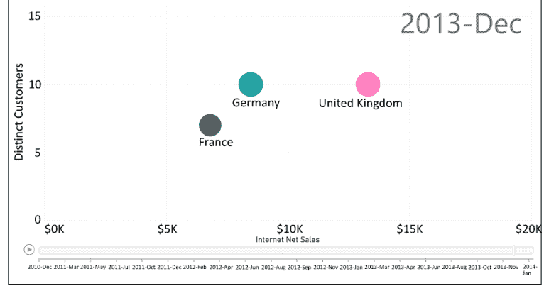

图 4.28：散点图视觉对象

- 7. 单击页面画布上的空白位置，然后从 **可视化** 窗格中选择 **折线图**。
- 8. 使用来自 **Dates** 表的 **Year Month** 列作为轴，来自 **Sales Territories** 表的 **Sales Territory Country** 列作为图例，以及来自 **Internet Sales** 表的 **Internet Margin %** 度量作为值。
- 9. 在 **格式** 窗格的“常规”部分中，将 X 位置设置为 754，Y 位置设置为 508，宽度设置为 526，高度设置为 212。
- 10. 展开图例部分，将位置设置为底部，并删除图例名称。
- 11. 展开 X 轴和 Y 轴部分，并将两者的标题切换为“关闭”。
- 12. 将数据标签切换为“关闭”。
- 13. 展开标题部分，将标题文本更改为 Internet Sales Margin % by Country，并将对齐方式设置为居中。

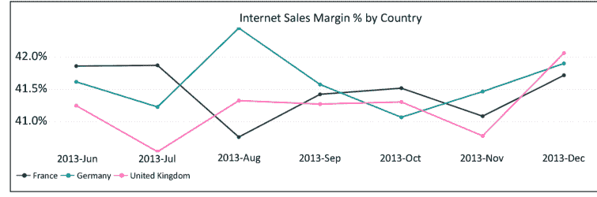

图 4.29：折线图视觉对象

- 14. 切换到 France 页面。
- 15. 从 **可视化** 窗格中选择 **地图** 视觉对象，将来自 **Customers** 表的 **Location** 列添加为位置，将来自 **Internet Sales** 表的 **Internet Customer Count** 度量添加为大小。
- 16. 在 **格式** 窗格的“常规”部分中，将 X 位置设置为 160，Y 位置设置为 295，宽度设置为 288，高度设置为 381。
- 17. 将类别标签切换为“关闭”，并将标题切换为“关闭”。
- 18. 单击画布的空白区域，并从 **可视化** 窗格中选择 **折线和群集柱状图**。
- 19. 从字段列表中，将来自 **Dates** 表的 **Year Month** 列添加为轴。
- 20. 从 **Reseller Sales** 表中，将 **Reseller Net Sales** 度量添加为柱形值，将 **Reseller Margin %** 度量添加为线值。
- 21. 在 **格式** 窗格的“常规”部分中，将 X 位置设置为 448，Y 位置设置为 295，宽度设置为 832，高度设置为 232。
- 22. 展开图例部分，并将位置更改为底部。
- 23. 展开 X 轴和 Y 轴部分，并将两者的标题切换为“关闭”，然后将 Y 轴切换为“关闭”。
- 24. 展开数据标签部分，并将方向更改为水平。
- 25. 展开标题部分，并将标题文本更改为 Reseller Sales and Margin %，对齐方式为居中。
- 26. 将背景切换为“关闭”。
- 27. 复制 **地图** 和 **折线和群集柱状图**，并粘贴到 **Germany** 和 **United Kingdom** 页面。
- 28. 切换到 **Germany** 页面，并选择 **地图** 视觉对象。
- 29. 改用来自 **Customers** 表的 **State/Province** 列作为位置。
- 30. 在选中 **地图** 视觉对象的情况下，从 **可视化** 窗格中选择 **形状地图**。如果 **形状地图** 不存在，可以通过 **预览功能** 激活此视觉对象，方法是选择菜单/功能区中的 **文件**，然后选择 **选项和设置**，最后选择 **选项**。
- 31. 在 **格式** 窗格中，展开 **形状** 部分，并将 **地图** 更改为 Germany states。
- 32. 保存你的工作。


图 4.30：形状地图视觉对象

## 工作原理

当单个值及其比较比趋势更重要时，选择柱状图。当轴类别标签较长时，选择条形图，因为条形图比柱状图能显示更多的标签文本。当数据的趋势或形状比单个值及其比较更重要时，使用折线图。选择散点图以展示一个维度在两个度量之间的相关性。选择专用视觉对象，如树状图和瀑布图，作为标准视觉对象的补充。

通常建议避免使用饼图、环形图、仪表图和树状图视觉对象，因为其他视觉对象在视觉感知和理解方面具有优势。例如，饼图和仪表图的弯曲形状比柱状图/条形图中的直线以及散点图中的点间距离更难解释。

瀑布图应按度量排序，以支持从组件到 **总计** 列的直观“走查”。默认的红色表示负值、绿色表示正值的颜色格式通常是合适的。可以向 **类别** 字段添加额外的列，以实现下钻维度。来自 **Dates** 表的 **Year Month** 列或来自 **Products** 表的 **Product Category** 列是不错的选择。此外，也可以向 **细分** 字段添加一列。**细分** 字段计算两个类别值之间单个维度值的方差和百分比方差。将 **Product Category** 列添加到 **细分** 字段，可以显示国家之间差异最显著的产品类别，详细信息可在工具提示中查看。

许多图表类型（如折线图）都有有用的分析选项。为了演示这些分析功能，请执行以下操作：

- 1. 在 **Scratch** 页面上，创建一个 **折线图**，将来自 **Dates** 表的 **Year Month** 列作为轴，将来自 **Internet Sales** 表的 **Internet Net Sales** 度量作为值。
- 2. 选择折线图，并选择 **分析** 选项卡。
- 3. 展开 **平均线** 部分，并单击 **添加**。
- 4. 将 **数据标签** 切换为 **开**，并将 **文本** 更改为 **名称和值**。
- 5. **趋势** 线可用，但仅当 x 轴设置为 **连续** 时才可用。**Date** 列是提供 **连续** 轴的不错选择。**Date** 列还使 **预测** 分析可用。
- 6. 折线图视觉对象的一个有用技巧是使用度量来添加条件格式。在 **Internet Sales** 表中创建以下度量：

- 7. 将此度量添加到折线图的 **值** 字段井中。条件度量将包含在折线图中，但仅在满足条件时才有值（且不为空白）。这种方法遵循了通用报表设计目标，即在不影响可用性的情况下在同一空间中提供更多分析价值。通过轴中的数据层次结构进行下钻，以及工具提示中的额外度量，在同一报表画布空间中提供了进一步支持。


```
**Variance Less Than 12%** =
IF(
    ABS([Internet Plan Variance]) < [Internet Net Sales]*.12,
    [Internet Net Sales],BLANK()
)
```


## 另请参阅

- Power BI 中的视觉对象类型：http://bit.ly/3cHg2vh

## 创建表和矩阵视觉对象

需要查看精确的单独值，或需要在详细级别（例如单个交易）查看数据时，表和矩阵视觉对象非常合适。Power BI 中的表视觉对象符合经典的列和行“列表”报表格式，但支持强大的交叉突出显示和格式设置选项，包括条件格式。矩阵视觉对象包含表视觉对象的功能，并对应于 Excel 中数据透视表的布局和一般功能：度量的二维表示，能够在行和列轴上进行向上和向下钻取。

在本方法中，将演示表和矩阵可视化的各种功能，包括条件格式、钻取和交叉突出显示。

### 准备工作

为准备此方法，请执行以下步骤：

- 1. 打开 CH4_R6.pbix 文件，并将文件另存为 CH4_R7.pbix。
- 2. 切换到 Scratch 页面，使用 Ctrl-A 然后按 Delete 删除所有视觉对象。
- 3. 检查“筛选器”窗格，确保只有“欧洲”筛选器处于活动状态。

### 如何创建表和矩阵视觉对象

要实现此方法，请使用以下步骤：

- 1. 选择“法国”页面。
- 2. 在“可视化”窗格中，选择“表”视觉对象。
- 3. 从“产品”表中添加“产品类别”列，从“Internet 销售”表中添加“Internet 净销售额”、“Internet 利润率%”和“Internet 客户计数”度量值，以及从“经销商销售”表中添加“经销商净销售额”和“经销商利润率%”度量值。
- 4. 在视觉对象的“值”区域中，根据需要重新排列度量值。
- 5. 在视觉对象的“值”井中，双击“Internet 客户计数”度量值，并将其重命名为“Internet 客户”。
- 6. 在“格式”窗格的“常规”部分，将“X 位置”设置为 448，“Y 位置”设置为 526，“宽度”设置为 832，“高度”设置为 194。
- 7. 展开“样式”部分，选择“对比交替行”。
- 8. 将此视觉对象复制到“德国”、“英国”和“Scratch”页面。
- 9. 在“Scratch”页面上，使用“值”井中“经销商利润率%”度量值的下拉菜单，将条件格式应用于背景色。

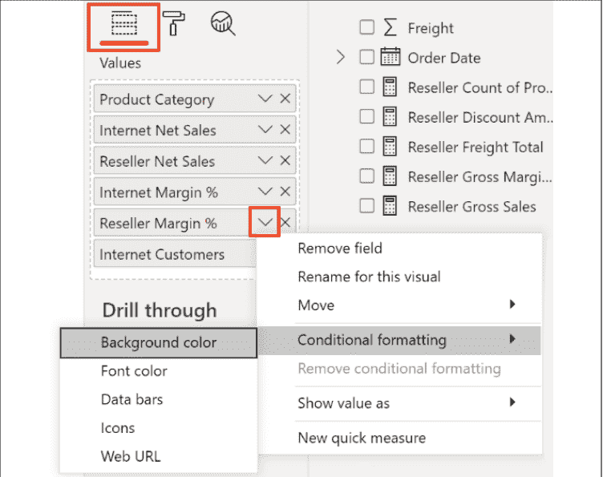

图 4.33：条件格式

- 10. 在“条件格式”对话框中，勾选“发散”复选框，然后单击“确定”按钮。


图 4.34：条件格式的发散颜色

- 11. 对 **Internet 净销售额** 应用条件格式，但这次将 **格式方式** 更改为 **规则**，并在 **规则** 中将下拉菜单更改为 **为空白**。

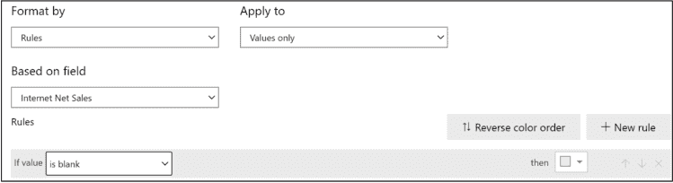

图 4.35：按规则设置格式

- 12. 对 **经销商净销售额** 度量值应用条件格式，但这次选择 **数据条**，并在 **数据条** 对话框中单击 **确定** 以接受默认设置。

| 产品类别 | Internet 净销售额 | 经销商净销售额 | Internet 利润率% | 经销商利润率% | Internet 客户 |
|---|---:|---:|---:|---:|---:|
| 配件 | $202,269 | $125,708 | 62.6% | 33.9% | 4,717 |
| 自行车 | $8,644,933 | $8,509,428 | 40.6% | -4.1% | 2,752 |
| 服装 | $82,840 | $318,540 | 34.9% | 8.8% | 2,034 |
| 组件 | — | $1,916,858 | — | 7.2% | — |
| **总计** | **$8,930,042** | **$10,870,535** | **41.0%** | **-1.3%** | **5,503** |

图 4.36：应用了条件格式的表

- 13. 在 **Scratch** 页面上复制并粘贴 **表视觉对象**，然后调整其位置。
- 14. 从此新视觉对象中删除 **经销商净销售额** 和 **经销商利润率%** 度量值，注意 **组件** 行从表中消失。
- 15. 在视觉对象的 **值** 井中，展开 **产品类别** 的菜单，选择 **显示无数据的项目**，注意 **组件** 行会重新出现，并伴随一个完全空白的行。
- 16. 在视觉对象的 **值** 井中，展开 **Internet 客户** 的菜单，选择 **显示值为**，然后选择 **占总计的百分比**，注意 **Internet 客户** 列现在显示百分比，而空白行和 **组件** 行消失。
- 17. 将 **矩阵视觉对象** 添加到 **Scratch** 页面。
- 18. 使用“销售区域”表中的“销售区域层次结构”作为行，使用“产品”表中的“产品类别层次结构”作为列，使用“Internet 销售”表中的“Internet 净销售额”度量值作为值。
- 19. 使用行旁边的 **+** 图标展开 **欧洲**。
- 20. 将 **钻取** 切换为 **列**，选择向下箭头以打开 *钻取* 模式，并单击 **自行车** 列。

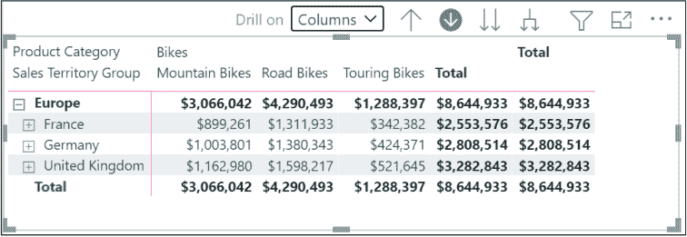

图 4.37：矩阵视觉对象

- 21. 保存你的工作。

### 工作原理

表和矩阵视觉对象会自动筛选掉没有数据的行和列。实际上，如果 **值** 区域中的聚合或度量值全部计算为空白，则该行不会在表中显示。**显示无数据的项目** 功能会覆盖这一默认行为，但并非万无一失，如使用 **显示值为** 功能的情况所示。另一种方法是构造度量值，使其返回零而不是空白，如下面的示例所示：

```
Measure =
    VAR __Sum = SUM('Internet Sales'[Sales Amount])
RETURN
    IF(ISBLANK(__Sum),0,__Sum)
```

或

```
Measure = SUM('Internet Sales'[Sales Amount]) + 0
```

或

```
Measure =
    COALESCE(
        SUM('Internet Sales'[Sales Amount]),
        0
    )
```

数据条可以像本示例中这样与度量值一起显示，也可以作为独立条显示。还可以输入特定的最小和最大阈值，以驱动数据条的条件格式。

除了对背景色和数据条应用条件格式外，条件格式还可用于字体和图标。如果字体色阶和背景色阶使用相同的格式逻辑和颜色，则只会显示值的颜色，例如在热图中。

对于添加到表和矩阵视觉对象中的度量值，可以使用 **显示值为** 选项，将度量值显示为行、列或总计的百分比。但是，表和矩阵视觉对象中的度量值目前无法设置为显示单位，也无法设置小数位数，例如千或百万。对于表视觉对象，由于视觉对象只有单一维度，因此只有 **占总计的百分比** 可用。

对于矩阵视觉对象，可以通过每行开头的 **+** 和 **-** 图标导航行层次结构。或者，在 **钻取** 下拉菜单中选择 **行**，可以使用钻取图标导航行层次结构。同样，在 **钻取** 下拉菜单中选择 **列**，可以通过相同的钻取图标导航列。共有四个钻取图标：向上箭头图标在层次结构中向上钻取一层；向下箭头图标打开钻取模式。当钻取模式处于活动状态（实心圆）时，单击某一行或列会仅针对该特定列或行向下钻取一层。双向下箭头图标会对所有行或列向下钻取一层，但在此情况下会丢失父级层次结构上下文。若要对所有行或列向下钻取一层并保留父级层次结构上下文，请使用分叉向下箭头图标。

### 更多内容...

表和矩阵视觉对象的一个额外条件格式选项是 **Web URL**。使用 **Web URL** 条件格式可以将显示的值转换为实时链接。若要演示其工作原理，请执行以下操作：

- 在 **Scratch** 页面上，使用 **客户表** 中的 **客户名称**、**电子邮件** 和 **服务 URL** 列创建一个 **表视觉对象**。
- 在 **表视觉对象** 的 **值** 井中，访问 **客户名称** 度量值的 **条件格式**，并选择 **Web URL**。
- 在 **Web URL** 对话框中，将 **基于字段** 更改为 **客户表** 中的 **电子邮件** 列。

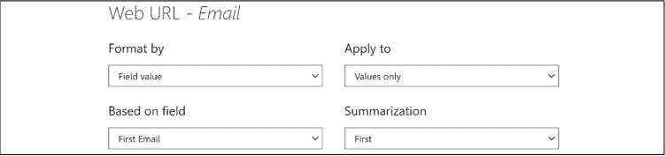

图 4.38：Web URL 条件格式


## 房屋租赁合同

甲方（出租方）：______________________ 乙方（承租方）：______________________

身份证号：____________________________ 身份证号：____________________________

联系电话：____________________________ 联系电话：____________________________

### 一、房屋基本情况

| 项目 | 内容 |
| --- | --- |
| 房屋坐落 | ________________________ |
| 建筑面积 | ________________________ |
| 使用面积 | ________________________ |
| 房屋权属证书编号 | ________________________ |
| 房屋装修状况 | ________________________ |
| 配套设施 | ________________________ |

第一条 租赁期限
租赁期共____个月，自____年____月____日起至____年____月____日止。

第二条 租金及支付方式
该房屋月租金为人民币________元（大写：________），租金按________支付，乙方应于每________前支付下一期租金。

第三条 押金
乙方应于本合同签订之日向甲方支付押金人民币________元（大写：________）。租赁期满或合同解除后，押金除抵扣应由乙方承担的费用外，剩余部分应无息退还乙方。

甲方（盖章）：____________________ 乙方（盖章）：____________________
签订时间：____年__月__日

## 增强报表

许多报表功能可以为报表提供更丰富的上下文，并增强自助式数据探索体验。其中三项功能是工具提示、工具提示页和钻取报表页。

在本操作指南中，我们将逐步介绍如何使用工具提示、工具提示页和钻取报表页来增强我们的报表。

## 准备工作

若要为此操作指南做准备，请按照以下步骤操作：

- 1. 打开 CH4_R7.pbix 文件，并将文件另存为 CH4_R8.pbix。
- 2. 切换到 Scratch 页，按 Ctrl-A 后按 Delete，删除所有视觉对象。
- 3. 检查“筛选器”窗格，确保只有 Europe 筛选器处于活动状态。

## 如何增强报表

要实施本操作指南，请执行以下步骤：

- 1. 选择 Germany 页。
- 2. 选择“形状地图”视觉对象。
- 3. 在字段井中，将 Internet Sales 表中的“Internet Net Sales”、“Internet Margin %”和“Internet Sales Per Customer”度量值添加到“工具提示”字段。
- 4. 将鼠标悬停在已着色的德国州上，即可在工具提示弹出窗口中看到新的度量值：


- 5. 创建一个名为 **Product Tooltip** 的新**页面**。
- 6. 在 **格式**窗格中，展开 **页面信息**部分，然后将 **工具提示**切换为 **开**。
- 7. 展开 **页面大小**部分，并将 **类型**更改为 **工具提示**。
- 8. 创建 **簇状条形图**视觉对象，并调整其大小以占满整个页面。
- 9. 将 Products 表中的 **Product Subcategory**列添加到 **轴**。
- 10. 将 Internet Sales 表中的 **Internet Net Sales**度量值添加到 **值**。
- 11. 在 **筛选器**窗格中，对 **Product Subcategory**应用视觉级筛选器，选择按 **Internet Net Sales**排序显示前 5 项的 **Top N**筛选器。

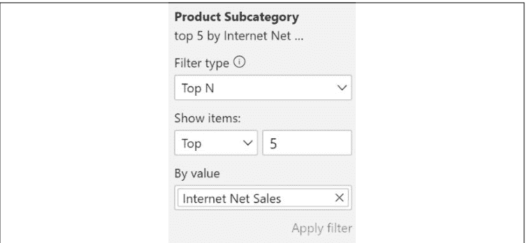

图4.42：工具提示视觉筛选器

- 12. 在 **Germany**页上，选择 **表视觉对象**。
- 13. 在 **格式**窗格中，将 **工具提示**切换为 **开**。
- 14. 展开 **工具提示**部分，将 **类型**设置为 **报表**页，并将 **页面**设置为“Product Tooltip”。

15. 将鼠标悬停在表中任意单元格上时，会弹出 Product Tooltip 页，作为该行产品类别下子类别的工具提示。

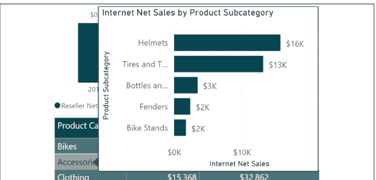

图4.43：报表页工具提示

16. 创建一个名为“Customer Drill through”的页面。

17. 在此页面的字段井中，将 Customers 表中的 State/Province 列添加到钻取字段区域。

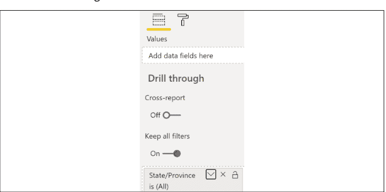

图4.44：页面钻取字段

18. 请注意，此页面的左上角会自动创建一个返回按钮。


图4.45：返回按钮

19. 创建以客户为中心的视觉对象，例如图4.46中所示的视觉对象。

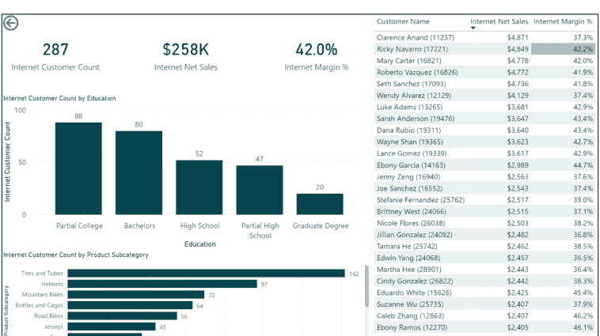

图4.46：客户钻取页

20. 在 Germany 页上，右键单击其中一个已着色的州，选择“钻取”，然后选择“Customer Drill through”。

21. 请注意，钻取筛选器会沿用从页面和视觉对象传入的上下文。

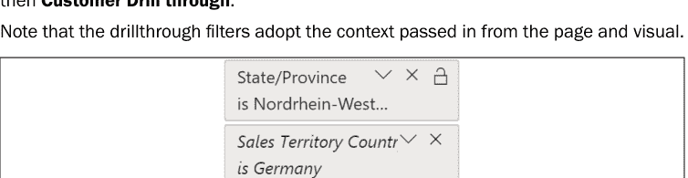

图4.47：钻取后的钻取筛选器

## 工作原理

工具提示和报表页工具提示是提高报表信息和分析密度的绝佳方法，可以在相同的报表页面空间内提供额外见解。工具提示和报表页工具提示都会继承光标悬停的视觉对象元素在其粒度级别上的上下文。这意味着，工具提示中的任何度量值以及报表页工具提示中的任何视觉对象，都会反映当前与报表交互的用户的上下文。

报表作者还可以设计钻取报表页，让用户能够快速、轻松地探索与特定关注项关联的详细信息。钻取报表页上的所有视觉对象都会更新，以反映启动钻取时所选项的筛选器上下文。

钻取是一项非常强大且广受欢迎的功能，因为当用户查看报表时，它实际上可以充当按用户问题定制的动态生成报表。因此，在用户经常交互的热门报表中，可能会包含跨常见维度的多个钻取报表页。可考虑使用第7章“参数化 Power BI 解决方案”中的“使用模板”操作指南中描述的 Power BI 模板（.pbit 文件），以便在新报表中重用现有的钻取报表页。

对于高基数维度列，钻取页尤其有价值，因为这些列的各个值很可能没有自己专用的报表或报表页。例如，“Product Category”和“Product Subcategory”列可能已有自己的报表和仪表板，但单个“Product Model”（此层次结构的第三级）可能就是构建一个或多个钻取报表页的理想候选。

当向钻取筛选器字段井中添加列时，系统会自动创建返回按钮。此按钮可以设置格式，也可以完全移除，但通常很有帮助，尤其是在包含多个页面的报表中。另外，任何通过 Power BI Desktop 功能区的“插入”选项卡添加的形状或图像，也可以用作钻取页的返回按钮。

## 更多内容

在页面的钻取区域中，您可能已经注意到“跨报表”开关。Power BI 确实允许您在报表之间（而不仅仅是在页面之间）进行钻取。必须在“选项和设置”中“当前文件”的“报表设置”中，或者 Power BI 服务中，启用源报表以使用其他报表中的钻取目标。然后，需要配置目标报表，将“跨报表”选项切换为“开”，并相应地配置钻取字段。请注意，跨报表筛选要求报表的数据集架构匹配。

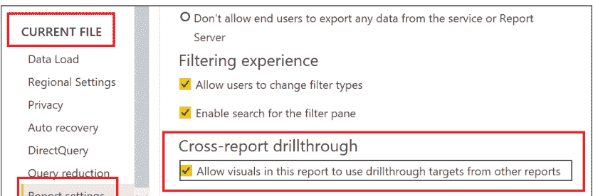

图4.48：跨报表钻取

## 另请参阅

- 在 Power BI 中使用报表工具提示页：http://bit.ly/20dzeHA
- 使用报表页工具提示扩展视觉对象：http://bit.ly/3cGwBHC
- 在 Power BI 报表中设置钻取：http://bit.ly/31SH2lv
- 使用报表页钻取：http://bit.ly/3sKg5w0
- 在 Power BI Desktop 中使用跨报表钻取：http://bit.ly/3fzfQjJ

## 设置报表格式以供发布

Power BI Desktop 包含多项功能，可精细控制并增强报表的格式和布局。在将报表发布到 Power BI 服务之前，可以对齐视觉对象、调整其大小并使其均匀分布，以形成有序、对称的布局。此外，还可以添加形状、文本框和图像等补充报表元素，以进一步组织报表页面，并通过文字和视觉辅助手段丰富页面内容。

本操作指南演示了如何控制报表视觉对象的位置、对齐和分布，以及按组呈现和处理视觉对象的一些技巧。此外，还提供了在发布报表之前进行最终清理的有用提示，以及发布后设置 Q&A 的提示。


## 准备工作

要准备本食谱，请按照以下步骤操作：

- 1. 打开 CH4_R8.pbix 文件，并将文件另存为 CH4_R9.pbix。
- 2. 切换到 Scratch 页面，使用 Ctrl-A，然后按 Delete 删除所有视觉对象。
- 3. 检查“筛选器”窗格，确保只有 Europe 筛选器处于活动状态。

## 如何设置报表格式

要实现本食谱，请按照以下步骤操作：

- 1. 将四个 KPI 视觉对象从 Europe 页面复制并粘贴到 Scratch 页面。
- 2. 在页面上移动 KPI 视觉对象，将它们垂直间隔开，并置于不同的水平位置。
- 3. 注意移动或调整视觉对象大小时出现的自动对齐参考线（称为智能参考线的红色虚线）。

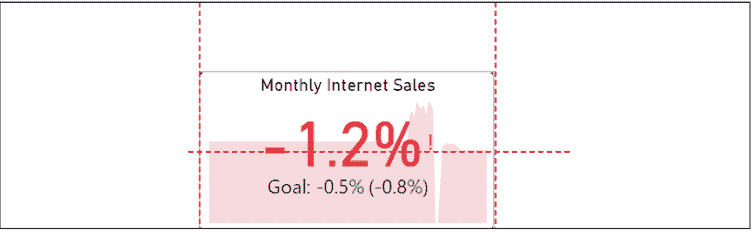

图 4.49：自动对齐参考线

- 4. 使用 Ctrl-A 选择所有 KPI 视觉对象。
- 5. 在功能区中选择“格式”选项卡，选择“对齐”，然后选择“左对齐”。

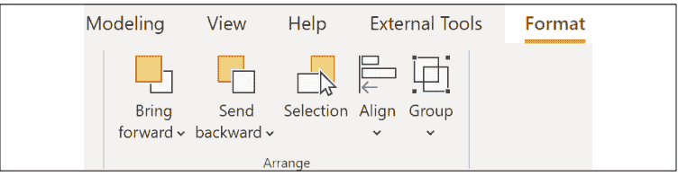

图 4.50：格式功能区中的排列选项

- 6. 所有视觉对象都将与最左侧的视觉对象对齐。
- 7. 再次选择 **对齐**，然后选择 **垂直分布**。
- 8. 视觉对象将以相等的间距在页面上垂直分布。
- 9. 在 **格式** 选项卡的功能区中选择 **组合**，然后选择 **组合**。
- 10. 现在可以将视觉对象作为一个整体在页面上移动。
- 11. 选择 **组合**，然后选择 **取消组合**。
- 12. 将视觉对象大致堆叠在一起。
- 13. 单击页面上的空白区域，然后选择最上方的视觉对象。
- 14. 在 **格式** 选项卡中，选择 **下移一层**，然后选择 **置于底层**。
- 15. 单击页面画布的空白区域，注意该视觉对象现在位于所有其他视觉对象的下方。
- 16. 选择其中一个视觉对象，这次在 **格式** 选项卡的功能区中选择 **选择**，以显示 **选择** 窗格。

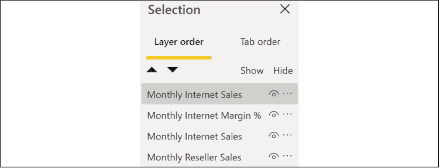

图 4.51：选择窗格

- 17. 使用向上和向下图标更改视觉对象的 **图层顺序**。
- 18. 切换到 **Tab 键顺序**，再次使用向上和向下图标更改视觉对象的 Tab 键顺序。
- 19. 关闭 **选择** 窗格。
- 20. 将 KPI 视觉对象在页面上水平分布。
- 21. 使用 *Ctrl-A* 选择所有视觉对象。
- 22. 选择 **格式** 选项卡，并在功能区中选择 **对齐 | 顶端对齐**，然后选择 **对齐 | 水平分布**。
- 23. 将每个 **KPI** 视觉对象转换为 **卡片** 视觉对象。
- 24. 将其中一个 KPI 视觉对象的 **边框** 和 **背景** 切换为 **关**。
- 36. 对 **Product Tooltip** 和 **Customer Drill through** 页面重复 *步骤 32*。
- 37. 使用 **+** 选项卡添加一个名为 **信息** 的页面。
- 38. 在 **信息** 页面上，使用功能区中的 **插入** 选项卡创建一个 **文本框**，类似于 *图 4.55* 中的图像。

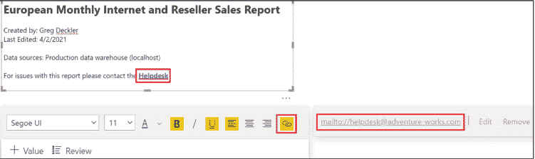

图 4.55：带有可用的 mailto 链接的报表信息页面

- 39. 在此情况下，选择 **帮助台** 并将其设为可用的 **mailto:** 链接。
- 40. 在 **视图** 选项卡中，选择功能区中的 **锁定对象**。
- 41. 选择 **Europe** 页面并保存工作。
- 42. 在 **开始** 选项卡中，选择功能区中的 **发布**，将报表发布到 Power BI 服务。

## 工作原理

当报表准备好发布时，最好使用 **锁定对象** 设置来防止视觉元素被意外移动或调整大小。但需要注意的是，**锁定对象** 仅影响通过鼠标和键盘移动或调整视觉对象大小的操作。**格式** 窗格 **常规** 部分中的 **X 位置**、**Y 位置**、**宽度** 和 **高度** 设置仍然可以重新定位和调整视觉对象的大小。

在发布报表之前，应隐藏或删除开发期间使用的页面，例如 **Scratch** 页面。用于报表页工具提示的页面也应隐藏。钻取页面可能会被隐藏，也可能不会，这取决于它们在报表中的用途。在 Power BI 服务中查看报表时，隐藏页面不会显示给报表阅读者。

通常最好包含一个 **信息** 页面。信息页面可用于描述报表中使用的数据源、浏览报表的有用提示，甚至支持信息。

定位和对齐是专业报表的关键要素。如本食谱所示，Power BI 提供了许多选项来确保视觉对象以对称方式对齐和调整大小。在页面上移动或调整视觉元素大小时，自动对齐参考线始终会出现。

- 3. 填充移动布局视图：在设备网格中单击并拖动视觉对象到所需位置。

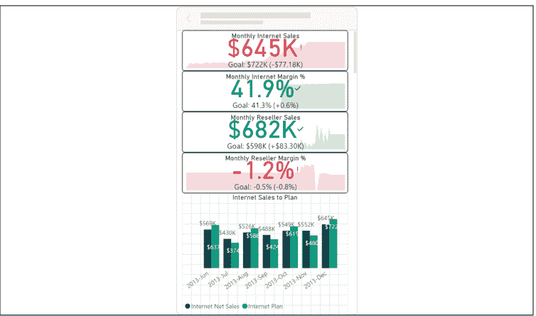

图 4.61：填充后的移动布局

- 4. 切换到 United Kingdom 页面，并同样配置移动布局。

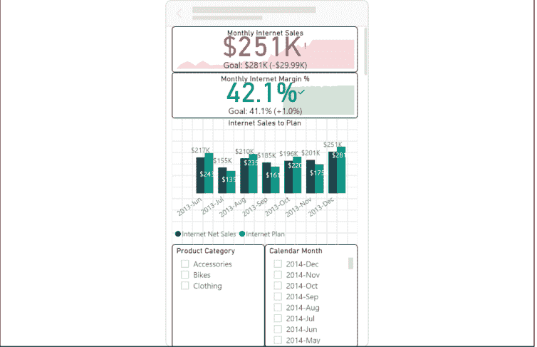

图 4.62：United Kingdom 销售和利润移动布局

- 5. 通过在 **视图** 选项卡的功能区中单击 **移动布局** 来退出 **移动布局**。
- 6. 保存工作。
- 7. 将报表发布到 Power BI 服务。
- 8. 使用手机上的 Power BI 应用测试移动视图。

## 工作原理

Power BI 报表的使用方式往往会因设备不同而存在显著差异。例如，包含多个切片器和表格或矩阵视觉对象的报表页面可能适合在笔记本电脑上提供详细的交互式体验，但可能不适合移动设备使用。在许多场景中，用户更希望在移动设备上简单、方便地访问少数几个高层级视觉对象，如卡片或 KPI，而不是页面上所有视觉对象的欠佳呈现。

如果预期会有移动端使用，报表作者应与用户协作设计此布局和整体体验。由于 **移动布局** 处于报表页面级别，并且无法组合来自多个页面的视觉对象，因此包含最重要度量值或 KPI 的专用报表页面会很有帮助。这些报表页面通常仅通过卡片、仪表或 KPI 视觉对象包含数字，以便在移动端一目了然地查看最重要的数据点。

手机布局呈现一个矩形的移动设备网格和一个 **可视化** 窗格，其中包含给定报表页面的不同元素，包括文本框和形状。虽然可以为每个报表页面设计针对移动优化的布局，但对于大多数报表而言，可能只需要设计一个或两个移动布局，重点突出报表中最重要的度量值或趋势。

**移动布局** 的 **可视化** 窗格使识别要包含或排除的元素变得容易。视觉对象以默认大小吸附到网格，并在不同尺寸的移动设备上放大或缩小。

一旦保存并重新发布到 Power BI 服务，从移动设备访问报表的用户将看到定义的手机布局。如果没有移动布局，移动用户将收到尚未配置的通知，并可以调整设备方向（横向）以横向视图查看报表页面。无论是否配置了手机布局，切换到横向方向都会以标准桌面视图打开报表。Power BI 报表的页面可以通过从屏幕侧面滑动或点击页面图标来访问。


图 4.63：切换到横向视图

## 更多内容...

Power BI 报表的许多交互功能，如钻取模式和切片器，也可以通过 Power BI 移动应用使用。然而，考虑到外形因素的限制，评估这些元素的可用性并考虑诸如卡片或 KPI 等移动友好的视觉对象是否能够提供必要的可见性非常重要。

在 Power BI 中创建和修改仪表板时，该服务为仪表板提供了类似的移动优化创作体验。在 Power BI 服务中的仪表板上，单击 **编辑** 下拉菜单，如 *图 4.64* 所示。


图 4.64：Power BI 服务中仪表板的移动视图


## 创作 Power BI 报表

移动视图和功能与 Power BI Desktop 中的移动布局非常相似。固定到仪表板的实时页面会成为单个仪表板磁贴，因此只有一个移动视觉对象。因此，若要有效配置针对移动优化的仪表板，必须将单个报表视觉对象固定到仪表板中的磁贴。

### 另请参阅

- 适用于移动设备的 Power BI 应用：`http://bit.ly/2q6SG8f`
- 使用 Power BI 开发移动友好型报表的提示：`https://bit.ly/3wpUJX8`

### 创建分页报表

Microsoft 已做出巨大努力，确保分页报表（SSRS 风格报表）在 Power BI 生态系统中成为一流公民。Power BI Premium 支持此类报表，**Power BI 报表服务器（PBIRS）** 也是如此。Microsoft 仍致力于在 Power BI 中支持分页报表的最新证据是，其宣布了计划在 Power BI Desktop 中提供用于创建分页报表的报表构建体验，以及于 2021 年 5 月发布的**分页报表**视觉对象。

但截至目前，分页报表仍必须在单独的工具 Power BI 报表生成器中创建。本方案演示如何下载并安装 Power BI 报表生成器，以及如何使用该工具构建分页报表。

#### 准备工作

要准备本方案，请按照以下步骤操作：

1. 从此位置下载 Power BI 报表生成器：`https://bit.ly/2X0p1G1`。
2. 打开 **PowerBIReportBuilder.msi** 文件。
3. 使用向导完成安装。

在考虑分页报表时，确认是否确实需要开发分页报表会很有帮助。以下问题有助于确认是否需要分页报表：

1. 报表是否需要跨多页打印？
2. 报表是否更像只包含数据表格的静态操作报表？
3. 报表数据本身是否需要通过电子邮件订阅发送给用户？

对这些问题中的一个或多个回答“是”，有助于确认需要分页报表。

#### 如何创建分页报表

要实现本方案，请使用以下步骤：

1. 运行 Power BI 报表生成器应用。
2. 打开 Power BI 报表生成器后，依次选择“新建报表”和“表或矩阵向导”。
3. 选择“创建数据集”，然后单击“下一步”。
4. 选择“新建”以创建新的数据源连接。
5. 选择连接类型“Microsoft SQL Server”。

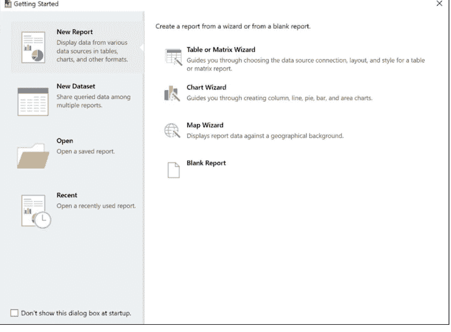

图 4.65：报表生成器“开始使用”对话框

6. 使用 **构建** 选项配置数据源；完成后，单击 **确定** 按钮。

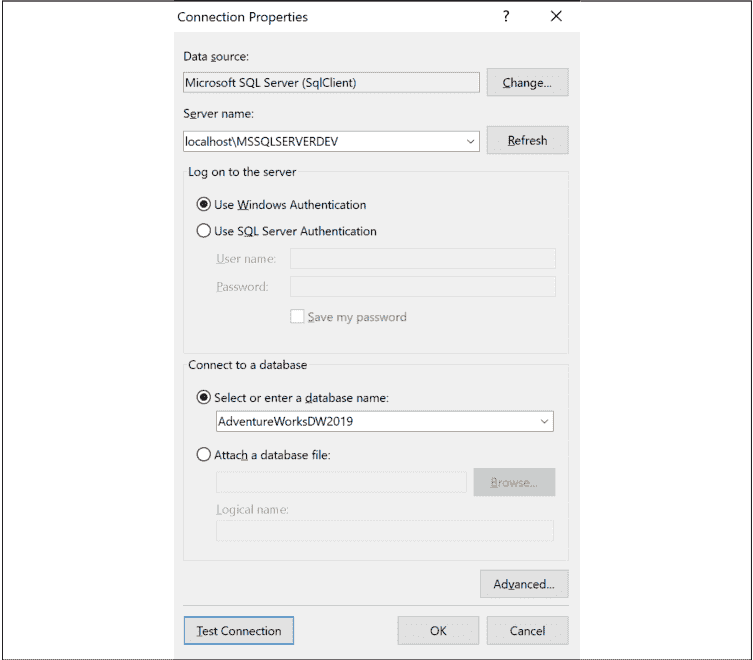

7. 单击 **确定** 按钮。
8. 单击 **下一步** 按钮。
9. **展开“视图”**，然后展开 **vProducts** 视图以选择以下字段：

- ProductKey
- EnglishProductName
- EnglishProductCategoryName
- EnglishProductSubcategoryName
- DaysToManufacture
- Color

10. **展开“表”**，然后展开 **FactInternetSales** 表以选择以下字段：

- ProductKey
- OrderQuantity
- UnitPrice
- DiscountAmount
- SalesAmount
- TaxAmt
- Freight
- OrderDate

11. 展开“关系”区域，取消选择“自动检测”，然后按“添加关系”图标。

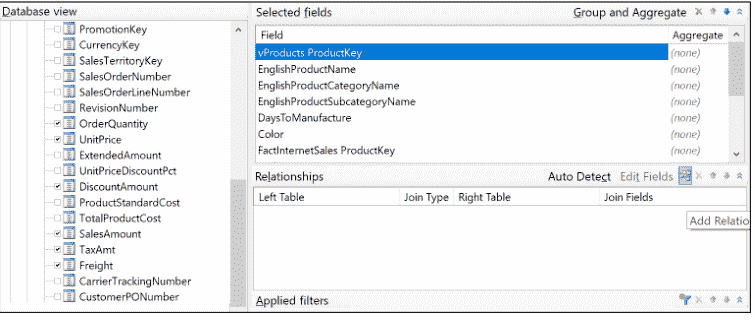

图 4.67：添加关系

12. 选择 vProducts 作为左表，并选择 FactInternetSales 作为右表。

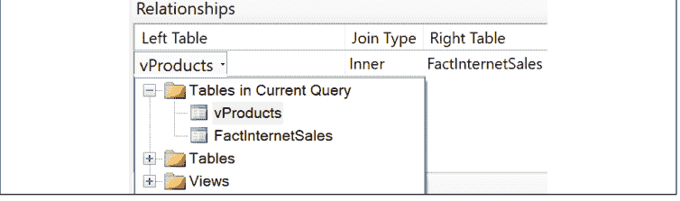

图 4.68：联接表

13. 双击“联接字段”下方的区域。

14. 在“编辑相关字段”对话框中，单击“添加字段”图标，然后从每个表中选择 ProductKey 字段；单击 **确定** 按钮。

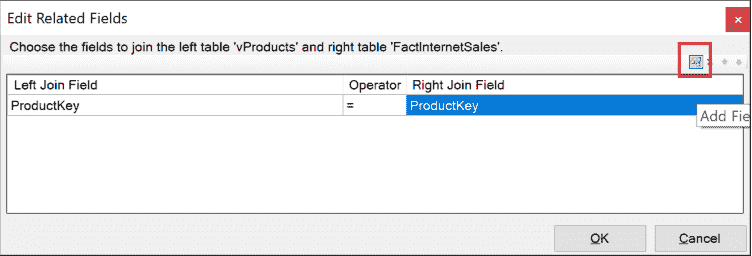

15. 在“设计查询”对话框中，单击 **下一步** 按钮。
16. 在“排列字段”对话框中，按以下顺序将字段放入“行组”区域：

- EnglishProductCategoryName
- EnglishProductSubcategoryName
- EnglishProductName

17. 将以下字段放入“值”区域：

- OrderQuantity
- UnitPrice
- DiscountAmount
- SalesAmount
- TaxAmt
- Freight

18. 保持聚合为“求和”；也可以通过“值”区域中字段的下拉列表进行更改。
19. 单击 **下一步** 按钮。
20. 在“选择布局”对话框中，选择“递阶，小计在上方”，然后单击 **下一步** 按钮。
21. 在“预览”屏幕上单击 **完成 >>**。

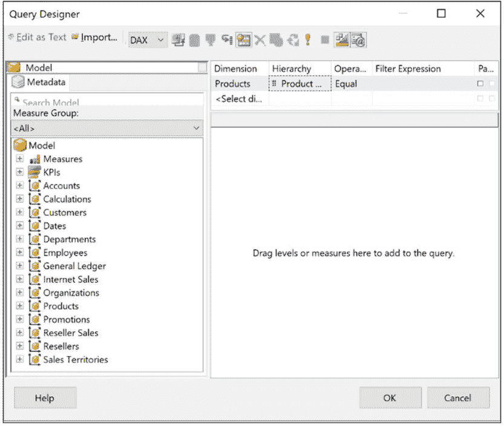

图 4.72：查询设计器

Power BI 报表生成器包含“插入”菜单中提供的许多视觉元素，包括：

- 表
- 矩阵
- 列表
- 柱形图
- 折线图
- 饼图
- 条形图
- 面积图
- 仪表
- 地图
- ESRI 形状文件
- 数据条
- 迷你图
- 指示器

还可使用 **文本框、图像、线条** 和 **矩形** 等元素。报表还可以包含 **子报表、页眉** 和 **页脚**。

可以使用众多函数和运算符创建计算字段；以下两个公式分别创建 **TaxAndFreight** 和 **Year** 的计算字段：

```text
=Fields!TaxAmt.Value+Fields!Freight.Value
=Year(Fields!OrderDate.Value)
```

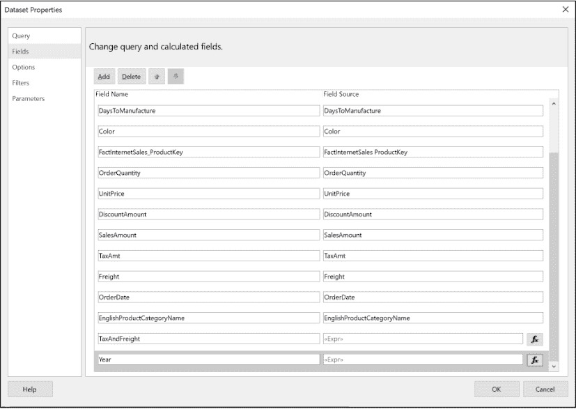

图 4.73：数据集属性

你可以通过单击网格中的单元格，然后使用 **开始** 选项卡的功能区来设置单元格格式，从而格式化列和行中显示的信息。例如，可以将行标题设为粗体，并将货币字段设置为 **货币**。

#### 互联网销售

| 年份 | 产品 | 订单数量 | 单价 | 折扣金额 | 销售金额 | 税费和运费 |
|------|---------|---:|---:|---:|---:|---:|
| 2010 | 自行车 | 14.00 | $43,421.04 | 0.00% | $43,421.04 | $4,559.21 |
| 2011 | 自行车 | 2,216.00 | $7,075,525.93 | 0.00% | $7,075,525.93 | $742,930.34 |
| 2012 | 配件 | 106.00 | $2,147.08 | 0.00% | $2,147.08 | $225.45 |
|  | 自行车 | 3,269.00 | $5,839,695.33 | 0.00% | $5,839,695.33 | $613,168.15 |
|  | 服装 | 22.00 | $642.79 | 0.00% | $642.79 | $67.49 |
| 2013 | 配件 | 34,409.00 | $668,241.53 | 0.00% | $668,241.53 | $70,166.85 |
|  | 自行车 | 9,706.00 | $15,359,502.30 | 0.00% | $15,359,502.30 | $1,612,748.23 |
|  | 服装 | 8,686.00 | $323,806.45 | 0.00% | $323,806.45 | $34,000.09 |
| 2014 | 配件 | 1,577.00 | $30,371.35 | 0.00% | $30,371.35 | $3,189.06 |
|  | 服装 | 393.00 | $15,323.37 | 0.00% | $15,323.37 | $1,608.97 |
| **总计** |  | **60,398.00** | **$29,358,677.20** | **0.00%** | **$29,358,677.20** | **$3,082,663.84** |

图 4.74：分页报表

### 另请参阅

- Power BI 报表生成器：http://bit.ly/3rLcG3I
- 示例 Power BI 分页报表：http://bit.ly/2PonXVE
- Power BI Premium 中的分页报表是什么？：http://bit.ly/31F4tOS

### 结论

Power BI 报表是 Power BI 中仪表板、数据探索以及内容协作和分发的基础。Power BI Desktop 提供了丰富的数据可视化功能和选项，使你能够在各种设备上构建高度针对性强且用户友好的报表。在本章中，我们开发并描述了最基本的报表视觉对象和设计概念。此外，还提供了相关指导，以增强和控制用户与 Power BI 报表交互以及在 Windows 和移动设备上使用这些报表时的体验。

## 在服务中工作

> “仪表板实际上是一个内容聚合器。它让你能够将许多不同的数据源汇集到一个地方，从而在一个仪表板上全面了解你的业务。”
>
> —— Adam Wilson，Power BI 服务组项目主管

Power BI 仪表板是在 Power BI 服务中创建的磁贴集合，代表一个或多个 Power BI 报表中的视觉对象，也可以包含其他来源（如 Excel 和 SQL Server Reporting Services（SSRS））的视觉对象。仪表板最适合用于以视觉和移动优化布局集中展示关键绩效指标（KPI）、度量值和趋势。此外，仪表板还可以作为通向其他仪表板或报表的入口，并通过 URL 链接、流式数据、图像、Web 内容以及交互性得到进一步增强。

在本章中，我们将构建 Power BI 仪表板，以提供对关键度量值和高影响力业务活动的直观、一目了然的监控。本章还涵盖了仪表板的独特功能，例如 Q&A 自然语言查询、数据警报，以及集成其他报表类型（如 Excel 和 SSRS）。最后，还介绍了如何创建其他内容对象，例如流式数据集和数据流。

在本章中，我们将介绍以下方案：

- 构建仪表板
- 为 Q&A 做准备
- 添加警报和订阅
- 从 Excel 和 SSRS 部署内容
- 流式数据集
- 创作数据流


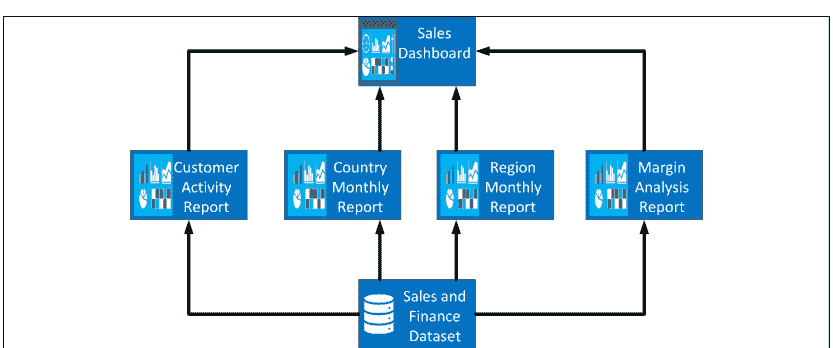

Figure 5.1: 北美销售仪表板结构：4 个报表和 1 个数据集

## Getting Ready

为准备本配方，请按以下步骤操作：

- 1. 登录 Power BI 服务。
- 2. 在左侧导航窗格中单击工作区，并在弹出菜单底部选择创建工作区。如果无法创建工作区，请咨询您的 Power BI 管理员，因为他们可能已禁用此选项。
- 3. 在创建工作区对话框中，输入工作区名称并单击保存。
- 4. 在中央区域，单击添加内容。
- 5. 在获取数据对话框中，单击文件旁的获取按钮。


Figure 5.2: 创建工作区


Figure 5.3: 获取数据，文件

- 6. 选择 **本地文件**。
- 7. 选择 CH5_R1_SalesAndFinanceDataset.pbix 文件并单击 **打开**。
- 8. 在 Power BI Desktop 中打开 CH5_R1_RegionMonthlyReport.pbix 文件。
- 9. 如有必要登录到 Power BI 服务，并在 **无法连接** 对话框中选择 **编辑**。如果收到错误，请联系管理员以允许连接到实时数据集。
- 10. 在 **选择数据集创建报表** 页面，选择 **CH5_R1_SalesAndFinanceDataset**，然后单击 **创建** 按钮。
- 11. 在 *步骤 3* 创建的 **工作区** 中 **保存** 并 **发布** 报表到服务。
- 12. 对 CH5_R1_CountryMonthlyReport.pbix 和 CH5_R1_MarginAnalysisReport.pbix 重复 *步骤 8、9、10 和 11*。

如果无法在 Power BI 服务中创建 **工作区**，您可以使用 **我的工作区** 替代。完成这些步骤后，报表都已与数据集 CH5_R1_SalesAndFinanceDataset 建立实时连接。

## How to Build a Dashboard

要实现本配方，请使用以下步骤：

- 1. 在 Power BI 服务中，选择本配方 *入门* 部分创建的工作区。
- 2. 在中央区域，单击 **新建** 然后选择 **仪表板**。


Figure 5.4: 创建新仪表板

- 3. 在 **创建仪表板** 对话框中，为 **仪表板名称** 输入 **北美销售** 然后单击 **创建**。
- 4. 创建空白仪表板；单击左侧导航窗格中的工作区并注意 **北美销售** 仪表板显示在列表中。
- 5. 在服务中打开 **CH5_R1_RegionMonthlyReport** 报表并导航到 **北美** 页面。

6. 将鼠标悬停在月度互联网销售额 KPI 可视化上并单击固定视觉图标。


Figure 5.5: 固定视觉对象

7. 在固定到仪表板对话框中，选择现有仪表板，选择北美销售，然后单击固定按钮。

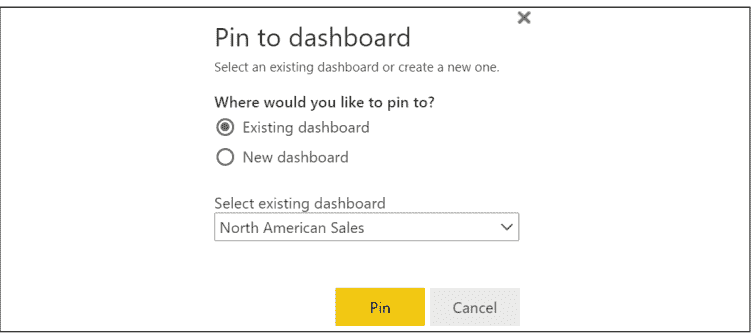

Figure 5.6: 固定到仪表板

- 8. 将月度互联网利润率 % KPI 可视化固定到北美销售仪表板。
- 9. 在服务中打开 CH5_R1_MarginAnalysisReport 报表。
- 10. 在销售组切片器中，选择北美。
- 11. 在日历月份切片器中，选择 2013-12、2013-11、2013-10、2013-09、2013-08 和 2013-07。
- 12. 将净销售额与去年同期  clustered 柱状图可视化固定到北美销售仪表板。
- 13. 在服务中打开 CH5_R1_CustomerActivityReport 报表。
- 14. 在销售组切片器中，选择北美。
- 15. 在日历月份切片器中，选择 2013-12、2013-11、2013-10、2013-09、2013-08 和 2013-07。
- 16. 将月度客户 KPI 可视化固定到北美销售仪表板。

- 17. 将年初至今净销售额与去年同期仪表可视化固定到北美销售仪表板。
- 18. 将按区域客户计数堆积柱状图可视化固定到北美销售仪表板。
- 19. 将按区域年初至今净销售额 clustered 条形图可视化固定到北美销售仪表板。
- 20. 在服务中打开 CH5_R1_CountryMonthlyReport 报表。
- 21. 导航到美国报表页面。
- 22. 将填充地图可视化固定到北美销售仪表板。
- 23. 导航到加拿大报表页面。
- 24. 将填充地图可视化固定到北美销售仪表板。
- 25. 在服务中打开北美销售仪表板。
- 26. 移动并调整仪表板磁贴大小，使最重要的视觉对象位于左上角。
- 27. 在美国的填充地图上，将鼠标悬停在磁贴上并从右上角选择省略号 (...)。
- 28. 选择编辑详细信息。
- 29. 编辑标题为互联网净销售额按州，删除副标题文本，然后单击应用。
- 30. 对加拿大地图重复步骤 27 到 29，使用互联网净销售额按省作为标题。

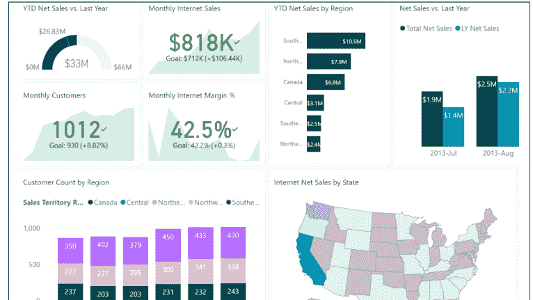

Figure 5.7: 北美销售仪表板

仪表板提供了对北美销售团队最重要的度量的概览。您可以通过单击仪表板磁贴访问任意四个底层报表。

请注意，调整和移动仪表板磁贴起初可能有点棘手。将光标悬停在仪表板磁贴上会在磁贴右下角显示一个调整大小手柄。单击此调整大小手柄可调整磁贴大小。磁贴会调整为在调整大小时显示在磁贴周围的灰色框显示的预配置磁贴大小。

移动磁贴时，单击并按住磁贴以在仪表板上移动磁贴。其他磁贴会根据您放置磁贴的位置自动移动。释放鼠标按钮以放置磁贴。

- 31. 在主仪表板区域正上方，选择 **编辑** 然后 **添加磁贴**。


Figure 5.8: 仪表板编辑菜单

- 32. 在 **添加磁贴** 面板中，选择 **图像**，然后单击 **下一步**。
- 33. 在 **URL** 中，放置以下链接：`https://bit.ly/3mhzBxv`。
- 34. 选中 **设置自定义链接** 复选框。
- 35. 将 **链接类型** 设置为 **外部链接** 且 **URL** 为 `http://www.adventure-works.com`。

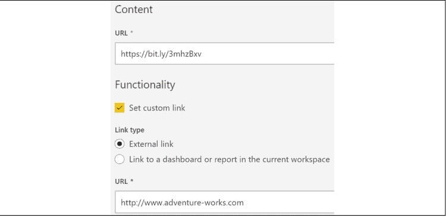

Figure 5.9: 图像磁贴设置

## Working in the Service

- 36. 单击 **应用** 按钮。
- 37. 再添加一个磁贴，这次是 **文本** 框。
- 38. 在 **内容** 区域添加文本；注意您可以使用 **插入链接** 图标添加活动链接。


Figure 5.10: 文本框磁贴设置

- 39. 单击 **应用** 按钮。
- 40. 从报表的 **编辑** 菜单中选择 **移动视图**。
- 41. 在 **未固定磁贴** 窗格中，将新磁贴固定到 **手机视图**。
- 42. 通过拖放磁贴重新定位或使用右下角的调整大小手柄调整大小。

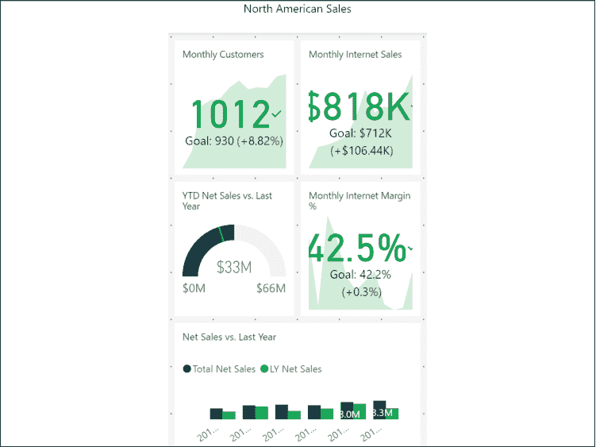

Figure 5.11: 仪表板移动视图

2. 从报表菜单栏单击省略号 (...) 并选择 **固定到仪表板**。

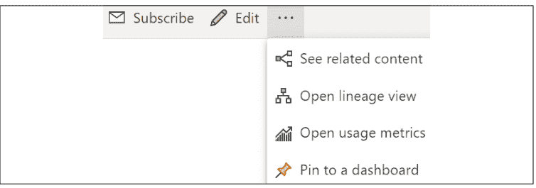

Figure 5.12: 固定到仪表板

3. 选择 **固定到仪表板** 后，选择 **现有仪表板**，选择 **北美销售** 仪表板，然后单击 **固定实时** 按钮。

4. 导航到 **北美销售** 仪表板，向下滚动并注意报表现在已作为磁贴固定。

仪表板用户可以与实时页面的区域和日期切片器以及其他视觉对象交互。鉴于报表页面的大小，通常不建议将实时报表页面固定到 **移动视图**。实时页面磁贴右上角的省略号包括 **转到报表** 链接以访问实时页面报表的所有页面。对底层报表的修改将反映在固定的实时页面上。其他视觉对象链接到其报表页面。

## See also

- - Power BI 设计师的仪表板简介：http://bit.ly/31KvIrv
- - 设计出色的 Power BI 仪表板的技巧：http://bit.ly/2PspxG3
- - 向仪表板添加图像、视频等：https://bit.ly/31QypHP

## Preparing for Q&A

Q&A 可以成为一种强大的方法，使用户能够探索数据集，使他们能够直接在 Power BI 服务和通过 Power BI 移动应用程序提交自己的问题。每个数据集的表和度量，由仪表板上的磁贴表示，可用于回答 Q&A 问题。


本指南提供数据模型设计和元数据提示，用于为 Q&A 准备数据集。此外，将在 Power BI Desktop 数据模型中添加同义词，以提高自然语言查询的准确性。

## 准备工作

要准备本指南：

- 完成本章的第一个指南，*构建仪表板*。

## 如何为 Q&A 做准备

要实现本指南，请执行以下步骤：

- 1. 打开**北美销售**仪表板。
- 2. 在仪表板的左上角，单击**就你的数据提问**。


图 5.13：Power BI Q&A

- 3. 输入以下内容：`wholesaler net sales by country.`
- 4. 请注意，单词 **wholesaler** 以红色双下划线标注，**net sales** 以蓝色下划线标注，而 **country** 以红色虚线下划线标注。


图 5.14：显示按经销商国家/地区的净销售额结果

- 5. 将鼠标悬停在显示的地图气泡之一上，注意工具提示显示的是 **Total Net Sales**，而不是 **Reseller Net Sales**。
- 6. 单击屏幕右下角的“不喜欢”图标。
- 7. 打开文件 `CH5_R1_SalesAndFinanceDataset.pbix`。
- 8. 切换到**模型**视图。
- 9. 在**主页**选项卡的功能区中，单击**Q&A 设置**。
- 10. 在**Q&A 设置**对话框中，单击**审阅问题**选项卡，请注意所提出的问题出现在列表中。请注意，你可能需要等待几分钟，并使用刷新图标来显示该问题。

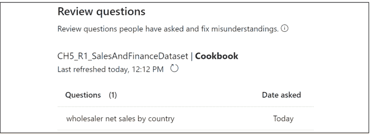

图 5.15：审阅问题

- 11. 单击**需要修复**列下的铅笔图标。请注意，如果几分钟后问题仍未出现，只需转到**教 Q&A** 选项卡，输入问题 **wholesaler net sales by country**，单击**提交**按钮，然后继续执行步骤 13。
- 12. 将打开**教 Q&A** 选项卡，并显示该问题。
- 13. 单词“wholesaler”被标记在两个手柄之间；在**定义 Q&A 无法理解的术语**中，在输入字段中键入 **reseller**（见图 5.16）。

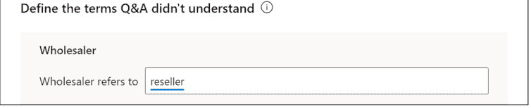

图 5.16：为 reseller 添加同义词

- 14. 单击**保存**，但请注意，地图视觉对象仍然不正确。
- 15. 拖动右侧手柄（红色棒和圆圈）以包含整个短语 **wholesaler net sales**，并单击**提交**。


图 5.17：为 wholesaler net sales 添加术语

- 16. 在**定义 Q&A 无法理解的术语**对话框中，在输入字段中键入 **reseller net sales**，并注意地图会更新；正确信息现在显示在工具提示中。
- 17. 单击**保存**按钮。
- 18. 单击**管理术语**选项卡，注意 **wholesaler** 和 **wholesaler net sale** 现在已定义为具有正确定义的术语。
- 19. 单击**字段同义词**选项卡，展开**经销商**表，注意 **wholesaler** 同义词已添加到**经销商**表中。

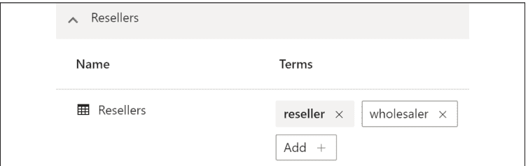

图 5.18：表同义词

- 20. 展开**经销商销售**表，向下滚动，看到 **wholesaler net sale** 同义词已添加到 **Reseller Net Sales** 度量值。

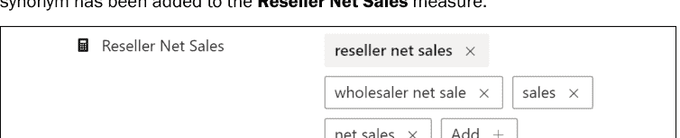

图 5.19：度量值同义词

- 21. 使用右上角的关闭按钮关闭**Q&A 设置**对话框。

## 工作原理

Power BI Q&A 支持导入模式以及与 Azure Analysis Services、SQL Server Analysis Services（通过网关）和 Power BI 数据集的实时连接。这些数据源支持 RLS。此外，Q&A 支持与 SQL DirectQuery 源的 DirectQuery 连接，例如 Azure SQL Database、Azure Synapse Analytics 和 SQL Server 2019。Q&A 不支持复合数据模型或 Reporting Services。

同义词是确保业务用户获得简单直观的 Q&A 体验以及获得其问题正确答案的关键部分。同义词允许向数据模型添加语义层，该语义层使用业务术语，而不仅仅是模型中表、列和度量值的名称。表、列和度量值可以包含在 Q&A 中或从中排除，并且可以定义同义词。

## 在服务中工作

设置 Q&A 的一些通用提示包括：

- 修订任何数据类型不正确的列，例如存储为文本数据类型的日期或数字。
- 将维度列的默认汇总设置为**不要汇总**。
- 将地理列（如州和邮政编码）与相关数据类别关联。
- 将包含多个值的列拆分为不同的列。
- 规范化表，使表内的实体移动到其各自独立的表中；例如，产品表中供应商的列可以移动到供应商表中。
- Q&A 查询仅对模型的活动关系有效。考虑使用具有活动关系的专用角色扮演维度。或者，考虑将非活动关系维度反规范化为事实表。
- 定义最常见或最常用的自然语言问题，并在 Power BI 中测试其准确性。
- 识别数据模型实体名称与自然语言查询中使用的名称之间的差距。
- 关注用户不会随意使用的较长且不太直观的实体名称。
- 避免在多个实体间重用相同的同义词，因为这可能导致不正确的查询结果。
- 确保模型中每个实体的主同义词是唯一的。

## 更多内容

Q&A 可能不适用于某些仪表板和数据集。例如，Q&A 搜索栏**就你的数据提问**可能会分散只想查看所呈现的 KPI 和其他信息的用户的注意力。此外，如果数据集需要网关（例如本地 SSAS 服务器或通过 DirectQuery Power BI Desktop 模型连接到本地源），则可能应避免使用 Q&A，考虑到额外的（可能低效的）查询和性能问题。

要启用或禁用 Q&A，请按照以下步骤操作：

- 1. 在 Power BI 服务中，访问包含仪表板的应用工作区。
- 2. 使用三个垂直点并单击**设置**。

图 5.20：仪表板设置

3. 选中或取消选中“在此仪表板上显示 Q&A 搜索框”复选框。

图 5.21：在此仪表板上显示 Q&A 搜索框

驱动 Q&A 的整个语义层定义可以通过 Power BI Desktop 在模型视图中使用“主页”选项卡功能区中的“语言架构”选项进行导出、修改和导入。导出的文件是 YAML 文件。YAML（YAML Ain't Markup Language）是一种用于数据序列化的人类可读文本文件。添加 wholesaler net margin 同义词后，YAML 文件的一部分如下所示：

```
reseller_sale.reseller_net_sales:
  Definition:
    Binding: {Table: Reseller Sales, Measure: Reseller Net Sales}
  State: Generated
  Terms:
  - reseller net sales: {State: Generated}
  - wholesaler net sale: {LastModified: '2021-04-05T16:58:30.2996117Z'}
  - sales: {State: Generated, Weight: 0.97}
  - net sales: {State: Generated, Weight: 0.97}
  - sale: {State: Suggested, Weight: 0.97}
  - net sale: {State: Suggested, Weight: 0.97}
  - reseller net sale: {Type: Noun, State: Suggested, Weight: 0.739}
  - wholesaler net auction: {Type: Noun, State: Suggested, Weight: 0.492}
  - net auction: {Type: Noun, State: Suggested, Weight: 0.485}
```

```
- wholesaler net transaction: {Type: Noun, State: Suggested, Weight: 0.482}
- auction: {Type: Noun, State: Suggested, Weight: 0.476}
- net transaction: {Type: Noun, State: Suggested, Weight: 0.475}
- wholesaler net deal: {Type: Noun, State: Suggested, Weight: 0.468}
- wholesaler net trade: {Type: Noun, State: Suggested, Weight: 0.468}
- wholesaler net vending: {Type: Noun, State: Suggested, Weight: 0.468}
- wholesaler net retailing: {Type: Noun, State: Suggested, Weight: 0.468}
```

## 另请参阅

- 使用 Power BI Q&A 浏览和创建视觉对象：http://bit.ly/2QYa7JN
- 优化 Q&A 的最佳实践：http://bit.ly/3cSddYp
- Power BI Q&A 的限制：http://bit.ly/2PtCrDL

## 添加警报和订阅

警报可以配置在仪表板的磁贴上，以在满足特定条件时提供通知。警报规则和选项可以在 Power BI 服务中进行管理，通知可以仅限于 Power BI 中的通知中心，也可以通过电子邮件共享。数据驱动的警报增强了 Power BI 仪表板的价值，因为在支持仪表板磁贴的数据集刷新时，它们会立即引起对重要事件或结果的关注。Power BI 仪表板和报表还支持订阅。订阅按照定义的计划将刷新后的报表和仪表板的图像和链接直接发送到用户收件箱。此外，可以配置分页报表订阅，以常见的文件格式（如 Excel 和 PDF）将报表数据附加到订阅电子邮件中。

本指南演示如何创建和配置警报和订阅，以及如何通过使用 Power Automate 来利用此功能释放更强大的功能。

## 准备工作

要准备本指南：

- 完成本章的第一个指南，*构建仪表板*。


## 如何添加预警和订阅

要实现本方案，请执行以下步骤：

- 1. 在 Power BI 服务中打开 **北美销售** 仪表板。
- 2. 悬停在 **月度客户数** KPI 磁贴上，单击右上角的省略号 (...)，然后选择 **管理预警**。
- 3. 在 **管理预警** 窗格中，单击 **添加预警规则**。
- 4. 编辑 **预警标题**、**条件** 和 **阈值**，并确保选中 **也向我发送电子邮件** 复选框。

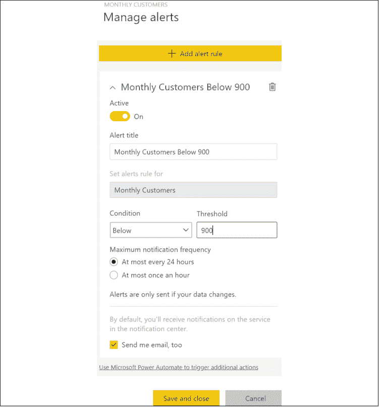

图 5.22：创建预警

- 5. 单击 **保存并关闭** 按钮以保存预警。
- 6. 在同一 KPI 视觉对象上创建另一个名为 **月度客户数高于 1100** 的预警，并设置相应的 **条件** 和 **阈值**。
- 7. 在仪表板功能区中，选择 **订阅**。


图 5.23：仪表板功能区

- 8. 单击 **添加新订阅** 按钮。
- 9. 编辑订阅设置。

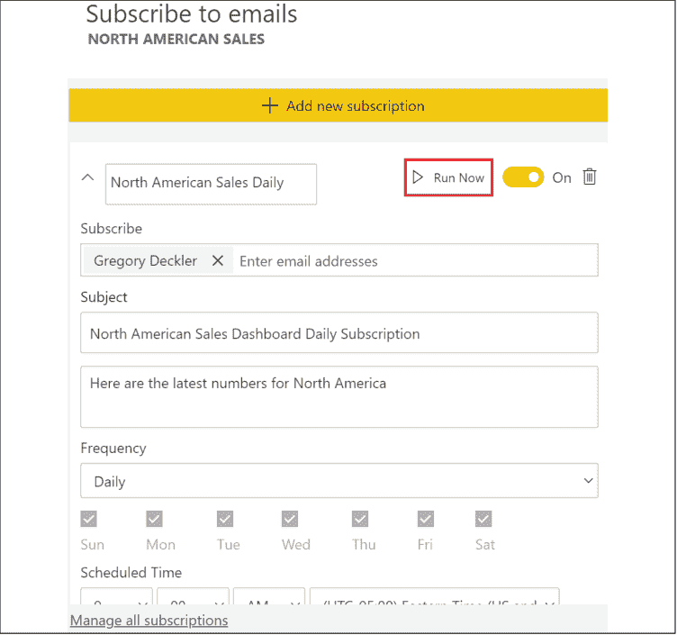

图 5.24：创建订阅

- 10. 单击 **保存并关闭** 按钮。
- 11. 再次单击功能区中的 **订阅**。
- 12. 这次展开刚创建的订阅。
- 13. 单击 **立即运行** 测试订阅（参见 *图 5.24*）。
- 14. 几分钟内，你应该会收到来自 Microsoft Power BI 的电子邮件，主题行为订阅名称，邮件正文与 *图 5.25* 中显示的类似。

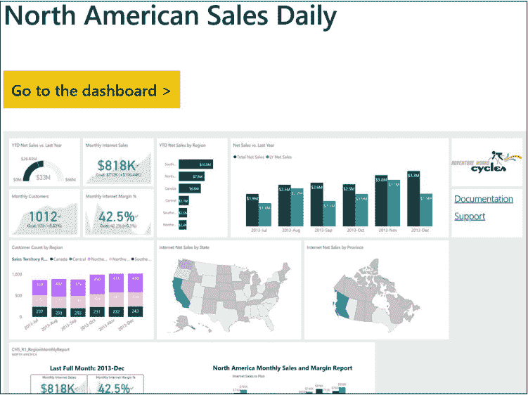

图 5.25：订阅邮件正文

- 15. 在 Power BI 服务中，单击右上角的齿轮图标，然后选择 **设置**。
- 16. 单击 **预警** 选项卡，可以看到你创建的预警。

| 预警 | 仪表板 | 创建日期 |
|---|---|---|
| 月度客户数低于 900 | 北美销售 | 2021年4月5日 20:46:05 — 开 |
| 月度客户数高于 1100 | 北美销售 | 2021年4月5日 20:47:37 — 开 |

图 5.26：预警管理

- 4. 此时会为 Power Automate 打开一个新标签页，其中包含一个名为 **使用 Power BI 数据驱动预警触发流** 的模板。
- 5. 单击 **立即试用** 按钮。
- 6. 如有必要，请登录你的工作账户。

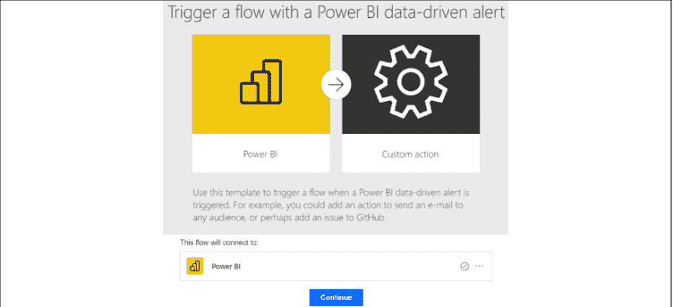

图 5.28：使用 Power BI 数据驱动预警触发流

- 7. 单击 **继续** 按钮。
- 8. 在 **预警 ID** 下拉列表中，选择要触发该流的特定 Power BI 数据预警，然后点击 **新建步骤** 按钮。
- 9. 找到 **邮件** 操作并选择它。
- 10. 使用 **动态内容** 配置电子邮件通知，并单击 **保存** 按钮。


图 5.29：为预警配置自定义电子邮件通知

- 11. 选择 **保存** 进行保存，选择 **测试** 测试该流。选择 **手动** 选项。
- 12. 在左侧导航窗格中选择 **我的流** 选项卡时，确认该流出现。

考虑到预警对利益相关者的价值，以及在 Power BI 和 Power Automate 中创建和管理预警及通知所需的工作量很低，可以开发专门的预警仪表板，以减少所需的分析和监控工作量。

## 另请参阅

- 在 Power BI 服务仪表板上设置数据预警：http://bit.ly/2R40ebL
- 订阅你自己的报表和仪表板：http://bit.ly/3fJphwU
- 让其他人订阅你的报表和仪表板：http://bit.ly/3wynW2a

## 从 Excel 和 SSRS 部署内容

Power BI 中的仪表板可以整合的不只是 Power BI 报表视觉对象。Microsoft Excel 对象——如数据透视表、图表和工作表区域——以及 SSRS 报表项也可以固定为仪表板磁贴。这种与 Power BI 的集成使团队能够利用现有报表和技能，并将这些工具的独特功能纳入整体 BI 解决方案。

在本方案中，将 Excel 工作簿中的数据透视表和数据透视图集成到现有的 Power BI 仪表板中。此外，还会将一个 SSRS 报表项固定到此仪表板。有关更高级的集成示例，请参阅第 13 章“将 Power BI 与其他应用程序集成”。

### 准备工作

要为本方案做好准备，请执行以下步骤：

- 1. 完成本章中的第一个方案，即“创建仪表板”。
- 2. 从 Power BI 服务安装“在 Excel 中分析”。有关此过程的详细信息，请参阅第 1 章“配置 Power BI 工具”。
- 3. 通过打开 Reporting Services 配置管理器，单击“Power BI 集成”选项卡，然后选择“注册 Power BI”，为 Power BI 配置报表服务器。

### 如何部署 Excel 和 SSRS 内容

要实现本方案，请执行以下步骤：

- 1. 在服务中打开报表 CH5_R1_CountryMonthlyReport。
- 2. 在报表功能区中，选择“导出”，然后选择“在 Excel 中分析”。
- 3. 从 **下载** 文件夹打开 CH5_R1_SalesAndFinanceDataset.xlsx 文件。
- 4. 在 **受保护的视图** 警告框中，单击 **启用编辑**。
- 5. 在 **安全警告** 框中，单击 **启用内容**。
- 6. 在 **PivotTable1** 区域中选择一个单元格。
- 7. 在 **数据透视表字段** 窗格中，找到前面带有求和图标的 **Internet Sales** 组，并将 **Internet Net Sales** 放在 **值** 区域。
- 8. 向下滚动找到前面带有表图标的 **Dates** 组，并将 **Year Month** 字段拖放到 **行** 区域。


图 5.30：数据透视表配置

- 9. 在 **分析** 选项卡的功能区中选择 **插入切片器**。
- 10. 在 **插入切片器** 对话框中，从 **Customers** 表中选择 **Country**，然后点击 **确定**。
- 11. 在数据透视表中选择一个单元格，然后在 **分析** 选项卡的功能区中选择 **数据透视图**。
- 12. 在 **插入图表** 对话框中，选择 **柱形图**，然后选择 **簇状柱形图**，并点击 **确定**。
- 13. 在切片器中选择 **United States**。
- 14. 将 Excel 文件以 CH5_R4_Workbook 的名称保存到你的 OneDrive for Business 目录，然后关闭 Excel。
- 15. 在 Power BI 服务中，打开包含 **北美销售** 仪表板的工作区。
- 16. 在左下角选择 **获取数据**。
- 17. 在 **获取数据** 对话框中，在 **创建新内容** 下的 **文件** 部分中选择 **获取** 按钮。
- 18. 选择 **OneDrive – Business**。
- 19. 选择该 Excel 文件，然后点击 **连接** 按钮。
- 20. 在 **在 Power BI 中连接、管理和查看 Excel** 区域，单击 **连接** 按钮。
- 21. 该 Excel 文件名现在会出现在工作区的 **工作簿** 区域中。
- 22. 选择 **CH5_R4_Workbook**。
- 23. 选择 **数据透视图**。
- 24. 在右上角选择固定图标。
- 25. 将数据透视图固定到 **北美销售** 仪表板。


图 5.31：将 Excel 数据透视图固定到仪表板

- 26. 导航到 **北美销售** 仪表板，在仪表板底部查看固定的 **数据透视图** 磁贴。

### 工作原理

本方案演示了如何将工作簿从 Excel 发布到 Power BI，然后在 Power BI 服务中固定该工作簿报表中的项目。使用此方法，工作簿在发布后无法刷新。这意味着，在将项目直接从 Excel 工作簿固定到仪表板后，必须定期刷新与 Power BI 服务中所托管数据集的连接，并且需要移除磁贴后重新固定。

为避免这种手动且本地的刷新过程，Excel 报表视觉对象可以基于 Excel 数据模型构建；然后可以将此 Excel 工作簿发布到 Power BI 服务。包含数据模型的已发布工作簿可以在 Power BI 服务中配置计划刷新，并且其从属报表也会更新以反映这些刷新。

最近，Microsoft 在 Excel 网页版中增加了刷新已连接数据透视表的功能。这意味着，在 Excel 网页版中连接到 Power BI 的数据透视表现在可以刷新。可以通过在服务的报表中选择 **在 Excel 中分析** 选项，或在 Excel 中插入数据透视表时选择 **从 Power BI** 选项，来创建已连接的数据透视表。

### 更多内容

也可以将 SSRS 报表元素固定到 Power BI 仪表板。若要了解其工作原理，请执行以下操作：

- 1. 创建或确定支持该仪表板的 SSRS 报表。
- 2. 将此报表发布到 SSRS 报表服务器，或在报表服务器上打开此报表。
- 3. 在报表服务器浏览器窗口中，单击 Power BI 图标，并使用相应的 Power BI 账户登录。
- 4. 单击要固定的 SSRS 报表项。
- 5. 在 **固定到 Power BI 仪表板** 对话框中，选择要将项目固定到的工作区和仪表板。


图 5.32：从 SSRS 2016 固定到 Power BI

更新频率会创建 SSRS 订阅，以保持 Power BI 中的磁贴更新。如果这些项目位于报表正文中（而不是页眉或页脚），你还可以将 SSRS 报表中的图表、仪表面板、地图和图像固定到 Power BI 仪表板。目前无法固定来自 SSRS 报表的表、矩阵或列表报表项。


11. 在仪表板功能区中，选择**编辑**，然后选择**添加磁贴**。
12. 在**添加磁贴**窗格中，从**实时数据**区域选择**自定义流数据**。
13. 单击**下一步**按钮。
14. 在**你的数据集**下，选择**流传感器数据**，然后单击**下一步**。
15. 对于**可视化类型**，选择**折线图**。
16. 对于**轴**，使用 **timestamp**，对于**值**，使用 **ambient_temperature**。
17. 单击**下一步**按钮。
18. 为该磁贴输入**标题**名称**温度**，并单击**应用**按钮。
19. 向下滚动仪表板，找到**温度**磁贴。

## 工作原理

实际上，Power BI 中有三种类型的流数据集：

- 推送（Push）
- 流式（Streaming）
- PubNub

推送数据集由外部程序将数据推送到 Power BI；数据作为数据集存储在 Power BI 中。推送数据集将信息永久存储在 Power BI 中，之后可用于创建报表。使用推送数据集时，可通过报表生成视觉对象，然后将其固定到仪表板。推送数据集限制为每秒 1 个请求、每个请求 16 MB、每小时 100 万行。

流数据集将数据推送到 Power BI，但不将数据存储在 Power BI 数据集中。因此，流数据集不能用于报表，只能用于仪表板。流数据集限制为每秒 5 个请求、每个请求 15 KB，但对每小时处理的行数没有限制。

PubNub 数据集也不在 Power BI 中存储数据，因此只能用于仪表板。对于每秒发送的请求数或每个请求发送的数据量没有限制，因为 Power BI Web 客户端使用 PubNub SDK 读取现有的 PubNub 数据流，而不是将信息推送到 Power BI。

推送数据集和流数据集可以使用 Power BI REST API 创建，也可以在使用 Azure 流分析创建新的流数据集时，通过服务中的 **API** 选项创建。


图 5.34：新建流数据集的选项

在服务中使用 API 选项创建流数据集时，配置屏幕包含“历史数据分析”开关。此开关默认关闭，将创建流数据集——将“历史数据分析”切换到“开启”将创建推送数据集。创建 PUSH/STREAMING 数据集后，可以使用 Power BI REST API 的推送数据集功能将数据推送到数据集中。

Power BI 服务中的“Azure 流”选项在撰写本文时尚未完全实现，但实现后将提供一个界面，用于将 Azure 流分析数据集成到 Power BI 中。目前，必须从 Azure 流分析激活 Power BI 集成。Power BI 是 Azure 流分析数据的输出选项之一。将 Power BI 设置为 Azure 流分析的输出，会创建一个既可以利用推送也可以利用流式功能的 Power BI 数据集。默认情况下，此数据集存储 200,000 行数据，并采用先进先出（FIFO）方式使数据过期。

## 更多内容

对于实时或近实时数据，另一个选项是使用自动页面刷新。自动页面刷新用于报表页，可设置视觉对象的刷新间隔，且仅在查看报表时生效——该选项不适用于导入数据源。自动页面刷新可在 Power BI Desktop 或 Power BI 服务的页面格式选项中配置。刷新类型可以配置为固定间隔，也可以基于变更检测配置。变更检测支持因存储模式、数据源以及使用的是专用容量（Premium）还是共享容量而异。共享容量不支持任何存储模式或数据源的变更检测。最小固定刷新间隔也因存储模式、数据源和容量类型而异。对于专用容量，最小固定刷新间隔为 1 秒，但 Azure Analysis Services 除外，其间隔为 30 分钟。对于共享容量，所有存储模式和数据源的最小固定刷新间隔均为 30 分钟。

## 定义新表

选择数据源以定义数据流的表。你可以将数据映射到标准的通用数据模型（Common Data Model）表，也可以改为定义自定义表。了解更多

添加新表

图 5.35：定义新表

4. 在“所有类别”选项卡中，在“数据源”下选择 Excel。

| 所有类别 | 数据源 |
| --- | --- |
| 文件 | Excel |
| 数据库 | 文件 |
| Power Platform | 文件夹 |
| Azure | 文件 |
| 联机服务 | SharePoint 文件夹 |
| 其他 | 文件 |
|  | Text/CSV |
|  | 文件 |

图 5.36：数据源

5. 对于连接设置，单击“浏览 OneDrive”按钮，选择 CH5_R7_AuthoringDataflows.xlsx 文件，并单击“打开”。

6. 单击右下角的“下一步”按钮。

7. 选择 DimProduct、DimProductCategory 和 DimProductSubcategory。

搜索
显示选项
Excel [3]
DimProduct
DimProductCategory
DimProductSubcategory

图 5.37：选择数据

18. 将 **EnglishProductName** 列重命名为 **Product Name**。

19. 在**开始**选项卡的功能区中单击**合并查询**。


图 5.39：合并对话框

20. 选择 **DimProductSubcategory** 作为**用于合并的右表**，选择两个 **ProductSubcategoryKey** 列，并单击**确定**以接受默认的**左外部联接类型**。

21. 单击 DimProductSubcategory 列标题中的列展开图标，取消选择所有列，选择“Product Subcategory”和“ProductCategoryKey”列，然后取消选中“使用原始列名作为前缀”复选框；单击“确定”。


图 5.40：展开列

22. 单击“开始”选项卡功能区中的“合并查询”。

23. 选择 DimProductCategory 作为“用于合并的右表”，选择两个 ProductCategoryKey 列，并单击“确定”以接受默认的“左外部联接类型”。

24. 单击 DimProductCategory 列标题中的列展开图标，取消选择所有列，选择“Product Category”列，取消选中“使用原始列名作为前缀”复选框，并单击“确定”。

25. 选择 ProductCategoryKey 列，然后在按住 Ctrl 键的同时选择 ProductSubcategoryKey 列。

26. 右键单击 ProductSubcategoryKey 列标题，然后选择“删除列”。

27. 在“查询”窗格中右键单击 DimProductCategory 查询，然后取消选中“启用加载”。

28. 同样禁用 DimProductSubcategory 查询上的加载。

29. 在右下角，单击“保存并关闭”按钮。

30. 将数据流命名为 Products，并单击“保存”按钮。


图 5.41：保存数据流

31. 单击返回工作区，注意 **Products** 数据流已经出现。


图 5.42：Products 数据流

32. 将鼠标悬停在 **Products** 数据流上，并单击**立即刷新**图标。

## 工作原理

数据流允许在 Power BI 服务中构建 Power Query 查询。此外，与在 Power BI Desktop 中构建的 Power Query 查询不同，数据流可跨多个数据集（模型）重复使用。由于数据流和在 Power BI Desktop 中构建的 Power Query 查询使用相同的底层 M 代码技术，因此实际上可以将在 Power BI Desktop 中构建的查询轻松迁移到数据流，方法是使用**高级编辑器**功能在桌面端和数据流之间复制粘贴代码，或者在创建数据流时使用**导入模型**功能。

数据流将来自源的数据引入到存储在 Azure Data Lake Storage Gen2 中的符合通用数据模型（Common Data Model，Dataverse）的文件夹中。数据流还允许你将你自己的 Azure Data Lake Gen2 存储中的数据公开给其他 Azure 服务。创建后，数据流必须至少刷新一次，以初始化 Azure Data Lake Gen2 存储中的数据。数据流支持与数据集类似的设置，即你可以配置计划刷新并在刷新数据时使用网关。

专用容量（例如 Premium）支持额外的数据流功能，例如：

- 增强的计算引擎，使数据流能够利用 `DirectQuery`
- 刷新其他数据流中的链接表
- **自动机器学习（AutoML）**和认知服务

## 更多内容

创建后，数据流可以在 Power BI Desktop 中用作数据源。要了解其工作原理，请执行以下操作：

1. 打开新的 Power BI Desktop 文件。
2. 从**开始**选项卡的功能区中选择**获取数据**，然后选择 **Power BI 数据流**。
3. 展开创建 **Products** 数据流的工作区。
4. 展开 **Products** 数据流。
5. 选择 DimProduct 表，然后单击**加载**按钮。


DimProduct 表现已添加到数据集中。

## 另请参阅

- 数据流和自助数据准备简介：https://bit.ly/3uCjNZf
- 创建数据流：https://bit.ly/2RiiGPV
- 配置和使用数据流：https://bit.ly/2RhIVHm
- 数据流最佳实践：https://bit.ly/3cZIIQr
- 数据流的限制和注意事项：https://bit.ly/3t2UChM
- 数据流的高级功能：https://bit.ly/3fZXLLA
- 在 Power BI 中构建机器学习模型：https://bit.ly/3d1XGp7
- 将机器学习（认知服务）与数据流结合使用：https://bit.ly/3fT3nYk

## 结论

Power BI 服务提供了创建和共享其他 BI 对象（如仪表板、应用、流式数据集和数据流）的功能；这些组件可以通过警报、订阅、图像和 Web 内容来丰富和增强。本章构建了 Power BI 仪表板，以提供对关键度量和高影响力业务活动的简单、一目了然的监控。本章还介绍了仪表板的独特功能，例如 Q&A 自然语言查询、数据警报，以及与其他报表类型（如 Excel 和 SSRS）的集成。最后，本章还涵盖了流式数据集和数据流的创建和使用。

日期表应包含每个日历日期的单行记录（无间隙）。鉴于其规模较小（20 年跨度包含最后一年约为 7,600 行），请包含所有必要的历史数据以及三年或更久的未来年份。

## 如何构建维度表

要实现此方案，请执行以下步骤：

- 1. 识别并记录日期维度所需的列，并找出与现有表之间的差距。

  与其他维度表一样，团队通常可以通过附加逻辑随着时间的推移逐步改进其日期维度表。例如，如果绝大多数分析围绕会计日历并在特定粒度下进行，那么可以首先针对这些列。成熟的日期表——包括标准和财务日历、顺序代理列以及逻辑或动态列（如 Fiscal Period Status）——通常非常宽，有 40 多列。必需的日期维度列包括以下内容：

  - 适用于标准和财务日历的 Prior Year Date 和 Prior Period Date 列
  - 所有级别的自然层次结构属性，例如 2013、2013-Q3、2013-Sep、2013-Wk39 和 9/25/2013

  自然层次结构（每个子值对应一个父值）允许用户通过向下钻取和下一级命令轻松导航 Power BI 报表视觉对象。如果没有自然层次结构，则在钻取到给定父级时会丢失父值的上下文。例如，向下钻取到 2017 年将显示每个月的名称，但与此月关联的年份只能通过将鼠标悬停在图表上在工具提示中看到。有了自然层次结构，此上下文不会丢失，因为 Calendar Yr-Mo 列可能包含诸如 2017-Aug 之类的值。

  Power BI 提供了一种通过层次结构钻取功能中的“将所有级别向下展开一级”来处理报表视觉对象中非自然层次结构的方法。但是，当使用多个层次结构级别时，这可能导致轴标签过于密集。考虑到日期智能需求以及其他可视化的需求，建议构建日期表以支持自然层次结构。在构建自然层次结构时，请考虑构建以下支持列：

  - 一个整数列，对应于每个字符串列的按时间顺序，例如 Weekday。例如，一个 Weekday Number 列，其值为 1 到 7，将设置 Weekday 的“排序依据”属性。
  - 多个“X in Y”列，例如 Day in Year、Day in Month、Week in Month 和 Week in Year，存储为整数。
  - 指示器列，例如 Weekday Indicator、Holiday Indicator 和 Working Day Indicator。这些列的值应适合报表使用，例如 Holiday 和 Non-Holiday。
  - 针对所支持的不同粒度的开始和结束日期列，例如 Week Ending Date 和 Period Ending Date。

- 2. 考虑将其他日历（如期间或会计日历）集成到源数据库中的同一日期表中。可以创建不同的视图以支持角色扮演维度。参见“还有更多……”一节。

- 3. 识别现有报表中或业务用户在 Excel 或 Power BI 中进行的常见日期操作，并考虑添加日期维度列以消除或简化此工作。

- 4. 确保日期列（例如，Prior Year Date）和数字列（例如 Calendar Year）分别存储为日期和整数数据类型，因为这允许算术和 DAX 函数（如 MAX 和 MIN）在不进行任何类型转换的情况下运行。

  如果日期维度表作为数据仓库提取-转换-加载（ETL）过程的一部分每天更新，则标识当前期间和先前期间的列（如 IsCurrentFiscalPeriod 和 IsPrior60Days）也很常见。

- 5. 考虑向关系数据库中存储的日期表添加两列：一个自然层次结构字符串（例如 2009-Jan）和一个整数列（例如 Calendar Year Month Number (200901)）。

- 6. 创建一个包含三列的表：Calendar Year、Calendar Month Number 以及一个增量值为 1 的标识列 Calendar Yr Mo Index：

```sql
Create Table dbo.TempTblYearMo
( [Calendar Year] int not null
, [Calendar Month Number] tinyint not null
, [Calendar Yr Mo Index] smallint identity(1,1) not null)
```

- 7. 执行一条 INSERT INTO SQL 语句以加载此表。

- 8. 对现有日期表中的 Calendar Year 和 Calendar Month Number 列执行 SELECT、GROUP BY 和 ORDER BY。

  SELECT 语句的 ORDER BY 子句应按 Calendar Year，然后按 Calendar Month Number 排序。临时表的索引列（Calendar Yr Mo Index）现在按月跨年按顺序填充，如图 6.1 所示。

| Calendar Year | Calendar Month Number | Calendar Yr Mo Index |
| 2016 | 11 | 95 |
| 2016 | 12 | 96 |
| 2017 | 1 | 97 |
| 2017 | 2 | 98 |

图 6.1：通过 INSERT INTO 语句加载的 TempTblYearMo 表

- 9. 执行一条 UPDATE 语句，用标识值填充 `Calendar Year Month Number` 列：

```sql
UPDATE DBO.DimFinDateTestTbl
SET [Calendar Year Month Number] = T.[Calendar Yr Mo Index]
FROM
DBO.DimFinDateTestTbl as D INNER JOIN dbo.TempTblYearMo as T
ON D.[Calendar Year] = T.[Calendar Year] AND D.[Calendar Month Number] = T.[Calendar Month Number]
```

图 6.2 中的以下查询显示了日期表中依次递增的 `Calendar Year Month Number` 列。

| Date | Calendar Yr-Mo | Calendar Year Month Number |
| 2017-12-30 | 2017-Dec | 108 |
| 2017-12-31 | 2017-Dec | 108 |
| 2018-01-01 | 2018-Jan | 109 |
| 2018-01-02 | 2018-Jan | 109 |

图 6.2：更新了 Calendar Year Month Number 列的日期表

- 10. 对其他自然层次结构列（如 Year-Qtr 和 Year-Wk）重复此过程，然后删除临时表。

- 11. 加载到模型后，应将代理列从报表视图中隐藏，并用作“排序依据”列。

- 12. 按照*创建层次结构和组*中的方法（在*第 3 章 构建 Power BI 数据模型*中介绍）在字段列表中实现层次结构。

SQL 窗口函数有助于创建某些“X in Y”日期维度列。例如，以下 DENSE_RANK 函数返回给定日历月份的日历周编号：

```sql
OVER(PARTITION BY D.[CALENDAR YEAR MONTH NUMBER] ORDER BY D.[Calendar Week Number in Year])
```

对于 DirectQuery 数据模型（其中定义模型表的 SQL 查询在运行时执行），最好将尽可能多的数据转换逻辑移回源系统。复杂的 SQL 查询、DAX 计算列和 M 查询表达式逻辑都可能导致低效的查询计划，从而对 DirectQuery 解决方案的性能产生负面影响。


## 工作原理...

日期智能度量通过引用代理键列，可以轻松定义特定的时间段筛选条件，例如在 Internet Net Sales (Trailing 3 Periods) 中：

```
Internet Net Sales (Trailing 3 Periods) =
    CALCULATE(
        [Internet Net Sales],
        FILTER(
            ALL('Date'),
            'Date'[Calendar Year Month Number] >=
                MAX('Date'[Calendar Year Month Number])-2
            &&
            'Date'[Calendar Year Month Number] <=
                MAX('Date'[Calendar Year Month Number])
        )
    )
```

Internet Net Sales (Trailing 3 Periods) 可用于视觉对象，如图 6.3 所示。

| Calendar Yr-Mo | Calendar Year Month Number | Internet Net Sales | Internet Net Sales (Trailing 3 Periods) |
|---|---|---|---|
| 2017年5月 | 101 | $1,169,589 | $3,265,519 |
| 2017年4月 | 100 | $1,046,023 | $2,867,279 |
| 2017年3月 | 99 | $1,049,907 | $2,678,946 |

图 6.3：Trailing 3 Periods 度量包含 2017 年 5 月的 Calendar Year Month Number 值 99 到 101。

如果 Calendar Year Month Number 列不是顺序的，则无法在不使用复杂逻辑的情况下引用跨年月份，例如 2017 年 1 月的尾随三个月平均值。请注意，在此示例中，2017 年 5 月是当前月份，因此已包含在内，但通常在这些计算中仅包含已完成（或之前的）月份。

数据模型使用的 SQL 视图应动态筛选所需日期，例如过去三年：

```
FROM DBO.DimFinDate as D
WHERE
D.[Date] BETWEEN DATEADD(YEAR,-3,CAST(CURRENT_TIMESTAMP AS date)) AND CAST(CURRENT_TIMESTAMP as date)
```

在此示例中，仅将当前系统日期和之前三个日历年度加载到数据模型中。

## 更多内容...

通过 *第 3 章：构建 Power BI 数据模型* 中描述的 USERELATIONSHIP 函数来使用“次要关系”（非活动关系），其替代方案是在数据模型中包含多个日期维度表，每个表都基于事实表的不同日期列具有单个活动关系。例如，模型可以包含 Order Date、Ship Date 和 Delivery Date 维度表。这种方法称为**角色扮演表**，可减少必须在模型中开发和维护的自定义度量数量。如果选择此方法，请针对源日期维度表创建与每个角色扮演表对应的单独视图。在每个视图中应用列别名，将属性与日期关联（例如，Ship Date Year 或 Ship Date Month）。

如果源事实表仅包含代理键（通常为 YYYYMMDD 格式），数据模型使用的源视图可以包含以下转换逻辑：

```
`CONVERT(date, (CAST(F.OrderDateKey AS nvarchar(8)))) as [Order Date-Convert]`
```

SQL Server 中的 DATEFROMPARTS 函数可用于许多其他日期转换或逻辑需求。

作为一般做法，我们建议在企业数据仓库系统（如 Azure Synapse Analytics）中开发单个日期维度表，并在多个数据集中利用此维度。在许多情况下，针对特定业务流程和团队的 Power BI 数据集需要自定义日期筛选或分组，而数据仓库中现有的日期维度表不支持这些。在这些场景中，可以将额外逻辑合并到特定于数据集的 SQL 视图对象中；或者，如果该需求预计在多个数据集中很常见，则可以将新逻辑或列构建到数据仓库维度表中。

## 通过查询编辑器准备日期维度

在某些 BI 环境中，按照之前的方案修改源日期表，甚至修改用于加载日期维度表的 SQL 视图，是不可行的。在这些情况下，Power BI Desktop 的查询编辑器和 M 表达式可以作为有效的替代方案，提供驱动强大日期智能分析所需的相同列。

在本方案中，将分享一个示例日期维度 M 查询，该查询构建常见日期属性以及动态逻辑列。此外，还包含通过 M 表达式添加顺序日期智能列的过程。

## 准备工作

要准备此方案，请执行以下操作：

- 从以下 GitHub 仓库下载 CH6_DateTable.xlsx：https://github.com/PacktPublishing/Microsoft-Power-BI-Cookbook-Second-Edition

## 如何准备日期维度

要实现此方案，请执行以下步骤：

- 1. 创建新的 Power BI Desktop 文件。
- 2. 通过单击“开始”选项卡功能区中的“转换数据”打开 Power Query 编辑器。
- 3. 创建一个从 CH6_DateTable.xlsx 导入 Dates 工作表的查询，并将此查询命名为 BaseDateTable。
- 4. 创建一个引用 BaseDateTable 查询的 M 查询，该查询检索最近三年的日期，并通过 M 函数计算 11 个附加列：

```
let
    Dates = BaseDateTable,
    CurrentDate = DateTime.Date(DateTime.LocalNow()),
    CurrentYear = Date.Year(DateTime.Date(DateTime.LocalNow())),
    CurrentMonth = Date.Month(DateTime.Date(DateTime.LocalNow())),
    FilteredDates =
        Table.SelectRows(
            Dates,
            each [Date] >= Date.AddYears(CurrentDate,-3) and [Date] <= CurrentDate
        ),
    DateCol = Table.SelectColumns(FilteredDates,"Date"),
    YearCol =
        Table.AddColumn(
            DateCol, "Year", each Date.Year([Date]), Int64.Type
        ),
    MonthNameCol =
        Table.AddColumn(
            YearCol, "Month Name", each Date.MonthName([Date]), type text
        ),
    YearMonthCol =
        Table.AddColumn(
            MonthNameCol, "Year-Mo",
            each Text.From([Year]) & "-" & [Month Name], type text
```

```
MonthNumberCol =
    Table.AddColumn(
        YearMonthCol, "Month Number", each Date.Month([Date]),
        Int64.Type
    ),
WeekdayNameCol =
    Table.AddColumn(
        MonthNumberCol, "Weekday", each Date.DayOfWeekName([Date]),
        type text
    ),
DayNumberOfWeekCol =
    Table.AddColumn(
        WeekdayNameCol, "Weekday Number",
        each Date.DayOfWeek([Date]), Int64.Type
    ),
YearStatusCol =
    Table.AddColumn(DayNumberOfWeekCol, "Year Status", each
        if Date.IsInCurrentYear([Date]) = true then "Current Year"
        else if [Year] = [CurrentYear] - 1 then "Prior Year"
        else "Other Year", type text
    ),
MonthStatusCol =
    Table.AddColumn(YearStatusCol, "Month Status", each
        if [Year Status] = "Current Year" and [Month Number] = CurrentMonth
        then "Current Month" else
        if [Year] =
            Date.Year(
                Date.AddMonths(DateTime.Date(DateTime.LocalNow()), -1)
            )
            and [Month Number] =
                Date.Month(
                    Date.AddMonths(DateTime.Date(DateTime.LocalNow()), -1)
                )
        then "Prior Month" else "Other Month", type text
    ),
DayInMonthCol =
    Table.AddColumn(
        MonthStatusCol, "Day in Month", each Date.Day([Date]),
        Int64.Type
    ),
WeekOfYearCol =
```

```
Table.AddColumn(
    DayInMonthCol, "Week of Year", each Date.WeekOfYear([Date]),
    Int64.Type
),
WeekOfMonthCol =
    Table.AddColumn(
        WeekOfYearCol, "Week of Month",
        each Date.WeekOfMonth([Date]), Int64.Type
    )
in
    WeekOfMonthCol
```

- 5. 将此查询命名为 `DatesInterim`。
- 6. 创建一个名为 `Dates` 的新查询，该查询添加一个用于日期智能度量的代理顺序列：

```
let
    Source = BaseDateTable,
    YearMonthCols =
        Table.Distinct(
            Table.SelectColumns(
                Source, {"Calendar Year", "Calendar Month Number"}
            )
        ),
    YearMonthColSort =
        Table.Sort(
            YearMonthCols,
            {
                {"Calendar Year", Order.Ascending},
                {"Calendar Month Number", Order.Ascending}
            }
        ),
    YearMonthColIndex =
        Table.AddIndexColumn(YearMonthColSort, "YearMonthIndex", 1, 1),
    JoinedDateTable =
        Table.NestedJoin(
            DatesInterim, {"Year", "Month Number"},
            YearMonthColIndex, {"Calendar Year", "Calendar Month Number"},
            "Year-Mo Index", JoinKind.Inner
        ),
    IndexColumnAdded =
        Table.ExpandTableColumn(
            JoinedDateTable,
            "Year-Mo Index", {"YearMonthIndex"}, {"Year Month Number"}
        )
```


```
in
IndexColumnAdded
```

- 7. 右键单击查询并取消选中“启用加载”，以禁用 BaseDateTable 和 DatesInterim 的加载。只有 Dates 查询需要加载到数据模型中。

### 工作原理...

对于 DatesInterim 查询，可以将 CurrentDate、CurrentMonth 和 CurrentYear 表达式存储为单独的查询。DateTime.LocalNow 函数用于动态 M 日期逻辑，类似于 SQL 语句中使用的 CURRENT_TIMESTAMP 函数。通过 Table.SelectRows 函数应用筛选，仅检索最近三年的日期，并使用条件逻辑填充动态的 Year Status 和 Month Status 列（例如 Current Year）。其余表达式使用 Date 对象类的函数或连接列。

尽管源系统中有一个极简日期表（只需包含日期的列），M 查询仍会为模型生成一个有用的日期维度表，其中包含许多最常见和最重要的列。

对于最终的 Dates 查询，使用了两个额外的列（Calendar Year 和 Calendar Month Number），尽管我们可以使用 DatesInterim 查询中的 Year 和 Month Number 列执行自联接查询。例如，如果我们将 Dates 查询重命名为 DatesInterim2，我们还可以创建最终的 Dates 表，为 Year Week Number 添加顺序索引：

``` 
let
    Source = DatesInterim2,
    YearMonthWeekCols =
        Table.Distinct(
            Table.SelectColumns(
                Source, {"Year", "Month Number", "Week of Year"}
            )
        ),
    YearMonthWeekColSort =
        Table.Sort(
            YearMonthWeekCols,
            {
                {"Year", Order.Ascending},
                {"Month Number", Order.Ascending},
                {"Week of Year", Order.Ascending}
            }
        ),
YearMonthWeekColIndex =
    Table.AddIndexColumn(YearMonthWeekColSort, "YearMonthWeekIndex",1,1),
JoinedDateTable =
    Table.NestedJoin(
        DatesInterim2,{"Year", "Month Number", "Week of Year"},
        YearMonthWeekColIndex, {"Year", "Month Number", "Week of Year"},
        "Year-Mo-Wk Index", JoinKind.Inner
    ),
IndexColumnAdded =
    Table.ExpandTableColumn(
        JoinedDateTable,
        "Year-Mo-Wk Index", {"YearMonthWeekIndex"},{"Year Month Week Number"}
    )
in
    IndexColumnAdded
```

Table.AddIndexColumn 函数应用于排序后的 DatesInterim2 表，以创建顺序列 YearMonthWeekColIndex。然后将 DatesInterim2 查询与包含此新列的表联接。最后，使用 Table.ExpandTableColumn 函数展开联接后的表。

Year-Mo 列（即 2016-Dec）现在可以在数据模型中按 Year Month Number 列排序，DAX 度量可以引用 Year Month Number 列来应用日期智能筛选条件，例如最近六个月。

### 更多内容...

本配方中使用的 Table.AddIndexColumn 函数目前不支持 SQL Server 的 DirectQuery 模式，因此本配方“日期维度 M 查询”部分中的完整 M 查询不能在 DirectQuery 数据模型中使用。

由于 DirectQuery 模型中定义维度表和事实表的数据访问查询在运行时执行，因此这些查询应尽可能简单。例如，这些查询应避免联接、派生表、子查询、数据类型转换、CASE 语句等。对于访问模型中最大表的查询，简单、高效或优化的查询尤为重要。为确保 DirectQuery 模型在 Power BI 中具有足够性能，应使用 SQL Server 列存储索引和表分区等功能，对 DirectQuery 模型的大型源表进行读取性能优化。

### 另请参阅

- Power Query 日期函数：https://bit.ly/3wSCMAz
- Power Query 表函数：https://bit.ly/3wMx1mC

## 编写日期智能度量

有了完整的日期维度表，就可以开发日期智能度量，以支持常见需求，例如年初至今、同比和滚动历史，以及更复杂的、特定于上下文的行为。

本配方中描述的日期智能模式适用于标准和非标准财务日历，因为它们利用了基本的 DAX 函数以及本章前面创建的顺序日期智能列。

本配方包括核心的年初至今和上一年度度量示例，以及一个更高级的动态上期度量，该度量可适应日期维度的所有粒度。

### 准备工作

要为此配方做准备，请执行以下步骤：

- 1. 完成本章中的“通过查询编辑器准备日期维度”配方，或者拥有一个与该配方具有相同列的日期表。

- 2. 编辑 DatesInterim 查询的初始部分，以加载所有行，而不仅仅是前三年。下面的代码片段表示删除了 FilteredDates 表达式后的查询初始部分。查询的其余部分与本配方相同。请注意，DateCol 表达式现在引用 Dates 表达式，而不是 FilteredDates 表达式：

``` 
Dates = BaseDateTable,
CurrentDate = DateTime.Date(DateTime.LocalNow()),
CurrentYear = Date.Year(DateTime.Date(DateTime.LocalNow())),
CurrentMonth = Date.Month(DateTime.Date(DateTime.LocalNow())),
DateCol = Table.SelectColumns(Dates,"Date"),
```

- 3. 使用以下代码，在 DatesInterim 查询末尾添加两个额外列，用于 Prior Year Date 和 Prior Month Date：

``` 
PriorYearDate =
    Table.AddColumn(
        WeekOfMonthCol, "Prior Year Date", each Date.AddYears([Date],-1)
    ),
PriorMonthDate =
Table.AddColumn(
    PriorYearDate, "Prior Month Date", each Date.
    AddMonths([Date],-1)
)
in
    PriorMonthDate
```

- 4. 从 AdventureWorksDW2019 数据库导入 FactInternetSales 表。

- 5. 在 Dates 表的 Date 列与 FactInternetSales 表的 OrderDate 列之间创建关系。

- 6. 使用 Date 列将 Dates 表标记为日期表。

规划一个标准度量命名约定，以标识日期智能逻辑，例如 Sales (PYTD)。货币（$）或百分比（%）等符号字符也可以帮助用户浏览度量。记录要实现的日期智能度量类型以及应用到模型的哪些度量。创建日期智能度量矩阵，用于文档记录并支持与利益相关者的沟通。

| 日期智能度量 | YTD | MTD | WTD | PY | PM | PMTD | YOY | YOY % | YOY YTD % | 滚动 12 个月 |
|---|---|---|---|---|---|---|---|---|---|---|
| Internet Sales | ✓ | ✓ | ✓ | ✓ | ✓ | ✓ | ✓ | ✓ | ✓ | ✓ |
| Internet Orders | ✓ | ✓ | ✓ | ✓ | ✓ | ✓ | ✓ | ✓ | ✓ | ✓ |
| Reseller Sales | ✓ | ✓ | ✓ | ✓ | ✓ | ✓ | ✓ | ✓ | ✓ | ✓ |

图 6.4：日期智能度量矩阵

在设计报告时，与业务用户一起进行审查和/或质量保证测试，以验证逻辑并演练用例。由于需要开发的新度量数量众多，最好先让业务人员批准一两个度量，然后再将日期智能逻辑应用于其他度量。

### 如何编写日期智能度量

要实现此配方，请执行以下步骤：

- 1. 创建一个简单的 Internet Sales 度量：

``` 
Internet Sales = SUM('FactInternetSales'[SalesAmount])
```

- 2. 创建年初至今 (YTD)、月初至今 (MTD) 和周至今 (WTD) 度量：

``` 
Internet Sales (YTD) =
    CALCULATE([Internet Sales],
        FILTER(ALL('Dates'),
            'Dates'[Year] = MAX('Dates'[Year]) &&
            'Dates'[Date] <= MAX('Dates'[Date])
        )
    )

Internet Sales (MTD) =
    CALCULATE([Internet Sales],
        FILTER(ALL('Dates'),
            'Dates'[Year Month Number] = MAX('Dates'[Year Month Number]) &&
            'Dates'[Date] <= MAX('Dates'[Date])
        )
    )

Internet Sales (WTD) =
    CALCULATE([Internet Sales],
        FILTER(ALL('Dates'),
            'Dates'[Year Week Number] = MAX('Dates'[Year Week Number]) &&
            'Dates'[Date] <= MAX('Dates'[Date])
        )
    )
```

- 3. 创建上一年度 (PY)、上一年度至今 (PYTD) 和上月至今 (PMTD) 度量：

``` 
Internet Sales (PY) =
    CALCULATE([Internet Sales],
        FILTER(ALL('Dates'),
            'Dates'[Date] >= MIN('Dates'[Prior Year Date]) &&
            'Dates'[Date] <= MAX('Dates'[Prior Year Date])
        )
    )

Internet Sales (PYTD) =
    CALCULATE([Internet Sales],
        FILTER(ALL('Dates'),
            'Dates'[Year] = MAX('Dates'[Year]) - 1 &&
            'Dates'[Date] <= MAX('Dates'[Prior Year Date])
        )
    )

Internet Sales (PMTD) =
    CALCULATE([Internet Sales],
        FILTER(ALL('Dates'),
            'Dates'[Year Month Number] = MAX('Dates'[Year Month Number]) - 1 &&
            'Dates'[Date] <= MAX('Dates'[Prior Month Date])
        )
    )
```

- 4. 使用当前年度和上一年度度量创建同比 (YOY) 度量：

``` 
Internet Sales (YOY YTD) = [Internet Sales (YTD)] - [Internet Sales (PYTD)]

Internet Sales (YOY YTD %) = DIVIDE([Internet Sales (YOY YTD)],[Internet Sales (PYTD)])
```


-   5. 在日期智能度量中构建逻辑，以处理替代性小计筛选上下文，例如，在年度、季度或周小计上下文中计算上一期间度量时：

```
Internet Sales (Prior Period) =
    VAR Periods = DISTINCTCOUNT('Dates'[Year Month Number])
    RETURN SWITCH(TRUE,
        HASONEVALUE('Dates'[Date]),
            CALCULATE([Internet Sales],
                FILTER(ALL('Dates'),'Dates'[Date] = MAX('Dates'[Date])-1)),
        HASONEVALUE('Dates'[Year Week Number]),
            CALCULATE([Internet Sales],
                FILTER(ALL('Dates'),
                    'Dates'[Year Week Number] = MAX('Dates'[Year Week Number])-1)),
        CALCULATE([Internet Sales],
            FILTER(ALL('Dates'),
                'Dates'[Year Month Number] >= MIN('Dates'[Year Month Number]) - Periods &&
                'Dates'[Year Month Number] <= MAX('Dates'[Year Month Number] - Periods )))
```

-   6. 创建一个矩阵可视化，使用 Dates 表中的 Year 列作为列，并将 Internet Sales (YTD) 和 Internet Sales (PYTD) 作为值。

## 工作原理...

在设计日期智能度量时，重要的是要理解“当前”和“上一期间”的定义是由度量所在的可视化上下文决定的。FILTER 函数会遍历每一行（一个日期），以确定哪些行被传递给 CALCULATE 函数。ALL 函数会移除所有现有的日期表筛选器，从而使度量中的筛选条件能够访问日期表的所有行。

对于“当前”日期期间度量，每个度量表达式在表示目标粒度的列上设置“等于”条件；该列通过 MAX 尊重报表查询的筛选上下文。如果对日期表的源查询被筛选为仅检索小于或等于当前日期的日期，则这些度量在添加到报表时将默认为当前年份、月份（或期间）和周。

请注意，Year Month Number 和 Year Week Number 列应为顺序递增的整数。

对于“上一期间”日期期间度量，对上一日期列同时应用 MIN 和 MAX 筛选条件，可以选择相应的日期范围。从列的 MAX 中减去一个值（在此示例中为 1）会将所选时间段向后移动。

增长或差异度量用于计算度量的当前时间段值与上一时间段（如同比（YOY）增长）之间的差异，可以通过创建新度量来实现，这些新度量从当前期间度量中减去上一期间度量。以百分比表示的其他增长或差异度量可以使用 DIVIDE 函数来计算该差异占上一期间值的百分比。

上一期间日期列允许上一时间段度量相对于活动日期筛选上下文应用简单的筛选表达式，直到单个日期粒度。在没有这些列的情况下，对于期间级或月级日期表，度量筛选条件可以编写如下：

```
Prior Year (PY) = 'Dates'[Year Month Number] = MAX('Dates'[Year Month Number] - 12)
Prior Month (PM) = 'Dates'[Year Month Number] = MAX('Dates'[Year Month Number]) - 1)
```

对于动态上一期间度量 Internet Sales (Prior Period)，DAX 变量（Periods）计算当前筛选上下文中的期间数，例如，如果小计为年则为 12，如果为季度则为 3，如果为单个期间则为 1。使用 HASONEVALUE 的测试条件检查是否选择了单个日期或周，并分别返回相应的前一天或上一周。其余日期粒度（年、季度、期间）由 Periods 变量处理；该值会从给定上下文的期间编号的 MIN 和 MAX 中减去。此示例强调了顺序日期智能列在跨粒度访问特定时间范围以应用自定义筛选条件方面的重要性。

## 更多内容...

DAX 包含一整套时间智能函数，如 DATESYTD 和 SAMEPERIODLASTYEAR，在给定标准（公历）日历的情况下，这些函数可以计算出与本配方中的表达式相同的值。尽管这些函数通常比本配方中的示例更具可读性，但在使用非标准日历时（如会计日历和更复杂的场景），使用（并了解）核心 DAX 函数（如 FILTER、MAX 和 MIN）是必要的。考虑到绝大多数 DAX 时间智能函数只是 FILTER 函数和关于日历日期的简化假设的语法糖，在许多实际场景中依赖 DAX 时间智能函数发挥任何有意义的作用是不明智的。

对于许多刚接触商业智能的人来说，组织衡量和概念化时间的方式如此不同，常常令人惊讶；这在星期方面尤其如此。在这里，DAX 时间智能函数再次无用，因为没有包含任何周函数。在处理周时，不同的组织会在一个星期内的不同日期开始一周。因此，在按年或按月粒度分配周数时，务必牢记这一点。

此外，不同组织对不完整周的处理方式也不同。例如，在最终的 Dates 表中，有一个 Year Week Number 为 54 的条目。这是因为 2010 年以一个不完整的第 53 周结束。这一周中的单独一天，即 2011 年 1 月 1 日（星期六），不属于 2010 年。组织对这些不完整周的处理方式各不相同，可能会将该单独的一天作为 2010 年开始的那一周的一部分，或将其作为独立的一周，或作为 2011 年第一个完整周的一部分。

## 另请参阅

-   - DAX FILTER 函数：https://bit.ly/2Q1S45q
-   - DAX HASONEVALUE 函数：https://bit.ly/3wXSEBE
-   - DAX 时间智能函数：https://bit.ly/3mKWtWp
-   - 让时间智能**见鬼**去吧：https://bit.ly/3gaUHN6

## 开发高级日期智能度量

日期智能度量通常处于最引人注目的 Power BI 报表和仪表板以及更复杂的业务分析的中心。因此，考虑到每个组织和 BI 项目的独特要求，了解如何超越前一配方中描述的标准模式以有效地嵌入自定义逻辑非常重要。此外，回答业务问题“X 何时发生（或未发生）？”的能力是对数据模型的有力补充，可以通过 DAX 度量逻辑加以支持。

在本配方中，提供了一个度量示例，用于识别特定区域和产品类别未记录销售信息的日期。此外，还描述了一个自定义的上一期间年初至今（YTD）度量，该度量具有默认（无筛选）行为，并排除当前年份中的不完整期间。

## 准备工作

要准备此配方，请按照以下步骤操作：

-   1. 打开 Power BI Desktop。
-   2. 完成本章中的“通过查询编辑器准备日期维度”配方。
-   3. 创建一个名为 AdworksDw 的导入模式数据源查询。此查询应类似于以下内容：

```
let
    Source = Sql.Database("localhost\MSSQLSERVERDEV",
```

"AdventureWorksDW2019")
in
    Source

-   4. 将此查询隔离到一个名为 `Data Sources` 的查询组中，并禁用加载。
-   5. 右键单击 `AdWorksDW`，然后选择“引用”。
-   6. 选择 `FactInternetSales` 表，并将此查询命名为 `Internet Sales`。
-   7. 对 `DimSalesTerritory` 表重复步骤 5 和 6，并将此查询命名为 `Sales Territories`。
-   8. 基于 `DimProduct`、`DimProductCategory` 和 `DimProductSubcategory` 表，使用以下代码创建一个 Products 查询。

```
let
    Source = AdWorksDW,
    Navigation = Source{[Schema="dbo",Item="DimProduct"]}[Data],
    Subcategory =
        Table.ExpandRecordColumn(
            Navigation, "DimProductSubcategory",
            {"EnglishProductSubcategoryName", "DimProductCategory"},
            {"Product Subcategory", "DimProductCategory"}
        ),
    Category =
        Table.ExpandRecordColumn(
            Subcategory, "DimProductCategory",
            {"EnglishProductCategoryName"}, {"Product Category"}
        )
in
    Category
```

-   9. 将事实查询 `Internet Sales` 分离到一个 Facts 查询组中。
-   10. 将维度查询 `Dates`、`Sales Territories` 和 `Products` 分离到一个 Dimensions 查询组中。
-   11. 在 Other Queries 组中创建一个名为 `Calculations` 的空白查询。
-   12. 在“主页”选项卡的功能区中选择“关闭并应用”，将表加载到数据模型中。
-   13. 使用 Dates 表中的 Date 列和 Internet Sales 表中的 OrderDate 列创建关系。
-   14. 使用 ProductKey 列和 SalesTerritoryKey 列，分别在 Internet Sales 表与 Products 表、Sales Territories 表之间创建关系。
-   15. 将 Dates 表中 Year-Mo 列的“排序依据”列设置为 Year Month Number 列。


## 如何开发高级日期智能度量值

要实现本方案，请执行以下步骤：

1. 创建一个度量值，用于计算在以下条件下没有对应事实表行的行（天）数：

```dax
Days Without Northwest Bike Sales =
    COUNTROWS(
        FILTER('Dates',
            ISEMPTY(CALCULATETABLE('Internet Sales',
                FILTER(CROSSJOIN(ALL('Sales Territories'),ALL('Products')),
                    'Sales Territories'[SalesTerritoryRegion] = "Northwest" &&
                    'Products'[Product Category] = "Bikes")))))
```

2. 创建一个 Power BI 报表可视化对象来分析该度量值。执行此操作的结果如图 6.5 所示。


图 6.5：2013 年中西北地区未产生任何自行车销售额的 22 天

### 工作原理...

在本示例中，新的度量值必须计算西北销售区域未产生任何自行车产品类别在线销售额的天数。通过 CROSSJOIN 与 ALL 子句的组合，移除了 Product 和 Sales Territory 表上的任何现有筛选器。然后，对 Internet Sales 事实表按西北区域和自行车类别进行筛选，并对筛选上下文中的每个日期应用 ISEMPTY。FILTER 仅返回没有行的日期进行计数。

使用 CROSSJOIN 是必要的，因为需要移除模型中不同表的列上的筛选器。单个 ALL 函数可用于移除单个表筛选上下文中的一个或多个列，例如 ALL('Product'[Product Color], 'Product'[Product Class])。

### 更多内容...

前期日期智能度量值可能变得相当复杂。例如，考虑这样一种场景：对于月度粒度的上年截至当前日期（Prior Year-to-Date）度量值，业务要求仅按当前年度已完成的期间来筛选上一年度（仅将已完成期间与已完成期间进行比较）。目标是自动计算上年截至当前日期值（仅已完成期间），而无需在报表中使用任何日期列，并且如果在报表视觉对象中选择了未完成的当前期间，则返回空值。要实现此度量值，请执行以下步骤：

1. 在 Calculations 表中，创建以下度量值：

```dax
Today = DATE(2013,6,28)
Current Year = LOOKUPVALUE('Dates'[Year], 'Dates'[Date],[Today])
Current Period = LOOKUPVALUE('Dates'[Year Month Number],'Dates'[Date],[Today])
Last Complete Period = [Current Period] - 1
Last Complete Month = LOOKUPVALUE('Dates'[Month Number],'Dates'[Year Month Number],[Last Complete Period])
Internet Sales = SUM('FactInternetSales'[SalesAmount])
```

2. 在“报表视图”中隐藏 Calculations 表。

3. 在 Calculations 表中创建一个度量值，其中包含多对条件和结果，以应对不同的筛选上下文和需求：

```dax
Sales (PYTD-Custom) =
SWITCH(TRUE(),
    NOT(ISCROSSFILTERED('Dates')),
    CALCULATE([Internet Sales],
        FILTER(ALL('Dates'),
            'Dates'[Year] = [Current Year]-1 &&
            'Dates'[Month Number] <= [Last Complete Month])),
    HASONEVALUE('Dates'[Year Month Number]) &&
    MAX('Dates'[Year Month Number]) > [Last Complete Period],BLANK(),
    HASONEVALUE('Dates'[Year Month Number]) &&
    MAX('Dates'[Year Month Number]) <= [Last Complete Period],
    CALCULATE([Internet Sales],
        FILTER(ALL('Dates'),'Dates'[Year] = MAX('Dates'[Year])-1 &&
        'Dates'[Year Month Number] <= MAX('Dates'[Year Month Number])-12))
)
```

- DAX CROSSJOIN 函数：https://bit.ly/2Ryr3qx
- DAX HASONEVALUE 函数：https://bit.ly/3wXSEBE

## 使用 DAX 和计算表简化日期智能

除了本章前面描述的 M 查询转换之外，DAX 表函数也可以用于 Power BI 导入模式模型，以增强和简化日期智能。DAX 查询可以访问数据模型中的现有表，刷新期间计算出的表可以像所有其他表一样用于关系以及度量值计算。与计算列类似，计算表应很少使用——考虑到 M、SQL 和 ETL 工具的转换能力——但对于小型表（例如角色扮演日期维度和桥接表）来说，它们可以作为模型的有价值补充。

本方案提供了一个示例，演示如何使用 DAX 计算表来支持角色扮演日期维度。此外，还通过 DAX 创建了一个单行表，以简化常见的日期智能度量值。

### 准备就绪

要准备本方案，请遵循以下步骤：

1. 打开 Power BI Desktop。

2. 创建一个名为 AdWorksDW 的导入模式数据源查询。该查询应类似于以下内容：

```dax
let
    Source = Sql.Database("localhost\MSSQLSERVERDEV", "AdventureWorksDW2019")
in
    Source
```

3. 将此查询隔离到名为“Data Sources”的查询组中，并禁用加载。

4. 右键单击 AdWorksDW，然后选择“引用”（Reference）。

5. 选择 FactInternetSales 表，并将此查询命名为 Internet Sales。

6. 对 DimDate 表重复步骤 5 和 6，并将此查询命名为 Order Dates。

7. 将事实查询 Internet Sales 分入“Facts”查询组。

8. 将维度查询 Order Dates 分入“Dimensions”查询组。

9. 在“Other Queries”组中创建一个名为 Calculations 的空白查询。

10. 在“开始”选项卡的功能区中选择“关闭并应用”（Close & Apply），以将表加载到数据模型。

11. 使用 Order Dates 表中的 FullDateAlternateKey 列和 Internet Sales 表中的 OrderDate 列创建关系。

### 如何简化日期智能

要实现本方案，请执行以下步骤：

1. 在“报表视图”中，单击“建模”选项卡功能区中的“新建表”（New Table）。

2. 在公式栏中，为日期维度表指定名称（例如 Shipment Dates），并使用 SELECTCOLUMNS 函数从现有的日期维度表中检索日期列：

```dax
Shipment Dates =
    SELECTCOLUMNS('OrderDates',
        "Shipment Date", 'OrderDates'[FullDateAlternateKey],
        "Shipment Year", 'OrderDates'[CalendarYear],
        "Shipment Month", 'OrderDates'[EnglishMonthName],
        "Last Refreshed", NOW()
    )
```

3. 按照示例，应用列别名（Shipment...）以避免与模型中的其他日期表产生混淆。

4. 在 Shipment Dates 表中的 Shipment Date 列与 Internet Sales 表中的 ShipDate 列之间创建关系。

5. 将 Order Dates 表中的 FullDateAlternateKey 列重命名为 Order Date。

### 工作原理...

在本示例中，模型现在有两个日期维度表，它们与事实表、订单日期和发货日期之间具有活动关系。通常，当使用角色扮演日期维度时，会对所有表和列应用别名，因此需要将日期表及其列重命名为 Order Dates。但是，如果新的角色扮演日期表很少使用，那么可能只需要对这些新的角色扮演日期表应用别名。

### 更多内容...

进一步简化日期智能度量值的一种选择是，在模型中嵌入一个计算表，该表生成经常用作筛选条件的值：

1. 在 Calculations 表中创建一个 Today 度量值：

```dax
Today = DATE(2013,6,28)
```

2. 在`报表视图`中隐藏`Calculations`表，并注意`Calculations`表的图标从表变为计算器。该度量值表将保持在`字段`列表中其他非仅度量值表的上方。

3. 在`报表视图`中，从`建模`选项卡的功能区中选择`新建表`，并输入以下 DAX 查询：

```dax
Date Parameters =
    VAR __Today = [Today]
    VAR __CurrentFiscalYear =
        LOOKUPVALUE('OrderDates'[FiscalYear], 'OrderDates'[Order Date], __Today)
    VAR __CurrentFiscalQuarter =
        LOOKUPVALUE('OrderDates'[FiscalQuarter], 'OrderDates'[Order Date], __Today)
    RETURN
        ROW(
            "Last Refreshed", NOW(),
            "Today", __Today,
            "30 Days Prior", __Today - 30,
            "90 Days Prior", __Today - 90,
            "Current Fiscal Year", __CurrentFiscalYear,
            "Prior Fiscal Year", __CurrentFiscalYear - 1,
            "Current Fiscal Quarter", __CurrentFiscalQuarter
        )
```

4. 从`报表`视图中隐藏参数表。


图 6.7：通过 DAX 计算表查询创建的单行表（Date Parameters）示例

5. 创建利用计算表中存储的值的日期智能度量值：

```dax
Internet Sales = SUM('Internet Sales'[SalesAmount])

Last 90 Days Sales =
    CALCULATE([Internet Sales],
        'OrderDates'[Order Date] >= DISTINCT('Date Parameters'[90 Days Prior])
            &&
        'OrderDates'[Order Date] <= DISTINCT('Date Parameters'[Today]))
```

由于我们在 Adventure Works 数据库中处理的是历史信息，因此 Today 度量值被设置为一个特定日期。在生产场景中，Today 度量值可以是类似于 `Today = TODAY()`，或者，如果您在查询中筛选日期表仅到当前日期，则可以使用 `Today = MAX('Dates'[Date])`。


变量名称前可以使用下划线或其他前导字符，以确保变量名称不与保留字冲突，同时也可用于区分变量和 DAX 新增列与数据模型中的实际列和表。

DISTINCT 函数从表中检索单个值，以便与 CALCULATE 的筛选条件中相应的日期维度列进行比较。有人可能会想在此处使用 MAX 或 MIN 函数代替 DISTINCT，但这会产生错误，提示 MAX 或 MIN 函数已用于用作表筛选表达式的 True/False 表达式中。

## 另请参阅

- ► DAX SELECTCOLUMNS 函数：https://bit.ly/2OSw4JA
- ► DAX LOOKUPVALUE 函数：https://bit.ly/3gdjZK1
- ► DAX ROW 函数：https://bit.ly/3dobQ3R

## 利用计算组

在处理日期智能时，通常会有许多准冗余度量，用于计算 YTD、MTD、PY、PYTD、PMTD 以及其他常见日期智能区间的各种不同指标。例如，业务用户可能对总销售额、净销售额和其他度量的年初至今、同比和同比百分比计算感兴趣。通常，这需要九个 DAX 度量来计算每个日期智能区间上的这些度量。

计算组可以通过允许 DAX 表达式为任何度量重用，极大地帮助减少所需度量的数量。在给出的示例中，这意味着三个 DAX 表达式即可满足不使用计算组时所需的九个 DAX 表达式的需求。

本方案演示了在日期智能上下文中使用计算组，以消除冗余的 DAX 表达式。

## 准备工作

要准备本方案，请执行以下步骤：

- 1. 打开 Power BI Desktop。
- 2. 创建一个名为 AdWorksDw 的导入模式数据源查询。此查询应类似于以下内容：

```
let
    Source = Sql.Database("localhost\MSSQLSERVERDEV",
"AdventureWorksDW2019")
in
Source
```

- 3. 将此查询隔离在名为 Data Sources 的查询组中，并禁用加载。
- 4. 右键单击 AdworksDW，然后选择“引用”。
- 5. 选择 FactInternetSales 表，并将此查询命名为 Internet Sales。
- 6. 对 DimDate 表重复步骤 4 和 5，并将此查询命名为 Order Dates。
- 7. 将事实查询 Internet Sales 分离到 Facts 查询组中。
- 8. 将维度查询 Order Dates 分离到 Dimensions 查询组中。
- 9. 在 Other Queries 组中创建一个名为 Calculations 的空白查询。
- 10. 在“开始”选项卡的功能区中选择“关闭并应用”，以将表加载到数据模型。
- 11. 使用 Order Dates 表中的 FullDateAlternateKey 列和 Internet Sales 表中的 OrderDate 列创建关系。
- 12. 将 FullDateAlternateKey 列重命名为 Date。
- 13. 将 Order Dates 表标记为日期表，并使用 Date 作为日期列。
- 14. 在 Calculations 表中，创建一些简单度量：
- 15. 隐藏 Calculations 表中的 Calculations 列。
- 16. 将 EnglishMonthName 列的“排序依据”列设置为 MonthNumberOfYear 列。

```
Internet Sales = SUM('Internet Sales'[SalesAmount])
```

```
Orders = COUNTROWS('Internet Sales')
```

## 如何使用计算组

要实现本方案，请执行以下步骤：

- 1. 在“外部工具”选项卡的功能区中选择 Tabular Editor。
- 2. 在 Tabular Editor 中，选择 Model，然后选择 New Calculation Group。
- 3. 将新的计算组命名为 Date Intelligence Group。
- 4. 展开 Date Intelligence Group，右键单击 Calculation Items，然后选择 New Calculation Item。
5. 使用公式 SELECTEDMEASURE() 创建一个 Current 计算项。


图 6.8：创建 Current 计算项

6. 重复步骤 4 和 5，创建以下计算项：

对于 YTD：

```
CALCULATE(SELECTEDMEASURE(),
    FILTER(ALL('Order Dates'),
        'Order Dates'[CalendarYear] = MAX('Order Dates'[CalendarYear])
        &&
        'Order Dates'[Date] <= MAX('Order Dates'[Date])))
```

对于 MTD：

```
CALCULATE(SELECTEDMEASURE(),
    FILTER(ALL('Order Dates'),
        'Order Dates'[CalendarYear] = MAX('Order Dates'[CalendarYear])
        &&
        'Order Dates'[MonthNumberOfYear] = MAX('Order Dates'[MonthNumberOfYear])
        && 'Order Dates'[Date] <= MAX('Order Dates'[Date])))
```

对于 QTD：

```
CALCULATE(SELECTEDMEASURE(),
    FILTER(ALL('Order Dates'),
        'Order Dates'[CalendarYear] = MAX('Order Dates'[CalendarYear])
        &&
        'Order Dates'[CalendarQuarter] = MAX('Order Dates'[CalendarQuarter]) &&
        'Order Dates'[Date] <= MAX('Order Dates'[Date])))
```

对于 PY：

```
VAR __MaxDate = MAX('Order Dates'[Date])
VAR __MinDate = MIN('Order Dates'[Date])
RETURN
    CALCULATE(SELECTEDMEASURE(),
FILTER(ALL('Order Dates'),
    'Order Dates'[Date] >=
        DATE(YEAR(__MinDate)-1,MONTH(__MinDate),DAY(__MinDate))
    &&
        'Order Dates'[Date] <=
        DATE(YEAR(__MaxDate)-1,MONTH(__MaxDate),DAY(__MaxDate)))
```
对于 PY YTD：
VAR __MaxDate = MAX('Order Dates'[Date])
RETURN
    CALCULATE(SELECTEDMEASURE(),
        FILTER(ALL('Order Dates'),
            'Order Dates'[CalendarYear] =
                MAX('Order Dates'[CalendarYear])-1 &&
            'Order Dates'[Date] <=
                DATE(
                    YEAR(__MaxDate)-1,
                    MONTH(__MaxDate),
                    DAY(__MaxDate))))
对于 YOY：
SELECTEDMEASURE()
    - CALCULATE(SELECTEDMEASURE(),'Date Intelligence Group'[Name] = "PY")
对于 YOY %：
DIVIDE(
    CALCULATE(SELECTEDMEASURE(),'Date Intelligence Group'[Name] = "YOY"),
    CALCULATE(SELECTEDMEASURE(),'Date Intelligence Group'[Name] = "PY"))
```

- 7. 对于 YOY % 计算项，将格式字符串表达式设置为 `0.00%;-0.00%;0.00%`
- 8. 在 Tabular Editor 中，选择 File，然后选择 Save。
- 9. 在 Power BI Desktop 中，在有关刷新计算组的警告框中单击“立即刷新”。


图 6.9：手动刷新计算组

- 10. 创建一个矩阵视觉对象，将 Order Dates 表中的 CalendarYear 和 EnglishMonthName 列作为行，将 Internet Sales 度量作为值，并将 Date Intelligence Group 中的 Name 列作为列。
- 11. 将 Orders 度量作为值添加到矩阵视觉对象中。

## 工作原理...

目前，Power BI Desktop 不提供创建和编辑计算组的方法，因此必须在 Visual Studio 或 Tabular Editor 中完成。

SELECTEDMEASURE 函数获取上下文中的当前度量，并将度量返回的值替换为计算组中的计算结果。返回值的格式（货币、整数、小数）与所选度量的格式相对应，除非被指定的格式字符串表达式覆盖。对于数值，格式字符串表达式应始终包含三个以分号分隔的格式规范，分别用于正值、负值和零值。

当所有计算项的 Ordinal 属性设置为 -1 时，返回的计算项顺序将按字母顺序排列。可以通过指定从 0 及更高的 Ordinal 数字来覆盖此顺序。Ordinal 数字较小的显示在前。

## 更多内容...

使用 DAX 时间智能函数也可以获得相同的结果，但需要注意的是，DAX 时间智能函数假定使用标准（公历）日历，因此在处理会计日历和更复杂的场景时应避免使用。要了解其工作原理，请执行以下操作：

- 1. 在 Tabular Editor 中，选择 Model，然后选择 New Calculation Group。
- 2. 将新的计算组命名为 Time Intelligence Group。
- 3. 创建以下计算项：
  - **Current：** `SELECTEDMEASURE()`
  - **YTD：** `CALCULATE(SELECTEDMEASURE(), DATESYTD('Order Dates'[Date]))`
  - **MTD：** `CALCULATE(SELECTEDMEASURE(), DATESMTD('Order Dates'[Date]))`
  - **QTD：** `CALCULATE(SELECTEDMEASURE(), DATESQTD('Order Dates'[Date]))`
  - **PY：** `CALCULATE(SELECTEDMEASURE(), SAMEPERIODLASTYEAR('Order Dates'[Date]))`
  - **PY YTD：** `CALCULATE(SELECTEDMEASURE(), SAMEPERIODLASTYEAR('Order Dates'[Date]), 'Time Intelligence Group'[Name] = "YTD")`
  - **YOY：** `SELECTEDMEASURE() - CALCULATE(SELECTEDMEASURE(), 'Time Intelligence Group'[Name] = "PY")`
  - **YOY %：** `DIVIDE(CALCULATE(SELECTEDMEASURE(), 'Time Intelligence Group'[Name] = "YOY"), CALCULATE(SELECTEDMEASURE(), 'Time Intelligence Group'[Name] = "PY"))`


+   4. 复制页面 1
+   5. 选择 `Duplicate of Page 1` 上的矩阵可视化，并用 `Time Intelligence Group` 中的名称列替换列

两个矩阵中的数字是相同的。

## 另请参阅

+   - Analysis Services 表模型中的计算组：https://bit.ly/3t1JRYd
+   - DAX `SELECTEDMEASURE` 函数：https://bit.ly/3sv5XWN

## 结论

本章提供了准备数据模型以支持稳健的日期智能以及编写自定义日期智能度量的配方。日期智能提供了一套广泛的数据建模模式和函数，可实现跨时间段的分析。为日期智能创建的度量可以相互组合，以支持增长和差异度量，并且通常在 Power BI 仪表板中用作 KPI。正确实施时，日期智能极大地扩展了数据模型的分析能力，并简化了报表和仪表板开发。

## 参数化 Power BI 解决方案

在 Power BI 部署的基础建立起来后，数据检索和报表设计流程的组件——以及用户体验——可以被参数化，以为技术服务和用户提供更大的灵活性。例如，查询参数可以隔离和限制数据源以支持变化的源系统，模板可以实现针对预定义元数据的参数化报表开发，而 M 和 DAX 函数可以提供自定义集成和分析功能。

本章中的配方涵盖了 Power BI 中的标准参数化功能和技术，以及更高级的自定义实现。对数据源、查询、用户定义函数和报表的参数化示例进一步体现了 M 语言及其与 Power BI Desktop 其他功能集成的强大功能。其他示例，例如基于 URL 的参数过滤器、专用的预测或假设分析工具，以及用户选择参数表，利用 Power BI 的转换和分析功能，使用户能够更好地控制 Power BI 数据模型的分析和可视化。

在本章中，我们将介绍以下配方：

+   - 动态过滤报表
+   - 利用查询参数
+   - 使用模板
+   - 将静态查询转换为动态函数
+   - 使用参数表捕获用户选择
+   - 使用假设分析进行预测

## 技术要求

完成本章中的配方需要以下内容：

+   - Power BI Desktop
+   - 安装了 AdventureWorksDW2019 数据库的 SQL Server。该数据库及其安装说明可在以下位置获取：http://bit.ly/20VQfG7
+   - 本章文件可从以下 GitHub 仓库下载：https://github.com/geckler/PowerBICookbook2ndEdition

## 动态过滤报表

除了 *第 4 章《创建 Power BI 报表* 中涵盖的 Power BI Desktop 中的报表筛选选项外，还可以通过 URL 字符串对已发布的 Power BI 报表应用筛选器。无需多个专用报表和具有不同筛选条件的报表页面，带有唯一查询字符串的 URL 链接可以利用 Power BI 服务中的单个已发布报表。此外，URL 链接可以嵌入到数据集中，以便已发布的报表可以公开指向具有预定义筛选条件的其他报表的链接。

在本配方中，创建了两个 URL 字符串以演示单数和多个筛选参数语法。第二个示例通过 M 查询为产品维度表的每一行创建 URL 字符串，并在报表可视化中公开此动态链接。

## 准备工作

为准备本配方，请执行以下步骤：

+   1. 从以下 GitHub 仓库下载 CH7_R1.pbix：https://github.com/PacktPublishing/Microsoft-Power-BI-Cookbook-Second-Edition
+   2. 在 Power BI Desktop 中打开 CH7_R1.pbix。
+   3. 编辑 AdWorksDW 查询并将 Source 行更改为指向安装了 AdventureWorksDW2019 数据库的 SQL 服务器。
+   4. 将报表发布到 Power BI 服务。

## 如何动态过滤报表

要实施本配方，请执行以下步骤：

+   1. 在 Power BI 服务中打开报表。
+   2. 用以下内容替换 URL 中的查询字符串并按 Enter：
+   `?filter=Products/ProductCategory eq 'Bikes'`
+   3. 要应用多个 URL 筛选参数，请使用 and 运算符分隔列筛选器，如以下示例所示：
+   `?filter=Products/ProductCategory eq 'Bikes' and Dates/CalendarYear eq 2013`
+   4. 复制报表 URL，不包括查询字符串（? 之后的部分）。
+   5. 在 Power BI Desktop 中打开 CH7_R1.pbix
+   6. 在 Power Query 编辑器中编辑 Products 查询。
+   7. 通过在“添加列”选项卡的功能区中使用自定义列，向 Products 表添加一个名为 Product URL 的列，格式类似于以下内容：
+   `"https://app.powerbi.com/groups/[...]/reports/[...]/[...] ?filter=Products/ProductName eq '' & [ProductName] & ''"`

> 请注意，[...] 将被替换为您的唯一 ID。

+   8. 关闭并应用查询更改以将其应用到模型。
+   9. 将 Products 表中 Product URL 列的数据类别更改为 Web URL。
+   10. 向报表添加第二个页面。
+   11. 创建一个表格可视化，其中包含来自 Products 表的 ProductName 列、来自 Calculations 表的 Total Net Sales 度量以及来自 Products 表的 Product URL 列。
+   12. 选择表格可视化后，使用格式窗格，展开“值”部分，并将 URL 图标切换为开。
+   13. 保存并发布报表。
+   14. 在 Power BI 服务中打开报表，导航到第 2 页，然后单击某个产品的 URL 图标之一。

## 其工作原理...

URL 筛选器可以应用于数据模型中任何文本或数值数据类型列。列不必在“字段”列表中可见或在“报表”视图的“筛选”字段井中使用即可用于 URL 筛选。

语法为 <报表 URL>?filter=表/列 eq '值'。表和字段名称（不含空格）区分大小写，并且文本值的 '值' 必须用单引号括起来。但是不要对数值使用单引号。

用于 URL 筛选的表和列名称不得包含空格。如果您希望为报表用户提供列的友好名称，可以复制友好名称列，从重复列名称中删除空格，然后从报表视图中隐藏重复列名称。这样，您就可以拥有一个用于报表中的列，以及一个可用于 URL 筛选的重复列。使用重复列时，鉴于新列所需的额外资源，请尽量将列限制为具有少量不同值的列。此外，可以基于多个列的连接创建一个没有空格的单个隐藏列，以简化 URL 字符串。

## 还有更多...

自定义 URL 带有查询字符串的报表可视化可以固定到仪表板，并且仪表板磁贴将在刷新后反映筛选条件。但是，默认情况下，选择固定的仪表板磁贴将导航到未筛选的源报表。可以将自定义 URL 与仪表板磁贴关联以控制仪表板导航，如图 7.1 所示：


图 7.1：Power BI 仪表板磁贴的自定义 URL 链接

## 另请参阅

+   使用 URL 中的查询字符串参数筛选报表：https://bit.ly/3swEJPF

## 如何利用查询参数

要实施本配方，请执行以下步骤：

+   1. 创建一个名为 CurrentDate 的空白查询并禁用该查询的加载，方法是右键单击该查询然后取消选择 **启用加载**：
+   
+   ```m
+   let
+       Source = #date(2014,1,28)
+   in
+       Source
+   ```
+   2. 从 **Power Query 编辑器** 的 **主页** 选项卡中，单击 **管理参数** 下拉菜单并选择 **新建参数**：


图 7.2：为筛选事实表查询而创建的新参数

+   3. 为查询命名为 **Days Prior to Current Date**，数据类型为 **十进制数**，并且为此示例输入建议值列表。必要时也可以将参数应用于列表之外的建议值。
+   4. 基于 **值列表**，输入 **默认值** 和 **当前值**。


5. 创建一个名为 **StartDate** 的新空白查询，该查询基于 **CurrentDate** 查询和新的参数计算日期值，然后禁用加载：

    ```powerquery
    let
        Source = Date.AddDays(CurrentDate, - #"Days Prior to Current Date")
    in
        Source
    ```

    在此示例中，根据默认参数值返回当前日期之前 365 天的日期。

6. 根据以下 M 代码创建 **Internet Sales** 查询：

    ```powerquery
    let
        Source = AdWorksDW,
        dbo_FactInternetSales =
            Source{[Schema="dbo",Item="FactInternetSales"]}[Data],
        ChangeType = Table.TransformColumnTypes(
            dbo_FactInternetSales,{{"OrderDate", type date}}),
        RowFilter = Table.SelectRows(
            ChangeType,
            each [OrderDate] >= StartDate and [OrderDate] <= CurrentDate)
    in
        SalesTerritoryJoin
    ```

7. 在查询编辑器的 **Home** 选项卡中单击 **Close & Apply**。

8. 可选地，针对刷新的事实表构建报表或查询以验证筛选器。

9. 从 **Report** 视图的 **Home** 选项卡中，单击功能区中的 **Transform data** 下拉菜单并选择 **Edit Parameters**：

    

    Figure 7.3: Editing parameters from the Report view

10. 从下拉菜单中选择建议的值，或在输入框中输入数字然后单击 **OK**。

11. 从警告对话框中单击 **Apply Changes**。StartDate 和受参数更改影响的事实表查询都将被刷新。

## How it works...

在生产场景中，CurrentDate 查询不会硬编码为日期，而更类似于以下内容：

```powerquery
let
    Source = DateTime.Date(DateTime.LocalNow())
in
    Source
```

StartDate 查询使用参数根据从值列表中选择的日期数计算早于 CurrentDate 的日期。参数可以在查询中引用，就像引用查询中的其他查询或步骤一样，同样适用相同的规则。当参数名称中包含空格时，引用参数必须以哈希 (#) 和双引号开头，并以双引号结尾 (#"Days Prior to Current Date")。参数名称中不包含空格的参数可以直接引用，无需前缀或后缀。

Internet Sales 查询在 RowFilter 步骤中使用 Table.SelectRows 函数，使用 OrderDate 列筛选 Fact.InternetSales 表，使其大于或等于 StartDate（日期值）。OrderDate 列的数据类型与 StartDate 查询的数据类型必须相互匹配。例如，Date 数据类型不能与 DateTime 数据类型进行比较。

目前，参数无法在 Power BI 服务中创建或编辑。发布时配置的参数值将用于每次刷新。

在考虑自己的场景时，确定查询参数的候选对象，例如硬编码的日期筛选器和具有少量不同值的维度属性（例如，部门组）。确定某些业务用户或团队需要对数据集（即源查询、模型关系和度量）具有编辑权限，但仅需要一个小型、高度筛选的模型用于自助开发的场景。

## There's more...

查询可受多个参数影响。此外，参数也可以使用查询作为其建议值。要了解如何在查询中使用多个参数，以及如何使用查询为参数提供建议值，请执行以下操作：

1. 在 **Power Query Editor** 中，创建一个名为 **SalesTerritoryGroupsList** 的查询，该查询返回 **DimSalesTerritory** 表中的不同 **Sales Territory Groups**，并禁用查询的加载：

    ```powerquery
    let
        Source = AdWorksDW,
        Navigation = Source{[Schema="dbo",Item="DimSalesTerritory"]}[Data],
        RemoveColumns = Table.SelectColumns(Navigation,{"SalesTerritoryGroup"}),
        FilterNA = Table.SelectRows(RemoveColumns, each ([SalesTerritoryGroup] <> "NA")),
        RemoveDups = Table.Distinct(FilterNA),
        List = Table.ToList(RemoveDups)
    in
        List
    ```

2. 从 **Home** 选项卡功能区中的 **Manage Parameters** 下拉菜单中单击 **New Parameter**。

3. 创建一个名为 **Territory Group** 的参数，其数据类型为 **Text**，并使用 **SalesTerritoryGroupsList** 查询作为 **Suggested Values**：

    

    Figure 7.4: Territory Group parameter

4. 创建一个 **SalesTerritoryKeys** 查询，该查询使用 **Territory Group** 参数设置的值选择与此维度关联的唯一键值，并禁用加载：

    ```powerquery
    let
        Source = AdWorksDW,
        Navigation = Source{[Schema="dbo",Item="DimSalesTerritory"]}[Data],
        ParamFilter = Table.SelectRows(Navigation, each [SalesTerritoryGroup] = #"Territory Group"),
        KeyColumn = Table.Distinct(Table.SelectColumns(ParamFilter,{"SalesTerritoryKey"}))
    in
        KeyColumn
    ```

5. 在 Internet Sales 表查询中，针对新的 SalesTerritoryKeys 查询创建内部连接表达式步骤：

    ```powerquery
    let
        Source = AdWorksDW,
        dbo_FactInternetSalesReason = Source{[Schema="dbo",Item="FactInternetSales"]}[Data],
        ChangeType = Table.TransformColumnTypes(dbo_FactInternetSalesReason, {{"OrderDate", type date}}),
        RowFilter = Table.SelectRows(ChangeType, each [OrderDate] >= StartDate and [OrderDate] <= CurrentDate),
        SalesTerritoryJoin = Table.Join(RowFilter,"SalesTerritoryKey",SalesTerritoryKeys,"SalesTerritoryKey",JoinKind.Inner)
    in
        SalesTerritoryJoin
    ```

Internet Sales 表现在同时由 Days Prior to Current Date 参数和 Territory Group 参数筛选。Territory Group 不是静态值列表，而是从模型中的另一个查询 SalesTerritoryGroupsList 查询派生建议值。对于要在参数中用作建议值的查询，查询必须返回 List 数据类型，而不是表。SalesTerritoryGroupsList 查询中使用 Table.ToList 函数将单列表转换为列表。

SalesTerritoryKeys 查询返回一个单列表，其中包含与为 Territory Group 参数选择的值相对应的不同 SalesTerritoryKey 值。该表在 Internet Sales 查询中的 Table.Join 表达式中使用，以筛选 Internet Sales 表，仅包含使用 Territory Group 参数选择的销售区域。

## See also

- Using parameters: https://bit.ly/37rXLP6
- Edit parameter settings in the Power BI service: https://bit.ly/3iuC1sn

## Working with templates

Power BI 模板可以从 Power BI Desktop 文件创建，以便为用户和其他报表作者提供访问预定义元数据的方式，例如 M 查询、DAX 度量、模型关系和报表可视化。由于模板文件不包含实际数据，因此非常轻量级，对于导入模式模型，只有在打开模板时才会检索数据。此外，如果已配置查询参数，则会提供用户界面以输入参数值，并且这些参数可以与源查询和数据集的其他组件集成。

在本配方中，向 Power BI Desktop 文件添加参数和支持查询以支持 Power BI 模板的发布。

### Getting ready

为准备本配方，请执行以下步骤：

1. 从以下 GitHub 仓库下载 `CH7_R3_Start.pbix`：`https://github.com/PacktPublishing/Microsoft-Power-BI-Cookbook-Second-Edition`。
2. 编辑 AdWorksDW 查询以指向您自己的 AdventureWorksDW2019 数据库副本。

### How to work with templates

在本示例中，目标是提供一个仅检索单个客户国家/地区数据的 Power BI 模板。要实现本配方，请执行以下步骤：

1. 在 Power BI Desktop 中打开 `CH7_R3_Start.pbix`。
2. 从 **Home** 选项卡的功能区中选择 **Transform data** 以打开 **Power Query Editor**。
3. 在 **Queries** 窗格中，右键单击空白区域并选择 **New Group** 以创建一个名为 **Parameters** 的新查询组。
4. 右键单击 **Other Queries** 并创建一个名为 **CustomerCountries** 的列表查询，以从 **Customers** 查询中检索 **Country** 名称：

    ```powerquery
    let
        Source = Customers,
        SelectColumn = Table.SelectColumns(Source,{"Country"}),
        Distinct = Table.Distinct(SelectColumn),
        List = Table.ToList(Distinct)
    in
        List
    ```

5. 禁用 **CustomerCountries** 查询的加载。
6. 右键单击 **Parameters** 查询组并选择 **New Parameter**。
7. 创建一个名为 **Customer Country** 的参数，其类型为 **Text**，**Suggested Values** 为 **CustomerCountries** 查询，当前值为 **United States**。
8. 在 **Other Queries** 组中，创建一个名为 **CustomerKeys** 的查询，该查询引用 **Customer Country** 参数，并禁用此查询的加载：

    ```powerquery
    let
        CountryParamFilter = Table.SelectRows(Customers, each [Country] = #"Customer Country"),
        CustomerKeys = Table.SelectColumns(CountryParamFilter,
    ```


+   6. 点击 **确定** 按钮退出 **管理参数** 对话框。
+   7. 修改 AdWorksDW 查询以使用新参数：

```powerquery
let
    SQLInstance =
        if #"SQL Server Instance" = null
        then "localhost\\MSSQLSERVERDEV" else #"SQL Server Instance",
    SQLDatabase =
        if #"SQL Database" = null
        then "AdventureWorksDW2019" else #"SQL Database",
    Source = Sql.Database(SQLInstance, SQLDatabase)
in
    Source
```

在这种情况下，修改后的 AdWorksDW 查询演示了如何处理可能不需要的参数。该查询使用 if 语句来确定参数值是否为 null，如果为 null，则为 SQLInstance 和 SQLDatabase 表达式使用默认值。如果保存为模板，则在打开 PBIT 文件时，SQL Server 实例和 SQL 数据库的这些参数将呈现给用户。这将允许用户连接到自己的本地数据库副本，以检索报告中使用的数据。然后，用户可以将文件保存为 PBIX。

## 另请参阅

-   ➤ 在 Power BI Desktop 中使用模板：https://bit.ly/3gpXtxX

## 将静态查询转换为动态函数

除了 M 查询可用的标准函数库之外，还可以创建用户定义的函数来封装查询逻辑，以便针对参数输入进行动态应用。与 SQL 存储过程一样，M 函数可以带或不带输入参数创建，这些参数可以是必需的或可选的。此外，由于函数是 M 语言中的值，就像表和列表值一样，它们可以在给定的 Power BI 数据模型中的多个区域按需调用。

在本教程中，将创建一个函数来支持集成数据仓库环境之外维护的员工 ID 列表。该函数接受员工 ID 值作为参数输入，并检索相关的列值。

## 准备工作

要准备本教程，请执行以下步骤：

-   1. 从以下 GitHub 存储库下载 `Employees.xlsx`：https://github.com/PacktPublishing/Microsoft-Power-BI-Cookbook-Second-Edition。
-   2. 在本地打开 **Power BI Desktop** 文件，然后通过单击 **主页** 选项卡功能区中的 **转换数据** 访问 **Power Query 编辑器**。
-   3. 创建一个名为 AdWorksDW 的查询，类似于以下查询：
    
    ```m
    let
        Source = Sql.Database("localhost\\MSSQLSERVERDEV", "AdventureWorksDW2019")
    in
        Source
    ```
-   4. 禁用 AdWorksDW 查询的加载，并将其放入“数据源”查询组中。
-   5. 创建一个引用 AdWorksDW 查询并导入 DimEmployee 表的 Employees 查询：
    
    ```m
    let
        Source = AdWorksDW,
        dbo_DimEmployee = Source{[Schema="dbo",Item="DimEmployee"]}[Data],
        FullName =
            Table.CombineColumns(
                dbo_DimEmployee,
                {"FirstName", "LastName"},
                Combiner.CombineTextByDelimiter(" ", QuoteStyle.None),
                "EmployeeName"
            )
    in
        FullName
    ```
-   6. 将 Employees 查询放入名为“Dimensions”的查询组中，并禁用加载。

## 如何转换静态查询

要实现本教程，请执行以下步骤：

-   1. 在 **其他查询** 组中创建一个名为 EmployeeKeysAdHoc 的 M 查询，用于从 Excel 工作簿中检索员工 ID：
    
    ```m
    let
        Source = Excel.Workbook(File.Contents("C:\\Employees.xlsx"), null, true),
        Employees_Sheet = Source{[Item="Employees",Kind="Sheet"]}[Data],
    ```

```
Headers = Table.PromoteHeaders(Employees_Sheet, [PromoteAllScalars=true]),
TypeConversion =
    Table.TransformColumnTypes(
        Headers,{ {"EmployeeAlternateKey", type text}}
    ),
RemoveNullsAndDups =
    Table.Distinct(
        Table.SelectRows(TypeConversion, each [EmployeeAlternateKey]<>null)
    )
in
    RemoveNullsAndDups
```

-   2. 禁用 **EmployeeKeysAdHoc** 查询的加载。
-   3. 通过创建一个 **空白查询**，使用以下代码创建一个函数，该函数从 **Employees** 查询中检索给定员工 ID 输入参数所需的员工列值：

```
(EmployeeID as text) =>
    let
        EmployeeDimFilter =
            Table.SelectRows(
                Employees,
                each [EmployeeNationalIDAlternateKey] = EmployeeID and
                     [EndDate] = null),
        EmployeeColumnSelection = Table.SelectColumns(
            EmployeeDimFilter,
            {"EmployeeName", "DepartmentName", "EmailAddress"})
    in
        EmployeeColumnSelection
```

-   4. 将此函数命名为 **EmployeeDetailFunction**，并将其放入 **函数** 查询组中。查询编辑器中的公式 (fx) 图标将标识该值为函数。
-   5. 在 **其他查询** 组中创建一个新的空白查询，引用 **EmployeeKeysAdHoc** 查询；将此新查询命名为 **EmployeeIDLookup**。
-   6. 添加一个表达式，该表达式在 `Table.AddColumn` 函数中调用 **EmployeeDetailFunction** 函数，然后使用 `Table.ExpandTableColumn` 函数展开该列，以公开从 **EmployeeDetailFunction** 函数返回的三列：

```
let
    Source = EmployeeKeysAdHoc,
    CallFunction =
        Table.AddColumn(
            Source,
```

```m
"FunctionTbl", each EmployeeDetailFunction([EmployeeAlternateKey])
),
Expand =
    Table.ExpandTableColumn(
        CallFunction,
        "FunctionTbl",
        {"EmployeeName", "DepartmentName", "EmailAddress"},
        {"EmployeeName", "DepartmentName", "EmailAddress"}
    )
in
    Expand
```

7. 单击 **主页** 选项卡功能区中的 **关闭并应用**，然后保存您的工作。

## 工作原理...

在此示例中，业务团队在 Excel 工作簿中维护着一个员工 ID 列表，并希望能够从数据模型中与这些 ID 相关的员工维度表中访问多个列。在 EmployeeKeysAdhoc 查询中，应用了三个 M 转换函数来保护集成过程：将数据类型转换为文本、删除任何空值以及删除任何重复值。从文件和非结构化数据源导入时，始终建议进行数据清理操作。

在 EmployeeDetailFunction 函数中，首先将 EmployeeID 参数定义为必需的文本类型输入参数。然后，该参数在 EmployeeDimFilter 表达式中用作 Table.SelectRows 过滤函数的一部分。鉴于 Employees 表应用了类型 2 缓慢变化维度逻辑，每个员工可能有多行，因此有必要根据 EmployeeDimFilter 变量表达式（[End Date = null]）过滤当前员工行。设置此过滤条件可确保仅返回员工的当前或“活动”行（无结束日期）。

缓慢变化维度逻辑会随着维度中实体的变化而为核心维度插入和/或更新行，这是数据仓库的一项基本功能。此类维度所代表的实体可以是产品、员工等。Power BI 数据集设计人员必须了解此逻辑在维度列中的表示方式，例如代理键和备用键或业务键，并相应开发 M 和 DAX 表达式。

应用过滤条件后，使用一个简单的 Table.SelectColumns 表达式来检索所需的三列。每个行返回一个表值，每个表包含 Excel 工作簿中给定员工 ID 的列。根据 M 表达式代码，EmployeeDetailFunction 函数接受 EmployeeNationalIDAlternateKey 列中的值作为其参数输入。

Excel 工作簿中员工键列表的更改将在每次刷新时反映在 Power BI 报表中。可以向函数中添加其他列和逻辑，由于函数只是元数据，它可以在其他数据转换场景中使用——在此模型或其他模型中——只要可以访问 Employees 表。

本教程中的函数（基于 Excel 列表）以及针对支持查询折叠的关系数据库源应用的函数，仍然需要 M 引擎的本地资源。如图 7.6 所示：


图 7.6：调用的 M 函数没有查询折叠

鉴于本地资源使用和函数的迭代性质，请尽量限制或避免对多行使用函数，以及避免使用具有复杂、多步骤逻辑的函数。例如，在本教程中，员工列表非常小，函数仅从小维度表中选择了几列。由于联接函数（Table.Join、Table.NestedJoin）和过滤表达式会折叠回关系数据库源，查询作者应设计查询过程以实现与函数相同的结果，但要避免逐行迭代，从而避免本地或网关资源的使用。

## 更多内容...

Excel 文件连接信息可以进行参数化。要了解其工作原理，请执行以下步骤：

-   1. 在 Power Query 编辑器中，选择“管理参数”，然后选择“主页”选项卡功能区中的“新参数”。
-   2. 创建一个名为 ExcelFolder 的文本类型参数，并将“当前值”设置为 Employees.xlsx 文件所在的文件夹路径，路径末尾不要带反斜杠 \。


+   3. 创建第二个参数 **ExcelFile**，类型为 **Text**，并将 **Current Value** 设置为 `Employees.xlsx`。
+   4. 将 **ExcelFolder** 和 **ExcelFile** 参数移动到 **Parameters** 查询组。
+   5. 在 **Other Queries** 组中创建一个新的 **Blank Query**，命名为 **ExcelFilePath** 并禁用加载：

```
let
    ExcelPath = ExcelFolder & "\\" & ExcelFile
in
    ExcelPath
```

+   6. 编辑 `EmployeeKeysAdHoc` 查询的 Source 行以使用 `ExcelFilePath` 查询：

```
Source = Excel.Workbook(File.Contents(ExcelFilePath), null, true),
```

Excel 文件的路径和文件名现在由 ExcelFolder 和 ExcelFile 参数控制。

## See also

+   ➤ Writing Custom Functions in Power Query M: https://bit.ly/3xnPuYc

## Capturing user selections with parameter tables

为 Power BI 报表用户提供参数功能的一种替代方法是使用专用的参数表。在这种方法中，参数表的值要么在数据集刷新过程中计算，要么作为一次性手动操作加载。DAX 度量引用此参数表以及模型中的其他表和表达式，以丰富自助分析体验并支持 Power BI 报表开发。这种方法最适合参数不经常更改的情况，因为 Power BI 中的硬编码参数表意味着数据集所有者必须进行此类更改。如果参数需要频繁更改，最好使用数据库表或外部文件作为参数表，这样更容易编辑和更改。

本食谱中的示例涉及为基线年度销售计划提供四种替代场景的简单可见性——高于和低于基线计划的 10% 和 20%。一组内联场景值嵌入在数据模型中，并使用 DAX 度量来捕获筛选上下文——例如业务用户选择——并计算相应的场景逻辑。

## Getting ready

为本食谱做准备，请按以下步骤操作：

+   1. 在本地打开一个 Power BI Desktop 文件，通过单击 **Home** 选项卡功能区中的 **Transform Data** 访问 **Power Query Editor**。
+   2. 创建一个名为 AdWorksDW 的查询，类似于以下内容：
   
   ```powerquery
   let
       Source = Sql.Database("localhost\\MSSQLSERVERDEV", "AdventureWorksDW2019")
   in
       Source
   ```
+   3. 禁用 AdWorksDW 查询的加载并将其放在 Data Sources 查询组中。
+   4. 右键单击 AdWorksDW 查询并选择 **Reference**。
+   5. 使用以下代码创建 Products 查询：
   
   ```powerquery
   let
       Source = AdWorksDW,
       Navigation = Source{[Schema="dbo",Item="DimProduct"]}[Data],
       Subcategory =
           Table.ExpandRecordColumn(
               Navigation, "DimProductSubcategory",
               {"EnglishProductSubcategoryName", "DimProductCategory"},
               {"Product Subcategory", "DimProductCategory"}
           ),
       Category =
           Table.ExpandRecordColumn(
               Subcategory, "DimProductCategory",
               {"EnglishProductCategoryName"}, {"Product Category"}
           )
   in
       Category
   ```
+   6. 使用以下代码创建 CategoryPlan 查询：
   
   ```powerquery
   let
       Source = Products,
       Sales =
           Table.ExpandTableColumn(
               Source, "FactInternetSales",
               {"SalesAmount", "OrderDate"}, {"SalesAmount", "OrderDate"}
           ),
       RemoveNulls = Table.SelectRows(Sales, each [SalesAmount] <> null),
       Year =
   ```

```
Table.AddColumn(
    RemoveNulls, "Calendar Year", each Date.Year([OrderDate])
),
Month =
    Table.AddColumn(
        Year, "Calendar Month", each Date.MonthName([OrderDate])
    ),
MonthNum =
    Table.AddColumn(
        Month, "Month Number", each Date.Month([OrderDate])
    ),
Group =
    Table.Group(MonthNum, {"Calendar Year", "Calendar Month", "Product Category", "Month Number"}, {{"SalesAmount", each List.Sum([SalesAmount]), type nullable number}}),
Index = Table.AddIndexColumn(Group, "Index", 1, 1, Int64.Type),
Plan =
    Table.AddColumn(
        Index, "Plan Amt",
        each if Number.IsEven([Index])
            then 1/Number.RandomBetween(5,10) * [SalesAmount] + [SalesAmount]
            else (-1 * 1/Number.RandomBetween(5,10) * [SalesAmount]) + [SalesAmount]
    ),
YearMonthSort =
    Table.AddColumn(
        Plan, "YearMonthSort", each [Calendar Year] * 100 + [Month Number]
    ),
YearMonth =
    Table.CombineColumns(
        Table.TransformColumnTypes(
            YearMonthSort, {{"Calendar Year", type text}}, "en-US"
        ),
        {"Calendar Year", "Calendar Month"},
        Combiner.CombineTextByDelimiter("-", QuoteStyle.None), "Year-Month"
    ),
Currency = Table.TransformColumnTypes(YearMonth, {{"Plan Amt", Currency.Type}})
in
    Currency
```

+   7. 将 **CategoryPlan** 查询移动到名为 **Facts** 的查询组，并将 **Products** 查询移动到名为 **Dimensions** 的查询组。

## Parameterizing Power BI Solutions

+   8. 禁用 **Products** 查询的加载。
+   9. 从 **Home** 选项卡功能区中选择 **Close & Apply**。
+   10. 在 CategoryPlan 表中，将 **Year-Month** 列的 **Sort By** 列设置为 YearMonthSort 列。
+   11. 保存你的工作。

## How to capture user selections

要实现本食谱，请执行以下步骤：

+   1. 在 Power BI Desktop 中，在 **Report** 视图中，单击 **Modeling** 选项卡功能区中的 **New Table**。
+   2. 使用 DAX DATATABLE 函数创建一个计算表，其中包含场景名称、场景值和排序键：

```
Plan Scenarios =
    DATATABLE(
        "Plan Scenario", STRING,
        "Var to Plan", DOUBLE,
        "Scenario Sort", INTEGER,
        {
            {"Plan",1,3},{"10% Above Plan",1.1,2},
            {"20% Above Plan",1.2,1},
            {"10% Below Plan",.9,4},
            {"20% Below Plan",.8,5}
        }
    )
```

+   3. 在 **Data** 视图中选择新表 (**Plan Scenarios**)，并使用功能区 **Column tools** 选项卡中的 **Sort by column** 功能将 **Plan Scenario** 列设置为按 **Scenario Sort** 列排序。
+   4. 右键单击 **Scenario Sort** 和 **Var to Plan** 列并选择 **Hide in Report View**。
+   5. 返回 **Report** 视图并创建一个度量以检索 **Plan Scenario** 列的筛选上下文：
   
   ```
   Sales Plan Scenario Filter Branch =
       SWITCH(TRUE(),
           NOT(ISFILTERED('Plan Scenarios'[Plan Scenario])),
           "No Selection",
           NOT(HASONEFILTER('Plan Scenarios'[Plan Scenario])),
           "Multiple Selections",
           "Single Selection"
       )
   ```
+   6. 创建一个 **Plan Amount** 度量：
   
   ```
   Plan Amount = SUM('SubCatPlan'[Plan Amt])
   ```
+   7. 创建一个 **Internet Sales Plan Scenario** 度量，该度量根据筛选上下文动态计算预算/计划金额：
   
   ```
   Internet Sales Plan Scenario =
       VAR FilterContext = [Sales Plan Scenario Filter Branch]
   RETURN
       SWITCH(TRUE(),
           FilterContext = "Single Selection",
               MIN('Plan Scenarios'[Var to Plan]) * [Plan Amount],
           FilterContext = "No Selection",
               [Plan Amount],
           FilterContext = "Multiple Selections",BLANK()
       )
   ```
+   8. 将货币格式应用于 **Plan Amount** 和 **Internet Sales Plan Scenario** 度量。
+   9. 创建可视化以显示不同的计划场景；示例显示在图 7.7 中：


图 7.7：计划场景的可视化

## How it works…

在使用 DAX DATATABLE 函数在 Plan Scenarios 表中时，列名和类型会被声明，并且每一行都用大括号括起来——M 查询中的 List 值。理想情况下，新的场景表可以持久化在数据仓库中，并且 Power BI 解决方案可以对场景名称和值的更改具有弹性。


如同其他配方，使用 DAX 创建表或列通常应被视为次要且临时的选项，例如在概念验证场景中，或在狭窄的静态用例中，例如由业务团队拥有和维护的 Power BI 模型。

中间度量“Sales Plan Scenario Filter Branch”通过计算三种可能的筛选上下文之一（无选择、单选、多选）简化了参数选择度量。该度量可以从报表视图的“字段”列表中隐藏。

方案度量“Internet Sales Plan Scenario”将中间度量传递给 FilterContext 变量，并利用现有的“Plan Amount”度量。如果已进行单个方案选择（例如在切片器视觉对象上），则“Plan Scenarios”表中将仅激活单个值，并通过 MIN 函数检索该值。通常，如果未进行任何选择，则默认采用标准或基准值；如果进行了多项选择，则返回空白，这有助于最大程度地降低复杂性和用户困惑。

标准切片器是在报表中呈现参数值的最直接方法，并且方案值的降序排列（基于“排序依据”列）使切片器对用户直观易用。与矩阵视觉对象一样，“Plan Scenario”列也可以在报表视觉对象中使用。此外，任何与计划/预算事实表具有关系的维度表（例如 Products 表）也可以与新的方案度量一起用于报表可视化。切片器可用于控制所选计划方案，或者可以应用视觉级筛选器以仅显示五个方案值中的一个或几个。

断开连接的参数表是 Power BI 中较为强大且易于实现的模式之一，有许多已发布的示例，例如使用户能够通过切片器按自己的 TOP 标准（即前 5、10、15、20）筛选报表。一种更动态、更分析性的方法涉及在每次刷新时通过 M 查询计算参数值，例如价格的标准差、中位数和平均值，然后在 DAX 度量中使用这些查询结果。

## 更多内容...

参数表还可以在直接查询（DirectQuery）源中用于动态筛选 Power Query 查询。这意味着用户可以使用报表切片器动态筛选 DirectQuery 查询返回的信息。此功能在本书出版时可能仍处于预览阶段，但有关此功能的更多信息请参阅本配方的“另请参阅”部分。

## 另请参阅

- Power BI Desktop 中的动态 M 查询参数（预览）：https://bit.ly/2QYrvhq

## 使用 what-if 分析进行预测

Power BI 可直接用于支持创建预测、预算以及未来业务指标和事件的其他计划值。这些数据集的关系和逻辑通常在 Excel 公式中实现并由业务团队维护，可以在专用的 Power BI Desktop 文件中高效复制。在 Power BI 中将 what-if 输入变量与预测创建、存储和可视化隔离，使用户能够更轻松地创建、分析和协作处理业务预测。

在本配方中，使用 Power Desktop 模型从 Excel 中摄取预测变量输入，并通过对这些变量进行动态转换处理来生成可供可视化的预测表。此设计使业务团队能够快速迭代预测，并最终支持可与其他数据模型集成的正式或经批准的预测或计划。

## 准备就绪

要准备本配方，请按照以下步骤操作：

- 1. 从以下 GitHub 存储库下载 `Forecast.xlsx`：https://github.com/PacktPublishing/Microsoft-Power-BI-Cookbook-Second-Edition。
- 2. 在本地打开 **Power BI Desktop** 文件，并通过单击 **开始** 选项卡功能区中的 **转换数据** 访问 **Power Query 编辑器**。
- 3. 创建一个名为 `AdWorksDW` 的查询，如下所示：
  
  ```powerquery
  let
      Source = Sql.Database("localhost\\MSSQLSERVERDEV", "AdventureWorksDW2019")
  in
      Source
  ```
- 4. 禁用 AdWorksDW 查询的加载，并将其放入 Data Sources 查询组。
- 5. 右键单击 AdWorksDW 查询，然后选择 **引用**。
- 6. 将查询重命名为 `Internet Sales`，选择 `FactInternetSales` 表，并将 `OrderDate` 列更改为日期数据类型：
  
  ```powerquery
  let
      Source = AdWorksDW,
      dbo_FactInternetSales = Source{[Schema="dbo",Item="FactInternetSales"]}[Data],
      DateType = Table.TransformColumnTypes(
          dbo_FactInternetSales,{{"OrderDate", type date}})
  ```
- 7. 重复步骤 5 和 6，创建指向 DimSalesTerritory 表的“Sales Territories”查询，以及指向 DimDates 表的“Dates”查询。
- 8. 向 Dates 表添加 YearMonth 和 YearMonthSort 列：

  ```powerquery
  let
      Source = AdWorksDW,
      dbo_DimDate = Source{[Schema="dbo",Item="DimDate"]}[Data],
      YearMonth = Table.AddColumn(
          dbo_DimDate, "YearMonth",
          each Text.From([CalendarYear]) & "-" & Text.Start([EnglishMonthName],3)
      ),
      YearMonthSort = Table.AddColumn(
          YearMonth, "YearMonthSort", each [CalendarYear]*100+[MonthNumberOfYear])
  in
      YearMonthSort
  ```
- 9. 从 **开始** 选项卡的功能区中选择 **关闭并应用**。
- 10. 切换到 **模型** 视图，并在 `Internet Sales` 表和 `Sales Territories` 表中的 `SalesTerritoryKey` 列之间创建关系。
- 11. 在 `Dates` 表中的 `DateKey` 列与 `Internet Sales` 表中的 `OrderDateKey` 列之间创建关系。
- 12. 将 `Dates` 表中 `YearMonth` 列的“排序依据”列设置为 `YearMonthSort` 列。

## 如何使用 what-if 分析进行预测

要实现本配方，请执行以下步骤：

- 1. 在 **报表** 视图中，从 **开始** 选项卡的功能区中选择 **转换数据**。
- 2. 在 `Data Sources` 查询组中创建一个名为 **ForecastFile** 的查询，指向 `Forecast.xlsx` 文件并禁用加载：

  ```powerquery
  let
      Source = Excel.Workbook(File.Contents("C:\Forecast.xlsx"), null, true)
  in
      Source
  ```
- 3. 右键单击 **ForecastFile** 查询，然后选择 **引用**。

## 为 Power BI 解决方案参数化

- 4. 将查询重命名为 ForecastYear，并使用以下代码：

  ```powerquery
  () =>
      let
          Source = ForecastFile,
          FY = Source{[Item="ForecastYear",Kind="DefinedName"]}[Data],
          Rename = Table.RenameColumns(FY,{{"Column2", "ForecastYear"}}),
          SelectColumn = Table.SelectColumns(Rename,{"ForecastYear"}),
          Record = Table.Max(SelectColumn,{"ForecastYear"}),
          Year = Record.Field(Record,"ForecastYear")
      in
          Year
  ```
- 5. 将 ForecastYear 函数移动到一个名为 Forecast 的查询组。
- 6. 在 Forecast 查询组中，创建一个名为 ForecastTotalGrowth 的查询并禁用加载：

  ```powerquery
  let
      Source = ForecastFile,
      Forecast = Source{[Item="TotalSalesGrowthBaseForecast",Kind="DefinedName"]}[Data],
      Promote = Table.PromoteHeaders(Forecast, [PromoteAllScalars=true]),
      Unpivot = Table.UnpivotOtherColumns(
          Promote, {"Value"}, "Attribute", "Value.1"),
      RemoveColumn = Table.RemoveColumns(Unpivot,{"Value"}),
      Rename = Table.RenameColumns(
          RemoveColumn,{{"Attribute", "Month"}, {"Value.1", "Sales Growth"}}),
      ChangeToPercent = Table.TransformColumnTypes(
          Rename,{{"Sales Growth", Percentage.Type}})
  in
      ChangeToPercent
  ```
- 7. 在 Forecast 查询组中，创建一个名为 ForecastAllocation 的查询并禁用加载：

  ```powerquery
  let
      Source = ForecastFile,
      Allocation = Source{[Item="SalesGroupAllocation",Kind="DefinedName"]}[Data],
      Promote = Table.PromoteHeaders(Allocation, [PromoteAllScalars=true]),
      Unpivot = Table.UnpivotOtherColumns(
          Promote, {"Group"}, "Attribute", "Value"),
      Rename = Table.RenameColumns(Unpivot,
          {
              {"Group", "Sales Territory"}, {"Attribute", "Month"},
              {"Value", "Allocation"}
          })
  ```


## 参数化 Power BI 解决方案

```powerquery
}),
ChangeToPercent = Table.TransformColumnTypes(
    Rename,{{"Allocation", Percentage.Type}})
in
    ChangeToPercent
```

- 8. 在 Forecast 查询组中，创建一个名为 CurrentDate 的函数：

  ```powerquery
  () as date =>
  let
      Current = Date.FromText("6/28/2013")
  in
      Current
  ```

- 9. 在 Forecast 查询组中，创建一个名为 PriorYearMonthlySales 的查询，并禁用加载：

  ```powerquery
  let
      CurrentYear = Date.Year(CurrentDate()),
      CurrentMonth = Date.Month(CurrentDate()),
      WorkingMonth =
          if Date.DaysInMonth(CurrentDate()) = Date.Day(CurrentDate())
          then CurrentMonth + 1 else CurrentMonth,
      PYJoin = Table.Join(
          #"Internet Sales", "OrderDate",
          Dates, "FullDateAlternateKey", JoinKind.Inner),
      PYFilter = Table.SelectRows(PYJoin, each [CalendarYear] =
          CurrentYear - 1 and
          [MonthNumberOfYear] >= WorkingMonth),
      PYGroup = Table.Group(
          PYFilter, {"CalendarYear", "MonthNumberOfYear",
              "EnglishMonthName"},
          {{"Sales", each List.Sum([SalesAmount]), Currency.Type}}),
      RemoveColumns = Table.RemoveColumns(PYGroup, {"MonthNumberOfYear"}),
      Month = Table.TransformColumns(
          RemoveColumns,
          {{"EnglishMonthName", each Text.Start(_, 3), type text}}),
      Rename = Table.RenameColumns(Month, {{"EnglishMonthName", "Month"}})
  in
      Rename
  ```

- 10. 在 Forecast 查询组中，创建一个名为 CurrentYearMonthlySales 的查询，并禁用加载：

  ```powerquery
  let
      CurrentYear = Date.Year(CurrentDate()),
      CurrentMonth = Date.Month(CurrentDate()),
      WorkingMonth =
          if Date.DaysInMonth(CurrentDate()) = Date.Day(CurrentDate())
          then CurrentMonth else CurrentMonth - 1,
      PYJoin = Table.Join(
          #"Internet Sales", "OrderDate",
          Dates, "FullDateAlternateKey", JoinKind.Inner),
      PYFilter = Table.SelectRows(PYJoin, each [CalendarYear] =
          CurrentYear and
              [MonthNumberOfYear] <= WorkingMonth),
      PYGroup = Table.Group(
          PYFilter, {"CalendarYear", "MonthNumberOfYear",
              "EnglishMonthName"},
          {{"Sales", each List.Sum([SalesAmount]), Currency.Type}}),
      RemoveColumns = Table.RemoveColumns(PYGroup, {"MonthNumberOfYear"}),
      Month = Table.TransformColumns(
          RemoveColumns,
          {{"EnglishMonthName", each Text.Start(_, 3), type text}}),
      Rename = Table.RenameColumns(Month, {{"EnglishMonthName", "Month"}})
  in
      Rename
  ```

- 11. 在 Forecast 查询组中，创建一个名为 `SalesForecastBase` 的查询，并禁用加载：

  ```m
  let
      History = Table.Combine({CurrentYearMonthlySales, PriorYearMonthlySales}),
      JoinForecast = Table.NestedJoin(
          History, "Month", ForecastTotalGrowth, "Month",
          "Fcst Column", JoinKind.Inner),
      ForecastColumns = Table.ExpandTableColumn(
          JoinForecast, "Fcst Column", {"Sales Growth"}, {"Sales Growth"}),
      MonthlyForecast = Table.AddColumn(
          ForecastColumns,
          "Forecast Sales", each ([Sales Growth] + 1) * [Sales], Currency.Type),
      AddForecastYear = Table.AddColumn(
          MonthlyForecast, "Forecast Year", each ForecastYear()),
      RemoveColumns = Table.RemoveColumns(
          AddForecastYear, {"CalendarYear", "Sales", "Sales Growth"})
  in
      RemoveColumns
  ```

```DAX
IF(
    MAX('Dates'[FullDateAlternateKey])<[Today],
    SUM('Internet Sales'[SalesAmount]),
    BLANK()
),
SUM('Sales Forecast'[Forecast Sales])
)
```

- 24. 创建一个折线图视觉对象，使用 Dates 表中的 YearMonth 列作为轴，并使用 Total Sales Amount 度量值作为值。

- 25. 添加一个切片器视觉对象，使用 Sales Territories 表中的 SalesTerritoryGroup 列，如*图 7.9*所示：


图 7.9：历史销售额与预测销售额

### 工作原理...

ForecastYear、ForecastTotalGrowth 和 ForecastAllocation 查询使用 Forecast.xlsx 文件中的命名区域来导入所需的预测信息。ForecastYear 查询是一个没有输入参数的函数，返回预测年份的单个数值。ForecastTotalGrowth 和 ForecastAllocation 查询使用 Table.UnpivotOtherColumns 函数对数据中的月份列进行逆透视，分别返回 12 行和 36 行。在 ForecastTotalGrowth 查询中，每一行代表预测年份中的一个月份以及预测的同比增长百分比。在 ForecastAllocation 查询中，每一行代表按销售区域和月份划分的预测增长的预期分配。

CurrentDate 查询通过使用一个没有输入参数的函数来指定当前日期的日期。该函数被指定为返回 Date 数据类型。在本方案中，CurrentDate 的值被硬编码为 2013 年 6 月 28 日。在生产环境中，将改用类似 Date.LocalNow 的函数。

PriorYearMonthlySales、CurrentYearMonthlySales 和 SalesForecastBase 查询协同工作，为报表创建基础预测。PriorYearMonthlySales 和 CurrentYearMonthlySales 查询都按月份从 Internet Sales 查询中检索聚合值。PriorYearMonthlySales 和 CurrentYearMonthlySales 查询中使用 Table.SelectRows 筛选函数，以确保两个查询的组合始终等于完整的 12 个月。例如，在 2013 年 6 月，CurrentYearMonthlySales 查询仅检索 1 月到 5 月的数据，其余月份由 PriorYearMonthlySales 查询检索。

SalesForecastBase 查询使用 Table.Combine 函数将 PriorYearMonthlySales 和 CurrentYearMonthlySales 查询合并到 History 表达式中。然后将合并后的表联接到 ForecastTotalGrowth 查询，以添加预测的 Sales Growth 列。基础预测（即 Forecast Sales 列）是通过将 Internet Sales 中的 Sales 列乘以 1 + Sales Growth 百分比创建的。最后，通过从 Table.AddColumn 表达式调用 ForecastYear 函数来添加 Forecast Year 列，并删除不必要的列。

最终的 Sales Forecast 查询将 ForecastAllocation 查询联接到 SalesForecastBase 查询，以便按销售区域归属指定分配的销售增长。使用 Left.Outer 联接来确保 ForecastAllocation 查询中的所有行都出现在结果表中，其中 AllocationTable 列包含来自 SalesForecastBase 查询的列。展开 SalesForecastBase 表中的列后，可以通过将 Forecast Sales Total 列乘以 Allocation 列来创建 Forecast Sales 列。最后，删除不必要的列，并创建一个 YearMonth 列，以确保 Sales Forecast 表可以与模型中的 Dates 表建立关联。

`ForecastDateBridge` 和 `ForecastTerritoriesBridge` 表分别包含 `YearMonth` 和 `SalesTerritoryGroup` 的唯一值。这些表在模型中用于桥接 Dates 表、Sales Territories 表和 Sales Forecast 表之间的不同粒度。

`Total Sales Amount` 度量值确定该度量值是在当前还是未来的 YearMonth 中执行，并通过针对当前 YearMonth 值对 Internet Sales 表中的 SalesAmount 列求和，或针对未来 YearMonth 值对 Sales Forecast 表中的 Forecast Sales 列求和来计算该值。

### 扩展内容...

可以修改预测，加入一个可由用户选择的 what-if 参数，以可视化超出预测指定百分比的情况。为演示其工作原理，请执行以下步骤：

- 1. 在**报表**视图中，从**建模**选项卡的功能区中选择**新建参数**。

- 2. 将参数命名为 `Beat Forecast By`，为数据类型选择 `Decimal number`，将**最小值**设置为 `0.1`，**最大值**设置为 `0.4`，**增量**设置为 `0.1`。


图 7.10：What-if 参数


3. 修改 Total Sales Amount 度量值，如下所示：

```
Total Sales Amount =
    VAR __BeatForecastValue = [Beat Forecast By Value]
    VAR __ForecastIncrease =
        IF(ISBLANK(__BeatForecastValue),1,1+__BeatForecastValue)
RETURN
    SWITCH(TRUE(),
        ISBLANK(COUNTROWS('Sales Forecast')),
        IF(
            MAX('Dates'[FullDateAlternateKey])<[Today],
            SUM('Internet Sales'[SalesAmount]),
            BLANK()
        ),
        SUM('Sales Forecast'[Forecast Sales]) * __ForecastIncrease
    )
```

用户现在可以使用 Beat Forecast By 切片器来控制假设分析场景，即按指定百分比超出销售预测的场景。

## 另请参阅

- 使用假设参数可视化变量：https://bit.ly/2QsmNZu

## 结论

本章中的方案涵盖了 Power BI 中的标准参数化功能和技术，以及更高级的自定义实现。对数据源、查询、用户定义函数和报表进行参数化的示例展示了 M 语言的强大功能及其与 Power BI Desktop 其他功能的集成。其他示例，例如基于 URL 的参数筛选器、专用的预测或假设分析工具，以及用户选择参数表，同时利用了 Power BI 的转换和分析功能，使用户能够更好地控制 Power BI 数据模型的分析和可视化。

## 实现动态
### 基于用户的可见性
### 在 Power BI 中

数据安全性（即阻止用户或用户组查看数据集的一部分）通常是 Power BI 部署中的首要要求。安全性实现的复杂度各不相同，从基于单个维度值（如部门或区域）将若干安全组映射到其关联的行级安全性角色，到涉及专用用户权限表和动态 DAX 函数的动态、基于用户的安全性。考虑到用例的多样性以及跨利益相关者安全共享数据集的重要性，了解可用于开发、测试和运营数据安全角色的流程和技术至关重要。

除了**行级安全性 (RLS)** 角色之外，动态的、基于用户的筛选上下文技术也可用于简化和个性化用户体验。例如，报表中内置的筛选条件以及最终用户的交互式筛选选择都可以动态更新并显示在直观的视觉对象中，以帮助理解。在更高级的方案中，DAX 度量值本身可以根据与内容交互的用户信息进行筛选，以提供个性化体验。本章包含针对 Import 和 DirectQuery 数据集构建和部署动态、基于用户的安全性的详细示例，以及用于增强用户体验的动态筛选上下文功能的示例。

在本章中，我们将介绍以下方案：

- 捕获当前用户上下文
- 定义 RLS 角色和筛选表达式
- 设计动态安全性模型
- 为 DirectQuery 构建动态安全性
- 显示当前筛选上下文
- 避免用户手动点击

## 技术要求

完成本章中的方案需要满足以下条件：

- Power BI Desktop。
- 安装了 AdventureWorksDW2019 数据库的 SQL Server。该数据库及其安装说明可在此处获取：http://bit.ly/2OVqfG7。
- 本章的文件可从以下 GitHub 仓库下载：https://github.com/PacktPublishing/Microsoft-Power-BI-Cookbook-Second-Edition。

## 捕获当前用户上下文

Power BI 中动态用户安全性和可见性的基础是能够提取正在访问 Power BI 服务内容的业务用户的用户主体名称 (UPN) 或登录凭据。USERPRINCIPALNAME DAX 函数可检索此文本值，从而使筛选表达式能够应用于安全角色中的模型表。除了 RLS 角色（会覆盖并影响数据集的所有 DAX 度量值）之外，UPN 或“当前用户”文本值还可供 DAX 度量值用来检索 UPN 前缀和后缀，或筛选其他度量值。

在本方案中，DAX 度量值被添加到数据模型中，以动态检索 UPN 以及 UPN 的前缀和后缀。还将介绍 Power BI 中身份验证的更多细节，以及 USERNAME 函数（另一个也可以在 Power BI 服务中检索 UPN 的动态 DAX 函数）。

## 准备工作

要准备本方案，请执行以下步骤：

- 1. 在 Power BI Desktop 中打开新文件并登录
- 2. 单击“开始”选项卡功能区中的“转换数据”
- 3. 在 Power Query 编辑器中，创建一个名为“Dynamic User Measures”的新空白查询
- 4. 单击“开始”选项卡功能区中的“关闭并应用”
- 5. 切换到“数据”视图，并隐藏“Dynamic User Measures”表中的“Dynamic User Measures”列

## 如何捕获用户上下文

要实现本方案，请使用以下步骤：

- 1. 在**数据**视图中，在 **Dynamic User Measures** 表中创建三个 DAX 度量值：
  
  ```DAX
  User Principal Name = USERPRINCIPALNAME()
  ```
  
  ```DAX
  UPN Prefix = LEFT([User Principal Name], SEARCH("@", [User Principal Name]) - 1)
  ```
  
  ```DAX
  UPN Suffix =
      RIGHT(
          [User Principal Name],
          LEN([User Principal Name]) - LEN([UPN Prefix]) - 1
      )
  ```

- 2. 创建一个**表**视觉对象，并将这三个度量值作为**值**添加到表中

| 用户主体名称 | UPN 前缀 | UPN 后缀 |
|---|---|---|
| BrettP@FrontlineAnalytics.onmicrosoft.com | BrettP | FrontlineAnalytics.onmicrosoft.com |

图 8.1：UPN 度量值

- 3. 将报表发布到 Power BI 服务
- 4. 向工作区添加另一个用户，或与另一个用户共享报表
- 5. 请求该用户登录工作区以查看报表，或使用备用用户的凭据登录

| 用户主体名称 | UPN 前缀 | UPN 后缀 |
|---|---|---|
| JenLawrence@FrontlineAnalytics.onmicrosoft.com | JenLawrence | FrontlineAnalytics.onmicrosoft.com |

图 8.2：该函数返回不同已登录用户的 UPN

### 工作原理 …

为了实施动态安全性或可见性，技术上并不需要创建这些度量值，但这种方法可以简化开发，因为度量值表达式可以被重用并对用户隐藏。

Power BI 使用 **Azure Active Directory (AAD)** 对登录 Power BI 服务的用户进行身份验证。当用户尝试访问需要身份验证的资源时，Power BI 登录凭据（例如 `BrettP@FrontlineAnalytics.onmicrosoft.com`）将用作有效用户名。`USERPRINCIPALNAME` DAX 函数返回用于登录 Power BI 的电子邮件地址。对于使用工作电子邮件地址登录 Power BI 的组织，此有效用户名映射到本地 Active Directory 中的 UPN。

在 Power BI 服务到本地的方案中（例如使用本地 SSAS 多维数据集），来自 Power BI 服务的有效用户名（登录凭据）将映射到本地 Active Directory 中的 UPN，并解析为关联的 Windows 域账户。

如果数据集尚未配置安全角色，工作区的成员（例如 JenLawrence）将通过工作区中的读取或编辑权限看到其 UPN。如果已经为数据集配置了安全角色，则该成员需要具有工作区的编辑权限，或者可以被添加到为数据集定义的安全角色之一，并被授予对工作区的读取访问权限。安全角色应用于应用工作区的只读成员。或者，应用工作区管理员或具有编辑权限的工作区成员可以测试映射到某个安全角色但不是工作区成员的用户的安全性。

## 更多内容...

USERNAME DAX 函数在本地返回格式为 domain\user 的用户域登录名，但在 Power BI 服务中返回用户主体名称（用户的登录凭据）。因此，安全角色筛选表达式、用户权限表以及添加到 Power BI 数据集中的任何其他动态用户功能都应与 USERPRINCIPALNAME 提供的 UPN 电子邮件地址格式保持一致。

在本地共享数据模型中，可以使用 DAX 文本函数从 USERNAME 中提取域和用户名，就像本方案示例中对 USERPRINCIPALNAME 所做的那样：

```
User Name = USERNAME()
```

```
User Name Domain = LEFT([User Name], SEARCH("\\", [User Name]) - 1)
```

```
User Name Login =
    RIGHT([User Name], LEN([User Name]) - LEN([User Name Domain]) - 1)
```

| 用户名 | 用户名域 | 用户登录名 |
|---|---|---|
| ATLAS\Brett Powell | ATLAS | Brett Powell |

图 8.3：在本地和 Power BI 服务之外使用 USERNAME 函数

USERNAME 函数通常用于基于 SSAS 表格模型的动态安全性实现中。USERPRINCIPALNAME 是为了简化用户标识而引入的，因为它在本地和 Power BI 服务中均返回 UPN（电子邮件地址格式）。一个罕见的例外是 PC 未加入域的情况。在这种不太可能出现的场景中，USERPRINCIPALNAME 会像 USERNAME 一样以 (domain\user) 格式返回域和用户名。


还有一个 USEROBJECTID DAX 函数，当在 Power BI 服务或 Azure Analysis Services 的上下文中使用时，它会返回当前用户来自 AAD 的对象 ID。当与本地 SQL Server Analysis Services 一起使用时，将返回用户的 Security Identifier (SID)。

## See also

- Power BI security documentation and whitepaper: http://bit.ly/22NH zRS
- DAX USERPRINCIPALNAME function: https://bit.ly/3dMDhVc
- DAX USERNAME function: https://bit.ly/2RRFuWT
- DAX USEROBJECTID function: https://bit.ly/3aCEXPo

## Defining RLS Roles and Filter Expressions

数据安全应始终是首要考虑事项，BI 团队和开发人员应努力确保用户永远不会获得超出执行合法业务功能所必需的更大访问权限或权限。

在 Power BI 项目的上下文中，“谁应该可以看到什么？”这个问题应在发布任何报表或授予数据集的读取访问权限之前得到明确定义并记录下来。此外，应有一个明确定义的流程来创建和管理安全实现中使用的安全组。

Power BI 模型的数据安全由模型内定义的安全角色组成，每个角色包含一个或多个唯一的 DAX 过滤表达式。角色及其关联的过滤表达式在 Power BI Desktop 中创建，用户或组在 Power BI 服务中映射到安全角色。单个 DAX 过滤表达式可以应用于给定安全角色中模型的每个表，用户可以选择映射到多个安全角色。应用于安全角色中表的过滤表达式也会通过模型中定义的关联来过滤模型中的其他表，就像应用于 Power BI 报表的过滤器一样，并且会应用于安全角色成员提交的所有查询。

本食谱包含配置、部署和验证 RLS 角色的端到端示例，适用于导入和 DirectQuery 数据模型。还包括有关合并安全角色表以提高更改安全要求可管理性的额外指导。

## Getting ready

为准备本食谱，请执行以下步骤：

- 1. 在本地打开一个 Power BI Desktop 文件，通过单击“开始”选项卡功能区中的“转换数据”访问 Power Query 编辑器
- 2. 创建一个名为 AdWorksDW 的查询，类似于以下内容：
  ```
  let
      Source = Sql.Database("localhost\MSSQLSERVERDEV", "AdventureWorksDW2019")
  in
      Source
  ```
- 3. 禁用 AdWorksDW 查询的加载并将其放入数据来源查询组中
- 4. 右键单击 AdWorksDW 查询并选择引用
- 5. 重命名查询为 Internet Sales 并选择 FactInternetSales 表
- 6. 重复步骤 4 和 5，创建指向 DimResellers 表的 Resellers 查询、指向 FactResellerSales 查询的 Reseller Sales 查询、指向 DimSalesTerritory 表的 Sales Territories 查询以及指向 DimDate 表的 Dates 查询
- 7. 使用以下代码创建 Customers 查询：
  ```
  let
      Source = AdWorksDW,
      dbo_DimCustomer = Source[{Schema="dbo",Item="DimCustomer"}][Data],
      DimGeography = Table.ExpandRecordColumn(
          dbo_DimCustomer, "DimGeography",
          {"DimSalesTerritory"}, {"DimSalesTerritory"}),
      SalesTerritory = Table.ExpandRecordColumn(
          DimGeography, "DimSalesTerritory",
          {"SalesTerritoryGroup"}, {"SalesTerritoryGroup"})
  in
      SalesTerritory
  ```
- 8. 使用以下代码创建 Products 查询：
  ```
  let
      Source = AdWorksDW,
      Navigation = Source[{Schema="dbo",Item="DimProduct"}][Data],
      Subcategory = Table.ExpandRecordColumn(
          Navigation, "DimProductSubcategory",
  ```
  ```
  {
      "EnglishProductSubcategoryName", "DimProductCategory'",
      {"Product Subcategory", "DimProductCategory"}
  ),
  Category =
      Table.ExpandRecordColumn(
          Subcategory, "DimProductCategory",
          {"EnglishProductCategoryName"}, {"Product Category"}
  )
  in
      Category
  ```
- 9. 将 **Internet Sales** 和 **Reseller Sales** 查询移动到 **Facts** 查询组，并将 **Sales Territories**、**Dates**、**Customers**、**Resellers** 和 **Products** 查询移动到 **Dimensions** 查询组
- 10. 在 **Other Queries** 组中，创建一个名为 **Calculations** 的 **Blank** 查询
- 11. 从“开始”选项卡的功能区中选择“关闭并应用”
- 12. 切换到“模型”视图并在 **Internet Sales** 和 **Sales Territories** 表之间创建 **SalesTerritoryKey** 列的关系
- 13. 在 **Reseller Sales** 和 **Sales Territories** 表之间创建 **SalesTerritoryKey** 列的关系
- 14. 在 **Reseller Sales** 和 **Products** 表之间创建 **ProductKey** 列的关系
- 15. 在 **Internet Sales** 和 **Products** 表之间创建 **ProductKey** 列的关系
- 16. 在 **Dates** 表的 **DateKey** 列与 **Internet Sales** 表的 **OrderDateKey** 列之间创建关系
- 17. 在 **Dates** 表的 **DateKey** 列与 **Reseller Sales** 表的 **OrderDateKey** 列之间创建关系
- 18. 在 **Internet Sales** 和 **Customers** 表之间创建 **CustomerKey** 列的关系
- 19. 在 **Reseller Sales** 和 **Resellers** 表之间创建 **ResellerKey** 列的关系
- 20. 保存你的工作

定义并记录要实现的安全角色要求以及这些角色的成员或组。使用 *第 3 章《构建 Power BI 数据模型》* 中描述的公交矩阵图（*图 3.1* 和 *图 3.2*）来帮助传达模型中当前存储的数据。鉴于数据的风险或敏感性，验证角色安全性是否确实是必需的（而不是报表或模型过滤器）。

不要将安全角色过滤器与 Power BI 中的各种其他形式的过滤器混淆，例如报表、页面和视觉级别的过滤器，以及 DAX 度量中的过滤逻辑。RLS 角色过滤器应用于安全角色成员的所有查询，有效地在查询时为给定角色生成数据模型的一个虚拟子集。鉴于将安全角色过滤器与报表查询过滤器叠加的性能影响，所有用户体验和分析过滤器都应在安全角色过滤器之外实现。安全过滤器应专门用于保护敏感数据。


图 8.4：RLS 角色和过滤表达式的模型

## How to Define RLS Roles and Filter Expressions

要实现本食谱，请使用以下步骤：

- 1. 在报表视图中，在 Calculations 表中创建以下度量：
  
  Customers Row Count = COUNTROWS('Customers')
  
  Internet Sales Row Count = COUNTROWS('Internet Sales')
  
  Products Row Count = COUNTROWS('Products')
  
  Reseller Sales Row Count = COUNTROWS('Reseller Sales')

```
Resellers Row Count = COUNTROWS('Resellers')
```

```
Sales Territories Row Count = COUNTROWS('Sales Territories')
Dates Row Count = COUNTROWS('Dates')
```

- 2. 使用上一步中创建的度量创建一个简单的表格可视化。示例显示在图 8.5 中。


图 8.5：Power BI 数据模型表格视觉中的行计数度量

- 3. 隐藏 Calculations 表中的 Calculations 列。

- 4. 单击“建模”选项卡功能区中的“管理角色”。

- 5. 单击“创建”按钮并将新角色命名为 United States Online Bike Sales。

- 6. 在 Customers、Products、Resellers 和 Sales Territories 表上分别创建以下四个表过滤 DAX 表达式：

```
[SalesTerritoryGroup] = "North America"
[Product Category] = "Bikes"
FALSE()
[SalesTerritoryCountry] = "United States"
```


图 8.6：United States Online Bike Sales 的角色安全定义

- 7. 单击“创建”并将新角色命名为 Europe Reseller Mountain and Touring。

- 8. 在 Customers、Resellers 和 Sales Territories 表上分别创建以下三个表过滤 DAX 表达式：

```
FALSE()
[ProductLine] IN {"Mountain","Touring"}
[SalesTerritoryGroup] = "Europe"
```

- 9. 单击“保存”按钮。


## 在 Power BI 中实现基于用户的动态可见性

- 10. 在**建模**选项卡的功能区中单击**以身份查看**，选择“美国在线自行车销售”角色，单击**确定**按钮，注意表可视化中的行数会发生变化，“经销商销售额行数”和“经销商行数”度量值为空。


图 8.7：以“美国在线自行车销售”角色成员身份查看行数度量值

- 11. 在**建模**选项卡的功能区中单击**以身份查看**，选择“欧洲经销商山地车和旅行车”角色，并取消选中“美国在线自行车销售”角色，单击**确定**按钮，注意表可视化中的行数会发生变化，“在线销售额行数”和“客户行数”度量值为空。


图 8.8：以“欧洲经销商山地车和旅行车”角色成员身份查看行数度量值

- 12. 保存文件，在**开始**选项卡的功能区中单击**发布**，并部署到 Power BI 服务。
- 
- 13. 登录 Power BI 服务，并导航到已发布报表的工作区。
- 
- 14. 单击数据集旁边的垂直省略号，然后选择**安全性**。


图 8.9：在应用工作区中打开已发布 Power BI 数据集的安全设置

15. 可以通过输入用户的电子邮件地址并单击**添加**按钮来为每个角色添加成员。


图 8.10：行级安全性对话框

## 工作原理

**行级安全性（RLS）**角色中的筛选表达式始终会被强制执行，并覆盖连接报表或 DAX 度量值中的任何筛选逻辑。负责定义 RLS 角色的模型的 BI 开发人员应当能够向报表作者和其他利益相关者说明 RLS 逻辑如何影响常见报表和度量值。

安全角色中应用的筛选器会像 Power BI 报表中的筛选器以及 DAX 度量值中应用的筛选器一样遍历关系。例如，对产品维度表的安全筛选会从**产品**表（关系的一端）流向多端（**在线销售**），但会在此停止，也不会流向与**在线销售**相关的其他表，除非在**在线销售**与这些其他维度表之间启用了双向关系。请注意，以任一角色或无角色身份查看时，**日期行数**度量值保持不变，因为没有直接应用筛选器——也没有任何 DAX 筛选表达式通过关系传播到**日期**表。

数据模型同时包含在线销售和经销商销售，但每个角色应仅限于其特定的业务流程（事实表）。此外，**美国在线自行车销售**角色应能够查看北美客户详细信息（加拿大和美国），但只能查看美国客户在自行车类别中购买商品的销售数据。**销售区域**筛选器确保成员只能看到与美国客户关联的销售数据。**客户**表筛选器允许安全成员选择查看加拿大和美国客户。FALSE 函数用于筛选**经销商**表中的每一行，这也会筛选相关的**经销商销售**表。

由于 FALSE 安全筛选器，两个经销商表度量值返回空值。**在线销售**表由**产品**筛选器（自行车）和**销售区域**筛选器（美国）进行筛选。**在线销售**表也由**客户**筛选器进行筛选，但**销售区域**筛选器的限制性更强。

即使对于经验丰富的 Power BI 开发人员，并且对于相对简单的需求，一次只应用一个安全筛选器并观察对行数的影响也很有帮助。带有行数以及可能的事实表度量值的标准测试报表页面有助于加快这一过程。

对于**欧洲经销商山地车和旅行车**角色，**经销商**筛选器仅使**产品线**为**山地车**或**旅行车**的行可见。IN DAX 运算符比旧版本语言中用作逻辑 OR 运算符的 || 符号更直观且更易于维护。**在线销售**和**客户**表因**客户**表的 FALSE 表达式而为空。**客户**与**在线销售**之间是一对多、单向关系。因此，对**客户**表的筛选会影响**在线销售**，但不会影响其他表。

**销售区域**表因欧洲筛选器而剩余三行（法国、德国和英国）。**经销商销售**事实表同时受到**销售区域**筛选器和**经销商产品线**筛选器（**山地车**或**旅行车**）的影响。来自**经销商**和**销售区域**表的筛选器会流向**经销商销售**表，但会在此停止，不会影响其他表。

在收集安全需求时，以及在测试或**质量保证（QA）**阶段，应向利益相关者说明哪些表不受安全筛选器影响。用户可能会错误地认为**产品**表的安全筛选器也会筛选其他维度表，例如**商店**维度，因为某些产品只在某些商店销售。然而，如果直接查询**商店**表，并且**商店**与**销售**事实表之间没有双向关系，则所有商店都是可访问的。只有当视觉对象中使用销售度量值时，具有空值（鉴于**产品**筛选器）的商店才会默认被丢弃，即便如此，用户也可以通过**显示无数据的项目**设置访问这些商店。若要保护这些表并避免这些关系的双向交叉筛选，可能需要额外的表特定安全筛选器。

## 更多内容

安全角色定义特定于给定的 Power BI 模型（数据集）。在多个 Power BI 模型中维护通用安全角色和业务定义的管理开销和风险，以及资源使用过多的问题，应促使 IT/BI 团队考虑将这些模型整合到单个 Power BI 高级数据集或可选的 Analysis Services 模型中。在多个 Power BI 模型中维护通用安全角色和业务定义的管理开销和风险，可以促使 IT/BI 团队在可行时整合数据模型，并考虑将 **SQL Server Analysis Services（SSAS）** 或 **Azure Analysis Services** 模型作为更高效、更安全的长期解决方案。

随着数据模型需要越来越多的角色和角色筛选要求，可以在数据仓库中构建一个中央安全角色表，其中包含与要保护的列值相关联的不同角色名称。针对此表的查询可由导入或 DirectQuery 数据模型使用，以通过关系实现这些角色。

## 另请参阅

- ► 使用 Power BI 实现行级安全性（RLS）：https://bit.ly/3nhx3zW
- ► Power BI Desktop 中的行级安全性（RLS）指南：https://bit.ly/3tUH3kY

## 设计动态安全模型

Power BI 中的动态安全模型根据登录用户与数据模型中存储的一个或多个列的关系来筛选表。USERPRINCIPALNAME DAX 函数返回用户的 UPN，如本章第一个配方所述，安全角色的筛选表达式接受此值作为参数。与 Power BI 数据模型中的所有筛选器一样，安全角色中应用的筛选器也会通过一对多和双向关系筛选其他表。安全角色还可以将动态的基于用户的筛选器与标准安全筛选器结合使用，以进一步限制映射到这些角色的成员的可见性。

本配方在 Employees 维度表上实现动态安全。结果是，登录用户（员工）只能查看自己的数据以及直接或通过其他经理间接向其汇报的员工的数据。

### 准备工作

若要准备此配方，请执行以下步骤：

- 1. 在本地打开 Power BI Desktop 文件，并通过在“开始”选项卡的功能区中单击“转换数据”来访问 Power Query 编辑器
- 2. 创建一个名为 AdWorksDW 的查询，类似于以下内容：
- ```
let
    Source = Sql.Database("localhost\MSSQLSERVERDEV", "AdventureWorksDW2019")
in
    Source
```
- 3. 禁用 AdWorksDW 查询的加载，并将其放入“数据源”查询组
- 4. 右键单击 AdWorksDW 查询并选择“引用”
- 5. 将查询重命名为 Employees，选择 DimEmployee 表，并将其移动到“其他查询”查询组
- 6. 在“开始”选项卡的功能区中选择“关闭并应用”
- 7. 切换到“数据”视图并创建以下计算列：
- ```
Employee Name = SWITCH(TRUE(),
    ISBLANK([MiddleName]),[FirstName] & " " & [LastName],
    [FirstName] & " " & LEFT([MiddleName],1) & ". " & [LastName])
```


## 产品需求文档（PRD）

**项目名称**：智能文档解析系统

**版本**：v1.2

**更新日期**：2025-06-15

### 1. 项目背景

随着企业数字化转型的深入推进，文档数量呈现指数级增长。传统的文档管理方式存在检索困难、信息利用率低、人工标注成本高等问题。本项目旨在构建一套智能文档解析系统，利用自然语言处理和光学字符识别技术，实现文档的自动分类、信息抽取和结构化存储。

### 2. 需求概述

- 支持PDF、Word、扫描件等多种格式
- 自动识别文档标题、段落、表格、图片等元素
- 支持自定义抽取规则
- 提供可视化标注工具
- 支持批量处理与导出

### 3. 功能列表

| 编号 | 功能模块 | 优先级 | 描述 |
|------|----------|--------|------|
| F001 | 文档上传 | P0 | 支持批量上传与格式校验 |
| F002 | 版面分析 | P0 | 识别文档布局结构 |
| F003 | 内容提取 | P1 | 抽取标题/正文/表格 |
| F004 | 数据导出 | P1 | 支持JSON/XML/CSV导出 |
| F005 | 用户管理 | P2 | 角色权限与操作审计 |

## 在 Power BI 中实现基于用户的动态可见性

```
Current User Org Level = CALCULATE(MAX(Employees[ManagementPathLength]), FILTER(ALL(Employees),Employees[EmployeeKey] = [Current User EmployeeKey]))
```

```
Employee Row Count = COUNTROWS('Employees')
```

3. 在“建模”选项卡的功能区中选择“管理角色”。

4. 单击“创建”，将角色命名为“Current User”，并在 Employees 表上使用以下表筛选器 DAX 表达式：

```
PATHCONTAINS(Employees[ManagementPath],[Current User EmployeeKey])
```

5. 单击“保存”按钮。

6. 使用 Current User Name、Current User Manager、Current User Org Level 和 Employee Row Count 度量作为字段创建一个多卡片可视化对象。

7. 在“建模”选项卡的功能区中选择“查看身份”，然后选择“Current User”角色。


图 8.12：应用于 Employees 表的安全角色 Current User 的动态筛选表达式

8. 将 Current User Principal Name 度量编辑为 peter0@adventure-works.com。


图 8.13：以 A. Scott Wright 身份查看报表


图 8.14：以 Peter J. Krebs 身份查看报表

### 工作原理

在生产环境中，**Current User Principal Name** 度量不应硬编码为电子邮件地址，而应采用以下公式的形式：

```
Current User Principal Name = USERPRINCIPALNAME()
```

本方法中使用的 DAX 函数专用于 **DimEmployee** 源表中存在的父子层次结构。**DimEmployee** 表包含一个电子邮件地址列，该列在登录 Power BI 服务时对应于 DAX USERPRINCIPALNAME 函数返回的值。此外，本方法仅适用于导入模式数据集，因为 DirectQuery 模式模型中无论是计算列还是安全筛选表达式，目前都不支持父子 DAX 函数。

**Employees** 表有 296 行，但登录用户应该只能看到自己的数据以及直接或间接向其汇报的员工的数据。例如，即使经理向高级经理汇报，而高级经理又向副总裁汇报，副总裁仍然应该可以看到经理的数据。但是，高级经理不应该能够查看副总裁的数据或其他高级经理的数据。可见性仅限于当前用户的数据以及通过其他经理直接或间接向当前用户汇报的员工的数据。

**EmployeeKey** 值是通过 PATH 函数获取的 **ManagementPath** 列中的最后一项。**Current User EmployeeKey** 度量使用 **Current User Principal Name** 检索 **EmployeeKey** 值，作为 item 参数传递给 RLS 筛选表达式中的 PATHCONTAINS 函数。在步骤 1 中创建的计算列 **ManagementPath** 提供了每个 **Employees** 行要评估的值字符串。

### 扩展内容

RLS 表达式可能会显著降低查询性能，因为当安全角色成员访问此内容时，这些筛选器将应用于 Power BI 报表中的其他筛选器和表达式之外。一般规则是，如本章以下方法所示，尝试使用低基数表之间的关系来实现动态安全性。LOOKUPVALUE、CONTAINS 和 PATHCONTAINS 等实用函数或信息函数可以满足导入模式模型中的复杂安全规则，但应用到较大的维度表（例如包含超过一百万行的客户表或产品表）时，从性能角度来看可能会非常昂贵。

### 另请参阅

- 使用 Power BI 的行级安全性 (RLS)：https://bit.ly/3nhx3zW
- Power BI Desktop 中的行级安全性 (RLS) 指南：https://bit.ly/3tUH3kY

## 为 DirectQuery 构建动态安全性

可通过关系在 DirectQuery 模型中实现动态行级安全性角色，并在用户安全表与要保护的维度表之间进行特定的双向交叉筛选。在导入模式模型的角色安全表达式中常用的 DAX 信息函数（如 CONTAINS 和 LOOKUPVALUE）在 DirectQuery 模式模型中不受支持，因此需要基于关系的安全设计。尽管仅限于这一种方法，但可以快速为 DirectQuery 模型开发动态安全性并轻松维护，而无需复杂的 DAX 安全表达式。

本方法将介绍在 DirectQuery 模型中支持动态安全性所需的步骤和设置。

### 准备工作

要准备此方法，请按照以下步骤操作：

1. 在本地打开 Power BI Desktop 文件，并单击“开始”选项卡功能区中的“转换数据”以访问 **Power Query 编辑器**。
2. 创建一个新查询，以访问 SQL Server 上的 **AdventureWorksDW2019** 数据库副本，并确保**数据连接**模式设置为 **DirectQuery**。
3. 在“导航”对话框中选择 **FactInternetSales** 表。
4. 将查询重命名为 **Internet Sales**。
5. 右键单击 **Internet Sales** 查询，然后选择“复制”。
6. 将“导航”步骤改为指向 **DimSalesTerritory** 表。
7. 将查询重命名为 **Sales Territories**。
8. 右键单击 **Internet Sales** 查询，然后选择“复制”。
9. 将“导航”步骤改为指向 **DimEmployee** 表。
10. 将查询重命名为 **Employees**。
11. 将 **Employees** 查询编辑为以下内容（将 **Source** 行替换为你的 SQL Server 实例）：

```
let
    Source = Sql.Database("localhost\MSSQLSERVERDEV", "AdventureWorksDW2019"),
    dbo_DimEmployee = Source{[Schema="dbo",Item="DimEmployee"]}[Data],
    ExpandSalesTerritory = Table.ExpandRecordColumn(
        dbo_DimEmployee, "DimSalesTerritory",
        {"SalesTerritoryCountry"}, {"SalesTerritoryCountry"}),
    RemoveColumns = Table.SelectColumns(
        ExpandSalesTerritory,
        {"SalesTerritoryCountry", "EmployeeKey",
         "EmployeeNationalIDAlternateKey", "EmailAddress"})
in
    RemoveColumns
```

12. 右键单击 **Employees** 查询，然后选择“复制”。
13. 将查询重命名为 **Countries**。
14. 将 **Countries** 查询编辑为以下内容（将 **Source** 行替换为你的 SQL Server 实例）：

```
let
    Source = Sql.Database("localhost\MSSQLSERVERDEV", "AdventureWorksDW2019"),
    dbo_DimEmployee = Source{[Schema="dbo",Item="DimEmployee"]}[Data],
    ExpandSalesTerritory = Table.ExpandRecordColumn(
        dbo_DimEmployee, "DimSalesTerritory",
        {"SalesTerritoryCountry"}, {"SalesTerritoryCountry"}),
    RemoveColumns = Table.SelectColumns(
        ExpandSalesTerritory,{"SalesTerritoryCountry"}),
    RemoveDups = Table.Distinct(RemoveColumns)
in
    RemoveDups
```

15. 在“开始”选项卡的功能区中单击“关闭并应用”。
16. 切换到“模型”视图，在 **Sales Territories** 和 **Countries** 表的 **SalesTerritoryCountry** 列之间创建关系。
17. 在 **Sales Territories** 和 **Internet Sales** 表的 **SalesTerritoryKey** 列之间创建关系。
18. 在 **Countries** 和 **Employees** 表的 **SalesTerritoryCountry** 列之间创建关系。
19. 保存你的工作。

### 如何为 DirectQuery 构建动态安全模型

要实现此方法，请执行以下操作：

1. 在“模型”视图中，打开 **Countries** 到 **Employees** 关系的属性，并将“交叉筛选方向”设置为“双向”。
2. 同时勾选“假设引用完整性”和“在两个方向上应用安全筛选器”复选框，然后单击“确定”。


Figure 8.15: Bidirectional relationship between the Countries and Employees tables

3. The model should now look the same as that shown in Figure 8.16


Figure 8.16: Dynamic user security relationships

4. Create the following measure, Current User Principal Name:
Current User Principal Name = "david8@adventure-works.com"

5. Click Manage roles in the ribbon of the Modeling tab

6. Click Create, and name the role Current User, with a table filter DAX expression on the Employees table of the following code:

```
[EmailAddress] = [Current User Principal Name]
```

7. Figure 8.17 shows this DAX formula entered into Power BI Desktop's interface for creating RLS roles


Figure 8.17: DAX table filter expression applied to the EmailAddress column of the Employees table

## Implementing Dynamic User-Based Visibility in Power BI

- 8. Click the **Save** button
- 
- 9. Create a Table visualization using the **EmailAddress** and **SalesTerritoryCountry** columns from the **Employees** table
- 
- 10. Create a **Clustered column chart** visualization using the **SalesTerritoryCountry** column from the **Countries** table as the **Axis**, and the **SalesAmount** column (sum) from the **Internet Sales** table as **Values**
- 
- 11. Click **View as** in the ribbon of the **Modeling** tab, choose **Current User**, and click the **OK** button to see that only the **United States** column is shown in the clustered column chart
- 
- 12. Edit the **Current User Principal Name** measure to be lynn@adventure-works.com and observe that only **Australia** is shown in the clustered column chart

## How it works

In a production environment, the **Current User Principal Name** measure would not be hardcoded to an email address, but would rather be of the following formula:

```
Current User Principal Name = USERPRINCIPALNAME()
```

When a user mapped to the dynamic security role connects to the DirectQuery dataset, their UPN is computed via the USERPRINCIPALNAME function. This value filters the **Employees** table to a single row, which then filters the **Countries** table via the bidirectional, one-to-many relationship. The filtered countries, such as Australia and the United States, then filter the **Sales Territories** dimension table. As a final step, the **Internet Sales** fact table is filtered by the **Sales Territories** table, and thus all **Internet Sales** measures and aggregations reflect the given **SalesTerritoryCountry** of the employee.

Note that the **Countries** table, which contains only the distinct country values, is necessary, since the **Sales Territories** table contains many regions for the same country, and all relationships must have a side that identifies each row of a table.

Ensure that **Apply security filter in both directions** is selected for the bidirectional (both) cross-filter relationship between the **Countries** and **Employees** tables. In addition, the **Assume referential integrity** setting causes the DirectQuery data model to send inner join SQL queries to the source database and this—of course—significantly improves performance with larger models.

## There's more

The approach from this recipe can be implemented in the same way for an Import mode model, and can also be used with a consolidated security role table. For example, instead of an **Employees** table containing UPNs (email addresses), a **Permissions** table could be loaded to the model containing the names of each RLS role and the columns to secure.

## Getting ready

To prepare for this recipe, follow these steps:

- 1. Open a Power BI Desktop file locally and access the **Power Query Editor** by clicking on **Transform Data** in the ribbon of the **Home** tab.
- 2. Create a query named **AdWorksDW**, similar to the following:
- 
  ```m
  let
      Source = Sql.Database("localhost\\MSSQLSERVERDEV", "AdventureWorksDW2019")
  in
      Source
  ```
- 
- 3. Disable load on the **AdWorksDW** query and place it into a **Data Sources** query group.
- 4. Right-click the **AdWorksDW** query and choose **Reference**.
- 5. Rename the query **Sales Territories**, choose the **DimSalesTerritory** table, and move to the **Other Queries** query group.
- 6. Create a **Products** query using the following code:
- 
  ```m
  let
      Source = AdWorksDW,
      Navigation = Source{[Schema="dbo",Item="DimProduct"]}[Data],
      Subcategory =
          Table.ExpandRecordColumn(
              Navigation, "DimProductSubcategory",
              {"EnglishProductSubcategoryName", "DimProductCategory"},
              {"Product Subcategory", "DimProductCategory"}
          ),
      Category =
          Table.ExpandRecordColumn(
              Subcategory, "DimProductCategory",
              {"EnglishProductCategoryName"}, {"Product Category"}
          )
  in
      Category
  ```
- 
- 7. Move the **Sales Territories** and **Products** queries to the **Other Queries** query group.
- 8. Select **Close & Apply** from the ribbon of the **Home** tab.
- 9. Save your work.

## How to do it

To implement this recipe, perform the following:

- 1. Create a DAX measure for **Regions Selected:**
- 
      Regions Selected =
          VAR Selected =
              FILTERS('Sales Territories'[SalesTerritoryRegion])
          VAR String = "Regions Selected: " &
              CONCATENATEX(
                  Selected,[SalesTerritoryRegion],", ",[SalesTerritoryRegion])
          VAR StringLength = LEN(String)
          VAR NumOf = COUNTROWS(Selected)
      RETURN
          SWITCH(TRUE(),
              NOT(ISFILTERED('Sales Territories'[SalesTerritoryRegion])),
              "No Regions Selected",
              StringLength < 45, String,
              NumOf & " Regions Selected" )
- 
- 2. Create a DAX measure for **Categories Selected:**
- 
      Categories Selected =
          VAR Selected =
              FILTERS('Products'[Product Category])
          VAR String = "Categories Selected: " &
              CONCATENATEX(
                  Selected,[Product Category],", ",[Product Category])
          VAR StringLength = LEN(String)
          VAR NumOf = COUNTROWS(Selected)
      RETURN
          SWITCH(TRUE(),
              NOT(ISFILTERED('Sales Territories'[SalesTerritoryRegion])),
              "No Categories Selected",
              StringLength < 45, String,
              NumOf & " Categories Selected" )
- 
- 3. Add a **Card** or **Multi-row card** visualization for each measure created

## There's more

- 1. Create a DAX measure that identifies the remaining **SalesTerritoryRegion** values, given all other filters are applied:

```
```DAX
Regions Remaining =
    VAR Remaining = DISTINCT('Sales Territories'[SalesTerritoryRegion])
    VAR String = "Regions Remaining: " &
        CONCATENATEX(
            Remaining,[SalesTerritoryRegion],", ",[SalesTerritoryRegion])
    VAR StringLength = LEN(String)
    VAR NumOf = COUNTROWS(Remaining)
    RETURN
        SWITCH(TRUE(),
            NOT(ISCROSSFILTERED('Sales Territories')),
                "No Sales Territories Filters",
            StringLength < 55, String,
            NumOf & " Regions Remaining")
```
```

- 2. Create a DAX measure that identifies the remaining **Product Subcategories** values, given all other filters are applied:

```
```DAX
Subcategories Remaining =
    VAR Remaining = DISTINCT('Products'[Product Subcategory])
    VAR String = "Subcategories Remaining: " &
        CONCATENATEX(
            Remaining,[Product Subcategory],", ",[Product Subcategory])
    VAR StringLength = LEN(String)
    VAR NumOf = COUNTROWS(Remaining)
    RETURN
        SWITCH(TRUE(),
            NOT(ISCROSSFILTERED('Sales Territories')),
                "No Products Filters",
            StringLength < 55, String,
            NumOf & " Subcategories Remaining")
```
```

The DISTINCT function replaces the FILTERS function used in the earlier example to return the unique values still active despite filters on other columns. The ISCROSSFILTERED function replaces the ISFILTERED function used in the earlier example to test if any column from the **Sales Territories** dimension table is being used as a filter.


测试新度量：如图 8.20 所示，对列应用筛选器以减少可用值或剩余值。


图 8.20：Regions Remaining 和 Subcategories Remaining 度量

SalesTerritoryRegion 和 Product Subcategory 列分别受到应用于 SalesTerritoryGroup 和 Product Category 列的筛选器的影响。鉴于 15 个产品子类别的文本字符串字符数较多，因此只显示剩余数量。

请注意，当筛选器直接应用在给定列上时，这些剩余表达式将返回与第一个示例相同的字符串值。例如，如果在销售区域地区切片器上选择了 Northwest 和 Northeast 地区，那么它们将是仅剩的两个地区。这两个示例中应用的技术可以进一步混合或丰富，例如将数值度量与分隔字符串返回的每个维度值关联起来。

## 另请参阅

- DAX FILTERS 函数：https://bit.ly/3aAVTFB
- DAX CONCATENATEX 函数：https://bit.ly/3sVmvHQ
- DAX ISCROSSFILTERED 函数：https://bit.ly/3vo13gr

## 避免用户手动点击

在 BI 项目中，常见场景是需要定制一组核心报表和仪表板，以更好地匹配更大团队或组织职能中特定角色或用户的职责与分析需求。理想情况下，特定业务用户应能立即、默认地看到相关数据，而无需与内容交互或修改内容，例如应用筛选器选择。

Power BI 丰富的自助服务功能有时可以满足这一需求（或部分满足），而其他由 IT 支持的、针对特定角色的报表和仪表板则是另一个实际可行的选择。

第三种选择（也是本技巧的主题）是将基于用户的动态筛选逻辑嵌入 DAX 度量中。通过这种方法，可以在组织的多个层级中利用单个或少数几个报表和仪表板，从而避免开发新报表的需要。

## 准备工作

要准备此技巧，请按照以下步骤操作：

- 1. 在本地打开 Power BI Desktop 文件，然后通过单击“开始”选项卡功能区中的“转换数据”来访问 Power Query 编辑器。
- 2. 创建一个名为 AdWorksDW 的查询，类似于以下内容：
- 3. 禁用 AdWorksDW 查询的加载，并将其放入 Data Sources 查询组。
- 4. 右键单击 AdWorksDW 查询，然后选择“引用”（Reference）。
- 5. 将查询重命名为 Internet Sales，然后选择 FactInternetSales 表。
- 6. 对名为 Sales Territories（指向 DimSalesTerritory 表）的查询和名为 Customers（指向 DimCustomers 表）的查询重复步骤 4 和 5。
- 7. 编辑 Customers 查询以展开 DimGeography 列：

```
let
    Source = Sql.Database("localhost\MSSQLSERVERDEV", "AdventureWorksDW2019")
in
    Source
```

```
let
    Source = AdWorksDW,
    dbo_DimCustomer = Source[{"Schema"="dbo",Item="DimCustomer"}][Data],
    ExpandGeography = Table.ExpandRecordColumn(
        dbo_DimCustomer, "DimGeography",
        {"City", "StateProvinceName", "EnglishCountryRegionName", "PostalCode"},
        {"City", "StateProvinceName", "EnglishCountryRegionName", "PostalCode"})
in
    ExpandGeography
```

## 在 Power BI 中实现基于用户的动态可见性

- 8. 将 **Internet Sales** 查询移动到名为 **Facts** 的查询组，并将 **Sales Territories** 和 **Customers** 查询移动到名为 **Dimensions** 的查询组。
- 9. 在 **Dimensions** 查询组中创建一个名为 **Sales User Roles** 的 **Enter Data** 查询，包含以下信息：

| EmailAddress | SalesTerritoryKey | UserRole |
|---|---|---|
| david8@adventure-works.com | 2 | Country |
| linda3@adventure-works.com | 4 | Region |
| pamela0@adventure-works.com | 6 | Group |

- 10. 在 **Other Queries** 组中，创建一个名为 **Calculations** 的 **Blank** 查询。
- 11. 在 **Home** 选项卡的功能区中选择 **Close & Apply**（关闭并应用）。
- 12. 在 **Sales Territories** 表和 **Internet Sales** 表的 **SalesTerritoryKey** 列之间创建关系。
- 13. 在 **Sales Territories** 表和 **Sales User Roles** 表的 **SalesTerritoryKey** 列之间创建关系。
- 14. 在 **Internet Sales** 表和 **Customers** 表的 **CustomerKey** 列之间创建关系。
- 15. 将 **Customers** 表中 **Postal Code** 列的 **Data category**（数据类别）设置为 **Postal Code**。
- 16. 保存你的工作。

现在的模型应与 *图 8.21* 中所示相同。


图 8.21：此技巧的模型

## 如何避免用户手动点击

要实现此技巧，请使用以下步骤：

- 1. 在 **Calculations** 表中创建以下 DAX 度量：

```
User Principal Name = "david8@adventure-works.com"
```

```
User Sales Territory Key = LOOKUPVALUE('Sales User Roles'[SalesTerritoryKey],
    'Sales User Roles'[EmailAddress],[User Principal Name])
```

```
User Sales Role =
    VAR RoleLookup = LOOKUPVALUE('Sales User Roles'[UserRole],
        'Sales User Roles'[EmailAddress],[User Principal Name])
RETURN IF(ISBLANK(RoleLookup),"Role Not Found",RoleLookup)
```

```
User Sales Group = IF([User Sales Role] = "Role Not Found",
    "Role Not Found", LOOKUPVALUE('Sales Territories'[SalesTerritoryGroup],
        'Sales Territories'[SalesTerritoryKey],[User Sales Territory Key]))
```

```
User Sales Country = IF([User Sales Role] = "Role Not Found",
    "Role Not Found", LOOKUPVALUE('Sales Territories'[SalesTerritoryCountry],
        'Sales Territories'[SalesTerritoryKey],[User Sales Territory Key]))
```

```
User Sales Region = IF([User Sales Role] = "Role Not Found",
    "Role Not Found", LOOKUPVALUE('Sales Territories'[SalesTerritoryRegion],
        'Sales Territories'[SalesTerritoryKey],[User Sales Territory Key]))
```

- 2. 在 **Calculations** 表中创建两个 DAX 度量，以检测 **Sales Territories** 表的筛选上下文，并相应地筛选 **Internet Sales** 表：

```
Sales Territory Detection = IF(ISCROSSFILTERED('Sales Territories'),
    "Filters Applied", "No Filters")
```

```
Internet Sales Amount = SWITCH(TRUE(),
    [Sales Territory Detection] = "Filters Applied" ||
    [User Sales Role] = "Role Not Found",SUM('Internet Sales'[SalesAmount]),
    [User Sales Role] = "Group",
```

```
CALCULATE(SUM('Internet Sales'[SalesAmount]),
FILTER(ALL('Sales Territories'),
'Sales Territories'[SalesTerritoryGroup] = [User Sales Group])),
[User Sales Role] = "Country",
CALCULATE(SUM('Internet Sales'[SalesAmount]),
FILTER(ALL('Sales Territories'),
'Sales Territories'[SalesTerritoryCountry] =
[User Sales Country])),
[User Sales Role] = "Region",
CALCULATE(SUM('Internet Sales'[SalesAmount]),
FILTER(ALL('Sales Territories'),
'Sales Territories'[SalesTerritoryRegion] =
[User Sales Region])) )
```

- 3. 创建一个包含新度量和 Sales Territory 表的标准报表，以测试或演示该逻辑。


图 8.22：用户 Pamela（北美地区的组角色成员）的默认筛选上下文

- 4. 更改 User Principal Name 度量以测试三种不同的角色。

## 工作原理

在生产环境中，User Principal Name 度量不会硬编码为电子邮件地址，而应使用以下公式：

```
User Principal Name = USERPRINCIPALNAME()
```

此外，生产级实现会将 **Sales User Roles** 表存储在 SQL 数据仓库中，而不是使用 **Enter Data** 查询。

此技巧中的度量相互依赖，最终形成 **Internet Sales Amount** 度量。这些度量的目的是为度量（**Internet Sales Amount**）提供特定的默认筛选上下文。例如，国家/地区角色成员在打开报表时，默认应看到按自己所在国家/地区筛选的数据。但是，条件逻辑也可以允许用户应用自己的筛选选择，从而提供额外的可见性选项。

**Sales Territory Detection** 度量是此方法的基础。如果 **Sales Territories** 表上的任何列都未被筛选（例如通过切片器），则销售度量应默认为基于用户的特定筛选上下文。如果已对 **Sales Territories** 列进行了筛选选择，则度量应使用这些选择。

如果当前用户在 **Sales User Roles** 表中找不到，**Internet Sales Amount** 度量默认会对 **Internet Sales** 表中的 **SalesAmount** 列求和。如果确定了用户的角色，并且未对 **Sales Territories** 表应用筛选器，则会应用用户角色级别（**Group**、**Country** 或 **Region**）的筛选器以及特定维度成员。

## 更多内容

示例报表左上角卡片视觉对象中显示的五个 DAX 度量定义如下：

```
User Role Status = "My Sales Role: " & [User Sales Role]
```

```
Sales Group Status = "My Group: " & [User Sales Group]
```

```
Sales Country Status = "My Country: " & [User Sales Country]
```

```
Sales Region Status = "My Region: " & [User Sales Region]
```

```
Filter Status = VAR Prefix = "Sales Territory Filter Status: "
RETURN IF([Sales Territory Detection] = "No Filters",
    Prefix & "Role Based",Prefix & "User Defined")
```

## 另请参阅

- DAX LOOKUPVALUE 函数：https://bit.ly/3gdjZKl


## 结论

本章提供了针对导入和 DirectQuery 数据集构建和部署动态的、基于用户的安全性的详细示例，以及增强用户体验的动态筛选上下文功能示例。在 Power BI 部署中，阻止用户或用户组查看数据集的一部分的数据安全性通常是一项首要需求，安全实现可以从简单到复杂。考虑到用例的多样性以及此功能在利益相关者之间安全共享数据集的重要性，了解可用于开发、测试和操作数据安全角色的流程和技术非常重要。

## 应用高级分析和自定义视觉对象

Power BI Desktop 的标准报表创作工具为开发丰富的 BI 和分析内容提供了坚实的基础。由 Microsoft 和第三方开发的自定义可视化通过其独特功能进一步补充了这些能力，并且可以与 Power BI 报表和仪表板中的标准视觉对象集成。此外，地理空间分析功能（例如适用于 Power BI 的 ArcGIS 地图视觉对象、自定义维度分组以及动画和批注选项）进一步有助于从数据中提取含义，并支持与他人共享这些见解。

Power BI Desktop 还包含反映现代数据科学工具和算法的高级分析功能，包括聚类、预测以及对自定义 R 和 Python 脚本和视觉对象的支持。例如，可使用“分析”窗格通过其他指标（如趋势线）丰富视觉对象，并且“快速见解”功能使报表作者能够快速分析特定问题并生成新的可视化。

本章包含各种不同的方案，重点介绍 Power BI 的许多最新、最受欢迎的自定义可视化和高级分析功能。其中包括顶级的自定义视觉对象，如子弹图、适用于 Power BI 的 ArcGIS 地图视觉对象，以及通过动画和批注进行的数据故事讲述。此外，还提供了利用 Power BI 数据集以及 DAX、R 和 Python 语言分别嵌入自定义统计分析和可视化的示例。

本方案包括两个示例，说明如何利用 Power BI Desktop 中的“分析”窗格来提高图表视觉对象的分析价值：一个用于簇状柱形图，另一个用于折线图。分析窗格中内置的预测功能将在本章后面的“预测和异常检测”方案中介绍。

### 准备工作

要为此方案做准备，请按照以下步骤操作：

- 1. 在 Power BI Desktop 中打开新文件
- 2. 在“主页”选项卡的功能区中单击“转换数据”
- 3. 在 Power Query 编辑器中，创建一个名为“Internet Sales”的新查询，用于导入 AdventureWorksDW2019 数据库中的 FactInternetSales 表
- 4. 在“主页”选项卡的功能区中单击“关闭并应用”

### 如何整合高级分析

要实施此方案，请使用以下步骤：

- 1. 在“报表”视图中，创建一个簇状柱形图视觉对象，使用“Internet Sales”表中的“OrderDate”列作为“轴”，并使用“UnitPrice”列的平均值作为“值”
- 2. 在“可视化”窗格的“轴”字段井中，选择“OrderDate”列下的下拉列表，并将“日期层次结构”切换为“OrderDate”
- 3. 使用“筛选器”窗格仅显示从 1/1/2013 到 4/1/2013 的值
- 4. 在“可视化”窗格中，单击“分析”窗格（放大镜图标）
- 5. 打开“趋势线”卡片，单击“添加”，然后应用颜色黑色、虚线样式和透明度 0%


图 9.1：将日期列添加到视觉对象时自动生成的日期层次结构

```DAX
EVALUATE
  GROUPBY(
    __DS0Core,
    "MinInternet_Net_Sales", MINX(CURRENTGROUP(), [Internet_Net_Sales]),
    "MaxInternet_Net_Sales", MAXX(CURRENTGROUP(), [Internet_Net_Sales]),
    "AverageInternet_Net_Sales", AVERAGEX(CURRENTGROUP(), [Internet_Net_Sales]),
    "MinMinDate", MINX(CURRENTGROUP(), [MinDate])
  )
```

图 9.3：使用“分析”窗格获取最小值、最大值和平均值的 Power BI 文件的 SQL Server 事件探查器跟踪

### 更多内容...

折线图支持比其他大多数视觉对象更多的分析功能，包括预测和 X 轴常量线。要查看折线图分析的实际效果，请执行以下操作：

- 1. 使用以下公式创建一个名为 **Margin %** 的度量值：
-   
-      ```DAX
-      Margin % =
-          VAR __Price = SUM('Internet Sales'[SalesAmount])
-          VAR __Cost = SUM('Internet Sales'[TotalProductCost])
-          RETURN DIVIDE(__Price - __Cost,__Price,0)
-      ```
-   
-   2. 在 **报表** 视图中，创建一个 **折线图** 视觉对象，使用 **OrderDate**（列，而不是层次结构）作为 **轴**，使用 **Margin %** 作为 **值**。
-   3. 使用 **筛选器** 窗格仅显示从 1/1/2013 到 4/1/2013 的值。
-   4. 在 **分析** 窗格中，添加一条名为 **Target:** 的 **Y 轴常量线**，其 **值** 为 0.4。
-   5. 添加一条名为 **End of Quarter:** 的 **X 轴常量线**，用于 3/31/2013。
-   6. 添加一条名为 **Min:** 的 **最小值** 线和一条名为 **Max:** 的 **最大值** 线，**颜色** 为黑色，**线型** 为 **实线**。
-   7. 添加一条名为 **75% Percentile** 的 **百分位线**，并将 **百分位** 设置为 **75%**。
-   8. 对于所有线条，将 **数据标签** 切换为 **开**，并将 **文本** 设置为 **名称和值**。
-   9. 添加一个 **预测**，**持续 1 个月**，**置信区间** 为 **75%**，**季节性** 为 **60 个点**。


图 9.4：带分析线和预测的折线图

在此示例中，40% 被视为关键盈利阈值，因此常量线有助于标出低于此水平的值。此外，设置为 75% 的百分位线有助于识别值的前四分位数。来自 **分析** 窗格的线条（及其格式）为用户提供了更多的分析价值，而无需为模型添加额外的 DAX 度量值，也不会使视觉对象变得杂乱。

### 另请参阅

- Power BI 分析窗格文档：http://bit.ly/2s2fA0P
- 如何跟踪 Power BI Desktop 文件：http://bit.ly/2tYRLZg

## 使用自定义视觉对象和快速见解丰富内容

可从 AppSource 查看和下载适用于 Power BI 的自定义视觉对象，以提供超出 Power BI Desktop 标准视觉对象所支持范围的功能和选项。AppSource 目前提供 300 多个自定义视觉对象，其中许多由 Microsoft 开发，用于满足常见需求，例如子弹图、直方图和甘特图。AppSource 中提供的其他自定义视觉对象由第三方开发，但已经过 Microsoft 的安全验证，这些视觉对象具有独特而强大的功能，例如流图网络可视化和 ZoomCharts 开发的交互式视觉对象。除自定义视觉对象外，**快速见解** 可在 Power BI 服务和 Power BI Desktop 中使用，对数据集应用高级分析算法以提取见解（如趋势或关系），并快速生成用于报表和仪表板的新可视化。

只有在自定义视觉对象提供标准视觉对象不提供的极具价值或必需的功能时，才应使用它们。这是因为自定义视觉对象的性能通常远低于标准视觉对象，且可靠性较差。此外，自定义视觉对象的支持难度更大，因为报表作者对自定义视觉对象相关特定选项的熟悉程度不如标准视觉对象。

本方案包括一个在 Power BI Desktop 中访问和使用子弹图自定义视觉对象的示例，以及一个在 Power BI 服务中使用快速见解功能的示例。

### 准备工作

要为此方案做准备，请按照以下步骤操作：

- 1. 在 Power BI Desktop 中打开新文件
- 2. 在 **主页** 选项卡的功能区中单击 **转换数据**
- 3. 在 Power Query 编辑器中，创建一个名为 **Internet Sales** 的新查询，用于导入 **AdventureWorksDW2019** 数据库中的 **FactInternetSales** 表：


4. 在 **“开始”** 选项卡的功能区中，单击 **“关闭并应用”**

```
Source = Sql.Database("localhost\\MSSQLSERVERDEV", "AdventureWorksDW2019"),
    Navigation = Source{[Schema="dbo",Item="FactInternetSales"]}[Data],
    ExpandedDimSalesTerritory = Table.ExpandRecordColumn(
        Navigation, "DimSalesTerritory",
        {"SalesTerritoryCountry"}, {"SalesTerritoryCountry"})
in
    ExpandedDimSalesTerritory
```

5. 在 **“可视化”** 窗格中，单击省略号（...），然后选择 **“获取更多视觉对象”**


图9.5：从 AppSource 导入自定义视觉对象

6. 使用 **“搜索”** 查找经过认证的（蓝色星号/复选标记图标）**“子弹图”** 视觉对象，并单击 **“添加”** 按钮


图9.6：从 Power BI Desktop 添加自定义视觉对象

## 如何使用自定义视觉对象和快速见解丰富内容

要实现本操作指南，请执行以下步骤：

- 1. 创建以下度量值：

```
Sales 2011 = SUMX(FILTER('Internet Sales',YEAR([OrderDate])=2011),[Sales Amount])

Sales 2012 = SUMX(FILTER('Internet Sales',YEAR([OrderDate])=2012),[Sales Amount])

Sales 2012 Improve = [Sales 2011] * .7

Sales 2012 Sat = [Sales 2011] * .8
```

子弹图还支持在格式窗格中手动输入目标值和目标值的百分比。但建议使用由 DAX 度量值驱动的数据驱动方法，因为这样可以在其他视觉对象中复用这些计算，并且在目标和阈值逻辑发生变化时，可以轻松调整多个报表。

## 更多内容

Power BI 服务中的 **“快速见解”** 功能和分析引擎现已可用于 Power BI Desktop。若要了解其工作原理，请执行以下步骤：

- 1. 使用以下代码创建 Margin % 度量值：

```
Margin % =
    VAR __Price = SUM('Internet Sales'[SalesAmount])
    VAR __Cost = SUM('Internet Sales'[TotalProductCost])
RETURN DIVIDE(__Price - __Cost,__Price,0)
```

- 2. 创建一个折线图视觉对象，将“订单日期”（层次结构，而不是列）作为轴，将 Margin % 度量值作为值。

- 3. 在图表中右键单击 2013 年的数据点，然后选择“分析”，再选择“解释下降”。


图9.8：Power BI Desktop 中的“分析”功能

## 应用高级分析和自定义视觉对象

右键单击特定数据点时，会出现 **“分析”** 选项，从而可以生成特定于所选项目的其他视觉对象，例如折线图上的日期或条形图上的维度值。生成的视觉对象随后可以添加到 Power BI Desktop 文件中，并可像所有其他视觉对象一样进行编辑。**“分析”** 选项是 Power BI Desktop 中 **“快速见解”** 功能和分析引擎的体现。

**“快速见解”** 也可以对 Power BI 服务中的整个数据集执行。若要对数据集运行快速见解，请单击该数据集的省略号，然后选择 **“获取快速见解”**。通过同一上下文菜单中的 **“查看见解”** 选项，可以访问生成的见解。每条见解都包含一个 Power BI 视觉对象、所采用的见解（算法）标题（例如离群值和相关性）以及一段简短描述。来自 **“查看见解”** 的视觉对象也可以固定到新的和现有的仪表板。

**“快速见解”** 会对数据集应用复杂的算法，包括类别离群值、相关性、时间序列中的变化点、低方差、多数、时间序列中的季节性以及时间序列中的总体趋势。见解引擎在限定的时间内呈现结果。

**“快速见解”** 视觉对象可以像其他 Power BI 报表和仪表板磁贴一样，固定到新的和现有的仪表板。此外，可以针对之前由快速见解生成的视觉对象再次执行快速见解。

通过隐藏或取消隐藏列，可以改进 **“快速见解”** 的结果。**“快速见解”** 不会搜索隐藏的列，因此隐藏（或删除）不必要的列可以让见解算法只关注重要的列。同样，可以删除或隐藏任何重复的列，从而高效利用可用于运行快速见解的时间。

## 另请参阅

- Power BI 自定义视觉对象：https://bit.ly/3xY9GAk
- 经过认证的 Power BI 视觉对象：https://bit.ly/2RETFPa
- 自动生成数据集的数据见解：https://bit.ly/33qJErT
- 优化数据以用于 Power BI 快速见解：https://bit.ly/3TrWOPz

## 使用 ArcGIS 地图创建地理空间映射

ESRI 的 ArcGIS 地图和空间分析软件是 **地理信息系统（GIS）** 市场的领导者，它内置于 Power BI Desktop 中，可从数据的空间分量中生成更深入的见解。熟悉的报表可视化字段井以及 Power BI 的交叉筛选功能，可以与 ArcGIS 的地理空间功能和数据集（如分类类型、图钉和参考图层）相结合，从而在 Power BI 解决方案中构建自定义的智能地理视觉对象。

在本操作指南中，会创建一个自定义地理列，以包含多个地理属性（即街道地址、城市和州），从而支持 ArcGIS 服务进行准确的地理编码。然后，使用 Power BI Desktop 中的 ArcGIS 视觉对象将客户地址绘制到聚类主题地图视觉对象中，并辅以图钉和信息图。

## 准备工作

要准备本操作指南，请执行以下步骤：

- 1. 在 Power BI 服务中，单击右上角的“设置”（齿轮图标），并在“常规”选项卡上启用 ArcGIS 地图。这需要具有 Power BI 服务的管理员访问权限。


图9.9：Power BI 服务中的“常规设置”对话框

- 2. 在 Power BI Desktop 中打开一个新文件。

- 3. 在“开始”选项卡的功能区中单击“转换数据”。

- 4. 在“Power Query 编辑器”中，使用以下代码创建一个名为 Customers 的新查询（编辑 Source 行）：

```
let
    Source = Sql.Database("localhost\MSSQLSERVERDEV",
    "AdventureWorksDW2019"),
    dbo_DimCustomer = Source[{Schema="dbo",Item="DimCustomer"}][Data],
    ExpandGeography = Table.ExpandRecordColumn(dbo_DimCustomer,
    "DimGeography",
    {"City", "StateProvinceCode", "EnglishCountryRegionName",
    "PostalCode",
    "DimSalesTerritory"},
    {"City", "StateProvinceCode", "EnglishCountryRegionName",
    "PostalCode",
    "DimSalesTerritory"}),
    ExpandSalesTerritory = Table.ExpandRecordColumn(ExpandGeography,
    "DimSalesTerritory", {"SalesTerritoryRegion"},
```

```
{"{SalesTerritoryRegion}"}),
    DupCity = Table.DuplicateColumn(ExpandSalesTerritory, "City", "City1"),
    DupZip = Table.DuplicateColumn(DupCity, "PostalCode", "Zip"),
    Address = Table.CombineColumns(DupZip,
        {"AddressLine1", "City1", "StateProvinceCode"},
        Combiner.CombineTextByDelimiter(", ", QuoteStyle.None),"Address"),
    FullAddress = Table.CombineColumns(Address,{"Address", "Zip"},
        Combiner.CombineTextByDelimiter(" ", QuoteStyle.None),"Full Address")
    in
    FullAddress
```

- 5. 在 **“开始”** 选项卡的功能区中单击 **“关闭并应用”**。
- 6. 在 Power BI Desktop 中，选择 **Customers** 表中的 **“城市”** 列，并分配 **“数据类别”** 为 **“城市”**。
- 7. 在 **Customers** 表中选择 **“完整地址”** 列，并分配 **“数据类别”** 为 **“地址”**。

## 如何使用 ArcGIS 地图创建地理空间映射

要实现本操作指南，请执行以下步骤：

- 1. 使用 **Customers** 表中的 **SalesTerritoryRegion** 列应用页面级筛选器，并且只选择 **“西南”**。
- 2. 在 **“可视化”** 窗格中，选择 **“ArcGIS Maps for Power BI”** 视觉对象，然后将视觉对象的大小扩展到整个页面。
- 3. 在 **Customers** 表中，将 **“完整地址”** 列添加为 **“位置”**，将 **CustomerKey** 列添加为 **“大小”**，并将 **YearlyIncome** 列添加为 **“颜色”**。
- 4. 在 **“格式”** 窗格中，展开 **“位置类型”**，然后选择 **“美国”**。


- 5. 在 ArcGIS 地图视觉对象的左上角，选择 **“展开地图工具”**。


6. 单击“图层列表”图标，然后点击“Full Address”旁边的垂直省略号，并选择“符号系统”。


图 9.11：更改地图图层的符号系统

7. 向下滚动并选择“聚类”。

8. 在“地图工具”中，单击“分析工具”（扳手图标），然后选择“参考图层”。

9. 单击“2020 年美国人均收入”下的“添加”。

10. 关闭“参考图层”对话框，再次单击“分析工具”，这次选择“信息图”。

11. 为“平均家庭规模”和“按年龄划分的可支配收入中位数”添加信息图。

12. 在“地图工具”中，单击“搜索”图标（放大镜），输入 sherman，然后选择 Sherman Oaks, CA, USA，以在地图上添加图钉。

13. 在“地图工具”中，单击“分析工具”（扳手图标），然后选择“行驶时间”。

14. 选中图钉，在“距离”中为半径输入 10，然后选择“确定”。


图 9.12：格式化后的聚类主题地图，包含图钉、分析图层、行驶时间半径和两个信息图

图 9.13：ArcGIS 分类选项

## 另请参阅

- ArcGIS for Power BI 文档：`https://bit.ly/3VtMckC`

## 普及人工智能

Power BI 可视化库近期新增的功能通过让机器学习变得直观且易于最终用户使用，帮助普及人工智能。本章介绍的**关键影响因素**和**分解树**可视化，以及**智能叙述**和**问答**等其他视觉对象，利用机器学习算法实时分析可视化数据，将人工智能见解带给大众。机器学习是纯粹基于数学算法分析数据，以识别模式、关键指标、聚类、异常值和关键分类的过程。

本方案演示如何配置和使用**关键影响因素**和**分解树**可视化的人工智能功能。

## 准备工作

要准备本方案，请按照以下步骤操作：

- 1. 在本地打开 Power BI Desktop 文件，并通过单击**主页**选项卡功能区中的**转换数据**进入 **Power Query 编辑器**。
- 2. 创建名为 AdWorksDW 的查询，如下所示：

```
let
    Source = Sql.Database("localhost\\MSSQLSERVERDEV", "AdventureWorksDW2019")
in
    Source
```

- 3. 禁用 AdWorksDW 查询的加载，并将其放入**数据源**查询组中。
- 4. 右键单击 AdWorksDW 查询，然后选择**引用**。
- 5. 将查询重命名为 **Internet Sales**，并选择 **FactInternetSales** 表。
- 6. 重复步骤 4 和 5，创建指向 **DimDates** 表的 **Dates** 查询，以及指向 **DimSalesTerritory** 表的 **Sales Territories** 查询。
- 7. 使用以下代码创建 **Customers** 查询：

```
let
    Source = AdWorksDW,
    dbo_DimCustomer = Source{[Schema="dbo",Item="DimCustomer"]}[Data],
    ExpandGeography = Table.ExpandRecordColumn(dbo_DimCustomer, "DimGeography",
{"City", "StateProvinceCode", "EnglishCountryRegionName", "PostalCode", "DimSalesTerritory"},
{"City", "StateProvinceCode", "EnglishCountryRegionName", "PostalCode", "DimSalesTerritory"}),
ExpandSalesTerritory = Table.ExpandRecordColumn(ExpandGeography, "DimSalesTerritory", {"SalesTerritoryRegion"}, {"SalesTerritoryRegion"}),
DupCity = Table.DuplicateColumn(ExpandSalesTerritory, "City", "City1"),
DupZip = Table.DuplicateColumn(DupCity, "PostalCode", "Zip"),
Address = Table.CombineColumns(DupZip, {"AddressLine1", "City1", "StateProvinceCode"}, Combiner.CombineTextByDelimiter(", ", QuoteStyle.None),"Address"),
FullAddress = Table.CombineColumns(Address,{"Address", "Zip"}, Combiner.CombineTextByDelimiter(" ", QuoteStyle.None),"Full Address")
in
FullAddress
```

- 8. 使用以下代码创建 **Products** 查询：

```
let
    Source = AdWorksDW,
    Navigation = Source{[Schema="dbo",Item="DimProduct"]}[Data],
    Subcategory =
        Table.ExpandRecordColumn(
            Navigation, "DimProductSubcategory",
            {"EnglishProductSubcategoryName", "DimProductCategory"},
            {"Product Subcategory", "DimProductCategory"}
        ),
    Category =
        Table.ExpandRecordColumn(
            Subcategory, "DimProductCategory",
            {"EnglishProductCategoryName"}, {"Product Category"}
        )
in
    Category
```

- 9. 将 **Internet Sales** 查询移动到 **Facts** 查询组，并将 **Sales Territories**、**Dates**、**Customers** 和 **Products** 查询移动到 **Dimensions** 查询组。
- 10. 从**主页**选项卡的功能区中选择**关闭并应用**。
- 11. 切换到**模型**视图，并在 **Internet Sales** 和 **Sales Territories** 表中的 **SalesTerritoryKey** 列之间创建关系。
- 12. 在 **Internet Sales** 和 **Products** 表中的 **ProductKey** 列之间创建关系。
- 13. 在 **Dates** 表中的 **DateKey** 列与 **Internet Sales** 表中的 **OrderDateKey** 列之间创建关系。
- 14. 在 **Internet Sales** 和 **Customers** 表中的 **CustomerKey** 列之间创建关系。
- 15. 保存您的工作。

## 如何普及人工智能

要实施本方案，请使用以下步骤：

- 1. 在**报表**视图中，创建一个**关键影响因素**可视化，将 **Internet Sales** 表中的 **SalesAmount** 列放入**分析**字段井中，并将以下列放入**按以下项解释**字段井中：
  - 来自 **Sales Territories** 表的 **SalesTerritoryCountry** 列
  - 来自 **Sales Territories** 表的 **SalesTerritoryGroup** 列
  - 来自 **Sales Territories** 表的 **SalesTerritoryRegion** 列
  - 来自 **Products** 表的 **Product Category** 列
  - 来自 **Products** 表的 **Product Subcategory** 列
  - 来自 **Customers** 表的 **City** 列


图 9.14：关键影响因素可视化

- 2. 点击不同的**条件**项，查看与影响因素相关的视觉对象。
- 3. 点击**顶级细分**选项卡，查看识别出的不同细分。
- 4. 点击感兴趣的细分，查看附加信息和视觉对象。


图 9.15：关键影响因素可视化中的细分详情

## 工作原理

**关键影响因素**视觉对象使用机器学习算法分析添加到视觉对象中的数据，并基于这些算法提取见解。根据指标具有分类还是连续的关键影响因素，会创建不同的视觉对象与见解。在**分析**字段井中使用未汇总的数值字段，可以将**格式**窗格中的**分析**更改为**分类**或**连续**。使用度量值或聚合列会强制进行**连续**分析。度量值既可以用作待分析的指标，也可以用作关键影响因素（**按以下项解释**）。

可以在**格式**窗格的**分析**部分中启用计数。计数有助于确定关键影响因素是否具有较大影响，但仅代表总数据的一小部分。启用计数会在每个关键影响因素圆周围创建一个环，表示该关键影响因素出现的数据行所占的百分比。环绕整个圆的环表示 100% 的数据都包含该关键影响因素。

**顶级细分**选项卡分析数据，以查找相似数据点的聚类。同样，使用机器学习聚类算法从可视化所使用的基础数据中查找并提取这些细分。

**关键影响因素**可视化存在某些限制，主要与支持的数据源以及视觉对象可显示的位置有关。例如，关键影响因素视觉对象不支持 DirectQuery，也不支持与 Azure Analysis Services 或 SQL Server Analysis Services 的实时连接。此外，在使用**发布到 Web**或将可视化嵌入 SharePoint Online 时，不支持关键影响因素可视化。


### 更多内容

另一个最近新增的高级可视化是分解树。要了解如何配置和使用分解树可视化，请按照以下步骤操作：

1. 在报表视图中，通过将 Internet Sales 表中的 SalesAmount 列放入“分析”字段井，并将以下列放入“解释依据”字段井，创建关键影响因素可视化：
    - Sales Territories 表中的 SalesTerritoryCountry 列
    - Products 表中的 Product Category 列
    - Products 表中的 Product Subcategory 列
    - Customers 表中的 City 列
    - Dates 表中的 CalendarYear 列
2. 单击 SalesAmount 条末尾的 + 图标，然后选择“高值”。
3. 重复此过程，直到树完全展开，如图9.17所示。


图9.16：分解树展开过程


图9.17：完全展开的分解树可视化

展开分解树时，选择“高值”或“低值”会利用人工智能机器学习算法来展开树，分别返回所分析度量的最高值或最低值。分解树可视化对于最终用户来说是一种强大而灵活的工具，可用于探索和分析其数据，因为用户可以按任意顺序浏览“解释依据”类别，或者让机器学习算法引导其分析。

### 另请参阅

- 关键影响因素可视化教程：https://bit.ly/3h414Cn
- 分解树：https://bit.ly/2PC9ZiR

## 构建动画和叙事

业务团队和分析师通常负责与其他利益相关者（如高级管理层）分享或“讲解”业务结果、趋势以及他们的分析发现。为了最有效地支持信息传递过程，Power BI 为标准散点图和 ArcGIS 地图可视化类型提供了内置动画功能。此外，核心视觉对象和自定义视觉对象（如脉冲图）通过将用户自定义注释嵌入视觉对象并提供对动画的完全播放控制，进一步帮助了叙事过程。

> “我们正在将叙事引入 Power BI。我们正在把 Power BI 变成数据的 PowerPoint。”
>
> —— Amir Netz，微软技术院士

本操作指南包含一些示例，介绍如何准备标准**散点**图可视化以进行动画，并利用**ArcGIS Maps for Power BI**视觉对象的日期动画功能。还包括有关**书签**窗格以及**智能叙述**和其他叙事自定义视觉对象的详细信息。

### 准备工作

要为执行本操作指南做好准备，请按照以下步骤操作：

1. 在本地打开一个 Power BI Desktop 文件，然后通过单击“开始”选项卡功能区中的**转换数据**来访问**Power Query 编辑器**。
2. 创建一个名为 AdWorksDW 的查询，类似如下：

```
let
    Source = Sql.Database("localhost\MSSQLSERVERDEV",
    "AdventureWorksDW2019")
in
    Source
```

3. 禁用 AdWorksDW 查询的加载，并将此查询放入**Data Sources**查询组。
4. 右键单击 AdWorksDW 查询，然后选择**引用**。
5. 将查询重命名为 Internet Sales，并选择 FactInternetSales 表。
6. 重复步骤4和5，创建一个指向 DimDates 表的 Dates 查询，以及一个指向 DimSalesTerritory 表的 Sales Territories 查询。
7. 使用以下代码创建 Customers 查询：

```
let
    Source = AdWorksDW,
    dbo_DimCustomer = Source[{Schema="dbo",Item="DimCustomer"}][Data],
    ExpandGeography = Table.ExpandRecordColumn(dbo_DimCustomer,
        "DimGeography",
        {"City", "StateProvinceCode", "EnglishCountryRegionName",
        "PostalCode",
        "DimSalesTerritory"},
        {"City", "StateProvinceCode", "EnglishCountryRegionName",
        "PostalCode",
            "DimSalesTerritory"}),
    ExpandSalesTerritory = Table.ExpandRecordColumn(ExpandGeography,
        "DimSalesTerritory", {"SalesTerritoryRegion"},
        {"SalesTerritoryRegion"}),
    DupCity = Table.DuplicateColumn(ExpandSalesTerritory, "City",
        "City1"),
    DupZip = Table.DuplicateColumn(DupCity, "PostalCode", "Zip"),
    Address = Table.CombineColumns(DupZip,
        {"AddressLine1", "City1", "StateProvinceCode"},
        Combiner.CombineTextByDelimiter(" ", QuoteStyle.None), "Address"),
    FullAddress = Table.CombineColumns(Address, {"Address", "Zip"},
        Combiner.CombineTextByDelimiter(" ", QuoteStyle.None), "Full Address")
in
    FullAddress
```

8. 使用以下代码创建 Products 查询：

```
let
    Source = AdWorksDW,
    Navigation = Source[{Schema="dbo",Item="DimProduct"}][Data],
    Subcategory =
        Table.ExpandRecordColumn(
            Navigation, "DimProductSubcategory",
            {"EnglishProductSubcategoryName", "DimProductCategory"},
            {"Product Subcategory", "DimProductCategory"}
        ),
    Category =
        Table.ExpandRecordColumn(
            Subcategory, "DimProductCategory",
            {"EnglishProductCategoryName"}, {"Product Category"}
        )
in
    Category
```

9. 将**Internet Sales**查询移动到**Facts**查询组，并将**Sales Territories**、**Dates**、**Customers**和**Products**查询移动到**Dimensions**查询组。
10. 从“开始”选项卡的功能区中选择**关闭并应用**。
11. 在 Power BI Desktop 中，选择**Customers**表中的**City**列，并为其分配**数据类别**为**City**。
12. 选择**Customers**表中的**Full Address**列，并为其分配**数据类别**为**Address**。
13. 切换到**模型**视图，并在**Internet Sales**表与**Sales Territories**表中的**SalesTerritoryKey**列之间创建关系。
14. 在**Internet Sales**表和**Products**表的**ProductKey**列之间创建关系。
15. 在**Dates**表的**DateKey**列与**Internet Sales**表的**OrderDateKey**列之间创建关系。
16. 在**Internet Sales**表和**Customers**表的**CustomerKey**列之间创建关系。
17. 保存你的工作。

### 如何构建动画和叙事

要实现本操作指南，请使用以下步骤：

1. 在**报表**视图中，将**SalesTerritories**表中的**SalesTerritoryGroup**列的报表级或页面级筛选器设置为**Europe**值。
2. 创建一个**散点**图可视化，使用**SalesTerritories**表中的**SalesTerritoryCountry**列作为**详细信息**，使用**Internet Sales**表中的**CustomerKey**列（计数）作为**X 轴**，使用**SalesAmount**（求和）作为**Y 轴**。
3. 在**格式**窗格中，展开**形状**卡片，将**大小**设置为**100**，并将**填充点**、**类别标签**和**按类别着色**切换为**开**。
4. 使用以下公式在**Dates**表中创建两个新列：

```
**YearMonth** = [CalendarYear] & "-" & LEFT([EnglishMonthName],3)
**YearMonthSort** = [CalendarYear]*100 + [MonthNumberOfYear]
```

5. 将**YearMonth**列的**按列排序**设置为**YearMonthSort**列。

15. 将**Dates**表中的**FullDateAlternateKey**列添加到**时间**字段井。


图9.19：使用热力图主题和时间线的 ArcGIS Maps for Power BI 视觉对象

16. 添加一个新页面，并使用**筛选器**窗格添加页面级筛选器，使用**Dates**表中的**CalendarYear**列筛选年份**2011、2012和2013**。
17. 在**可视化**窗格中，单击省略号 (…) 并选择**获取更多视觉对象**。
18. 搜索、查找并添加**播放轴（动态切片器）**可视化。
19. 创建一个**簇状**柱形图可视化，将**Dates**表中的**YearMonth**列作为**轴**，将**SalesAmount**列（求和）作为**值**。
20. 创建一个**簇状**条形图可视化，将**Sales Territories**表中的**SalesTerritoryCountry**列作为**轴**，将**SalesAmount**列（求和）作为**值**。
21. 添加**播放轴**可视化，并将**Dates**表中的**YearMonth**列用作**字段**。


## 22. 点击 Play Axis 可视化中的播放按钮


图 9.20：Play Axis 自定义视觉筛选两个图表并暂停在 2013 年 6 月

## 如何工作

对于散点图，使用度量作为 Size 字段井来显示气泡是一种替代方法，在散点图上应用度量/列作为 Size，气泡的大小用于视觉上强调某个指标。然而，与饼图和环形图类似，很难直观地判断气泡大小的差异。此外，即使是少量维度项，例如产品类别，以气泡图呈现时也可能导致可视化变得杂乱。

在散点图示例中，可以通过按住 Ctrl 键并从另一个系列中点击气泡来选择或取消选择多个项目。选中后，散点图会突出显示给定项目（或项目）在 Play Axis 上当前选中或筛选的点之前的路径。播放和暂停 Play Axis 并选择散点图的维度（），使演示者能够轻松地指出显著的异常值或相关趋势开始的时间点。

微软还创建了 Enhanced Scatter 自定义视觉，它支持背景图片 URL，例如业务位置或图表，以及为各个绘制的类别提供图片。然而，该视觉不包含 Play Axis 或标准散点图在此配方中使用的任何视觉动画。Enhanced Scatter 可视化可在 AppSource 中获得。

对于 ArcGIS 可视化，用于 Time 字段井的列必须是日期或日期/时间数据类型，例如单个日历日期或周结束日期。不支持文本和数值数据类型列，例如日历年。可视化底部的 timeline 可用于播放每个单独的日期值，或通过修改 timeline 的开始和结束点来设置自定义时间间隔。

例如，可以在 timeline 开始时设置代表四周的日期间隔，点击播放图标将依次显示每个间隔。向前和向后图标可用于快速导航到不同的时间段或间隔。

最后，Play Axis 可视化为没有原生动画功能的视觉添加了动画功能。Play Axis 可视化通过利用 Power BI 原生的跨筛选和跨突出显示功能来工作。Play Axis 可视化最好与柱形图、条形图以及允许 **Highlight** 视觉交互的其他图表结合使用。

## 还有更多

书签可用于保存特定的报表状态，包括筛选上下文和报表画布上特定项目的可见性。当使用动画视觉时，这尤其有用，以便跳到动画中最有趣的部分。**Bookmarks** 窗格可在 **View** 选项卡的 ribbon 中在 **Report** 视图中访问。使用 **Add** 按钮创建书签。使用 **View** 按钮可像幻灯片一样轻松浏览书签。


**Selection** 窗格，也可在 **View** 选项卡的 ribbon 中使用，可与书签一起设置书签的视觉可见性。在 Power BI 报表中浏览书签类似于 Microsoft PowerPoint 演示文稿（在演示模式下）利用动画。此外，书签可以与报表中的其他对象（如图片）链接，使得在报表页面之间创建直观的导航体验成为可能。

微软还在为 Power BI 添加叙述和讲故事的视觉。**Smart narrative** 视觉已添加到 Power BI Desktop。要了解 Smart narrative 的工作原理，请按照以下步骤操作：

- 1. 创建一个新页面并将 **Clustered** 柱形图可视化添加到页面，使用 **Dates** 表中的 **CalendarYear** 列作为 **Axis**，以及 **Internet Sales** 表中的 **SalesAmount** 列作为 **Values**
- 2. 复制并粘贴此视觉

3. 选择复制的视觉后，点击 Visualizations 选项卡中的 Smart narrative 视觉


图 9.22：相同数据同时以聚类柱形图和 Smart narrative 视觉呈现

Smart narrative 可视化分析数据并创建数据的自然语言叙述，该叙述在可视化中呈现。其他专注于将解释性文本或注释与数据模型中的数据集成的自定义视觉包括 Add Intelligent Narratives for BI 视觉、Enlighten Data Story 视觉和 Timeline Storyteller。

## 另请参阅

- Scatter, bubble, and dot plot charts in Power BI: https://bit.ly/3u38toZ
- Use bookmarks in Power BI Desktop to share insights and build stories: https://bit.ly/2QK3ACS
- Smart narratives tutorial: https://bit.ly/3e57xuM

## 嵌入统计分析

超出基本聚合的统计分析通常由数据科学家和数据科学应用程序在业务智能语义模型之外实现。然而，在可能的情况下，利用现有数据模型、Power BI 技能以及用于其他 Power BI 报表和仪表板的特性——例如本章前面描述的 Analytics 窗格——会更高效。

在此配方中，支持线性回归模型的数据点是从现有的 Power BI 数据模型创建的。然后通过 DAX 度量对其进行分析和描述，值包括斜率、Y 截距和残差的 Z 分数。最后，构建一个丰富的报表页面以可视化回归模型的强度和准确性并检测异常值。

## 准备工作

为准备此配方，请按照以下步骤操作：

- 1. 在本地打开一个 Power BI Desktop 文件并通过点击 **Home** 选项卡 ribbon 上的 **Transform Data** 访问 **Power Query Editor**
- 2. 创建一个名为 **AdWorksDW** 的查询，类似于以下内容：
```
let
    Source = Sql.Database("localhost\MSSQLSERVERDEV", "AdventureWorksDW2019")
in
    Source
```
- 3. 禁用 **AdWorksDW** 查询的加载并将其放入 **Data Sources** 查询组
- 4. 右键点击 **AdWorksDW** 查询并选择 **Reference**
- 5. 重命名查询为 **Internet Sales** 并选择 **FactInternetSales** 表
- 6. 重复步骤 4 和 5，创建指向 **DimDates** 表的 **Dates** 查询
- 7. 将 **Internet Sales** 查询移动到 **Facts** 查询组，并将 **Dates** 查询移动到 **Dimensions** 查询组
- 8. 从 **Home** 选项卡的 ribbon 中选择 **Close & Apply**
- 9. 切换到 **Model** 视图并在 **Dates** 表的 **DateKey** 列与 **Internet Sales** 表的 **OrderDateKey** 列之间创建关系
- 10. 在 **Dates** 表中创建两个新列，使用以下公式：
```
YearMonth = [CalendarYear] & "-" & LEFT([EnglishMonthName],3)
YearMonthSort = [CalendarYear]*100 + [MonthNumberOfYear]
```
- 11. 将 **YearMonth** 列的 **Sort by column** 设置为 **YearMonthSort** 列
- 12. 保存你的工作

## 如何嵌入统计分析

要实现此配方，请使用以下步骤：

- 1. 在 **Report** 视图中，点击 **Modeling** 选项卡 ribbon 上的 **New table** 并使用以下代码：
```
MktSalesRegression =
    FILTER(
        SUMMARIZECOLUMNS(
```

```
```DAX
'Dates'[YearMonth],
'Dates'[YearMonthSort],
CALCULATETABLE('Dates',
    'Dates'[FullDateAlternateKey] >= DATE(2011,1,1) &&
    'Dates'[FullDateAlternateKey] <= DATE(2013,12,31)),
"Marketing Amount",
    VAR __MonthNum = MAX('Dates'[MonthNumberOfYear])
    VAR __Value = SUM('Internet Sales'[SalesAmount])
    RETURN SWITCH(__MonthNum,
        1,__Value*.8,
        2,__Value*.8,
        3,__Value*.8,
        4,__Value*.8,
        5,__Value*.8,
        6,__Value*1,
        7,__Value*.8,
        8,__Value*.8,
        9,__Value*.6,
        10,__Value*.8,
        11,__Value*.8,
        12,__Value*.8),
"Internet Sales", SUM('Internet Sales'[SalesAmount])
),
NOT(ISBLANK([Internet Sales]) || ISBLANK([Marketing Amount]))
```
```

- 2. 创建相关系数、斜率、y 截距和决定系数（R 平方）的度量：

```
```DAX
MktSalesCorrelNum = SUMX(MktSalesRegression,
    (
        ( MktSalesRegression[Marketing Amount] -
            AVERAGE(MktSalesRegression[Marketing Amount]) ) *
        ( MktSalesRegression[Internet Sales] -
            AVERAGE(MktSalesRegression[Internet Sales]) )
    )
)

MktSalesCorrelDenomX = SUMX(MktSalesRegression,
    ( MktSalesRegression[Marketing Amount] -
        AVERAGE(MktSalesRegression[Marketing Amount]) )^2 )

MktSalesCorrelDenomY = SUMX(MktSalesRegression,
    ( MktSalesRegression[Internet Sales] -
        AVERAGE(MktSalesRegression[Internet Sales]) )^2 )

Mkt-Sales Correl = DIVIDE([MktSalesCorrelNum],
    SQRT([MktSalesCorrelDenomX]*[MktSalesCorrelDenomY]) )
```
```

## 应用高级分析和自定义视觉


Mkt-Sales R Squared = [Mkt-Sales Correl]^2

MktSalesSlope = DIVIDE([MktSalesCorrelNum],[MktSalesCorrelDenomX])

MktSales Intercept = AVERAGE(MktSalesRegression[Internet Sales]) - ( [MktSalesSlope]*AVERAGE(MktSalesRegression[Marketing Amount]) )

3. 从 Modeling 选项卡的 ribbon 中单击 New table 并使用以下代码：
Residuals =
    VAR Intercept = [MktSales Intercept]
    VAR Slope = [MktSalesSlope]
RETURN
    ADDCOLUMNS(MktSalesRegression,"Y Intercept",Intercept,"Slope",Slope,
    "Predicted Internet Sales", ([Marketing Amount]*Slope) + Intercept,
    "Residual",[Internet Sales] - (([Marketing Amount]*Slope) + Intercept))

4. 创建以下度量值：
Residuals Amount = SUM(Residuals[Residual])

Residuals Average = CALCULATE(AVERAGE(Residuals[Residual]),ALL(Residuals))

Residuals Sample Std Dev = CALCULATE(STDEV.S(Residuals[Residual]),ALL(Residuals))

Residuals Z Score = DIVIDE([Residuals Amount] - [Residuals Average],[Residuals Sample Std Dev])

Regression Line Message = "Regression Line: Y= " & FORMAT([MktSalesSlope],"#,###") & "X" & "+" & FORMAT([MktSales Intercept],"#,###")

Last Month Internet Sales =
    VAR __LastMonth = MAX('Residuals'[YearMonthSort])
RETURN
    LOOKUPVALUE('Residuals'[Internet Sales],[YearMonthSort],__LastMonth)

Last Month Predicted Internet Sales =
    VAR __LastMonth = MAX('Residuals'[YearMonthSort])
RETURN
    LOOKUPVALUE('Residuals'[Predicted Internet Sales],[YearMonthSort],__LastMonth)

+   5. 从 **Report** 视图创建卡片视觉对象以显示 **Last Month Internet Sales**、**Last Month Predicted Internet Sales**、**Mkt-Sales Correl**、**Mkt-Sales R Squared** 和 **Regression Line Message** 度量值
+   6. 创建散点图可视化，使用 **MktSalesRegression** 表中的 **Marketing Amount** 列（求和）作为 **X Axis**，**MktSalesRegression** 表中的 **Internet Sales** 列（求和）作为 **Y Axis**，以及 **MktSalesRegression** 表中的 **YearMonth** 列作为 **Details**
+   7. 从 **Analytics** 窗格添加 **Trend** 线
+   8. 创建第二个散点图可视化，使用 **Residuals** 表中的 **Predicted Internet Sales** 列（求和）作为 **X Axis**，**Residuals** 表中的 **Residuals Z Score** 列（求和）作为 **Y Axis**，以及 **Residuals** 表中的 **YearMonth** 列作为 **Details**


Figure 9.23: Regression report page

通过此报表设计，用户可通过 **Marketing Amount and Internet Sales by YearMonth** 散点图以及 *Figure 9.23* 中显示的相关系数和 R 平方卡片的高值，立即感知关系的强度。**Predicted Internet Sales and Residuals Z Score by YearMonth** 散点图有助于识别变化相对较大的月份。

## How it works

在本示例中，我们显然人为构建了月度营销支出指标，使其与互联网销售额高度相关。如果我们使用来自总账 **FactFinance** 事实表的实际 **Sales and Marketing** 支出数字，将发现完全没有相关性。

简单的单变量回归模型通常不足以准确估计 Y 值，但本配方中使用的许多概念和技术适用于更复杂的多元线性回归模型。

主要的相关性计算处理 **MktSalesRegression** 表中的数据。该表创建了我们希望进行相关性的两个指标之间对应的数据行。SUMMARIZECOLUMNS 函数按月粒度对表进行分组，而 FILTER 函数删除没有互联网销售额和营销值的行（月份）。对计算至关重要的是，数据在任何一个时间序列中都不存在缺口。CALCULATETABLE 函数将过滤后的日期表传递给 SUMMARIZECOLUMNS，以排除某些月份。**Marketing Amount** 和 **Internet Sales** 列是我们希望找到或不找到相关性的两个度量值。请注意，要尝试不同度量值之间的相关性，只需更改 **Marketing Amount** 和 **Internet Sales** 表达式——所有其他度量值和 DAX 计算都可以保持不变。

可以在源系统中开发新的 SQL 视图以满足回归表要求，并且作为另一种选择，数据集中的 M 查询可以利用现有的总账、互联网销售和日期查询。然而，像本示例这样的小型 DAX 表（36 行）是支持自定义或高级分析和功能的好选择。

相关系数被拆分为三个独立的中间度量值（**MktSalesCorrelNum**、**MktSalesCorrelDenomX** 和 **MktSalesCorrelDenomY**），这些度量值在 **Mkt-Sales Correl** 度量值中被引用。相关性和其组成部分在模型中定义后，斜率（**MktSalesSlope**）度量值可以利用相同的分子度量值 **MktSalesCorrelNum** 以及 **MktSalesCorrelDenomX** 度量值。最后，我们可以计算回归的 y 截距，**MktSales Intercept**。

现在我们有了直线方程 *y = mx + b* 的所有组成部分，其中 *m* 是斜率，*b* 是 y 截距。此公式使我们能够在 **Residuals** 表中计算 **Predicted Internet Sales**。**Residuals** 表中的 **Predicted Internet Sales** 列通过引用 **Marketing Amount** 列（*x*）、斜率（**MktSalesSlope**）和 y 截距（**MktSales Intercept**）来实现直线的方程（*y = mx + b*）。最后，**Residual** 列计算为从 **Internet Sales** 列中的观测（实际）值中减去预测销售额值。

为每个残差数据点（一个月）计算 Z 分数，以确定预测值和观测值之间的变化（或“误差”）相对于其他数据点是否较大。为了支持可视化，一个度量值返回包含回归模型直线方程的文本字符串。此外，还创建了两个度量值以显示分析中最后一个月的实际和预测互联网销售额。

本配方中的两个计算表，**MktSalesRegression** 和 **Residuals**，与模型中的其他表没有任何关系。刷新两个 DAX 表的源表（查询）也会刷新计算表。

## There's more

本配方中创建的 DAX 度量值对应于 Microsoft Excel 中的 CORREL、SLOPE 和 INTERCEPT 函数。这些 Excel 函数的文档提供了以下公式：

CORREL 函数的公式，对于样本（Pearson 相关系数）：

Correl (X, Y) = Σ(x − x̄)(y − ȳ) / √Σ(x − x̄)²(y − ȳ)²

求直线斜率的标准公式：

b = Σ(x − x̄)(y − ȳ) / Σ(x − x̄)

求 y 截距的标准公式：

a = ȳ − b x̄

相关系数范围从 -1 到 1。两个指标之间的正相关意味着一个度量值上升或下降时，另一个指标也会上升或下降。负数表示反相关，其中两个指标呈反向相关，即一个指标上升时，另一个指标下降，反之亦然。接近 1 或 -1 的值表示两个指标具有强相关性并直接相互影响。接近 0 的值表示两个指标之间没有关系。

R 平方值，或决定系数，仅仅是相关系数的平方。R 平方值介于 0 和 1 之间，因为负数的平方为正。R 平方值为 1 表示一个指标的变动 100% 由比较指标的变动解释，而值为 0 表示两个指标之间没有关系。R 平方值在 .85 到 1 之间被认为是“高”，意味着两个指标紧密相关，而低于 .7 则被认为是弱或影响相对较小。

重要的是要考虑时间序列数据通常表现出季节性，这意味着数字由于例如季度影响而人为地高于或低于正常水平。想想零售销售和第四日历季度的假日，如感恩节和圣诞节。当数据表现出季节性时，在进行相关性分析之前，至关重要的是对指标的值进行去季节化。

另一个需要考虑的是领先和滞后指标。领先指标意味着一个时间序列中的值与另一个时间序列相关，但存在若干周或月份的偏移。换句话说，一个指标可能上升并对应另一个指标上升，但第二个指标反映第一个指标的变动之前存在一段时间或延迟。


寻找领先指标在业务中可以极具价值，因为它们提供了可预测的指标，企业可以根据预期未来行为做出决策并采取行动。要找到领先指标，相关性分析中的值必须根据适当的时间段数量相互偏移。这通常会导致在各种时间段偏移下进行相关性计算，以确定一个指标是领先于还是滞后于另一个指标。

## 另请参阅

- ► 斜率和截距方程描述：http://bit.ly/2tdzrgA
- ► 去季节化相关系数：https://bit.ly/2SeTSsp

## 分组和分箱

Power BI 中的分组和分箱会创建分组列，然后可以像模型中的其他列一样使用，以简化报表可视化和自助分析，因为其粒度降低。此外，分组可以在 Power BI Desktop 中进行管理和编辑，为数据集所有者提供灵活的选项，以便快速响应不断变化的需求或偏好。

本食谱提供了在 Power BI Desktop 中使用分组和分箱功能示例。

## 准备工作

为本食谱做准备，请按以下步骤操作：

- 1. 在本地打开 Power BI Desktop 文件并通过单击 **Home** 选项卡功能区中的 **Transform Data** 访问 **Power Query Editor**
- 2. 创建一个名为 AdWorksDW 的查询，类似于以下内容：
- 3. 禁用 AdWorksDW 查询的加载并将其放入 **Data Sources** 查询组中
- 4. 右键单击 AdWorksDW 查询并选择 **Reference**
- 5. 重命名查询为 **Internet Sales** 并选择 **FactInternetSales** 表

```
let
    Source = Sql.Database("localhost\MSSQLSERVERDEV",
    "AdventureWorksDW2019")
in
    Source
```

- 6. 重复步骤 4 和 5，创建一个指向 **DimDates** 表的 **Dates** 查询，以及一个指向 **DimCustomer** 表的 **Customers** 查询
- 7. 将 **Internet Sales** 查询移动到 Facts 查询组，并将 **Dates** 和 **Customers** 查询移动到 **Dimensions** 查询组
- 8. 从 **Home** 选项卡功能区选择 **Close & Apply**
- 9. 切换到 **Model** 视图并在 **Dates** 表的 **DateKey** 列与 **Internet Sales** 表的 **OrderDateKey** 列之间创建关系
- 10. 在 **Customers** 表与 **Internet Sales** 表之间创建 **CustomerKey** 列的关系
- 11. 保存您的工作

## 如何执行分组和分箱

要实施本食谱，请执行以下步骤：

- 1. 右键单击 **Customers** 表中的 **DateFirstPurchased** 列并选择 **New Group**
- 2. 将 **Name** 设置为 **Customer First Purchase Calendar Quarter**，将 **Bin size** 设置为 **3**，从下拉菜单中选择 **Months**，然后单击 **OK**


图 9.24：用于首次购买日期列的分组对话框，分箱大小为 3 个月

- 3. 创建一个 **Matrix** 可视化对象，使用客户表中新创建的 **Customer First Purchase Calendar Quarter** 列作为 **Rows**，来自 **Dates** 表的 **CalendarYear** 列作为 **Columns**，以及来自 **Internet Sales** 表的 **SalesAmount** 列（求和）作为 **Values** 来分析这些季度客户分箱的销售额
- 4. 可选地，通过单击值字段井中列名称右侧的向下箭头并选择 **Conditional formatting** 然后选择 **Data bars**，为 **Values** 字段井中的 **SalesAmount** 列添加条件格式

| Customer First Purchase Calendar Quarter | 2010 | 2011 | 2012 | 2013 | 2014 | Total |
|---|---|---|---|---|---|---|
| January 2014 |  |  |  |  | $26,089 | $26,089 |
| October 2013 |  |  |  | $2,064,938 | $3,907 | $2,068,846 |
| July 2013 |  |  |  | $1,201,124 | $4,391 | $1,205,515 |
| April 2013 |  |  |  | $1,537,392 | $4,975 | $1,542,367 |
| January 2013 |  |  |  | $1,087,279 | $6,332 | $1,093,611 |
| October 2012 |  |  | $1,620,094 | $1,631,978 |  | $3,252,072 |
| July 2012 |  |  | $1,461,896 | $1,581,699 |  | $3,043,595 |
| April 2012 |  |  | $1,320,543 | $1,465,738 |  | $2,786,281 |
| January 2012 |  |  | $1,378,995 | $1,419,521 |  | $2,798,516 |
| October 2011 |  | $2,038,185 | $3,485 | $1,404,207 |  | $3,445,877 |
| July 2011 |  | $1,814,388 | $16,952 | $1,132,372 |  | $2,963,712 |
| April 2011 |  | $1,801,595 | $22,953 | $95,837 |  | $2,780,385 |
| January 2011 |  | $1,421,357 | $17,567 | $853,667 |  | $2,274,591 |
| October 2010 | $43,421 |  |  | $33,798 |  | $77,219 |

图 9.25：矩阵可视化中使用的客户首次购买日历季度分组

## 其工作原理

通过将客户分组为季度分箱，新的分组列（**Customer First Purchase Calendar Quarter**）只有 14 个唯一值，可以在报表可视化中使用。在此分析中，很明显 2017 年的销售额是由首次购买在 2013 年第一季度和第二季度的客户推动的（2013 年 1 月、2013 年 4 月）。有趣的是，首次购买于 2011 年的客户在 2015 年是大型买家，但随后在 2016 年基本消失，并在 2017 年回归。

## 还有更多

在本示例中，目标是根据客户上次购买以来的天数对客户进行分组（分箱）。要了解其工作原理，请执行以下操作：

- 1. 创建以下度量来定义 **Today**：
     `Today = DATE(2014,1,28)`
- 2. 在 **Customers** 表中创建以下列：
     `Last Order Date = CALCULATE(MAX('Internet Sales'[OrderDate]))`
     `Days Since Last Purchase = ([Today] - [Last Order Date]) * 1`

```
Today = DATE(2014,1,28)
```

```
Last Order Date = CALCULATE(MAX('Internet Sales'[OrderDate]))
```

```
Days Since Last Purchase = ([Today] - [Last Order Date]) * 1
```

3. 基于 Days Since Last Purchase 列创建数值分组以帮助分析此数据


图 9.26：基于 Days Since Last Purchase 列创建的分组

4. 创建一个聚类条形图以图形方式显示信息，使用客户表中新创建的 Days Since Last Purchase（分箱）列作为轴，并使用 Internet Sales 表中的 SalesAmount 列作为值


图 9.27：按 90 天自上次购买以来分组的互联网销售额聚类条形图

新的分组列（**90 Days Since Last Purchase**）有助于确定 $15.7 M 的总历史互联网销售额由过去 180 天内购买的客户组成（0 至 90 组为 $7.3 M，90 至 180 组为 $8.4 M）。

由于分组本质上是数据模型中的计算列，并且对源系统不可见，分组列的逻辑最终应迁移到源数据仓库中的新列。分组对于概念验证场景和短期解决方案非常有帮助，但根据其他食谱，Power BI Desktop 中的数据转换过程应保持有限，以使数据集尽可能易于管理和可扩展。如果没有数据仓库选项，可以使用 M 查询转换而不是 DAX 计算列。

## 另请参阅

- ► 在 Power BI Desktop 中使用分组和分箱：https://bit.ly/3xHnMpG

## 检测和分析聚类

聚类是一种数据挖掘和机器学习技术，用于根据一个或多个度量的值对一个维度的项目进行分组（聚类）。鉴于不同维度项目的数量，例如产品或客户，以及描述这些项目的度量数量，聚类是探索数据以发现标准报表和分析技术难以检测的关系的强大方法。Power BI Desktop 提供了内置支持来创建聚类，并允许这些聚类像数据模型中的其他列一样进行管理、修订和使用于 Power BI 报表中。

在本食谱中，基于销售额、订单数量和上次购买以来的天数创建客户聚类。创建 DAX 度量以支持此分析，并创建 **Scatter Chart** 可视化对象以进一步分析聚类。

## 准备工作

为本食谱做准备，请按以下步骤操作：

- 1. 在本地打开 Power BI Desktop 文件并通过单击 **Home** 选项卡功能区中的 **Transform Data** 访问 **Power Query Editor**
- 2. 创建一个名为 AdWorksDW 的查询，类似于以下内容：

```
let
    Source = Sql.Database("localhost\MSSQLSERVERDEV",
    "AdventureWorksDW2019")
in
    Source
```


- 3. 禁用 AdWorksDW 查询的加载并将其放入 **Data Sources** 查询组
- 4. 右键单击 AdWorksDW 查询并选择 **Reference**
- 5. 重命名查询为 **Internet Sales** 并选择 **FactInternetSales** 表
- 6. 重复步骤 4 和 5，创建一个指向 **DimDates** 表的 **Dates** 查询、一个指向 **DimCustomer** 表的 **Customers** 查询，以及一个指向 **DimSalesTerritory** 表的 **Sales Territories** 查询
- 7. 使用以下代码创建 **Products** 查询：

```let
    Source = AdWorksDW,
    Navigation = Source{[Schema="dbo",Item="DimProduct"]}[Data],
    Subcategory =
        Table.ExpandRecordColumn(
            Navigation, "DimProductSubcategory",
            {"EnglishProductSubcategoryName", "DimProductCategory"},
            {"Product Subcategory", "DimProductCategory"}
        ),
    Category =
        Table.ExpandRecordColumn(
            Subcategory, "DimProductCategory",
            {"EnglishProductCategoryName"}, {"Product Category"}
        )
in
    Category
```

- 8. 将 **Internet Sales** 查询移动到 **Facts** 查询组，并将 **Dates**、**Customers** 和 **Products** 查询移动到 **Dimensions** 查询组
- 9. 在 **Other Queries** 组中，创建一个名为 **Calculations** 的空白查询
- 10. 从 **Home** 选项卡的功能区中选择 **Close & Apply**
- 11. 切换到 **Model** 视图并在 **Dates** 表中的 **DateKey** 列与 **Internet Sales** 表中的 **OrderDateKey** 之间创建关系
- 12. 在 **Customers** 表与 **Internet Sales** 表之间创建 **CustomerKey** 列的关系
- 13. 在 **Products** 表与 **Internet Sales** 表之间创建 **ProductKey** 列的关系
- 14. 在 **Sales Territories** 表与 **Internet Sales** 表之间创建 **SalesTerritoryKey** 列的关系
- 15. 保存你的工作

## Applying Advanced Analytics and Custom Visuals

```
Average Customer Orders =
AVERAGEX(DISTINCT(Customers[CustomerAlternateKey]),[Internet Sales Orders])
```

```
Average Days Since Last Purchase =
AVERAGEX(DISTINCT(Customers[CustomerAlternateKey]),[Days Since Last Purchase])
```

- 6. 使用创建的三个度量值加上 **Customers** 表中的 **Customers (RFM)** 列和 **CustomerAlternateKey**（计数），以及 **Internet Net Sales** 度量值，创建一个简单的 **Table** 可视化

| Customers (RFM) | Internet Net Sales | Count of CustomerAlternateKey | Average Customer Sales | Average Customer Orders | Average Days Since Last Purchase |
|---|---:|---:|---:|---:|---:|
| Cluster1 | $7,856,813 | 14072 | $558 | 1.29 | 175 |
| Cluster2 | $1,201,140 | 410 | $2,930 | 1.00 | 852 |
| Cluster3 | $20,300,724 | 4002 | $5,073 | 2.28 | 172 |
| **Total** | **$29,358,677** | **18484** | **$1,588** | **1.50** | **189** |

Figure 9.29: Average Customer Measures used with the Customers (RFM) clusters

- 7. 在新页面上，创建一个散点图，使用 **Average Days Since Last Purchase** 度量值作为 **X Axis**，**Average Customer Sales** 度量值作为 **Y Axis**，并使用 **Customers** 表中的 **Customers (RFM)** 列作为 **Legend**


Figure 9.30: Clusters visualized in a scatter chart by Internet Net Sales and Days Since Last Purchase

基于这些集群的一个潜在用例或行动是，专注于将最近购买过的 **Cluster1** 客户转化为更高价值的 **Cluster3** 客户。此外，**Cluster2** 客户可能已经转向了新的自行车供应商，或者更乐观地说，可能在两到三年前购买过自行车，并且可能不知道有哪些自行车相关配件和服装可供选择。

### How it works

特征工程是数据科学中的常见做法，其中向数据集添加新列以生成更准确的模型。新列通常包含内置逻辑，并且根据生成的模型迭代地添加、删除和修改特征（列）。通过以不同的方式表示维度，识别对算法增加最多价值的度量。本示例中用于支持聚类的三个度量值遵循 RFM 技术，识别客户购买历史的最近性、频率和货币价值。添加涵盖 RFM 各组成部分的度量值（特征工程）对于各种营销和客户流失分析非常有用。

遵循 RFM 技术，**Days Since Last Purchase** 度量值识别最近性，**Internet Sales Orders** 度量频率，而 **Internet Net Sales** 度量货币价值。**Last Purchase Date** 度量值是为支持 **Days Since Last Purchase** 度量值而创建的中间度量值。**Days Since Last Purchase** 使用 **Last Purchase Date** 度量值和 **Today** 度量值作为 DATEDIFF 函数的参数输入。在生产场景中，**Today** 度量值将使用 TODAY 函数而不是硬编码的 DATE。

本示例中创建了三个集群。这些集群由添加到数据模型中 **Customers** 表的一列表示，其名称在 **Clusters** 对话框中提供，**Customers (RFM)**。集群列在 **Fields** 列表中以两个重叠的正方形形状标识，并且可以通过右键单击该列或选择该列旁边的省略号来提供 **Edit clusters** 选项。

对于分析度量值 **Average Customer Sales**、**Average Customer Orders** 和 **Average Days Since Last Purchase**，使用 **AVERAGEX** 函数遍历由 **DISTINCT** 函数提供的唯一客户键，以计算客户特定的值（销售额、订单数和购买天数），然后返回每个集群的度量值的平均值。

Power BI 聚类功能使用 K-Means 算法来确定要创建的最佳集群数量。目前，集群最多限于 15 个度量值和一个维度；如果超过这些限制，将返回错误消息。

### There's more

除了本食谱中的标准 Power BI 聚类之外，AppSource 中还提供用于聚类的其他自定义视觉对象，包括 **Clustering** 和 **Clustering with Outliers**。这两个自定义视觉对象均使用 R 统计编程语言构建。

与示例中的表格视觉对象一样，集群也可以从散点图视觉对象自动创建。这些集群最多限于两个输入度量值（X 和 Y），但集群会自动添加到 **Details** 字段。要了解其工作原理，请执行以下操作：

- 1. 在新页面上，创建一个散点图可视化，使用 **Internet Net Sales** 度量值作为 **X Axis**，**Internet Sales Orders** 度量值作为 **Y Axis**，并使用 **Products** 表中的 **EnglishProductName** 列作为 **Details**
- 2. 选择散点图可视化，单击省略号（**...**），并选择 **Automatically find clusters**


Figure 9.31: Clusters automatically added to the legend of a Scatter chart

### See also

- Apply clustering techniques: https://bit.ly/3gWvKK3

## Forecasting and Anomaly Detection

标准的 Power BI 报表和仪表板可视化是支持历史或实时数据的描述性和诊断分析的优秀工具，但最终组织需要预测性和规范性分析来帮助指导涉及未来结果的决策。Power BI Desktop 提供了一个时间序列预测工具，具有内置的预测建模功能，使报表作者能够快速创建自定义预测、评估这些预测的准确性，并构建直观的可视化，将实际或历史数据与预测融合。


本方案包含两个完整的预测示例。第一个示例利用自动日期层次结构构建未来三个月的月度预测。第二个示例构建未来八周的每周预测，并评估将预测应用于近期数据时的准确性。最后，提供了一个使用异常检测的示例。

## 准备工作

要准备本方案，请按照以下步骤操作：

- 1. 在本地打开一个 Power BI Desktop 文件，并确保在**当前文件数据加载**选项中启用了**自动日期/时间**设置（通过**文件 | 选项和设置 | 选项**）
- 2. 通过单击**主页**选项卡功能区中的**转换数据**访问**Power Query 编辑器**
- 3. 创建一个名为 AdWorksDW 的查询，如下所示：
  
  ```powerquery
  let
      Source = Sql.Database("localhost\\MSSQLSERVERDEV", "AdventureWorksDW2019")
  in
      Source
  ```
  
- 4. 禁用 AdWorksDW 查询的加载，并将其放入 **Data Sources** 查询组中
- 5. 右键单击 AdWorksDW 查询，然后选择**引用**
- 6. 将查询重命名为 **Internet Sales**，然后选择 **FactInternetSales** 表
- 7. 重复步骤 4 和 5，创建一个指向 **DimDates** 表的 **Dates** 查询
- 8. 将 **Internet Sales** 查询移动到 **Facts** 查询组，将 **Dates** 查询移动到 **Dimensions** 查询组
- 9. 在 **Other Queries** 组中，创建一个名为 **Calculations** 的空白查询
- 10. 从**主页**选项卡的功能区中选择**关闭并应用**
- 11. 切换到**模型**视图，并在 **Dates** 表中的 **DateKey** 列与 **Internet Sales** 表中的 **OrderDateKey** 列之间创建关系
- 12. 保存你的工作

## 如何执行预测和异常检测

要实现本方案，请执行以下步骤：

- 1. 在 Calculations 表中创建以下度量：
  Today = DATE(2014,1,28)
  Internet Gross Sales = SUM('Internet Sales'[SalesAmount])
  Internet Sales Discounts = SUM('Internet Sales'[DiscountAmount])
  Internet Net Sales = [Internet Gross Sales] - [Internet Sales Discounts]
- 2. 在报表视图中，创建一个折线图视觉对象，使用 Dates 表中的 FullDateAlternateKey 作为轴，并使用 Internet Net Sales 度量作为值
- 3. 选中该视觉对象后，单击层次结构中的“向下展开一级”按钮两次，以导航到月度粒度
- 4. 选中折线图后，打开分析窗格，展开预测，并单击添加
- 5. 在**预测长度**中输入 3，在**忽略最后**中输入 1，在**季节性**中输入 12


图9.32：使用“向下展开一级”按月份显示折线图视觉对象


图9.33：包含三个预测点并排除最近一个月的月度预测

- 6. 在 Dates 表中使用以下代码创建新列：

```
Sequential =
    VAR __Date = 'Dates'[FullDateAlternateKey]
    VAR __Year = YEAR(__Date)
    VAR __Calendar = ADDCOLUMNS(ALL('Dates'),
        "__Year", YEAR('Dates'[FullDateAlternateKey]),
        "__WeekNum", WEEKNUM('Dates'[FullDateAlternateKey]))
    VAR __FirstYear = MINX(__Calendar,[__Year])
    VAR __WeekNum = MAXX(FILTER(__Calendar,
        [FullDateAlternateKey] = __Date), [__WeekNum])
    VAR __MaxWeeks = GROUPBY(__Calendar, [__Year],
        "__MaxWeek", MAXX(CURRENTGROUP(), [__WeekNum]))
    VAR __Start = SUMX(FILTER(__MaxWeeks, [__Year]<__Year), [__MaxWeek])
    VAR __Calendar1 = ADDCOLUMNS(__Calendar,
        "__MaxWeek",
            MAXX(FILTER(__Calendar, [__Year] =
                EARLIER([__Year])),[__WeekNum]))
    VAR __SubtractTable = GROUPBY(FILTER(__Calendar1,
        [__Year] < __Year && [__WeekNum] = [__MaxWeek]), [__Year],
        "__NumWeekDays", COUNTX(CURRENTGROUP(),[FullDateAlternateKey]))
    VAR __Subtract = COUNTROWS(FILTER(__SubtractTable, [__NumWeekDays]<7))
    VAR __Sequential = IF(__Year=__FirstYear,
        __WeekNum,
        __Start + __WeekNum - __Subtract)
RETURN __Sequential
```

```
Week Ending Date =
    VAR __CurrentWeek = [Sequential]
RETURN
    MAXX(FILTER(ALL('Dates'),[Sequential] = __CurrentWeek),
        [FullDateAlternateKey])
```

```
IsCurrentWeek =
    VAR __CurrentWeek =
        LOOKUPVALUE('Dates'[Sequential],'Dates'[FullDateAlternateKey],[Today])
RETURN
    IF([Sequential] = __CurrentWeek,1,0)
```

## 应用高级分析和自定义视觉对象

- 7. 在**报表**视图中，创建另一个**折线图**视觉对象，使用 **Dates** 表中的 **Week Ending Date**（不是层次结构）作为**轴**，并使用 **Internet Net Sales** 度量作为**值**
  
- 8. 选中该视觉对象后，使用**筛选器**窗格，将 **IsCurrentWeek** 列添加到该视觉对象的筛选器中，并排除值为 **1** 的数据
  
- 9. 选中折线图后，打开**分析**窗格，展开**预测**，并单击**添加**
  
- 10. 在**预测长度**中输入 **8**，在**忽略最后**中输入 **5**，在**季节性**中输入 **52**


图9.34：每周销售趋势和排除前5个完整周的三周预测

## 工作原理

Power BI 预测工具使用指数平滑时间序列预测算法。该方法广泛应用于多个领域，有助于抑制异常值，同时有效捕捉趋势。预测工具目前仅适用于**折线图**视觉对象，并且该视觉对象上只允许一个度量（线）。x 轴值需要具有日期或日期/时间数据类型，或是均匀递增的整数，并且至少需要六个日期点。

Power BI 中的预测工具包含一个**忽略最后**功能，它允许从预测中排除不完整的期间（月、周和天）。然而，对于常见的加法度量，例如 **Sales Amount**，不过滤掉当前期间往往会显著降低视觉对象的可用性，因为当前（不完整）期间会呈现急剧下降。动态更新的日期列（如 **IsCurrentWeek**）通常可以解决此问题。

在第一个折线图中，默认情况下，将为所选度量在未来 10 个点（月）内创建预测，并采用 95% 的**置信区间**。预测会自动确定步长（月度粒度），并确定应用于预测的季节性因子。在此示例中，未对报表应用任何筛选器，因此当前（不完整）月份最初会被预测使用。通过将**忽略最后**设置为 **1** 个点，我们排除了最近的、不完整的月份。

现在，预测中包含了当前（不完整）月份的预测值。在已知粒度（每年 12 个）下应用**季节性**变量，将覆盖默认的季节性因子。

当已知季节性（每个周期的点数）时，建议手动应用此值以提高准确性。根据 95% 的置信区间，将鼠标悬停在预测数据点上会显示预测值以及上限和下限值。

在第二个示例中，最后一个完整的 **Week Ending Date** 是 2014 年 1 月 25 日（1/25/14）。因此，给定要忽略的 **5** 个点，该点与前四个周将从预测算法中排除，这样预测只能使用截至 2013 年 12 月 21 日（12/21/13）及更早的周来生成预测。对于结束于 2014 年 2 月 1 日、2014 年 2 月 8 日和 2014 年 2 月 15 日的周，将计算另外三个预测点（8（预测长度）− 5（忽略最后））。

### 更多内容

除了预测功能之外，折线图视觉对象现在还包括异常检测功能。要了解其工作原理，请执行以下操作：

- 1. 通过选择**文件 | 选项和设置 | 选项**，然后选择**预览功能**，确保**异常检测**功能已在**预览功能**中激活
- 2. 将 **Week Ending Date** 折线图复制到新页面
- 3. 删除**分析**窗格中的**预测**
- 4. 展开**查找异常**，然后选择**添加**


图9.35：查找异常

默认**敏感度**为 70%。提高**敏感度**会识别出更多异常。

### 另请参阅

- 使用 Power BI Desktop 进行数据预测与分析：https://bit.ly/3xFWakx
- 异常检测教程：https://bit.ly/3t6NAiC


## 使用 R 和 Python 视觉对象

R 和 Python 编程语言（包括其在数据处理、高级分析和可视化方面的强大且可扩展的功能）已与 Power BI 深度集成。R 和 Python 脚本可用作 Power BI 数据集的数据源、M 查询中的数据转换和整形过程，以及 Power BI 报表和仪表板中的独立视觉对象类型。与标准 Power BI 视觉对象一样，R 和 Python 脚本视觉对象直接利用数据模型中定义的关系，并可通过其他视觉对象（如切片器）进行动态筛选。

在本节中，将使用 R 脚本在 Power BI Desktop 中创建两个直方图视觉对象：一个使用 R 的标准基础绘图系统，另一个使用流行的 ggplot2 可视化包。此外，还包含一个 Python 视觉对象示例。

## 准备工作

要准备本节内容，请按照以下步骤操作：

- 1. 使用以下任一方式在本地计算机上下载并安装 R 引擎：
  - https://cran.r-project.org/bin/windows/base/
  - https://aka.ms/rclient/
- 2. 通过以下命令为 R 安装 ggplot2 包：install.packages("ggplot2")。
- 3. （可选）安装用于编辑 R 脚本的 IDE，例如 RStudio（https://www.rstudio.com/）。
- 4. 打开 Power BI Desktop，确认在 Power BI Desktop 的 R 脚本选项中反映了本地 R 安装目录路径（文件 | 选项和设置 | 选项）。
- 5. 类似地，从 http://www.python.org 或 Anaconda（https://www.anaconda.com/）中捆绑的 Python 安装 Python，并在 Power BI Desktop 中验证 Python 脚本选项（文件 | 选项和设置 | 选项）。


**检测到的 R IDE** 和 **检测到的 Python IDE** 下拉列表可用于在多个已安装的 IDE 之间进行选择。如果 Power BI Desktop 中尚未使用 R 和 Python 脚本视觉对象，将出现 **启用脚本视觉对象** 提示。单击 **启用**。

- 6. 使用以下命令为 Python 安装 matplotlib：`python -m pip install matplotlib`。
- 7. 使用以下命令为 Python 安装 pandas：`python -m pip install pandas`。
- 8. 通过在 **主页** 选项卡的功能区中单击 **转换数据**，访问 **Power Query 编辑器**。
- 9. 创建名为 AdWorksDW 的查询，如下所示：

```
let
    Source = Sql.Database("localhost\\MSSQLSERVERDEV", "AdventureWorksDW2019")
in
    Source
```

## 应用高级分析和自定义视觉对象

- 10. 禁用 AdWorksDW 查询的加载，并将其放入 **数据源** 查询组。
- 11. 右键单击 AdWorksDW 查询，然后选择 **引用**。
- 12. 将查询重命名为 **Internet Sales**，然后选择 **FactInternetSales** 表。
- 13. 重复步骤 4 和 5，创建指向 **DimDates** 表的 **Dates** 查询。
- 14. 使用以下代码创建 **Products** 查询：

```
let
    Source = AdWorksDW,
    Navigation = Source{[Schema="dbo",Item="DimProduct"]}[Data],
    Subcategory =
        Table.ExpandRecordColumn(
            Navigation, "DimProductSubcategory",
            {"EnglishProductSubcategoryName", "DimProductCategory"},
            {"Product Subcategory", "DimProductCategory"}
        ),
    Category =
        Table.ExpandRecordColumn(
            Subcategory, "DimProductCategory",
            {"EnglishProductCategoryName", "ProductCategoryKey"},
            {"Product Category", "ProductCategoryKey"}
        )
in
    Category
```

- 15. 将 **Internet Sales** 查询移动到 **事实** 查询组，并将 **Dates** 和 **Products** 查询移动到 **维度** 查询组。
- 16. 在 **其他查询** 组中，创建一个名为 **Calculations** 的空白查询。
- 17. 在 **主页** 选项卡的功能区中选择 **关闭并应用**。
- 18. 切换到 **模型** 视图，并在 **Dates** 表中的 **DateKey** 列与 **Internet Sales** 表中的 **OrderDateKey** 列之间创建关系。
- 19. 在 **Products** 表和 **Internet Sales** 表的 **ProductKey** 列之间创建关系。
- 20. 保存你的工作。

## 如何使用 R 和 Python 视觉对象

要实现本节内容，请使用以下步骤：

- 1. 在 **Calculations** 表中创建以下度量：
  **Internet Gross Sales = SUM('Internet Sales'[SalesAmount])**
  
  **Internet Sales Discounts = SUM('Internet Sales'[DiscountAmount])**
  
  **Internet Net Sales = [Internet Gross Sales] - [Internet Sales Discounts]**
- 2. 在 **报表** 视图中，使用 **筛选器** 窗格为 **Dates** 表中的 **CalendarYear** 列添加筛选器，并仅选择 **2013**
- 3. 从 **可视化** 窗格添加一个 R 脚本视觉对象，并将 **Products** 表中的 **ProductKey** 和 **ListPrice** 列、**Dates** 表中的 **CalendarYear** 列以及 **Internet Net Sales** 度量添加到 **值** 字段井中
- 4. 在 R 脚本编辑器中输入以下 R 脚本，并单击 **运行脚本** 图标：
- 5. 在同一页面上复制并粘贴该 R 脚本视觉对象

```
par(bg = "#E6E6E6")
hist(dataset$'ListPrice', breaks = seq(from=0, to = 2500, by = 500), col = "#2C95FF",
main = "Current Year Online Sales List Price Distribution", cex.main = 1.75, cex.axis = 1.2, cex.lab = 1.4, ylab = "Count of Products", xlab = "Product List Price Bins", las = 1, labels = TRUE, border = "black", ylim=c(0,50))
```


图 9.37：通过基础绘图系统在 Power BI 中呈现的 R 脚本视觉对象

- 6. 选择粘贴的 R 脚本视觉对象，并将代码更改为以下内容：

```
prices <- as.numeric(as.character(dataset$'ListPrice'))
breakpoints <- seq(from=0, to = 2500, by = 500)
library("ggplot2")
ggplot(dataset, aes(x = prices)) + geom_histogram(breaks = breakpoints, fill = "#2C95FF", color = "black") + xlab("Product List Price Bins") + ylab("Count of Products") + ggtitle("Current Year Online Sales List Price Distribution") + stat_bin(breaks = breakpoints, geom="text", aes(label=..count..), vjust = -1) + coord_cartesian(ylim=c(0,50)) + theme(text = element_text(size = 16)) + theme(plot.title = element_text(hjust = .5))
```

- 7. 此代码更改的结果如图 9.38 所示


图 9.38：通过 ggplot2 包在 Power BI 中呈现的 R 脚本视觉对象

## 工作原理

如果按照“准备工作”部分安装了受支持的外部 R IDE，并在“检测到的 R IDE”R 脚本选项中选择了该 IDE，则可以单击“在外部 R IDE 中编辑脚本”（向上箭头图标）。这将启动 IDE 应用程序（如 RStudio），并从 Power BI Desktop 导出数据帧。R 脚本 IDE 的常见功能（如 IntelliSense 和变量历史记录）对于开发复杂的 R 脚本视觉对象很有帮助（甚至必不可少）。

本节中两个视觉对象的要求是显示当前日历年内已在线销售的产品列表价格的分布。第一个示例使用 R 基础绘图系统中的标准 hist() 函数，第二个示例使用 R 的 ggplot2 包提供的 ggplot() 函数。

通过 `par()` 函数设置浅灰色背景，`hist()` 函数的参数定义 x 轴和 y 轴、标题的文本字符串、数据标签、字体大小以及条形的浅蓝色。`seq()` 函数用于配置 x 轴间隔（分箱），宽度或箱大小为 500 美元，最大价格为 2,500 美元。

`ggplot2` 的 `geom_histogram()` 需要连续变量，因此 **List Price** 列被转换为 `prices` 变量中的数值数据类型。之前示例中用于 x 轴（按 500 到 2,500 分箱）的向量表达式（`seq()`）被用作 `geom_histogram()` 和 `stat_bin()` 的 **breaks** 参数。同样，之前示例中 y 轴的表达式被重用，但作为参数传递给 `coord_cartesian()` 函数。`qplot()` 函数（快速绘图的缩写）在 `ggplot2` 包中也可用，并且可以用更少的代码（通常只需一行）更快地开发相对复杂的可视化。

Power BI Desktop 中的 R 脚本编辑器会自动创建数据帧，并根据加载到 **值** 字段井中的列删除重复行。


图 9.39：Power BI Desktop R 脚本编辑器数据帧和重复项删除

在本示例中，其目的是统计单个产品（包括那些具有相同列表价格的产品），因此有必要在数据帧中添加一个单独的列（**product key** 列），使数据帧的每一行都是唯一的。在其他场景中，可以使用 `Table.AddIndexColumn()` M 函数来创建唯一性。

在 R 脚本视觉对象的数据帧中包含 **Internet Net Sales** 度量，可以使视觉对象通过 **Date** 维度列和报表页面上的其他维度表进行筛选。

默认情况下，根据此筛选上下文，没有任何销售记录的产品将不会包含在数据帧中，这符合本节的要求。如果要在此视觉对象中包含没有销售记录的产品，可以使用 **值** 字段井中 **Product Key** 列的 **显示无数据的项目** 选项。

R 脚本数据源连接器可在 **获取数据** 对话框的 **其他** 类别中使用。在查询编辑器的 **转换** 窗口中提供了 **运行 R 脚本** 命令图标。许多使用 R 构建的自定义视觉对象已在 AppSource 中提供，并且截至 2017 年 7 月，R 自定义视觉对象可以包含交互功能，例如选择和缩放。


# 更进一步

Python 还可以用来创建可视化。要了解如何实现，请执行以下操作：

- 1. 创建一个新页面并使用 **Filters** 面板为 **Dates** 表中的 **CalendarYear** 列添加筛选器，仅选择 **2013**
- 2. 创建一个 Python 可视化并添加 **Products** 表中的 **Product Category** 列，以及将 **Internet Net Sales** 度量添加到 **Values** 字段井中
- 3. 使用以下代码用于 Python 可视化，并单击 **Run script** 图标：

```
```python
import matplotlib.pyplot as plt
dataset.plot(kind='bar',x='Product Category',y='Internet Net Sales')
plt.show()
```
```

- 4. 此代码更改导致显示在 *Figure 9.40* 中的可视化


# 另请参阅

- Install Microsoft R Client on Windows: https://bit.ly/3aYfDD1
- Create Power BI visuals using R: https://bit.ly/3aWN4pP
- R Script Visual Showcase for Power BI: https://community.powerbi.com/t5/R-Script-Showcase/bd-p/RVisuals
- Run Python Scripts in Power BI Desktop: https://bit.ly/2QNtDc1
- Create Power BI visuals using Python in Power BI Desktop: https://bit.ly/3aUfVve

# 结论

本章包含大量食谱，重点介绍了 Power BI 的最新和最受欢迎的自定义可视化和高级分析功能。本章包括自定义可视化、ArcGIS 地图可视化，以及通过动画和注释进行数据叙述。此外，还提供了利用 Power BI 数据集以及 DAX、R 和 Python 语言来嵌入自定义统计分析和可视化的示例。
