# 10

## 管理和监控 Power BI

除了针对业务流程和实体（如销售和客户）的解决方案外，Power BI 还可以作为系统监控和管理的平台。各种系统遥测和诊断数据源，例如 Azure 服务的日志、性能监视计数器和事件，可以集成到 Power BI 数据集中，以提供对系统健康状况、活动和性能的强大可见性。尽管有多个专用监控工具可用，例如 Microsoft System Center 中的 Operations Manager，使用 Power BI 构建自定义解决方案可提供对解决方案所有层的完全灵活性和控制，同时利用相关的 Power BI 功能，包括数据驱动的警报、电子邮件通知和订阅以及 Power BI 移动。此外，随着越来越多的组织采用和部署 Power BI，现有的许可证和经验可以显著降低开发和维护这些解决方案的成本。

本章的食谱重点介绍了最常见和最具影响力的管理数据源，包括 Windows Performance Monitor、SQL Server Query Store、本地数据网关、MSDB 系统数据库和扩展事件。建立在这些数据源之上的 Power BI 解决方案可主动评估使用趋势和资源瓶颈，并提供识别根本原因所需的详细分析。此外，通过 **动态管理视图 (DMVs)** 暴露的现有 Power BI 和 SSAS 数据模型的元数据，例如度量和关系定义以及资源消耗，可以集成以提供 BI 和业务团队的简化参考或文档资产。SQL skills 的首席顾问 Erin Stellato 和 Microsoft 数据平台 MVP 为其中一些食谱做出了贡献，包括对关系数据库监控和管理数据源的设置和利用的参考。

在本章中，我们将介绍以下食谱：

- 使用 Power BI 创建集中式 IT 监控解决方案
- 构建监控、可视化和分析层
- 导入和可视化动态管理视图 (DMV) 数据
- 提高 DBA 生产率
- 提供文档
- 分析 SSAS 多维数据集数据库和网关
- 分析扩展事件
- 可视化日志文件数据
- 利用 Power BI PowerShell 模块

# 技术要求

- Power BI Desktop。
- 安装了 AdventureWorksDW2019 数据库的 SQL Server。此数据库及其安装说明可在以下位置获得：http://bit.ly/2OVqfG7。
- 本章的文件可以从以下 GitHub 仓库下载：https://github.com/PacktPublishing/Microsoft-Power-BI-Cookbook-Second-Edition。

# 使用 Power BI 创建集中式 IT 监控解决方案

Power BI 强大的数据连接和转换功能非常适合系统和数据库管理员的集成需求。可以从文件目录（或多个目录）检索包含性能监视计数器统计信息的一组日志文件，进行整合，并进一步增强以支持报告。还可以将存储在专用管理员数据库中的性能和配置数据的快照等其他来源包含在计划的数据刷新过程中，并且包含现有的 BI 维度表，例如日期和时间，进一步简化整体监控解决方案。

在本食谱中，包含有关 CPU、内存等统计信息的 Windows Performance Monitor 计数器文件与存储在 SQL Server 数据库中的管理数据集成在一起，包括查询等待统计信息和实例配置值。

- 4. 创建一个名为 **AdminDB:** 的查询
```
let
    Source = Sql.Database(SQLServer, AdminDB)
in
    Source
```
- 5. 禁用对 **AdWorksDW** 和 **Admin** 查询的加载，并将两个查询都放入 **Data Sources** 查询组中。
- 6. 创建一个 **Parameters** 查询组。
- 7. 在 **Parameters** 查询组中，创建一个名为 **CounterHistoryDays** 的参数并分配 **7** 或 **30** 的值以限制检索的天数。
- 8. 在 **Parameters** 查询组中，创建一个名为 **PerformanceCountersFolder** 的参数并将值设置为性能计数器日志文件的位置。
- 9. 在 **Other Queries** 查询组中创建一个名为 **Performance Counters** 的查询以检索性能计数器日志文件：
```
let
    CurrentDate = DateTime.Date(DateTime.LocalNow()),
    EarliestDate = Date.AddDays(CurrentDate,-CounterHistoryDays),
    SourceFolder = Folder.Files(PerformanceCountersFolder),
    ReportFiles = Table.SelectRows(SourceFolder, each [Extension] = ".csv" and DateTime.Date([Date modified]) >= EarliestDate)
in
    ReportFiles
```
- 10. 单击 **Content** 列上的向下双箭头以将剩余文件合并为一个查询。在 **Combine Files** 对话框中，单击 **OK**。
- 11. 在 **Transform File from Performance Counters** 查询组中，编辑 **Transform Sample File** 查询：
```
let
    Source = Csv.Document(Parameter1,[Delimiter=",", Columns=8, Encoding=1252, QuoteStyle=QuoteStyle.None]),
    PromoteHeaders = Table.PromoteHeaders(Source, [PromoteAllScalars=true]),
    ParsedDate = Table.AddColumn(PromoteHeaders, "Date", each Date.From(DateTimeZone.From(["#(PDH-CSV 4.0) (Eastern Daylight Time)(240)"])), type date),
    ParsedTime = Table.AddColumn(ParsedDate, "Time", each Time.From(DateTimeZone.From(["#(PDH-CSV 4.0) (Eastern Daylight Time)(240)"])), type time),
    RemoveColumns = Table.RemoveColumns(ParsedTime,
{"(PDH-CSV 4.0) (Eastern Daylight Time)(240)}",
RenameColumns = Table.RenameColumns(RemoveColumns,
    {{"Memory\Available MBytes", "AvailableMemoryMB"},
    {"Buffer Manager\Page life expectancy", "PageLifeExpectancy"},
    {"SQL Statistics\Batch Requests/sec", "BatchRequestsPerSec"},
    {"PhysicalDisk(_Total)\Avg. Disk sec/Read", "AvgDiskSecPerRead"},
    {"PhysicalDisk(_Total)\Avg. Disk sec/Write", "AvgDiskSecPerWrite"},
    {"Processor(_Total)\% Processor Time", "ProcessorTime%"}}),
HourText = Table.AddColumn(RenameColumns, "TextHour", each if Time.Hour([Time]) < 10 then "0" & Text.From(Time.Hour([Time])) else Text.From(Time.Hour([Time])), type text),
MinText = Table.AddColumn(HourText, "TextMin", each if Time.Minute([Time]) < 10 then "0" & Text.From(Time.Minute([Time])) else Text.From(Time.Minute([Time])), type text),
SecText = Table.AddColumn(MinText, "TextSec", each if Number.RoundDown(Time.Second([Time]),0) < 10 or Number.RoundUp(Time.Second([Time]),0) < 10 then "0" & Text.From(Number.RoundDown(Time.Second([Time]),0)) else Text.From(Number.RoundDown(Time.Second([Time]),0)), type text),
SecondCol = Table.AddColumn(SecText,"SecondOfDay", each [TextHour] & [TextMin] & [TextSec], type text),
RemoveOtherColumns = Table.SelectColumns(SecondCol,
    {"AvailableMemoryMB", "PageLifeExpectancy", "BatchRequestsPerSec", "AvgDiskSecPerRead", "AvgDiskSecPerWrite", "ProcessorTime%", "Date", "Time", "SecondOfDay"})
in
RemoveOtherColumns
```
- 12. 在 Performance Counters 查询上，删除自动添加的 Changed Type 查询步骤并用你自己的手动设置类型替换它：
```
TypeChanges = Table.TransformColumnTypes(PreviousStep,
    {{"AvailableMemoryMB", Int64.Type}, {"PageLifeExpectancy", Int64.Type},
    {"BatchRequestsPerSec", type number},
    {"AvgDiskSecPerRead", type number},
    {"AvgDiskSecPerWrite", type number}, {"ProcessorTime%", type number},
    {"Date", type date}, {"Time", type time}, {"SecondOfDay", type text}})
```


+   13. 在 **Other Queries** 组中，创建一个名为 **Calculations** 的空白查询。
+   14. 从 **Home** 选项卡的功能区中选择 **Close & Apply**。
+   15. 使用以下 DAX 代码创建 **Dates** 表：
+   16. 创建 **Time** 表：
+   17. 将 **Dates** 表中 **Date** 列的 **Data type** 改为 **Date**。
+   18. 将 **Time** 表中 **SecondOfDay** 列的 **Data type** 改为 **Text**。
+   19. 在 **Model** 视图中，在 **Dates** 表和 **Performance Counters** 表之间创建 **Date** 列的关系。
+   20. 在 **Time** 表和 **Performance Counters** 表之间创建 **SecondOfDay** 列的关系。
+   21. 保存你的工作。

```
Dates =
    VAR __Today = TODAY()
RETURN
    CALENDAR(DATE(YEAR(__Today)-1,1,1),DATE(YEAR(__Today)+1,12,31))
```

```
Time =
    VAR __hrs = SELECTCOLUMNS(GENERATESERIES(1,23,1),"Hour",[Value])
    VAR __mins = SELECTCOLUMNS(GENERATESERIES(0,59,1),"Minutes",[Value])
    VAR __secs = SELECTCOLUMNS(GENERATESERIES(0,59,1),"Seconds",[Value])
    VAR __hoursMinutes = GENERATEALL(__hrs, __mins)
    VAR __hoursMinutesSeconds = GENERATEALL(__hoursMinutes,__secs)
    VAR __final = ADDCOLUMNS(ADDCOLUMNS(__hoursMinutesSeconds,
        "Time", TIMEVALUE(FORMAT([Hour],"00") & ":" &
            FORMAT([Minutes],"00") & ":" & FORMAT([Seconds],"00")),
        "SecondOfDay", FORMAT([Hour],"00") & FORMAT([Minutes],"00") &
            FORMAT([Seconds],"00"))
RETURN __final
```

## How it works...

计划的数据收集器集将为每个新的文件输出自动生成一个子目录。Power BI M 查询引用根目录（或父目录），并且此查询的子目录中的所有受支持文件格式都可供检索。根据计数器的数量、其时间间隔（即 15 秒）以及收集器集的计划和持续时间，可能会累积大量文件。

如果源 DateTime 列已四舍五入到整秒，例如 SQL Server datetime2(0)，则可通过 DateTime.Time M 函数创建的 Time 列用于与 Time 维度表的关系。

建议在用于导入到 Power BI 的 SQL 视图中将 SQL Server datetime 数据类型列转换为 datetime2(0)，以避免在 Power BI 查询中实现额外的四舍五入逻辑。在性能监视器计数器日志文件的情况下，DateTime 列未四舍五入到整秒，因此在 M 查询中应用四舍五入逻辑以创建六字符文本列。连接的 SecondOfDay 列用于与 Time 维度表的关系。

在此示例中，Time 维度表有 86,400 行，即一天中每秒一行。此粒度下的细节有助于故障排除和更深入的分析，但仅有 1,440 行的分钟粒度时间维度可能已足够。无论是按秒还是按分钟，Time 维度表对于在同一报表中筛选多个事实表以及提供有用的分组（例如上午 7 点至 9 点的时间段）尤其推荐。

## There's more...

可以向模型添加额外的性能数据；SQL 性能指标，包括等待统计信息和实例配置数据存储。可以在 Admin 数据库中创建表，例如 WaitStats 和 ConfigData，其列分别对应 sys.dm_os_wait_stats 和 sys.configurations 系统视图。这些表本质上包含性能或配置数据的快照，就像性能计数器代表在所选间隔的点-in-time 值一样。维护这些数据收集过程使 Power BI 等工具能够生成洞察并驱动适当的响应。请参考以下来源获取更多信息：

- ► 等待统计数据存储的设置和等待统计信息的捕获由 Erin Stellato 在以下博客文章中描述：https://sqlperformance.com/2015/10/sql-performance/proactive-sql-server-health-checks-5
- ► 实例配置数据存储的设置和这些值的捕获也由 Erin Stellato 在此博客文章中描述：https://sqlperformance.com/2015/02/system-configuration/proactive-sql-server-health-checks-3

应在 admin 数据库中为 Wait Stats 和 Config Data 表创建 SQL 视图。每个视图都应应用报表友好的列别名和 WHERE 子句，仅导入所需的时间范围。sys.configurations 视图和要在 Admin 数据库中创建的表中的 value 和 value_in_use 列以 sql_variant 数据类型存储。用于将此数据导入 Power BI 的视图将这些列转换为 Integer 数据类型，并将 datetime CaptureDate 列转换为 datetime2(0)，以将此列四舍五入到秒。

将 WaitStats 和 ConfigData 的两个视图导入 Power BI 模型并根据需要构建适当的关系。还可以集成其他输入，例如 SQL Server Agent 和备份日志文件，以帮助管理员评估可用资源、工作负载和系统配置变化的原因和影响。

## See also

- - Combine binaries in Power BI Desktop: http://bit.ly/2oL2nM4

## Constructing a monitoring, visualization, and analysis layer

监控和 administration 工具，例如 Performance Monitor、SQL Server Activity Monitor、Query Store 和 Extended Events，都包含用于查看和分析其各自特定数据集的图形界面。然而，相对于专用 BI 工具（如 Power BI）提供的数据探索和可视化功能，这些功能是有限的。此外，根据本章的第一个配方，系统和数据库管理员需要对不同的数据源进行集成视图，并具有通用且灵活的可视化表面。在监控源数据之上定义逻辑的能力，以及 Power BI 内容的“随时随地”可用性及其数据警报和高级分析功能，进一步增强了集成监控数据集的价值。

在本配方中，本章第一个配方中创建的监控数据集被用于开发报告内容，以解决主要利益相关者的优先事项，例如“今天的性能如何？”和“是否有任何配置值发生变化？”SQL Server Query Store 特定的报表可视化包含在 *There's more...* 部分。

## Getting ready

为准备本配方，请执行以下步骤：

- 1. 从利益相关者和主题专家（SMEs）处获取有关性能基线和阈值值的指导。例如，“可用内存”指标应与最近 7 天、30 天或更长时间进行比较吗？等待统计信息度量或 CPU 时间是否与良好（绿色）、满意（黄色）和问题（红色）值相关联？
- 2. 完成本章的第一个配方，*Creating a centralized IT monitoring solution with Power BI*。

## How to construct a monitoring visualization and analysis layer

要实施本配方，请执行以下步骤：

- 1. 在 **Calculations** 表中，为性能计数器创建简单的 DAX 度量（AVERAGE、MIN 和 MAX），并创建日期智能度量以支持将性能监控计数器与先前时间段或基线进行比较：
  
  ```DAX
  Available Memory MB (Today) = CALCULATE([Available Memory (MB)],
      FILTER(ALL('Dates'),'Dates'[Date] = [Today]))
  
  Batch Requests per Sec (Yesterday) = CALCULATE([Batch Requests Per Sec],
      FILTER(ALL('Dates'),'Dates'[Date] = [Yesterday]))
  
  Min Available Memory MB (Today) = CALCULATE([Min Available Memory (MB)],
      FILTER(ALL('Dates'),'Dates'[Date] = [Today]),ALL('Time'))
  ```

- 2. 在 **Time** 表中创建 **Hour Time** 列以启用切片器选择：
  
  ```DAX
  Hour Time = TIMEVALUE(FORMAT('Time'[Hour], "00") & ":00")
  ```

- 3. 创建一个基于性能监视器计数器的报表页面，以解决主要可见性需求，例如“今天的性能如何？”和“我们距离资源阈值有多近？”

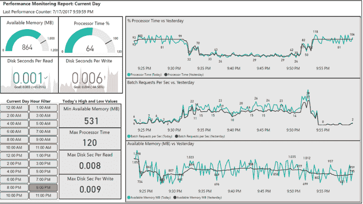

Figure 10.1: Performance Monitoring Report page leveraging Windows Performance Monitor counters


## 工作原理...

两个仪表盘视觉对象和KPI视觉对象用于显示相对于预定义阈值或基线具有最高优先级的计数器。例如，磁盘每秒读取时间（Disk Seconds Per Read）以绿色突出显示，因为其值低于目标值 .003；磁盘每秒写入时间（Disk Seconds Per Write）以红色突出显示，因为其值高于目标值 .004。这四个视觉对象都遵循左下角的小时筛选器控件（一个自定义的Chiclet切片器），并且使用Time维度表中的 Minute of Day Time 数据类型列作为KPI视觉对象的趋势轴。

一组“今日最高值和最低值”卡片视觉对象忽略时间筛选器选择（例如切片器中的9:00 P.M.），但应用当前日期筛选器。在此示例中，CPU（处理器百分比）、每秒批处理请求数和可用内存与前一天的值在折线图中进行对比。七天和三十天的平均值度量通常用作性能基线。

## 更多内容...

如果按照之前的配方实现，还可以为等待统计和配置值创建报表视觉对象。要了解其工作原理，请执行以下步骤：

- 1. 创建DAX度量值以识别数据库实例配置更改：

```
Config Value = IF(AND(HASONEVALUE('Configuration Values'[ConfigurationID]), HASONEVALUE('Dates'[Date])), MAX('Configuration Values'[Configuration Value]),BLANK())

Config Value (Today) = CALCULATE([Config Value], FILTER(ALL('Dates'),'Dates'[Date] = [Today]))

Config Value (Yesterday) = CALCULATE([Config Value], FILTER(ALL('Dates'), 'Dates'[Date] = [Yesterday]))

Config Change (Today) = IF([Config Value (Today)] <> [Config Value (Yesterday)], "Config Change", "No Change")

Config Changes = IF([Config Value] = [Prior Day Config],0,1)
```

性能监控报表：实例配置

上次配置捕获日期：7/15/2017

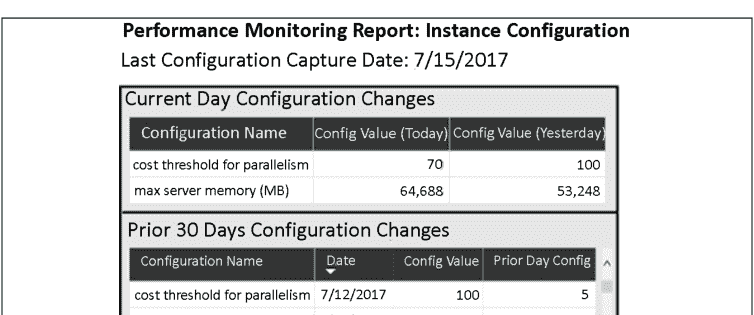

图10.2：实例配置报表页面：当前日期及过去30天的更改历史

- 2. “当前日期配置更改”表视觉对象在 Config Change (Today) 度量值上使用视觉级筛选器，以便仅显示（当天的）已更改配置。“前30天配置更改”表视觉对象使用两个视觉级筛选器。一个筛选器应用于Dates维度表中的 Date 列，并使用相对日期筛选功能来检索过去30天但不包括当天；另一个筛选条件应用于 Config Changes 度量值，筛选值为1。

- 3. 为Wait Statistics表创建类似的DAX度量值，例如当前日期的平均等待秒数。

- 4. 在新页面上，将当前日期的等待统计捕获数据的平均值与先前日期进行比较：

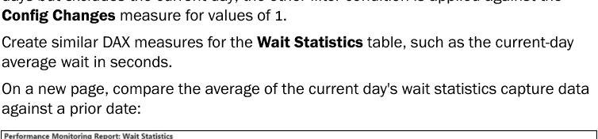

图10.3：等待统计报表示例：KPI、瀑布图和散点图视觉对象

> “等待统计信息可能是开始排查SQL Server性能问题的最佳单一途径。SQL Server知道执行为何停滞（换句话说，线程为何必须等待），因此利用这些信息来识别瓶颈和进一步调查的方向，可以显著减少诊断工作负载性能下降原因所需的时间。”
> 
> ——Paul Randal，SQLskills CEO，微软数据平台MVP

在此有限的等待统计报表示例中，页面级别应用了相对日期筛选，仅包含过去30天；因此，两个KPI视觉对象的背景中显示了30天趋势。视觉级别还向瀑布图和散点图应用了相对日期筛选，分别仅包含最近2天和当天。瀑布图的“分解字段”井用于自动识别从昨天到当前日期的等待秒数（等待类型）变化的最大驱动因素。

高级等待统计报表可用作分析的快速起点，以识别系统中的瓶颈。此外，在具备成熟且可预测的基线数据后，该报表可用于排查性能下降问题。例如，PAGEIOLATCH_EX等待的突然飙升可能表明存在缺失索引问题、相关数据库架构或代码更改问题。

## 另请参阅

- SQL Server等待类型库：https://www.sqlskills.com/help/waits/。

## 导入和可视化动态管理视图（DMV）数据

Analysis Services数据模型和Power BI实例包含许多动态管理视图（DMV），这些视图可用于检索与各种数据库对象相关的架构元数据和资源使用情况。导入数据模型的查询性能直接受所消耗内存量的影响。因此，在性能调优工作中，了解内存消耗以及影响内存消耗的因素（如压缩和基数）至关重要。Power BI集成和可视化工具可以增强DMV提供的系统信息的价值，从而为Power BI和SSAS数据集的所有者提供一个直观、可持续的报表层，以支持这些资产。

### 准备工作

要准备此配方，请执行以下步骤：

- 1. 打开包含要分析的数据集的Power BI Desktop文件。在数据检索期间，该文件必须保持打开状态。
- 2. 从“外部工具”中打开DAX Studio。
- 3. 从DAX Studio状态栏的右下角检索与正在运行的Power BI Desktop文件关联的服务器名称和端口；例如 localhost:56514。
- 4. 在DAX Studio中，在左上角的“元数据”下，右键单击数据库ID，然后选择“复制数据库ID”。
- 5. 打开一个新的Power BI Desktop文件，并点击“开始”选项卡功能区中的“转换数据”，以打开Power Query编辑器窗口。
- 6. 创建两个参数 Server 和 Database，并将从DAX Studio检索到的值作为当前值应用：


图10.4：具有本地Power BI模型值的查询参数

### 如何导入和可视化DMV数据

要实现此配方，请执行以下步骤：

- 1. 创建一个 Segments 查询：

```
let Source = AnalysisServices.Database
(Server, Database,[Query="Select * From $SYSTEM.DISCOVER_STORAGE_TABLE_COLUMN_SEGMENTS"]),
    Segments = Table.AddColumn(Source, "Structure Type", each
        if Text.Range([TABLE_ID],1,1) <> "$" then "Data"
        else if Text.Start([TABLE_ID],2) = "H$" then "Column Hierarchy"
        else if Text.Start([TABLE_ID],2) = "U$" then "User Hierarchy"
        else if Text.Start([TABLE_ID],2) = "R$" then "Relationship"
        else "unknown", type text),
    RenameTable = Table.RenameColumns(Segments,{{"DIMENSION_NAME", "Table"}}),
    KeyColumn = Table.AddColumn(RenameTable, "ColumnKey", each [Table] & "-" & [COLUMN_ID], type text)
in KeyColumn
```

- 2. 创建一个 **Columns** 查询：

```
let Source = AnalysisServices.Database
    (Server, Database,[Query="Select * From $SYSTEM.DISCOVER_STORAGE_TABLE_COLUMNS"]),
        BasicData = Table.SelectRows(Source, each ([COLUMN_TYPE] = "BASIC_DATA")),
        RenameTable = Table.RenameColumns(BasicData,{{"DIMENSION_NAME", "Table"},{"ATTRIBUTE_NAME", "Column"}}),
        KeyColumn = Table.AddColumn(RenameTable, "ColumnKey", each [Table] & "_" & [COLUMN_ID], type text),
        DateRetrieved = Table.AddColumn(KeyColumn, "Date Retrieved", each DateTime.Date(DateTime.LocalNow()), type date)
    in DateRetrieved
```

- 3. 创建一个名为 **Calculations** 的空查询。

- 4. 点击 **“开始”** 选项卡功能区中的 **“关闭并应用”**。

- 5. 在 **“模型”** 视图中，在 **Segments** 和 **Columns** 表的 **ColumnKey** 列之间创建关系。

- 6. 创建以下DAX度量值：

```
BytesPerMB = 1048576

Segment Size (MB) = DIVIDE(SUM(Segments[USED_SIZE]),[BytesPerMB])

Dictionary Size (MB) = DIVIDE(SUM('Columns'[DICTIONARY_SIZE]),[BytesPerMB])

Data Size (MB) =
    CALCULATE([Segment Size (MB)],Segments[Structure Type] = "Data")

Column Hierarchies Size (MB) =
    CALCULATE([Segment Size (MB)],Segments[Structure Type] = "Column Hierarchy")

User Hierarchy Size (MB) =
    CALCULATE([Segment Size (MB)],Segments[Structure Type] = "User Hierarchy")

Relationship Size (MB) =
    CALCULATE([Segment Size (MB)],Segments[Structure Type] = "Relationship")

Total Column Size (MB) = [Data Size (MB)] + [Dictionary Size (MB)]

Total Size (MB) = [Column Hierarchies Size (MB)] + [Relationship Size (MB)]
```


(MB)] +
[用户层次结构大小 (MB)] + [字典大小 (MB)] + [数据大小 (MB)]

```
Last Refresh Message = VAR RefreshDate = MAX('Columns'[Date Retrieved])
RETURN "Last Refreshed: " & RefreshDate
```

+   7. 基于检索到的并已建模的 DMV 数据创建 Power BI 报表页，如图 10.5 所示：

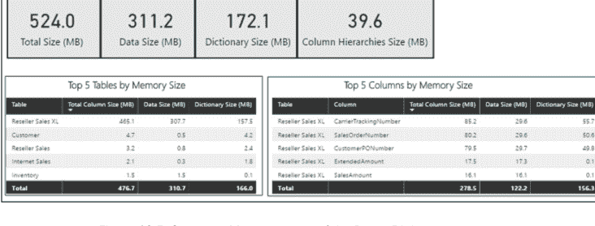

图 10.5：Power BI 数据集的摘要内存报告

## 工作原理...

对于 Segments 查询，使用 Server 和 Database 参数，以及针对 DISCOVER_STORAGE_TABLE_COLUMN_SEGMENTS DMV 的 SQL 语句，从正在运行的 Power BI Desktop 文件（其中包含 Analysis Services 实例）中提取并访问内存使用数据。添加条件列 Structure Type 以标识每一行所表示的内存结构，并创建串联列 ColumnKey 以支持与 Columns 表之间的关系。

对于 Columns 查询，会根据 Column_Type 列对 DISCOVER_STORAGE_TABLE_COLUMNS DMV 进行筛选，并创建串联列 ColumnKey 用于与 Segments 表建立关系。此外，还添加了一个动态的 Date Retrieved 列，以支持报表层。

两个源 DMV 的内存列均以字节为单位。由于 MB 的位数更少，因此更直观、更易于展示；因此，使用 BytesPerMB 度量值（硬编码为 1,048,576）对 USER_SIZE 和 DICTIONARY_SIZE 列的总和进行 DIVIDE 运算。在 Segments 查询中创建的 Structure Type 列用于支持总体内存使用的不同组成部分，并为汇总级报表创建了两个总计度量值。

使用卡片视觉对象显示总体内存使用情况；两个带有“前 N 项”视觉级筛选器的表视觉对象提供更多详细信息。在此示例中，**Reseller Sales XL** 表是模型中目前最大的表，具体而言，该表的 **CarrierTrackingNumber**、**SalesOrderNumber** 和 **CustomerPONumber** 列消耗的内存最多。单击 **Top 5 Tables** 视觉对象中的表名会交叉筛选 **Top 5 Columns** 视觉对象。

可以添加更多 DMV 和逻辑，以构建一个更强大的模板报表，供各 Power BI 项目使用。请注意，当所分析的 PBIX 文件被关闭并重新打开时，需要更新 **Server** 和 **Database** 参数。

## 更多内容...

除了每列的压缩数据内存结构外，导入的数据模型还会在内部创建字典和列层次结构（**H$**）以支持查询。通过 columns DMV 检索到的字典结构存储列的唯一值，因此对于高基数列，其占用空间更大。另外两种内存结构包括用户定义的层次结构（**U$**）和表关系（**R$**）。

在本技巧中，分配给列层次结构（**H$**）的内存在 **Total Column Size** 度量值中被排除，但被包含在 **Total Size** 度量值中。这样做的目的是将分析重点放在内存的较大组成部分上，而这些部分可能会受到数据模型修订的直接影响。同样，用于关系和用户定义层次结构的内存相对于模型列的数据和字典大小而言很小。

导入数据模型的基本性能调优主要侧重于尽量减少高基数列和关系，以减少扫描的内存。更高级的调优（通常用于 SSAS 模型）涉及表分区、段大小以及优化引擎在压缩期间使用的排序顺序。对于 Power BI 数据集，只有排序顺序可用。

Vertipaq Analyzer 利用 DMV 收集数据集的信息，现已集成到 DAX Studio 的 **Advanced** 菜单以及 Tabular Editor 3 中。与自行编写针对 DMV 的查询相比，使用 Vertipaq Analyzer 是一种更快速、更轻松的分析数据模型内存大小、基数和其他方面的方法。

## 另请参阅

- Kasper de Jonge 发表了一篇关于使用 Power BI 构建 SSAS 内存报表的博客：http://bit.ly/2tDumgk.
- SQL BI 的 Vertipaq Analyzer Excel 文件：http://bit.ly/2sTTuS0.
- Analysis Services 中的**动态管理视图 (DMVs)**：https://bit.ly/33etDoc.

Vertipaq Analyzer 用于 Tabular Editor 2 的脚本：https://bit.ly/2YA97zv

## 提高 DBA 生产力

SQL Server 查询存储（Query Store）是一项监控功能，适用于 SQL Server 2016 及更高版本的所有版本——它极大地简化和加快了查询调优和故障排除。查询存储数据库提供关于查询执行、查询计划和等待统计的聚合指标，使性能趋势和使用模式可见。

> “查询存储是执行计划的绝佳飞行数据记录器。它将帮助你排查参数嗅探问题、连接设置问题、计划回归、糟糕的统计信息以及更多问题。”

— Brent Ozar，作者、Microsoft 认证大师（SQL Server）

查询存储包含图表和用户控件的图形界面，其架构非常适合自定义 T-SQL 查询，例如过去一小时内运行时间最长的 10 个查询。虽然这些功能很棒并且足以应对某些场景，但管理员通常不得不在 T-SQL 的灵活性与查询存储提供的图形控件之间进行权衡。在本技巧中，将简单的 T-SQL 语句从 Power BI 传递给 SQL Server 查询存储，以识别和分析最近的性能问题以及特定存储过程的性能。

## 准备工作

若要准备本技巧，请执行以下步骤：

- 1. 在最新版本的 SQL Server Management Studio (SSMS) 中启用查询存储，可以通过对象资源管理器界面中的“数据库属性”对话框（右键单击数据库，选择“属性”），也可以通过以下 T-SQL 语句：

```
ALTER DATABASE AdventureWorksDW2019 SET QUERY_STORE = ON;
```

- 2. 根据你的要求配置查询存储设置，例如统计信息收集间隔、保留期和最大大小 (MB)。

在此示例中，单个查询的性能将被聚合或汇总到 5 分钟的时间范围内。较小的收集时间间隔可提供更多详细信息，但也会消耗更多的存储和收集资源。若要获得不对查询进行分组时的最大详细信息，可以计划一个扩展事件 (Extended Events) 会话。有关更多详细信息，请参阅本章后面的“分析扩展事件”技巧。

## 如何提高 DBA 生产力

若要实施本技巧，请执行以下步骤：

- 1. 生成并测试用于检索所需查询存储统计信息的 T-SQL 语句：

```
SELECT
    [rs].[avg_duration], [rs].[avg_logical_io_reads], [qst].[query_text_id],
    [qsq].[query_id],
    [qst].[query_sql_text], CASE WHEN [qsq].[object_id] = 0
        THEN N'Ad-hoc' ELSE OBJECT_NAME([qsq].[object_id])
        END AS [ObjectName],
    [qsp].[plan_id], GETUTCDATE() AS CurrentUTCtime,
    [rs].[last_execution_time],
        CAST((DATEADD(MINUTE,
            -(DATEDIFF(MINUTE, GETDATE(), GETUTCDATE())),
            [rs].[last_execution_time])) AS datetime2(0))
        AS LocalLastExecutionTime
FROM
    [sys].[query_store_query] [qsq]
    JOIN [sys].[query_store_query_text] [qst] ON
        [qsq].[query_text_id] = [qst].[query_text_id]
    JOIN [sys].[query_store_plan] [qsp] ON
        [qsq].[query_id] = [qsp].[query_id]
    JOIN [sys].[query_store_runtime_stats] [rs] ON
        [qsp].[plan_id] = [rs].[plan_id]
WHERE [rs].[last_execution_time] > DATEADD(hour, -8, GETUTCDATE())
```

- 2. 创建另一个 T-SQL 语句，其中包含类似的与性能相关的列，并筛选到特定的存储过程，该存储过程同时检索收集间隔时间：

```
SELECT * FROM
[sys].[query_store_query] [qsq]
JOIN [sys].[query_store_query_text] [qst] ON
    [qsq].[query_text_id] = [qst].[query_text_id]
JOIN [sys].[query_store_plan] [qsp] ON
    [qsq].[query_id] = [qsp].[query_id]
JOIN [sys].[query_store_runtime_stats] [rs] ON
    [qsp].[plan_id] = [rs].[plan_id]
JOIN [sys].[query_store_runtime_stats_interval] [rsi] ON
    [rs].[runtime_stats_interval_id] = [rsi].[runtime_stats_interval_id]
WHERE [qsq].[object_id] = OBJECT_ID(N'Sales.usp_GetFullProductInfo')
```


+   3. 在 SQL Server 中为两个 **查询存储** 查询创建一个视图和一个参数化存储过程，不要使用 WHERE 子句过滤器——此条件将由 Power BI 参数驱动。
+   4. 设计 SQL Server 存储过程，使其包含一个 WHERE 子句，其中带有一个将从 Power BI 传入的参数，例如以下内容：
```
CREATE PROCEDURE [Website].[QueryStoreProc]
@QSProcedure nvarchar(55)
AS ......
WHERE [qsql].[object_id] = OBJECT_ID(@QSProcedure)
```
+   5. 在本地打开 Power BI Desktop 文件，并为“查询存储”数据库添加服务器和数据库参数。
+   6. 使用引用这两个参数的 Sql.Database 函数创建一个新查询 **AdWorksDW**。
+   7. 创建一个参数 **HoursInPast**，数据类型为十进制数，以及一个 **QueryStoreProcedure** 文本参数。
+   8. 创建一个新的 M 查询 **Query Store DurationIO**，该查询检索所有查询的 I/O 和持续时间统计信息，并使用 **HoursInPast** 参数：
```
let
    Source = AdWorksDW,
    SQLView = Source{[Schema="Website", Item="QueryStoreDurationIO"]}[Data],
    ParamFilter = Table.SelectRows(SQLView, each
        [LocalLastExecutionTime] >=
            (DateTime.LocalNow() - #duration(0,HoursInPast,0,0))),
    ExecutionDate = Table.AddColumn(ParamFilter,
        "Last Execution Date",
        each DateTime.Date([LocalLastExecutionTime]), type date),
    ExecutionTime = Table.AddColumn(ExecutionDate,
        "Time", each DateTime.Time([LocalLastExecutionTime]), type time)
in ExecutionTime
```
+   9. 创建一个新的 M 查询 **Query Store Procedure**：
```
let
    Source = AdWorksDW,
    Procedure = Value.NativeQuery(Source,
        "EXECUTE Website.QueryStoreProc @QSProcedure = "
        & "'" & QueryStoreProcedure & "'"),
    InsertedDate = Table.AddColumn(Procedure, "Date",
        each DateTime.Date([end_time]), type date),
    InsertedTime = Table.AddColumn(InsertedDate, "Time",
        each DateTime.Time([end_time]), type time)
in InsertedTime
```
+   10. 创建一个名为 **Calculations** 的空白查询。
+   11. 在 **开始** 选项卡的功能区中单击 **关闭并应用**。
+   12. 使用以下 DAX 代码创建 **Dates** 表：
```DAX
Dates
    VAR __Today = TODAY()
    RETURN
    CALENDAR(DATE(YEAR(__Today)-1,1,1),DATE(YEAR(__Today)+1,12,31))
```
+   13. 创建 **Time** 表：
```DAX
Time =
    VAR __hrs = SELECTCOLUMNS(GENERATESERIES(1,23,1), "Hour", [Value])
    VAR __mins = SELECTCOLUMNS(GENERATESERIES(0,59,1), "Minutes", [Value])
    VAR __secs = SELECTCOLUMNS(GENERATESERIES(0,59,1), "Seconds", [Value])
    VAR __hoursMinutes = GENERATEALL(__hrs, __mins)
    VAR __hoursMinutesSeconds = GENERATEALL(__hoursMinutes,__secs)
    VAR __final = ADDCOLUMNS(ADDCOLUMNS(__hoursMinutesSeconds,
        "Time", TIMEVALUE(FORMAT([Hour], "00") & ":" &
            FORMAT([Minutes], "00") & ":" & FORMAT([Seconds],"00"))),
        "SecondOfDay", FORMAT([Hour],"00") & FORMAT([Minutes],"00")
            & FORMAT([Seconds],"00"))
    RETURN __final
```
+   14. 将 **Dates** 表中 **Date** 列的 **数据类型** 更改为 **Date**。
+   15. 将 **Time** 表中 **SecondOfDay** 列的 **数据类型** 更改为 **Text**。
+   16. 在 **模型** 视图中，在 **Query Store DurationIO** 和 **Query Store Procedure** 表与 **Dates** 和 **Time** 表之间创建关系。
+   17. 向 **Calculations** 表添加 DAX 度量值：
```DAX
Average CPU Time (QS Proc) = AVERAGE('Query Store Procedure'[avg_cpu_time])

Average Duration (QS Proc) = AVERAGE('Query Store Procedure'[avg_duration])

Average Logical IO Reads (QS Proc) = AVERAGE('Query Store Procedure'[avg_logical_io_reads])
```
+   18. 利用这些度量值和关系，为两个“查询存储”表创建专用报表页：

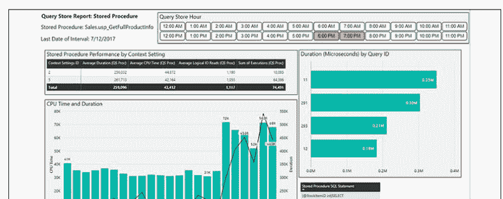

图 10.6：查询存储示例报表页 – 存储过程

**查询存储存储过程** 报表页按 **上下文设置 ID** 和各个 **查询 ID** 细分性能度量值。组合图显示各时间间隔内 CPU 和持续时间的性能趋势；与存储过程关联的 SQL 语句通过表视觉对象显示。此外，还使用自定义 Chiclet 切片器为用户提供按小时时间段的简单筛选控制。

## 工作原理...

SQL Server 查询存储收集与数据库的查询和查询计划相关的编译和运行时信息。这些持久化数据通过三个独立的数据存储提供给分析：

- 包含查询执行计划信息的计划存储
- 包含执行统计信息的运行时统计存储
- 包含查询等待统计信息的等待统计存储

在 SQL Server 2016 或更高版本中，可以通过以下系统视图查询这三个数据存储：sys.query_store_plan、sys.query_store_runtime_stats 和 sys.query_store_wait_stats。

第一个 T-SQL 查询检索过去 8 小时内收集的查询存储时间间隔的平均持续时间和逻辑 I/O 读取次数，以及 SQL 语句本身和 **查询 ID**。可以在 Power BI 中设置要检索的小时数参数，因此为检索此数据而创建的 SQL 视图不需要 WHERE 子句。Power BI 将通过查询折叠动态构建包含此参数的 WHERE 子句筛选器的 T-SQL 语句。

## 另请参阅

-   使用查询存储监控性能：`http://bit.ly/2s9Cx5r`

## 提供文档

随着数据模型不断增长和变化以支持新的业务流程和逻辑，访问最新文档变得至关重要。基本元数据的可见性，例如模型的关系、表的列以及度量值中内置的筛选逻辑，可以显著帮助业务团队利用 Power BI 数据集。此外，对于可能刚接触特定模型或不熟悉模型某个组件的商业智能和 IT 专业人员而言，直接访问技术元数据（如数据源参数、SQL 和 M 查询以及已配置的安全角色）也会带来极大帮助。

在本节中，将访问与 Power BI 数据集架构相关的若干 **动态管理视图 (DMV)**，并将其集成到 Power BI 报表中。然后，创建一个带参数的模板，以便在多个 Power BI 数据集之间生成标准文档报表。

## 准备工作

要准备本节内容，请执行以下步骤：

+   1. 打开包含要分析的数据集的 Power BI Desktop 文件。在数据检索期间，此文件必须保持打开状态。
+   2. 从 **外部工具** 打开 DAX Studio。
+   3. 从 DAX Studio 状态栏右下角检索与正在运行的 Power BI Desktop 文件关联的服务器名称和端口，例如 **localhost:56514**。
+   4. 在 DAX Studio 中，靠近左上角的 **元数据** 下，右键单击数据库 ID，然后选择 **复制数据库 ID**。
+   5. 打开一个新的 Power BI Desktop 文件，在 **开始** 选项卡的功能区中单击 **转换数据**，以打开 **Power Query 编辑器** 窗口。
+   6. 创建两个参数 **Server** 和 **Database**，并将从 DAX Studio 检索到的值作为当前值应用。

## 如何提供文档

要实现本节内容，请执行以下步骤：

+   1. 创建一个名为 **TablesDMV** 的新空白 M 查询，该查询通过 **Server** 和 **Database** 参数检索 TMSCHEMA_TABLES DMV：

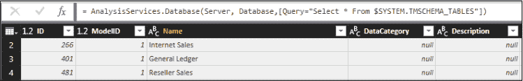

图 10.8：正在运行的 Power BI Desktop 文件的表元数据

+   2. 复制 **TablesDMV** 查询，以同时检索以下五个架构 DMV：
   
   - SYSTEM.TMSCHEMA_COLUMNS
   - SYSTEM.TMSCHEMA_MEASURES
   - SYSTEM.TMSCHEMA_ROLES
   - SYSTEM.TMSCHEMA_TABLE_PERMISSIONS
   - SYSTEM.TMSCHEMA_RELATIONSHIPS:
+   3. 根据其来源命名查询，并将这些查询及其参数组织到各自的文件夹中：

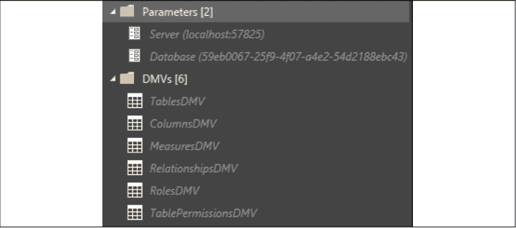

图 10.9：用于支持模型文档的参数和 DMV 查询

+   4. 创建名为 **Documentation** 的第三个查询组，以及一个名为 **Columns** 的新空白查询：
```
```m
let
    Tables = TablesDMV, Columns = ColumnsDMV,
    Join = Table.NestedJoin(Columns,{"TableID"},Tables,{"ID"},
```


“TableColumns”，JoinKind.LeftOuter），
TableExpand = Table.ExpandTableColumn（Join，“TableColumns”， {“Name”}，{“Table”}），
DataType = Table.AddColumn（TableExpand，“Data Type”，每个
    如果 [ExplicitDataType] = 2 则 “Text” 否则
    如果 [ExplicitDataType] = 6 则 “Whole Number” 否则
    如果 [ExplicitDataType] = 8 则 “Decimal Number” 否则
    如果 [ExplicitDataType] = 9 则 “Date” 否则
    如果 [ExplicitDataType] = 10 则 “Fixed Decimal Number” 否则 “Other”，
    类型文本），
ColumnType = Table.AddColumn（DataType，“Column Type”，每个
    如果 [Type] = 1 则 “Standard” 否则
    如果 [Type] = 2 则 “Calculated” 否则 “Other”，类型文本），
Filter = Table.SelectRows（ColumnType，每个
    不是 Text.StartsWith（[ExplicitName]，“RowNumber”）
    且不是 Text.StartsWith（[Table]，“LocalDate”）
    且不是 Text.StartsWith（[Table]，“DateTableTemplate”）），
Rename = Table.RenameColumns（Filter，
    {{“ExplicitName”，“Column”}，{“DataCategory”，“Data Category”}，
    {“IsHidden”，“Is Hidden”}，{“FormatString”，“Column Format”}}）
在 Rename 中

5. 创建一个名为 Relationships 的新空白查询，并识别每个关系的表和列：

```
let
    Relationships = RelationshipsDMV,
    Tables = TablesDMV, Columns = ColumnsDMV,
    FromTableJoin = Table.NestedJoin（Relationships，
        {“FromTableID”}，Tables，{“ID”}，“FromTableCols”，JoinKind.Inner），
    FromTable = Table.ExpandTableColumn（FromTableJoin，
        “FromTableCols”，{“Name”}，{“From Table”}），
    ToTableJoin = Table.NestedJoin（FromTable，
        {“ToTableID”}，Tables，{“ID”}，“ToTableCols”，JoinKind.Inner），
    ToTable = Table.ExpandTableColumn（ToTableJoin，“ToTableCols”，
        {“Name”}，{“To Table”}），
    FilterDateTbls = Table.SelectRows（ToTable，
        每个不是 Text.StartsWith（[To Table]，“LocalDateTable”）），
    FromColumnJoin = Table.NestedJoin（FilterDateTbls，
        {“FromColumnID”}，Columns，{“ID”}，“FromColumnCols”，JoinKind.Inner），
    FromColumn = Table.ExpandTableColumn（FromColumnJoin，“FromColumnCols”，
        {“ExplicitName”}，{“From Column”}），
```

## 管理和监控 Power BI

```
ToColumnJoin = Table.NestedJoin（FromColumn，
    {“ToColumnID”}，Columns，{“ID”}，“ToColumnCols”，JoinKind.Inner），
ToColumn = Table.ExpandTableColumn（ToColumnJoin，“ToColumnCols”，
    {“ExplicitName”}，{“To Column”}），
CrossFiltering = Table.AddColumn（ToColumn，“Cross Filtering”，
    每个如果 [CrossFilteringBehavior] = 1 则 “Single Direction”
        否则 “Bidirectional”，类型文本），
Rename = Table.RenameColumns（CrossFiltering，{{“ID”，“Relationship ID”}}）
在 Rename 中
```

- 6. 创建一个名为 **Metrics** 的简单查询，基于 **MeasuresDMV** 查询，通过连接到 **TablesDMV** 查询来添加表名。
- 7. 添加一个名为 **Security Roles** 的查询，将 **RolesDMV** 查询与 **TablePermissionsDMV** 查询和 **TablesDMV** 查询连接，使得安全角色名称、筛选条件和筛选条件所在的表都包含在查询中。
- 8. 在 **Home** 选项卡的功能区中单击 **Close & Apply**。
- 9. 在 **Report** 视图中，创建以下四个报表页面：
  - Columns
  - Relationships
  - Measures
  - Security
- 10. 使用表视觉对象在每个页面上公开每个集成 M 查询中最重要的列：

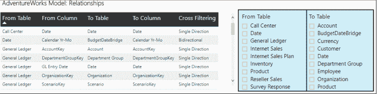

图 10.10：Relationships 元数据报表页面

## 工作原理...

当作为数据集（而不是实时连接的报表）使用时，打开的 Power BI Desktop 文件包含一个 SQL Server Analysis Services（SSAS）实例。因此，Power BI Desktop 文件中包含的所有数据模型对象（包括 DMV）都可以作为 SSAS 数据源进行访问。例如，SQL Server Profiler、SQL Server Management Studio 和 Microsoft Excel 都可以引用相同的端口和目录名称来建立与数据源的连接。此外，本食谱中的相同方法也适用于 DirectQuery 模式下的 Power BI Desktop 模型：

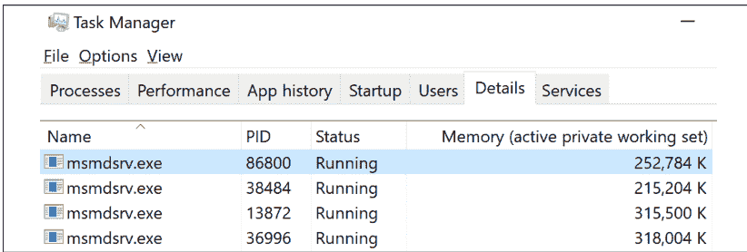

图 10.13：Windows 任务管理器：与打开的 PBIX 数据集关联的 SQL Server Analysis Services 进程

Columns 查询连接了 Columns 和 Tables DMV 查询，并创建了两个新列来标识数据类型和任何计算列。此外，还应用了筛选器来移除与 Power BI 为日期列创建的内部日期表相关的元数据，并重命名了若干列以支持文档报表。

Relationships DMV 包含模型中定义的每个关系两侧的表和列 ID 键。因此，使用四个单独的连接表达式来检索 From Table 和 From Column 以及 To Table 和 To Column。此外，添加了一个列来标识任何双向交叉筛选关系，并应用筛选器来移除内部日期表。

## 更多内容...

对于 SSAS 表格文档，可以使用额外的 DMV，例如 TMSCHEMA_KPIS 和 TMSCHEMA_PERSPECTIVES，以及有关列和度量的显示文件夹、模型作者为各种对象输入的描述以及分区的更多详细信息。目前特定于 SSAS 的元数据（例如透视和 KPI）未来也可能被 Power BI 数据集使用。

## 另请参阅

- 四种查找 Power BI 本地端口号的方法：https://bit.ly/3uiV01d
- Analysis Services 中的动态管理视图（DMV）：https://bit.ly/33etDoc

## 分析 SSAS 表格数据库和网关

Microsoft 本地数据网关使特定云服务（包括 Power BI、Azure Analysis Services、Power Apps 和 Power Automate）能够安全地连接到本地数据源。在 Power BI 的上下文中，这些连接既支持存储在 Power BI 中的导入数据集的计划刷新，也支持 DirectQuery 和 Live Connection 数据集，在这些数据集中，只有报表查询及其结果在 Power BI 和本地源之间交换。由于网关的可用性和性能对于任何需要本地数据的 Power BI 和其他受支持的云服务部署都至关重要，因此建议定期监控网关服务及其主机服务器。

在本食谱中，特定于本地数据网关和 SQL Server Analysis Services 的性能监视器计数器被集成到单个 Power BI 数据集中。此源数据通过 M 查询动态检索和增强，并创建示例报表可视化以支持监控和分析。

## 准备工作

要准备此食谱，请执行以下步骤：

- 1. 在初始部署或规划阶段，查看有关 SSAS 表格和本地数据网关的可用文档、提示和最佳实践，包括推荐的硬件和网络配置。

  SSAS 表格服务器应具有其压缩内存数据库 2.5 倍的 RAM，并且应打开出站端口 443 以在默认 HTTPS 模式下运行本地数据网关（如果使用 TCP 模式，则为端口 9350-9353）。尽管硬件充足，但数据模型、M 查询和 DAX 度量的设计和复杂性会显著影响资源使用和性能。有关更多详细信息，请参阅第 11 章“增强和优化现有 Power BI 解决方案”。

- 2. 确定一个安全的网络位置目录来存储性能计数器文件。此路径可以使用通用网络驱动器和其他监控日志文件的父文件夹。

3. 使用 Windows 性能监视器设计和计划一个新的数据收集器集，其中包含以下性能监视器计数器：

- \MSOLAP:Memory\Memory Limit Hard KB
- \MSOLAP:Memory\Memory Limit High KB
- \MSOLAP:Memory\Memory Limit Low KB
- \MSOLAP:Memory\Memory Limit Vertipaq KB
- \MSOLAP:Memory\Memory Usage KB

性能监视器默认使用 .blg 日志文件，但 Power BI 只能合并文本、CSV 和 Excel 格式的文件，因此请将日志格式设置为逗号分隔。Windows 性能监视器有完善的文档，并且大多数管理员都很熟悉。通过 PowerShell 进行最佳实践和自动化超出了本食谱的范围。

## 如何分析 SSAS 表格模型和网关

要实现此食谱，请执行以下步骤：

- 1. 打开一个新的 Power BI Desktop 文件，用于同时收集 SSAS 表格和本地数据网关计数器。
- 2. 为 Server、Database 和要检索的历史天数（CounterHistoryDays）创建数据源参数。
- 3. 定义一个查询 AdWorksDW，用于公开数据库对象（表和视图）。
- 4. 创建一个名为 SSAS Memory 的新查询，选择 SSAS 表格性能计数器的父文件夹位置，并按照本章前面“使用 Power BI 创建集中式 IT 监控解决方案”食谱中描述的导入性能监视器计数器文件的相同步骤操作。
- 5. 在 Home 选项卡的功能区中单击 Close & Apply。
- 6. 使用以下 DAX 代码创建 Dates 表：
- 7. 创建 Time 表：

```
Dates =
    VAR __Today = TODAY()
RETURN
    CALENDAR(DATE(YEAR(__Today)-1,1,1),DATE(YEAR(__Today)+1,12,31))
```

```
Time =
    VAR __hrs = SELECTCOLUMNS(GENERATESERIES(1,23,1),"Hour",[Value])
```


```
VAR __mins = SELECTCOLUMNS(GENERATESERIES(0,59,1), "Minutes", [Value])
VAR __secs = SELECTCOLUMNS(GENERATESERIES(0,59,1), "Seconds", [Value])
VAR __hoursMinutes = GENERATEALL(__hrs, __mins)
VAR __hoursMinutesSeconds = GENERATEALL(__hoursMinutes,__secs)
VAR __final = ADDCOLUMNS(ADDCOLUMNS(__hoursMinutesSeconds,
    "Time", TIMEVALUE(FORMAT([Hour],"00") & ":" &
        FORMAT([Minutes],"00") & ":" & FORMAT([Seconds],"00")),
    "SecondOfDay", FORMAT([Hour],"00") & FORMAT([Minutes],"00")
        & FORMAT([Seconds],"00")))
RETURN __final
```

- 8. 将 **Dates** 表中的 **Date** 列的**数据类型**更改为 **Date**。
- 9. 将 **Time** 表中的 **SecondOfDay** 列的**数据类型**更改为 **Text**。
- 10. 在**模型**视图中，在 **Dates** 表的 **Date** 列与 **SSAS Memory** 表之间创建关系。
- 11. 在 **Time** 表的 **SecondOfDay** 列与 **SSAS Memory** 表之间创建关系。
- 12. 创建 DAX 度量值以支持报表和分析，如下所示：

```
KB to GB Conversion = 1048576

Avg Memory Limit Hard (GB) =
    DIVIDE(AVERAGE('SSAS Memory'[Memory Limit Hard KB]),[KB to GB Conversion])

Avg Memory Usage GB (Today) =
    CALCULATE([Avg Memory Usage (GB)],
        FILTER(ALL('Date'),'Date'[Date] = [Current Date]))

Max Memory Usage GB (Today) =
    CALCULATE([Max Memory Usage (GB)],
        FILTER(ALL('Date'),'Date'[Date] = [Current Date]))

Max Memory GB (Today, All Time) =
    CALCULATE([Max Memory Usage GB (Today)],ALL('Time'))
```

- 13. 利用合并后的计数器文件、模型关系和度量值创建 SSAS 表格内存报表：

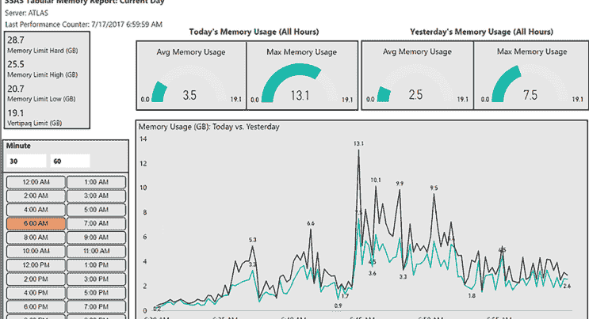

图 10.14：SQL Server Analysis Services 服务器属性 – 内存属性

### 工作原理

SSAS 表格模式在处理操作期间，除了用于现有数据的内存外，还需要内存来加载新数据。此外，有时会创建临时内存结构来处理某些查询。这三个组成部分构成了 2.5 倍 RAM 的建议（2 倍用于当前数据和新数据，0.5 倍用于临时结构）。

当 SSAS 实例所需的内存超过特定内存限制或阈值时，根据服务器可用 RAM 量以及分析服务器属性中定义的内存属性，SSAS 会采取各种操作，从清除低优先级内存缓存（LowMemoryLimit）到强制终止用户会话（HardMemoryLimit）。有关 SSAS 内存属性文档的参考，请参见“另请参阅”部分。

DAX 度量值将内存计数器值从 KB 转换为 GB，并便于在不同筛选上下文中比较当天与前一天。例如，Avg Memory Usage GB (Today) 度量值筛选到当前日期，但会遵循 Time 维度表上用户或报表筛选器的选择。而 Max Memory GB (Today, All Time) 度量值将同时忽略 Dates 和 Time 筛选选择，始终显示当前日期的最高内存使用值。

内存使用量的显著峰值可能表明 DAX 度量值不够优化，或报表查询效率低下，需要大型临时内存结构。BI 团队需要确保内存使用量不超过计数器识别的内存限制，以避免性能下降。增加 SSAS 内存限制属性设置，或仅为 SSAS 服务器增加总 RAM，是避免内存不足的两种选择。

### 更多内容...

根据数据集的大小以及其 M 查询是否可以作为 SQL 语句折叠到数据源，计划刷新导入到 Power BI 的数据集可能在刷新时需要大量资源。例如，如果使用在源 Oracle 数据库中没有等效表达式的 M 函数，则网关中的 M 引擎将用于执行筛选、排序和聚合等逻辑。

然而，DirectQuery 和 SSAS 实时连接的资源消耗较低，因为只有查询和查询结果数据通过网关传输。尽管如此，重要的是要考虑以下事实：这些连接根据并发用户数、用户对已发布报表的使用或交互、可视化的类型和数量，以及是否配置了**行级安全性（RLS）**角色，会产生高频率的查询。

还可以为 Power BI 网关创建性能报表。要了解具体做法，请执行以下步骤：

- 1. 创建并计划一个新的性能监视器数据收集器集，其中包含本地数据网关计数器：

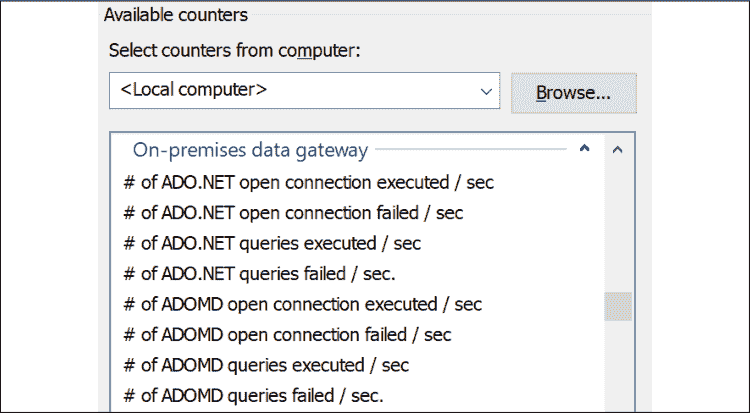

图 10.15：本地数据网关性能计数器

- 2. 在包含 SSAS 计数器的同一个 Power BI Desktop 文件中，对网关计数器文件的父文件夹创建额外的查询，并应用相同的 M 查询转换来筛选导入的文件、调整数据类型、重命名列，以及添加 **Date** 和 **Time** 列，以支持与 **Dates** 和 **Time** 维度表的关系。
- 3. 针对不同的网关计数器列构建基本聚合度量值。
- 4. 按照与 **SSAS Memory** DAX 度量值相同的表达式模式，构建额外的 DAX 度量值，以应用或移除来自 **Dates** 和 **Time** 表的筛选上下文。
- 5. 为网关性能计数器设计一个专用的网关报表页面：

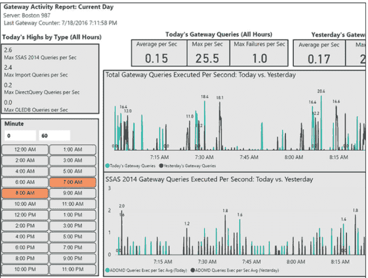

图 10.16：网关性能报表

在此示例中，该组织使用 SSAS 2014 表格服务器作为 Power BI 报表和仪表板内容的主要数据源。因此，使用基于 ADOMD 网关计数器的度量值来展示此工作负载的量（底部图表）。顶部图表使用了 **每秒执行的查询总数** 性能计数器，以及折线图上方的平均和最大卡片视觉对象。虽然不太常见，该组织还使用此网关来支持某些 Power BI 数据集的导入刷新（Mashup 计数器）和 DirectQuery 数据集的刷新（ADO.NET 计数器）。

将卡片、仪表和标准 KPI 视觉对象固定为仪表板磁贴后，可以触发数据警报和电子邮件通知。在本方案的上下文中，超过 VertiPaq 和其他内存限制的内存使用量可能触发数据警报。同样，大量查询失败或网关计数器报告的意外查询类型活动也可能触发数据警报。例如，如果某个网关专门用于导入（Mashup）工作负载，则计数器不应报告 ADO.NET（DirectQuery）或 OLEDB 连接的查询活动。

应注意，本地数据网关支持通过管理应用程序的**诊断**选项卡进行日志记录。可以通过打开**附加日志记录**选项来启用详细日志记录，但此选项仅应在故障排除时使用，不应永久启用，因为这会显著增加日志文件的数量和大小。网关日志可以在同一个**诊断**选项卡上导出。

### 另请参阅

- Power BI 数据网关部署指南：http://bit.ly/2t8hk9i
- SQL Server Analysis Services 内存属性：http://bit.ly/2vuY1I2
- 监视和优化本地数据网关性能：https://bit.ly/3nffIJQ

## 分析扩展事件

扩展事件是一个高度可配置且轻量级的性能监视系统，可用于 SQL Server 关系数据库引擎和 Analysis Services。特定会话可以使用大量事件库，这些事件可以被保存、计划，然后进行分析，以支持性能调优、故障排除和常规监视。然而，与其他监视工具（如 Windows 性能监视器和 SQL Server 查询存储）类似，扩展事件的图形界面缺乏 Power BI 等报表工具所具备的丰富分析能力和灵活性。

在本方案中，将包含查询执行统计信息的扩展事件会话输出提取到专用的 Power BI 事件分析报表文件中。来自该文件的 140 万行事件数据在导入过程中得到增强，并开发了报表可视化，以突出最有意义的趋势和度量值，并支持进一步的自助分析。

### 准备就绪

要准备此方案，请执行以下步骤：

- 1. 确定与主要监视和故障排除用例关联的事件。


+   2. 为这些用例创建单独的扩展事件会话，并使用筛选器排除无关或冗余的数据
+   3. 确定会话的数据存储目标，例如事件文件，以及该文件的位置
+   4. 可选地，配置诸如事件保留模式和最大内存大小等设置，和/或可选地配置 SQL Agent 作业以启动和停止事件会话

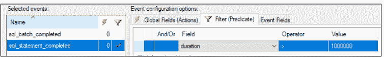

图 10.17：具有两个事件和一个筛选器的扩展事件会话

# 如何分析扩展事件

要实现此配方，请执行以下步骤：

+   1. 获取对扩展事件目标 XEL 目标文件的访问权限并从 SQL Server Management Studio (SSMS) 打开它，或在 SSMS 的另一个实例中直接从 Windows 资源管理器打开它。
+   2. 在 SSMS 中打开 XEL 文件后，单击工具栏上的扩展事件选项卡并选择底部的导出到。
+   3. 选择 CSV 文件选项，输入描述会话的文件名，并选择扩展事件以及可能的其他性能和行政日志文件共用的网络路径：
+   4. 打开已包含日期和时间表的 Power BI Desktop 文件，或使用本章前面所述的《使用 Power BI 创建集中式 IT 监控解决方案》配方中描述的相同流程创建这些表
+   5. 单击“开始”选项卡功能区上的“转换数据”以打开 Power Query 编辑器
+   6. 为事件会话文件的文件夹路径创建参数，并为会话文件名创建参数

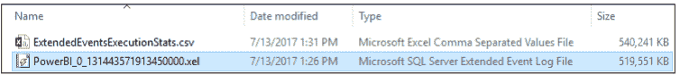

图 10.18：扩展事件会话目标 XEL 文件及其导出为 CSV 文件

+   7. 打开一个空白查询，将两个参数连接成完整的路径。命名此查询为 **XEventsSession**：

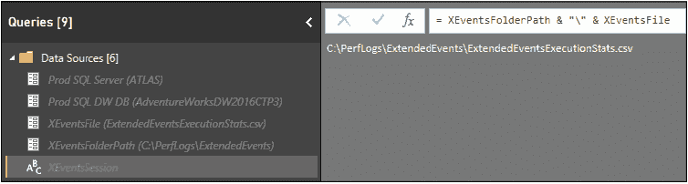

图 10.19：查询编辑器视图，其中包含 Data Sources 参数和 XEventsSession 查询

+   8. 创建一个使用文本/CSV 数据连接器的查询，并将文件路径替换为 **XEventsSession** 查询

+   9. 将顶部行提升为列标题并通过 `Table.TransformColumnTypes` 函数转换数据类型

+   10. 基于源文件的 **Timestamp** 列添加一个 **Date** 列：

```
```powerquery
let
    Source = Csv.Document(File.Contents(XEventsSession),
        [Delimiter=",", Columns=31, Encoding=65001, QuoteStyle=QuoteStyle.None]),
    PromotedHeaders = Table.PromoteHeaders(Source,
        [PromoteAllScalars=true]),
    ChangedTypes = Table.TransformColumnTypes(PromotedHeaders,
        {{"timestamp", type datetime}, {"duration", Int64.Type}}),
    DateColumn = Table.AddColumn(RenameColumns, "Timestamp Date",
        each DateTime.Date([timestamp]), type date)
in
    DateColumn
```
```

+   11. 添加一个 **Time** 列和一个 **SecondOfDay** 列以支持与 **Time** 维度表的关联

请参阅本章前面所述的《使用 Power BI 创建集中式 IT 监控解决方案》配方，了解 **SecondOfDay** 列的逻辑和语法。与该示例中的性能监视器计数器数据一样，扩展事件会话的时间戳不是按秒粒度，因此仅通过 `DateTime.Time` M 函数添加时间列不足以支持与 **Time** 维度表的模型关系

+   12. 将此查询命名为 **Execution Stats**；禁用 **XEventsSession** 查询的加载

+   13. 创建一个名为 **Calculations** 的空白查询
+   14. 单击“开始”选项卡功能区上的“关闭并应用”
+   15. 从 **Execution Stats** 到 **Dates** 和 **Time** 表创建多对一、单向关系
+   16. 开发并格式化简单的 DAX 度量以支持扩展事件事实列的常见聚合，例如查询持续时间、CPU 时间以及逻辑读取和写入的平均值、最小值和最大值：
+   
+      **Average CPU Time = AVERAGE('Execution Stats'[cpu_time])**
+   
+      **Max Duration = MAX('Execution Stats'[duration])**
+   
+      **Minimum Logical Reads = MIN('Execution Stats'[logical_reads])**
+   
+   17. 创建报表以可视化数据，如 *图 10.20* 所示：

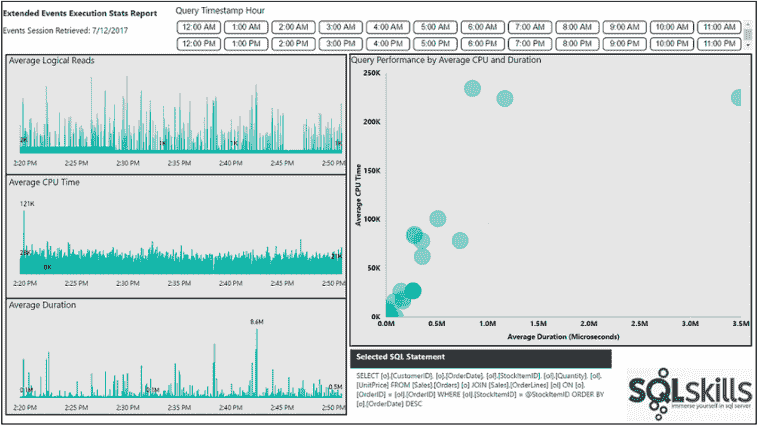

在此示例中，3 个折线图突出了在 30 分钟扩展事件会话期间发生的逻辑读取、CPU 时间和查询持续时间的峰值。散点图按持续时间和 CPU 时间绘制单个 query_hash 值，并使用工具提示显示所代表的单个 SQL 语句。还使用带有自动换行的表格视觉对象来显示与用户选择关联的 SQL 语句。请参阅 *How it works...* 部分，了解有关示例报表视觉对象的更多详细信息。

# 如何工作...

按设计，扩展事件会话不能写入 SQL Server 中的表。捕获和分析事件会话数据的其他选项可用，例如 **histogram** 和 **pair matching** 目标。数据也可以通过 **Watch Live Data** 实时查看；CSV 和表导出选项将此数据公开给 Power BI 等工具。

请注意，如果事件文件已导出到 SQL Server 中的表，则 Power BI 数据集可以配置为 DirectQuery 模式。避免通过 DirectQuery 将数据导入 Power BI 可能是有用的，甚至是必要的设计选择，如果在同一个 Power BI 数据集中需要大型和/或多个事件会话文件。第一配方中描述的专用 **Admin** 数据库可以存储扩展事件数据，并且必要的 **Dates** 和 **Time** 表可以导入到同一服务器和数据库中，从而允许 DirectQuery 模式。

# 还有更多...

SQL Server Profiler 在 SQL Server 2016 中受支持，但现在已是关系数据库引擎的已弃用功能；扩展事件是其长期替代品。Profiler 对于 Analysis Services 并不是已弃用功能，尽管 SSAS 2016 中图形界面到扩展事件是一个新功能，并且有几个新的 SSAS 跟踪事件仅通过扩展事件可用。无论是关系还是分析数据库引擎，扩展事件都比 SQL Server Profiler 更高效、更灵活，从而允许以更少的生产工作负载影响收集更细致的事件数据。与新 SQL Server 功能关联的事件仅限于扩展事件。

诸如阻塞和死锁会话之类的其他标准事件会话可以集成到 Power BI 数据集中，类似于本章前面所述的合并数据集和可视化层。随着解决方案的成熟，可以在数据集中嵌入事件的自定义分组和/或数值列的区间，以进一步简化分析。

在 Azure 中，可以使用 Azure Log Analytics 监控在 Azure 中运行的虚拟机和其他资源活动。可以编写 Kusto 查询从此数据中提取日志事件。然后，这些 Kusto 查询可以使用 **Export** 菜单导出到 **Power Query (M)**。然后可以将这些 **Power Query (M)** 查询粘贴到 Power BI 中的空白查询中以提取相同数据并包含在模型中。

# 另请参阅

+   - Quickstart: Extended Events in SQL Server: https://bit.ly/2Ss8pRN
+   - XEvents overview—SQL Server: https://bit.ly/2QJmfPj
+   - Log Analytics tutorial - Azure Monitor: https://bit.ly/3hn3NGn

# 可视化日志文件数据

包含 SQL Server Agent 作业历史记录的日志文件以及存储在 Office 365 审核日志和 Power BI 活动日志中的 Power BI 使用活动也可以集成到本章前面所述的 Power BI 监控解决方案中。例如，SQL Agent 作业数据可以揭示重要趋势，例如用于加载数据仓库的夜间作业的性能以及这些作业中各个步骤的持续时间和可靠性。同样，基于用户在 Power BI 服务中的活动（如删除仪表板）的详细报告和可选警报，使 BI 和 IT 管理员能够更好地管理和治理 Power BI 部署。

在此配方中，对 Power BI 审核日志的结构应用了转换，以将以 JSON 格式存储的审核数据转换为并调整为本地时间报告。此外，还使用高级 T-SQL 查询访问 SQL Server Agent 系统表中的作业历史记录数据，并为在 Power BI 中可视化准备此数据。虽然此配方涵盖 Office 365 审核日志，但也可以使用 Power BI 活动日志获得类似信息。请参阅此配方的“另请参阅”部分，了解有关 Power BI 活动日志的更多信息。

# 准备就绪

为准备此配方，请执行以下步骤：

+   1. 在 Power BI 管理门户中，选择租户设置并启用审核日志记录：

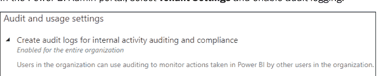

图 10.21：Power BI 审核日志记录已启用

+   2. 确保您是 Office 365 全局管理员，或另有权限启用访问 Office 365 审核日志
+   3. 以管理员身份运行 PowerShell 会话
+   4. 设置执行策略：

```
Set-ExecutionPolicy RemoteSigned
```

+   5. 运行以下命令以安装 Exchange Online Management 模块：

```
Install-Module ExchangeOnlineManagement
```


## 管理和监控 Power BI

2. 创建一个名为 **PBIAuditLog** 的空白查询，该查询基于参数返回完整的文件路径；禁用加载：

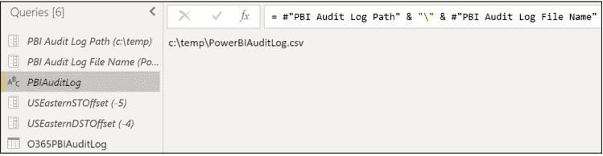

图 10.22：查询编辑器中 PBIAuditLog 文件路径查询和其他参数

3. 创建一个名为 **O365PBIAuditLog** 的新查询：

```powerquery
let
    Source = Csv.Document(File.Contents(PBIAuditLog),
        [Delimiter=",", Columns=13, Encoding=65001,
        QuoteStyle=QuoteStyle.Csv]),
    RemoveTopRows = Table.Skip(Source,1),
    PromoteHeaders = Table.PromoteHeaders(RemoveTopRows,
        [PromoteAllScalars=true]),
    ApplyDateType = Table.TransformColumnTypes(PromoteHeaders,
        {{"CreationDate", type datetime}}),
    AddCreationDateColumn = Table.AddColumn(ApplyDateType,
        "CreationDateOnly", each DateTime.Date([CreationDate]), type date),
    AddLocalTime = Table.AddColumn(AddCreationDateColumn, "LocalCreationDate",
        each [CreationDate] + #duration(0,USEasternDSTOffset,0,0)),
    AddLocalCreationDateColumn = Table.AddColumn(AddLocalTime,
        "LocalCreationDateOnly", each DateTime.Date([LocalCreationDate]), type date),
    ParseJSON = Table.TransformColumns(AddLocalCreationDateColumn,
        {{"AuditData", Json.Document}})
in
    ParseJSON
```

4. 添加步骤以展开 **Audit** 列并为展开的列设置适当的数据类型。

5. 创建或重用 **Server** 和 **Database** 参数以创建一个名为 **SQLAgentHistory** 的查询来检索代理数据：

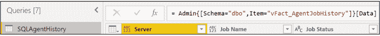

图 10.23：在“AdminProd”查询中公开的 SQL Server Agent 历史记录视图

6. 从 **Home** 选项卡的 ribbon 中单击 **Close & Apply**

7. 使用以下 DAX 代码创建 **Dates** 表：

```
Dates =
    VAR __Today = TODAY()
    RETURN
        CALENDAR(DATE(YEAR(__Today)-1,1,1),DATE(YEAR(__Today)+1,12,31))
```

8. 创建 **Time** 表：

```
Time =
    VAR __hrs = SELECTCOLUMNS(GENERATESERIES(1,23,1), "Hour", [Value])
    VAR __mins = SELECTCOLUMNS(GENERATESERIES(0,59,1), "Minutes", [Value])
    VAR __secs = SELECTCOLUMNS(GENERATESERIES(0,59,1), "Seconds", [Value])
    VAR __hoursMinutes = GENERATEALL(__hrs, __mins)
    VAR __hoursMinutesSeconds = GENERATEALL(__hoursMinutes, __secs)
    VAR __final = ADDCOLUMNS(ADDCOLUMNS(__hoursMinutesSeconds,
        "Time", TIMEVALUE(FORMAT([Hour],"00") & ":" &
            FORMAT([Minutes],"00") & ":" & FORMAT([Seconds],"00"))),
        "SecondOfDay", FORMAT([Hour],"00") & FORMAT([Minutes],"00") &
            FORMAT([Seconds],"00"))
    RETURN __final
```

9. 将 **Dates** 表中 **Date** 列的 **Data type** 更改为 **Date**

10. 将 **Time** 表中 **SecondOfDay** 列的 **Data type** 更改为 **Text**

11. 在 **Model** 视图中，在 **Dates** 和 **Time** 表与 **O365PBIAuditLog** 和 **SQLAgentHistory** 表之间创建关系

12. 创建 DAX 度量值和报表可视化以按步骤和随时间推移的持续时间分解代理作业

13. 创建报表页面以可视化数据：

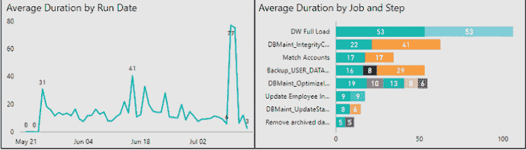

图 10.24：SQL Server Agent 历史记录可视化——按运行日期、作业和步骤的平均持续时间

### How it works...

用于 PowerShell 的 Search-UnifiedAuditLog cmdlet 用于从 Office 365 审计日志中访问 Power BI 数据。可以定义完整 CSV 文件路径以及开始和结束日期的变量，评估并将其作为参数传递给 Search-UnifiedAuditLog cmdlet。有关更多信息，请参阅本食谱的“另请参阅”部分。

msdb 数据库的 dbo 架构中提供了 20 多个 SQL Server Agent 系统表。在本食谱“准备就绪”部分创建的视图中，run_date 和 run_time 列以整数形式存储在 SQL Server 中，因此分别转换为日期和时间数据类型。run_duration 列以 HHMMSS 格式以整数存储并转换为分钟。run_status 列被替换为 Execution Status 列以显示用户友好的值，例如 succeeded，并且同样从 enabled 源列创建 Job Status 列以显示 disabled 与 enabled 值。

对于本食谱中的 SQL Agent 报表，使用堆叠条形图显示构成每个作业的各个步骤；悬停在条形上会显示特定于作业步骤的详细信息。条形图上的用户选择会过滤折线图，从而可以轻松访问任何作业步骤的近期性能。在 Power BI 中分析 SQL Agent 作业历史记录比 SQL Server Management Studio 中的 Job Activity Monitor 和 Log File Viewer 接口容易得多且更灵活。

### There's more...

Power BI 服务为仪表板和已发布报表提供免费使用报表。这些使用报表可以轻松扩展以使用以下步骤分析应用程序工作区中包含的所有报表和仪表板活动：

1. 在 Power BI 服务中打开应用程序工作区并选择报表或仪表板的垂直省略号；选择 View usage metrics report（使用指标报表也可以通过打开报表或仪表板后通过工具栏省略号 (...) 并选择 Open usage metrics 来访问）：


2. 打开使用指标报表后，单击 File | Save as 以向应用程序工作区添加新报表：

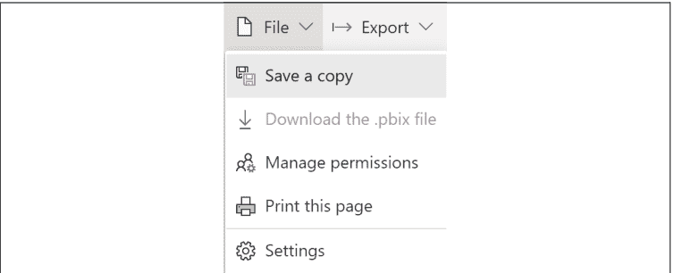

图 10.26：保存为以创建工作区的使用指标数据集

3. 打开新报表并简单地删除报表级筛选器，以便包含所有报表和仪表板：

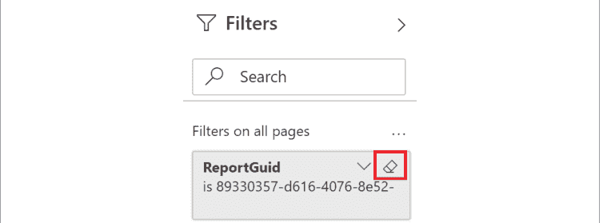

图 10.27：使用指标报表

请注意，单个用户包含在数据集和默认报表中，使得识别谁访问或未访问内容变得容易。

### See also

- SQL Server Agent Table documentation: http://bit.ly/2v7kWdc
- Monitor usage metrics in the new workspace experience: https://bit.ly/2Srjy1V
- Track user activities in Power BI: https://bit.ly/3raDXZD

## 利用 Power BI PowerShell 模块

Power BI 管理员可以通过开发利用 Microsoft Power BI Management PowerShell 模块中包含的命令（如 Get-PowerBIWorkspace 和 Add-PowerBIWorkspaceUser）的 PowerShell 脚本来自动化常见任务。此外，可以使用 Power BI REST API 和 .NET 客户端库开发自定义管理解决方案。使用 Power BI REST API，管理员可以自动化工作区和仪表板的创建、发布工作区内容、共享工作区内容、删除对工作区的访问、删除工作区等等。

本食谱演示了如何通过 PowerShell 连接到 Power BI 并执行简单的管理功能。

### Getting ready

为本食谱做准备，请执行以下步骤：

1. 在 Power BI 服务的租户设置中启用 Power BI API：

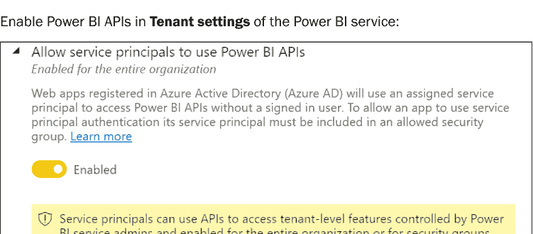

图 10.28：Power BI 服务中 Power BI API 的租户设置

2. 确保您是 Power BI 管理员或具有 Power BI 权限

3. 以管理员身份运行 PowerShell 会话

4. 设置执行策略：

```
Set-ExecutionPolicy RemoteSigned
```

5. 运行以下命令安装 Power BI Management 模块：

```
Install-Module MicrosoftPowerBIMgmt -Force
```

6. 连接到 Power BI：`Login-PowerBI`

7. 验证访问：`Get-PowerBIWorkspace | Format-Table`

### How to leverage the Power BI PowerShell Module

要实现本食谱，请执行以下步骤：

1. 在 PowerShell 中获取所有新工作区的列表，包括个人工作区，并将其导出为 CSV 文件：

```powershell
Get-PowerBIWorkspace -Scope Organization -All | Export-Csv c:\temp\workspaces.csv
```

2. 获取所有工作区的列表，包括经典工作区，但排除个人工作区，并将其导出到 CSV 文件：

```powershell
Get-PowerBIWorkspace -All | Export-Csv c:\temp\workspaces2.csv
```

3. 获取所有新工作区的所有工作区用户列表：

```powershell
Get-PowerBIWorkspace -Scope Organization -Include All -All |
ForEach-Object {
    $Workspace = $_.name
    $WorkspaceId = $_.Id
    foreach ($User in $_.Users) {
        [PSCustomObject]@{
            Workspace = $Workspace
            Id = $WorkspaceId
            Role = $User.accessright
            User = $user.Identifier
        }
    }
} | Export-Csv "c:\temp\workspaceusers.csv" -NoTypeInformation
```

4. 创建一个名为 Workspaces2 的查询并禁用加载：

```powerquery
let
    Source = Csv.Document(File.Contents("C:\temp\workspaces2.csv"),
        [Delimiter=",", Columns=15, Encoding=1252,
        QuoteStyle=QuoteStyle.None]),
    RemoveRows = Table.Skip(Source,1),
    Headers = Table.PromoteHeaders(RemoveRows, [PromoteAllScalars=true]),
    ChangeTypes = Table.TransformColumnTypes(Headers,{{"Id", type text},
        {"Name", type text}, {"IsReadOnly", type logical},
        {"IsOnDedicatedCapacity", type logical}, {"CapacityId", type text},
        {"Description", type text}, {"Type", type text}, {"State", type text},
```


foreach ($Report in $_.Reports) {
[PSCustomObject]@{
Workspace = $Workspace
Id = $WorkspaceId
ReportID = $Report.Id
Report = $Report.Name}} | Export-Csv "c:\temp\wsreports.csv" -NoTypeInformation
```

- 8. 从 **Home** 选项卡的 功能区 中单击 **Close & Apply**。
- 9. 在 **Workspaces** 和 **WorkspaceUsers** 表之间建立 **ID** 列的关系。
- 10. 可选地，在 **Workspaces** 表与 Reports、Dashboards、Datasets、Dataflows 和 Workbooks 的其他表之间建立 **ID** 列的额外关系。
- 11. 创建一个用于连接用户的度量值：
  **Users = CONCATENATEX('WorkspaceUsers',[User],", ")**
- 12. 创建一个矩阵可视化，使用 **Workspaces** 表中的 **Name** 列作为 **Rows**，**WorkspaceUsers** 表中的 **Role** 列作为 **Column**，以及 **Users** 度量值作为 **Values**。

## How it works...

经典 Power BI 工作区的功能比新工作区少。对于经典工作区，用户权限列表无法通过 Power BI API 获取，因为访问权限是通过 Office 365 组授予的。此外，PSCustomObject 未包含在支持经典工作区的 cmdlet 调用中。作为 Power BI 管理员，您可以通过访问 Power BI **Admin portal** 并选择 **Workspaces** 来升级工作区。在列出的 **Workspaces** 中，选择一个或多个工作区，然后从工具栏单击 **Upgrade**。

通过本食谱中创建的矩阵可视化，可以轻松找到经典工作区，只需单击 **Rows** 字段中 **Name** 列的下拉菜单并选择 **Show items with no data**。没有列出用户、例如 **Admin**、**Contributor**、**Member** 或 **Viewer** 的非孤立工作区几乎肯定是应升级的经典工作区。

## There's more...

可用于 Power BI 的 PowerShell cmdlet 很多，包括以下内容：

- 1. 获取所有已删除工作区的列表：
  **Get-PowerBIWorkspace -Scope Organization -Deleted -All**

## Administering and Monitoring Power BI

- 2. 恢复工作区：
  
  ```powershell
  Restore-PowerBIWorkspace -Id "<Workspace GUID>" -RestoredName "<Workspace Name>" -AdminEmailAddress "<Admin UPN>"
  ```
  
- 3. 查找孤立工作区：
  
  ```powershell
  Get-PowerBIWorkspace -Scope Organization -Orphaned -All
  ```
  
- 4. 解决孤立工作区问题：
  
  ```powershell
  Add-PowerBIWorkspaceUser -Scope Organization -Id <Workspace ID> -UserPrincipalName <User UPN> -AccessRight Admin
  ```
  
- 5. 获取 Power BI 活动日志事件：
  
  ```powershell
  $events = Get-PowerBIActivityEvent -StartDateTime '2021-07-14T00:00:00' -EndDateTime '2021-07-14T23:59:59' -ActivityType 'ViewDashboard' | ConvertFrom-Json
  $events.Count
  $events[0]
  ```

并非所有 Power BI REST API 调用都有对应的 PowerShell cmdlet。然而，这并不意味着这些 REST API 调用不能仍从 PowerShell 中使用。Power BI 的 PowerShell cmdlet 包括通用的 Invoke-PowerBIRestMethod 方法。此方法允许调用任何 Power BI REST API 调用，例如以下示例，它创建一个包含所有工作区以及关联用户、报表、仪表板、数据集和工作簿的 JSON 文件：

```
```powershell
Invoke-PowerBIRestMethod -Url 'https://api.powerbi.com/v1.0/myorg/admin/Groups?$top=5000&$expand=users,reports,dashboards,datasets,workbooks' -Method Get > c:\temp\workspaces.json
```
```

此方法使用 Login-PowerBI、Login-PowerBIServiceAccount 或 Connect-PowerBIServiceAccount 调用设置的相同凭据。要在 PowerShell 之外使用经过身份验证的会话，请使用以下命令：

```
```powershell
Get-PowerBIAccessToken -AsString
```
```

## See also

- PowerShell cmdlets, REST APIs, and .NET client libraries for administrators: https://bit.ly/3vDJ5qc
- Power BI REST APIs: https://bit.ly/3eR70R6
- Power BI Cmdlets reference: https://bit.ly/3h1ShR2
- Track user activities in Power BI: https://bit.ly/3raDXZD

## Conclusion

本章的食谱重点介绍了最常见且影响最大的管理数据源，包括 Windows Performance Monitor、SQL Server Query Store、本地数据网关、MSDB 系统数据库和 Extended Events。构建在这些数据源之上的 Power BI 解决方案可主动评估使用趋势和资源瓶颈，同时提供识别根本原因所需的详细分析。此外，本章还介绍了通过 **dynamic management views (DMVs)** 暴露的现有 Power BI 和 SSAS 数据模型的元数据，例如度量值和关系定义以及资源消耗。
