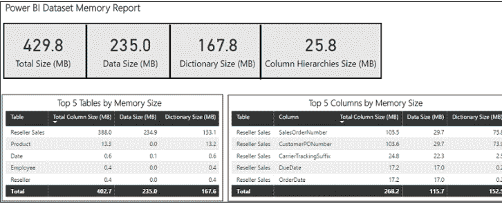
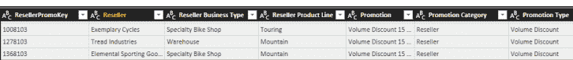
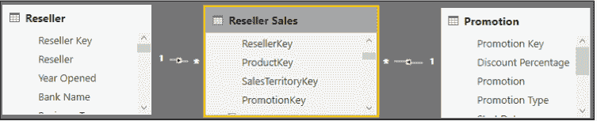
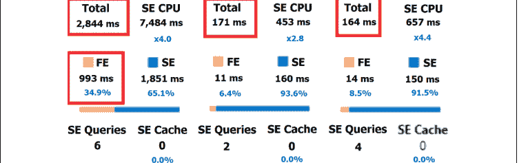
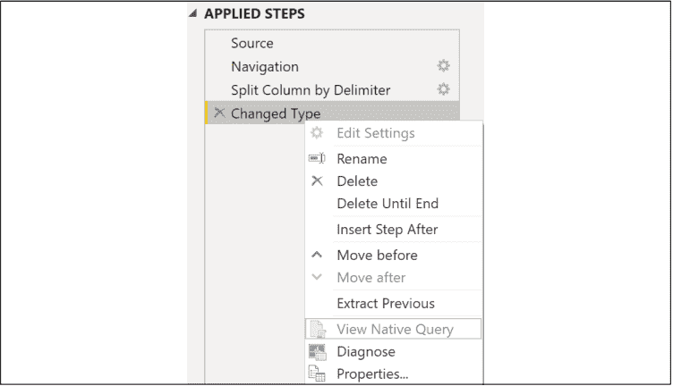
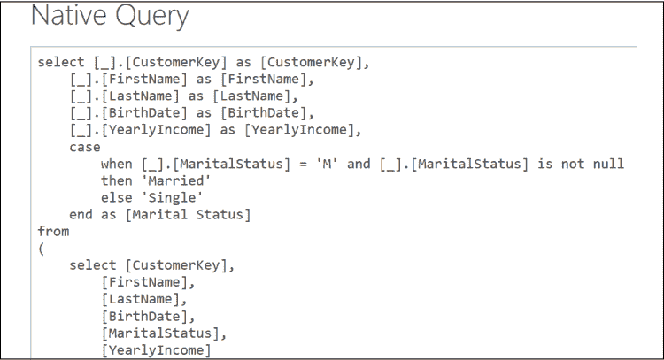
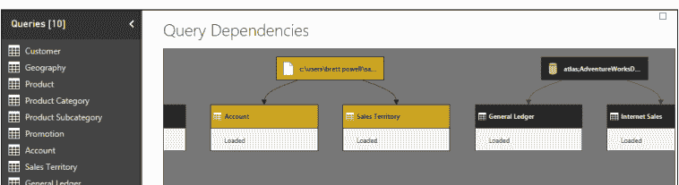
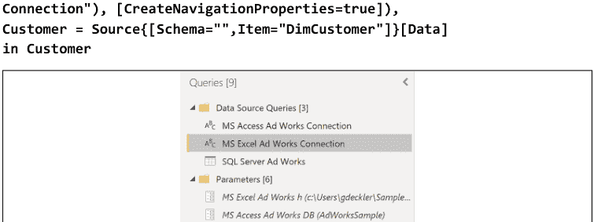
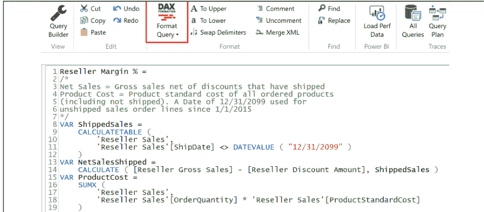
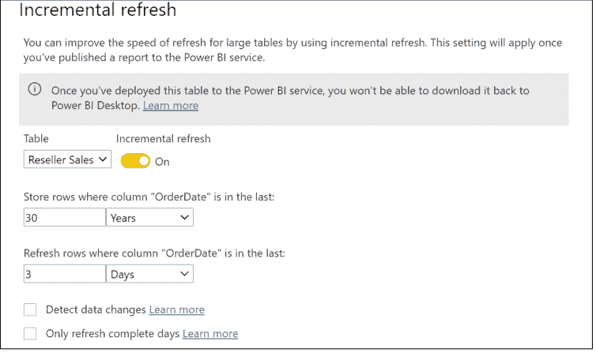

## 11

## Enhancing and Optimizing Existing Power BI Solutions

Power BI 项目通常从关注特定功能需求开始，例如为某个业务领域和团队提供一组仪表板和报表。在需求相对狭窄且数据集较小的情况下，通常无需对数据检索、模型和报表层进行设计和代码增强即可实现足够的性能和可靠性。此外，Power BI Premium 容量以及在某些情况下的 Analysis Services 资源提供了增强数据集可扩展性的可行选项。

对于更大的 Power BI 项目——特别是当 Power BI Premium 和 Analysis Services 选项不可用时——识别改进报表查询性能的机会以及更有效地使用系统资源来存储和刷新数据集变得很重要。

此外，数据导入过程通常可以变得更具弹性且资源消耗更少。此外，在 Power Query (M) 和 DAX 表达式中应用标准编码语法、变量和注释，进一步提高了 Power BI 数据集的可持续性。

本章的食谱包含增强 Power BI 数据集性能、可扩展性和可靠性的顶级数据建模、DAX 度量值和 M 查询模式。这包括数据模型和度量的性能调优示例、M 查询的错误处理和查询折叠示例，以及关于 DAX 和 M 查询引擎的支持细节。

在本章中，我们将介绍以下食谱：

- Enhancing Data Model Scalability and Usability
- Improving DAX Measure Performance
- Pushing Query Processing Back to Source Systems
- Strengthening Data Import and Integration Processes
- Isolating and Documenting DAX Expressions
- Improving Data Load Speeds with Incremental Refresh

## Technical Requirements

完成本章食谱所需的条件如下：

- Power BI Desktop
- 安装了 AdventureWorksDW2019 数据库的 SQL Server。此数据库及安装说明可在以下位置获取：http://bit.ly/20VQfG7
- 本章的文件可从以下 GitHub 仓库下载：https://github.com/PacktPublishing/Microsoft-Power-BI-Cookbook-Second-Edition

## Enhancing Data Model Scalability and Usability

所有 Power BI 报表的性能都受数据模型设计的影响。在访问报表时执行的 DAX 查询以及在交互式、自助用户会话中动态更新报表可视化时所依赖的查询，都依赖于模型中定义的关系以及对模型表的优化。对于内存中模型，导入列的基数和这些列的压缩会影响数据集的大小和查询持续时间。对于 DirectQuery 数据模型，源表的引用完整性和关系源的优化在很大程度上决定了查询性能。

本食谱包含三个优化过程，均以包含 1170 万行的 Reseller Sales 事实表为重点。第一个示例利用第 10 章 Administering and Monitoring Power BI 中创建的 DMVs 和 Power BI 内存报告来识别和解决最昂贵的列。第二个示例将维度表拆分为两个较小的表，最后一个示例对导入的事实表应用自定义排序顺序，以优化报表中常用的列的压缩。


## 增强和优化现有的 Power BI 解决方案

对于导入模式模型来说，昂贵的列是指具有大量唯一值（高基数）的列，例如*第 2 章“访问和检索数据”*中用作示例的**订单编号**列。同样，每个日期包含多个时间值的 **DateTime** 列会比两个独立的 **Date** 和 **Time** 列消耗更多内存。最好只导入**Date**列，或者只导入**Date**和**Time**列，而不是**DateTime**列。

此外，按照*选择和重命名列*中的方法，针对低基数列（如**单价**和**数量**）执行简单算术运算的 DAX 度量值可以避免导入更昂贵的派生列（如**销售额**和**含税销售额**）。而且，虽然看起来有违直觉，但跨多列进行算术运算的 SUMX 度量值通常优于简单的 SUM 度量值。

- 3. 识别以高精度（小数点右侧的位数）十进制数字数据类型存储的列。如果不需要这种精度级别，请考虑在 SQL 视图中或通过 M 导入查询来舍入这些列，以降低基数（唯一值的数量），从而改善压缩效果。如果 (19,4) 列能提供足够的大小和精度，请在模型中应用定点十进制数字类型。

- 4. 替换大型事实表上的任何 DAX 计算列，因为导入列比计算列能实现更好的压缩。事实表上的计算列通常可以用 DAX 度量值来解决，而不会牺牲性能；但如果无法使用 DAX 度量值，则将该列的逻辑移至事实表的 SQL 视图或 M 查询中，或移至数据源本身。如果修改了 M 查询，请确保逻辑被下推到源系统。

- 5. 同样，移除或替换任何大型维度表上的 DAX 计算列，方法是将此逻辑移至数据检索过程或利用源系统。

查找包含 RELATED 或 LOOKUPVALUE 函数的计算列，这些函数类似于 Excel VLOOKUP 函数，只是从与事实表存在多对一关系的“一”侧表中检索列值。业务用户通常使用 RELATED 和 LOOKUPVALUE 函数来扁平化或反规范化事实表，就像在标准 Excel 工作表中那样，但在 Power BI 中这种重复通常是不必要的，而且计算列不像标准导入列那样被压缩。此外，请考虑将计算列表达式的逻辑（例如计算日期、日期差异和派生数值列）迁移到 DAX 度量值中。

- 6. 在此示例中，数据集的当前状态为 334 MB 的压缩磁盘空间（从 KB 转换的 PBIX 文件大小）和 674 MB 的总内存（根据*第 10 章“管理和监控 Power BI”*中引入的内存报告）。

按照上述步骤，在 Reseller Sales 事实表（1170 万行）上发现了几个立竿见影的优化点，包括：

- 分析只需要 CarrierTrackingNumber 的最后四个字符。
- 可以移除 YYYYMMDD 格式的 Order Date、Ship Date 和 Due Date 列，因为这些列与该列的数据类型（日期）冗余，而关系仅使用日期数据类型。
- 可以移除四个计算列（Due Date 与 Order Date 之间的天数、Order Days、Reseller 和 Product Name），因为可以使用 DATEDIFF DAX 度量值，并且可以改用现有的维度列。
- 可以移除 Sales Amount、Extended Amount 和 Total Product Cost 列，因为简单的 DAX 度量值可以计算它们的值。



完成修订后，数据集现在占用 429 MB 内存，Power BI Desktop 文件（PBIX）占用 221 MB 磁盘空间，内存和磁盘空间节省了 33% 以上。

大型维度表（约 100 万行以上）由于与事实表存在高基数关系，是 Power BI 和 SSAS 表格导入模型的主要性能瓶颈。请考虑以下同时描述经销商和促销活动的维度表：



- 7. 合并后的表包含 10,520 行，**Reseller Sales** 表上的关系列为 19.4 MB。

| 列 | 总列大小（MB） | 数据大小（MB） | 字典大小（MB） | VERTIPAQ_STATE |
|---|---:|---:|---:|---|
| CarrierTrackingSuffix | 23.9 | 22.3 | 1.6 | COMPLETED |
| ResellerPromoKey | 19.4 | 19.2 | 0.2 | COMPLETED |
| OrderDate | 16.7 | 16.5 | 0.2 | COMPLETED |

图 11.3：Reseller 促销键，大小约为 20 MB

- 8. 我们可以将此表拆分（规范化）为较小的 **Reseller**（701 行）和 **Promotion**（16 行）维度表，并删除合并的 **Reseller Promotion** 维度表以及事实表上昂贵的 ResellerPromoKey 列。



图 11.4：Reseller 和 Promotion 表替代合并后的 Reseller Promotion 表

较小的关系可以提高访问 **Promotion** 和 **Reseller** 列的查询性能。此外，移除 ResellerPromoKey 关系列将减小数据集的大小。

在此特定示例中，行数足够少，因此影响不大；但随着查询工作负载的增加，请考虑将超过 200,000 行的大型维度表拆分为较小的表（更低粒度）。例如，一个 100 万行的客户表可以仅根据常见的查询模式（如客户区域或地理位置）拆分为两个数据模型表。

### 工作原理...

请记住，针对导入模式模型执行的 DAX 查询会访问和扫描与各列关联的内存。因此，事实表上可能存在几个具有数百万唯一值的非常昂贵的列，但这可能不会对不引用这些列的查询性能产生负面影响。移除这些昂贵的列或用更便宜的列替换它们可以减小数据集的整体大小，但您不应指望查询性能得到改善。

当数据加载到 Power BI Desktop 模型（导入模式）时，VertiPaq 存储引擎会对每一列应用压缩算法以减少内存占用，从而提高性能。VertiPaq 首先存储列的所有唯一值（通过值编码或哈希编码），然后，更重要的是，应用**运行长度编码（RLE）**，对一组连续行中出现的重复值只存储一次。因此，唯一值较少的列（如月份名称）会被高度压缩，而主键和 GUID 列则完全不会被压缩。

Power BI Desktop（以及 Excel 的 Power Pivot）中的数据模型以 100 万行的列段存储。例如，一个 2000 万行的销售事实表将包含大约 20 个不同的段。如果报表查询所需的数据分散在所有 20 个段中，则需要更多资源（和更长时间）来访问每个段并合并这些结果以解决查询。但是，如果这些段按日期或某个给定维度（例如 **StoreID**）排序，并且报表查询包含利用此顺序的筛选器（如会计年度或商店区域），则只会查询一部分段。

举个简单的例子，假设一个 2000 万行的事实表在导入 Power BI 时按日期排序，每个日历年代表 100 万行。一个仅按 2 年筛选的报表查询将只需要访问 20 个列段中的 2 个，因为其他 18 个段包含的日期不在查询范围内。

VertiPaq Analyzer 现在已集成到 DAX Studio 的**高级**菜单以及 Tabular Editor 3 中。VertiPaq Analyzer 可以轻松快速地识别消耗内存最多的列。这和 Tabular Editor 中的 Best Practice Analyzer 是分析 Power BI 数据集健康状况最常用且最易用的两个工具。

### 更多内容...

虽然分析数据模型并进行优化很重要，但在 Power Query 编辑器中也可以进行优化。例如，避免将仅用于数据检索/转换逻辑的表（如暂存查询）加载到数据模型。即使从**字段**列表中隐藏，这些表也像模型中的所有其他表一样消耗处理和存储资源，并增加不必要的复杂性。在 Power Query 编辑器中右键单击这些查询，并禁用**启用加载**以从数据模型中移除该表。请记住，具有许多 M 查询的数据模型，无论是否加载，在刷新期间都可能会使源系统的可用线程/资源不堪重负，因为所有查询都会同时提交。

此外，识别很少更改的表，并考虑禁用默认的**包含在报表刷新中**属性（通过在 Power Query 编辑器中右键单击查询）。该表仍可加载到数据模型中，因此可用于关系和 DAX 度量值，但其源查询将不再随每次刷新一起执行。典型的候选表包括每年只更新一次的年度预算或计划表、货币表，以及可能的地理或人口统计表。


## 准备工作

要为本配方做准备，请按照以下步骤操作：

- 1. 打开包含要分析的数据模型和度量的 Power BI Desktop 文件
- 2. 从 **External Tools** 选项卡的 ribbon 中选择 **DAX Studio**
- 3. 如有必要，构建一个与性能不佳的报表或常见报表布局相匹配的示例报表页
- 4. 在 Power BI Desktop 中，从 **View** 选项卡的 ribbon 中选择 **Performance analyzer**

## 如何操作…

要实现本配方，请使用以下步骤：

- 1. 在 **Performance analyzer** 窗格中，选择 **Start recording**。
- 2. 在 Power BI Desktop 报表视觉对象上进行一次选择，并在 **Performance analyzer** 中观察 DAX 查询。在此案例中，所研究的度量为 Gross_Sales_Warehouse 度量，定义如下：
  
  **Gross_Sales_Warehouse = CALCULATE([Reseller Gross Sales], FILTER('Reseller', 'Reseller'[Business Type] = "Warehouse"))**
  
- 3. 在 **Performance analyzer** 中展开包含所需度量的视觉对象并选择 **Copy query**：

```
DEFINE
    VAR __DS0FilterTable = FILTER(KEEPFILTERS(VALUES('Date'[Calendar Year])),
        OR('Date'[Calendar Year] = 2016, 'Date'[Calendar Year] = 2017))
    VAR __DS0FilterTable2 = FILTER(KEEPFILTERS(VALUES('Product'[Product Category])),
        'Product'[Product Category] = "Bikes")
    VAR __DS0FilterTable3 = FILTER(KEEPFILTERS(VALUES('Promotion'[Promotion Type])),
        OR(OR(OR('Promotion'[Promotion Type] = "Excess Inventory",
            'Promotion'[Promotion Type] = "New Product"), 'Promotion'[Promotion Type] = "No Discount"),
            'Promotion'[Promotion Type] = "Volume Discount"))
EVALUATE
    TOPN(1001, SUMMARIZECOLUMNS('Reseller'[Reseller], __DS0FilterTable, __DS0FilterTable2, __DS0FilterTable3,
        "Gross_Sales_Warehouse", 'Reseller Sales'[Gross Sales Warehouse]),
        [Gross_Sales_Warehouse], 0, 'Reseller'[Reseller], 1)
```

使用修订后的度量后，基准查询执行速度提高了 35%（**69 ms** 至 **45 ms**），并且仅需要 **1 SE** 查询。

## 其工作原理...

第一个度量较慢的原因是，使用对 **Reseller** 的 FILTER，报表中切片器视觉对象的筛选选择（**Date**、**Product** 和 **Promotion**）必须在仓库筛选执行之前得到尊重。例如，**Reseller** 维度表将在应用 **Warehouse** 筛选之前被筛选为仅包含 2016-2017 年自行车类别销售且属于特定促销的经销商。这需要对事实表进行额外扫描，因此效率较低。

来自 Power BI 报表视觉对象的 DAX 查询由 DAX 公式引擎和 DAX 存储引擎解析。存储引擎是导入模式模型的内存中列式压缩数据库（也称为 VertiPaq），也是 DirectQuery 模型的关联数据库。在任何模式下，公式引擎负责生成查询计划并可以执行所有 DAX 函数，包括复杂的表达式逻辑，但它仅限于单线程且无缓存。

公式引擎向存储引擎发送请求，如果存储引擎在现有数据缓存中没有请求的数据，则存储引擎利用多个线程访问数据模型中的数据段（每段 1 个线程，每段 100 万行）。存储引擎执行简单的连接、分组、筛选和聚合，包括不同计数，以便将请求的数据缓存提供给公式引擎。鉴于此架构，基本的 DAX 和 Power BI 模型设计实践是最大化将查询分配给存储引擎，并最小化由公式引擎操作的数据缓存的大小。

鉴于减少存储的性能优势，引擎请求也考虑使用变量。虽然 DAX 变量的主要好处是提高可读性，但变量还可以减少与度量相关的查询数量（从而缩短其执行时间），因为变量仅评估一次并且可以在表达式中多次重用。查找具有多个 IF 或 SWITCH 分支的 DAX 度量，这些分支多次引用相同的计算或度量。对于这些度量，请考虑声明一个变量，该变量仅引用现有度量（`VAR MyVariable = [Sales Amount]`），然后在每个逻辑条件中引用此变量，而不是度量。

虽然 Power BI 生成的 DAX 查询无法编辑，但 DAX 查询可以完全从头开始为其他工具编写，例如 **SQL Server Reporting Services (SSRS)** 报表中的数据集。许多较新的 DAX 函数，例如 **TREATAS and SUMMARIZECOLUMNS**，对查询特别有帮助，通常度量和查询的性能考虑是相同的。研究 Power BI 生成的 DAX 查询是学习如何编写高效 DAX 查询和 DAX 的好方法。

## 还有更多...

DAX 度量可以优化的另一个示例是此示例，其中度量必须按来自两个不同表的两个列的 OR 条件进行筛选。与前一个示例一样，在此场景中无法避免 FILTER 函数，因为必须在同一表达式中引用多个列（OR 条件）。当前度量定义如下：

```
Reseller Gross Sales (Filter OR) =
CALCULATE([Reseller Gross Sales], FILTER('Reseller Sales',
RELATED('Product'[Product Subcategory]) = "Mountain Bikes" ||
RELATED('Reseller'[Reseller Country]) IN {"United States", "Australia"}))
```

对事实表应用了 FILTER，并使用单独的 RELATED 函数来实现所需的 OR 逻辑。要了解如何优化此度量，请考虑以下内容：

- 1. 就像前一个示例一样，从 **Performance analyzer** 窗格在 Power BI Desktop 中捕获生成的示例 DAX 查询
- 2. 在 DAX Studio 中测试和分析查询，以建立当前度量的基线
- 3. 现在创建两个单独的替代度量——一个使用 SUMMARIZE，另一个使用 CROSSJOIN：
  
  **Reseller Gross Sales (Summarize OR) =**
  ```dax
  CALCULATE([Reseller Gross Sales], FILTER(
  SUMMARIZE('Reseller Sales', 'Product'[Product Subcategory], 'Reseller'[Reseller Country]),
  'Product'[Product Subcategory] = "Mountain Bikes" ||
  'Reseller'[Reseller Country] IN {"United States", "Australia"}))
  ```
  
  **Reseller Gross Sales (Crossjoin OR) =**
  ```dax
  CALCULATE([Reseller Gross Sales], FILTER(
  CROSSJOIN(ALL('Product'[Product Subcategory]),ALL(Reseller[Reseller Country])), 'Product'[Product Subcategory] = "Mountain Bikes" ||
  'Reseller'[Reseller Country] IN {"United States", "Australia"}))
  ```
  
- 4. 在 Power BI Desktop 中确认新度量产生的结果与当前度量相同
- 5. 在 DAX Studio 中，将对（filter OR）度量的引用替换为对新度量的引用

- 6. 重复清除缓存后执行多个查询并记录性能的过程，以为三种版本的度量建立基线



图 11.8：DAX Studio 中基线查询（filter OR）度量与两个新度量的服务器时序

两个新度量比当前状态快 16.7 倍（2,844 至 170 ms），并且超过 90% 在存储引擎（SE）中执行。在此场景中，CROSSJOIN 方法比 SUMMARIZE 稍快，但此比较会根据所涉及列的基数而变化。此示例的主要观点是，在迭代函数（如 FILTER 和 SUMX）的表达式参数中实现存储引擎不支持的逻辑所带来的危险。这在传递给这些函数的表参数行数很多时尤其如此，例如本配方中使用的 1170 万行的 Reseller Sales 事实表。

请注意，如果两个列来自同一表，例如 ALL('Product'[Product Category], 'Product'[Product Color])，则可以使用 ALL 函数生成表参数。ALL 不能直接访问来自不同表的列。

在高层次上，始终考虑被筛选表的大小，并寻找可以用来减小此表大小的简单筛选条件和单列。例如，用实现简单、高效筛选条件的 CALCULATETABLE 函数替换 SUMX 和 FILTER 等函数的表参数。然后，更复杂的表达式，这些表达式无法由存储引擎处理，可以在此较小的表上运行。同样，考虑（并测试）嵌套筛选条件，使最具选择性、最有效的筛选条件首先应用（内部 FILTER，外部 CALCULATE）：

```
CALCULATE(
    CALCULATE(<param1>, <param2>)
) //outer calculate
```

```
FILTER(
    FILTER(<param1>,<param2>), // inner FILTER
    <param2>
)
```


## 另请参阅

- 使用 Performance analyzer 在 Power BI Desktop 中检查报表元素性能：`https://bit.ly/3eWXdEb`

## 将查询处理推回源系统

在从本地源检索的数据集的计划刷新期间，任何未由源系统执行的查询转换都将需要本地资源，即本地数据网关服务器的 **M (Mashup)** 引擎。随着数据集变大，并且可能在同一网关服务器上同时进行其他计划刷新，设计能够通过查询折叠充分利用源系统资源的 M 查询变得非常重要。虽然针对某些源（如文件）的转换始终需要本地资源，但在许多场景中，可以修改 M 查询以帮助引擎生成等效的 SQL 语句，从而最小化本地资源消耗。

在本配方中，提供了一个流程和项目列表，用于识别当前未折叠的查询及其潜在原因。此外，还基于现有 SQL 语句重新设计了一个查询，使用 M 表达式实现查询折叠。

### 准备工作

为本配方做准备，请执行以下步骤：

- 1. 识别要评估查询折叠的数据集
- 2. 使用网关服务器内存性能计数器数据建立执行刷新时当前使用的资源基线，因为这些计数器应会受到任何更改的影响

此外，使用 Power Query 编辑器 **Tools** 选项卡中的新 **Diagnostic tools** 建立查询性能基线。

要优化的数据集通常是一个大型 PBIX 文件（100 MB+），已发布到 Power BI 服务，并配置了计划刷新以使用本地数据网关，且查询关系数据库（SQL、Oracle）作为主要源。如果大型 PBIX 文件是从文件或文件夹中的文件集合检索的，修订是完全可能的，例如根据文件修改日期相对于当前日期进行过滤，但对于文件源而言，查询折叠不是一个选项。

### 如何操作...

以下步骤概述了一般的查询折叠分析流程：

- 1. 打开用作已发布数据集并进行本地数据计划刷新的 Power BI Desktop 文件。
- 2. 从 **Home** 选项卡的 ribbon 中单击 **Edit Queries** 以打开 Power Query 编辑器。
- 3. 从 **Query Settings** 窗口中，从最大的查询（事实表）开始，右键单击最终步骤。



图 11.9：最终查询步骤的 View Native Query 已禁用

如果 **View Native Query** 选项被禁用，则本地 M 引擎至少正在执行此最终步骤。如果 **View Native Query** 未被禁用，您可以可选地查看 SQL 语句，如之前的配方所述。

- 4. 检查之前的步骤以确定哪些步骤（如果有）被折叠，从而确定导致查询使用本地资源的步骤。一旦查询中的某个步骤（M 变量表达式）使用本地资源，查询中的所有后续步骤也将使用本地资源。
- 5. 识别本地操作的成因，例如源系统不支持的特定 M 函数。

- 6. 考虑修订源数据库对象、M 表达式和数据源隐私级别以启用查询折叠。

作为执行此流程的示例，考虑以下案例，其中业务分析师已使用 SQL 语句和查询编辑器构建了一个客户查询：

```
let Source = Sql.Database("ATLASC", "AdventureWorksDW2016CTP3"),
    Query = Value.NativeQuery(Source, "Select CustomerKey,FirstName,LastName,BirthDate,MaritalStatus,YearlyIncome From dbo.DimCustomer"),
    ChangedType = Table.TransformColumnTypes(Query,{{"BirthDate", type date}, {"YearlyIncome", Int64.Type}}),
    ReplacedValue = Table.ReplaceValue(ChangedType,"M","Married",Replacer.ReplaceText,{"MaritalStatus"}),
    ReplacedValue1 = Table.ReplaceValue(ReplacedValue,"S","Single",Replacer.ReplaceText,{"MaritalStatus"}),
    MergedColumns = Table.CombineColumns(ReplacedValue,{ "FirstName", "LastName"},Combiner.CombineTextByDelimiter(", ", QuoteStyle.None),"Customer Name"),
    RenamedColumns = Table.RenameColumns(MergedColumns,{{"MaritalStatus", "Marital Status"}, {"YearlyIncome", "Yearly Income"}, {"BirthDate", "Date of Birth"}})
in RenamedColumns
```

图 11.10：基于原生 SQL 语句和 M 转换的客户查询

在此场景中，SQL 语句针对数据仓库中的基础客户表（不是视图），并且对查询结果应用的后续转换在每次刷新过程中都使用本地网关服务器资源，因为第一步执行了原生 SQL 查询。现有 SQL 视图（vDim_Customer）包含 Customer Name 列，消除了合并操作的需要，尽管 Marital Status 列未按分析师的转换转换为更长的 Married 或 Single 字符串。可以通过利用查询折叠来改进查询，如下所示：

- 1. 创建一个新的 M 查询，使用参数用于服务器和数据库，并使用客户 SQL 视图：

```
let Source = AdWorksProd,
Customer = AdWorksProd{[Schema = "BI", Item = "vDim_Customer"]}[Data],
SelectColumns = Table.SelectColumns(Customer,{"Customer Key", "Customer Name", "Date of Birth", "Marital Status", "Annual Income"}),
MarriageStatus = Table.AddColumn(SelectColumns, "M Status", each if [Marital Status] = "M" then "Married" else "Single", type text),
RemovedColumns = Table.RemoveColumns(MarriageStatus,{"Marital Status"}),
RenamedColumns = Table.RenameColumns(RemovedColumns,{{"M Status", "Marital Status"}, {"Annual Income", "Yearly Income"}})
in RenamedColumns
```

利用了现有的 SQL 视图 vDim_Customer，并且 Marital Status 条件逻辑是在 Table.AddColumn 表达式中构建的。剩下的几个步骤只是选择、删除和重命名列，都是可以折叠回 SQL Server 的转换。

- 2. 右键单击新修订查询的最终步骤，并确保 **View Native Query** 已启用。



*图 11.11：基于修订后的客户 M 查询的原生查询（已折叠）*

新查询返回相同的结果，但现在已折叠回 SQL Server 而不是使用本地资源。`if...then...else` M 表达式被折叠为 SQL Server 执行的 CASE 表达式。

### 工作原理...

查询折叠受源系统支持的转换、内部专有 M 引擎逻辑、分配给数据源的隐私级别、原生数据库查询（SQL 语句）的使用以及自定义 M 函数和逻辑的影响。例如，即使出于性能考虑查询折叠是合适的，例如使用服务器与本地文件进行连接操作，如果本地文件配置为私有数据源，折叠也不会发生。

根据本配方中的查询折叠重新设计示例，如果查询的第一步或 **Source** 步骤是原生 SQL 语句，请考虑修订 M 查询步骤以帮助 M 引擎形成 SQL 查询（折叠 M 查询）。在原生 SQL 数据库查询（通过 `Value.NativeQuery`）之上应用的任何 M 转换都不会折叠到源系统。如果使用原生 SQL 查询，例如存储过程调用，建议将所有查询步骤和转换嵌入到原生 SQL 查询本身中。如果不可能，请将最耗资源的运算嵌入到存储过程中，并从 Power BI 向存储过程传递过滤参数以减少本地 M 引擎的工作负载。

如果有必需的转换或逻辑不被源系统支持用于查询折叠，建议将这些步骤移到查询的最后。例如，允许 SQL Server 通过查询折叠执行过滤、派生列和其他简单步骤，然后再在 SQL 查询结果集之上本地应用复杂步骤。

一些常见的 M 函数不被大多数关系数据库源支持，例如 `Table.Distinct`，它从表中删除重复行，以及 `Table.RemoveRowsWithErrors`，它从表中删除包含错误的行。如果在查询中合并数据源，请检查其隐私设置（**Data source settings | Edit Permissions...**），以确保隐私配置允许折叠，例如从一个组织源到另一个组织源。

通常，以下操作不被查询折叠支持：

- 更改列数据类型
- 添加索引列
- 从不同源合并或追加查询
- 使用在数据源中没有等效函数的 Power Query 函数添加自定义列

### 还有更多...

对于具有许多查询和大型表的模型，请考虑在 **File | Options | Options and settings | CURRENT FILE** 中禁用默认的并行加载表，因为同时执行的许多查询可能会压倒源系统资源并导致刷新过程失败。


图 11.12：并行加载表 – CURRENT FILE 设置

仅仅因为查询被折叠成 SQL 语句，并不意味着没有可能的性能问题。例如，查询可能选择了数据模型不需要的更多列，或者可能在数据库模式支持内部连接时执行外部连接查询。这些查询的可见性可以为 BI 架构和 M 查询的更改提供信息。

关系数据库系统或数据仓库的所有者可以通过 **Extended Events** 等工具注意 Power BI 的折叠 SQL 查询。例如，数据库管理员或 BI 团队成员可以根据收集到的信息修订现有的 SQL 视图、表索引等。同样，Power BI 查询作者也可以被告知访问相同数据的更好或首选方法，例如在不同列上连接。


## 另请参阅

- ► Power Query 查询折叠：https://bit.ly/3jB5wrx
- ► 展开表格列时优化 Power Query：https://bit.ly/3trdKFA

## 加强数据导入和集成流程

许多 Power BI 数据集必须在没有数据仓库甚至关系型数据库源系统的情况下创建。这些数据集通常会转换和合并较少结构化和受管控的数据源，例如文本和 Excel 文件，一般需要更复杂的 M 查询来为分析准备数据。更复杂的 M 查询与这些源中周期性的结构变化和数据质量问题相结合，可能导致刷新失败以及支持数据集方面的挑战。此外，由于 M 查询有时最初完全通过 Query Editor 界面创建，所生成的实际 M 代码可能包含意外的逻辑，从而导致结果不正确并对源数据产生不必要的依赖。

本配方包含增加数据导入流程可靠性和可管理性的实用示例，包括数据源合并、错误处理和注释，以及应对缺失或更改的源列。

## 准备工作

为本配方做准备，请执行以下步骤：

- 1. 识别用于评估数据刷新可靠性的数据集，例如从逗号分隔值 CSV 文件导入信息的数据集
- 2. 在 Power BI Desktop 中打开该数据集的 PBIX 文件

本示例的目标是从包含 30 列描述客户的文本文件中检索四列。

## 如何操作...

要实施本配方，请使用以下步骤：

- 1. 使用文本/CSV 连接器连接到文件并用从参数创建的查询替换硬编码路径：

```
let Source = Csv.Document(File.Contents(CustomerTextFile),[Delimiter=" ", Columns=30, Encoding=1252, QuoteStyle=QuoteStyle.None]),
PromotedHeaders = Table.PromoteHeaders(Source, [PromoteAllScalars=true])
in PromotedHeaders
```

## 还有更多...

除了可靠性改进之外，还可以使用 Query Editor 中的 Tools 功能区中提供的 Query Diagnostics 来分析查询性能。还有改进 Power Query 代码整体可维护性的方法。其中两种方法是注释和数据源管理。

与所有编程语言一样，注释可用于提高 M 代码的整体可维护性，如以下示例所示：

```
/* This query joins the Product query to the Product Subcategory query.
    The product subcategory column 'EnglishProductSubcategoryName' is renamed
    'Product Subcategory' */
let ProductToProductSubCatJoin =
try
// Nested outer join based on Subcategory Surrogate Key
Table.NestedJoin(Product,{"ProductSubcategoryKey"},#"Product Subcategory",{"
ProductSubcategoryKey"},"ProductSubCatColumns",JoinKind.LeftOuter) otherwise
Product,
AddProductSubCatColumn =
try
// Will return nulls if EnglishProductSubcategoryName is renamed or missing in
Product Subcategory query
Table.ExpandTableColumn(ProductToProductSubCatJoin, "ProductSubCatColumns",{"Eng
lishProductSubcategoryName"}, {"Product Subcategory"}) otherwise Product
in AddProductSubCatColumn
```

注释以多行和单行格式使用，以帮助解释逻辑。多行注释以 /* 开始并以 */ 结束，而单行注释以 // 字符开头。变量名（即 AddProductSubCatColumn）采用正确的大小写且没有空格，以避免不必要的双引号并进一步描述流程。

提高 Power Query 代码可维护性的另一种方法是进行适当的数据源管理。考虑一个包含 10 个查询的 PBIX 文件，其中三个不同的数据源硬编码到每个查询中。在此示例中，10 个查询使用三个单独的源（SQL Server、Excel 文件和 MS Access 数据库文件）。对数据源路径或连接信息进行的任何更改都需要更改多达 10 个不同的查询。要了解如何解决此问题，请考虑以下内容：

- 1. 打开 Power BI Desktop 文件并识别所有查询访问的数据源
- 2. 报告视图中 Home 选项卡功能区 Transform data 下拉菜单中的 Data source settings 对话框将显示当前文件源
- 3. 为了获得更详细的信息，请打开 Power Query Editor 并从 View 选项卡的功能区中单击 Query Dependencies



图 11.14：10 个查询的 Query Dependencies 视图

- 4. 在查询窗口中创建以下文件夹组：**Parameters**、**Data Source Queries**、**Dimensions** 和 **Facts**
- 5. 创建六个文本参数以从三个源中抽象文件名、文件路径、服务器和数据库名称
- 6. 从引用这些参数的单个空白查询中开发三个数据源查询：
  = Sql.Database("#SQL Server AdWorks Server", "#SQL Server AdWorks DB")
  = "#MS Access AdWorks Path" & "\" & "#MS Access AdWorks DB" & ".accdb"
  = "#MS Excel Ad Works Path" & "\" & "#MS Excel Ad Works File" & ".xlsx"
- 7. 为这些查询分配名称，例如 **MS Access Ad Works Connection** 并禁用其加载到数据模型
- 8. 最后，修改每个 10 个查询以引用其中三个数据源查询，如下所示：

```
let Source = Access.Database(File.Contents("#MS Access Ad Works Connection"), [CreateNavigationProperties=true]),
Customer = Source[{"Schema="",Item="DimCustomer"}][Data]
in Customer
```



图 11.15：Power Query Editor 中合并且参数化的数据源

## 增强和优化现有的 Power BI 解决方案

文件夹组、参数和数据源查询使理解和管理检索过程变得更容易。

## 另请参阅

- - *Power Query 中 10 个常见错误及如何避免陷阱* 作者 Gil Raviv：`http://bit.ly/2uW6c33`
- - *Query Diagnostics*：`https://bit.ly/2YBEmKv`

## 隔离和记录 DAX 表达式

建议将表达式隔离为独立且可互换的 DAX 度量或作为度量中的变量，以简化数据集的开发和所有权。独立度量可以从 **Fields** 列表中隐藏，但包含核心业务定义和高效的过滤逻辑，以驱动模型中许多其他度量的结果和性能。虽然作用域限定于每个度量，但 DAX 变量提供自记录的编码风格，并且与标量值度量不同，还支持表值，从而允许更大的模块化。

在本配方中，DAX 变量、度量和注释在不同示例中使用，演示了 DAX 表达式的创建和使用的最佳实践。

## 准备工作

为本配方做准备，请执行以下步骤：

- 1. 在本地打开 Power BI Desktop 文件并通过单击 **Home** 选项卡功能区中的 **Transform Data** 访问 **Power Query Editor**。
- 2. 创建一个名为 AdWorksDW 的查询，类似于以下内容：
  
      ```m
      let
          Source = Sql.Database("localhost\\MSSQL_SERVERDEV", "AdventureWorksDW2019")
      in
          Source
      ```
- 3. 禁用 **AdWorksDW** 查询的加载并将其放置在 **Data Sources** 查询组中。
- 4. 右键单击 **AdWorksDW** 查询并选择 **Reference**。
- 5. 重命名查询为 **Reseller Sales** 并选择 **FactResellerSales** 表。
- 6. 重复步骤 4 和 5 以创建选择 **DimReseller** 表的 **Resellers** 表和选择 **DimDate** 表的 **Dates** 查询。
- 7. 将 **Reseller Sales** 查询移动到 **Facts** 查询组，并将 **Resellers** 和 **Dates** 查询移动到 **Dimensions** 查询组
- 8. 在 **Other Queries** 查询组中，创建一个名为 **Calculations** 的空白查询
- 9. 从 **Home** 选项卡的功能区中选择 **Close & Apply**
- 10. 保存您的工作

## 如何操作...

要实施本配方，请使用以下步骤：

- 1. 在 **Calculations** 表中创建以下基础度量：
  `Reseller Gross Sales = SUM('Reseller Sales'[SalesAmount])`
  `Reseller Discount Amount = SUM('Reseller Sales'[DiscountAmount])`
- 2. 在 **Calculations** 表中创建 **Reseller Margin %** 度量：
  `Reseller Margin % =`
  `/*`
  `Net Sales = Gross sales net of discounts that have shipped`
  `Product Cost = Product standard cost of all ordered products (including not shipped). A Date of 12/31/2099 used for unshipped sales order lines since 1/1/2015`
  `*/`
  `VAR ShippedSales = CALCULATETABLE('Reseller Sales', 'Reseller Sales'[ShipDate] <> DATEVALUE("12/31/2099"))`
  `VAR NetSalesShipped = CALCULATE([Reseller Gross Sales] - [Reseller Discount Amount],ShippedSales)`
  `VAR ProductCost = SUMX('Reseller Sales', 'Reseller Sales'[OrderQuantity] * 'Reseller Sales'[ProductStandardCost])`
  `RETURN`
  `DIVIDE(NetSalesShipped - ProductCost,NetSalesShipped)`
- 3. 在 **Calculations** 表中创建 **Reseller Gross Sales (Custom)** 度量：
  `Reseller Gross Sales (Custom) =`
  `VAR CurrentDate = MAX('Dates'[FullDateAlternateKey])`
  `VAR ResellerTypes = CALCULATETABLE('Resellers', Resellers[BusinessType] = "Warehouse")`
  `VAR DateHistory = --Trailing 10 Days`
  `FILTER(ALL('Dates'),'Dates'[FullDateAlternateKey] <= CurrentDate && 'Dates'[FullDateAlternateKey] >= CurrentDate - 10)`
  `RETURN`
  `CALCULATE([Reseller Gross Sales],ResellerTypes,DateHistory)`


## 工作原理...

**Reseller Margin %**（经销商利润率）度量包含三行注释，用于描述度量各组件的业务定义。还可以通过 `--` 和 `//` 字符逐行添加注释，Power BI 会将这些文本以绿色编码显示。对于包含多个组件的复杂度量以及构成许多其他度量基础的简单度量，都建议嵌入注释。

**ShippedSales** 变量对 **Reseller Sales**（经销商销售）事实表进行筛选，以排除未发货的销售订单行，该表随后作为 **NetSalesShipped** 变量中的筛选参数使用。这里引用了现有的 **Reseller Gross Sales**（经销商总销售额）和 **Reseller Discount Amount**（经销商折扣金额）度量，但 **ProductCost** 变量是显式针对 **Reseller Sales** 事实表（无论是否发货）定义的。虽然比实现相同计算的其他 DAX 表达式长得多，但使用变量和注释消除（或减少）了查看其他度量以理解逻辑和源列的需求。

对于 **Reseller Gross Sales (Custom)** 度量，为每个要筛选的表声明了变量，并插入了一条注释（**Trailing 10 Days**（最近10天））来帮助解释 **DateHistory** 变量。这些变量作为筛选参数传递给 CALCULATE，因此 **Reseller Gross Sales** 度量反映了这种修改后的筛选上下文。将所有筛选逻辑都写在 CALCULATE 中也能实现相同的功能结果，但这会降低表达式的可读性，从而使维护更加困难。

## 更多内容...

可以在 DAX Studio 中使用 DAX Formatter 来让括号与关联函数对齐。可以将长而复杂的 DAX 度量从 Power BI Desktop 复制到 DAX Studio 中进行格式化。要使用 DAX Studio 格式化查询，请打开 DAX Studio，将 Power BI Desktop 中的查询复制粘贴到主窗口中，然后在 DAX Studio 中点击 **Format Query**（格式化查询）。从 DAX Studio 中复制格式化后的查询，替换 Power BI Desktop 中的原表达式。



图 11.16：DAX Studio 中的 DAX Formatter 用于格式化年度累计度量

Power BI Desktop 中的 DAX 编写也支持括号高亮，但 DAX Formatter 将函数独立成行，并缩进内部函数参数。如果没有 DAX Formatter 提供的函数隔离和缩进，复杂表达式往往过于宽泛，难以解读或排查问题。

## 另请参阅

- 通过优化 DAX 提升 Power BI 性能：https://bit.ly/3uqUs4x

## 使用增量刷新提升数据加载速度

增量刷新最初是面向 Power BI Premium 容量发布的功能，但后来也成为 Pro 许可证可用的功能。在增量刷新之前，Power BI 刷新数据集时只有一种操作模式——全量加载。换句话说，数据集中的现有数据会在每次刷新时被移除并完全替换。当处理包含数百万行的大型事实表时，全量加载刷新过程可能需要很长时间。增量刷新通过只刷新数据集中的新增和变更数据来解决此问题。由于增量刷新相对较新，较旧的数据集很可能仍在使用全量加载过程，因此通过改造为增量刷新可能会受益。

本教程演示如何在 Power BI 中设置和配置增量刷新。

### 准备工作

要为本教程做准备，请执行以下步骤：

- 1. 在本地打开一个 Power BI Desktop 文件，点击 **开始** 选项卡功能区中的 **转换数据**，进入 **Power Query 编辑器**。
- 2. 创建一个名为 AdWorksDW 的查询，类似如下：

```
```powerquery
let
    Source = Sql.Database("localhost\\MSSQLSERVERDEV", "AdventureWorksDW2019")
in
    Source
```
```

- 3. 禁用 AdWorksDW 查询的加载，并将其放入 **数据源** 查询组中。
- 4. 右键单击 AdWorksDW 查询，选择 **引用**。
- 5. 将查询重命名为 **Reseller Sales**（经销商销售），并选择 **FactResellerSales** 表。
- 6. 将 **Reseller Sales** 查询移动到 **Facts** 查询组。
- 7. 在 **其他查询** 查询组中，创建一个名为 **Calculations** 的空白查询。
- 8. 在 **开始** 选项卡的功能区中选择 **关闭并应用**。
- 9. 保存你的工作。

- 12. 点击 **关闭并应用**。
- 13. 在 **数据** 视图中，按降序对 **OrderDate** 列排序，注意 **11/29/2013 12:00:00 AM** 的行不存在。
- 14. 仍在 **数据** 视图中，右键单击 **Reseller Sales** 表，选择 **增量刷新**。
- 15. 在 **增量刷新** 对话框中，为 **Reseller Sales** 表将 **增量刷新** 切换为 **开**，并将 **存储行...** 设置为 **30 年**，**刷新行...** 设置为 **3 天**，如下图所示：



图 11.18：增量刷新对话框设置

- 16. 点击 **全部应用** 按钮。
- 17. 为报告创建一个简单的卡片视觉对象，显示 **最新订单日期**。
- 18. 将报告发布到 Power BI 服务。
- 19. 在 Power BI 服务中打开发布报告所在的工作区。
- 20. 打开数据集的 **设置**。
- 21. 如有必要，将数据源添加到任何网关集群。
- 22. 在 Power BI 服务中打开发布报告所在的工作区。
- 23. 点击数据集的 **立即刷新** 图标。
- 24. 打开数据集的 **设置**，查看 **刷新历史记录**。
- 25. 等待数据集刷新，然后打开报告，验证 **最新订单日期** 现在是否为 **11/29/2013 12:00:00 AM**。

## 工作原理...

增量刷新在执行增量刷新时使用保留的参数名称 **RangeStart** 和 **RangeEnd**。虽然这些参数在增量刷新配置期间初始设置，但之后由 Power BI 服务更新，以确定数据集中需要增量刷新的行。

配置增量刷新的筛选行时，需要注意 **RangeStart** 和 **RangeEnd** 的两个条件不能都包含等于（=）子句，因为这可能导致重复数据。只将其中一个条件配置为包含等于（=）子句，以避免这种情况。

在服务中首次刷新数据时，Power BI 会按照 **增量刷新** 对话框中的 **存储行（其中列在最近...）** 设置刷新整个数据集。换句话说，在首次刷新配置了增量刷新的数据集时，刷新过程类似于对所有数据执行全量重新加载。除非有其他筛选器适用，否则存储期间内的所有行都会包含在数据集中。后续刷新仅按照 **刷新行（其中列在最近...）** 设置刷新新数据。

务必记住，一旦配置了增量刷新，就无法再从服务中导出发送 Power BI 文件。因此，必须保留原始 Power BI Desktop 文件，以防需要进行更改。

## 更多内容...

**增量刷新** 对话框中有两个可选的增量刷新设置。这些可选设置如下：

- 检测数据变更
- 仅刷新完整天数

**检测数据变更** 设置可用于进一步优化增量刷新的数据刷新。此设置必须使用 **日期/时间** 类型的列，且该列不应与用于 **RangeStart** 和 **RangeEnd** 参数的列相同。Power BI 服务在刷新时会评估此列的最大值，如果该值自上次刷新以来未发生变化，则不会刷新数据集中的任何数据。

**仅刷新完整天数** 设置用于防止不完整的天被包含在数据刷新中。例如，如果刷新操作检测到某天不完整（例如在凌晨4点进行计划刷新），则该天的数据不会包含在刷新操作中。这对于只希望数据集中包含完整每日信息以供报告的组织来说非常有用。


## 另请参阅

- Power BI 中的增量刷新：`https://bit.ly/3f3DSkM`
- Power BI 中数据集的增量刷新：`https://bit.ly/3w10oSv`

## 结论

本章的配方包含了提升 Power BI 数据集性能、可扩展性和可靠性的顶级数据建模、DAX 度量和 M 查询模式。这包括数据模型和度量的性能调优示例、错误处理，以及 M 查询的查询折叠示例，另外还包括有关 DAX 和 M 查询引擎的支持细节。下一章将全部关于使用 Power BI 服务、Teams 和移动设备部署和分发 Power BI 内容。

## 12
