## 部署和分发 Power BI 内容

迄今为止，本书的大部分内容都集中在个人 BI 专业人员使用 Power BI 创建数据模型、报表、仪表板和其他 BI 和系统资产上。然而，BI 的全部意义在于为业务提供洞察和信息。因此，对于任何 BI 项目来说，创建的数据和洞察都必须在整个组织中共享和分发都是成功的关键。

本章包含通过 Power BI 服务和 Power BI 移动应用程序部署和分发 Power BI 内容的详细示例和注意事项。这包括应用程序工作区和应用程序的创建和配置、采购和分配 Power BI Premium 容量、配置数据源和刷新计划，以及从 Power BI 移动应用程序中获得更大价值。此外，还涵盖了跨开发和生产环境分阶段部署以及多节点 Premium 容量部署等主题。

在本章中，我们将介绍以下配方：

- 为内容创建和协作做准备
- 在环境之间管理内容
- 与同事共享内容
- 配置工作区
- 配置本地网关数据源连接
- 发布应用程序

## 部署和分发 Power BI 内容

- 将报表发布到公共互联网
- 启用移动体验
- 使用 Teams 分发内容

在本章结束时，您将很好地了解如何部署和分发您的 Power BI 内容。

### 技术要求

完成本章中的配方需要以下内容：

- Power BI Desktop。
- 安装了 AdventureWorksDW2019 数据库的 SQL Server。该数据库及其安装说明可在以下位置获取：http://bit.ly/20VQfG7。
- 本章的文件可从以下 GitHub 仓库下载：https://github.com/PacktPublishing/Microsoft-Power-BI-Cookbook-Second-Edition

### 为内容创建和协作做准备

Power BI 协作环境可以有多种形式，从一小群 Power BI Pro 用户在单个应用程序工作区中相互创建和共享内容，到以许多只读用户通过 Power BI 应用程序访问 Power BI Premium 容量资源为特征的大规模企业 BI 场景。鉴于 Power BI Premium 提供的基于容量的定价模式的成本优势，以及它提供的增强性能和可扩展性功能，正确配置和管理这些资源非常重要。

本配方提供了与本章整体目的基本相关的两个流程：部署和分发 Power BI 内容。第一个流程强调了规划和管理 Power BI 部署中的几个关键问题和问题。第二个流程详细说明了 Power BI Premium 专用容量资源的配置以及将这些资源分配给特定部署工作负载的应用程序工作区。

### 准备工作

Power BI 有五种主要的许可机制

- Power BI Free
- Power BI Pro
- 专用容量（嵌入式、Premium）
- 每用户 Premium
- 本地部署（Power BI Report Server）

Power BI Free 提供的共享和分发功能极其有限（发布到网络），而 Power BI Pro 和 Premium Per User 要求创建或使用 Power BI 内容的每个用户都必须获得许可。嵌入式和 Premium 等专用容量允许免费用户使用发布到嵌入式或 Premium 专用容量工作区的内容。本地部署通过 Power BI Report Server 获得许可，后者是 SQL Server Reporting Services（SSRS）的超集。

必须仔细审查每个部署选项相关的许可和功能。例如，Power BI 服务中的许多功能，如仪表板和 Q&A（自然语言查询）在本地 Power BI Report Server 中不可用。同样，某些 Power BI Premium SKU 专门用于将 Power BI 嵌入到应用程序中。有关 Power BI 许可选项的更完整介绍，请参阅本配方的“另请参阅”部分。

### 如何操作...

要实施本配方，请执行以下操作：

1. 确定 Power BI 内容（数据集、报表和仪表板）将如何部署并被用户使用。
   - 内容是否将部署到 Power BI 服务并通过应用程序和 Power BI 移动应用程序访问？
   - 内容是否将部署到 Power BI 服务但嵌入到业务应用程序中？
   - 内容是否将部署到本地 Power BI 报表服务器并通过报表服务 Web 门户以及 Power BI 移动应用程序访问？

对于混合部署，例如同时使用 Power BI 服务和嵌入，或使用 Power BI 服务和 Power BI Report Server，请估算每个工作负载所需的资源，并评估合并许可模式和单独的专用许可。例如，如果使用 Power BI Premium P2 SKU 配置了 16 个虚拟核心，则 16 个单独的核心也可用于许可本地 Power BI Report Server。这种合并许可可能比单独许可 Power BI Report Server 并支付额外的 Power BI Pro 许可更有利。

## 部署和分发 Power BI 内容

2. 根据他们在组织中的角色和需求识别或估算 Power BI Pro 和 Power BI Free 用户。
   
   - 用户是否会创建和发布内容（Power BI Pro）？
   - 用户是否只会使用内容并可选择为个人使用创建内容（Power BI Free）？

通过“在 Excel 中分析”和 Power BI 服务实时连接连接到已发布的数据集是 Power BI Pro 功能，因此即使数据集分配给 Power BI Premium 容量，Power BI Free 用户也无法使用这些功能。然而，Power BI Free 用户仍然可以查看和订阅 Premium 容量中的报表和仪表板，并且还可以将内容导出到 CSV 和 PowerPoint。

3. 对于具有大量只读用户的更大部署，请估算所需的 Power BI Premium 资源。
   
   - 使用“另请参阅”部分中引用的 Power BI 专用容量负载评估工具作为起点。
   - 规划部署工作负载如何在 Premium 容量节点之间分配。
   - 特定的工作负载（或也许是业务功能）是否将拥有自己的容量，还是单个更大的容量将支持多个或所有工作负载或团队？

如果 Power BI 数据集以导入模式作为支持报表和仪表板的主要数据存储选项，请考虑其内存使用情况相对于每个 Power BI Premium SKU 可用内存的情况。例如，P1 容量节点目前可用 25 GB RAM，这可能不足以支持服务中存储的较大数据集（模型）并进行计划刷新。与 SSAS 多维数据集模型类似，应配置 2.5 倍的内存以支持处理和刷新、查询以及查询期间创建的临时内存结构。

4. 评估和规划数据建模工具（数据集）。
   
   - Power BI Desktop 是否将用于数据建模和报表开发，还是 Analysis Services 将用于数据建模而 Power BI Desktop 仅用于报表？
   - 这些新的语义模型将采用何种存储模式（导入、DirectQuery、复合）以及对所需内存有何影响？例如，聚合仅在 Power BI Premium 中可用，因此如果正确使用聚合，则需要配置的内存会显著减少。
   - 是否需要对关系数据源或基础设施进行更改以支持性能？

在某些情况下，必须修改或增强关系数据源以支持足够的 DirectQuery 性能。这些增强措施因源而异，但可能包括索引（例如 SQL Server 中的列存储索引）、更大的计算和内存资源、非规范化和引用完整性。


如果 SSAS 在本地部署作为 Power BI 的数据源（通过本地数据网关），则利用 Azure ExpressRoute 为 Power BI 租户的 Azure 数据中心创建专用连接可能是有益的。

5. 规划 Power BI 项目的扩展和迁移，因为采用率和需求发生变化，并确定项目生命周期的关键点以及随着需求变化而迁移和扩展所需的功能。

此类的示例包括添加单独的 Power BI Premium 容量节点（扩展），更大的容量节点（纵向扩展），将 Power BI Desktop 数据集迁移到 SSAS 或 Azure Analysis Services，在 Dev、Test 和 Production Power BI 工作区和应用之间分阶段部署，将工作区移入和移出 Premium 容量，以及在团队之间转移内容所有权，例如从业务团队转移到企业 BI 团队。

6. 为 Power BI 团队成员分配角色和职责。

- 数据集作者，包括源连接、检索查询、数据建模和度量开发
- 报表作者，包括仪表板、移动优化的报表和仪表板，以及应用
- 管理员，包括本地数据网关、Premium 容量和租户设置

7. 针对这些团队角色确定目标技能和知识。

- 数据集作者应学习 Power BI 和 SSAS 的 DAX、M 和数据建模基础知识。
- 报表作者应了解或学习可视化标准、交互性和筛选，以及自定义视觉对象。
- 管理员应研究用于本地网关监控的工作区、Premium 容量、Office 365 审计日志和 Power BI 活动日志的监控工具和可用数据。

报表作者通常是 IT 或 BI 组织之外的业务分析师，应定期查看 Power BI 月度更新中发布的新报表功能和近期报表功能。

8. 建立跨团队的协作流程。

- 数据集作者应与数据源的所有者和主题专家协作。例如，任何对数据源模式或资源所做的更改都应进行沟通。
- 报表作者应有权访问数据集文档并与数据集作者协作。例如，不适用于新报表的度量或维度应进行沟通。任何标准，例如企业 Power BI 报表主题或字体，都应记录下来。
- 管理员应与 Office 365 全局管理员、数据治理和安全团队协作。例如，管理员应确认 Power BI 租户设置与组织策略保持一致。此外，管理员可以请求或采购安全组来管理 Power BI。
- 规划常见支持场景、新项目请求和增强请求。例如，创建自动分配 Power BI 许可证和安全组成员身份的流程。此外，计划 Power BI 内容消费者的提问或问题。

任何具有显著规模的成功 Power BI 部署都需要规划、团队和跨团队协作、业务流程、主动管理以及有针对性的技能和资源。本食谱中的步骤仅确定了几个基本主题——实际流程始终特定于组织及其部署目标、策略以及可用的技能和资源。

## There's more...

Power BI Premium 被引入以支持企业的大规模 Power BI 部署。Power BI Premium 从其核心来看，是为给定组织配置和根据其自身用例和策略使用的专用硬件资源池。虽然其他旧版 Microsoft BI 技术（如 Analysis Services 和 Reporting Services）将继续得到支持，但所有新功能和功能，例如复合模型和聚合，仅对 Power BI Premium 客户可用。此外，Power BI Premium 容量支持包括在应用程序中嵌入内容以及使用 Power BI 公共云服务和本地部署的 Power BI 报表服务器的组合等新场景。或许对于大型部署而言最重要的是，Power BI Premium 避免了为每个用户购买许可证的需求，因为只读用户可以在没有专业许可证的情况下访问 Power BI Premium 内容。此外，作为托管云服务，资源可以通过简单的纵向扩展和横向扩展选项与组织不断变化的需求保持一致。

> “在许多情况下，Power BI Premium 的构建是为了应对大规模部署 Power BI 的挑战，您拥有随着时间推移而增长的更大数据模型，并且有更多用户访问内容。”
> 
> - Adam Wilson，Power BI 集团项目经理

在此示例中，组织中特定于职能区域的工作区与两个单独的 Power BI Premium 容量节点相关联。

一个额外的 workspace 和与所有帐户关联的 My Workspace（Power BI Free 和 Pro）包含在共享容量中——Power BI 服务的多租户环境。配置此类环境的流程如下：

1. Microsoft 365 全局管理员或计费管理员在 **Microsoft 365 管理中心** 中购买所需的 Pro 和 Free 许可证。
2. 根据规划阶段确定的角色将这些许可证分配给用户。

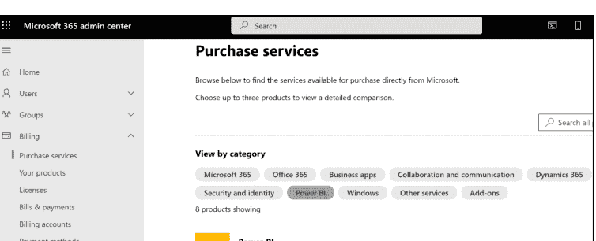

图 12.1：Microsoft 365 管理中心 – 购买服务

3. 通过向下滚动、单击 **Power BI Premium P2** 标题下的 **详细信息** 按钮，然后单击 **购买** 按钮来购买 Power BI Premium P2 容量节点。

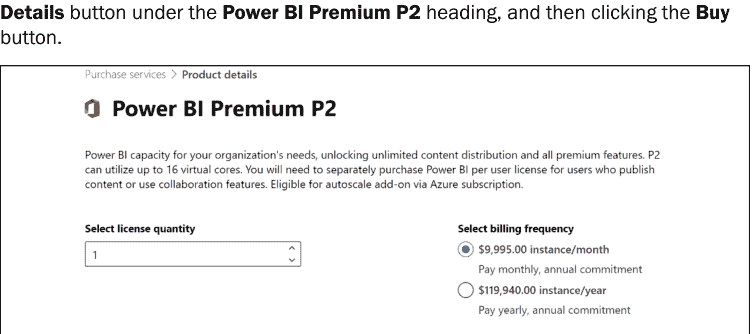

图 12.2：购买 Power BI Premium P2 容量

## 部署和分发 Power BI 内容

4. 购买 Power BI Premium P3 容量。
5. 确认新的 Power BI Premium 订阅出现在 **您的产品** 窗口中，与已购买的 Power BI Pro 和 Power BI Free 许可证一起出现。
6. Microsoft 365 全局管理员或 Power BI 服务管理员打开 Power BI 管理门户。在 Power BI 服务中，单击右上角的齿轮图标并选择 **管理门户**。
7. 从管理门户中选择 **容量设置**，然后单击 **设置新容量**。
8. 为容量提供描述性名称并将容量管理员角色分配给一个或多个用户。
9. 为容量授予特定 Power BI Pro 用户或组的 workspace 分配权限。

全局管理员和 Power BI 服务管理员默认是容量管理员，但容量管理员角色可以分配给不是 Power BI 服务管理员的用户。容量管理员角色权限特定于给定的容量。

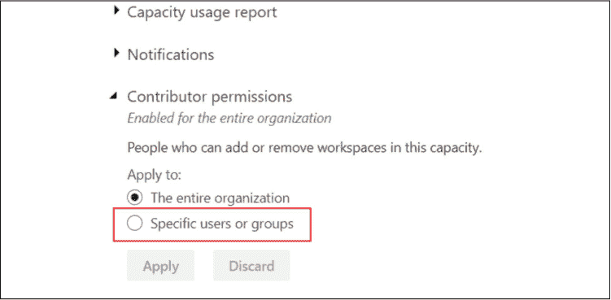

图 12.3：容量设置中的用户权限

10. 设置购买的另一个容量，分配其容量管理员，并授予其 workspace 分配权限。
11. 具有 workspace 分配权限的 Power BI Pro 用户可以在 Power BI 服务中创建 Premium 工作区。

在 Power BI 管理门户中，容量管理员可以为 Premium 容量分配或移除工作区，以及将用户列入白名单，以便将给定用户的所有工作区分配给 Premium 容量。

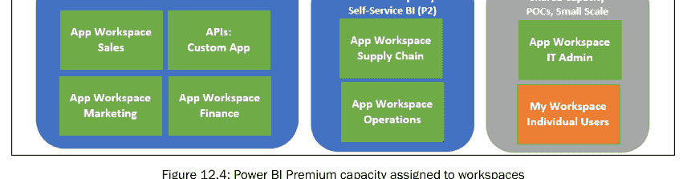

图 12.4：Power BI Premium 容量分配给工作区

在此示例中，三个工作区（销售、营销和财务）分配给名为 Enterprise BI（P3）的 Power BI Premium 容量。此外，该容量还支持自定义应用程序的嵌入式报表需求。选择了更大的 P3（32 核，100 GB RAM）容量，因为这些工作区的查询流量更高，并且需要更大的数据集大小。

供应链和运营工作区分配给 P2 容量。在这种情况下，尽管工作负载小于 P3 容量，但这些组仍需要与许多免费用户共享内容。最后，一个小型 IT 用户组（IT Admin）的工作区使用 Power BI Pro 许可证维护在共享容量中。该工作区不需要 Power BI Premium，因为向免费用户分发的需求最小，并且数据集较小，刷新计划相对不频繁。

横向扩展 Power BI Premium 涉及在多个容量之间分发已配置的容量（v-core）。例如，作为 P3 容量节点的一部分购买的 32 个 v-core 可以选择拆分为三个单独的容量：两个各 8 个 v-core 的 P1 容量和一个 16 个 v-core 的 P2 容量（8 + 8 + 16 = 32）。将 v-core 分布到不同的 Premium 容量中的这种能力称为 v-core 池。

Premium 容量的原地扩展涉及根据食谱在 Microsoft 365 管理中心购买额外的容量节点，然后调整给定 Premium 容量的容量大小以反映额外的核心：


图 12.5：Power BI 管理门户中容量的可用 v-core


例如，如果确定P1容量不足以满足所需的性能或可扩展性，可以购买额外的P1容量。此时，在购买了两个各8个v-core的P1容量后，可以在Power BI管理门户中为原始容量设置P2容量大小（16个v-core）。这样就可以根据需求变化快速、轻松地逐步扩展。

## 另请参阅

- Power BI许可图解：https://bit.ly/2R4xYYN
- 什么是Microsoft Power BI Premium？：https://bit.ly/3eyrpq8
- 规划Power BI企业部署白皮书：http://bit.ly/2wBGPRJ
- Power BI嵌入式分析中的容量和SKU：https://bit.ly/2REM437
- 容量规划：https://bit.ly/3tG66aR

## 管理环境之间的内容

熟悉项目生命周期、源代码控制系统以及管理开发、测试和生产环境的公司BI和IT团队，也应考虑将这些流程应用于Power BI部署。Power BI Desktop本身不直接与标准的源代码控制系统（如Azure DevOps）集成。然而，Power BI文件可以存储在SharePoint Online团队网站和OneDrive for Business中，以提供版本历史记录可见性、本地设备与云服务之间的同步、还原功能等。在Power BI服务中，可以创建独立的开发、测试和生产工作区及其对应的应用，以支持分阶段部署。利用这些工具和功能，Power BI团队可以高效管理工作流，向用户交付一致、高质量的内容。

本方案介绍了使用Power BI部署管道部署内容的方法，这是一项Premium功能。为没有Premium的用户提供的替代方法包含在“更多内容”部分中。

## 准备工作

为准备本方案，请按照以下步骤操作：

- 1. 在Power BI服务中，创建一个新的Premium工作区。
- 2. 在Power BI Desktop中打开包含查询参数的报告，并将报告发布到第1步创建的Premium工作区。查询参数应设置为`Text`。

同样，本方案需要Power BI Premium容量。

## 如何操作...

创建和使用Power BI部署管道相对容易。要创建和使用管道，请按照以下步骤操作：

- 1. 在Power BI服务中，从左侧导航窗格中选择**部署管道**。
- 2. 选择**创建管道**。
- 3. 提供**管道名称**，并单击**创建**按钮。
- 4. 单击**分配工作区**按钮。
- 5. 选择第1步创建的Premium工作区，将该工作区的部署阶段分配为**开发**，并单击**分配**按钮。

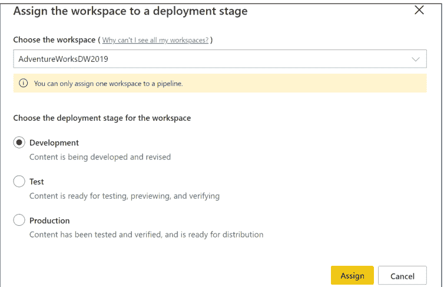

图12.6：将工作区分配到部署管道

6. 在**开发**阶段下，单击**部署到测试**按钮。这将创建一个新工作区，并将**开发**中的内容部署到此工作区。


图12.7：Power BI部署管道

- 7. 内容部署到**测试**后，单击**测试**阶段标题中的闪电图标。
- 8. 单击**数据集**标题下的数据集。
- 9. 展开**参数规则**，并单击**添加规则**按钮。
- 10. 在**对于此参数**标题下，选择一个参数。
- 11. 在**应用此值**下，编辑参数并单击**保存**按钮。

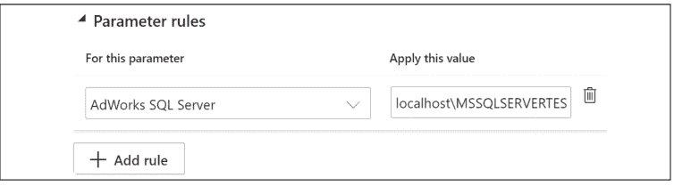

图12.8：Power BI部署管道参数规则

现在，每次将数据集部署到测试阶段时，该参数将指向测试SQL Server，而不是开发SQL Server。有关Power BI管道以及如何在Power BI部署场景中使用它们的更多信息，请参阅本方案的“另请参阅”部分。

## 工作原理...

Power BI部署管道允许内容在开发、测试和生产部署阶段之间轻松移动。这些部署阶段与管道自动创建的各个工作区相关联。当不同阶段中的内容发生变化时，可以将该内容部署到先前阶段或后续阶段。此外，可以在测试和生产阶段内定义规则，更改数据源或参数以指向相应的源系统。

开发阶段被设计为报告开发的工作区域。测试阶段是已开发内容可以与业务用户共享以进行用户验收测试的地方。最后，生产阶段是最终产品呈现给业务的地方。

## 更多内容...

如果你没有Power BI Premium，可以使用Power BI REST API在工作区之间部署内容。此外，ALM工具包允许你使用开源的BISM Normalizer工具集来比较和合并两个Analysis Services表格模型。BISM代表商业智能语义模型（Business Intelligence Semantic Model），是微软为报表、分析、记分卡和仪表板定义的一种模型。

## 准备工作

确认仪表板所有者以及接收者或使用者均具有Power BI Pro许可证。如果接收者没有Power BI Pro许可证，请检查仪表板是否包含在已分配给高级容量的工作区中。共享仪表板需要Pro许可证或Premium容量。Power BI Pro用户无法与Power BI免费用户共享托管在Power BI共享容量中的仪表板。

在Power BI管理门户中为组织或特定安全组启用外部共享功能。共享仪表板的所有者可以允许接收者重新共享仪表板，但任何与外部用户共享的仪表板都无法再次共享。此外，仪表板所有者可以删除用户对仪表板的访问权限以及重新共享能力。与本章后面描述的发布到Web功能不同，外部共享可以限于特定安全组或从特定安全组中排除。

在此示例中，BI团队的Jennifer负责与加拿大销售团队的Brett以及组织外部的另一个人Jack共享仪表板。Brett将需要能够与他的团队的几个成员共享仪表板。

## 如何操作...

要实现本方案，请执行以下操作：

- 1. 在Power BI服务中创建一个专用工作区。
- 2. 将工作区的隐私级别设置为允许成员编辑内容，并向工作区添加团队成员。
- 3. 在Power BI Desktop中为**加拿大销售团队**创建安全角色。
- 4. 将Power BI Desktop文件发布到工作区，并将成员或安全组添加到**加拿大销售团队**角色。

通过使用安全角色，包含其他国家/地区销售数据的现有Power BI Sales数据集可用于仪表板。Brett将被允许共享仪表板，但RLS将阻止他和通过安全组映射到安全角色的那些人查看其他国家/地区的销售数据。有关配置RLS的详细信息，请参阅*第8章，在Power BI中实现基于用户的动态可见性*。

- 5. 创建与工作区中已发布数据集具有实时连接的新Power BI Desktop报告文件。
- 6. 在每个文件中构建基本可视化，并发布这些报告。
- 7. 在Power BI服务中，创建一个新仪表板**加拿大销售仪表板**，从报告中固定视觉对象，并调整布局。

8. 在Power BI服务工作区中，单击加拿大销售仪表板上的“共享”。


图12.9：共享加拿大销售仪表板

9. 添加外部用户Brett，并可选地在共享仪表板表单上添加消息。

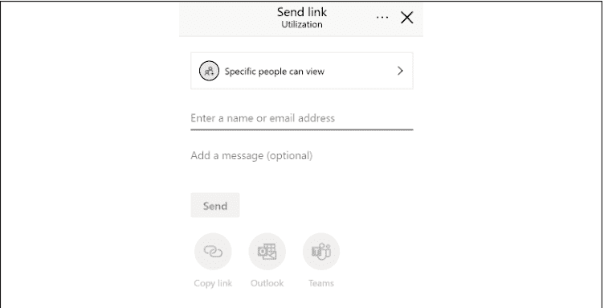

图12.10：Power BI服务中的共享仪表板表单

Power BI将会检测并尝试在“授予访问权限”输入框中输入电子邮件地址时自动补全。此外，尽管共享仪表板有时被称为点对点共享，但可以粘贴电子邮件地址列表，并且支持所有常见的组实体，包括通讯组、安全组和Office 365组。如图所示，如果输入了组织外部的用户，将出现警告。

10. 在此示例中，在消息下方保持启用“允许接收者共享此仪表板”选项。单击“授予访问权限”。

如果在共享表单上保持启用此选项，接收者将收到电子邮件通知以及Power BI中的通知。


图12.11：Power BI服务中仪表板接收者的通知中心


对于接收者来说，仪表板会出现在 **与我共享** 选项卡中。如果仪表板所有者启用了该选项（并且如果用户是组织内部成员），则与他人共享仪表板的选项将启用。用户将能够收藏仪表板、从 Power BI 移动应用访问它，并与其内容交互（例如筛选选择），但不能编辑报表或仪表板。

### 工作原理...

内容应始终从工作区分发，而不是从 **我的工作区** 分发。即使在相对非正式的场景（例如与一个用户共享仪表板）中，从 **我的工作区** 共享仪表板也会使单个用户（本例中为 Jennifer）承担维护内容的责任。从工作区与 BI 团队的多个成员共享内容，可消除 Jennifer 无法维护内容的风险，并受益于微软持续对工作区的管理和治理功能进行的投入。

拥有编辑权限的工作区成员可以禁用仪表板的二次共享，并完全停止共享。要编辑权限，请打开仪表板，单击 **共享**，单击省略号 (...)，然后选择 **管理权限**，以查看并视需要修改当前访问权限。

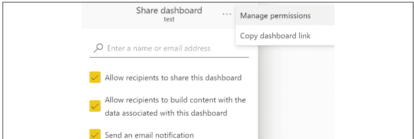

图 12.12：共享仪表板，管理权限

在 **管理权限** 窗格中，单击底部的 **高级**，然后选择 **直接访问** 选项卡。如图 12.13 所示，您可以在此添加用户、编辑权限和删除访问权限。


图 12.13：共享和访问选项

### 更多内容...

在 Power BI 服务中，共享报表与共享仪表板的操作在用户界面方面完全相同。唯一区别在于，该过程从服务中的报表页开始，而不是仪表板。

还可以通过提供数据集的特定读取访问权限来共享数据集。方法是单击数据集旁边的三个垂直点，这些点可位于左侧导航窗格中，也可在查看工作区的 **数据集 + 数据流** 窗格时出现。

### 另请参阅

- 与同事和其他人共享 Power BI 报表和仪表板：https://bit.ly/3f991lw
- 在 Power BI 中协作和共享的方式：https://bit.ly/3tyIuMv

## 配置工作区

工作区（以前称为应用工作区）是 Power BI 服务中供 Power BI Pro 用户开发内容的共享区域。工作区中包含的数据集、报表和仪表板可以发布为 Power BI 应用以分发给用户组。此外，工作区可以分配给专用硬件的 Power BI Premium 容量，使所有用户（无论许可证如何）都能使用已发布的应用，并提供一致的性能和更大的可扩展性。此外，工作区与已发布的应用保持一对一的映射关系，使工作区的成员和管理员能够在发布应用更新之前暂存和测试迭代。

阅读各种相关历史文档时，了解工作区的历史会有所助益。当 Power BI 首次发布时，该服务包含了工作区的概念。然而，这些工作区与 Office 365 组绑定，并存在各种限制。Microsoft 发布了组工作区的更新，并把这些新工作区命名为工作区。传统工作区被标记为 **经典工作区**。如今，由于经典工作区几乎已被淘汰，所有新工作区都是工作区，现简称为 **工作区**。虽然这可能看起来有点像“伊斯坦布尔，不是君士坦丁堡”那样令人困惑，但只需明白，在阅读博客文章和其他提及工作区的信息时，这仅指 Power BI 服务中的现代工作区体验。

在本节中，将创建并配置一个工作区。在本节及其辅助部分中，确定了所有主要考虑因素，包括工作区的范围或内容，以及将工作区分配到高级容量。

### 准备工作

要准备本节内容，请按照以下步骤操作：

1. 确认工作区的管理员和成员可以使用 Power BI Pro 许可证。
2. 确保工作区符合组织的 Power BI 内容分发策略或标准。
3. 如果已预配高级容量，但未批量分配给组织的所有工作区，请确定新工作区是否将托管在高级容量中。
4. 如果已预配高级容量并授权给新工作区，请评估高级容量的当前利用率，并确定新应用部署所产生数据集和用户查询的预期工作负载是否需要更大或独立的容量。此外，确认工作区管理员具有工作区分配权限，或按照“具体操作方法...”中的第一步在 Power BI 管理门户中分配此权限。
5. 单击 Power BI 服务右上角的问号 (?) 图标，然后选择“关于 Power BI”，以检索 Power BI 租户的 UTC 偏移量。UTC 偏移量如图 12.14 所示，本例中为 -0400：

    

    图 12.14：Power BI 租户的 UTC 偏移量

6. 从 Power BI 服务管理门户的容量设置中检索高级容量 ID。
7. 在容量设置中，单击所需容量“操作”下的齿轮图标，并记下容量 ID。
8. 在 Power BI 服务的工作区中，从屏幕左下角选择“获取数据”。
9. 在“服务”部分中，单击“获取”按钮。
10. 搜索“Premium”，并选择“Premium Gen2 容量利用率指标”应用。
11. 在模板应用的 AppSource 页面上，单击“立即获取”按钮，如图 12.15 所示：

    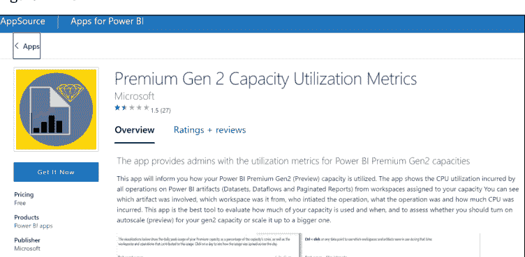

    图 12.15：AppSource 中的 Premium Gen2 容量利用率指标应用

12. 填写联系信息，接受条款和条件，并单击“继续”按钮。

13. 单击“安装到新工作区”单选按钮，提供工作区名称，然后点击“安装”按钮以安装应用。

以上即完成本节准备的步骤。

### 具体操作方法...

要实现本节内容，请执行以下操作：

1. 打开新工作区，并从 Power BI 服务的导航窗格中选择“应用”。
2. 单击“Gen2 利用率指标”应用。
3. 在屏幕顶部，单击“连接数据”，如图 12.16 所示：

    

    图 12.16：Gen2 利用率指标中的“连接数据”提示

4. 输入应用要求的 **容量 ID** 和其他信息，然后点击 **下一步** 按钮。

    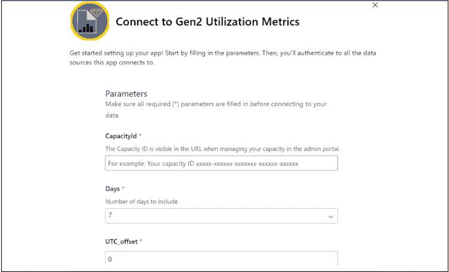

    图 12.17：连接到 Gen2 利用率指标

5. 在下一个屏幕上，选择 **登录并连接**，然后登录到 Power BI 服务。

6. 通过 CPU、内存和查询的使用度量查看容量的近期性能。

7. 假设容量指标正常，请单击应用左下角的 **返回** 链接退出应用。

8. 单击 **工作区** 旁边的箭头，然后点击 **创建工作区**。

    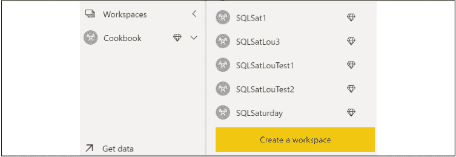

    图 12.18：在 Power BI 服务中创建工作区

分配到高级容量的工作区在 Power BI 服务中会以菱形图标标识。

9. 提供工作区名称，展开“高级”部分，选择“按容量高级版”的许可证模式，并选择一个容量。

**创建工作区**

| 字段 | 值 |
| --- | --- |
| 联系人列表 | |
| 工作区管理员 | 特定用户和组 / 输入用户和组 |
| 工作区 OneDrive | （可选） |
| 许可证模式 | Pro / 按用户高级版 / 按容量高级版 / 嵌入式 |
| 选择容量 | P1 MVP 演示 请勿更改任何内容 - 美国东部 2 |
| 默认存储格式 | 小型数据集存储格式 |
| 操作 | 保存 / 取消 |

图 12.19：创建高级工作区

10. 单击“保存”按钮以创建工作区。

11. 在工作区中，单击标题中的“访问”链接以添加工作区成员。

现在，工作区成员可以发布数据集和报表，并创建仪表板以通过应用分发。从技术上讲，可以将成员添加到仅查看组，并将开发人员分配为工作区管理员角色，以便他们可以编辑内容。不建议使用这种协作方法，因为与共享仪表板一样，仅查看成员将立即看到所有更改。从工作区发布的应用提供了暂存部署，是将内容分发给只读成员的建议解决方案。


## 另请参阅

- ▶ 管理 Power BI Premium： http://bit.ly/2vq8wHe
- ▶ 监控 Power BI Premium 容量： https://bit.ly/3xZqp6f

## 配置本地网关数据连接

利用 Power BI 服务和移动应用程序在所有设备上提供丰富的集成仪表板和报告访问的承诺，需要对数据源和使用的数据集进行周到的配置。对于许多组织而言，主要的商业智能数据源托管在本地，因此，除非 Power BI 报表专门部署到本地 Power BI Report Server，否则需要本地数据网关来安全地促进 Power BI 服务与本地系统之间查询和数据的传输。此外，通常支持许多报表和仪表板的数据集必须配置为使用本地数据网关，以便进行计划刷新以将数据导入 Power BI，或支持从 Power BI 生成的 DirectQuery 和实时连接查询。

本食谱包含两个配置已发布数据集的数据源和计划刷新的示例。第一个示例为导入模式 Power BI 数据集配置了两个本地数据源（SQL Server 和 Excel）并安排每日刷新。第二个示例为 DirectQuery Power BI 数据集配置了单独的本地 SQL Server 数据库，并设置了 15 分钟的仪表板磁贴刷新计划。

## 准备工作

为准备本食谱，请按以下步骤操作：

- 1. 下载、安装并配置本地数据网关，如第 1 章《配置 Power BI 工具》中创建本地数据网关所述。
- 2. 成为本地数据网关的管理员。

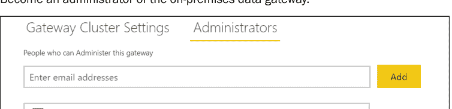

## 部署和分发 Power BI 内容

强烈建议为每个安装的网关至少设置两位管理员，以提供冗余和备份管理功能。

## 如何操作...

在本示例中，已使用 Power BI Desktop 创建了一个导入模式数据集，以从两个本地数据源检索，分别是 SQL Server 数据库和 Excel 文件。要实施本食谱，请执行以下操作：

- 1. 确定 Power BI Desktop 文件中使用的服务器名称和数据库名称。
- 2. 确定 Excel 文件的完整路径。
- 3. 在 Power BI 服务中，点击右上角的齿轮图标并选择 **管理网关**。
- 4. 从 **管理网关** 界面，点击 **添加数据源** 并选择 **SQL Server**。
- 5. 提供一个不会与其他源冲突的直观源名称，并输入服务器和数据库名称。

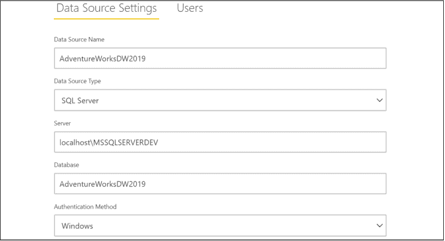

图 12.22：添加 SQL Server 数据库作为本地数据网关的源

网关的服务器和数据库名称必须与 Power BI 数据集中使用的名称完全匹配。

如果为网关配置 SSAS 数据源（数据源类型 = 分析服务），请确保使用的凭据也是给定 SSAS 实例的 SSAS 服务器管理员。服务器管理员凭据用于建立连接，但每次用户从 Power BI 与 SSAS 数据源交互时，其 UPN（用户主体名称）都会通过

EffectiveUserName 连接属性传递给服务器。这允许在 SSAS 数据库中定义的 RLS 角色应用于 Power BI 用户。

- 6. 在 **高级设置** 下，检查源是否使用适当的隐私级别，例如组织或私有。
- 7. 点击 **添加**，然后通过 **用户** 选项卡添加有权使用此网关访问此数据源的用户。

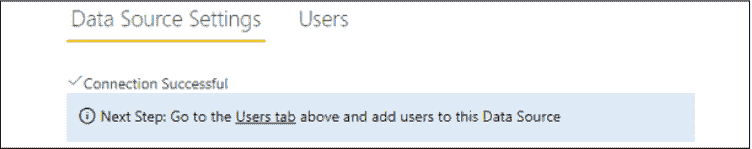

图 12.23：为本地数据网关成功设置数据源

- 8. 使用文件数据源类型为 Excel 文件添加另一个数据源。
- 9. 与 SQL Server 数据源一样，通过 **用户** 页面为此网关和此数据源授权用户。
- 10. 将导入模式 Power BI Desktop 文件（数据集）发布到 Power BI 服务的工作区。
- 11. 访问工作区并从 **数据集 + 数据流** 列表中，点击数据集的 **计划刷新** 图标。

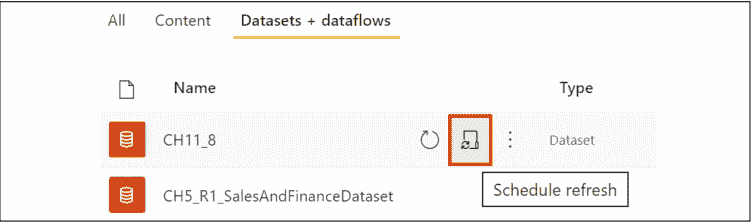

图 12.24：Power BI 服务中已发布数据集可用的操作

- 12. 展开 **网关连接** 部分。

如果满足以下三个条件，网关将作为数据刷新的选项出现：

- - ☐ 用户列在网关中数据源的 **用户** 页面上
- - ☐ 为网关在 Power BI 服务中配置的服务器和数据库名称与 Power BI Desktop 文件中使用的名称匹配
- - ☐ 数据集使用的每个数据源都已配置为网关的数据源

13. 在本数据集包含的数据源部分，使用映射到下拉菜单选择已配置的网关数据源连接。

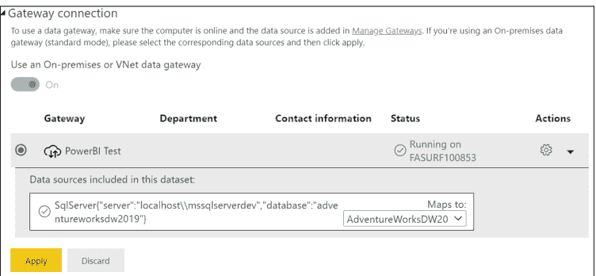

图 12.25：将数据源与 Power BI 网关数据连接关联

14. 点击应用按钮将数据源连接到网关。

15. 现在展开计划刷新部分。

16. 点击添加另一个时间链接以添加刷新的计划时间。

17. 添加完刷新时间后，点击应用按钮。

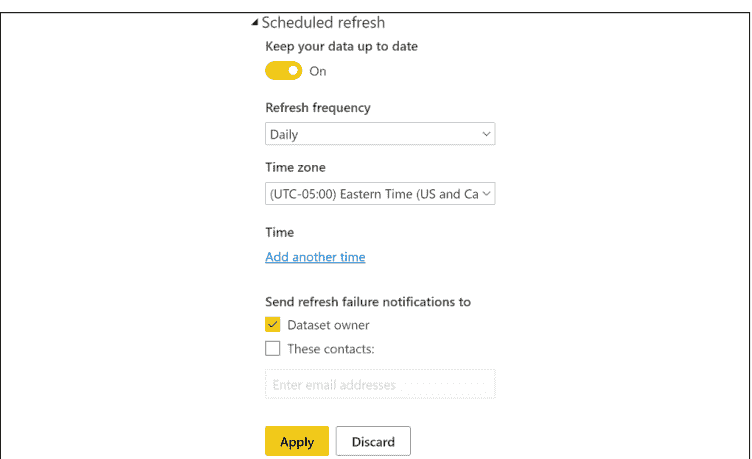

图 12.26：数据集的计划刷新

您的数据集现在已安排刷新。

## 其工作原理...

对于共享容量，无法保证计划刷新会在其计划的确切时间发生，例如本示例中的凌晨 5:00。实际刷新可能在 Power BI 服务中计划时间后长达 20-30 分钟进行。

仪表板磁贴使用的数据缓存会在导入模式数据集的刷新操作后更新（或手动更新）。Power BI 服务还会缓存报表可视化的数据，并在数据集刷新时更新这些缓存。仪表板磁贴可以在 Power BI 服务中通过 **刷新可视化** 菜单项手动刷新（右上角，圆形箭头图标）。同样，报表也可以从 Power BI 服务手动刷新，但这仅与 DirectQuery 和 SSAS 实时连接相关；这*不会*启动导入模式数据集的刷新。

导入模式数据集可以通过 Power BI 服务中的计划或通过 REST API 刷新。Power BI 数据刷新 API 允许 BI 团队以编程方式触发 Power BI 服务中的刷新操作。

例如，可以向现有的夜间（或更频繁）数据仓库或 ETL 流程添加一个步骤，以启动使用此数据源的 Power BI 数据集的刷新。这允许 Power BI 服务中的仪表板和报表尽可能快地反映数据源的最新成功刷新。换句话说，源系统刷新与 Power BI 数据集计划刷新之间的差距或延迟可以减少到在 Power BI 服务中刷新数据集所需的时间。

要为 Power BI 服务中的数据集触发刷新，只需发出以下 HTTP 请求：

```
POST https://api.powerbi.com/v1.0/myorg/groups/{group_id}/datasets/{dataset_id}/refreshes
```

请参阅本食谱 *另请参阅* 部分中的 Power BI REST API 身份验证文档和 Power BI REST API 参考。

## 还有更多...

在本示例中，基于单独的本地 SQL Server 数据库的 Power BI Desktop 文件（数据集）在 DirectQuery 模式下必须部署到 Power BI 服务。目的是使基于此数据集的仪表板尽可能保持最新。要实施本食谱，请执行以下操作：

- 1. 与导入模式数据集一样，将 SQL Server 数据库添加为网关的数据源。
- 2. 将用户分配给此数据源和网关。


## 部署和分发 Power BI 内容

- 3. 单击**创建应用**按钮。
- 
- 4. 在**设置**选项卡上，编辑**应用名称**并输入**描述**。你还可以上传自定义**应用徽标**，并设置**应用主题色**和**联系信息**。

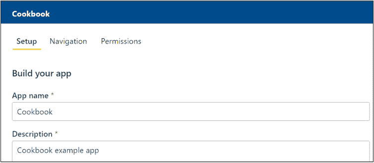

图 12.30：应用设置选项卡

- 5. 单击**导航**选项卡。
- 
- 6. 使用**新建**下拉菜单，选择**分区**。
- 
- 7. 选择**新建分区**，将**名称**更改为**北美**。
- 
- 8. 再创建三个分区，分别用于**全球销售报告**、**客户**和**支持材料**。
- 
- 9. 要在分区中移动报表元素链接，请在**导航**窗格中单击相应项目，然后从**分区**下拉菜单中选择一个分区。

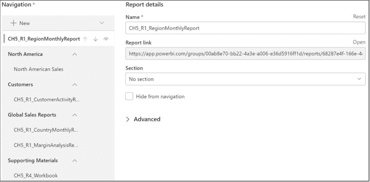

图 12.31：应用导航选项卡

10. 选择**权限**选项卡。

11. 添加需要访问该应用的特定个人或组，并设置权限。建议你取消勾选**允许所有拥有应用访问权限的人**标题下的设置，改为在数据集级别控制权限。此外，通常建议勾选**安装**标题下的**自动安装此应用**复选框。

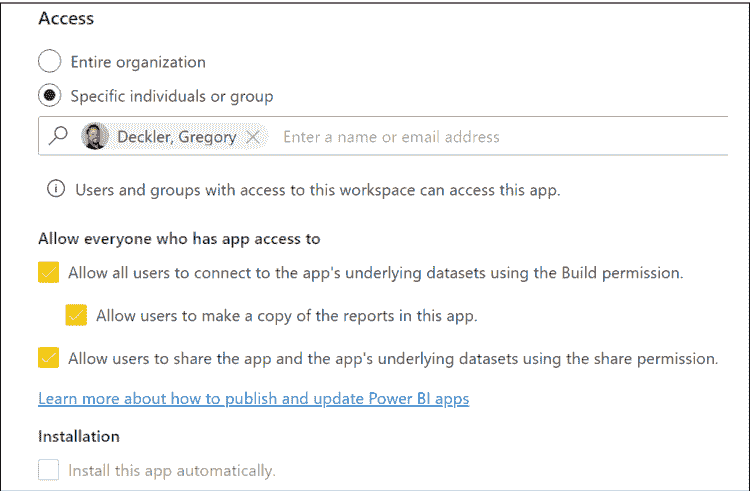

图 12.32：应用权限选项卡

12. 单击右下角的**发布应用**按钮。

13. 将出现一个显示应用名称的弹出窗口。单击**发布**按钮。

14. 在**发布成功**对话框中，单击**转到应用**按钮。

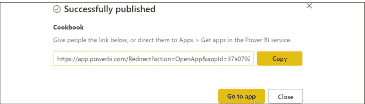

图 12.33：应用发布成功

## 部署和分发 Power BI 内容

- 15. 应用将显示如下：

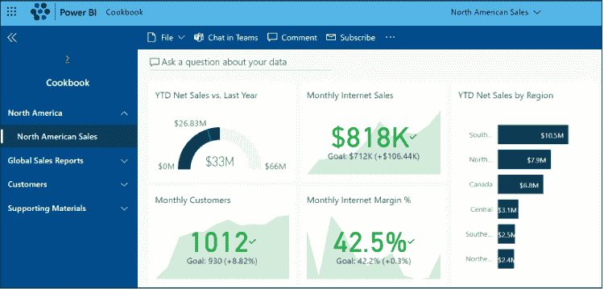

图 12.34：已发布的应用

- 16. 在左上角，单击**返回**。
- 17. 在左侧导航窗格中，选择**应用**。
- 18. 应用应会列出。


图 12.35：应用

现在，你已经构建了第一个应用！

### 工作原理...

应用是 Power BI 服务中的一种内容类型，允许在单一位置共享和访问多个仪表板、报表和工作簿。每个工作区仅限一个应用；虽然应用可以包含指向工作区外部内容的链接，但这些链接不会作为应用的一部分发挥作用，而只是将用户带到外部仪表板、报表或网页地址。

即使存在这些限制，当设计者不希望向业务用户授予整个工作区的权限时，应用在同时共享多个内容项方面仍具有优势。业务用户只需一个链接即可访问应用中的所有内容，从而从中受益。

### 更多内容...

应用发布后可以修改。在工作区中，单击右上角原先**发布应用**按钮所在位置的**更新应用**按钮即可完成修改。配置应用的选项卡与发布时相同，只是**权限**选项卡现在包含**链接**区域：

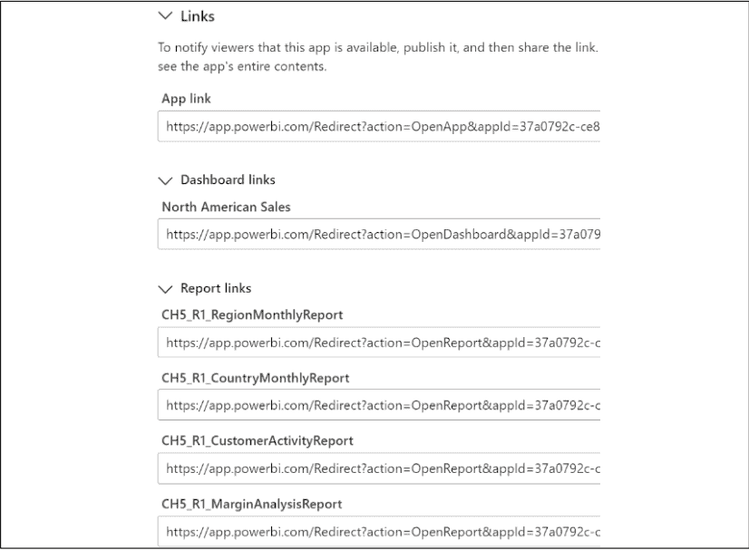

图 12.36：应用“权限”选项卡上的“链接”区域

所有三个选项卡上的应用设置都可以编辑，完成后，只需单击右下角最初**发布应用**按钮所在位置的**更新应用**按钮即可。

## 部署和分发 Power BI 内容

应用也可以取消发布。同样，在工作区中通过使用省略号 (...) 然后选择**取消发布应用**即可完成。

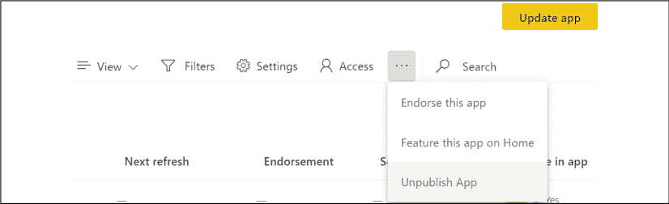

如你所见，应用提供了一种灵活向用户分发内容的方法。

### 另请参阅

- - 什么是 Power BI 应用？：https://bit.ly/3fMYsI5
- - 在 Power BI 中发布应用：https://bit.ly/39NW12S

## 将报表发布到公共 Internet

Power BI 服务中的**发布到 Web**功能允许通过将报表嵌入网站、博客文章以及共享 URL 链接的方式，向公众共享 Power BI 报表。如果启用了**发布到 Web** 租户设置，并且用户对报表具有编辑权限，则可以生成嵌入代码，其中包含用于嵌入报表的 HTML 代码和报表的 URL。报表的所有页面，包括任何受支持的自定义视觉对象以及筛选、交叉突出显示等标准交互功能，均可供报表消费者使用。此外，报表会自动更新以反映源数据集的刷新情况，并且可以管理嵌入代码，必要时还可选择删除，以通过嵌入代码和 URL 消除对报表的访问。

本指南介绍了使用**发布到 Web**功能的基本步骤和注意事项。

### 准备工作

要准备本指南，请执行以下步骤：

- 1. 在 Power BI 服务中，单击右上角的齿轮图标，然后选择**管理门户**。

### 操作步骤...

要实现本指南，请执行以下步骤：

- 1. 在 Power BI 服务中创建工作区，用于承载**发布到 Web**报表。
- 2. 为工作区指定一个描述性名称，使其与**发布到 Web**内容或公开可用的数据相关联。
- 3. 允许成员编辑内容，并且只添加需要内容编辑权限的个人用户。
- 4. 新建一个 Power BI Desktop 文件，作为**发布到 Web**报表的数据集。
- 5. 开发必要的数据连接、查询、模型关系和度量值，以支持报表。
- 6. 保存文件，并将其发布到之前创建的应用工作区。
- 7. 打开一个新的 Power BI Desktop 文件，作为**发布到 Web**报表。
- 8. 单击**获取数据**，通过 Power BI 数据集连接器连接到已发布的数据集。
- 9. 开发报表，包括所有视觉对象、布局和格式选项，以及页面大小（16:9 或 4:3）。
- 10. 为文件命名、保存，并单击**发布**。报表将发布到源数据集所在的工作区。
- 11. 在 Power BI 服务中访问该工作区。
- 12. 在“管理网关”门户中，将新的本地数据源添加到本地数据网关。
- 13. 打开数据集的设置，分配网关（如果适用），并配置计划刷新。
- 14. 打开报表，依次单击“文件”、“嵌入报表”，然后选择**发布到 Web（公共）**。

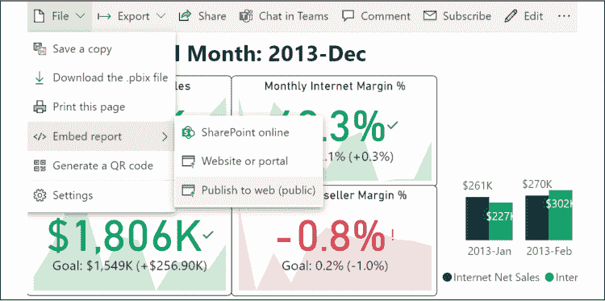

图 12.39：Power BI 服务中报表的“发布到 Web”选项

- 15. 单击**创建嵌入代码**，然后**发布**。
- 16. 显示一个**成功！**对话框，允许你复制报表的嵌入代码。

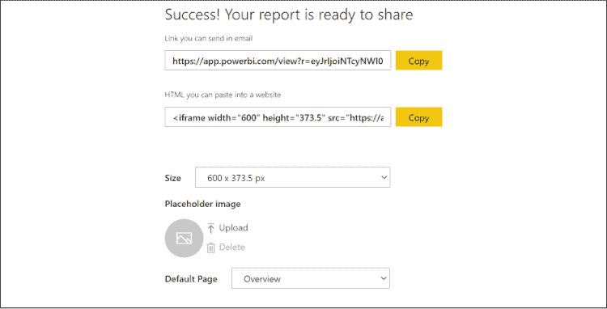

图 12.40：成功发布到 Web

现在，你可以共享**发布到 Web** URL，或将 HTML 代码用于自己的网站。

### 工作原理...

对于**发布到 Web**，技术上来讲并不需要单独的工作区，但建议进行这种隔离，以便于管理并降低发布机密或专有信息的风险。同样，Premium 容量也不是必需的，但对于较大的数据集，或者当更频繁的数据刷新和一致的性能很重要时，Premium 容量可能比较合适。

所提供的 HTML 代码可以手动编辑，以改善报表在嵌入目标位置上的适配效果。将高度尺寸增加 56 像素可以调整底部栏的大小。要获得完美适配，可能需要在 Power BI Desktop 中设置页面大小、设置 Power BI 服务中的查看模式（右上角报表页眉中的**视图**图标），并手动调整 iFrame 的高度和宽度值。

根据*图 12.39*，Power BI 报表也可以嵌入 SharePoint Online。单击**SharePoint Online**会提供一个 URL，该 URL 可用于 SharePoint Online 中的 Power BI Web 部件。访问 SharePoint Online 页面的用户还必须具有在 Power BI 服务中访问该报表的权限。

Power BI 会缓存报表定义以及用户查看报表时所需的查询结果。由于存在缓存，报表定义的更改或数据集刷新的影响大约需要一个小时才能反映在用户所查看的报表版本中。

### 更多内容...

所有**发布到 Web**及其他嵌入代码都可以由创建嵌入代码的工作区的成员进行管理。此外，管理员可以在集中位置管理所有工作区的所有嵌入代码。要了解具体操作，请执行以下步骤：

- 1. 在 Power BI 服务中，打开创建**发布到 Web**嵌入代码的工作区。
- 2. 单击右上角的齿轮图标，并选择**管理嵌入代码**。
- 3. 将显示为该工作区创建的所有嵌入代码，可以使用省略号（**...**）检索或删除这些代码。

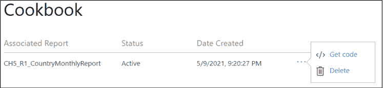

图 12.41：工作区的“管理嵌入代码”界面


4. 再次单击齿轮图标，然后选择**管理门户**。
5. 在管理门户中，选择**嵌入代码**。
6. 将显示所有工作区的所有嵌入代码，三个垂直点允许查看报表或删除嵌入代码。

**状态**为**不支持**表示报表使用了少数不支持的功能之一，例如 RLS、本地 SSAS 表格、R 视觉对象或适用于 Power BI 的 ArcGIS 地图。

### 另请参阅

- 从 Power BI 发布到 Web：https://bit.ly/3bezKxq

## 启用移动体验

Power BI 移动应用的设计与 Power BI 服务中的用户体验和功能集紧密对齐。这为用户提供了简单、熟悉的导航体验，并允许 BI 和 IT 团队利用现有的 Power BI 资产和知识来增强其组织中的移动体验。

本食谱包含两个流程，以利用 Power BI 的移动功能。第一个流程有助于识别“速赢”机会，这些机会需要有限的 BI/IT 投资，以更好地利用基本的 Power BI 移动功能。第二个流程识别 Power BI 移动应用的一些不太常见但强大且新兴的用例。

### 准备工作

要准备本食谱，请执行以下步骤：

1. 通过打开 Power BI 管理门户（齿轮图标：管理门户）并选择“使用情况指标”菜单项，确定使用最频繁的仪表板和报表。
2. 决定哪些仪表板和报表作为移动增强的目标。

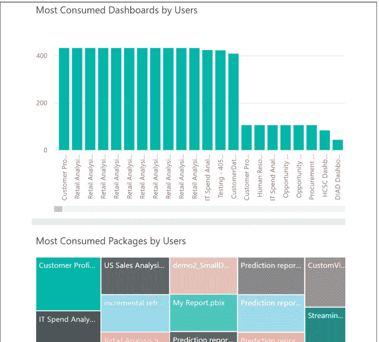

图 12.43：Power BI 管理门户中的使用情况指标

使用最多的仪表板和报表视觉对象提供了按用户数统计的使用量或使用情况摘要。要进行更细粒度的使用情况分析，可以按照*第 10 章“管理和监控 Power BI”*中的说明导入和分析 Microsoft 365 中 Power BI 事件的审核日志。此外，Power BI 服务中的省略号 (...) 菜单现在提供了特定于各个仪表板和报表的使用情况指标报表。尽管这些报表仅限于特定项目，但它们也指示了 Web 和移动使用之间的划分。

### 操作步骤...

要实现本食谱，请执行以下步骤：

1. 通过打开仪表板并切换到**移动视图**，优化 Power BI 仪表板以供移动使用。

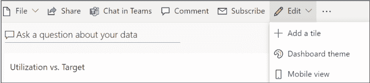

图 12.44：在 Power BI 服务中切换到仪表板的移动视图

2. 从移动视图中取消固定图像、文本以及不太适合移动设备或相关性较低的磁贴。
3. 在**移动视图**顶部调整 KPI 和基本视觉对象的大小并对其进行组织。

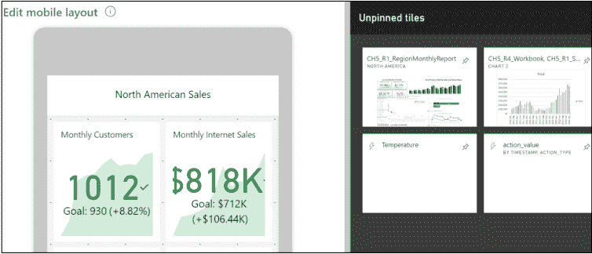

图 12.45：在 Power BI 服务中自定义仪表板的移动视图

4. 打开报表的 PBIX 文件。
5. 在最重要报表页面的**视图**选项卡的功能区中选择**移动布局**，并设计页面的自定义移动布局。有关此过程的详细信息，请参阅*第 4 章“创作 Power BI 报表”*。
6. 将更新后的 Power BI 报表发布到 Power BI 服务中的工作区，并重新固定任何仪表板磁贴。
7. 在移动设备上测试移动优化的仪表板和报表。
8. 将 Power BI 工作区中的更新发布到包含这些移动增强功能的 Power BI 应用中。
9. 检查移动用户是否正在使用仪表板和应用中的**收藏夹**。
10. 演示在 Power BI 移动应用中的仪表板磁贴上配置数据警报并发送通知的过程。


图 12.46：数据警报通知显示在移动应用外部

11. 向移动用户演示批注和共享功能及相关场景。

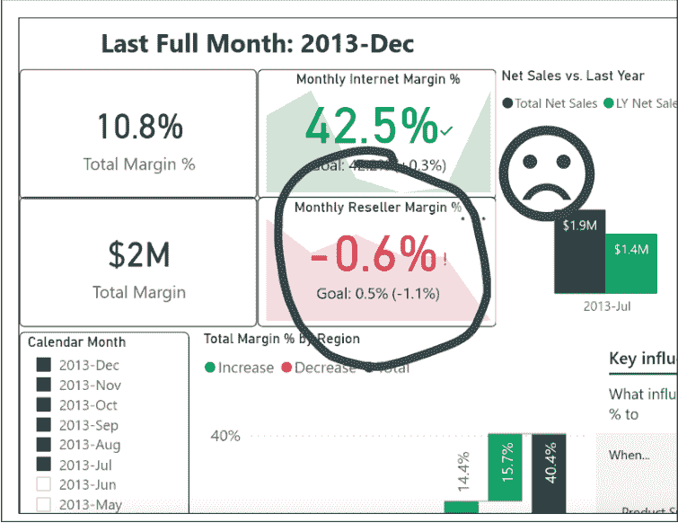

图 12.47：在 Power BI 移动版中向 Power BI 报表添加批注并通过电子邮件共享

在此示例中，在 Power BI 移动版中访问的报表被轻度批注，并向同事共享了一条简短消息，请求进一步分析。共享电子邮件中内置了指向已批注报表的链接，使收件人能够立即对消息采取行动，并可选地共享针对该请求的批注响应。

12. 在会议和演示中使用 Windows 10 Power BI 应用。

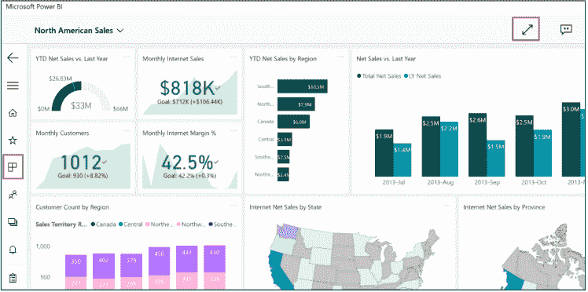

图 12.48：Windows 10 Power BI 应用

Windows 10 Power BI 应用支持触摸设备、批注和简单的导航控件。

13. 优化用于 Q&A 的数据集。有关更多详细信息，请参阅*第 5 章“在服务中工作”*中的食谱*“为 Q&A 做准备”*。
14. 测试常见问题，并为用户提供示例和关键字，以便更好地使用该功能。

构建和优化移动体验可以极大地帮助 Power BI 的采用。

### 工作原理...

只有仪表板的所有者才能在 Power BI 服务中自定义移动视图。根据*第 4 章“创作 Power BI 报表”*，报表页面的移动布局是在 Power BI Desktop 文件中实现的。因此，任何有权访问 Power BI 服务中报表工作区和源 PBIX 文件的 Power BI Pro 用户都可以优化这些报表以供移动使用。

通过为笛卡尔视觉对象（如柱状图、条形图和折线图）启用“响应式视觉对象”属性，这些视觉对象将在尺寸缩小时进行优化，以显示其最重要的元素。这有效地使得在报表的移动布局和仪表板的移动视图中使用这些更密集的视觉对象变得现实。然而，考虑到空间有限，在移动布局中优先考虑 KPI、卡片和仪表视觉对象仍然是有意义的。

用户配置的数据警报仅对这些用户可见，并且对可配置的警报数量没有限制。例如，用户可能希望为同一个仪表板磁贴设置两个警报，以同时提示高值和低值。目前，数据警报和收藏夹活动不会存储在 Office 365 审核日志中，因此有必要让移动用户参与这些功能，以了解采用水平。

### 更多内容...

Microsoft 的 Power BI 团队提供了许多在移动设备（如平板电脑、手机甚至手表）上使用 Power BI 的选项。这些选项的示例包括与 Apple Watch 的集成、从手机连接和查看本地 Reporting Services 报表的能力，以及针对 iOS 和 Android 设备的 Power BI 移动应用功能和特性的持续更新。

Power BI 仪表板可以通过适用于 iOS 的 Power BI 应用与 Apple Watch 同步。


图 12.49：Apple Watch 上 Power BI 移动应用的索引屏幕（左）和聚焦磁贴（右）

只需在适用于 iOS 的 Power BI 中打开仪表板，单击省略号 (...)，然后单击**与手表同步**。仅支持卡片和 KPI 磁贴，但可以将 Apple Watch 表盘配置为显示其中一个 Power BI 磁贴。

可以通过点击应用左上角的个人资料图像图标，然后点击**连接到服务器**，从 Power BI 移动应用访问和查看 SSRS 报表。

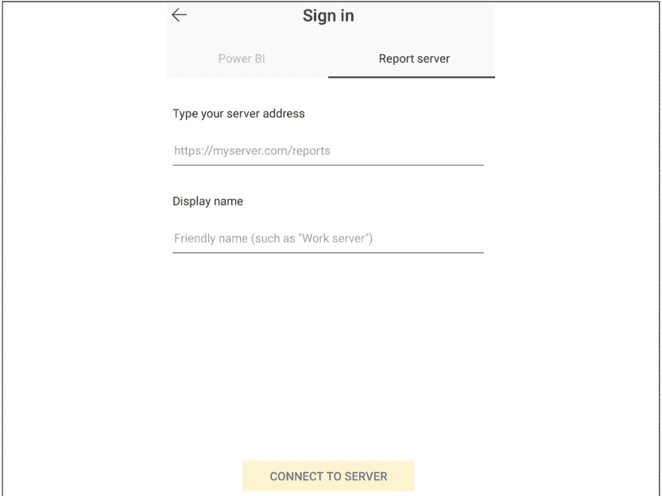

图 12.50：Power BI 移动版中连接到报表服务器的导航菜单

如您所见，Power BI 广泛支持各种不同的移动设备。

### 另请参阅

- Apple App Store 上的 Microsoft Power BI：https://apple.co/2R6kaNs
- Power BI 移动应用文档：https://bit.ly/33wKWB3
- 在 Power BI 移动版中查看本地报表服务器报表和 KPI：http://bit.ly/2noIloX


## 使用 Teams 分发内容

Microsoft Teams 是一个统一的协作和通信平台，将视频会议、电话呼叫、文件存储、持久化工作场所聊天和应用程序集成组合到统一的界面中。Teams 是 Microsoft 365 办公生产力套件的一部分，与 Word、PowerPoint、Excel 和 SharePoint Online 原生集成。此外，功能扩展提供了与第三方应用程序集成的支持。

近年来，Microsoft Teams 经历了爆炸式增长，尤其是在 2020 年疫情期间。事实上，在 2020 年 3 月至 6 月之间，Microsoft Teams 增长了近 900%。对于超过五十万家组织而言，Microsoft Teams 已成为每天用于推动沟通和协作的基本工具。因此，微软最近发布了 Power BI 与 Teams 之间的集成，使 Teams 能够作为仪表板、报表和其他内容的分发渠道也就不足为奇了。

本食谱演示如何利用 Teams 分发和协作 Power BI 内容。

### 准备工作

为准备本食谱，请执行以下步骤：

1. 确保您已将报表、仪表板或应用发布到 Power BI 服务。
2. 打开 Microsoft Teams 并加入或创建一个团队。

您现在已准备好完成本食谱。

### 如何操作...

要实现本食谱，请使用以下步骤：

1. 在 Teams 中，选择导航窗格中的 **Teams**，然后选择团队中的一个频道。
2. 在团队的标题区域（选项卡）中，选择加号图标 (+) 以 **添加选项卡**。
   
   图 12.51： 在 Microsoft Teams 中添加选项卡
3. 在添加选项卡对话框中，搜索 Power BI 并选择 Power BI 应用。
   图 12.52： 在 Microsoft Teams 中添加 Power BI 选项卡
4. 在 Power BI 对话框中，从工作区、应用或共享给我中选择一个仪表板或报表。
   图 12.53： 向 Teams 添加 Power BI 内容
5. 单击保存按钮。
6. 报表或仪表板名称将作为团队的选项卡添加。
7. 如果选中了 **在此选项卡上向频道发帖**，则会在 **常规**频道的 **发帖**选项卡中出现一条帖子。

恭喜您将第一个 Power BI 报表发布到 Teams！

### 工作原理...

在 Teams 中添加 Power BI 选项卡不会像 **发布到网络**或在 SharePoint Online 中嵌入那样生成嵌入代码，而是利用 Teams 的功能扩展功能与 Power BI 集成。此外，在 Teams 中创建 Power BI 选项卡并不会授予通过 Teams 分发的仪表板或报表的权限。给定团队的成员必须通过 Power BI 服务获得 Power BI 内容的权限。

### 更多内容...

在 Microsoft Teams 中向团队添加 Power BI 选项卡并不是 Power BI 与 Microsoft Teams 集成的唯一方式。还存在另外两种集成，**在 Teams 中聊天**和将 Power BI Windows 10 应用固定到 Teams 导航窗格。要了解这些额外集成的工作方式，请执行以下步骤：

1. 登录 Power BI 服务并打开仪表板、报表或应用。
2. 在标题栏中，单击 **Chat in Teams**。
   
3. 搜索团队或频道以共享 Power BI 内容的链接。
   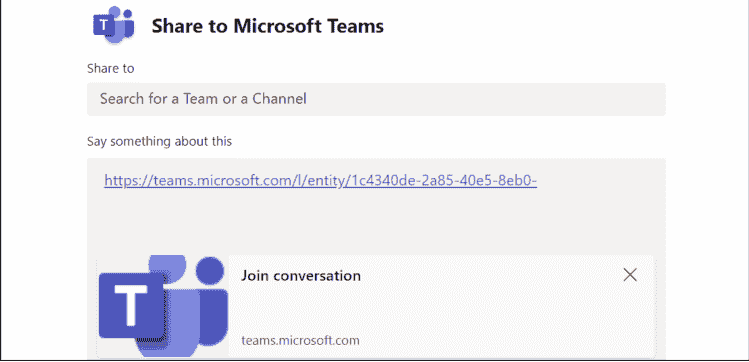
4. 单击 **Share** 按钮。
5. 包含指向 Power BI 内容的链接的帖子将被发布到所选团队和频道的 **发帖**选项卡。
   
   图 12.56： Power BI 报表链接共享到 Teams 发帖选项卡
6. 在 Teams 中，从导航窗格中选择省略号 (...) 并搜索 *Power BI*。
   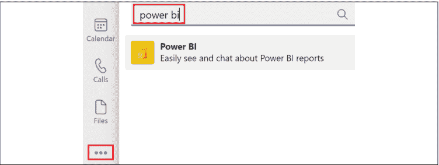
   图 12.57： 在 Teams 中添加 Power BI 应用
7. 选择 Power BI 应用，然后单击 **Add** 按钮。
