## 13 将 Power BI 与其他应用程序集成

Power BI 工具和服务包括 Power BI Desktop、Power BI Web 服务和 Power BI 移动应用程序本身就构成了现代、强大的商业智能和分析平台。Power BI Premium 进一步扩展了 Power BI 解决方案的可扩展性和部署选项，使组织能够通过 Power BI 服务中的应用、嵌入到自定义应用程序中、本地 Power BI 报表服务器或这些分发选项的组合，将 Power BI 内容交付给大量用户。

然而，许多组织要么已经在其他工具中拥有广泛的自助式和企业 BI 资产和技能，例如 Excel、Analysis Services（Azure Analysis Services（AAS）或 SQL Server Analysis Services（SSAS））和 SQL Server Reporting Services（SSRS），要么有兴趣将这些工具的独特功能作为其 Power BI 解决方案的一部分。例如，组织可能会选择保留许多现有的 Excel 报表在 Excel 中，而不是将它们转换为 Power BI 报表，因为 Excel 具有立方体公式等独特功能。同样，一些组织可能会继续使用现有的 AAS 资源用于语义模型，而不是在一段时间内将这些模型迁移到 Power BI Premium，因为这些模型存在重大的报表依赖关系。此外，鉴于 Power BI 数据集的许多附加功能和优势，拥有基于旧版 Excel 的数据模型（以前称为 Power Pivot）的组织可能会选择将这些资产迁移到 Power BI。

本章中的食谱重点介绍了 Power BI 与 SSRS、Analysis Services、Excel、PowerPoint、Power Apps 和 Power Automate 之间的强大集成点。在本章中，我们将介绍以下食谱：

- 集成 SSRS 和 Excel
- 从 Excel 的 Power Pivot 迁移到 Power BI
- 在 Excel 中访问和分析 Power BI 数据集
- 将 Power BI 报表构建到 PowerPoint 演示文稿中
- 连接到 Azure Analysis Services
- 与 Power Automate 和 Power Apps 集成
- 利用 Dataverse 和 Dynamics 365
- 连接 Dynamics 365 Finance and Operations 和 Power Platform

在本章结束时，您将对 Power BI 如何工作以及如何与其他 Microsoft 技术集成有坚实的理解。

### 技术要求

完成本章中的食谱需要以下内容：

- Power BI Desktop
- Excel
- Visual Studio
- 安装了 **AdventureWorksDW2019** 数据库的 SQL Server。此数据库及其安装说明可在以下位置获得： `http://bit.ly/2OVOfG7`
- 本章的文件可以从以下 GitHub 仓库下载：
  `https://github.com/PacktPublishing/Microsoft-Power-BI-Cookbook-Second-Edition`

### 集成 SSRS 和 Excel

Power BI Desktop 是发布到 Power BI 服务的内容以及嵌入到自定义应用程序中的 Power BI 报表可视化的主要报表创作工具。然而，对于许多组织而言，使用 SSRS 和 Excel 构建的现有或遗留报表工作负载的大部分必须维护。在许多情况下，现有的 SSRS 和 Excel 报表可以转换为现代 Power BI 报表和仪表板，但 Power BI 并不是这些其他工具所有功能和用例的完全替代品。除了通过 Power BI Premium 支持分页报表（即 SSRS 报表）和针对 Power BI 数据集构建的 Excel 报表的刷新外，Power BI 服务还提供进一步的方法将来自 Excel 和 SSRS 的内容集成到 Power BI。此外，鉴于 Power BI、Excel 的 Power Pivot 和 Analysis Services 的通用数据库引擎和 DAX 语言，BI 团队可以通过编写自定义 DAX 查询来完全控制在 SSRS 和 Excel 中呈现的报表。

本食谱包含两个从 SSRS 和 Excel 创作和发布内容到 Power BI 的示例。


## 准备工作

为准备本配方，请按以下步骤操作：

- 1. 如有必要，请下载、安装并配置 Microsoft SSRS：https://bit.ly/3yfdTjk。
- 2. 确保 SSRS 已配置为 Power BI 集成：

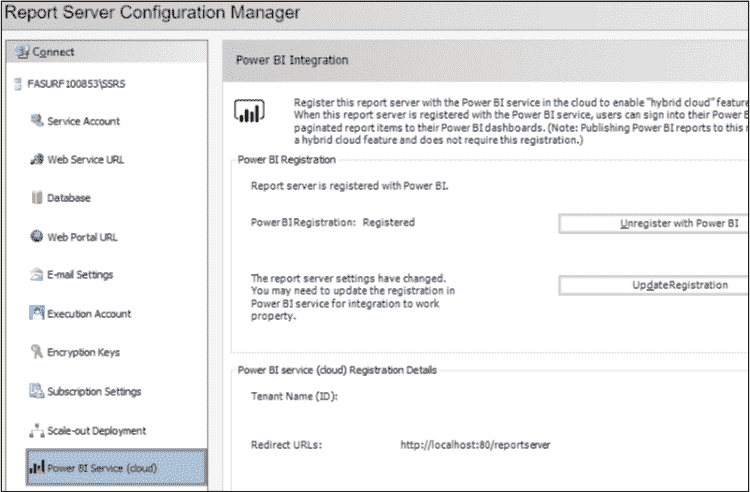

图 13.1：Report Server Configuration Manager—Power BI 集成
- 3. **Power BI Integration** 菜单项位于列表底部，并包含 Power BI 租户名称（ID）。您必须已配置 Web 服务 URL 和 Web 门户 URL 才能配置此设置。
- 4. 确保已安装 Visual Studio 并验证在 Visual Studio 中已安装 **SQL Server Data Tools**、**Workload for Data storage and processing** 以及 **Extension for Microsoft Reporting Services Projects**。在 Visual Studio 中根据需要安装适当的项目。要了解如何安装 Visual Studio，请使用此链接：https://bit.ly/389eozC。

您现在可以完成本配方的步骤。

## 如何操作...

要实现本配方，请执行以下操作：

- 1. 在 Power BI 服务中创建或识别一个用于托管报表内容的 workspace。
- 2. 创建或识别此 workspace 中将显示报表内容的工作区仪表板。
- 3. 在 Visual Studio 中创建新的 Report Server Project 或打开现有项目。
- 4. 将 AdventureWorksDW2019 数据库配置为项目的共享数据源：

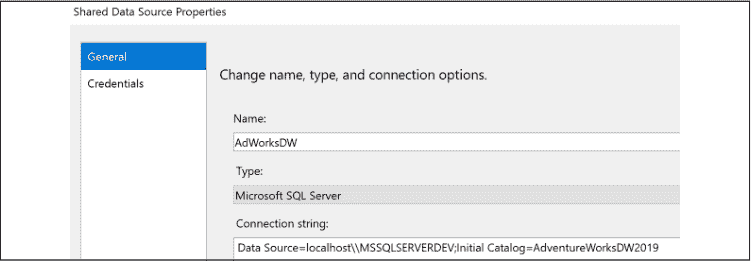

图 13.2：Report Server Project —SQL 数据库的共享数据源配置
- 5. 右键单击 Reports 文件夹并选择 Add New Report。
- 6. 右键单击 Data Sources 并选择 Add Data Source...
- 7. 选择 Shared data source 选项，选择步骤 4 中创建的共享数据源，然后按 Next> 按钮。
- 8. 构建自己的查询或使用以下查询：

```
SELECT
vProducts.ProductKey AS [vProducts ProductKey]
,vProducts.EnglishProductSubcategoryName
,vProducts.EnglishProductName
,vProducts.DaysToManufacture
,vProducts.Color
,FactInternetSales.ProductKey AS [FactInternetSales ProductKey]
,FactInternetSales.OrderQuantity
,FactInternetSales.UnitPrice
,FactInternetSales.DiscountAmount
,FactInternetSales.SalesAmount
,FactInternetSales.TaxAmt
,FactInternetSales.Freight
,vProducts.EnglishProductCategoryName
,FactInternetSales.OrderDate
FROM
    vProducts
    INNER JOIN FactInternetSales
        ON vProducts.ProductKey = FactInternetSales.ProductKey
```
- 9. 单击 **OK** 按钮退出 **Query Designer**，然后单击 **Next>** 按钮。
- 10. 选择 **Tabular** 并单击 **Next>** 按钮。
- 11. 单击 **Finish>>** 按钮。
- 12. 单击 **Finish** 按钮。
- 13. 删除中央设计面板（设计表面）中创建的表格。
- 14. 使用数据集创建用于固定的 SSRS 报表可视化对象。图表、仪表板、地图和图像可以从 SSRS 固定到 Power BI 仪表板。
- 15. 将 SSRS 报表部署到 SSRS 门户中的报表文件夹并确认其正确呈现：

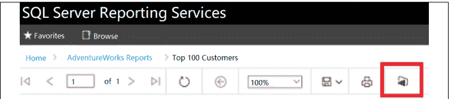

图 13.3：将 SSRS 报表可视化对象固定到 Power BI 仪表板
- 16. 单击 Power BI 图标，然后单击要固定的报表中的图表。
- 17. 选择 **Workspace**、**Dashboard** 和 **Frequency of updates**：

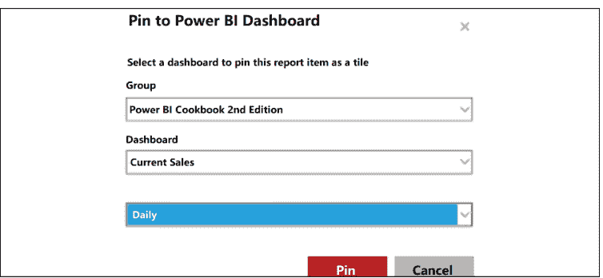

图 13.4：从 SSRS 固定到 Power BI
- 18. 单击 **Pin** 按钮。
- 19. 在 SSRS 门户中，单击齿轮图标并选择 **My subscriptions** 以确认 **Power BI Dashboard** 订阅：

| Edit | Report | Description | Status | Type | Folder | Delivery |
|---|---|---|---|---|---|---|
|  | Top 100 Customers |  | Enabled | Standard | /AdventureWorks Reports | Power BI Dashboard |

图 13.5：SSRS 中的我的订阅
- 20. 在 Power BI 服务中，调整仪表板磁贴的大小、位置，并可选择标题和副标题。
- 21. 单击仪表板磁贴以测试 URL 是否在 SSRS 门户中打开报表。设置链接在单独的选项卡中打开。

本配方现已完成。

## 其工作原理...

微软已明确表示 Power BI 和 SSRS 是为独特的 BI 工作负载和场景而设计的，组织可以选择最适合其特定项目的工具，以及在同一解决方案和整体 BI 部署中使用多个报表创作工具。Power BI 专为现代、交互式和丰富的数据探索体验而设计。

SSRS 现已包含在 Power BI Report Server 中，继续提供强大的企业报表功能，具有更新的分页报表对象，适用于操作性报表和分发功能，例如订阅。

在某些报表场景中，具有完全配置的页面和在 Visual Studio SSRS 项目中定义的报表布局的分页或“经典”报表是合适的。此外，对于只能在本地部署 BI 或某些 BI 内容（如高度敏感的报表）必须保留在本地的组织，Power BI Report Server 提供单一的本地解决方案和门户，可同时包含传统的 SSRS 报表以及可选的 Power BI 报表。最后，Power BI Premium 包含将 SSRS 分页报表部署到 Power BI 服务的功能。

在相对简单的表格报表文档需要跨组或团队分发或以 PDF 或 Excel 等特定文件格式提供时，操作性报表工作负载非常适合 SSRS。分页 SSRS 报表可以通过报表参数和图表提供基本的用户交互和数据可视化，但这并非其优势或核心用例。请注意，SSRS 还具有移动报表类型和 Microsoft SQL Server Mobile Report Publisher 中的移动报表创作工具。Power BI 支持个人用户对报表的电子邮件订阅，但 SSRS 支持基于订阅者信息（如东部地区或销售经理）将参数应用于报表的基于数据驱动的报表订阅。

未来对 Power BI 报表和仪表板订阅功能的改进，以及对表格和矩阵可视化的更大控制和 Power BI Premium 专属硬件，可能会使 Power BI 承担传统上由 SSRS 处理的更大份额的报表工作负载。

## 还有更多...

除了与 SSRS 构建集成外，微软还将另一款流行的 BI 工具 Excel 与 Power BI 集成。要演示 Excel 与 Power BI 的集成，请执行以下操作：

- 1. 确认 Excel 报表内容使用 Excel 数据模型作为其数据源。只有具有数据模型的工作簿才能在 Power BI 服务中配置为计划刷新。有关如何使用 Excel 数据模型构建 Excel 报表的详细信息，请使用此链接：https://bit.ly/3j9AY0B。
- 2. 识别 Excel 数据模型使用的数据源，并在必要时将其添加到本地数据网关。
- 3. 在 DAX Studio 中开发和测试 DAX 查询，以便在 Excel 中用作数据集和表。
- 4. 打开包含数据模型的 Excel 工作簿。
- 5. 从 Data 选项卡中，单击 Existing Connections 并选择用于加载数据模型的一个查询。选择其中一个较小的维度表查询，例如 Currency：

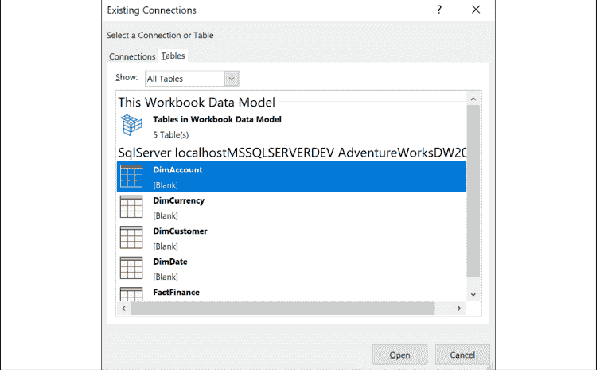
- 10. 按 **OK** 按钮。
- 11. 选择 **File**，然后从 Excel 功能区选择 **Publish**。
- 12. 在 **Publish** 对话框中，选择工作区然后单击 **Upload** 按钮：

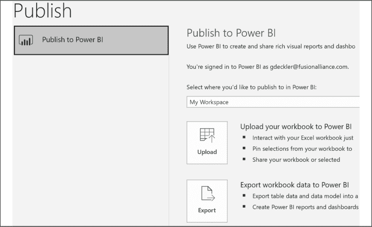

图 13.10：将 Excel 数据模型上传到 Power BI 工作区
- 13. 打开 Power BI 服务并导航到包含已发布 Excel 工作簿的工作区。
- 14. 从工作区的 **Workbooks** 菜单中，选择三个垂直点然后选择 **Schedule refresh**。
- 15. 将数据源与数据网关关联，单击 **Apply**，然后安排数据刷新：

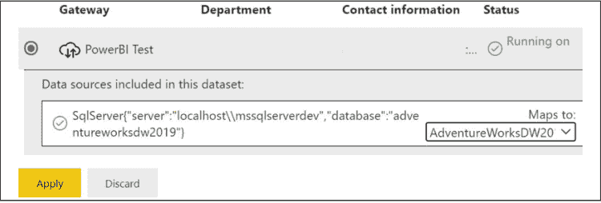

图 13.11：工作簿的网关配置
- 16. 选择工作簿以打开报表。选择整个表格然后单击 **Pin**。


在本简短的配方中，一个数据模型及其包含在 Excel 工作簿中的源 M 查询通过导入 Excel 工作簿到 Power BI Desktop 迁移功能迁移到 Power BI 数据集。有关导入的工作簿内容以及 Excel 到 Power BI 迁移的其他选项和注意事项的更多详细信息，请参阅 *How it works...* 和 *There's more...* 部分。

## Getting ready

分析 Excel 工作簿以识别可以导入到 Power BI Desktop 的组件。例如，Excel 工作表中的数据表或数据范围将不会被导入，但 Excel 数据模型中的表将被导入。同样，Excel 中的 Power View 报表工作表及其可视化效果将通过标准 Excel 图表迁移，数据透视表和工作表公式和格式将不会迁移。

在某些情况下，可能需要修改 Excel 工作簿以建立将被迁移的数据源连接和查询。此外，可能需要使用 Power BI Desktop 报表制作可视化效果重新创建 Excel 特定的报表可视化效果，例如数据透视表和图表。包含大量自定义内容（如 VBA 宏和复杂的 Excel 公式逻辑）的工作簿可能需要对 Excel 工作簿或 Power BI Desktop 模型进行大量修改，或两者结合，以支持迁移。

## How to do it...

要实现此配方，请执行以下操作：

- 1. 保存或下载最新的 Excel 工作簿
- 2. 打开一个新的 Power BI Desktop (PBIX) 文件
- 3. 从 **Report View**，点击 **File | Import | Power Query, Power Pivot, Power View**

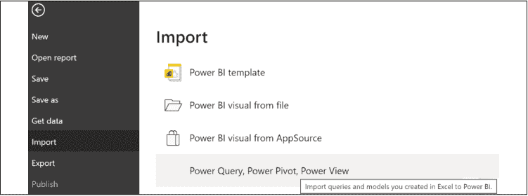

Figure 13.13: Import queries and models created in Excel to Power BI

- 4. 选择 Excel 文件并点击 **Open** 按钮

您的新 Power BI 数据集现在可在 Power BI 服务中使用。如果需要，您甚至可以针对此数据集创建新的实时连接报表。

## How it works...

迁移可能需要几分钟时间，具体取决于导入的数据模型的大小。Power BI Desktop 导入 M 查询、数据模型表、DAX 度量值和 KPI，以及任何用于 Excel 的 power view 工作表。

对于严重依赖不导入的项目（如 Excel 公式、标准 Excel 表（非模型表）、工作表范围数据、标准 Excel 图表和条件格式）的工作簿，可能需要在一定程度上继续支持。例如，可以将最少量的数据导入到 Excel 的数据模型中以继续驱动基于 Excel 的报表，并将此工作簿上传到 Power BI 服务并进行刷新。

Power BI 表和矩阵可视化效果包含 Excel 数据透视表最重要的功能，例如丰富的条件格式选项、在行上显示多个度量值、在行和列上钻取上下层级、控制小计可见性、分步或交错布局、行/列/总计百分比等。这些增强功能以及 Power BI 报表独有的强大交叉高亮显示功能，使得将大多数基于 Excel 数据透视表的报表迁移到 Power BI 成为可能且有利。

例如，如果 Power Pivot for Excel 工作簿包含多个数据透视表、数据透视图和标准 Excel 图表的工作表，则可以开发包含相同度量值和属性的新 Power BI 报表作为替代方案。将数据模型和报表完全迁移到 Power BI 后，可以将 Excel 工作簿从 Power BI 服务或任何刷新和分发流程中移除。

## There's more...

如果尽管迁移后仍需要某些 Excel 特定内容，可以将 Power Pivot for Excel 数据模型上传到同一工作区，并在 Power BI 服务中为此工作簿配置刷新计划。这可以通过从 Excel 功能区选择 File 然后选择 Publish 来完成。一旦文件发布到 Power BI 服务的工作区，Power Pivot 数据集将出现在工作区的数据集中，而 Excel 工作簿将出现在工作区的 Workbooks 中。

还可以通过在服务底部左侧使用 **Get Data** 链接，然后选择 **Files** 来将工作簿添加到 Power BI 服务：

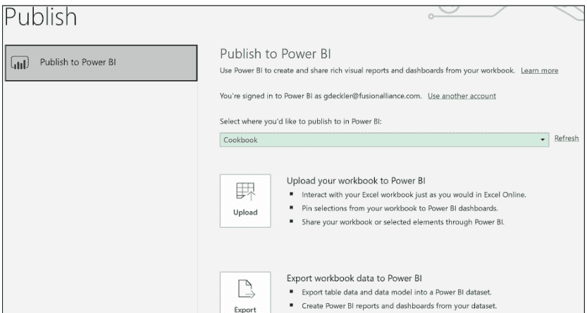

Figure 13.16: Publish Excel workbook with Data Model to Power BI—upload

Excel 中的 **Export** 选项等同于本配方中从 Power BI Desktop 导入迁移到 Power BI 的过程，只是新数据集已发布到 Power BI 服务的工作区中。然而，不推荐这种迁移方法，因为您将失去从 Power BI 服务下载创建的数据集 PBIX 文件的能力。按照本配方先导入到 Power BI Desktop，可保留此选项。

## See also

- - Import Excel workbooks into Power BI Desktop: https://bit.ly/3eI4gBG

## Accessing and Analyzing Power BI Datasets in Excel

通过在 Power BI 服务中托管的集中且可能已认证的 Power BI 数据集，拥有免费和专业版许可证的 Excel 用户可以充分利用 Excel 熟悉的界面以及高级功能和用例，例如立方体公式和自定义 DAX 查询。

尽管这些 Excel 报表与 SSRS 分页报表一样，只是 Power BI 服务中 Power BI 报表和仪表板的补充，但在具有自定义格式和许多度量值和列的记分卡布局中通常很有用。

在此场景中，经验丰富的 Excel 用户可以利用已发布 Power BI 数据集的性能、规模和自动刷新来创建自定义、完全格式化的 Excel 报表。此外，Excel 报表作者可以灵活地在数据集之上应用报表范围的逻辑，使用熟悉的技术，这些自定义可以为 BI 团队或数据集所有者提供现有差距或所需增强的信息。

本配方包含两个访问和分析 Power BI 数据集在 Excel 中的示例。第一个示例使用立方体公式和 Excel 切片器生成交互式模板报表。第二个示例将自定义 DAX 查询传递给 Power BI 数据集以支持 Excel 地图。有关 Excel 中立方体函数和新 Excel 可视化的更多详细信息包含在支持部分中。

## Getting ready

为准备本配方，请执行以下步骤：

- 1. 确保用户拥有 Power BI Pro 许可证。
- 2. 确认 Power BI Pro 用户有权访问包含 Power BI 报表和数据集的工作区。
- 3. 选择用于分析的报表。例如，如果您已完成 *Chapter 5, Working in the Service* 中的配方，**CH5_R1_CountryMonthlyReport** 是一个不错的选择。您可以从 GitHub 下载此报表的 PBIX 并将其发布到 Power BI 服务。

您现在可以完成本配方。

## How to do it…

要实现此配方，请执行以下操作：

- 1. 在 Power BI 服务中打开所选报表
- 2. 在报表的页眉/功能区中，选择 **Export** 然后选择 **Analyze in Excel**
- 3. 打开从 Power BI 服务下载的 Excel 文件

## Integrating Power BI with Other Applications

- 4. 点击数据透视表并从数据集中添加度量值和列：

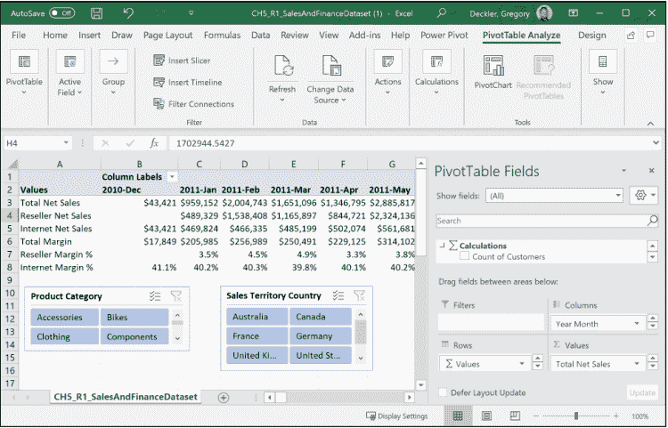

Figure 13.17: Excel Pivot Table with two Slicers based on the Power BI dataset

- 5. 在数据透视表中选择一个单元格
- 6. 从 **PivotTable Analyze** 选项卡中选择 **OLAP Tools** 下拉菜单并点击 **Convert to Formulas**：

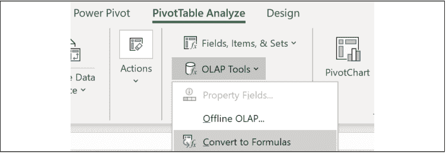

Figure 13.18: Convert to Formulas Option in the PivotTable Analyze Tab of Excel

## How it works...

数据透视表被转换为 Excel 公式，例如以下内容：

```
```excel
=CUBEVALUE("pbiazure://api.powerbi.com <id> Model",$A3,C$2, Slicer_Sales_Territory_Hierarchy)
```
```

在此示例中，工作簿单元格 **C3** 引用单元格 **A3** 中的 **Total Net Sales** 度量值和单元格 **C2** 中的 **2011-Jan** 维度值。请注意，两个 Excel 切片器可视化效果仍与每个 CUBEVALUE 公式单元格连接，因此可用于过滤报表。日历月份（例如 2011-Jan）被转换为对特定值进行硬编码引用的 CUBEMEMBER 函数。这些公式必须由 Excel 报表作者维护和/或更新：

```
```excel
=CUBEMEMBER("pbiazure://api.powerbi.com <id> Model","[Dates].[Year Month].&[2011-Jan]")
```
```

Excel 报表作者可以快速学习自定义立方体公式，例如应用不同的过滤器并支持报表更改，包括新的度量值（行）和属性值（列）。

CUBEVALUE 和 CUBEMEMBER 函数是最常见的立方体函数，但也可以使用其他函数，例如 CUBESETCOUNT。Excel 中的 **Formulas** 界面提供每个函数的参数信息。在更高级的场景中，可以为立方体公式分配 **Named Ranges**，并可选择性地为报表中的其他公式分配，然后作为参数传递到立方体公式中：

```
```excel
=CUBEMEMBER(strConn,"[PeriodStart].[Period Start].["&SPUser&"]")
```
```

在此示例中，strConn 是 Excel 中包含 Power BI 数据集数据连接名称的 **Named Range**。PeriodStart 是数据模型中一个断开连接且隐藏的 PeriodStart 表中的列，而 SPUser 是反映 Excel 中经典组合框窗体控件上业务用户选择的命名范围。单独的 CUBEVALUE 函数可以引用此 CUBEMEMBER 函数，以便用户在简单的 Excel 控件中的选择可以通过立方体函数传递到源数据集并在报表中反映。

## There's more...

一旦 Analyze in Excel 创建了 Power BI 数据集与 Excel 之间的连接，此连接可用于创建额外的报表元素。要了解如何操作，请执行以下操作：

- 1. 在本地打开的同一 Excel 工作簿中，创建一个 **New sheet**。
- 2. 从 **Data** 选项卡的功能区中选择 **Existing Connections**。


## 将 Power BI 与其他应用程序集成

- 3. 在 **现有连接** 对话框中，选择 Power BI 连接并选择 **打开** 按钮。
- 4. 在 **导入数据** 对话框中，选择 **数据透视表报表** 然后选择 **确定** 按钮。
- 5. 创建一个简单的数据透视表报表，包含一个度量值和一个属性，例如按 **产品类别** 的 **Internet Net Sales**。

    

    图 13.19：基于 Power BI 服务数据集的 Excel 数据透视表

- 6. 双击其中一个度量值单元格，例如 **$339,773** 以执行“下钻”查询。底层 **Internet Sales** 事实表的全部列将被检索，并按 **Clothing** 类别进行筛选。

    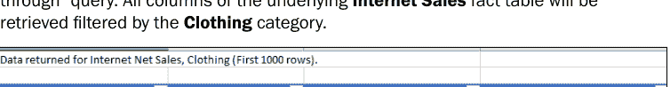

    图 13.20：下钻的 Excel 表结果

- 7. 在 Excel 表中选择一个单元格，右键单击并选择 **表格** 然后 **编辑查询**...

    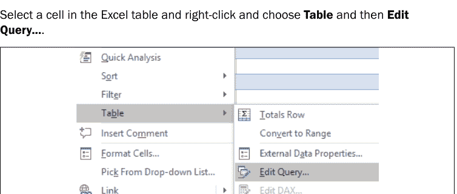

    图 13.21：Excel 表格选项

- 8. 在 **命令文本** 区域中，输入（或粘贴）自定义 DAX 查询并单击 **确定。**

    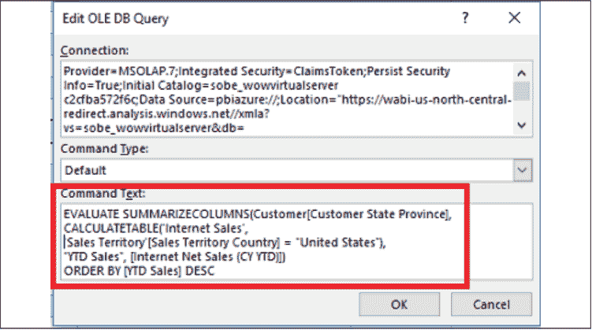

    图 13.22：从 DAX Studio 粘贴到编辑 OLE DB 查询对话框的命令文本区域中的 DAX 查询

- 9. 如果查询有效，Excel 表将更新以返回查询中指定的列。
- 10. 可视化对象，例如地图可视化对象，可以使用此表（DAX 查询）作为其数据源。

    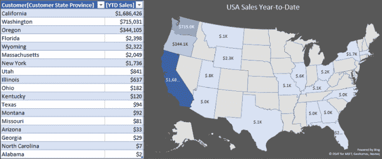

    图 13.23：DAX 查询的 Excel 表结果（左）和 Excel 地图可视化对象（右）

可在 **连接属性** 中的 **OLAP 下钻** 属性中调整要检索的行数。可视化对象上应用了自定义数据标签格式，以千为单位并保留一位小数表示值。请注意，默认数据透视表不能用作此可视化对象或其他多个新 Excel 可视化对象的源。

### 另请参阅

- Analyze in Excel: https://bit.ly/3bIMSeM
- CUBEVALUE function: https://bit.ly/3DfftUA
- CUBEMEMBER function: https://bit.ly/3AXr1Kq

## 将 Power BI 报表构建到 PowerPoint 演示文稿中

Microsoft PowerPoint 仍然是标准的幻灯片演示应用程序，而将外部工具中的数据分析和可视化集成到演示文稿中通常是有效演示文稿的重要组成部分。为响应大量客户请求，Power BI 服务支持将 Power BI 报表导出为 PowerPoint 文件的功能。Power BI 报告的每个页面都会转换为独立的 PowerPoint 幻灯片，并且 Power BI 服务会根据报表和相关元数据（例如最后刷新日期）创建标题页。存在一些当前限制，例如导出的文件是静态的以及支持的可视化对象，但该功能可供所有 Power BI 用户使用，以简化演示文稿幻灯片的创建。然而，更深层次的集成计划在未来实现，包括将动态 Power BI 报表嵌入到 PowerPoint 中的能力。

本食谱包含一个准备过程，以更好地利用导出到 PowerPoint 的功能并避免当前限制。此外，还描述了一个用户从已发布的应用程序导出 Power BI 报表并在 PowerPoint 中访问内容的示例过程。

### 准备就绪

为准备本食谱，请执行以下步骤：

- 1. 登录到 Power BI 服务。
- 2. 单击右上角的齿轮图标并选择 **管理门户**。
- 3. 单击 **租户设置**。
- 4. 在 **导出和共享** 下，在 Power BI 管理门户中启用 **导出报表为 PowerPoint 演示文稿或 PDF 文档** 功能：

    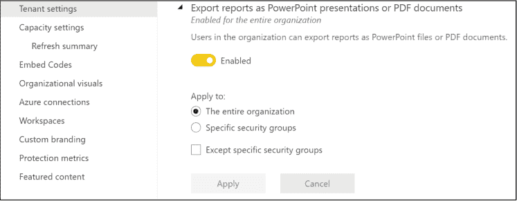

    *图 13.24：Power BI 管理门户中的租户设置*

    如前面的屏幕截图所示，Power BI 管理员或 Office 365 全局管理员还可以将该功能限制为特定的安全组。

- 5. 确定将作为要创建的 PowerPoint 的来源的 Power BI 报表及其数据集。
- 6. 如果报表包含多个页面，请统计报表页面的数量。目前超过 15 页的报表无法导出。
- 7. 确定报表中是否有任何不受支持的可视化对象，包括 R 可视化对象和未通过认证的自定义可视化对象。
- 8. 检查报表可视化对象中是否使用了任何背景图像或是否设置了任何自定义页面大小。最好避免使用背景图像和自定义页面大小。
- 9. 根据之前的步骤和导出的初始测试，对现有报表进行修订或创建单独的报表（以当前报表为起点），该报表将专门用于 PowerPoint。

现在您可以完成本食谱的步骤。

### 如何操作...

要实施本食谱，请执行以下操作：

- 1. 在 Power BI 服务中打开报表。
- 2. 从报表标题中选择导出，然后选择 PowerPoint。

    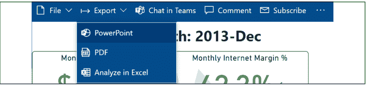

    图 13.25：导出到 PowerPoint

- 3. 导出对话框提供选项，单击导出按钮。

    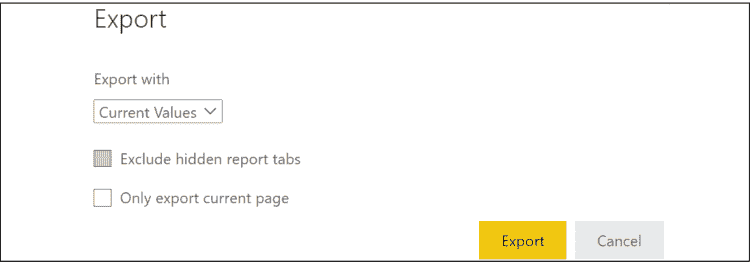

    图 13.26：PowerPoint 的导出选项

- 4. 消息将指示导出正在进行中，可能需要几分钟。
- 5. 打开 PowerPoint 文件并在 PowerPoint 中根据需要进行额外调整。

    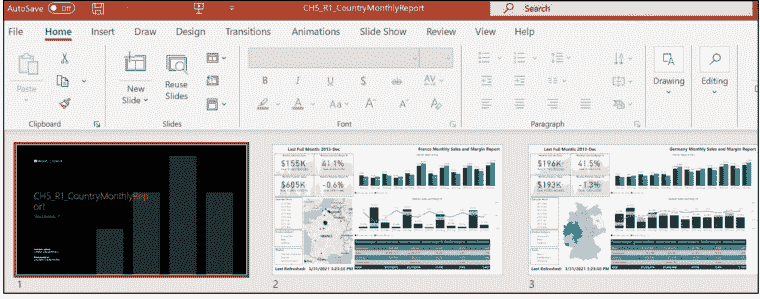

    图 13.27：Microsoft PowerPoint 幻灯片排序视图中的已导出 Power BI 报表

正如您所见，导出到 PowerPoint 非常容易！

### 其工作原理...

根据浏览器及其下载设置，文件将下载到特定路径，或浏览器会显示保存或打开 PowerPoint 文件的消息。导出过程会自动生成标题页，其中包含报表名称和指向 Power BI 服务中报表的链接。标题页还包括最后数据刷新和下载日期时间值。每个报表页面都会转换为包含报表页面高质量渲染图像的幻灯片。针对可视化对象指定的任何替代文本都包含在每个页面的备注中。

与执行仪表板等高可见性内容的其他规划和预防措施类似，了解和确信数据源、刷新过程、数据质量和所有权非常重要。例如，如果源数据集从多个来源检索，包括临时 Excel 文件，并且刷新失败的历史记录，则该报表可能不是 PowerPoint 演示文稿的良好候选者。基于已验证的 IT 管理的 Analysis Services 模型并且拥有明确所有者的报表将是更好的选择。

背景图像将被图表的边界区域裁剪，因此建议删除或避免背景图像。此外，导出的报表页面始终会生成标准 16:9 PowerPoint 幻灯片大小，因此应避免自定义或非标准页面大小。用于提供自定义分组、边框和可视化对象背景色的形状（例如矩形和线条）也可能需要删除以实现正确的 PowerPoint 渲染。最后，在使用导出到 PowerPoint 的报表中应避免使用未认证的可视化对象、R 可视化对象和 Python 可视化对象。

### 更多内容...

Power BI 服务支持通过 Power BI REST API 将报表导出为 PowerPoint 或 PDF 以及图像文件。此外，分页报表还可以导出为以下其他格式：

- MHTML
- Microsoft Word
- XML

AppSource 中提供了一个第三方加载项，用于将 Power BI 服务中的 Power BI 瓷砖集成到 Microsoft Office 文档中，名为 Power BI Tiles：https://bit.ly/3w2sUmq。DevScope 的产品包括自动化的 Office 到 Power BI 刷新流程，并支持 Word、Outlook 和 PowerPoint。


## 将 Power BI 与其他应用程序集成

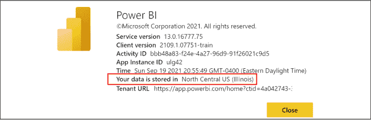

请注意，租户可以被视为公寓楼中的一间公寓。Microsoft Azure 中的 Power BI 服务类似于大楼，提供基础、管道和其他公共设施。然而，Power BI 服务中的每个居民都有自己的私人生活区域（租户）。

3. 登录 Microsoft Azure 门户，https://portal.azure.com。
4. 选择 **创建资源**。
5. 搜索 **Analysis Services** 并选择 **创建**。
6. 通过填写必填字段创建 Azure Analysis Services 服务器：

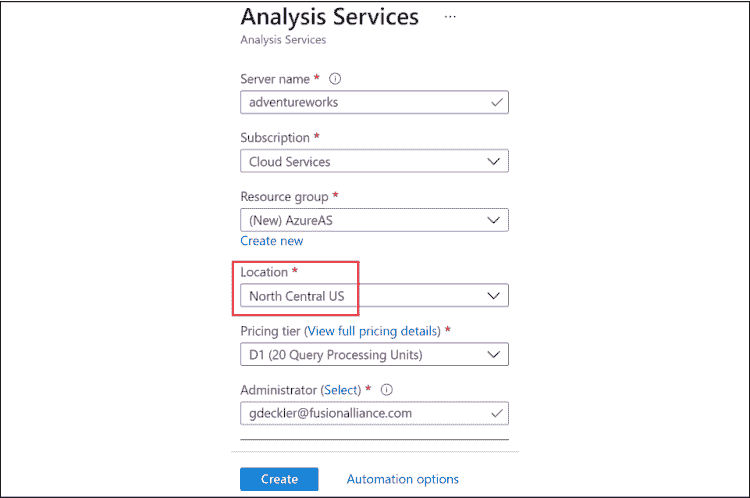

为了获得最小的延迟，所选位置应与 *准备工作* 中 Power BI 租户的位置相匹配。需要标准或开发层 Azure Analysis Services 实例才能从 Power BI Desktop 导入。

7. 点击 **创建** 并等待服务器在 Azure 门户中可见（通常不到一分钟）。
8. 导航到 **Analysis Services** 资源并打开该实例。
9. 在 **模型** 下，选择 **管理**。
10. 选择 **新建模型**，选择 **示例数据**，然后点击 **添加** 按钮。

一个新的名为 **adventureworks** 的模型将被添加到你的 Analysis Services 实例中。

### 如何操作...

要实现此配方，请执行以下操作：

1. 在 Analysis Services 资源打开的情况下，点击 **概述** 并获取 **服务器名称**。


2. 如果服务器上有多个模型，请确认模型名称并选择要连接到的透视（可选）。Azure 门户中也会列出 AAS 服务器上的所有模型。
3. 打开一个新的 Power BI Desktop 文件，点击 **获取数据**，并选择 **Analysis Services**。
4. 输入或粘贴服务器名称和数据库（模型名称），然后按 **确定** 按钮：

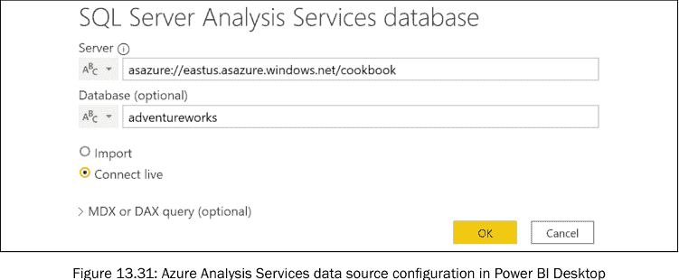

5. 使用 **Microsoft 账户** 进行身份验证。
6. 创建 Power BI 报表并将其发布到 Power BI 服务中的工作区。

正如你所见，连接到 Analysis Services 数据库非常简单直接。

### 其工作原理...

**实时连接** 是默认选项，并且这应该代表绝大多数如果不是全部连接，因为数据已经导入到（或在 SSAS DirectQuery 模型的情况下从中连接）Azure Analysis Services 数据库。导入数据到 Power BI Desktop 将需要其自己的刷新过程，但在某些罕见场景中，DAX 查询可以从 AAS 数据库中检索，然后选择性地将此数据与其他数据源在 Power BI Desktop 中合并或集成。

就像 Power BI Desktop 报表与 Power BI 服务中数据集的实时连接一样，报表作者也可以为与 Analysis Services 的实时连接创建特定于给定报表的 DAX 度量。此功能使熟悉 DAX 的报表作者能够满足报表独特的指标需求。如果相同的报表级度量在多个报表中被重复创建，负责 Analysis Services 模型的 BI/IT 团队可以考虑将此逻辑实现到模型中。

Azure Analysis Services 实例按小时计费，根据 **QPUs（查询处理单元）** 和内存计费。一个虚拟核心大约等于 20 QPUs。例如，S4 实例拥有 400 QPUs，大约有 20 个虚拟核心和 100 GB RAM：

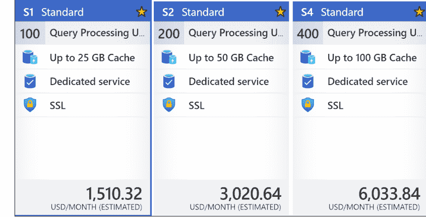

图 13.32：Azure Analysis Services 实例定价

Azure Analysis Services 服务器可以暂停，并且在服务器暂停期间不会产生费用。此外，服务器的定价层可以上下移动服务层，例如从 S1 到 S3 或反之亦然。服务器也可以从较低的服务层升级，例如从开发版到标准版，但服务器不能从较高的服务层降级。

### 还有更多...

鉴于 Power BI 和 Analysis Services Tabular 共享相同的数据库引擎，并且由于 Azure Analysis Services 消除了通过本地数据网关在 Power BI 服务与本地服务器之间通信的查询延迟和基础设施成本，组织可以考虑将 Power BI 和 SSAS 模型迁移到 Azure Analysis Services。作为一个示例，模型的源数据如 Teradata 可以保留在本地，但模型表和表分区的计划或触发刷新过程将通过本地数据网关更新 Azure 主持的模型。除了 Azure Analysis Services 平台即服务（PaaS）提供的其他成本和灵活性优势之外，Power BI Premium 容量可以使所有业务用户访问构建在 Azure Analysis Services 模型之上的 Power BI 报表和仪表板。一旦迁移到 Azure Analysis Services，表格模型可以作为 Power BI 报表的源进行访问。

### 另请参阅

- Azure Analysis Services: https://azure.microsoft.com/en-us/services/analysis-services/
- 连接到 Azure Analysis Services 的客户端库: http://bit.ly/2vzLAv0

### 与 Power Automate 和 Power Apps 集成

Power BI 的工具和服务旨在从数据中得出意义和洞察力，并使这些洞察力可供他人访问。虽然这两种功能都很重要，但 Power BI 本身并不打算对分析可视化的数据采取行动或执行业务决策。此外，信息工作者经常与许多应用程序或服务交互，因此，为了保持生产力，需要在 Power BI 与这些应用程序之间自动化工作流并嵌入逻辑，以简化业务流程。Power Apps 和 Power Automate 都是 Microsoft 365 应用程序，是与 Power BI 一起构成业务应用程序平台的一部分，通过使业务用户能够创建自定义业务应用程序和工作流流程来满足这些需求。

在本配方中，创建了一个 Power Automate 工作流来支持 Power BI 服务中的流式数据集。具体来说，Power Automate 工作流被配置为每两分钟从本地 SQL Server 表中读取，并将此数据推送到 Power BI，以提供接近实时的可见性并支持数据驱动的警报和通知。

### 准备工作

为准备此配方，请执行以下步骤：

1. 打开 **SQL Server Management Studio (SSMS)**，连接到包含 **AdventureWorksDW2019** 数据库的本地 SQL 数据库，并熟悉 **dbo.FactSurveyResponse** 表的 **列**：

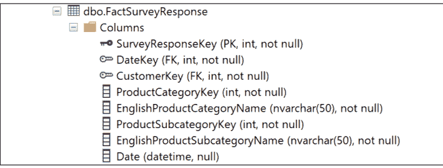

2. 确保你有一个与 Power Automate 兼容的数据网关正在运行。有关安装说明，请参阅 *第 1 章，配置 Power BI 工具*。

在本配方中，使用本地数据网关通过 Power Automate 从本地 SQL Server 数据库表支持 Power BI 流式数据集。根据先前章节，支持 Power BI 刷新过程和实时连接或 DirectQuery 模型的同一网关也可以用于 Power Apps 和 Power Automate。根据这些不同活动和应用程序产生的负载，以及基于网关资源监控，可能有必要将 Power Apps 和 Power Automate 隔离到专用的本地网关，或在未来向高可用性网关集群添加服务器。

### 如何操作...

要实现此配方，请执行以下操作：

1. 在 Power BI 服务中打开一个工作区，并在顶部菜单栏中点击 **新建** 按钮。

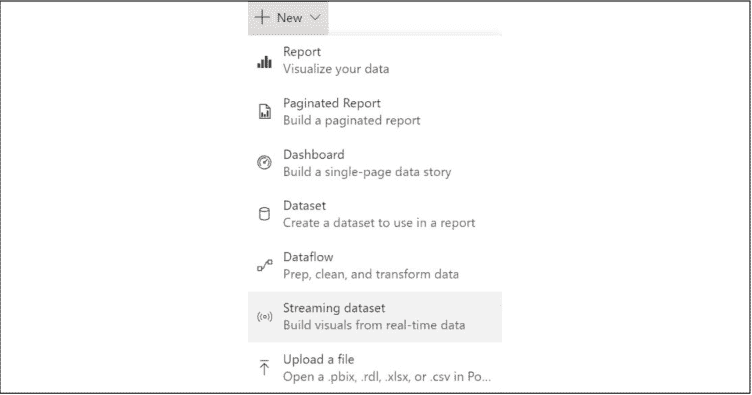

图 13.34：Power BI 服务中工作区的新建选项

2. 选择 **流式数据集**，点击 **API** 图标，然后点击 **下一步** 按钮。
3. 配置流式数据集以与 **FactSurveyResponse** 表的列和数据类型保持一致。

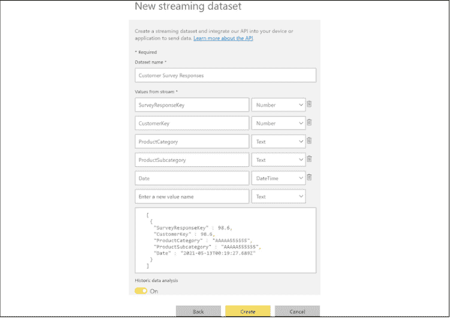

图 13.35：流式数据集配置


+   4. 输入**数据集名称**，启用**历史数据分析**设置，并单击**创建按钮**。
+   5. 复制**推送 URL** 值，并单击**完成按钮**。
+   6. 登录 Microsoft 365 中的 Power Automate：https://flow.microsoft.com。
+   7. 在左侧导航窗格中，单击**创建**。
+   8. 在**从空白开始**区域中，单击**计划云流**。
+   9. 提供**流名称**，将工作流设置为**每 5 分钟重复一次**，然后点击**创建按钮**。

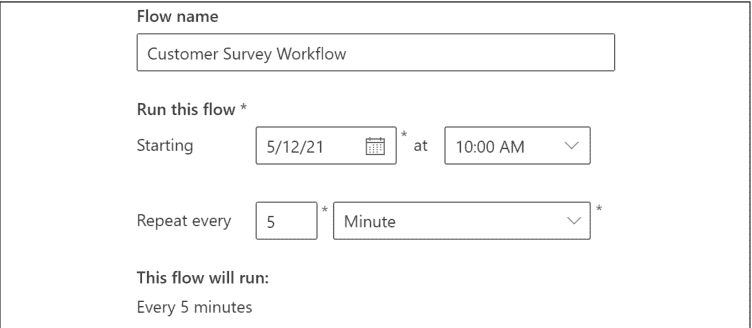

图 13.36：创建 Power Automate 工作流

+   10. 在设计屏幕上，单击**新建步骤**。
+   11. 搜索 SQL Server，然后在**操作**中选择**获取行 (V2)**。


图 13.37：Power Automate 中的 SQL Server 获取行操作

12. 输入 SQL Server 的连接信息，然后点击**创建按钮**。为了让网关出现，连接信息必须与网关上配置的数据源匹配。

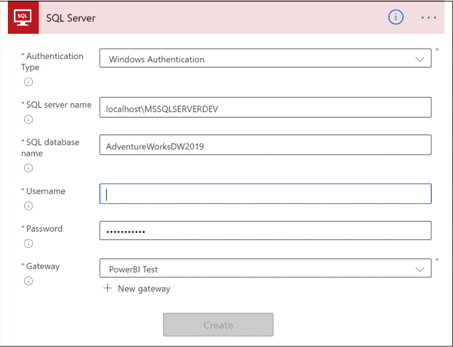

图 13.38：Power Automate 中的 SQL Server 连接信息

13. 配置**获取行 (V2)** 步骤：

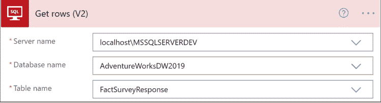

图 13.39：在 Power Automate 中配置 SQL Server 获取行 (V2) 步骤

+   14. 单击**新建步骤**按钮。
+   15. 搜索 **Power BI**，并选择**向数据集添加行（预览）**。
+   16. 为之前创建的**工作区**和**数据集**配置**向数据集添加行（预览）**步骤。

17. 选择 **RealTimeData** 作为**表**，并配置数据集的列。

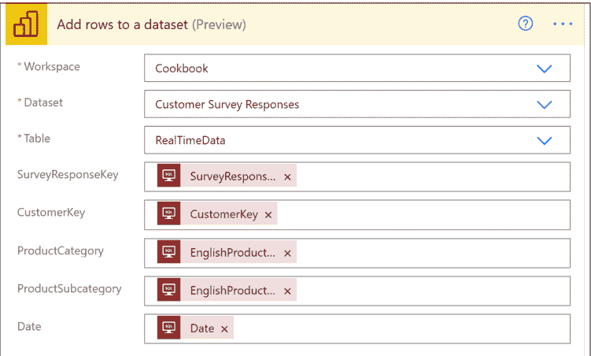

18. 完成后，单击**保存**按钮。

19. 单击**我的流**，然后**运行**工作流。

20. 单击**流运行页面**链接并等待流完成，以监视流。

21. 打开一个新的 Power BI Desktop 文件。

22. 单击**获取数据**，然后选择 **Power BI 数据集**。

23. 选择 **Customer Survey Responses** 数据集，并单击**创建按钮**。

24. 创建一个对数据集中的行进行计数的简单视觉对象。

在生产场景中，需要修改此方案，使 Power Automate 流的每次运行不会重复 Power BI 数据集中已有的行。

## 工作原理...

在 Power BI 服务中为流式数据集启用历史数据分析后，创建的数据集既是流式数据集，也是推送数据集。作为推送数据集，会在 Power BI 服务中为该数据集创建数据库和表，从而允许基于此表创建 Power BI 报表视觉对象和功能。如果未启用历史数据分析（默认情况），则数据集仅为流式数据集。Power BI 会临时缓存数据，但没有底层数据库，因此可视化这些数据的唯一方法是通过实时流式仪表板磁贴。

Power Automate 流在概念上类似于 **SQL Server 集成服务 (SSIS)** 包的控制流界面。可以通过分支条件、作用域和循环结构向 Power Automate 工作流添加复杂逻辑。Power Automate 专为自助服务场景和业务高级用户设计。Power Automate 利用 Azure Logic Apps，这是一项基于云的集成服务，更面向开发人员和企业集成场景。

流的运行历史记录（包括成功和失败的执行）可通过单击 Power Automate 网站**我的流**区域中的流名称来查看。此外，特定于给定流的**我的流**页面允许添加所有者、查看连接、编辑流和关闭流。

## 更多内容...

除了 Power Automate，Power Apps 也与 Power BI 集成。要了解此集成的工作方式，请执行以下步骤：

+   1. 登录 Microsoft 365 中的 Power Apps：https://powerapps.microsoft.com
+   2. 在左侧导航窗格中展开**数据**
+   3. 选择**表**
+   4. 选择**数据**下拉菜单，选择**获取数据**，然后再次选择**获取数据**

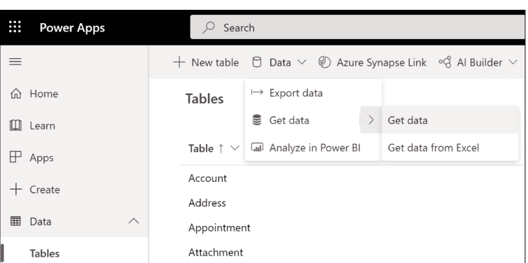

图 13.41：获取数据

+   5. 选择 **Power Platform 数据流**
+   6. 对于**连接**，选择**新建连接**并进行身份验证
+   7. 单击**下一步**按钮

8. 从数据流中选择一个表，并单击**下一步**

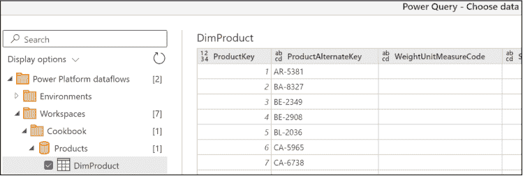

图 13.42：选择数据流表

9. 单击**下一步**按钮

10. 选择**加载到新表**，并单击**下一步**按钮

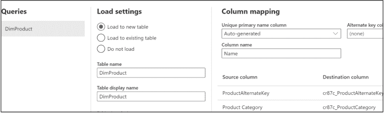

图 13.43：加载为新表

11. 选择手动刷新还是自动刷新，并单击**发布**按钮

12. 返回**表**屏幕，在左侧导航窗格中单击**创建**

13. 选择**从空白画布应用**

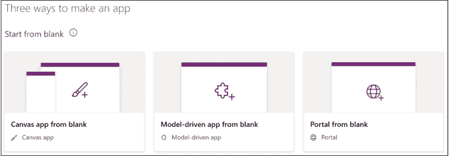

图 13.44：创建 Power Apps 应用的三种方式

## 将 Power BI 与其他应用程序集成

+   14. 提供**应用名称**，然后点击**创建**按钮

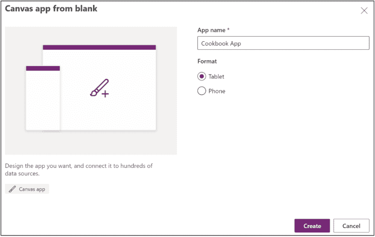

+   15. 选择**插入**菜单选项
+   16. 单击**图表**下拉菜单，并选择 **Power BI 磁贴**

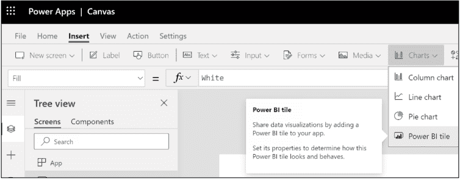

17. 从 Power BI 服务中选择**工作区**、**仪表板**和**磁贴**

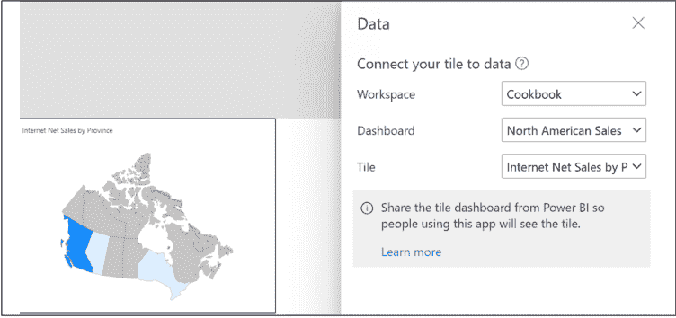

图 13.47：选择仪表板磁贴

18. 从**主页**菜单中，选择**新建屏幕**，然后选择**列表**

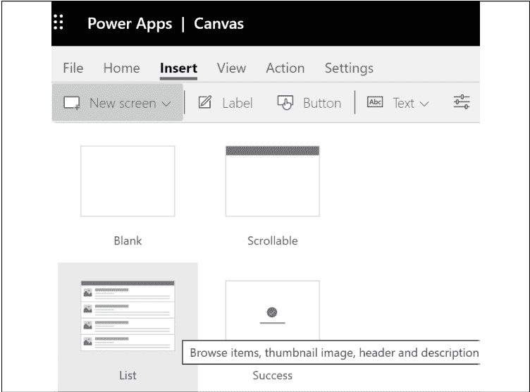

图 13.48：创建新的列表屏幕

+   19. 选择一个列表项，并编辑**数据**源以选择之前创建的表（在本例中为 **DimProduct**）
+   20. 对于**字段**，选择**编辑**，并将 **Title2** 更改为**产品名称**
+   21. 保存应用

## 另请参阅

- 将 Power BI 数据警报与 Power Automate 集成：https://bit.ly/3tHLv5R
- 宣布适用于 Power BI 的新 Power Automate 视觉对象：https://bit.ly/3vY9C1J
- 使用 Power Automate 导出报表并通过电子邮件发送：https://bit.ly/3fc8eBT
- Power Apps 和 Power BI 终于齐聚一堂：https://bit.ly/2QbQHkC
- 适用于 Power BI 的 Power Apps 视觉对象：https://bit.ly/3yg5a0n

## 利用 Dataverse 和 Dynamics 365

Microsoft Power Platform 包含 Dataverse，即以前所称的 **Common Data Service (CDS)**。Dataverse 在云中安全地存储业务数据，并允许你管理业务应用使用的数据。Dataverse 以表的形式存储数据，包含适用于常见场景的基础表，也允许创建新的自定义表。Dynamics 365 应用（如 Dynamics 365 Sales、Dynamics 365 Talent 和 Dynamics 365 Customer Service）将数据原生存储在 Dataverse 中；此外，还可以使用 Power Apps 基于这些核心数据构建应用，而无需集成。最后，Dynamics 365 Business Central 和 Dynamics 365 Finance and Operations 也与 Dataverse 进行了原生集成。

本方案演示如何将 Power BI 与 Dataverse 和 Dynamics 365 结合使用。

## 准备就绪

要准备本方案，请执行以下步骤：

+   1. 如果尚未完成，请在数据网关中配置到 **AdventureWorksDW2019** 数据库的连接。有关详细信息，请参阅*第 12 章“部署和分发 Power BI 内容”*。
+   2. 打开 Web 浏览器，转到 https://admin.powerplatform.microsoft.com，并使用你的 Microsoft 365 帐户登录。这是 Power Platform 管理中心。
+   3. 在左侧导航窗格中，单击**环境**。

+   4. 在功能区区域，单击**+ 新建**。这将在页面右侧打开**新环境**窗格。

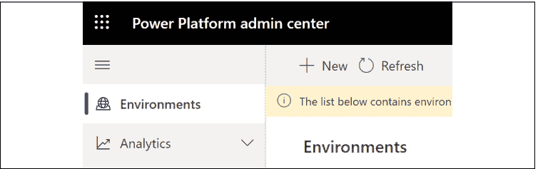

图 13.49：Power Platform 管理中心

+   5. 在**新环境**窗格中，输入环境的**名称**，选择**类型**（**生产**、**沙盒**或**试用**），并选择**区域**。此外，将**为此环境创建数据库**切换为**是**，然后点击窗格底部的**下一步**按钮。
+   6. 选择**语言**和**币种**。如果需要，提供**URL**。
+   7. 将**启用 Dynamics 365 应用**切换为**是**。
+   8. 点击**自动部署这些应用**的下拉菜单，并勾选所有复选框。
+   9. 点击窗格底部的**保存**按钮。
+   10. 单击该环境并记下**环境 URL**。

现在，你已经准备好完成此方案。

## 操作步骤...

要实现本方案，请执行以下步骤：

+   1. 导航到 https://powerapps.com，并切换到在*准备就绪*中创建的新环境。当前环境位于右上角。
+   2. 在左侧导航中，展开**数据**并单击**数据流**。
+   3. 单击**创建数据流**按钮，并选择**从空白开始**。
+   4. 为你的数据流提供**名称**，例如 **Customers**，并单击**创建**按钮。
+   5. 选择 **SQL Server 数据库**。
+   6. 输入本地 **AdventureWorksDW2019** 数据库的连接信息。


7. 从下拉列表中为 **本地数据网关** 选择你的网关。
8. 输入你的身份验证信息并单击 **Next** 按钮。
9. 选择 **DimCustomer** 表并单击 **Transform data** 按钮。
10. 展开 **DimGeography** 列以显示以下列，并取消选中 **Use original column name as prefix**：
    - ☐ City
    - ☐ StateProvinceName
    - ☐ EnglishCountryRegionName
    - ☐ PostalCode
11. 单击 **Next** 按钮。
12. 选择 **Load to existing table** 并选择 **Contact** 作为 **Table display name**。
13. 创建以下映射：
    - ☐ City = Address1_City
    - ☐ EnglishCountryRegionName = Address1_Country
    - ☐ AddressLine1 = Address1_Line1
    - ☐ AddressLine2 = Address1_Line2
    - ☐ PostalCode = Address1_PostalCode
    - ☐ StateProvinceName = Address1_StateOrProvince
    - ☐ Phone = Address1_Telephone1
    - ☐ YearlyIncome = AnnualIncome
    - ☐ BirthDate = BirthDate
    - ☐ FirstName = FirstName
    - ☐ Title = JobTitle
    - ☐ LastName = LastName
    - ☐ TotalChildren = NumberOfChildren
    - ☐ Phone = Telephone1
14. 将所有其他列设置为 **(none)**，然后单击 **Next** 按钮。
15. 保留 **Refresh manually** 的默认值并单击 **Create** 按钮。
16. 刷新将自动开始，请等待刷新完成。
17. 创建一个新的 Power BI Desktop 文件。
18. 选择 **Get data** 然后选择 **Dataverse**。
19. 输入来自 *Getting started 的第 10 步* 的 **Environment URL**。
20. 登录并单击 **Connect** 按钮。
21. 在 **Navigator** 中选择 **Contact** 并单击 **Load** 按钮。
22. 创建一个简单的报表视觉对象以显示加载到 **Dataverse** 环境中的联系人：


图 13.50：Dataverse 环境中的客户

*图 13.50* 显示了加载到 Dataverse 的客户位置。

### How it works…

Power Apps 数据流使用与 Power BI 相同的 Power Query 技术。这些数据流可以从许多不同的源摄取数据，包括通过数据网关的本地源以及基于云的源。一旦数据导入 Dataverse，此数据可以通过导入或 DirectQuery 由 Power BI 访问。

重要的是要指出，Power Apps 和 Power Automate 也可以原生访问存储在 Dataverse 环境中的数据。

### There's more…

除了 Dataverse 之外，Power BI 还与 Dynamics 365 应用程序具有原生集成，允许 Power BI 仪表板在 Dynamics 365 应用程序内显示。为演示此功能，请执行以下操作：

1. 打开 Power Platform 管理中心，`https://admin.powerplatform.microsoft.com`
2. 在左侧导航窗格中，单击 **Environments**
3. 单击在此食谱中创建的环境
4. 单击 **Environment URL** 的链接以打开环境
5. 选择右上角的齿轮图标并选择 **Advanced Settings**
6. 从左上角的 **Settings** 下拉菜单中选择 **Administration:**

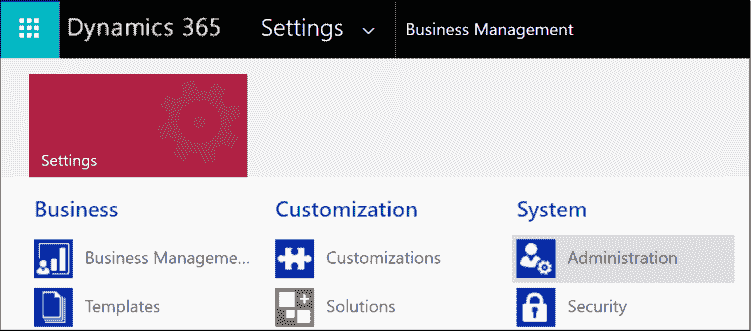

图 13.51：Dynamics 365 设置

7. 选择 **System Settings**
8. 单击 **Reporting** 选项卡并将 **Allow Power BI visualization embedding** 设置为 **Yes**
9. 单击 **OK** 按钮
10. 打开环境的 Sales Hub 应用并单击 **Dashboards**
11. 选择 **New** 然后选择 **Power BI Dashboard**
12. 如有必要，登录到 Power BI
13. 选择一个 **Workspace** 和一个 **Dashboard** 并单击 **Save** 按钮
14. 选择 New 然后选择 **Dynamics 365 Dashboard**
15. 选择一个布局然后单击 **Create** 按钮
16. 单击 **Add a Power BI tile to the dashboard** 图标：


图 13.52：Dynamics 365 中添加到仪表板的 Power BI 磁贴图标

17. 选择一个 **Workspace**、一个 **Dashboard** 和一个 **Tile** 然后单击 **OK** 按钮
18. 为仪表板提供一个 **Name** 并单击 **Save** 然后单击 **Close**

Power BI 仪表板和磁贴继续表现出对其底层报表的链接行为。单击报表磁贴会打开底层报表，并且该报表是交互式的，这意味着单击视觉对象会交叉筛选报表中的其他视觉对象，就像在 Power BI 服务中查看报表一样。

### See also

- Administer Power Platform: https://bit.ly/3bqaKTQ
- Create and use dataflows in Power Apps: https://bit.ly/3eP6tLL

## Connecting Dynamics 365 Finance and Operations and the Power Platform

Power BI 是 Microsoft Power Platform 产品系列的一部分。Power Platform 包括 Power BI、Power Apps、Power Automate 和 Power Virtual Agents。然而，Power Platform 也是一个更大产品系列的一部分，即 Microsoft Business Applications。Microsoft Business Applications 是围绕 Dynamics 365 Sales、Dynamics 365 Business Central 和 Dynamics 365 Finance and Operations 构建的应用程序。Microsoft 实际上将 Business Applications 细分为以下几类：

- Microsoft Power Platform
- Customer Service
- Field Service
- Finance
- Marketing
- Operations
- Commerce
- Human Resources
- Sales

然而，需要注意的是，Customer Service、Field Service、Marketing、Commerce、Human Resources 和 Sales 都是围绕 Microsoft **客户关系管理 (CRM)** 系统构建的，该系统以前称为 Microsoft CRM。可扩展的 Microsoft CRM 系统，有时称为 XRM，实际上是 Dataverse 的核心。Finance and Operations 应用程序指的是 **企业资源规划 (ERP)** 应用程序，即 Dynamics 365 Finance and Operations 或 Dynamics 365 Business Central。请注意，Dynamics 365 Finance and Operations 是基于 Dynamics **AX (Axapta)** 构建的，而 Dynamics 365 Business Central 是基于 Dynamics **NAV (Navision)** 构建的。Dynamics **GP (Great Plains)** 并未过渡到云端。

## Integrating Power BI with Other Applications

Power Platform 管理中心提供了一个中央位置，用于集成 Microsoft Business Applications 组合中的各种产品。这还包括强大的数据集成功能，允许管理员将来自许多不同环境的数据集成到 Dataverse 环境中。与数据流类似，这些数据集成项目促进了数据管理策略和业务信息流的集中控制。

本食谱演示如何使用 Power Platform 管理中心创建数据集成项目，将 Dynamics 365 Finance and Operations 数据与 Dataverse 环境同步，然后从该数据构建 Power BI 报表。

### Getting ready

为准备本食谱，请执行以下步骤：

1. 打开 Web 浏览器，前往 `https://admin.powerplatform.microsoft.com`，并使用你的 Microsoft 365 帐户登录。这是 Power Platform 管理中心。
2. 在左侧导航窗格中，单击 **Environments**。
3. 在功能区区域中，单击 **+ New**。这将在页面右侧打开一个 **New environment** 窗格。
4. 在 **New environment** 窗格中，输入环境的 **Name**，选择 **Type**（**Production、Sandbox** 或 **Trial** 之一），并选择一个 **Region**。此外，将 **Create a database for this environment** 切换为 **Yes** 并单击窗格底部的 **Next** 按钮。
5. 选择 **Language** 和 **Currency**。如有需要提供 **URL**。
6. 将 **Enable Dynamics 365 apps** 切换为 **Yes**。
7. 单击 **Automatically deploy these apps** 的下拉菜单并选中所有复选框。
8. 单击窗格底部的 **Save** 按钮。
9. 单击环境并记下 **Environment URL**。
10. 单击 **Environment URL** 以打开环境。
11. 单击右上角的齿轮图标并选择 **Advanced Settings**。
12. 单击 **Settings** 然后单击 **Security**。
13. 选择 **Teams**。
14. 选中默认团队旁边的复选框并选择 **MANAGE ROLES**。
15. 选中 **System Administrator** 的复选框并单击 **OK** 按钮。


## 如何操作...

要实现此配方，请使用以下步骤：

- 1. 导航到 https://powerapps.com 并切换到 *Getting ready* 中创建的新环境。当前环境位于右上角。
- 2. 展开 **Data** 并选择 **Connections**。
- 3. 单击 **New connection**。
- 4. 搜索 **Dynamics** 并添加一个 **Fin & Ops Apps (Dynamics 365)** 连接。
- 5. 重复 *步骤 3 和 4* 以添加一个 **Dataverse** 连接和一个 **Dynamics 365 (deprecated)** 连接。
- 6. 在 **Data** 标题下，现在选择 **Tables**。
- 7. 切换到 **All** 视图并搜索 *warehouse*。
- 8. 单击 **Warehouse** 表。
- 9. 单击 **Add column**。
- 10. 添加一个 **City** 文本列。
- 11. 单击右下角的 **Save Table**。
- 12. 导航到 Power Platform 管理中心。
- 13. 单击 **Data integration**。
- 14. 单击 **New connection set**。
- 15. 为 **Connection set name** 提供一个描述性值。
- 16. 对于 **First app connection**，选择之前创建的 **Finance and Operations apps** 连接并选择正确的环境。
- 17. 对于 **Second app connection**，选择 **Dynamics 365 for Sales** 并选择本配方中创建的环境。请注意，在撰写本文时，**Dynamics 365 for Sales** 是正确的连接类型。旧的 **Common Data Service** 连接类型无法使用，而新的 **Dataverse** 连接类型不会出现在可用应用程序列表中。将来，**Dataverse** 连接类型很可能会是正确的选择。
- 18. 选择正确的组织，例如 **Finance and Operations apps** 的 **USMF**，以及 **Dynamics 365 for Sales** 组织的 环境名称。
- 19. 单击 **Save** 按钮。
- 20. 单击 **New project**。
- 21. 提供一个 **Project name**，例如 **Warehouse Sync**。
- 22. 单击 **Choose an existing connection set** 并选择之前创建的连接集。

## 将 Power BI 与其他应用程序集成

- 23. 单击 **Choose template**，选择 **Warehouses (Fin and Ops to Field Service)** 模板，然后单击 **OK** 按钮。
- 24. 在 **Organizations** 下选择组织对并单击 **Create** 按钮。
- 25. 单击 **Warehouse Sync** 项目。
- 26. 单击 **Refresh tables**。
- 27. 在 **Map** 列下，单击 **>** 图标。
- 28. 删除任何 **Destination** 为 **None** 的映射。
- 29. 单击 **Add mapping**。
- 30. 添加一个从 **PRIMARYADDRESSCITY** 到之前创建的 **City** 列的映射。

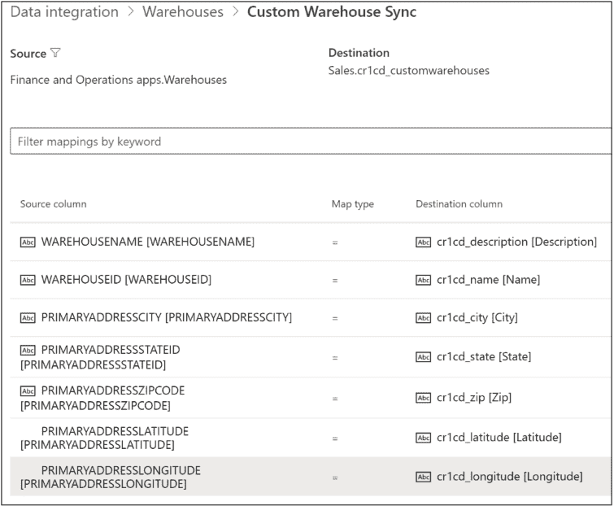

图 13.53：仓库同步源和目标

- 31. 单击 **Save**。
- 32. 单击面包屑中的项目名称。
- 33. 单击 **Run project**。

- 34. 单击 **Execution history** 选项卡并等待同步完成。应有 31 个 **Upserts**。
- 35. 创建一个新的 Power BI Desktop 文件。
- 36. 选择 **Get data** 然后选择 **Dataverse**。
- 37. 输入 *Getting started* 第 9 步中的 **Environment URL**。
- 38. 登录并单击 **Connect** 按钮。
- 39. 在 **Navigator** 中选择 **msdyn_warehouse** 并单击 **Load** 按钮。
- 40. 创建一个简单的报表可视化对象以显示加载到 **Dataverse** 环境中的仓库。
- 41. 保存并将报表发布到 Power BI 服务。
- 42. 在 Power BI 服务中打开报表并将报表可视化对象固定到仪表板：


图 13.54：Dataverse 环境中的仓库

*图 13.54 显示了从 Dynamics 365 Finance and Operations 加载到 Dataverse 的仓库位置。*

## 其工作原理...

在配置环境时，您可以选择是否创建数据库。如果环境仅用于 Power Apps 和 Power Automate 开发，且源数据来自 Dataverse 环境以外的其他位置，您可能会选择不创建数据库。通过创建带有数据库的 Dataverse 环境并将 **Deploy Dynamics 365 apps** 勾选为 **Yes**，将向环境中添加额外的表以支持所选应用程序。

重要的是，您必须将默认团队的角色设置为 **System Administrator** 或 **System Customizer**。默认情况下，配置过程创建的团队在系统中没有任何权限，而创建环境的 用户会被授予 **System Administrator** 等角色。然而，连接集、项目和任务执行的同步目前在写入 Dataverse 环境时使用的是团队权限，而不是用户权限。

创建数据集成项目包括三个任务：创建连接、创建连接集，最后创建包含要执行任务的项目。连接仅保存数据源的身份验证凭据，类似于在 Power BI 中定义数据源连接（数据源设置）。连接集仅定义源系统和目标系统。与 Power BI 不同，Power BI 的目标始终是 Power BI 数据模型，数据集成项目可以在任意两个源系统之间同步数据。最后，项目定义了数据集成期间要执行的任务。任务保存源系统和目标系统之间列的映射。

在 Power Platform 管理中心创建的数据集成项目利用了与 Power BI 和数据流相同的 Power Query 技术。这可以通过选择本配方中创建的数据集成项目中的任务，然后选择 **Advanced query and filtering** 来看出。熟悉的 Power Query 编辑器界面会显示，包括访问 **Advanced Editor** 以直接插入 M 代码。此 **Advanced query and filtering** 界面可用于进一步细化源数据查询，例如删除不必要的列，以提高数据源查询的整体效率或执行所需的转换。

## 另请参阅

- Administer Power Platform: https://bit.ly/3bqaKTQ
- Integrate data into Microsoft Dataverse: https://bit.ly/3bpQykV

## 结论

本章重点介绍了 Power BI、SSRS、Analysis Services、Excel、PowerPoint、Power Apps、Power Automate、Dataverse 和 Dynamics 365 之间强大的集成点。这包括将 Power BI 连接到 Analysis Services，利用 DAX 作为查询语言来支持 Excel 中的自定义报表，将报表服务可视化对象固定到 Power BI 仪表板，以及利用立方体公式构建模板或记分卡报表布局。此外，还提供了一个示例，说明如何使用 Power Automate 设计自动化工作流，将数据从关系数据库推送到 Power BI 服务中的流式数据集，从而通过常见的 Power BI 可视化和数据警报功能实时查看源数据更改。


packt.com

订阅我们的在线数字图书馆，即可完全访问超过 7,000 本书籍和视频，以及帮助您规划个人发展和推进职业生涯的行业领先工具。有关更多信息，请访问我们的网站。

## 为什么订阅？

- 使用来自 4,000 多名行业专业人士的实用电子书和视频，花更少的时间学习，花更多的时间编码
- 使用专为你打造的技能计划更好地学习
- 每月免费获得一本电子书或视频
- 完全可搜索，便于轻松访问重要信息
- 复制、粘贴、打印和书签内容

您知道 Packt 为每本出版的书籍都提供电子书版本，文件格式为 PDF 和 ePub 吗？您可以在 www.Pact.com 升级到电子书版本，作为印刷书籍客户，您有权享受电子书的折扣。有关更多详细信息，请联系 customercare@packtpub.com。

在 www.Pact.com，您还可以阅读大量免费技术文章，订阅一系列免费通讯，并获得 Packt 书籍和电子书的独家折扣和优惠。


## 其他书籍
您可能喜欢

如果您喜欢这本书，您可能对 Packt 的以下其他书籍感兴趣：


## Microsoft Power BI 快速入门指南 – 第二版

Devin Knight

Mitchell Pearson

Bradley Schacht

Erin Ostrowsky

ISBN: 978-1-80056-157-1

- 使用导入和 DirectQuery 选项连接数据源
- 使用查询编辑器进行数据转换和数据清理过程，包括编写 M 和 R 脚本以及数据流，以便在云中执行相同操作

## 其他您可能喜欢的书

- 通过设计关系和 DAX 计算来设计优化的数据模型
- 使用内置和自定义视觉对象设计有效的报表
- 采用 Power BI Desktop 和 Service 实现行级安全性
- 为你的组织管理 Power BI 云租户
- 使用内置 AI 功能增强 Power BI 数据转换技术
- 将你的 Power BI Desktop 文件部署到 Power BI Report Server
