# 1 引言

在本章中，我们介绍基于模型的辨识思想，从信号处理和估计的基本概念开始。一旦定义，我们引入基于模型的信号处理概念，这将导致子空间辨识的开发和应用。接下来，我们表明基于模型处理器的核心要素是“模型”，该模型必须可通过基础科学（第一性原理）获得，或通过本教材的核心——基于模型的辨识获得。

## 1.1 背景

开发能够从噪声传感器测量数据中提取信息的处理器，在各种应用中都是必不可少的，无论是使用雷达或声纳系统定位敌对目标，还是在乳腺组织中定位肿瘤，甚至在地震情况下定位地震源。对机翼或船体进行无损检测（NDE）即使在最简单的布置中也提供了一个具有挑战性的介质，需要复杂的处理，尤其是当介质是不均匀的时。为智能汽车、无人机或更确切地说精密的机器人手术器械设计控制器，也取决于为反馈和误差校正提供增强信号。取代人类在装配线上工作或在单调任务中提供帮助的机器人，必须感知其周围环境才能在这种嘈杂环境中发挥功能。大多数“高科技”应用需要集成“智能”处理器，能够感知其运行环境，增强噪声测量并提取关键信息，以便执行预先分配的任务，例如检测敌对目标并发射武器，或检测肿瘤并将其取出。

为了设计具有所需能力的处理器，有必要尽可能利用所有可用的先验信息。设计可能融合多种学科以实现预期结果。例如，处理器必须能够感知运行环境，无论是机场高度拥挤的电磁传播，还是繁忙港口嘈杂的海洋声学环境。

在主动雷达系统针对极感兴趣的信号进行阵列辐射测量时，可以检测 incoming 威胁，而声学阵列提供的被动监听有助于探测潜艇或同样在超声波中探测人体内的肿瘤。

处理器在如此恶劣环境中有效运行的能力需要越来越多的复杂性，而不仅仅是简单的滤波技术。在此，我们不仅讨论需求，而且还讨论设计的先验要求。例如，无法在不将噪声、变化的海洋的某种表征纳入处理方案的情况下实现对安静柴油潜艇的检测和定位。如何将此类信息嵌入？这是不仅信号处理器，而且海洋声学家和传感器设计师需要思考的问题。解决方案归结为融合这些信息，使能够开发出性能良好的处理器。

因此，我们看到除了特殊情况外，对支配信号如何在不确定介质或环境中传播的底层现象学知识，以及传感器如何进行合理测量以提供所需信息的能力，以及能够提取该信息的处理器，共同定义了一个由现象学家、传感器设计师和信号处理器组成的“团队”，能够实现手头问题的解决方案。

在本教材中，我们讨论了融合所有这些能力的方法。我们从基本处理器开始，然后逐步发展到能够将底层现象学、测量系统和不确定性纳入处理器的方案。为此，我们首先定义信号处理和信号估计，随后是基本基于模型的信号处理器，然后是从实验以及应用数据集获得所需模型的方法。

## 1.2 信号估计

信号处理基于一个基本概念——从不确定的测量数据中提取关键信息 [1, 2]。处理问题可能导致执行这种提取的某些复杂而错综复杂的范式，尤其是从噪声、有时不足的测量中。无论数据是使用监测网络的地震检波器传感器创建，还是使用安装在远洋船体上的水听器阵列创建，基本处理问题保持不变——提取有用信息。信号处理技术（例如滤波、傅里叶变换、时频和小波变换）是有效的；然而，随着产生测量的底层过程变得更加复杂，结果处理器可能需要关于过程现象学的更多信息来提取所需信息。挑战在于制定一个有意义的策略，旨在执行所需处理，即使面对这些高不确定性。该策略可以简单到将测量数据变换到另一个域进行分析，也可以复杂到将全尺度传播模型嵌入处理器 [3]。例如，考虑尝试从加速度计时间序列中提取一组谐振（阻尼正弦波）。几乎不可能从时间序列计算过零点，但将数据变换到频谱域使用傅里叶变换然后应用正弦波在傅里叶空间中呈脉冲状的性质，从而通过峰值检测促进其提取，这却很简单。在海洋中寻找传播的正弦波源是另一回事，由于这种恶劣、可变环境的衰减和色散特性，其相当复杂。在这里，必须开发并应用复杂的传播模型来“解开”高度失真的<|message|> 数据以揭示源——简单的傅里叶变换将不再起作用。两种方法的目标相同——提取所需信息并拒绝多余信息，因此开发处理方案以实现这一目标。底层信号处理哲学是一种“自下而上”的视角，使问题决定解决方案，而非相反。

更具体地说，信号处理构成了许多应用的基本核心。它是一个专业领域，许多研究人员/从业者在其日常技术工作中成功应用，例如谐振数据傅里叶分析的简便性，或分析海豚声音时频响应的复杂性。

应用层出不穷，具有独特的信号处理方法，为底层问题提供解决方案。例如，在敌对的海底海洋声学环境中定位目标不仅挑战现象学家，而且也考验信号处理基础的核心，从而要求将更多复杂性和先验知识纳入处理器。这一特定应用导致了水下信号处理以及各种所谓的基于模型或基于物理的处理器开发方面的许多进展。该技术的典型例子是基于模型的匹配场处理器 [3–5] 的出现，这不仅解决了目标定位问题，而且还在无损检测和生物医学成像等其他领域产生了许多应用。

因此，结论保持不变，信号处理作为一种工作工具是必不可少的，必须由现象学家掌握，以便从不确定的测量中提取有用信息。事实上，我们将信号处理定义为一组技术“从不确定的测量数据中提取所需信息并拒绝多余信息”。

信号处理依赖于产生底层测量的现象学的任何先验知识。表征这种现象学和传播物理以及随之而来的测量


仪器和噪声是所有信号处理器必须解决的此类处理问题的先决条件。在许多情况下，说起来容易做起来难。第一步是确定所需的信息是什么，通常这不是信号处理器的任务，而是进行研究的现象学家的工作。在我们的例子中，我们假设调查的目的是提取来自源的信号的信息，无论它是高海上的自主水下航行器（AUV）还是在深海中被动运行，或是响应地面运动而振动的结构。应用可以非常复杂，尤其是在超声波通过复杂的介质传播时，例如生物医学应用中的组织，或无损评价（NDE）研究中关键部件的非均质材料，或来自辐射源的光子 [6]。在任何情况下，处理通常涉及操纵测量数据以提取所需信息，例如 AUV 的位置和跟踪、结构的故障检测，或生物医学和 NDE 中的肿瘤/缺陷检测和定位 [3]。

如果测量信号没有多余的变化并且从一次测量到另一次测量是可重复的，则定义为确定性信号（第 2 章）。然而，如果它有额外变化且不再可重复，则定义为随机信号。本书关注的是利用任何先验信息从随机信号中提取相关信息的处理技术的发展。我们称这些技术为信号估计或信号增强，我们称特定算法为信号估计器或简称估计器。符号上，我们使用“尖角号”（^）符号来标注估计值（例如，\(s \rightarrow \hat{s}\)）。有时，估计器被称为滤波器（例如，维纳滤波器），因为它们执行与确定性（信号）滤波器相同的功能，只是信号是随机的；也就是说，它们去除不需要的干扰。噪声测量通过估计器处理以产生“滤波”数据。为了巩固这些概念，请考虑以下示例。

### Example 1.1

由两个正弦波组成的确定性信号：10 Hz 的信息和 20 Hz 的干扰，其对应的傅里叶频谱如图 1.1a 所示。根据先验信息，已知期望信号没有高于 15 Hz 的频率；然而，原始频谱显示了 20 Hz 的干扰。由于数据是确定性的，设计了一个截止频率为 12.5 Hz 的低通滤波器以提取期望信息（10 Hz 信号）并抑制多余的（20 Hz 干扰）。滤波后的数据如图 1.1b 所示，其中可以看到滤波后的信号和所得频谱。

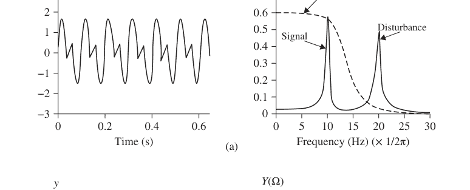

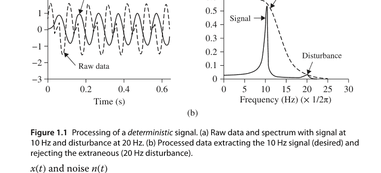

**Figure 1.1** Processing of a deterministic signal.

(a) Raw data and spectrum with signal at 10 Hz and disturbance at 20 Hz. (b) Processed data extracting the 10 Hz signal (desired) and rejecting the extraneous (20 Hz disturbance).

考虑设计用于从瞬态信号中消除随机噪声的估计滤波器的输出；即估计器是信号 \(x(t)\) 和噪声 \(n(t)\) 的函数：

\[
\hat{y}(t) = f(x(t), n(t)).
\]

考虑以下示例来说明该处理器。

### Example 1.2

受噪声污染的随机脉冲状信号如图 1.2a 所示。这里，我们看到测量数据及其傅里叶频谱。我们设计一个信号估计器来提取期望信号并去除噪声。处理后的数据如图 1.2b 所示，其中我们观察到估计滤波器的结果和相应的增强频谱。这里，我们看到滤波响应已消除了随机噪声。我们将在第 4 章中讨论使用现代参数设计方法进行信号估计的概念。

估计可以被认为是一个由三个主要部分组成的程序：

- Criterion function
- Models
- Algorithm

准则函数可以有多种形式，也可以分为确定性和随机性。模型代表了一类广泛的信息，将生成信号的过程、测量仪器、噪声表征和潜在概率结构有关的先验知识形式化。最后，选择用于最小化（或最大化）准则的算法或技术可以根据 (i) 模型、(ii) 准则和 (iii) 解的选择而采取多种不同的形式。例如，人们可以选择递归地求解众所周知的最小二乘问题，或使用数值优化算法。大多数估计算法的一个重要方面是它们提供估计器的“质量度量”。通常，这意味着估计器还预测关于其性能的重要的统计信息。

直观上，我们可以将估计过程视为如下：

- 准则的指定
- 从先验知识中选择模型
- 算法的开发和实现

准则函数通常是根据关于过程的有意义的信息或估计器开发的难易程度来选择的。用于估计的有用准则函数可分为确定性和概率性。一些典型函数如下：

- *Deterministic:*
  - Squared error
  - Absolute error
  - Integral absolute error
  - Integral squared error
- *Probabilistic:*
  - Maximum likelihood
  - Maximum a posteriori (Bayesian)
  - Maximum entropy
  - Minimum (error) variance

模型也可以是确定性的，也可以是概率性的；然而，这里我们更喜欢将其基础限制为对过程现象学（物理）和潜在概率密度函数以及描述这些函数的必要统计量的了解。现象学模型属于由底层数学方程的类型及其结构定义的通常类别，即线性或非线性，微分或差分，常微分或偏微分，时不变或时变。通常，这些模型通过包含不确定性或噪声过程而演变为随机模型。

最后，估计算法可以从各种影响中演变。对估计器结构的先入为主的观念在很大程度上影响了所得算法。基于计算考虑，我们可能选择递归地计算估计值，而不是作为批处理的结果，因为我们需要在线、准实时估计。此外，每个算法必须提供估计质量的度量，通常以期望估计误差表示。该度量提供了一种比较估计器的方法。因此，估计过程是这三个主要成分的组合：准则、模型和算法。

## 1.3 Model-Based Processing

对底层处理问题的另一种看法是将其分解为一组步骤，以捕捉处理方案的战略本质。固有地，我们相信我们能将关于测量及其底层现象学的“先验”知识越多地纳入处理器，我们就越能期望处理器表现更好——只要包含的信息是正确的！一种称为模型化的方法提供了基于模型信号处理（MBSP）[3] 的本质。有些人认为所有信号处理方案都可以归入这一通用框架。简单地说，基于模型的方法是“将物理现象学和测量过程（包括噪声）的数学模型纳入处理器以提取所需信息。”这种方法提供了一种机制，将底层物理或动力学的知识以数学过程模型的形式以及测量系统模型和伴随噪声以及模型不确定性直接纳入所得处理器。通过这种方式，基于模型的处理器（MBP）能够直接以问题物理学的术语解释结果。它实际上是一个建模工具，使能够将关于问题的任何先验信息纳入其中以提取所需信息。选择适当模型的这种方法如图 1.3 的信号处理阶梯所示。我们注意到，随着我们向上推进“建模”步骤以提高信噪比（SNR），模型的复杂性增加以实现所需结果。这是我们的路线图 [3]。如图所示，纳入处理器中的模型的保真度决定了基于模型处理器的复杂性，其最终目标是提高固有的信噪比（SNR）。这些模型可以从测量数据的简单、隐式、非物理表示，例如傅里叶或小波变换，到


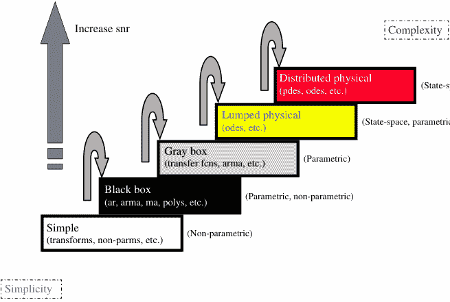

**图1.3** 基于模型的信号处理“模型阶梯”：第1步——简单模型。第2步——黑箱模型。第3步——灰箱模型。第4步——集总物理模型。第5步——分布式物理模型。

从用于数据预测的参数化黑箱模型，到以常微分方程为特征的集总数学表示，再到以偏微分方程模型为特征的分布式表示，以捕捉所研究过程的潜在物理特性。决定哪种模型最合适的主导因素通常由测量被噪声和潜在不确定性污染的程度决定。在许多情况下，如果测量的信噪比很高，那么可以使用简单的非物理技术来提取所需信息；然而，对于低信噪比测量，必须纳入越来越多的物理和仪器知识来进行提取。随着我们沿着*建模步骤*向上以提高信噪比，模型和算法的复杂度也按比例增加，以达到期望的结果。逐一审视每个步骤，我们意识到最低步骤不使用显式模型（*简单*），本质上几乎没有包含先验信息，用于分析原始测量数据的信息内容（频谱、时频等），试图对所研究信号的性质得出一些粗略结论。进入下一步，*黑箱*模型基本上用作数据预测机制。它们具有参数化形式（例如多项式、传递函数），但从其输出中同样几乎无法获得物理信息。再下一步，*灰箱*模型发展起来，可以利用底层的黑箱结构；然而，现在参数可以被使用

如果我们使用Y_meas来估计S_true（即Ŝ），那么噪声就会叠加在信号上，位于±2√R̃置信限内（见图1.4）。我们对S_true所能期望的最佳估计也只能在仪器的准确度（偏差）和精密度（方差）范围内。如果我们纳入测量仪器模型及其相关不确定性，那么我们就可以提高带噪测量的信噪比。这种技术表示基于我们的仪器和噪声（统计）模型的处理，如下所示：

```
Y_meas = c(S_true) + N_noise,    N ~ N(0, R_nn)    (Measurement and Noise)
```

其中c(S_true)是测量系统模型，N(0, R_nn)是由零均值、方差由R_nn指定的高斯或正态分布所描述的噪声统计量。

我们还可以指定估计误差方差R̃，或者等价地，该处理器在估计S时的质量。最后，如果我们不仅纳入仪器知识，还纳入物理过程知识，那么我们预计会做得更好；也就是说，随着我们向处理器中纳入越来越多的知识，我们期望由(S̃ := S_true − Ŝ)的方差P̃所定义的信号估计误差会变小（±2√R̃置信限或边界见图1.4），即：

```
Ŝ = a(S_true) + W_noise,    W ~ N(0, R_ww)
(Process Model and Noise)
Y_meas = c(S_true) + N_noise,    N ~ N(0, R_nn)
(Measurement Model and Noise)
```

其中a(S_true)是过程系统模型，N(0, R_ww)是由零均值、方差为R_ww的高斯分布所描述的过程噪声统计量。

事实上，情况确实如此，因为可以证明：

```
Instrument variance > R̃ > P̃
```

这就是基于模型的信号处理的基本思想：“我们能在算法中纳入的先验信息越多，所产生的误差方差就越小。”

考虑以下示例来说明这些思想。

### 示例1.3

使用如图1.5所示的高阻抗电压表测量RC电路输出端的电压。测量受到随机仪器噪声的污染，该噪声可以建模为：

```
e_out = K_e e + n
```

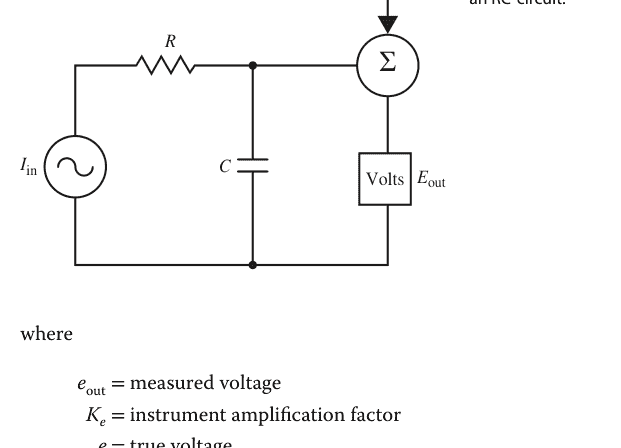

**图1.5** 用于RC电路的基于模型的信号处理“模型”。

其中

- e_out = 测量电压
- K_e = 仪器放大系数
- e = 真实电压
- n = 方差为R_nn的零均值随机噪声

该模型对应于前面描述的模型。将要设计一个处理器来提高仪器的精密度。然后，我们有：

- 测量：
  - s → e
  - c(·) → K_e
  - v → n
  - R_vv → R_nn
- 对于滤波器：
  - ŝ → ê
  - R̃_ss → R̃_ee

通过包含过程（电路）模型，可以进一步提高仪器的精密度。写出基尔霍夫节点方程，我们有：

```
ė = (1/C) I_in - e/(R C) + q
```

使用采样间隔ΔT的一阶差分对该方程进行离散化，并为参数和测量不确定性加入高斯白噪声源，我们得到以下离散高斯-马尔可夫模型：

```
e(t) = \left(1-\frac{\Delta T}{RC}\right)e(t-1)+\frac{\Delta T}{C}I_{in}(t-1)+w(t-1)
e_{out}(t) = K_e e(t) + v(t)
```

得到的基于模型的处理器（卡尔曼滤波器）如下：

```
\hat e(t|t) = \left(1-\frac{\Delta T}{RC}\right)\hat e(t-1|t-1) + K(t)e(t)
```

对于R = 3.3 kΩ和C = 1000 μF，ΔT = 100 ms，K_e = 2.0，e_0 = 2.5 V，I_in = 100 μA（负阶跃），其中w ~ N(0, 0.0001)且v ~ N(0, 4.0)，或者：

```
e(t) = 0.97 e(t-1) + I_in(t-1) + w(t-1)
e_out(t) = 2 e(t) + v(t)
```

带噪测量和相应的基于模型的随机信号估计如图1.6所示。这里我们看到了带噪测量数据、无噪（真实）测量（虚线），以及相应的“滤波后”或基于模型的估计。

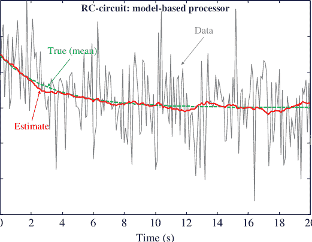

**图1.6** 用于RC电路的基于模型的处理器：原始数据（实线）、真实测量（虚线）和基于模型的估计（粗实线）。

注意估计如何跟踪真实测量，显著提高信噪比，增强信号。示例到此结束。

基于所使用的模型和估计计算方式的不同，基于模型的处理器有多种不同形式。例如，有基于过程模型的处理器（卡尔曼滤波器 [3]）、基于统计模型的处理器（Box–Jenkins滤波器 [7]、贝叶斯滤波器 [6]）、基于统计模型的处理器（协方差滤波器 [2]），甚至基于优化的处理器（梯度滤波器 [8]）。无论如何，许多处理器都可以采用递归形式，在计算当前估计（Ŝ_old）时会出现各种细微差别。所采用的标准技术是在新的测量数据可用时，对当前估计进行校正或更新。估计通常采用以下递归形式：

```
Ŝ_new = Ŝ_old + K E_new
```

其中

```
E_new = Y - Ŷ_old = Y - C Ŝ_old
```

这里我们看到，新估计是通过K加权量校正旧估计得到的。误差项E_new是新的信息或创新项；也就是说，它是实际测量与基于旧估计（Ŝ_old）的预测测量（Ŷ_old）之间的差值。权重K的计算取决于所使用的准则（例如均方误差、绝对误差）。

考虑以下示例，该示例演示如何递推估计样本均值。

### 示例1.5

样本均值估计器可以很容易地写成递归形式。该估计器由下式给出：

```
Ŝ(N) = 1/N Σ_{t=1}^N y(t)
```

从总和中提取第N项，我们得到：

```
Ŝ(N) = 1/N y(N) + 1/N Σ_{t=1}^{N-1} y(t)
```

从最后一项中识别出Ŝ(N − 1)，即：

```
Ŝ(N) = 1/N y(N) + ((N − 1)/N) Ŝ(N − 1)
```


递归形式由下式给出

\[
\hat{S}(N)=\hat{S}(N-1)+\frac{1}{N}\left[y(N)-\hat{S}(N-1)\right]
\]

这完成了从启发式角度对基于模型的信号处理的介绍性讨论。接下来我们讨论从测量数据中*提取*模型以构建 MBP 的方法。

## 1.4 基于模型的辨识

辨识为从测量数据序列中提取模型的问题提供了解决方案，这些序列可以是时间序列、频率数据或简单地是有序的索引值集合。如图 1.7 所示，无论是否存在扰动或参数不确定性，都使用输入（当可用时）和测量输出来执行提取。鉴于其从控制理论中根本演变而来，辨识或“系统”辨识基于从数据中估计 *动态系统* [7] 的模型。模型可以有多种形式，从简单的多项式到源自非线性分布系统的高度复杂结构。从数据中提取模型对于大量应用至关重要，这些应用从在变化的海洋中探测潜艇，到在乳腺组织中定位肿瘤，到精确定位破坏性地震的震中，或简单地监测驱动关键系统部件的电机的状况 [3]。

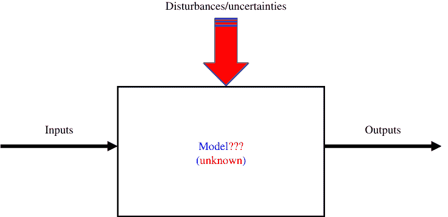

**Figure 1.7** System identification problem: input (deterministic/random), disturbances (noise/parametric uncertainty), output (noisy measurement), model (class selected).

这些应用中的每一个都需要建模的一个方面以及对支配该过程的潜在现象学（当可能时）的基本理解，以及提取数据的测量仪器以及随之而来的不确定性。其中一些问题可以用简单的“黑箱”表示来解决，该表示以某种方式忠实地再现数据，而无需捕捉潜在的动力学（例如常见的支票簿条目），或“灰箱”模型，该模型已被提取，但具有极大兴趣的参数（例如有毒物质的未知质量）。然而，当真正需要获得对潜在现象学的准确表示时，例如飞机机翼的结构动力学或核电站涡轮机中不合时宜的振动，则需要更复杂的系统和不确定性表示。在这种情况下，必须开发能够捕捉动力学的模型并“拟合”数据，以便执行诸如结构状况监测或旋转机器故障检测/预测等应用。这里的模型可以从由常微分方程组、线性或非线性控制的集中表征演变而来，也可以从由偏微分方程组演变的分布式表示演变而来。所有这些表示都有一个共同点，当需要执行关键任务时——它们由数学模型表示，该模型捕捉其潜在现象学，必须以某种方式从噪声测量中提取。这就是我们在本教材中要解决的基本问题，但我们必须将注意力限制在更易于管理的表示集合上，因为许多专著已经解决了针对特定应用的问题集 [9, 10]。

事实上，这种专门解决方案的概念引导我们进入系统理论和控制的通用状态空间模型（第 3 章）。这里的基本思想是，系统的所有理论特性都由该基本模型集表征，从而使理论能够发展并随后应用于任何可以用状态空间表示的系统。许多模型自然地在状态空间中演变，因为它本质上是一组 n 阶微分方程（常微分或偏微分，线性或非线性，时（空）不变或时（空）变化，标量或多变量）的表示，这些方程被转换为一组一阶方程，其中每一个都是一个状态。例如，由单个质量、弹簧、阻尼器构成的简单机械系统由一组二阶、线性、时不变微分方程表征，可以简单地用一组两个一阶方程表示为状态空间形式，每个方程代表一个状态：一个用于位移，一个用于速度 [9]。我们在本教材中始终采用状态空间表示，并在第 3 章中提供足够的背景知识。

在这里，我们主要关注为设计和应用基于模型的信号处理器（MBSP）而开发模型，使用

参数按顺序完成其指定任务。我们在第 4 章和第 5 章中为线性和非线性模型开发这些处理器。

在第 5 章中，我们提出了一种不同的方法，该方法将解决方案纳入辨识问题，作为基于模型信号处理器（卡尔曼滤波器）的组成部分，可以应用于大量应用，但在没有可靠模型或无法适应变化环境的情况下几乎没有成功 [13]。使用各种方法，可以非常快速地辨识模型并将其纳入各种处理问题，例如状态估计、跟踪、检测、分类、控制和通信等 [14, 15]。

例如，考虑开发一个处理器来提取 RC 电路的未知参数。

### Example 1.6 Suppose we investigate the RC-circuit and would like to dynamically estimate the circuit parameters as well as its output voltage. The model in state-space form with x := e and y := e_out is given by (see Example 1.4)

```
e(t) = θ₁ e(t − 1) + θ₂ I_in(t − 1) + w(t − 1)
e_out(t) = θ₃ e(t) + v(t)
```

处理器可以以多种方式实现，其中之一是使用严格参数估计器基于的最小二乘参数估计器

```
θ(t) = θ(t − 1) + w(t − 1)
e_out(t) = θ(t) + v(t)
```

或作为 MBID 处理器（非线性），嵌入电路模型并基于增广模型 x := [e | θ₁ | θ₂ | θ₃]′ 联合估计状态和参数

```
e(t) = θ₁(t − 1) e(t − 1) + θ₂(t − 1) I_in(t − 1) + w_x(t − 1)
θ(t) = θ(t − 1) + w_θ(t − 1)
e_out(t) = θ₃(t) e(t) + v(t)
```

结果如图 1.8 所示，我们可以看到每个参数估计值以及滤波后的测量值。在图 1.8a 中，我们看到系统（θ̂₁ ≈ −0.97）和输入（θ̂₂ ≈ −0.1）模型参数的参数估计值，而在图 1.8b 中，我们观察到输出（θ̂₃ ≈ 2.0）参数和增强（滤波）输出电压测量值（ŷ ≈ ê_out）。这完成了 MBID 的设计。

接下来我们考虑教材的核心——子空间辨识。

## 1.5 子空间辨识

Figure 1.8 Model-based identification of RC-circuit parameters: \hat{\theta}_1 \approx -0.97, \hat{\theta}_2 \approx -0.1, \hat{\theta}_3 \approx 2.0 and \hat{y} \approx \hat{e}_{out}.

处理器的模型以多种方式演变，要么从第一性原理出发并估计其固有不确定参数，如参数自适应方案 [3]，要么通过采用直接优化方法提取受约束的模型集 [7]，要么简单地将黑箱结构拟合到噪声数据 [8]。一旦模型从受控实验数据或从高度复杂的真实模型合成的数据中提取，长期处理器就可以为直接应用而开发 [6]。由于许多实际应用寻求实时解决方案，我们主要集中于开发快速、可靠的辨识方法，以实现此类实现 [16–18]。模型提取/开发必须随后进行验证和测试，以确保模型可靠地表示潜在现象学——糟糕的模型只能导致失败！

子空间的概念在系统辨识中具有明确的含义。简单地说，“子空间是父空间的空间或子集，它继承了其一些或全部特征。” 例如，我们可以将洋葱的每一层视为洋葱本身的一个子集（子空间），每个子集都继承其通用属性。在数学中，我们可以考虑将拓扑空间分解为子集，每个子集继承先前区域或子区域的属性，从而形成层次结构。例如，具有

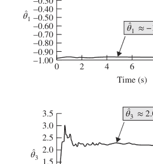

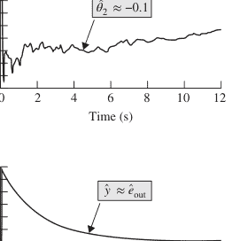

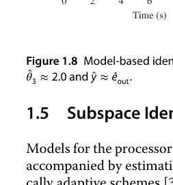

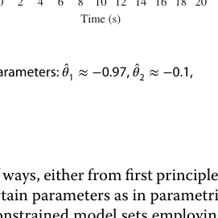


其所有属性都可以分解为子区域（层）：首先分解为拓扑-度量空间，接下来分解为拓扑-正规化-度量空间，最后分解为拓扑-正规化-度量-内积空间，每个子区域（层）都继承了其前驱的一些属性。在识别中，子空间主要是指一个向量（状态）空间，其本质特征可以由一个“更小”的空间——子空间来捕捉。例如，一个 N 阶状态空间动态系统可以用一个 M 阶（M < N）系统来近似，该系统捕捉了其大部分属性。这就是我们将在本篇文本中始终采用的概念。

子空间识别（SID）是一种技术，用于从不确定的输入/输出数据中提取（识别）通用的状态空间形式的黑箱模型，使用稳健的、数值稳定的线性代数方法。SID（简单地）从噪声测量中对通用状态空间模型（A, B, C, D）进行黑箱识别，如图 1.9 所示。与之前讨论的 MBID 不同，它不需要状态空间模型具有任何特定结构，只需要其阶数（状态数），该阶数可以直接从嵌入的线性代数分解中得出。SID 方法仅限于线性状态空间模型。

更具体地说，与上一节中迭代估计参数的 MBID 处理器 [3, 7] 相比，我们研究了子空间识别技术 [16–18]。这些技术能够提取大量参数，而预测误差（P-E）方法则非常耗时，对于大型参数问题并不实用，再加上潜在的实时应用需求。子空间识别技术是稳健可靠的，能够实时应用，

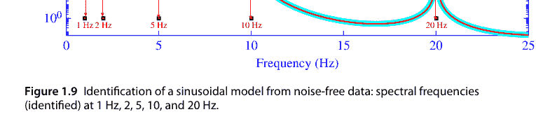

图 1.9 从无噪声数据识别正弦模型：谱频率（已识别）在 1 Hz、2、5、10 和 20 Hz。

但其精度不如基于优化的 P-E 方法 [8]。事实上，SID 方法通常用作 P-E 处理器的“启动器”，为数值优化器提供合理的起点，从而确保更快收敛。在本篇文本中，我们集中于 SID 方法，见第 6 章和第 7 章。

考虑以下噪声中正弦的例子来说明这一过程。

**例 1.7** 假设我们有一个理想测量，由频率范围从 1 到 20 Hz 的五个正弦波组成，我们希望在进行识别后建立该过程的模型，即我们的底层模型只是振幅各异的正弦波之和，使得

$$y(t)=\sum_{i=1}^{5} A_i\sin 2\pi f_i t \quad \text{with } f_i=\{1,2,5,10,20\}\ \text{Hz}$$  \tag{1.1}

我们可以在这种无噪声情况下简单地执行傅里叶变换，定位峰值和幅度以提取正弦波，或使用非线性（正弦）优化技术进行参数估计，从而得到基于模型的识别。然而，另一种方法是执行 *黑箱* 识别，选择一个通用的模型类（例如状态空间），以传递函数形式捕捉这些动态，估计底层状态空间模型，并利用它计算相应的脉冲响应。通过这种表示，对应的频率可以从已识别模型的特征值（极点）中提取。数据由标识符使用适当的阶数（20 个状态或 2 × 正弦波数）处理，结果如图 1.9 所示，同时显示了从模拟无噪声数据获得的傅里叶（功率）谱以及在图上标注的估计（已识别）频率（方块）。两者完全一致。该示例说明了识别（黑箱）的概念，并且随着信噪比的降低和谱峰不再可用于检测和定位时变得越来越重要。□

至此，子空间识别的介绍完成。接下来我们讨论本篇文本中将采用的记号。

## 1.6 记号和术语

本篇文本中使用的记号在文献中是标准的。在必要时，向量用粗体、小写、**x** 表示，矩阵用粗体、大写、**A** 表示。矩阵 A 的 *伴随* 记为 adj(A)，其对应的 *行列式* 用 det(A) 表示。我们定义记号 $\mathbb{N}$ 为 $1,2,\ldots,N$ 的简写方式。它将在矩阵中使用，$A(N)$ 表示

这正是离散 PMF 的均值（有关更多细节，请参见附录 A）。

此外，如前所述，我们将使用符号 ~ 表示“根据…分布”，如 x ~ N(m, v) 定义随机变量 x 为均值为 m、方差为 v 的高斯分布。我们还可能使用扩展记号：N(x : m, v) 以包含随机变量 x 本身。在采样时，我们使用非传统的右箭头“动作”记号 → 表示“从”特定分布“抽取样本”，例如 x_i → Pr(x) ——这再次将从上下文中清楚。当重采样时，即用新样本替换样本，我们使用“块”右箭头，例如 x_j ↔ x_i 表示新样本 x_j 替换当前样本 x_i。在离散（有限）概率表示中，我们定义纯离散变量为 x_k(t) := Pr(x(t) = X_k) 表示 x 只能取来自已知集合 X = {X_1, …, X_k, …, X_N} 的值（整数）k，在时间 t。我们还使用符号 □ 来标记例子的结束。

我们定义两种投影算子投影算子：（i）正交和（ii）斜或平行。正交投影算子“将 • 投影到”Y 上记为 P_•|Y 或其补集 P_•|Y^⊥，而斜投影算子“将 • 投影到”Y 上“沿着”Z 记为 P_•|Y||Z。例如，正交投影向量 x，我们有 P_x|Y 或 P_x|Y^⊥，而沿 Z 斜投影 x 为 P_x|Y||Z（见附录 B）。矩阵投影算子源于 LQ 分解（见附录 C）等分解，其中算子以其正交基表示为 P = Q × Q′。

## 1.7 总结

在本章中，我们介绍了基于模型信号处理（MBSP）的概念，其思想是将越来越多的先验信息纳入处理方案。各种信号被分类为确定性或随机。当信号是随机的时，所得处理器称为估计滤波器或估计器。定义了一个估计程序（估计程序），导致一个形式分解，该分解将在本篇文本中始终使用。在几个激励基于模型信号处理的概念的示例之后，随后进行了更正式的讨论，并以具体的 RC 电路示例完成了本章。接下来我们介绍了基于模型识别（MBID）的思想，它等价于各种 P-E 方法，其中从底层问题现象学中开发的模型直接纳入处理器。在讨论了 RC 电路参数的识别后，我们概念性地介绍了子空间识别（SID）方法，并通过正弦识别示例进行了说明。最后，讨论了本篇文本中使用的记号，完成了本介绍性章节。

## MATLAB 注释

MATLAB 是一个面向命令的向量-矩阵软件包，具有简单而有效的命令语言，包含大量嵌入式 C 语言结构，使其非常适合信号处理和图形。我们对本篇文本中的示例和问题所应用的所有算法在解决方案上都是基于 MATLAB 的，从简单的仿真到复杂的应用。我们将主要把这些注释作为总结，以指出给读者许多现有的命令，这些命令已经执行了本章中讨论的信号处理操作以及贯穿全文的操作。

更具体地说，MATLAB 由多种“工具箱”组成，使用户能够快速访问大量数值稳定且准确的算法，以及相应的演示示例套件。对于本篇文本，最重要的工具箱是信号处理（signal）、系统识别（ident）、控制系统（control）和统计（stats），可用于解决本篇文本中介绍的大多数问题。我们在全文中将引用可应用于各种问题的特定命令并提供有意义的解决方案。

## 参考文献

- 1. Rossing, T., Dunn, F., Hartmann, W. et al. (2007). *Handbook of Acoustics*. New York: Springer.
- 2. Hayes, M. (1996). *Statistical Digital Signal Processing and Modeling*. New York: Wiley.
- 3. Candy, J. (2006). *Model-Based Signal Processing*. Hoboken, NJ: Wiley/IEEE Press.
- 4. Bucker, H. (1976). Use of calculated sound fields and matched-field detection to locate sound in shallow water. *J. Acoust. Soc. Am.* 59: 329–337.
- 5. Tolstoy, A. (1993). *Matched Field Processing for Ocean Acoustics*. Hackensack, NJ: World Scientific.
- 6. Candy, J. (2016). *Bayesian Signal Processing, Classical, Modern and Particle Filtering*, 2e. Hoboken, NJ: Wiley/IEEE Press.
- 7. Ljung, L. (1999, 2e). *System Identification: Theory for the User*. NJ: Prentice-Hall.
- 8. Ljung, L. and Soderstrom, T. (1983). *Theory and Practice of Recursive Identification*. Cambridge, MA: M.I.T. Press.
- 9. Juang, J. (1994). *Applied System Identification*. Upper Saddle River, NJ: Prentice-Hall PTR.
- 10. Aoki, M. (1990). *State Space Modeling of Time Series*, 2e. London: Springer.
- 11. Sorenson, H. (1986). *Parameter Estimation*. New York: IEEE Press.


## 参考文献

12 Norton, J. (1986). *辨识导论.* 纽约: 学术出版社.

13 Kalman, R. (1960). 线性滤波与预测问题的新方法. *ASME基础工程杂志汇刊* 82: 34–45.

14 Van Der Veen, A., Deprettere, E.F., and Swindlehurst, A.L. (1993). 基于子空间的线性时不变系统辨识方法. *IEEE会刊* 81 (9): 1277–1308.

15 Viberg, M. (1995). 基于奇异值分解的子空间信号分析. *Automatica* 31 (12): 1835–1851.

16 van Overschee, P. and De Moor, B. (1996). *线性系统的子空间辨识：理论、实现与应用.* 马萨诸塞州波士顿: 克鲁维尔学术出版社.

17 Verhaegen, M. and Verdult, V. (2007). *滤波与系统辨识：最小二乘方法.* 剑桥: 剑桥大学出版社.

18 Katayama, T. (2005). *系统辨识的子空间方法.* 伦敦: 施普林格.

## 习题

**1.1** 我们需要估计大型车辆（半挂车）停在高速公路路肩上时，在过往车辆产生的阵风作用下的位移。我们通过在拖车上放置加速度计来测量车辆的位移。加速度计具有固有的不准确性，其建模如下：

```
y = K_a x + n
```

其中 y、x、n 分别表示测量位移、实际位移以及方差为 \(R_{nn}\) 的白测量噪声，\(K_a\) 为仪器增益。车辆的动力学可以用一个简单的质量-弹簧-阻尼器模型来描述。(a) 构建并辨识该系统的测量模型。(b) 构建并辨识该问题的过程模型和基于模型的估计器。

**1.2** 设想测量一个用燃烧器加热的烧杯中液体的温度。假设我们使用一支浸入液体中的温度计，周期性地观察并记录温度。(a) 假设温度计与温度呈线性关系，即 \(y(t) = k \Delta T(t)\)，构建测量模型。同时将目视测量的不确定性建模为方差为 \(R_{vv}\) 的随机序列 \(v(t)\)。(b) 假设我们将燃烧器传递给液体的热量建模为

```
Q(t) = C A ΔT(t)
```

其中 C 为导热系数，A 为横截面积，\(\Delta T(t)\) 为温度梯度，并假定其具有随机不确定性 \(w(t)\)，方差为 \(R_{ww}\)。利用该过程模型和上面建立的模型，辨识基于模型的处理器表示。

**1.3** 给定一个由含噪电压源 \(V_{in}(t)\) 驱动的 RLC 串联电路，我们使用一个按 K 线性放大并测量相应输出电压的测量仪器。我们知道，输入电压受到加性噪声源 \(w(t)\) 的污染，其协方差为 \(R_{ww}\)；测量得到的输出电压同样受到噪声源 \(v(t)\) 的污染，其协方差为 \(R_{vv}\)。  
(a) 确定测得输出电压 \(V_{out}(t)\) 的模型（测量模型）。  
(b) 确定电路的模型（过程模型）。  
(c) 辨识一般的基于模型的处理器结构。在每种方案中，指明过程、测量和噪声的模型。

**1.4** 一颗通信卫星被送入轨道，必须使用推进器进行机动以调整其天线的指向。将问题限制在垂直于纸面的单轴上，运动方程为

```
J d²θ/dt² = T_c + T_d
```

其中 J 是卫星绕其质心的转动惯量，\(T_c\) 是推进器控制力矩，\(T_d\) 是扰动力矩，\(\theta\) 是卫星轴相对于惯性参考系（无角加速度）的角度。针对该问题建立信号和噪声模型，并辨识基于模型的处理器的各个组成部分。

**1.5** 考虑一个由一组线性微分方程描述的过程

```
d²c/dt² + dc/dt + c = K m
```

该过程将由如下方程描述的比例-积分-微分（PID）控制律来控制

```
m = K_p ( e + 1/T_i ∫ e dt + T_d de/dt )
```

并且控制器参考信号 r 由下式给出

```
r = e + c
```

假设参考信号受到扰动信号的影响，并且受到加性噪声污染的测量传感器测量输出的"平方"。请为该问题建立基于模型的信号和噪声模型。

**1.6** 跟踪望远镜的仰角由一台直流电机控制。系统具有转动惯量 J 和由摩擦引起的阻尼 B，运动方程为

```
J d²θ/dt² + B dθ/dt = T_m + T_d
```

其中 \(T_m\) 和 \(T_d\) 分别是电机力矩和扰动力矩，\(\theta\) 是仰角。假设传感器将望远镜的仰角转换为成比例的电压，该电压受到噪声污染。请为望远镜建立信号和噪声模型，并辨识所有基于模型的处理器组成部分。

**1.7** 假设我们有一个双测量系统，其方程为

```
y = [3; 4] x + v
```

其中 \(R_{vv} = diag[1, 0.1]\)。

(a) 若 \(y = [7; 21]\)，参数 x 的批处理最小二乘估计（W = I）是多少？

(b) 选择 W 以实现最小方差估计时，参数 x 的批处理加权最小二乘估计是多少？

**1.8** 基于两次测量 \(y(1)\) 和 \(y(2)\)，计算参数向量 x 的批处理和序贯最小二乘估计，其中

```
y(1) = C(1)x + v(1) = [2; 1]
```

```
y(2) = c'x + v(2) = 4
```

```
C(1) = [1 1; 0 1],  c'(2) = [1 2],  W = I
```
