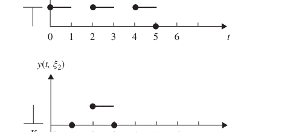
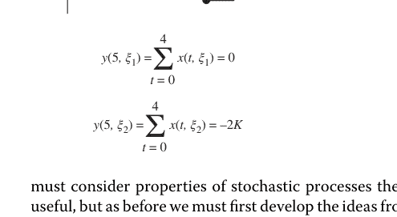
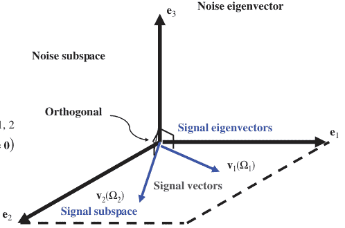

# 2 随机信号与系统

## 2.1 引言

我们可以对随机信号应用滤波器，但由于其输出仍然是随机的，为了运用系统理论中可用的强大技术，我们必须找到一种消除或减小这种随机性的方法。我们将说明，统计学技术结合线性系统理论可以用于提取所需的信号信息并抑制扰动或噪声。在这种情况下，该滤波器被称为估计滤波器，或简称为估计器，其任务是从含噪或随机的测量中提取有用信息（信号）。

当随机信号被变换为其协方差序列、其傅里叶谱被变换为其功率谱时，与线性确定性系统理论类似的技术同样成立。一旦完成这些变换，就可以应用线性系统理论的技术来获得与确定性信号处理类似的结果。事实上，我们知道协方差序列和功率谱是一对离散傅里叶变换（DFT），类似于确定性信号与其对应频谱的关系，即我们有

```
Fourier Transform: R_xx(k) ↔ S_xx(Ω)
```

并且与确定性情况一样，我们可以通过研究功率谱来分析随机信号的频谱成分。

离散随机过程的功率谱密度（PSD）函数定义为：

```
S_xx(Ω) = lim_{N→∞} E { X(Ω)X*(Ω) / (2N + 1) }    (2.1)
```

其中 * 表示复共轭。期望运算 \(E\{\cdot\}\) 可以看作是"减轻"随机性。类似地，……的协方差¹ 如图 2.2b 所示。因此，与确定性信号处理技术类似，协方差和功率谱使得线性系统理论的强大方法得以应用于从含噪数据中提取有用的信号信息。

本章关注的是随机信号分析方法的发展，这些方法将在后续应用中发挥重要作用。

¹ 通常也使用所谓的相关函数，它实际上就是均方函数，对于零均值情况与协方差函数完全相同。

## 2.2 离散随机信号

随机信号，或等价地称为随机过程，其根源在于概率论。底层概率或样本空间的概念对于处理随机信号至关重要。回顾一下，概率/样本空间 \(\Xi\) 是样本或试验结果 \(\xi\) 的集合，\(\xi\) 是该空间的元素。\(\Xi\) 的某些子集或结果的集合即为事件。例如，如果我们掷一枚均匀的硬币，那么样本空间由结果集 \(\Xi = \{H, T\}\) 构成，事件为 \(\{\emptyset, \{H\}, \{T\}\}\)。当我们试图说明某个特定事件在一次试验或实验中发生的可能性有多大时，我们就定义了概率的概念。就概率空间而言，我们将概率函数 \(Pr(\cdot)\) 定义为一个在事件类上定义的函数，它为实验中某个特定事件发生的可能性赋予一个数值。我们必须限制概率函数所定义的事件类，使所进行的集合运算产生的集合仍然是事件。因此，满足这一约束的集合类称为域（波雷尔域）。如果我们有一个空间 \(\Xi\)、一个域 \(B\) 和一个概率函数 \(Pr(\cdot)\)，我们就可以将一个试验精确地定义为三元组 \(\{\Xi, B, Pr\}\)。随机过程可以看作是一组带索引的随机变量的集合。更正式地说，随机信号或随机过程是 t 和 \(\xi\) 的二维函数：

```
X(t, ξ),   ξ ∈ Ξ,   t ∈ T    (2.6)
```

其中 T 是索引参数集合（连续或离散），\(\Xi\) 是样本空间。

因此我们看到，离散随机信号可以用下式精确刻画

```
x_i(t) := X(t, ξ_i)    (2.7)
```

随机过程的一个实现，实际上也就是 t 的每一个不同取值，都可以被解释为一个随机变量。因此，我们可以将随机过程简单地视为一串有序的随机变量序列。随机过程的一族实现称为一个总体。

随机过程的一种常见表示是随机游走，如下例所示。


### 示例 2.2（随机游走） 假设我们在每个时间瞬间抛一枚公平硬币，即

X(t, ξ_i),      t ∈ T = {0, 1, ..., N − 1},      ξ ∈ Ξ = {0, {H}, {T}}

其中随机变量由下式给出
X(t, ξ_i) = { K   ξ_1 = H
            −K   ξ_2 = T }

我们定义相应的概率质量函数为
P_X(X(t, ξ_i) = ±K) = 1/2

这里我们看到对于每个 t ∈ T，X(t, ξ) 只是一个随机变量。现在如果我们定义函数，
y(N, ξ_i) = Σ_{t=0}^{N-1} X(t, ξ_i)    i = 1, 2, ...

为第 i 次实现在 t 时刻的位置，则对于每个 t，y 是离散随机变量 X(., ξ_i) 的和，而对于每个 i，X(t, ξ_i) 是该过程的第 i 次实现（一个时间序列）。对于一次给定的试验，我们可能有 ξ_1 = {HHTHTT}，且 ξ_2 = {THTTT}，那么对于这些实现我们可以看到图 2.3 所示的集合。注意 y(5, ξ_1) = 0，且 y(5, ξ_2) = −2K，这可以利用给定的随机变量和实现进行预测。这完成了示例。

总之，我们看到随机信号可以精确地表示为离散随机过程，即时间等指标集和概率空间样本的二维函数 [1–3]。由于随机信号可以解释为随机变量序列，那么我们期望基本统计和性质同样适用。事实上确实如此，所得统计量仅成为指标参数 t（时间）的函数。随机过程的基本统计和性质成立并列于附录 A。注意期望值运算意味着对于随机过程，这些基本统计量是在集合上计算的。例如，如果我们想计算过程的均值，即
m_x(t) = E{X(t, ξ_i) = x_i(t)}

我们只需取 t = 0, 1, ... 的值并对每个时间值在集合（i = 1, 2, ...）上计算均值。因此我们看到处理随机过程与处理随机变量相似，只是我们必须考虑（时间）指标。知道随机信号由随机过程表征不足以使此信息有用。我们





### 图 2.3 随机游走实现的集合。

```
y(5, ξ₁)=∑_{t=0}^{4} x(t, ξ₁)=0
```

```
y(5, ξ₂)=∑_{t=0}^{4} x(t, ξ₂)=-2K
```

必须考虑使它们有用的随机过程本身的性质，但与之前一样，我们必须首先从概率论中发展这些思想，然后以随机过程的形式定义它们。假设我们有不止一个随机变量，那么我们定义 N 维随机变量的联合概率质量和分布函数为

```
p_X(x₁, ..., x_N),   P_X(x₁, ..., x_N)
```

所有基本统计定义保持不变，只是用联合变量概率函数代替单变量概率函数。显然，如果我们把随机过程看作是有序随机变量的序列，那么我们就是处理联合概率函数。假设我们有两个随机变量 x₁ 和 x₂，并且我们知道后者已经取了特定值，那么我们可以定义在 X(ξ₂)=x₂ 已发生条件下 x₁ 的条件概率质量函数为

```
p(x₁ | x₂) := p_X(X(ξ₁) | X(ξ₂)=x₂)    (2.8)
```

并且可以从基本概率公理证明（参见 Papoulis [1]）

```
p(x₁ | x₂)= p(x₁, x₂)/p(x₂)    (2.9)
```

- 对于 $M = 2$, $p(X(t_1), X(t_2)) = p(X(t_1 + k), X(t_2 + k))$ 或对于 $k = t_2 - t_1$, $p(X(t_2), X(t_2 + k))$（协方差平稳）这意味着
-   
  $$R_{xx}(t, t + k) = R_{xx}(k) = E\{x(t)x(t + k)\} - m_x^2$$

- 一个既均值又协方差平稳的过程称为宽平稳。

- 过程被称为遍历，如果其时间平均 $E_T$ 与其集合平均 $E$ 相同，即
  
  $$E\{y(t, \xi_i)\} \Longleftrightarrow E_T\{y(t)\} = \lim_{N\to\infty} \frac{1}{2N + 1} \sum_{t=-N}^{N} y(t)$$

- 遍历过程必须是宽平稳的，但反之不一定成立。

这意味着集合中的所有统计信息都可以从过程的一个实现中获得。例如，为了计算该过程的集合均值，我们必须对每个时间瞬间在集合上进行平均以确定 $m_x(t)$；然而，如果过程是遍历的，那么我们可以选择集合中的任意成员（实现）并计算其时间平均 $E_T\{x_i(t)\}$ 来获得所需的均值，即

$$m_x(t) = m_x$$

本讨论完成了将随机信号与随机过程的概率概念联系起来的介绍性概念。在工程应用过程中，概率空间等思想 $x(t)$ 被定义为随机过程，则假定读者会知道 [1–3]

$$x(t) \to X(t, \xi_i) \qquad t \in T, \quad \xi \in \Xi$$

我们现在拥有了所有概率要素来开始表征有用的随机信号。在下一节中，我们讨论协方差和功率谱“工具”，并展示它们如何用于指定随机信号的性质。

## 2.3 随机信号的谱表示

在许多工程问题中，在设计处理算法之前，有必要分析测量的信号。正如我们所说，类似于确定性情况，协方差函数变换随机信号，功率谱（变换）其傅里叶变换用于分析，如图 2.1 所示。在本节中，我们推导

协方差函数与功率谱之间的关系，并展示它们如何用于表征基本随机信号。²

首先我们通过定义离散随机信号的功率谱开始。回想一下离散时间傅里叶变换（DtFT）对为 [4]

```
X(e^{jΩ}) := DtFT[x(t)] = Σ_{t=-∞}^{∞} x(t) e^{-jΩt}

x(t) = IDtFT[X(e^{jΩ})] = (1/(2π)) ∫_{2π} X(e^{jΩ}) e^{jΩt} dΩ  (2.15)
```

如果 x(t) 是随机的，则 X(e^{jΩ}) 也随机，因为
x(t, ξ_i) ⟷ X(e^{jΩ}, ξ_i)  ∀ i

两者只是由 i 生成的集合上的随机信号的现实。更重要的是，对于平稳过程，X(e^{jΩ}) 几乎从不存在，因为任何非零实现 x(t, ξ_i) 在通常意义上不是绝对可和的（这些积分可以修改 [见 [2] 详情]）。

现在让我们建立 PSD 与其对应协方差之间的关系。我们有

```
S_{xx}(e^{jΩ}) = lim_{N→∞} (1/(2N+1)) E{ X_N(e^{jΩ}) X_N^*(e^{jΩ}) }  (2.16)
```

代入 DtFT，将期望运算移到求和内部并引入变量替换得到关系

```
S_{xx}(e^{jΩ}) = Σ_{k=-∞}^{∞} E_T{ R_{xx}(m+k, m) } e^{-jΩk}  (2.17)
```

如果我们进一步假设过程是宽平稳的，则 R_{xx}(m+k, m) → R_{xx}(k) 不再是时间的函数，而是滞后 k，因此

```
S_{xx}(e^{jΩ}) = Σ_{k=-∞}^{∞} R_{xx}(k) e^{-jΩk}  (2.18)
```

演化为众所周知的 Wiener–Khintchine 关系，其对应的协方差由逆离散时间傅里叶变换（IDtFT）给出

```
R_{xx}(k) = (1/(2π)) ∫_{2π} S_{xx}(e^{jΩ}) e^{jΩk} dΩ  (2.19)
```

回想一下 DtFT 只是 x(t) 的 Z 变换在单位圆上求值，即

```
S_{xx}(Ω) = S_{xx}(z)|_{z=e^{jΩ}}
```

2 我们将返回到此发展的更精确的数学记号，即 X(Ω) = X(e^{jΩ})。

并且我们得到以 Z 变换形式表示的等价对

```
$$S_{xx}(z) = Z[R_{xx}(k)] = \sum_{k=-\infty}^{\infty} R_{xx}(k)z^{-k}$$
```

和

```
$$R_{xx}(k) = \frac{1}{2\pi j} \int S_{xx}(z)z^{k-1}\,dz \qquad (2.20)$$
```

因此，我们可以用协方差和谱密度来定义随机信号。例如，纯随机或白噪声序列 e(t) 是所有 e(t) 互不相关的序列，即知道 e(t) 绝不能用于预测 e(t + 1)。白序列被称为完全随机或不可预测或无记忆（无相关）。这类序列历史上被称为白噪声，因为它们与白光的类比，白光具有所有频率（恒定功率谱），即白噪声的 PSD 为

```
$$S_{ee}(\Omega) = R_{ee}\quad\text{(constant)}$$
```

其对应的协方差由下式给出

```
$$R_{ee}(k) = R_{ee}\delta(k)\quad\text{(impulse)}$$
```

其中 R_ee 是噪声的方差。

事实上，随机信号的白噪声表征类似于确定性信号的脉冲表示，即

```
$$R_{ee}\delta(k) \Longleftrightarrow A\delta(t)$$
```

和

```
$$S_{ee}(\Omega) = R_{ee} \Longleftrightarrow H(\Omega) = A$$
```

它是随机系统对线性时不变（LTI）系统分析的脉冲激励的随机对应物。

还要注意随机或白序列也是马尔可夫的，因为它们不相关：

```
$$p(e(t) \mid e(t-1),...,e(1)) = p(e(t))$$
```

如果每个 e(t) 也是高斯分布的，那么作为序列白度的检验，我们可以对其底层协方差执行统计假设检验（见 [3]）。95% 置信区间或所谓的白度检验由下式给出

```
$$I = \left[ R_{yy}(k) - \frac{1.96 R_{yy}(0)}{\sqrt{N}},\, R_{yy}(k) + \frac{1.96 R_{yy}(0)}{\sqrt{N}} \right] \qquad (2.21)$$
```


**表 2.1** 协方差和谱函数的性质。

| # | Covariance | Power spectrum |
|---|---|---|
| 1. | *平均功率*<br>$R_{xx}(0)=E\{x^2(t)\}$ | $R_{xx}(0)=\frac{1}{2\pi j}\oint S_{xx}(z)z^{-1}\,dz$ |
| 2. | *对称性*<br>$R_{xx}(k)=R_{xx}(-k)$ (偶)<br>$R_{xy}(k)=R_{yx}(-k)$ | $S_{xx}(z)=S_{xx}(z^{-1})$ (偶)<br>$S_{xy}(z)=S_{yx}^*(z)$ |
| 3. | *最大值*<br>$R_{xx}(0)\ge \lvert R_{xx}(k)\rvert$<br>$\frac{1}{2}R_{xx}(0)+\frac{1}{2}R_{yy}(0)\ge \lvert R_{xy}(k)\rvert$<br>$R_{xx}(0)R_{yy}(0)\ge \lvert R_{xy}(k)\rvert^2$ | $S_{xx}(e^{j\Omega})\ge 0$ |
| 4. | *实数* | $S_{xx}(z)=E\{\lvert X(z)\rvert^2\}$ 为实数<br>$S_{xy}(z)=E\{X(z)Y^*(z)\}$ 为复数 |
| 5. | *和分解* | $S_{xx}(z)=S_{xx}^+(z)+S_{xx}^-(z)-R_{xx}(0)$ |

平稳过程的离散协方差函数的一些性质以及相应的 PSD 性质在表 2.1 中给出以供参考（未证明，详见 [4]）。

认识到这些性质对于分析离散随机信号中可用的信息至关重要。例如，如果我们试图确定某个测量信号的相位信息，我们立即认识到它在自协方差和相应的输出功率谱中都丢失了。

有了这些性质，我们现在可以重新审视 PSD 的表达式并进一步分解它。从 Z 变换关系，我们有

$$S(z)=\underbrace{\sum_{k=0}^{\infty} R(k)z^{-k}}_{S^+(z)}+\underbrace{\sum_{i=0}^{\infty}R(i)z^{i}}_{S^-(z)}-R(0)$$

这是 PSD 的 *和分解*，由下式给出

$$S(z):=S^+(z)+S^-(z)-R(0)\qquad(2.22)$$

其中单边 Z 变换为，$S^+(z)=Z_l\{R(k)\}$ 且 $S^-(z)=S^+(z^{-1})$。注意 $S^{\pm}(z)$ 使用 $\pm$ 表示相对于逆的正负时间

**表 2.2** 具有随机输入的线性系统：协方差/谱关系。

| Covariance | Spectrum |
|---|---|
| $R_{yy}(k)=h(k)*h(-k)*R_{xx}(k)$ | $S_{yy}(z)=H(z)H(z^{-1})S_{xx}(z)$ |
| $R_{yy}(k)=h(k)*R_{xy}(k)$ | $S_{yy}(z)=H(z)S_{xy}(z)$ |
| $R_{yx}(k)=h(k)*R_{xx}(k)$ | $S_{yx}(z)=H(z)S_{xx}(z)$ |

其中

| Covariance | Spectrum |
|---|---|
| $R_{yy}(k)=\frac{1}{2\pi j}\oint S_{yy}(z)z^{k-1}dz$ | $S_{yy}(z)=\sum_{k=-\infty}^{\infty}R_{yy}(k)z^{-k}$ |
| $R_{xy}(k)=\frac{1}{2\pi j}\oint S_{xy}(z)z^{k-1}dz$ | $S_{xy}(z)=\sum_{k=-\infty}^{\infty}R_{xy}(k)z^{-k}$ |

也许最重要的一项性质导致了多种脉冲响应辨识技术，即

$$S_{yx}(\Omega)=E\{Y(\Omega)X^*(\Omega)\}=E\{H(\Omega)[X(\Omega)X^*(\Omega)]\}=H(\Omega)S_{xx}(\Omega)\tag{2.27}$$

求解 $H$ 给出了频域中的 *维纳解* [7]。对于自协方差和互协方差及其相应的谱也可以得到类似的结果。我们在表 2.2 中总结了这些线性系统关系。

### 2.4.1 谱定理

我们现在可以提出一个对随机信号建模至关重要的重要结果。假设我们有一个渐近稳定的 LTI 系统，具有有理传递函数。如果我们用白噪声激励该系统，我们就得到所谓的 *谱分解定理*，它指出

**给定** 一个稳定的、有理的线性系统被单位方差白噪声激励，则 **存在** 一个有理 $H(\Omega)$ 使得

$$S_{yy}(\Omega)=H(\Omega)H^*(\Omega)=|H(\Omega)|^2\tag{2.28}$$

其中 $H(\Omega)$ 的极点和零点位于单位圆内。如果我们能以适当分解的形式表示谱密度，那么 *所有* 平稳过程都可以被视为线性动力系统的输出。合成具有给定谱的随机信号然后只需要 *生成白噪声序列*。我们用 *表示定理*³ 总结这一讨论：

³ 这实际上是著名的平稳随机信号 Wold 分解的受限变体（详见 [5]）。

**给定** 一个有理谱密度 $S_{yy}(\Omega)$，则 **存在** 一个在白噪声激励下渐近稳定的线性系统，产生具有该谱的平稳输出 $y(t)$。

具有给定统计特性的随机信号的仿真需要从和分解构造功率谱，然后进行谱分解。这导致了 *谱仿真过程*：

- (i) 从和分解计算 $S_{yy}(z)$；
- (ii) 执行谱分解以获得 $H(z)$；
- (iii) 生成方差为 $R_{xx}$ 的白噪声序列；
- (iv) 用该序列激励系统 $H(z)$ [7]。

该过程最困难的部分是执行谱分解。对于简单系统，可以通过使已知的 $S_{yy}(z)$ 的系数与谱因子未知系数相等来执行分解，并在步骤 1 中获得，然后求解由此产生的非线性代数方程，即

$$
\begin{aligned}
S_{yy}(z) &= S_{yy}^{+}(z) + S_{yy}^{-}(z) - R_{yy}(0) = \frac{N_s(z,z^{-1})}{D_s(z,z^{-1})} \\
H(z)H(z^{-1})R_{xx} &= \frac{N_H(z)N_H(z^{-1})}{D_H(z)D_H(z^{-1})}R_{xx}
\end{aligned} \tag{2.29}
$$

$$N_s(z,z^{-1}) = N_H(z)N_H(z^{-1}) \quad\text{and}\quad D_s(z,z^{-1}) = D_H(z)D_H(z^{-1})$$

对于高阶系统，存在更高效的迭代技术，包括多维系统（见 [8–10]）。接下来我们考虑一种可用于表示随机信号的多功能模型。

### 2.4.2 ARMAX 建模

我们刚刚展示了线性系统与谱整形之间的关系，即生成具有指定统计特性的过程。为了生成这样的序列，我们选择应用两种等效模型——输入/输出（ARMAX）或状态空间模型（下一章）。每个模型类都有其优点：输入/输出模型易于使用，而状态空间模型易于推广。

*输入/输出* 或 *传递函数* 模型工程师和科学家都很熟悉，因为它通常在频域中用拉普拉斯变换表示。同样，在离散时间情况下，它被称为 *脉冲传递函数* 模型，由 Z 变换给出

$$H(z) = \frac{B(z^{-1})}{A(z^{-1})} \tag{2.30}$$

其中 $A$ 和 $B$ 是 $z^{-1}$ 的多项式。

$$A(z^{-1}) = 1 + a_1 z^{-1} + \cdots + a_{N_a} z^{-N_a} \tag{2.31}$$

$$B(z^{-1}) = b_0 + b_1 z^{-1} + \cdots + b_{N_b} z^{-N_b} \tag{2.32}$$

这些相关谱估计通过使用滞后或等效谱窗口在统计上得到改进。⁶ 采用实际的窗口选择和长数据记录，相关方法可以有效地用于估计 PSD（详见 [4]）。

### 2.5.1.2 平均周期图法（Welch）

接下来我们考虑一种更直接的 PSD 估计方法。我们引入周期图估计器的概念，其统计特性等同于相关方法，然后我们展示如何通过统计平均和窗口平滑来改进这些估计，从而得到 *Welch 谱估计方法*。周期图是由统计学家设计用来检测噪声数据记录中的周期性 [14]。基于所谓的 *周期图* 定义的改进谱估计方法为

$$P_{xx}(\Omega_m) := \frac{1}{N}\left(X(\Omega_m)X^*(\Omega_m)\right)=\frac{1}{N}|X(\Omega_m)|^2$$

$P_{xx}$ 的样本是不相关的，这表明减少 $P_{xx}$ 中方差的一种方法是 *对通过将原始 $N$ 点数据记录分成 $K$ 个 $L$ 点段获得的各个周期图进行平均*，即

$$\hat{S}_{xx}(\Omega_m)=\frac{1}{K}\sum_{i=1}^{K}\hat{P}_{xx}(\Omega_m,i) \tag{2.37}$$

其中 $\hat{P}_{xx}(\Omega_m,i)$ 是第 $i$ 个 $L$ 点周期图。如果 $x$ 是平稳的，则可以证明该估计是一致的，因为当段数趋于无穷时方差趋于零 [4]。对于周期图估计器，我们有

$$\operatorname{var}\propto\frac{1}{K}\qquad\text{and}\qquad\operatorname{bias}\propto\frac{K}{N}$$

因此我们看到对于 $K$ 较大时，方差与 $K$ 成反比，而偏差与之成正比。因此，对于 *固定* 记录长度 $N$，随着周期图数量的增加，方差减小，但偏差增加。这是在方差与分辨率（偏差）之间的基本权衡，可以用来先验地确定可接受方差所需的记录长度 $N=LK$。也可以应用一个 *完整* 窗口 $W(t)$ 来获得平滑的谱估计。

Welch [16] 引入了原始程序的修改。数据被分成 $K$ 个长度为 $L$ 的记录；然而，窗口被直接应用


对周期图计算之前的分段记录进行处理。修改后的周期图随后为

\[
\hat{P}(\Omega_m, i) = \frac{1}{U} |\mathrm{DFT}[x_i(t)W(t)]|^2, \quad i = 1, \ldots, K
\]

其中

\[
U = \frac{1}{L} \sum_{t=0}^{L-1} W^2(t)
\]

并且

\[
\hat{S}_{xx}(\Omega_m) = \frac{1}{K} \sum_{i=1}^{K} \hat{P}(\Omega_m, i)
\]

我们用以下方式总结平均周期图方法（Welch 过程）：

- **分段** 数据，\(\{x(t)\}, t = 1, \ldots, N\)，分为 \(K\) 个段，每段长度为 \(L\)，其中 \(K = N/L\)，即 \(x_i(t) = x(t + L(i - 1))\)，\(i = 1, \ldots, K\)，\(t = 0, \ldots, L - 1\)。
- **加窗** 数据得到 \(x_i(t) \times W_i(t)\)。
- **估计** 使用 DFT 估计 \(K\) 个周期图 \(\hat{P}(\Omega_m, i) = \frac{1}{U} |\mathrm{DFT}[x_i(t)W(t)]|^2\)，\(i = 1, \ldots, K\)，其中 \(U = \frac{1}{L} \sum_{t=0}^{L-1} W^2(t)\)。
- **估计** 平均谱使用 \(\hat{S}_{xx}(\Omega_m) = \frac{1}{K} \sum_{i=1}^{K} \hat{P}(\Omega_m, i)\)，其中 \(\operatorname{var}\{\hat{S}_{xx}(\Omega_m)\} \propto 1/K\) 且 \(\operatorname{bias}\{\hat{S}_{xx}(\Omega_m)\} \propto K/N\) 根据特定窗进行调整。

至此，经典或非参数谱估计方法的讨论完成。尽管它们被认为是具有有限分辨率能力的经典技术，但如果我们有“长”数据记录且信号电平良好，它们仍然可以为我们提供合理的信息。接下来我们考虑参数谱估计方法。

## 2.5.2 现代（参数）谱估计

参数谱估计方法基于这样一个基本假设：所研究的测量数据是由所选模型可以表示的过程演化而来的。参数谱估计方法是一个三步过程，即 (i) 选择模型集；(ii) 从数据或相关滞后估计模型参数；以及 (iii) 使用（估计的）模型参数获得谱估计。这些参数方法的优点是频率分辨率更高，因为数据未被加窗 [17]。可以证明这些方法意味着自相关序列的无限延伸 [18]。我们还注意到这种方法是间接的，因为我们必须先找到合适的模型，然后再用它来估计 PSD。让我们回顾之前为随机输入的线性系统开发的基本谱关系。过程输出谱的测量与输入谱通过分解关系相关：

\[
S_{yy}(z) = H(z)H^*(z)S_{xx}(z) = |H(z)|^2 S_{xx}(z) \tag{2.38}
\]

其中

- \(x\) 是输入过程
- \(H\) 是线性系统传递函数
- \(y\) 是测量值。

由于我们采用信号处理的观点，那么我们将假设只有测量数据 \(y\) 可用，而激励 \(x\) 不可用。事实上，如果 \(x\) 和 \(y\) 都可用，则该问题称为系统辨识问题（参见 Ljung 和 Soderstrom [19] 了解详情），并且将使用 ARMAX 模型。然而，在本节中，我们将自己限制在纯信号表示中，并选择 AR 和 ARMA 模型集作为谱估计的代表。

总之，参数谱估计的现代方法由以下给出：

- 选择代表性模型集（AR、ARMA）。
- 从数据估计模型参数，即给定 \(\{y(t)\}\)，求 \(\hat{\Theta} = \{\hat{A}(q^{-1}), \hat{C}(q^{-1})\}\) 和 \(\hat{R}_{ee}\)。
- 使用这些参数估计 PSD，即 \(S_{yy}(z) \approx \hat{S}_{yy}(z, \hat{\Theta}) = \hat{H}(z)\hat{H}^*(z)S_{ee}(z)\)。

### 2.5.2.1 自回归（全极点）谱估计

AR 或全极点模型由差分方程表征

\[
A(q^{-1})y(t) = \sqrt{R_{ee}} e(t) \tag{2.39}
\]

其中

- \(y\) 是测量数据
- \(e\) 是零均值、白噪声序列，方差为 \(R_{ee}\)，并且
- \(A\) 是后向移位算子 \(q^{-1}\) 的 \(N_a\) 阶多项式。

取 Z 变换，我们有

\[
H_{AR}(z) = \frac{Y(z)}{E(z)} = \frac{\sqrt{R_{ee}}}{A(z)} \tag{2.40}
\]

其中

\[
A(z) = 1 + a_1 z^{-1} + \cdots + a_{N_a} z^{-N_a}
\]

如果我们用 \(H_{AR}\) 代替 \(H_1\)，我们得到 AR 功率谱为

\[
S_{yy}(z) = H_{AR}(z) H_{AR}^*(z) S_{ee}(z) = |H_{AR}(z)|^2 S_{ee}(z) \tag{2.41}
\]

或

\[
S_{yy}(z) = \frac{1}{A(z)} \frac{1}{A(z^{-1})} R_{ee} \Delta T = \frac{R_{ee} \Delta T}{|A(z)|^2}
\]

这就是全极点谱密度的期望表示。这里回顾 \(\Delta T\) 是相关的采样间隔。还要注意谱估计过程要求我们首先从数据估计 AR 模型参数，\((\{\hat{a}_i\}, \hat{R}_{ee})\) 然后形成估计

\[
S_{AR}(\Omega) := \hat{S}_{yy}(\Omega) = \hat{S}_{yy}(z)\big|_{z=e^{j\Omega}} = \frac{\hat{R}_{ee} \Delta T}{|\hat{A}(e^{j\Omega})|^2} \tag{2.42}
\]

AR 模型的一般（无限协方差）情况下的基本参数估计问题被表述为最小（误差）方差解

\[
\min_a J(t) = E\{e^2(t)\} \tag{2.43}
\]

其中估计误差定义为

\[
e(t) := y(t) - \hat{y}(t)
\]

并且 \(\hat{y}\) 是从 AR 模型获得的最小方差估计

\[
y(t) = - \sum_{i=1}^{N_a} a_i y(t - i) + e(t) \tag{2.44}
\]

为

\[
\hat{y}(t) = - \sum_{i=1}^{N_a} \hat{a}_i y(t - i) \tag{2.45}
\]

注意 \(\hat{y}\) 实际上是基于 \([t - 1]\) 过去数据样本的一步预测估计 \(\hat{y}(t|t - 1)\)，因此流行名称“线性（数据组合）预测器。”估计器可以通过最小化来轻松推导

7. 一种流行的“模拟”等间隔频率谱的方法是对系数进行零填充并计算 \(A(e^{j\Omega})\) 的 DFT，然后乘以其共轭并除以 \(\hat{R}_{ee}\)。

第一项是预测误差方差，而第二项由两部分组成，\(2/N\) 是去除样本均值的加性常数，而 \(N_a\) 是使用不会导致预测误差功率大幅降低的额外 AR 系数的惩罚。所选阶数是使 Akaike 信息准则估计最小化的阶数，即 MAICE。随着 \(N \to \infty\)，AIC \(\to\) FPE。

另一个流行的度量是 Rissanen [22] 开发的最小描述长度（MDL）。它与 AIC 相似，但在理论上具有改进的特性，给出为

\[
MDL(N_a) = -\ln \hat{R}_{ee} + \left( \frac{N_a}{2} \ln N \right) \tag{2.51}
\]

至此，AR 参数估计用于谱估计的开发完成。应注意，利用全极点或 AR 模型的谱估计技术可以被视为最大熵 MEM 谱估计器类 [18, 20]。

### 2.5.2.2 自回归滑动平均谱估计

自回归滑动平均（ARMA）或极点-零点模型由差分方程表征

\[
A(q^{-1})y(t) = C(q^{-1})e(t) \tag{2.52}
\]

其中

- \(y\) 是测量数据
- \(e\) 是零均值、白噪声序列，方差为 \(R_{ee}\)
- \(A, C\) 是后向移位算子 \(q^{-1}\) 的 \(N_a\) 阶和 \(N_c\) 阶多项式。

取 Z 变换，我们有

\[
H_{ARMA}(z) = \frac{Y(z)}{E(z)} = \frac{C(z)}{A(z)} \tag{2.53}
\]

其中

\[
C(z) = 1 + c_1 z^{-1} + \cdots + c_{N_c} z^{-N_c}
\]

\[
A(z) = 1 + a_1 z^{-1} + \cdots + a_{N_a} z^{-N_a}
\]

代入 \(H\) 上式，我们得到

\[
S_{yy}(z) = H_{ARMA}(z) H_{ARMA}^*(z) S_{ee}(z) = |H_{ARMA}(z)|^2 S_{ee}(z) \tag{2.54}
\]

或

\[
S_{yy}(z) = \left( \frac{C(z)}{A(z)} \right) \left( \frac{C(z^{-1})}{A(z^{-1})} \right) R_{ee} \Delta T = \left| \frac{C(z)}{A(z)} \right|^2 R_{ee} \Delta T \tag{2.55}
\]

因此被认为是一种“数据自适应”方法。MVDR 谱估计器的思想是对于给定的离散频率 \(\Omega_m\)，待提取的信号由复指数（窄带）表征，即

\[
x(t) = A e^{j\Omega_m t} \tag{2.58}
\]

并且

\[
X(\Omega) = A \delta(\Omega - \Omega_m)
\]

假设测量输出信号被加性白噪声污染

\[
y(t) = x(t) + n(t) \tag{2.59}
\]

需要设计一个估计器以使输出方差最小化，并且所考虑的频率 \(\Omega_m\) 不失真地通过。我们假设估计器形式为

\[
\hat{y}(t) = h(t) * y(t) = \sum_{k=0}^{N} h(k) y(t - k) \tag{2.60}
\]

由于估计器设计为通过窄带信号 \(x(t)\)，我们希望以单位增益通过 \(A e^{j\Omega_m t}\) 或

\[
H(\Omega)|_{\Omega = \Omega_m} = 1
\]

为实现这一点，我们还要求估计无偏

\[
E\{\hat{y}(t)\} = x(t) = A e^{j\Omega_m t} = \sum_{k=0}^{N} h(k) E\{ y(t - k) \}
\]

但从该关系，我们有

\[
A e^{j\Omega_m t} = \sum_{k=0}^{N} h(k) E\{ x(t - k) + n(t - k) \}
\]

或

\[
A e^{j\Omega_m t} = \sum_{k=0}^{N} h(k) (A e^{j\Omega_m (t-k)}) \tag{2.61}
\]

除以，得到期望结果

\[
1 = \sum_{k=0}^{N} h(k) e^{-j k \Omega_m} = H(\Omega)|_{\Omega = \Omega_m} \tag{2.62}
\]

这意味着估计器将在 \(\Omega = \Omega_m\) 时以单位增益通过复窄带信号。我们可以通过展开以向量形式表达这一点


总和表示为

$$\underbrace{[1\ e^{-j\Omega_m}\ \cdots\ e^{-jN\Omega_m}]}_{\mathbf{V}'(\Omega_m)}\underbrace{\begin{bmatrix}h(0)\\h(1)\\\vdots\\h(N)\end{bmatrix}}_{\mathbf{h}}=\mathbf{V}'(\Omega_m)\mathbf{h}=1$$

MVDR估计器通过最小化方差获得

$$\min_{\mathbf{h}} J=\mathbf{h}'\mathbf{R}_{yy}\mathbf{h}$$

并满足约束条件 $\mathbf{V}'(\Omega_m)\mathbf{h}=1$。该估计器可以使用拉格朗日乘数法推导，通过将拉格朗日乘数 $\lambda$ 增广到代价函数中并最小化，从而将有约束问题转化为无约束问题 [25]

$$\min_{\mathbf{h}} J=\mathbf{h}'\mathbf{R}_{yy}\mathbf{h}+\lambda(1-\mathbf{V}'(\Omega_m)\mathbf{h})$$

执行最小化并代入约束条件，得到滤波器权重为

$$\mathbf{h}_{\mathrm{MVDR}}=\frac{\mathbf{R}_{yy}^{-1}\mathbf{V}(\Omega_m)}{\mathbf{V}'(\Omega_m)\mathbf{R}_{yy}^{-1}\mathbf{V}(\Omega_m)}$$

将该表达式代入 $J$，得到在 $\Omega_m$ 处的 $MVDR$ 谱估计为

$$S_{\mathrm{MVDR}}(\Omega_m)=\frac{\Delta T}{\mathbf{V}'(\Omega_m)\mathbf{R}_{yy}^{-1}\mathbf{V}(\Omega_m)}=\Delta T\mathbf{h}'\mathbf{R}_{yy}\mathbf{h}$$

这意味着在给定频率处的谱估计是通过在期望频率处适当缩放输出协方差获得的。在实践中，MVDR比经典的相关/周期图估计器具有更高的分辨率，但低于AR（MEM）估计器。我们还注意到，对于窄带过程，MVDR谱估计的峰值与功率成正比，而MEM的峰值与功率的平方成正比。事实上，可以证明MVDR和MEM谱之间存在伯格公式的关系：[18]

$$\frac{1}{S_{\mathrm{MVDR}}(\Omega)}=\frac{1}{N_a}\sum_{i=1}^{N_a}\frac{1}{S_{\mathrm{AR}}(\Omega,i)}$$

其中 $S_{\mathrm{AR}}(\Omega,i)$ 是对应于第 $i$ 阶AR模型的MEM功率谱密度。因此，我们看到MVDR谱估计平均了所有较低阶（分辨率较低）和较高阶AR模型来获得其估计，从而解释了其较低的分辨率。实际上，实现该技术的一个建议方法是使用AR谱估计器，然后执行此平均。

这完成了对MVDR PSD估计技术的讨论。在下一节中，我们讨论主要设计用于从噪声中提取正弦信号的方法。

## 2.5.2.4 多信号分类（MUSIC）谱估计

在本节中，我们研究噪声中谐波（正弦）参数估计问题的解决方案，该问题在多种应用中普遍存在，尤其是在到达方向和目标定位问题的空间处理中 [26, 27]。

复谐波模型定义为

```
s(t) = Σ_{i=1}^{N_s} A_i e^{jΩ_i t + φ_i}  (2.69)
```

其中 $A_i$ 是复数，$A_i = |A_i| e^{-jθ_i}$，$\phi_i$ 是随机的且均匀分布为 $\phi \sim U(-\pi, \pi)$，$\Omega_i$ 是谐波频率。$N_s$ 个复振幅和谐波频率的集合 $[\{A_i\}, \{\Omega_i\}]$，$i = 1, ..., N_s$ 被假设为确定但未知的。

相应的测量模型由加性随机噪声中的复谐波信号表征

```
y(t) = s(t) + n(t)  (2.70)
```

其中 $n(t)$ 是方差为 $\sigma_n^2$ 的零均值随机序列。因此，其自相关函数为

```
R_yy(k) = R_ss(k) + R_nn(k) = Σ_{i=1}^{N_s} P_i e^{jΩ_i k} + σ_n^2  for P_i := |A_i|^2  (2.71)
```

由于信号与噪声不相关。将此关系扩展到包含 $N_s$ 个谐波，我们得到

```
R_yy(k) = { Σ_{i=1}^{N_s} P_i + σ_n^2 δ(k)  k = 0 ; Σ_{i=1}^{N_s} P_i e^{jΩ_i k}  k ≠ 0 }  (2.72)
```

有许多方法可以解决这个问题，例如最大似然参数估计、Prony技术、线性预测，但在这里我们选择使用功率方法 [20, 26]，即代价函数基于最大化信号中的输出功率，所得函数与其功率谱相关。频谱的所有峰值定位模型的关联谐波频率。

现在对式（2.72）在 $k$ 上展开，我们得到

$$R_{yy}(N) := R_{ss}+R_{nn}=V(\Omega)PV^H(\Omega)+\sigma_n^2I$$ (2.73)

其中 $V(\Omega)\in\mathbb{C}^{N\times N_s}$ 是谐波信号矩阵，对应的功率矩阵为 $P\in\mathbb{C}^{N_s\times N_s}$，且 $P=\operatorname{diag}[P_1\ \cdots\ P_{N_s}]$。由谐波模型构造的信号矩阵为

$$V(\Omega)=[v_1(\Omega)\mid v_2(\Omega)\mid\cdots\mid v_{N_s}(\Omega)]$$

其中 $v_i(\Omega):=[1\ e^{j\Omega_i}\ \cdots\ e^{j(N-1)\Omega_i}]^T$ (2.74)

因此，输出相关矩阵可以分解为对应的特征值 $(\Lambda)$ 和特征向量 $(E)$ 系统，即

$$R_{yy}(N)=E\,\Lambda\,E^H$$ (2.75)

或

$$R_{yy}(N)=E\begin{bmatrix}\lambda_1&0&\cdots&0\\0&\ddots&&\vdots\\\vdots&&\lambda_{N_s}&0\\0&\cdots&0&\lambda_N\end{bmatrix}E^H=V(\Omega)\begin{bmatrix}\lambda_1^s&0&\cdots&0\\0&\ddots&&\vdots\\\vdots&&\lambda_{N_s}^s&0\\0&\cdots&0&0\end{bmatrix}V^H(\Omega)+\sigma_n^2I$$ (2.76)

这源于存在 $N_s$ 个谐波的事实。因此，我们有 $\lambda_1>\lambda_2>\cdots>\lambda_N$ 且

$$\lambda_i=\begin{cases}\lambda_i^s+\sigma_n^2,&i=1,\ldots,N_s\\\sigma_n^2,&i=N_s+1,\ldots,N\end{cases}$$ (2.77)

输出相关也可以写成部分形式

$$R_{yy}(N)=[E(N_s)\mid E(N-N_s)]\begin{bmatrix}\Lambda(N_s)&0\\0&\Lambda(N-N_s)\end{bmatrix}\begin{bmatrix}E^H(N_s)\\E^H(N-N_s)\end{bmatrix}$$ (2.78)

其中 $E(N_s)\in\mathbb{C}^{N\times N_s}$ 和 $E(N-N_s)\in\mathbb{C}^{N\times(N-N_s)}$ 都是特征向量矩阵。将各部分相乘得到关系式

$$R_{yy}(N)=E(N_s)\Lambda(N_s)E^H(N_s)+E(N-N_s)\Lambda(N-N_s)E^H(N-N_s)$$ (2.79)

$$R_{yy}(N)=[e_1\ \cdots\ e_{N_s}]\begin{bmatrix}\lambda_1^s+\sigma_n^2&0&\cdots&0\\0&\ddots&&\vdots\\\vdots&&\lambda_{N_s}^s+\sigma_n^2&0\\0&\cdots&0&\lambda_{N_s}^s+\sigma_n^2\end{bmatrix}\begin{bmatrix}e_1^H\\\vdots\\e_{N_s}^H\end{bmatrix}+[e_{N_s+1}\ \cdots\ e_N]\begin{bmatrix}\sigma_n^2&0&\cdots&0\\0&\ddots&&\vdots\\\vdots&&\ddots&0\\0&\cdots&0&\sigma_n^2\end{bmatrix}\begin{bmatrix}e_{N_s+1}^H\\\vdots\\e_N^H\end{bmatrix}$$ (2.80)

这意味着分解

$$R_{yy}(N) = \sum_{i=1}^{N_s} (\lambda_i^s + \sigma_n^2)\mathbf{e}_i\mathbf{e}_i^H + \sum_{i=N_s+1}^{N} \sigma_n^2\mathbf{e}_i\mathbf{e}_i^H \tag{2.81}$$

根据这种*谱分解*，可以定义各种子空间，如下所示：

- 1) *信号子空间*定义为由*信号特征向量* $\{\mathbf{e}_i\}$；$i = 1, \dots, N_s$ 张成的 $N_s$ 维子空间，对应于 $N_s$ 个最大的特征值。
- 2) *噪声子空间*定义为由*噪声特征向量* $\{\mathbf{e}_i\}$；$i = N_s + 1, \dots, N$ 张成的 $(N - N_s)$ 维子空间，对应于剩余的 $(N - N_s)$ 个特征值。
- 3) *信号子空间*和*噪声子空间*是*正交*的。

将此分解应用于谐波估计问题，我们看到*谐波信号向量* $\mathbf{v}_i(\Omega)$ 位于由信号特征向量 $\{\mathbf{e}_i\}$；$i = 1, \dots, N_s$ 张成的信号子空间中，而相应的*噪声向量*位于由 $\{\mathbf{e}_i\}$；$i = N_s + 1, \dots, N$ 张成的正交噪声子空间中。因此，谐波信号向量位于 $R_{yy}(N)$ 的前 $N_s$ 个特征向量张成的子空间中，并且与每个噪声特征向量*正交*，即

$$\mathbf{v}_i^H(\Omega)\mathbf{e}_j = 0 \quad \text{对于所有 } i = 1, \dots, N_s; j = N_s + 1, \dots, N \tag{2.82}$$

这也意味着

$$V^H(\Omega)\mathbf{e}_j = 0 \text{ 对于 } j = N_s + 1, \dots, N \quad \text{且} \quad V(\Omega) = [\mathbf{v}_1(\Omega) \mid \cdots \mathbf{v}_{N_s}(\Omega)] \tag{2.83}$$

作为信号和噪声子空间正交性的说明，考虑两个谐波信号向量（$N_s = 2$）和一个噪声向量（$N = 3$）的情况，则信号向量 $\{\mathbf{v}_1(\Omega), \mathbf{v}_2(\Omega)\}$ 位于由两个信号特征向量 $\{\mathbf{e}_1, \mathbf{e}_2\}$ 张成的子空间中。噪声特征向量与该空间正交，如图2.4所示。

谐波频率*功率估计器* [26] 直接来源于式（2.82）的正交性，为

$$P(\Omega) := \frac{1}{\sum_{j=N_s+1}^{N} |\mathbf{v}^H(\Omega)\mathbf{e}_j|^2} \quad \text{对于 } P(\Omega) \to \infty \quad \text{只要 } \Omega = \Omega_i, \ i = 1, \dots, N_s \tag{2.84}$$

其中我们定义了*频率向量* $\mathbf{v}(\Omega)$ 来表示相应的时域傅里叶频率。⁸ 因此我们看到，如果我们计算功率

8 我们在全文中使用此频率向量约定。还要注意，它与谐波信号向量的不同之处在于，它跨越所有 $\Omega$，而不仅仅是与估计谐波信号对应的那个。




当该估计器在一组频率 {Ω} 上扫描时，一旦它经过某个谐波频率 Ω = Ωᵢ，功率函数中就会出现一个峰值。简单的峰值检测便可估计出所需的谐波频率。另一种估计这些频率的方法是通过定义下式来实现：

$$E(\Omega) := \mathbf{v}^{H}(\Omega)\mathbf{e}(N) = [1\ e^{-j\Omega}\ \cdots\ e^{-j(N-1)\Omega}]\begin{bmatrix}e(0)\\e(1)\\\vdots\\e(N-1)\end{bmatrix}=\sum_{t=0}^{N-1}e(t)e^{-j\Omega t}$$

上式就是本征滤波器 {e(t)} 的离散时间傅里叶变换（DTFT）。利用 Z 变换关系，我们可以看到谐波频率对应于下述多项式的根：

$$E(z)=\sum_{t=0}^{N-1}e(t)z^{-t}=\prod_{k=1}^{N_s}(1-e^{j\Omega_k}z^{-1})$$

这种谐波参数估计方法从 Pisarenko [26] 和 Schmidt [27] 的早期工作发展而来，再到更现代的子空间估计方法 [28–30]。我们仅简要提及这些特定方法，并请读者参阅所引文献中的详细推导和性能分析。不过，需要顺便指出的是，这些推导通常遵循我们在本节中概述的特征分解方法。

多信号分类（MUSIC）方法由 Schmidt [27] 提出，作为原始 Pisarenko 谐波估计技术的扩展。该方法源自空间（阵列）信号处理领域。它直接基于测量协方差矩阵的分解，其步骤总结如下：

- 1) 对自相关矩阵进行特征分解，R = E Λ Eᴴ。
- 2) 使用阶数估计或最佳秩近似方法 [7] 确定谐波数 Nₛ，噪声子空间维数为 N − Nₛ。
- 3) 信号子空间由最大特征值及其对应特征向量 [{λᵢ}, {eᵢ}] 定义，i = 1, …, Nₛ。
- 4) 噪声子空间由其余（最小）特征值及其对应特征向量 [{λᵢ}, {eᵢ}] 定义，i = Nₛ + 1, …, N。
- 5) 式 (2.87) 中的功率估计器（见下文）基于对所有噪声特征向量进行平均，以减少虚假峰值的影响，|vᵢᴴ(Ω)eⱼ|² → Σⱼ=Nₛ+1ᴺ |vᵢᴴ(Ω)eⱼ|²。
- 6) 通过求解式 (2.88) 的线性最小二乘问题得到功率。

利用噪声平均，MUSIC 功率估计器为

P_MUSIC(Ω) := 1 / [vᴴ(Ω)E(N−Nₛ)Eᴴ(N−Nₛ)v(Ω)] = 1 / Σⱼ=Nₛ+1ᴺ |vᴴ(Ω)eⱼ|² (2.87)

另外请注意，root-MUSIC 避免了计算功率估计器，而是像式 (2.73) 那样直接对所得多项式“求根”。

通过使用最小二乘法求解式 (2.73) 得到功率 P：

\hat{P} = [Vᴴ(Ω)V(Ω)]⁻¹ Vᴴ(Ω)(R_yy − σ_N² I)V(Ω) [Vᴴ(Ω)V(Ω)]⁻ᴴ (2.88)

其中 H 表示厄米共轭运算。

还应指出，文献 [31] 中的特征向量（EV）方法是 MUSIC 的加权版本，即除加权方式不同外，技术完全相同；与 MUSIC 中使用单位加权不同，EV 方法使用噪声特征值的倒数进行加权。这种加权的结果是进一步减少了虚假峰值或虚假根的影响。

## 2.6 案例研究：带通正弦信号的谱估计

正弦信号在雷达和声纳等应用中相当常见，主要用于目标定位与跟踪。在本节中，我们将谱估计技术应用于一组通过带通滤波器（30–70 Hz）滤波的正弦信号（35、50、56 和 90 Hz）所产生的含噪数据，以对每种方法进行测试。

（MEM）被应用于该数据集，结果如图 2.5e 所示。正弦估计在频谱中非常突出，易于识别，与 2.5f 中 MUSIC 方法的结果类似。同样，这两种算法都能清晰地检测到正弦信号，这也是它们被设计的目标；然而，我们注意到在这两种情况下，在 70 Hz 处都检测到了一个虚假正弦，即带通滤波器的截止频率。

总而言之，我们可以看到，尽管存在噪声，经典方法仍能提取出正弦信号，并且还有一定的“平滑”优势——这一特性需要较长的数据记录。MVDR 方法在性能上介于经典方法和参数化方法之间。在该方法中，正弦信号与带通响应同时被检测到。现代方法则高估了正弦信号的数量，并在带通滤波器的截止频率处产生了虚假峰值。案例研究到此结束。

## 2.7 小结

在本章中，我们讨论了随机信号分析的基本概念。我们讨论了随机过程作为现象学事件模型的演进，从抛硬币到线性动力系统。我们还讨论了特殊过程（如高斯过程、马尔可夫过程）以及随机过程的性质。在平稳性假设下，我们建立了谱表示，并提出了通过白噪声驱动线性系统来模拟具有给定协方差的平稳过程的概念。我们引入了一个基本模型，即带外生输入的自回归滑动平均模型（ARMAX）。利用这些思想，我们推导了协方差估计器，并将其应用于经典非参数谱估计方法：相关法和周期图法。随后，我们发展了现代参数化谱估计方法，研究了 AR 和 ARMA 技术，以及 MVDR 和 MUSIC 谐波方法。最后，以一个涉及带通滤波噪声中正弦信号恢复的案例研究作为总结。

## Matlab 说明

MATLAB 及其信号处理工具箱（signal）可用于设计参数化谱估计器。可以使用多种算法从数据中估计 AR 模型，包括 Levinson–Durbin 递推（levinson）、线性预测前向滤波器（lpc）、Burg 前向-后向方法（arburg）、协方差方法（arcov）、修正协方差方法（armcov）、最大熵方法（pmem）、Yule–Walker 方法（aryule），如果系统辨识工具箱（ident）可用，还可以使用 (ar)

- 7. Candy, J. (2006). *基于模型的信号处理*. Hoboken, NJ: Wiley/IEEE Press.
- 8. Bauer, F. (1955). 多项式 Hurwitz 分解的直接迭代过程. *电气传输档案* 9: 285–290.
- 9. Kailath, T. 和 Rissanen, J. (1972). 随机系统的部分实现. *Automatica* 8 (4): 389–396.
- 10. Rissanen, J. (1973). 块 Hankel 与 Toeplitz 矩阵的三角分解算法及其在正矩阵多项式因式分解中的应用. *数学计算* 17 (121): 147–154.
- 11. Makhoul, J. (1973). 利用线性预测进行语音谱分析. *IEEE 音频电声学汇刊* AU-21 (3): 140–148.
- 12. Stoica, P. 和 Moses, R. (1997). *谱估计导论*. Englewood Cliffs, NJ: Prentice-Hall.
- 13. Kay, S. (1988). *现代谱估计：理论与应用*. Englewood Cliffs, NJ: Prentice-Hall.
- 14. Schuster, A. (1898). 关于隐藏周期性的研究及其在气象现象中所谓26天周期中的应用. *地磁* 3 (1): 13–41.
- 15. Cooley, J. 和 Tukey, J. (1965). 复数傅里叶级数的机器计算算法. *数学计算* 19 (90): 297–301.
- 16. Welch, P. (1967). 利用快速傅里叶变换估计功率谱：一种基于短修正周期图时间平均的方法. *IEEE 音频电声学汇刊* AU-15 (2): 70–73.
- 17. Childers, D. (编) (1978). *现代谱分析*. New York: IEEE 出版社.
- 18. Burg, J. (1975). 最大熵谱分析. 博士论文. 斯坦福大学.
- 19. Ljung, L. 和 Söderström, T. (1983). *递归辨识的理论与实践*. Boston, MA: MIT 出版社.
- 20. Kay, S. 和 Marple, L. (1981). 谱分析——现代视角. *IEEE 论文集* 69 (11): 1380–1419.
- 21. Akaike, H. (1969). 预测用自回归模型拟合. *统计数学研究所纪事* 21 (1): 243–247.
- 22. Rissanen, J. (1978). 基于最短数据描述的建模. *Automatica* 14 (5): 465–471, 1978.
- 23. Cadzow, J. (1980). 高性能谱估计器——一种新的 ARMA 方法. *IEEE 声学、语音与信号处理汇刊* ASSP-28 (5): 524–529.
- 24. Capon, J. (1969). 高分辨率频率-波数谱分析. *IEEE 论文集* 57 (8): 1408–1418.
- 25. Stewart, G. (1973). *矩阵计算导论*. New York: Academic Press.
- 26. Pisarenko, V. (1973). 从协方差函数中提取谐波. *皇家天文学会地球物理杂志* 33 (5): 347–366.


## 2.6 开发一个计算机程序来模拟 ARMA 过程

$$y(t) = -a y(t - 1) + e(t)$$

其中 $a = 0.75$，$e(t) \sim N(0, 0.1)$，共 100 个数据点。

- a) 计算解析协方差 $R_{yy}(k)$。
- b) 确定一个“递推”计算 $R_{yy}(k)$ 的表达式。
- c) 绘制模拟结果并构造 $\pm 2\sqrt{R_{yy}(0)}$ 边界。
- d) 95% 的样本是否落在这些边界内？

## 2.7 开发一个数字滤波器来模拟协方差为 $R_{yy}(k) = 4e^{-3|k|}$ 的序列 $y(t)$。

## 2.8 假设我们有一个由传递函数表征的线性系统

$$H(z) = \frac{1 - \frac{1}{2}z^{-1}}{1 - \frac{1}{3}z^{-1}},$$

该系统由离散指数相关噪声 $R_{xx}(k) = (1/2)^{|k|}$ 激励。

- a) 求输出功率谱密度 $S_{yy}(z)$。
- b) 求输出协方差 $R_{yy}(k)$。
- c) 求互谱 $S_{yx}(z)$。
- d) 求互协方差 $R_{yx}(k)$。

## 2.9 假设我们有一个由脉冲响应 $h(t)$ 表征的因果 LTI 系统。如果该系统由零均值、单位方差的白噪声激励，则

- a) 求输出方差 $R_{yy}(0)$。
- b) 求 $k > 0$ 时的协方差 $R_{yy}(k)$。
- c) 假设系统传递函数为

$$H(z) = \frac{1 + b_0 z^{-1}}{1 + a_1 z^{-1} + a_2 z^{-2}}$$

- d) 找到一种递归计算 $h(t)$ 进而计算 $R_{yy}(0)$ 的方法。

## 2.10 给定协方差函数 $R_{yy}(k) = e^{-\frac{1}{2}|k|} \cos \pi |k|$

求一个数字滤波器，使其在单位方差白噪声驱动下产生具有这些统计特性的序列 $\{y(t)\}$。

## 2.11 假设我们有一个由差分方程表征的过程

$$y(t) = x(t) + \frac{1}{2}x(t - 1) + \frac{1}{3}x(t - 2)$$

- a) 求输出协方差 $R_{yy}(k)$ 的递推式。
- b) 如果 $x(t)$ 是方差为 $\sigma_{xx}^2$ 的白噪声，求 $R_{yy}(k)$。
- c) 求输出功率谱密度 $S_{yy}(z)$。

## 2.12

假设我们有一个由差分方程表征的线性系统

$$y(t) - \frac{1}{5}y(t - 1) = \frac{1}{\sqrt{3}}x(t)$$

且该系统由以下噪声激励：

- i) 高斯白噪声，$x \sim N(0, 3)$
- ii) 指数相关噪声，$R_{xx}(k) = (1/2)^{|k|}$

在两种情况下，求：

- a) 输出功率谱密度 $S_{yy}(z)$
- b) 输出协方差 $R_{yy}(k)$
- c) 互谱 $S_{yx}(z)$
- d) 互协方差 $R_{yx}(k)$

## 2.13

假设我们有一个 MA 过程（两点平均）

$$y(t) = \frac{e(t) + e(t - 1)}{2}$$

- a) 当 $e$ 是方差为 $R_{ee}$ 的白噪声时，推导 $S_{yy}(z)$ 的表达式。
- b) 令 $z = \exp\{j\Omega\}$，并绘制 $S_{yy}(e^{j\Omega})$ 的“响应”草图。
- c) 分别用闭式形式和递推形式计算协方差 $R_{yy}(k)$ 的表达式。

## 2.14

假设我们有一个零均值过程，其协方差为

$$R_{yy}(k) = 10 \exp(-0.5|k|)$$

- a) 确定一个数字滤波器，使其在白噪声驱动下产生具有上述协方差的序列。
- b) 开发一个计算机程序来生成 100 个点的 $y(t)$。
- c) 绘制结果并判断 95% 的样本是否落在 $\pm 2\sqrt{R_{yy}(0)}$ 内。

## 2.15

假设使用一个具有不确定性 $v \sim N(0, 4)$ 的仪器测量某个过程，使得

$$y(t) = 2x(t) + v(t)$$

- a) 计算输出协方差 $R_{yy}(k)$。
- b) 开发一个计算机程序来模拟输出。
- c) 绘制过程 $y(t)$ 及相应的置信限 $\pm 2\sqrt{R_{yy}(0)}$，共 100 个数据点；95% 的样本是否位于边界内？

## 2.16 给定以下 ARMAX 模型

$$A(q^{-1})y(t) = B(q^{-1})u(t) + \frac{C(q^{-1})}{D(q^{-1})} e(t)$$

其中 $q^{-1}$ 是后移（延迟）算子，且

$$A(q^{-1}) = 1 + 1.5q^{-1} + 0.7q^{-2}$$
$$B(q^{-1}) = 1 + 0.5q^{-1}$$
$$C(q^{-1}) = 1 + 0.7q^{-1}$$
$$D(q^{-1}) = 1 + 0.5q^{-1}$$

- a) 求该过程的脉冲传递表示（C = D = 0）。将其转换为等效的零极点形式和标准状态空间形式。该系统可控吗？可观测吗？请展示你的计算过程。
- b) 求该过程的零极点或 ARX 表示（C = 1, D = 0）。将其转换为等效的状态空间形式。
- c) 求该过程的零极点或 ARMAX 表示（D = 0）。将其转换为等效的状态空间形式。
- d) 求该过程的全零点或 FIR 表示（A = 1, C = D = 0）。将其转换为等效的状态空间形式。
- e) 求该过程的全极点或 IIR 表示（B = 0, C = 0, D = 0）。将其转换为等效的状态空间形式。
- f) 求该过程的全零点或 MA 表示（A = 1, B = 0, D = 0）。将其转换为等效的状态空间形式。
