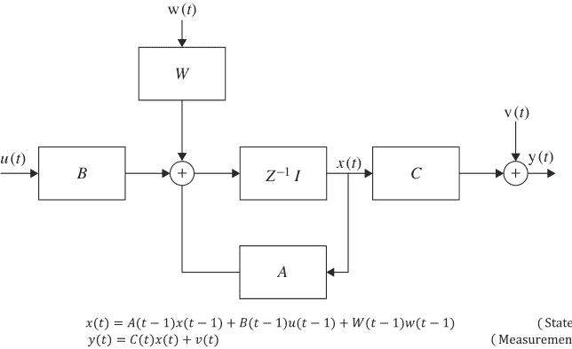
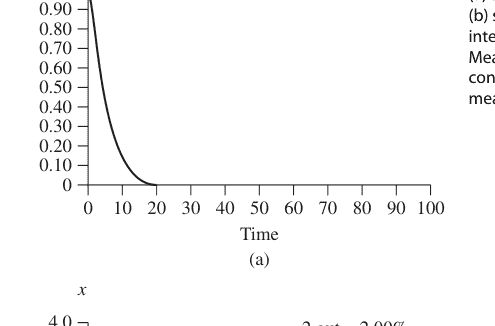
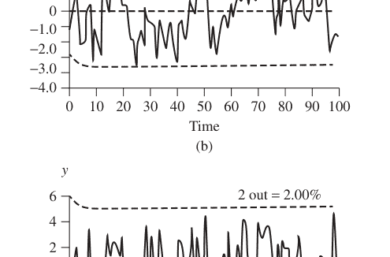
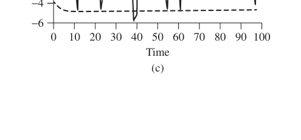
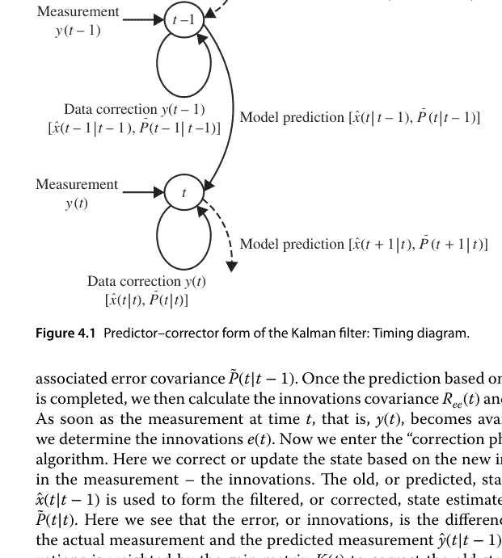
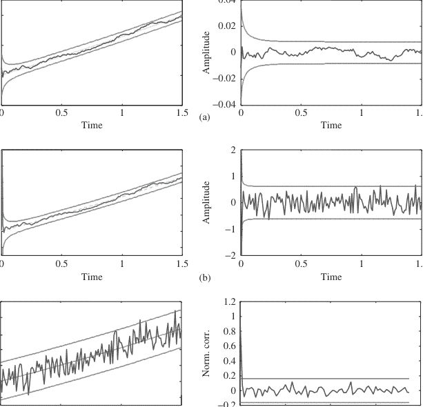
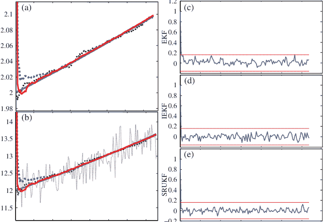
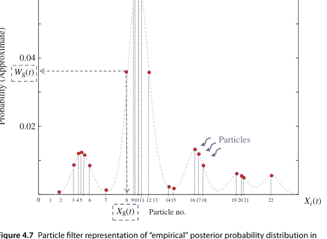
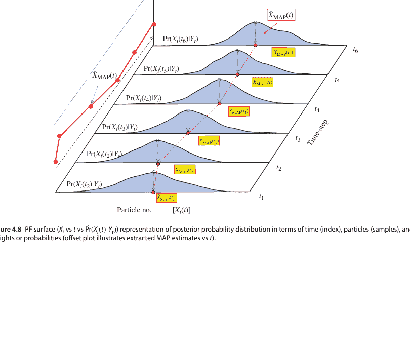
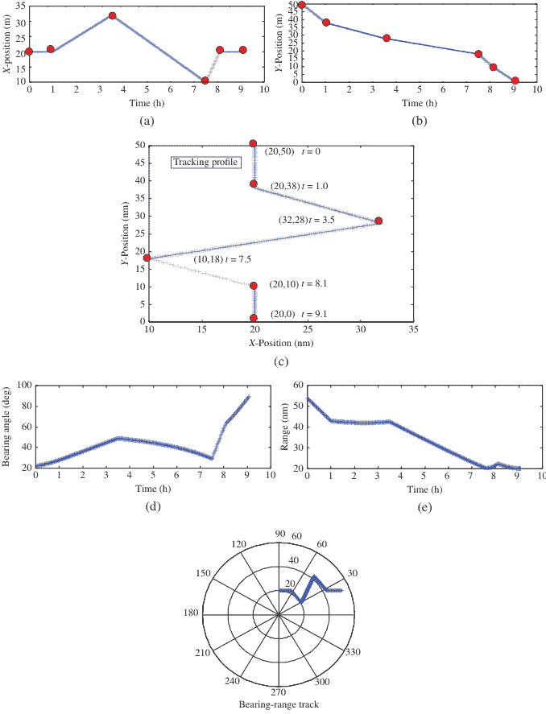

## 3 用于辨识的状态空间模型

让我们考虑一个包含输出（测量）模型的状态空间形式的*非线性动态系统*的一般*确定性*表述¹

$$\dot{x}_t = A(x_t,u_t) = a(x_t) + b(u_t)$$
$$y_t = C(x_t,u_t) = c(x_t) + d(u_t)$$

其中 $x_t$, $y_t$ 和 $u_t$ 分别为 $N_x$ 维状态向量、$N_y$ 维输出向量和 $N_u$ 维输入向量，并具有相应的系统（过程）、输入、测量（输出）和前馈函数。$N_x$ 维系统函数和输入函数分别由 $a(\cdot)$ 和 $b(\cdot)$ 定义，而 $N_y$ 维输出函数和前馈函数分别由 $c(\cdot)$ 和 $d(\cdot)$ 给出。

为了完整地确定 $N_x$ 阶微分方程的解，我们必须指定上述函数，以及在时间 $t_0$ 处的 $N_x$ 个初始条件和所有 $t \ge t_0$ 时的输入。这里 $N_x$ 是“最小”状态变量集的维数。

如果我们将状态空间表示约束为关于状态是线性的，那么我们得到如下一般的连续时间、*线性、时变*状态空间模型：

$$
\begin{aligned}
\dot{x}_t &= A_t x_t + B_t u_t \\
y_t &= C_t x_t + D_t u_t
\end{aligned}
\tag{3.1}
$$

其中 $x_t \in \mathbb{R}^{N_x\times 1}$，$u_t \in \mathbb{R}^{N_u\times 1}$，$y_t \in \mathbb{R}^{N_y\times 1}$，对应的系统、输入、输出和前馈矩阵分别为：$A \in \mathbb{R}^{N_x\times N_x}$，$B \in \mathbb{R}^{N_x\times N_u}$，$C \in \mathbb{R}^{N_y\times N_x}$，$D \in \mathbb{R}^{N_y\times N_u}$。

状态空间表示的一个有趣性质是，这些模型代表了几乎任何物理系统的完整通用形式。也就是说，如果我们有一个*RLC*电路或一个质量-阻尼-弹簧（MCK）机械系统，它们的动力学由一组相同的微分方程支配——只是它们的系数不同。当然，状态的物理意义不同，但这正是状态空间背后的思想——*许多物理系统*都可以用这种通用形式的微分方程来描述，即使这些系统在物理上是不同的。

系统理论本质上是对动态系统的研究，它基于对状态空间模型的研究，并富含揭示所研究系统基本属性的理论成果。这也是状态空间模型被用于信号处理的主要原因之一，尤其是当系统是*多变量*的，具有多个输入和多个输出（MIMO）时。接下来，我们建立状态空间表示与输入/输出关系——即传递函数——之间的联系。

¹ 我们将 $x_t$ 和 $u_t$ 分开是为了以后的模型，但这并非绝对必要。

为此，我们将上述状态空间表示约束为一个线性时不变（LTI）状态空间模型，如下所示：

$$
\begin{aligned}
\dot{x}_t &= A_c x_t + B_c u_t \\
y_t &= C_c x_t + D_c u_t
\end{aligned}
\tag{3.2}
$$

其中 $A_t \to A_c$, $B_t \to B_c$, $C_t \to C_c$, $D_t \to D_c$ 是它们对应的时不变形式，下标“c”表示连续时间矩阵。

该 LTI 模型对应于常系数微分方程的解，这些解可以用拉普拉斯变换求解。对这些方程取拉普拉斯变换²，并解出 $X(s)$，我们得到：

$$X(s) = (sI - A_c)^{-1} x_{t_0} + (sI - A_c)^{-1} B_c U(s) \tag{3.3}$$

其中 $I \in \mathbb{R}^{N_x \times N_x}$ 是单位矩阵。对应的输出为：

$$Y(s) = \left[C_c (sI - A_c)^{-1} B_c + D_c\right] U(s) + C_c (sI - A_c)^{-1} x_{t_0} \tag{3.4}$$

根据传递函数的定义（零初始条件），我们得到期望结果：

$$H(s)\big|_{t_0=0} := \frac{Y(s)}{U(s)} = C_c (sI - A_c)^{-1} B_c + D_c \tag{3.5}$$

对该方程取拉普拉斯逆变换，即可得到 LTI 系统相应的脉冲响应矩阵 [1]：

$$H(t, \tau) = C_c e^{A_c (t-\tau)} B_c + D_c \delta(t), \quad t \ge \tau \tag{3.6}$$

因此我们看到，状态空间表示使我们能够用内部变量或状态来表达输入-输出关系。还要注意，与信号处理文献中常见的单输入单输出（SISO）（标量）系统模型相比，这是一种多变量表示。

现在我们有了 LTI 系统的多变量传递函数表示，可以直接使用逆变换求解状态方程，得到时域解。首先，我们简化符号，将状态转移矩阵的拉普拉斯变换，即系统理论中所谓的预解矩阵 [1, 3] 定义为：

$$\Phi_c(s) := (sI - A_c)^{-1} \tag{3.7}$$

其中

$$\Phi_c(t) = \mathcal{L}^{-1}\left[(sI - A_c)^{-1}\right] = e^{A_c t} \tag{3.8}$$

² 回顾一下，拉普拉斯变换定义为 $X(s) := \mathcal{L}\{x_t\} = \int_{-\infty}^{\infty} x_t e^{-st} dt$，其逆变换为 $x_t = \mathcal{L}^{-1}[X(s)] = \int_{-\infty}^{\infty} X(s) e^{st} ds$，其中 $s = \sigma + j\omega$ 是一个复变量。


因此，状态转移矩阵是 LTI 系统状态方程解中的关键组成部分，其表达式为

```
Φ_c(t, t₀) = e^{A_c(t−t₀)}    t ≥ t₀    (3.9)
```

于是我们可以将传递函数矩阵重写为

```
H(s) = C_c Φ_c(s) B_c + D_c    (3.10)
```

相应的状态-输入传递矩阵由下式给出

```
X(s) = Φ_c(s) x_{t₀} + Φ_c(s) B_c U(s)    (3.11)
```

进行拉普拉斯逆变换可得时域解

```
x_t = ℒ⁻¹[X(s)] = Φ_c(t, t₀) x_{t₀} + Φ_c(t, t₀) B_c * u_t
```

或

```
x_t = Φ_c(t, t₀) x_{t₀} + ∫_{t₀}^{t} Φ_c(t, α) B_c u_α dα    (3.12)
      zero-input              zero-state
```

相应的输出解为

```
y_t = C_c Φ_c(t, t₀) x_{t₀} + ∫_{t₀}^{t} C_c Φ_c(t, α) B_c u_α dα + D_c δ(t)    (3.13)
```

重新审视式 (3.12) 的连续时间系统，并将状态转移矩阵替换为矩阵指数，得到 LTI 解如下

```
x_t = e^{A_c(t−t₀)} x_{t₀} + ∫_{t₀}^{t} e^{A_c(t−α)} B_c u_α dα    (3.14)
```

相应的测量系统为

```
y_t = C_c x_t + D_c u_t    (3.15)
```

一般来说，连续状态转移矩阵满足以下性质：[1, 2]

- 1) Φ_c(t, t₀) 对 t, t₀ ∈ [0, ∞) 是唯一确定的（唯一性）
- 2) Φ_c(t, t) = I（恒等性）
- 3) Φ_c(t) 满足矩阵微分方程：

  ```
  Φ̇_c(t, t₀) = A_t Φ_c(t, t₀),    Φ_c(t₀, t₀) = I, t ≥ t₀    (3.16)
  ```

- 4) Φ_c(t, t₀) = Φ_c(t, τ) × Φ_c(τ, α) × ⋯ × Φ_c(β, t₀)（半群性）
- 5) Φ_c(t, τ)⁻¹ = Φ_c(τ, t)（逆性）

因此，转移矩阵在 LTI 系统理论中对于分析和预测 LTI 及时变系统的响应起着关键作用 [2]。

例如，LTI 的极点决定了稳定性和响应时间等重要属性。极点是 A_c 的特征（多项式）方程的根，可通过求解预解式行列式的根得到，即：

```
|Φ_c(s)| = |(sI − A_c)|_{s=p_i} = 0  (3.17)
```

稳定性通过确保所有极点都位于 S 平面的左半平面来判定。接下来我们考虑采样数据状态空间表示。

## 3.3 采样数据状态空间模型

随着高速模数转换器（ADC）和现代计算机的出现，对连续时间系统进行采样已十分普遍。采样数据系统介于连续模拟域（物理系统）和纯离散域（股票市场价格）之间。由于我们是对连续时间过程进行严格采样，因此必须确保其所有属性都得以保留。著名的奈奎斯特采样定理精确地给出了从样本中实现该过程“完美”重构所需的条件（最高频率的两倍）[15]。

因此，如果我们有一个由连续时间动力学支配的物理系统，并且在给定时刻对其“采样”，那么可以直接从连续时间状态空间模型的解中获得采样数据模型。即，我们从 3.2 节可知

```
x_t = Φ_c(t, t_0)x_{t_0} + ∫_{t_0}^t Φ_c(t, α)B_c(α)u_α dα
```

其中 Φ_c(·,·) 是满足式 (3.16) 矩阵微分方程的连续时间状态转移矩阵，即

```
Φ̇_c(t, t_0) = A_t Φ_c(t, t_0),   Φ_c(t_0, t_0) = I,  t ≥ t_0
```

对该系统进行采样，使在区间 (t_{k−1}, t_k] 上 t → t_k，则相应的采样间隔定义为 Δt_k := t_k − t_{k−1}。注意，这种表示不一定是等间隔的——这也是状态空间表示的另一个重要性质。于是，采样解变为

```
x(t_k) = Φ(t_k, t_{k−1})x(t_{k−1}) + ∫_{t_{k−1}}^{t_k} Φ(t_k, α)B_c(α)u_α dα  (3.18)
```

因此，由式 (3.16) 的微分方程，我们得到解

```
Φ(t_k, t_{k−1}) = ∫_{t_{k−1}}^{t_k} A(α)Φ(t_k, α)dα   for   Φ(t_0, t_0) = I  (3.19)
```

时不变状态空间离散系统也可以使用 Z 变换表示为*输入/输出或传递函数*形式，即

```
H(z) = C(zI - A)^{-1}B + D = C(adj(zI - A)/det(zI - A))B + D   (3.29)
```

其中，回顾一下，“adj”表示矩阵的伴随（余子式矩阵的转置），“det”表示矩阵的行列式。

我们将 N 维系统矩阵 A 的*特征方程*或*特征多项式*定义为

```
α(z) := det(zI - A) = z^N + α_1 z^{N-1} + α_2 z^{N-2} + ⋯ + α_{N-1} z + α_N   (3.30)
```

其中*根*对应于底层系统的*极点*，这些极点也可由 A 的*特征值*获得，定义为

```
λ(A) := eig(A) = ∏_{n=1}^N (z - λ_n)   (3.31)
```

其中 λ_n 为第 n 个系统极点。

对式 (3.29) 进行 Z 逆变换，我们得到离散脉冲（或冲击）响应矩阵为

```
H_t = C A^{t-1} B + D δ(t)   (3.32)
```

其中 δ 为克罗内克 δ 函数。

状态差分方程的解可以很容易地通过归纳法导出 [3]，其表达式为

```
x(t) = Φ(t, k)x(k) + Σ_{i=k+1}^t Φ(t, i)B(i)u(i)   for   t > k   (3.33)
```

其中 Φ(t, k) 是*离散时间状态转移*矩阵。对于时变系统，可以（通过归纳法）证明状态转移矩阵满足

```
Φ(t, k) = A(t - 1)·A(t - 2)⋯A(k)
```

而对于时不变系统，状态转移矩阵为

```
Φ(t, k) = A^{t-k}   for   t > k
```

*离散状态转移矩阵*具有与其连续时间对应物类似的性质，即：

- 1) Φ(t, k) 是唯一确定的（唯一性）
- 2) Φ(t, t) = I（恒等性）
- 3) Φ(t, k) 满足矩阵差分方程：

  ```
  Φ(t, k) = A(t - 1)Φ(t - 1, k),   Φ(k, k) = I, t ≥ k + 1   (3.34)
  ```

- 4) Φ(t, k) = Φ(t, t - 1) × Φ(t - 1, t - 2) × ⋯ × Φ(k + 1, k)（半群性）
- 5) Φ^{-1}(t, k) = Φ(k, t)（逆性）

### 3.4.1 线性离散时不变系统

本节我们重点讨论离散 LTI 系统，它是后续子空间辨识技术不可或缺的组成部分。在此，我们推导系统输入/输出关系的紧凑向量-矩阵形式，这将在后续推导中发挥作用。

对于离散 LTI 系统，状态转移矩阵变为

```
Φ(t, k) = A(t − 1) · A(t − 2) ··· A(k) = A^{t−k} for t > k
```

因此，式 (3.33) 的离散 LTI 解为

```
x(t) = A^{t} x(0) + Σ_{k=0}^{t−1} A^{t−k} B u(k);  t = 0, 1, …, K  (3.35)
```

相应的测量或输出系统为

```
y(t) = C A^{t} x(0) + Σ_{k=0}^{t−1} C A^{t−k} B u(k) + D δ(t)  (3.36)
```

将该关系进一步在 K 个采样点上展开并合并同类项，我们得到

```
[ y(0) ; y(1) ; ⋮ ; y(K−1) ] = [ C ; C A ; ⋮ ; C A^{K−1} ] x(0) + [ D … 0 ; C B D … 0 ; ⋮ ⋮ ⋮ ⋮ ; C A^{K−1} B … C B D ] [ u(0) ; u(1) ; ⋮ ; u(K−1) ]  (3.37)
```

其中 𝓞 ∈ ℝ^{K N_y × N_x} 是能观测性矩阵，𝓣 ∈ ℝ^{K N_y × K N_u} 是托普利茨矩阵 [15]。

将这些关系在时间上平移（0 → t）得到

```
[ y(t) ; y(t+1) ; ⋮ ; y(t+K−1) ] = 𝓞_K x(t) + 𝓣_K [ u(t) ; u(t+1) ; ⋮ ; u(t+K−1) ]  (3.38)
```

从而得到向量输入/输出关系

```
y_K(t) = 𝓞_K x(t) + 𝓣_K u_K(t)  (3.39)
```

将式 (3.39) 的这些 m 维向量（K → m）连接起来，构成 K 个采样点上的批次数据（分块 Hankel）矩阵，我们可以得到“数据方程”，即定义分块矩阵如下

```
𝒴_{t,m|K} := [ y(t) y(t+1) ⋯ y(t+K−1) ; y(t+1) y(t+2) ⋯ y(t+K) ; ⋮ ⋮ ⋮ ⋮ ; y(t+m−1) y(t+m) ⋯ y(t+K+m−2) ] = [ y_m(t) ⋯ y_m(t+K−1) ] (3.40)
```

```
𝒰_{t,m|K} := [ u(t) u(t+1) ⋯ u(t+K−1) ; u(t+1) u(t+2) ⋯ u(t+K) ; ⋮ ⋮ ⋮ ⋮ ; u(t+m−1) u(t+m) ⋯ u(t+K+m−2) ] = [ u_m(t) ⋯ u_m(t+K−1) ] (3.41)
```

```
𝒳_{t,m|K} := [ x_m(t) x_m(t+1) ⋯ x_m(t+K−1) ] = [ x(t) A x(t) ⋯ A^{K−1} x(t) ] (3.42)
```

因此，我们得到将系统模型与数据（输入和输出矩阵）联系起来的向量-矩阵数据方程

```
𝒴_{t,m|K} = 𝒪_K 𝒳_{t,m|K} + 𝒯_K 𝒰_{t,m|K} (3.43)
```

该表达式表示了 LTI 状态空间系统输入-状态-输出的基本关系。接下来，我们将讨论一些相关的系统理论结果，这些结果将帮助我们理解后续的大部分子空间实现算法。

### 3.4.2 离散系统理论

在本节中，我们从系统理论的角度研究离散状态空间模型。动态系统必须具有某些属性，以确保对所研究动力学的一致表示。例如，可以证明 [2]，测量系统的一个必要条件是能观测性，即对所关注可用变量或参数的测量提供了足够的信息来重构内部变量或状态。

数学上，如果对于状态空间中的任意初始状态 x(0)，存在一个有限的 t > 0，使得输入 u(t) 和输出 y(t) 的知识足以唯一确定 x(0)，则称该系统是完全能观测的。回顾一下，离散系统的线性状态空间表示由以下方程组定义：

```
State Model: x(t) = A(t−1)x(t−1) + B(t−1)u(t−1)
```


以及由以下内容定义的相应测量系统或输出：

测量模型：
$$
y(t) = C(t)x(t) + D(t)u(t)
$$

使用这一表示形式，可观测系统最简单的例子是直接测量每个状态；因此，测量矩阵 $C$ 是一个 $N_y \times N_x$ 矩阵。为了根据测量值 $y(t)$ 重构 $x(t)$，根据测量系统模型，$C$ 必须是可逆的。在这种情况下，称系统是完全可观测的；然而，如果 $C$ 不可逆，则称系统是不可观测的。

更高一层的复杂性涉及当 $C$ 为 $N_y \times N_x$ 矩阵时对同一问题的求解；此时必须执行伪逆运算 [1, 2]。在一般情况下，问题会更加复杂，因为我们不仅关注重构 $x(t)$，还关注所有有限 $t$ 值下的 $x(t)$；因此，还必须包含状态模型，即系统的动态特性。

基于这一动机，下面正式定义可观测性的概念。状态表示的解由状态转移矩阵 $\Phi(t,0)$ 控制。回顾可知，状态方程的解为 [3]

$$
x(t) = \Phi(t,0)x(0) + \sum_{k=0}^{t-1} \Phi(t,k)B(k)u(k)
$$

因此，左乘测量矩阵后，输出关系为

$$
y(t) = C(t)\Phi(t,0)x(0) + \sum_{k=0}^{t-1} C(t)\Phi(t,k)B(k)u(k) \tag{3.44}
$$

或者通过重新整理，定义

$$
\tilde{y}(t) := y(t) - \sum_{k=0}^{t-1} C(t)\Phi(t,k)B(k)u(k) = C(t)\Phi(t,0)x(0) \tag{3.45}
$$

问题在于求解所得方程中的初始状态；因此，两边同时左乘 $\Phi' C'$，可根据以下关系推断其解：

$$
\Phi'(t,0)C'(t)C(t)\Phi(t,0)x(0) = \Phi'(t,0)C'(t)\tilde{y}(t)
$$

于是，可观测性问题转化为：在什么条件下，该方程能够唯一求出 $x(0)$？等价地，我们要判断 $C(t)\Phi(t,0)$ 的零空间是否为 $\mathbf{0} \in \mathbb{R}^{N_x \times 1}$。已有研究表明 [2, 4]，下述 $N_x \times N_x$ 可观测性 Gram 矩阵具有相同的零空间，即

$$
\mathcal{O}(0,t) := \sum_{k=0}^{t-1} \Phi'(k,0)C'(k)C(k)\Phi(k,0) \tag{3.46}
$$

这等价于确定 $\mathcal{O}(0,t)$ 是非奇异的，或其秩为 $N_x$。

进一步假设系统是 LTI 系统，则在有限时间区间 $t = 0, \ldots, K-1$ 且 $K > N_x$ 内，可得到如下 $K N_y \times N_x$ 的可观测矩阵 [4]：

$$
\mathcal{O}_K := \begin{bmatrix} C \\ C A \\ \vdots \\ C A^{K-1} \end{bmatrix} \tag{3.47}
$$

因此，系统完全可观测的充要条件是：可观测矩阵 $\mathcal{O}_K$ 的秩，即 $\rho(\mathcal{O}_K)$，必须等于 $N_x$。所以，对于 LTI 情形，检查所有测量是否包含重构状态所需的关键信息，可归结为检查可观测矩阵的秩。虽然这是一个有用的数学概念，但在复杂测量系统的分析中，它主要被用作经验性判断准则。

与系统理论中的可观测性相类似，可控性关注输入对动态系统状态的影响。对于任意 $x(0), x(t) \in \mathbb{R}^{N_x \times 1}$，如果存在一个输入序列 $\{u(t)\}$，使得初始条件为 $x(0)$ 的状态方程解在某个有限 $t > 0$ 时为 $x(t)$，则称离散系统是完全可控的。采用与可观测性相同的方法，可以得到如下定义的可控性 Gram 矩阵：

$$
\mathcal{C}(0,t) := \sum_{k=0}^{t-1} \Phi(0,k) B(k) B'(k) \Phi'(0,k) \tag{3.48}
$$

该矩阵必须是非奇异的，或者满足 $\rho[\mathcal{C}(0,t)] = N_x$。

同样，对于 LTI 系统，在有限时间区间 $t = 0, \ldots, K-1$ 且 $K > N_x$ 内，定义如下的 $N_x \times K N_u$ 可控矩阵：

$$
\mathcal{C}_K := \begin{bmatrix} B & A B & \cdots & A^{K-1} B \end{bmatrix} \tag{3.49}
$$

要使系统完全可控，必须满足秩条件 $\rho(\mathcal{C}_K) = N_x$ [4]。

继续讨论 LTI 系统描述。根据 $\mathbb{Z}$ 变换理论，离散传递函数可以表示为无穷幂级数 [4]，即

$$
H(z) = C(zI - A)^{-1} B = \sum_{t=1}^{\infty} H_t z^{-t} \quad \text{for} \quad H_t = C A^{t-1} B \tag{3.50}
$$

其中，$H_t$ 是 $N_y \times N_u$ 的单位脉冲响应矩阵，且 $H_0 = D$。这里，$\{H_t\}_{0}^{\infty}$ 被定义为马尔可夫序列，其对应的马尔可夫参数集合由嵌入系统 $\Sigma_{ABCD} = \{A, B, C, D\}$ 给出。

如果已知 MIMO 传递函数矩阵，那么只需对每个矩阵元素 $(i,j)$ 的传递函数进行长除法，即可确定脉冲响应（矩阵）序列 $\{H_t\}$，即 $H_{ij}(z) = N_{ij}(z)/D_{ij}(z)$。下面的示例将说明这一计算过程，并且该过程对于第 6 章的经典实现理论很有用。

### 示例 3.1

假设我们有一个已知的 $N_y \times N_u$ 传递函数矩阵，其中 $N_y = N_u = 2$——该系统是不稳定的，但可用于说明简单的脉冲响应计算。

$$
H(z) = \begin{bmatrix} \frac{1}{z+2} & \frac{z-1}{(z+1)(z+2)} \\[4pt] \frac{z}{(z+1)(z+2)} & \frac{1}{z+1} \end{bmatrix}
$$

逐项对每个元素执行长除法，令 $H_{ij}(z) = N_{ij}(z)/D_{ij}(z)$；$i = 1,2$；$j = 1,2$，可得到脉冲响应序列：

$$
H(z) = \begin{bmatrix} 1 & 1 \\ 1 & 1 \end{bmatrix}z^{-1} + \begin{bmatrix} -2 & -4 \\ -3 & -1 \end{bmatrix}z^{-2} + \begin{bmatrix} 4 & 10 \\ 7 & 1 \end{bmatrix}z^{-3} + \begin{bmatrix} -8 & -22 \\ -15 & -1 \end{bmatrix}z^{-4} + \begin{bmatrix} 16 & 46 \\ 31 & 1 \end{bmatrix}z^{-5}
$$

根据线性代数中的 *Cayley–Hamilton 定理*，一个 $N$ 维矩阵满足其自身的特征方程 [4]：

$$
A^N + \alpha_1 A^{N-1} + \alpha_2 A^{N-2} + \cdots + \alpha_{N-1} A + \alpha_N I = 0 \tag{3.51}
$$

因此，分别用测量矩阵和输入传输矩阵 $C$ 与 $B$ 左乘和右乘该关系，可知马尔可夫参数满足关于 $N$ 次 $\alpha(z)$ 的递推关系：

$$
H_N = -\sum_{t=1}^{N}\alpha_t H_{N-t} = -\sum_{t=1}^{N}\alpha_t \left(C A^{N-t-1} B\right) \tag{3.52}
$$

这一结果将在第 6 章中进一步涉及关键的 *可实现性* 条件。

根据式 (3.32) 的*外部描述*（$H(z)$ 或 $\{H_t\}$）确定系统的*内部描述* $\Sigma_{ABCD}$ 的问题，称为*实现问题*。在所有具有相同马尔可夫参数的可能实现 $(A,B,C,D)$ 中，维数最小的实现被定义为*最小实现*。因此，最小实现的维数与特征多项式的次数相同（对于多变量系统，实际上是最小多项式的次数），或者等价地，与传递函数的次数（系统极点的数量）相同。

为了建立这些关系，我们定义 $(K N_y) \times (K N_u)$ 的 *Hankel 矩阵*：

$$
\mathcal{H}_{K,K} := \begin{bmatrix} H_1 & H_2 & \cdots & H_K \\ H_2 & H_3 & \cdots & H_{K+1} \\ \vdots & \vdots & \ddots & \vdots \\ H_K & H_{K+1} & \cdots & H_{2K-1} \end{bmatrix} \tag{3.53}
$$

假设系统维数为 $N_x$，则可以使用 $2N_x$ 个脉冲响应矩阵构造 Hankel 矩阵，并令 $K = N_x$。已知阶数 $N_x$ 表明，精确“匹配”马尔可夫序列并提取马尔可夫参数所需的最少项数。此外，$\rho(\mathcal{H}_{K,K}) = N_x$ 就是最小实现的维数。如果不知道系统的维数，那么（理论上）令 $K \to \infty$，并确定 $\mathcal{H}_{\infty,\infty}$ 的秩。因此，“未知”系统的最小维数就是 Hankel 矩阵的秩。

系统要成为最小系统，必须是完全可控且完全可观测的 [4]。这是因为 Hankel 矩阵可以分解为

$$
\mathcal{H}_{K,K} = \begin{bmatrix} CB & \cdots & CA^{K-1}B \\ \vdots & \ddots & \vdots \\ CA^{K-1}B & \cdots & CA^{2K-2}B \end{bmatrix} = \begin{bmatrix} C \\ \vdots \\ CA^{K-1} \end{bmatrix} \begin{bmatrix} B & \cdots & A^{K-1}B \end{bmatrix} \tag{3.54}
$$

或者简单地写作

$$
\mathcal{H}_{K,K} = \mathcal{O}_K \times \mathcal{C}_K \tag{3.55}
$$

由这一分解可知，$\rho(\mathcal{H}_{K,K}) = \min[\rho(\mathcal{O}_K), \rho(\mathcal{C}_K)] = N_x$。因此可以看出，可控性和可观测性的性质与最小性紧密交织在一起，而检验 Hankel 矩阵的秩即可得到底层动态系统的维数。当我们从含噪测量数据中“辨识”系统 $\Sigma_{ABCD} = \{A, B, C, D\}$ 时，这一事实将发挥关键作用。第 6 章将利用这些结果进一步讨论实现理论。

## 3.4.3 等价线性系统

等价系统基于这样一个概念：存在无穷多个状态空间系统，它们具有“相同”的输入/输出响应。在状态空间中，这称为坐标变换；也就是说，我们可以通过相似变换改变描述系统的状态向量，使系统矩阵 $\Sigma_{ABCD} := \{A, B, C, D\}$ 通过变换矩阵 $T$ 变换到另一组坐标 [1–5]，即

$$
\Sigma_{ABCD} \xrightarrow{T} \bar{\Sigma}_{ABCD}
$$

其中

$$
\{A, B, C, D\} \to \{\bar{A}, \bar{B}, \bar{C}, \bar{D}\} := \{TAT^{-1}, TB, CT^{-1}, D\}
$$

从输入/输出角度看，这给出了一个“等价”系统，即传递函数相同：

$$
H(z) = \bar{C}(zI - \bar{A})^{-1}\bar{B} + \bar{D} = CT^{-1}(zI - TAT^{-1})^{-1}TB + D = C(zI - A)^{-1}B + D
$$


以及相应的脉冲响应矩阵

$$H_t = C\bar{A}^{t-1}\bar{B} + D\delta(t) = C T^{-1} \times T A^{t-1} T^{-1} \times T B + D\delta(t)$$
$$= C A^{t-1}B + D\delta(t)$$

“确实存在一种称为‘规范形式’的状态空间系统唯一表示，我们将在第 3.7 节中看到 SISO 系统的规范形式，以及随后在第 6 章中讨论的 MIMO 系统。事实上，控制理论的很大一部分都是基于在模态坐标系中设计控制器，具有对角系统或模态矩阵 $A_M$，然后使用逆变换 $T \to T_M^{-1}$ 将模态系统转换回物理坐标 [4]。

## 3.4.4 稳定的线性系统

线性系统的稳定性也可以与可控性和可观测性的性质结合起来考虑 [4–10]。对于齐次离散系统，已证明渐近稳定性直接由系统矩阵的特征值 $\lambda(A)$ 决定。这些特征值必须位于单位圆内，或者等价地 $\lambda_i(A) < 1\ \forall i$。

除了确定 $A$ 的特征值或等价地对特征方程进行因式分解以提取系统极点之外，另一种评估该条件的方法直接来自 Lyapunov 稳定性理论 [9, 10]，该理论结合了可观测性。

如果且仅当 Lyapunov 方程

$$P = A'PA + C'C \quad \text{(Lyapunov Equation)} \qquad (3.56)$$

具有唯一的正定解，$P > 0$，则可观测系统是稳定的。证明见 [9] 或 [10]。正如我们将看到的，这是一个重要的性质，它将在随后的辨识理论中应用于提取所谓的平衡实现以及唯一的随机实现 [10]。

至此，离散系统理论部分结束。应当注意，本节讨论的所有性质对于连续时间系统同样存在（详见 [2]）。

## 3.5 Gauss–Markov 状态空间模型

在本节中，我们将状态空间表示扩展到包含随机输入或噪声源以及随机初始条件。离散时间 Gauss–Markov 模型将在本文中广泛应用。

### 3.5.1 离散时间 Gauss–Markov 模型

这里我们研究当随机输入施加于具有随机初始条件的离散状态空间系统时的情况。如果激励是随机的

将输入限制为确定性 $u(t-1)$，噪声为零均值、白噪声、高斯 $w(t-1)$，Gauss–Markov 模型演化为

$$x(t)=A(t-1)x(t-1)+B(t-1)u(t-1)+W(t-1)w(t-1) \tag{3.57}$$

其中 $w\sim\mathcal{N}(0,R_{ww})$ 且 $x(0)\sim\mathcal{N}(\bar{x}(0),P(0))$。

Gauss–Markov 方程的解可通过归纳法容易地得到

$$x(t)=\Phi(t,k)x(k)+\sum_{i=k}^{t-1}\Phi(t,i+1)B(i)u(i)+\sum_{i=k}^{t-1}\Phi(t,i+1)W(i)w(i) \tag{3.58}$$

它仅依赖于前一状态而具有马尔可夫性。由于 $x(t)$ 只是高斯过程的线性变换，它也是高斯的。因此，我们可以利用状态空间模型轻松表示 Gauss–Markov 过程。

当 *measurement* 模型也包含在内时，我们有

$$y(t)=C(t)x(t)+D(t)u(t)+v(t) \tag{3.59}$$

其中 $v\sim\mathcal{N}(0,R_{vv})$。该模型在图 3.1 中以示意方式给出。

由于式 (3.57) 的 Gauss–Markov 模型由高斯分布表征，它在统计上完全由其均值和方差确定。因此，如果我们分别对式 (3.57) 和 (3.59) 取期望，我们得到 *state mean vector* $m_x$ 为

$$m_x(t)=A(t-1)m_x(t-1)+B(t-1)u(t-1) \tag{3.60}$$



图 3.1 离散过程的 Gauss–Markov 模型。

以及 *measurement mean vector* $m_y$ 为

$$m_y(t)=C(t)m_x(t)+D(t)u(t)$$  \tag{3.61}

*state variance*³ $P(t):=\operatorname{var}\{x(t)\}$ 由离散 Lyapunov 方程给出：

$$P(t)=A(t-1)P(t-1)A'(t-1)+W(t-1)R_{ww}(t-1)W'(t-1)$$  \tag{3.62}

以及测量方差，$R_{yy}(t):=\operatorname{var}\{y(t)\}$ 为

$$R_{yy}(t)=C(t)P(t)C'(t)+R_{vv}(t)$$  \tag{3.63}

类似地，可以证明 *state covariance* 遵循以下方程传播：

$$P(t,k)=\begin{cases}\Phi(t,k)P(k),&\text{for }t\ge k\\P(t)\Phi'(t,k),&\text{for }t\le k\end{cases}$$  \tag{3.64}

我们将 Gauss–Markov 模型及其对应的统计模型总结在表 3.1 中。

如果我们将 Gauss–Markov 模型限制为平稳情况，则

$$A(t)\to A,\quad B(t)\to B,\quad C(t)\to C,\quad W(t)\to W,\quad R_{ww}(t)\to R_{ww},$$
$$\text{and }R_{vv}(t)\to R_{vv}$$

**表 3.1 Gauss–Markov 表示。**

|  |  |
|---|---|
| *State propagation* | $x(t)=A(t-1)x(t-1)+B(t-1)u(t-1)+W(t-1)w(t-1)$ |
| *State mean propagation* | $m_x(t)=A(t-1)m_x(t-1)+B(t-1)u(t-1)$ |
| *State variance/covariance propagation* | $P(t)=A(t-1)P(t-1)A'(t-1)+W(t-1)R_{ww}(t-1)W'(t-1)$<br>$P(t,k)=\begin{cases}\Phi(t,k)P(k),&t\ge k\\P(t)\Phi'(t,k),&t\le k\end{cases}$ |
| *Measurement propagation* | $y(t)=C(t)x(t)+v(t)$ |
| *Measurement mean propagation* | $m_y(t)=C(t)m_x(t)$ |
| *Measurement variance/covariance propagation* | $R_{yy}(t)=C(t)P(t)C'(t)+R_{vv}(t)$<br>$R_{yy}(t,k)=C(t)P(t)C'(t)+R_{vv}(t,k)$ |

³ 我们在本文中始终使用简写记号，$P(k):=P_{xx}(k,k)=\operatorname{cov}\{x(k),x(k)\}=\operatorname{var}\{x(k)\}$。

以及方差方程变为

$$P(t)=AP(t-1)A' + WR_{ww}W'$$

其中

$$R_{yy}(t)=CP(t)C' + R_{vv}$$  (3.65)

在稳态时 ($t \to \infty$)，我们有

$$P(t)=P(t-1)=\cdots=P_{ss}=:P$$

因此，测量协方差关系变为

$$R_{yy}(0)=CPC' + R_{vv} \quad \text{for lag } k=0$$  (3.66)

通过归纳法可以证明

$$R_{yy}(k)=CA^{|k|}PC' \quad \text{for } k\ne0$$  (3.67)

测量功率谱可通过对该方程取 $\mathcal{Z}$-变换轻松获得

$$S_{yy}(z)=CS_{xx}(z)C' + S_{vv}(z)$$  (3.68)

其中

$$S_{xx}(z)=T(z)S_{ww}(z)T'(z^{-1}) \quad \text{for } T(z)=(zI-A)^{-1}W$$

其中

$$S_{ww}(z)=R_{ww} \quad \text{and} \quad S_{vv}(z)=R_{vv}$$

因此，使用 $H(z)=CT(z)$ 谱由下式给出

$$S_{yy}(z)=H(z)R_{ww}H'(z^{-1})+R_{vv}$$  (3.69)

因此我们看到 Gauss–Markov 状态空间模型使我们能够对多通道随机信号进行更一般的表示。事实上，我们能够在此框架内轻松处理多通道和非平稳统计情况。向量模型也可能进行推广，但这些形式变得相当复杂，需要一些多变量系统理论和规范形式方面的知识（详见 [1]）。在离开这个主题之前，让我们考虑一个具有 Gauss–Markov 模型的简单输入/输出示例。

### Example 3.2

考虑以下由随机（白）噪声驱动的差分方程：

$$y(t)=-ay(t-1)+e(t-1)$$

对应的状态空间表示为

$$x(t)=-ax(t-1)+w(t-1) \quad \text{and} \quad y(t)=x(t)$$

取 Z 变换（忽略随机性），我们得到传递函数

```
H(z) = 1 / (1 - a z^{-1})
```

使用式 (3.62)，上述模型的方差方程为

```
P(t) = a^2 P(t - 1) + R_{ww}
```

假设过程是平稳的，则 $P(t) = P$ 对所有 $t$ 成立，求解 $P$ 得到

```
P = R_{ww} / (1 - a^2)
```

因此，

```
R_{yy}(k) = C A^{|k|} P C' = a^{|k|} R_{ww} / (1 - a^2) and R_{yy}(0) = C P C' + R_{vv} = R_{ww} / (1 - a^2)
```

对于 $C = 1$。

选择 $R_{ww} = 1 - a^2$ 得到 $R_{yy}(k) = a^{|k|}$。取 Z 变换，离散功率谱由下式给出

```
S_{yy}(z) = H(z) R_{ee} H'(z^{-1}) + R_{vv} = 1/(1 - a z^{-1}) R_{ww} 1/(1 - a z)
```

因此，我们得出结论，对于平稳过程，这些模型是等价的。

现在如果我们假设一个非平稳过程并令 $a = -0.75$，$x(0) \sim N'(1, 2.3)$，$w \sim N'(0, 1)$，且 $v \sim N'(0, 4)$，则 Gauss-Markov 模型由下式给出

```
x(t) = 0.75 x(t - 1) + w(t - 1) and y(t) = x(t) + v(t)
```

对应的统计由均值关系给出

```
m_x(t) = 0.75 m_x(t - 1)   m_x(0) = 1
m_y(t) = m_x(t)           m_y(0) = m_x(0)
```

以及方差方程

```
P(t) = 0.5625 P(t - 1) + 1 and R_{yy}(t) = P(t) + 4
```

我们应用 MATLAB [15] 中提供的模拟器获得该过程的 100 个样本实现。结果如图 3.2a 至 c 所示。在图 3.2a,b 中我们看到均值和模拟状态以及均值周围的置信区间，即

```
[m_x(t) ± 1.96 sqrt(P(t))]
```

和

```
P = R_{ww} / (1 - a^2) = 2.286
```


图3.2 一阶过程的高斯-马尔可夫仿真：(a) 状态/量测均值，(b) 状态及其均值的95%置信区间，(c) 量测及其均值的95%置信区间。







利用上述置信区间，我们预计95%的样本将落在 \((m_x \to 0) \pm 3.03\;(1.96 \times \sqrt{2.286})\) 之内。从图中可以看出，100个样本中仅有2个超出该界限，表明该仿真在统计上是可以接受的。对于仿真量测，我们观察到类似的结果。稳态方差由下式给出

\[
R_{yy}=P+R_{vv}=2.286+4=6.286
\]

因此，在稳态下，我们预计95%的量测样本将落在 \((m_y \to 0) \pm 5.01(1.96 \times \sqrt{6.286})\) 之内。本例到此结束。

应当注意，如果超出界限的样本超过5%（即落在界内的样本不足95%），则必须选择新的随机种子并重新执行仿真，直到满足界限条件，以表明这是一个有效的高斯-马尔可夫仿真。

## 3.6 新息模型

在本节中，我们简要推导与高斯-马尔可夫表示相关的新息模型。该模型的重要性将在全书后续展开，但现在我们借此机会展示它与基本高斯-马尔可夫表示的关系。我们首先将原始的高斯-马尔可夫表示扩展到过程噪声与量测噪声相关的情形，然后说明新息模型如何成为该结构的一个特例。

相关过程噪声与量测噪声的标准高斯-马尔可夫模型由下式给出

\[
x(t)=Ax(t-1)+Bu(t-1)+W(t-1)w^*(t-1)
\]
\[
y(t)=Cx(t)+v^*(t) \tag{3.70}
\]

其中 \(R^*(t,k):=R^*\delta(t-k)\)，且

\[
R^*=
\begin{bmatrix}
R_{ww^*} & R_{wv^*}\\
R_{v^*w^*} & R_{v^*v^*}
\end{bmatrix}
=
\begin{bmatrix}
WR_{ww}W' & WR_{wv}\\
R_{vw}W' & R_{vv}
\end{bmatrix}
\]

这里我们观察到，在标准高斯-马尔可夫模型中，\((N_x+N_v)\times(N_x+N_v)\) 分块协方差矩阵 \(R^*\) 是满的，其非对角线上为互协方差矩阵 \(R_{w^*v^*}\)。通常的标准模型假设它们为零（不相关）。使用这种形式的高斯-马尔可夫模型对具有相关 \(w(t)\) 和 \(v(t)\) 的系统进行仿真更为复杂，因为必须首先对 \(R^*\) 进行因式分解，使得

\[
R^*=
\begin{bmatrix}
R_1^*\\
R_2^*
\end{bmatrix}
\begin{bmatrix}
R_1^{*'} & R_2^{*'}
\end{bmatrix}
\tag{3.71}
\]

其中 \(R_i^*\) 为矩阵平方根 [6, 7]。一旦完成因式分解，就可以通过对不相关噪声源 \(w(t)\) 和 \(v(t)\) 进行“着色”来合成相关噪声，如下所示

\[
\begin{bmatrix}
w^*(t)\\
v^*(t)
\end{bmatrix}
=
\begin{bmatrix}
R_1^*w(t)\\
R_2^*v(t)
\end{bmatrix}
\tag{3.72}
\]

新息模型是相关高斯-马尔可夫描述的一种受约束形式。如果我们假设 \(\{e(t)\}\) 是一个零均值、白色高斯序列，即 \(e \sim \mathcal{N}(0,R_{ee})\)，则*新息模型* [11–15] 可表示为

\[
x(t)=A(t-1)x(t-1)+B(t-1)u(t-1)+K(t-1)e(t-1)
\]
\[
y(t)=C(t)x(t)+e(t)
\tag{3.73}
\]

其中 \(e(t)\) 是 \(N_y\) 维新息向量，\(K(t-1)\) 是 \((N_x \times N_y)\) 加权矩阵，新息协方差由下式给出

\[
R_{ee}^* := \operatorname{cov}\left(
\begin{bmatrix}
Ke(t)\\
e(t)
\end{bmatrix}
\right)
=
\begin{bmatrix}
KR_{ee}K' & KR_{ee}\\
R_{ee}K' & R_{ee}
\end{bmatrix}
\delta(t-k)
\]

重要的是要注意，新息模型在维纳-卡尔曼滤波（谱分解）中具有重要意义，因为 \(R_{ee}^*\) 可以直接用权重和新息协方差矩阵表示为*因式分解*或平方根形式 \((R:=\sqrt{R}\sqrt{R}')\)，即

\[
R_{ee}^* :=
\begin{bmatrix}
K\sqrt{R_{ee}}\\
\sqrt{R_{ee}}
\end{bmatrix}
\begin{bmatrix}
\sqrt{R_{ee}}K' & \sqrt{R_{ee}}
\end{bmatrix}
\delta(t-k)
\tag{3.74}
\]

将新息模型与高斯-马尔可夫模型进行比较，我们看到它们都等价于 \(w\) 和 \(v\) 相关的情形。接下来，我们证明各种模型集与这一族状态空间表示的等价性。

## 3.7 状态空间模型结构

本节讨论文献中通常称为“标准形”的特殊状态空间结构，因为它们代表了特别有用的独特状态构造。我们将模型限制为SISO形式，而更复杂的多变量结构将在第6章中展开。这里我们首先回顾第2章中带外生输入的自回归滑动平均（ARMAX）模型，然后给出其在状态空间形式中的等价表示。

### 表3.2 ARMAX表示

| 传播 | 方程 |
|---|---|
| 输出传播 | \(y(t) = (1 - A(q^{-1}))y(t) + B(q^{-1})u(t) + C(q^{-1})e(t)\) |
| 均值传播 | \(m_y(t) = (1 - A(q^{-1}))m_y(t) + B(q^{-1})u(t) + C(q^{-1})m_e(t)\) |
| 脉冲传播 | \(h(t) = (1 - A(q^{-1}))h(t) + C(q^{-1})\delta(t)\) |
| 方差/协方差传播 | \(R_{yy}(k) = R_{ee}\sum_{i=0}^{\infty} h(i)h(i+k), \quad k \ge 0\) |

| 变量 | 描述 |
|---|---|
| \(y\) | 输出或量测序列 |
| \(u\) | 输入序列 |
| \(e\) | 方差为 \(R_{ee}\) 的过程（白色）噪声序列 |
| \(h\) | 脉冲响应序列 |
| \(\delta\) | 幅度为 \(\sqrt{R_{ee}}\) 的脉冲输入 |
| \(m_y\) | 均值输出或量测序列 |
| \(m_e\) | 均值过程噪声序列 |
| \(R_{yy}\) | 滞后 \(k\) 处的平稳输出协方差 |
| \(A\) | \(N_a\) 阶系统特征（极点）多项式 |
| \(B\) | \(N_b\) 阶输入（零点）多项式 |
| \(C\) | \(N_c\) 阶噪声（零点）多项式 |

下面给出一个示例，展示如何应用这些模型来实现一个随机信号。首先，我们考虑ARMAX到状态空间的变换。

回顾式(3.77)，ARMAX模型的一般差分方程形式由下式给出

\[
y(t) = -\sum_{i=1}^{N_a} a_i y(t-i) + \sum_{i=0}^{N_b} b_i u(t-i) + \sum_{i=0}^{N_c} c_i e(t-i)
\tag{3.78}
\]

或等价地，在频域中表示为

\[
Y(z) = \left( \frac{b_0 + b_1 z^{-1} + \cdots + b_{N_b} z^{-N_b}}{1 + a_1 z^{-1} + \cdots + a_{N_a} z^{-N_a}} \right) U(z) + \left( \frac{c_0 + c_1 z^{-1} + \cdots + c_{N_c} z^{-N_c}}{1 + a_1 z^{-1} + \cdots + a_{N_a} z^{-N_a}} \right) E(z)
\tag{3.79}
\]

其中 \(N_a \ge N_b\)、\(N_a \ge N_c\)，且 \(\{e(t)\}\) 是零均值白色序列，其频谱由 \(R_{ee}\) 给出。

可以直接证明（参见 [5]），ARMAX模型可以表示为*观测器标准形*：

\[
x(t) = A_0 x(t-1) + B_0 u(t-1) + W_0 e(t-1)
\]
\[
y(t) = C_0' x(t) + b_0 u(t) + c_0 e(t)
\tag{3.80}
\]

其中 \(x\)、\(u\)、\(e\) 和 \(y\) 分别为 \(N_a\) 维状态向量、标量输入、噪声和输出，且

\[
A_0 :=
\begin{bmatrix}
0 & \cdots & 0 & -a_{N_a}\\
1 & \cdots & 0 & -a_{N_a-1}\\
\vdots & \ddots & \vdots & \vdots\\
0 & \cdots & 1 & -a_1
\end{bmatrix}
\]

\[
B_0 :=
\begin{bmatrix}
-a_{N_a}b_0\\
\vdots\\
-a_{N_b+1}b_0\\
b_{N_b}-a_{N_b}b_0\\
\vdots\\
b_1-a_1b_0
\end{bmatrix}
\]

\[
W_0 :=
\begin{bmatrix}
-a_{N_a}c_0\\
\vdots\\
-a_{N_c+1}c_0\\
c_{N_c}-a_{N_c}c_0\\
\vdots\\
c_1-a_1c_0
\end{bmatrix}
\]

\[
C_0' :=
\begin{bmatrix}
0 & \cdots & 0 & 1
\end{bmatrix}
\]

注意该结构，我们看到每个矩阵或向量元素 \(\{A_{i,N_a}, B_i, W_i, C_i\}\)（\(i = 1, \ldots, N_a\)）都可以由以下关系确定

\[
\begin{aligned}
A_{i,N_a} &= -a_i \quad i = 1, \ldots, N_a\\
B_i &= b_i - a_i b_0\\
W_i &= c_i - a_i c_0\\
C_i &= \delta(N_a - i)
\end{aligned}
\tag{3.81}
\]

其中

\[
b_i = 0 \quad \text{for } i > N_b,\qquad
c_i = 0 \quad \text{for } i > N_c
\]

且 \(\delta(i-j)\) 是克罗内克δ函数。

考虑以下示例来说明这些关系。

**例3.3.** 设 \(N_a = 3\)、\(N_b = 2\)、\(N_c = 1\)，则相应的ARMAX模型为

\[
y(t) = -a_1 y(t-1) - a_2 y(t-2) - a_3 y(t-3) + b_0 u(t) + b_1 u(t-1) + b_2 u(t-2) + c_0 e(t) + c_1 e(t-1)
\tag{3.82}
\]

利用式(3.80)的观测器标准形，我们有

\[
x(t) =
\begin{bmatrix}
0 & 0 & -a_3\\
1 & 0 & -a_2\\
0 & 1 & -a_1
\end{bmatrix}
x(t-1)
+
\begin{bmatrix}
-a_3b_0\\
b_2-a_2b_0\\
b_1-a_1b_0
\end{bmatrix}
u(t-1)
+
\begin{bmatrix}
-a_3c_0\\
-a_2c_0\\
c_1-a_1c_0
\end{bmatrix}
e(t-1)
\]

\[
y(t) =
\begin{bmatrix}
0 & 0 & 1
\end{bmatrix}
x(t) + b_0 u(t) + c_0 e(t)
\]

本例到此结束。

重要的是要认识到，如果我们假设 \(\{e(t)\}\) 是高斯的，那么ARMAX模型等价于第3.6节的新息表示，即

\[
x(t) = A x(t-1) + B u(t-1) + W e(t-1)
\]
\[
y(t) = C' x(t) + b_0 u(t) + c_0 e(t)
\tag{3.83}
\]

在这种情况下，\(K \to W\)、\(D \to b_0\)、\(1 \to c_0\)。同时，相应的协方差矩阵变为

\[
R_{ee}^* := \operatorname{cov}\left(
\begin{bmatrix}
W e(t)\\
c_0 e(t)
\end{bmatrix}
\right)
=
\begin{bmatrix}
W R_{ee} W' & W R_{ee} c_0\\
c_0 R_{ee} W' & c_0 R_{ee} c_0
\end{bmatrix}
\delta(t-k)
\]

至此，关于一般ARMAX与状态空间等价性的讨论到此结束。接下来，我们推导第2.4节中给出的ARMAX模型某些特殊情况的状态空间等价模型。

我们从滑动平均（MA）开始

\[
y(t) = e(t) + \sum_{i=1}^{N_c} c_i e(t-i)
\]

或

\[
Y(z) = C(z)E(z) = \left(1 + c_1 z^{-1} + \cdots + c_{N_c} z^{-N_c}\right)E(z)
\]

定义状态变量为

\[
x_i(t-1) := e(t-i-1), \quad i = 1, \ldots, N_c
\tag{3.84}
\]


因此，

$x_i(t) = e(t - i) = x_{i-1}(t - 1), \quad i = 1, \dots, N_c$  (3.85)

展开该表达式，我们得到

$x_1(t) = e(t - 1)$  
$x_2(t) = e(t - 2) = x_1(t - 1)$  
$x_3(t) = e(t - 3) = x_2(t - 1)$  
$\vdots \quad \vdots \quad \vdots$  
$x_{N_c}(t) = e(t - N_c) = x_{N_c-1}(t - 1)$  (3.86)

或以向量–矩阵形式

$\begin{bmatrix} x_1(t) \\ x_2(t) \\ \vdots \\ x_{N_c}(t) \end{bmatrix} = \begin{bmatrix} 0 & \cdots & 0 & | & 0 \\ - - - - - - - - - & | \\ 1 & \cdots & 0 & | & 0 \\ \vdots & \ddots & \vdots & | & \vdots \\ 0 & \cdots & 1 & | & 0 \end{bmatrix} \begin{bmatrix} x_1(t - 1) \\ x_2(t - 1) \\ \vdots \\ x_{N_c}(t - 1) \end{bmatrix} + \begin{bmatrix} 1 \\ 0 \\ \vdots \\ 0 \end{bmatrix} e(t - 1)$

$y(t) = \begin{bmatrix} c_1 & c_2 & \cdots & c_{N_c} \end{bmatrix} \begin{bmatrix} x_1(t - 1) \\ x_2(t - 1) \\ \vdots \\ x_{N_c}(t - 1) \end{bmatrix} + c_0 e(t)$  (3.87)

因此，$MA$状态空间的一般形式为

$\mathbf{x}(t) = \begin{bmatrix} 0 & \cdots & 0 & | & 0 \\ - - - - - - - - - & | \\ \mathbf{I}_{N_c-1} & | & \vdots \end{bmatrix} \mathbf{x}(t - 1) + \mathbf{b} e(t - 1)$

$y(t) = \mathbf{c}' \mathbf{x}(t) + b_0 e(t)$  (3.88)

其中$N_x = N_c$，$\mathbf{b}, \mathbf{c} \in R^{N_x \times 1}$。

接下来考虑自回归（AR）模型（全极点），其形式为

$\sum_{i=1}^{N_a} a_i y(t - i) = \sigma e(t) \quad \text{or} \quad Y(z) = \frac{\sigma E(z)}{1 + a_1 z^{-1} + \cdots + a_{N_a} z^{-N_a}}$  (3.89)

这里，状态向量定义为$x_i(t - 1) = y(t - i - 1)$，因此，$x_i(t) = y(t - i) = x_{i+1}(t - 1); \quad i = 1, \dots, N_a - 1$，且$x_{N_a}(t) = y(t)$。对$i$展开，我们得到向量–矩阵状态空间模型

$x_1(t) \; x_2(t) \; \vdots \; x_{N_a}(t) = \begin{bmatrix}0 & 1 & 0 & \dots & 0 \\ 0 & 0 & 1 & \dots & 0 \\ \vdots & \vdots & \vdots & \ddots & \vdots \\ 0 & 0 & 0 & \dots & 1 \\ -a_{N_a} & -a_{N_a-1} & -a_{N_a-2} & \dots & -a_1\end{bmatrix} \begin{bmatrix}x_1(t-1)\\ x_2(t-1)\\ \vdots\\ x_{N_a}(t-1)\end{bmatrix} + \begin{bmatrix}0\\0\\ \vdots\\ \sigma\end{bmatrix} e(t-1)$

$y(t) = \begin{bmatrix}0 & 0 & \dots & 1\end{bmatrix} \begin{bmatrix}x_1(t-1)\\ x_2(t-1)\\ \vdots\\ x_{N_a}(t-1)\end{bmatrix}$  (3.90)

一般地，我们有AR（全极点）状态空间模型

$x(t) = \begin{bmatrix}0 & | & I_{N_a-1}\\ \vdots & | & \\ 0 & | & \\ -a_{N_a} & -a_{N_a-1} & -a_{N_a-2} & \dots & -a_1\end{bmatrix} x(t-1) + b e(t-1)$

$y(t) = c' x(t)$  (3.91)

其中$N_x = N_a$，$b, c \in R^{N_x \times 1}$。

另一种有用的状态空间表示是正规型，它通过对有理离散传递函数模型（ARMA）进行部分分式展开而得到

$h(t) = \sum_{i=1}^{N_p} R_i (p_i)^{t}$ 或 $H(z^{-1}) = Y(z^{-1})/E(z^{-1}) = \sum_{i=1}^{N_p} R_i / (1 - p_i z^{-1})$  (3.92)

其中$\{R_i, p_i\}$; $i = 1, \dots, N_p$为$H(z^{-1})$的留数和极点集合。注意，正规型模型是基于以下关系组的解耦或并联系统表示：

$y_i(t) - p_i y_i(t-1) = e(t),\; i = 1, \dots, N_p$

将状态变量定义为$x_i(t) := y_i(t)$，则等价地有

$x_i(t) - p_i x_i(t-1) = e(t),\; i = 1, \dots, N_p$  (3.93)

因此，输出由下式给出

$$y(t)=\sum_{i=1}^{N_p}R_i v_i(t)=\sum_{i=1}^{N_p}R_i x_i(t),\qquad i=1,\ldots,N_p$$

将这些关系对$i$展开，我们得到

$$\begin{bmatrix}x_1(t)\\x_2(t)\\\vdots\\x_{N_p}(t)\end{bmatrix}=\begin{bmatrix}p_1&0&\cdots&0\\0&p_2&\cdots&0\\\vdots&\vdots&\ddots&\vdots\\0&0&\cdots&p_{N_p}\end{bmatrix}\begin{bmatrix}x_1(t-1)\\x_2(t-1)\\\vdots\\x_{N_p}(t-1)\end{bmatrix}+\begin{bmatrix}1\\1\\\vdots\\1\end{bmatrix}e(t-1)$$

$$y(t)=\begin{bmatrix}R_1&R_2&\cdots&R_{N_p}\end{bmatrix}\begin{bmatrix}x_1(t-1)\\x_2(t-1)\\\vdots\\x_{N_p}(t-1)\end{bmatrix}$$

因此，*正规状态空间模型*的一般解耦形式为

$$\mathbf{x}(t)=\begin{bmatrix}p_1&0&\cdots&0\\0&p_2&\cdots&0\\\vdots&\vdots&\ddots&\vdots\\0&0&\cdots&p_{N_p}\end{bmatrix}\mathbf{x}(t-1)+\mathbf{b}e(t-1)$$

$$y(t)=\mathbf{c}'\mathbf{x}(t)$$

其中$\mathbf{b}\in\mathbb{R}^{N_p\times1}$，且$\mathbf{b}=\mathbf{1}$为$N_p$维单位向量。这里$\mathbf{c}\in\mathbb{R}^{1\times N_p}$，$\mathbf{c}'=[R_1\ R_2\ \cdots\ R_{N_p}]$。

## 3.8 非线性（近似）高斯-马尔可夫状态空间模型

实际中的许多过程是非线性的，而非线性的。将非线性与含噪数据耦合在一起，使得信号处理问题具有挑战性。在本节中，我们针对非线性建模问题提出一种近似解，该方法涉及围绕“已知”参考轨迹对非线性过程进行线性化。在本节中，我们将讨论限制在*离散*非线性系统。该问题的连续解在文献[6–15]中给出。

假设我们通过一组状态空间形式的非线性随机向量差分方程对*过程*进行建模，其形式为

$$x(t)=a[x(t-1)]+b[u(t-1)]+w(t-1)$$

非线性向量函数$a[\cdot]$和$b[\cdot]$可以围绕参考轨迹$[x^*(t), u^*(t)]$展开为一阶泰勒级数，如下⁶

```
$a[x(t-1)] = a[x^*(t-1)] + \frac{da[x^*(t-1)]}{dx^*(t-1)} \delta x(t-1) + \text{HOT}$
$b[u(t-1)] = b[u^*(t-1)] + \frac{db[u^*(t-1)]}{du^*(t-1)} \delta u(t-1) + \text{HOT} \quad (3.101)$
```

我们将一阶雅可比矩阵定义为

```
$A[x^*(t-1)] := \frac{da[x^*(t-1)]}{dx^*(t-1)} \quad \text{and} \quad B[u^*(t-1)] := \frac{db[u^*(t-1)]}{du^*(t-1)} \quad (3.102)$
```

结合式(3.102)的定义，并忽略式(3.101)中的高阶项（HOT），(3.100)中的线性化摄动过程模型可表示为

```
$\delta x(t) = A[x^*(t-1)] \delta x(t-1) + B[u^*(t-1)] \delta u(t-1) + w(t-1) \quad (3.103)$
```

类似地，可以利用参考测量值对测量系统进行线性化

```
$y^*(t) = c[x^*(t)] + d[u^*(t)] \quad (3.104)$
```

并将泰勒级数展开应用于非线性测量模型

```
$c[x(t)] = c[x^*(t)] + \frac{d\,c[x^*(t)]}{dx^*(t)} \delta x(t) + \text{HOT}$
$d[u(t)] = d[u^*(t)] + \frac{d\,d[u^*(t)]}{du^*(t)} \delta u(t) + \text{HOT} \quad (3.105)$
```

相应的测量摄动模型定义为

```
$\delta y(t) := y(t) - y^*(t) = c[x(t)] + d[u(t)] - c[x^*(t)] - d[u^*(t)] + v(t) \quad (3.106)$
```

将$c[x(t)]$和$d[u(t)]$的一阶近似代入，可得到线性化测量摄动如下

```
$\delta y(t) = C[x^*(t)] \delta x(t) + D[u^*(t)] \delta u(t) + v(t) \quad (3.107)$
```

其中$C[x^*(t)]$定义为测量雅可比矩阵。

概括而言，我们利用模型函数$a$、$b$和$c$的一阶泰勒级数展开，对确定性非线性模型进行了线性化，然后

6 我们使用简写记号$\frac{d(\cdot)}{d\theta^*}$来表示$\left.\frac{d(\cdot)}{d\theta}\right|_{\theta=\theta^*}$。

得到了一个线性化的高斯-马尔可夫摄动模型，该模型适用于偏离参考轨迹的小偏差，其形式为

```
δx(t) = A[x*(t − 1)]δx(t − 1) + B[u*(t − 1)]δu(t − 1) + w(t − 1)
δy(t) = C[x*(t)]δx(t) + D[u*(t)]δu(t) + v(t)  (3.108)
```

其中A、B、C和D为相应的雅可比矩阵，w、v为零均值高斯白噪声。

我们还可以使用线性化技术来近似过程和测量的统计特性。如果我们使用一阶泰勒级数展开，并围绕均值m_x(t)而不是x*(t)展开，那么取期望值

```
m_x(t) = E{a[x(t − 1)]} + E{b[u(t − 1)]} + E{w(t − 1)}  (3.109)
```

得到

```
m_x(t) = a[m_x(t − 1)] + b[u(t − 1)]  (3.110)
```

这是通过围绕m_x线性化a[·]并取期望值得到的。

方差方程P(t) := cov(x(t))也可以用类似方式推导（详见文献[7]），得到

```
P(t) = A[m_x(t − 1)]P(t − 1)A′[m_x(t − 1)] + R_ww(t − 1)  (3.111)
```

采用相同的方法，我们得到相应的测量统计量

```
m_y(t) = c[m_x(t)] + d[u(t)]  and
R_yy(t) = C[m_x(t)]P(t)C′[m_x(t)] + R_vv(t)  (3.112)
```

我们将这些结果汇总在表3.3的“近似”高斯-马尔可夫模型中。

在结束本节之前，考虑以下示例来说明这种近似。

### 示例3.4 考虑由下式给出的离散非线性过程

```
x(t) = (1 − 0.05ΔT)x(t − 1) + 0.04ΔT x²(t − 1) + w(t − 1)
```

相应的测量模型为

```
y(t) = x²(t) + x³(t) + v(t)
```

其中w(t) ∼ N(0, R_ww)，v(t) ∼ N(0, R_vv)，且x(0) ∼ N( x̄(0), P̄(0))。进行微分运算，我们得到以下雅可比矩阵：

```
A[x(t − 1)] = 1 − 0.05ΔT + 0.08ΔT x(t − 1) and C[x(t)] = 2x(t) + 3x²(t)
```

虽然这里讨论的线性化方法相对于前面几节似乎有些多余，但它成为后续（近似）非线性估计的经典方法中的关键组成部分。


# 表 3.3 近似非线性 Gauss–Markov 模型。

| 状态传播 |
| x(t) = a[x(t − 1)] + b[u(t − 1)] + w(t − 1) |
| 状态均值传播 |
| mₓ(t) = a[mₓ(t − 1)] + b[u(t − 1)] |
| 状态协方差传播 |
| P(t) = A[mₓ(t − 1)] P(t − 1) A′[mₓ(t − 1)] + R_ww(t − 1) |
| 测量传播 |
| y(t) = c[x(t)] + v(t) |
| 测量均值传播 |
| m_y(t) = c[mₓ(t)] |
| 测量协方差传播 |
| R_yy(t) = C[mₓ(t)] P(t) C′[mₓ(t)] + R_vv(t) |
| 初始条件 |
| x(0) and P(0) |
| 雅可比矩阵 |
| A[x*(t − 1)] ≡ d a[x(t − 1)] / d x(t − 1) |_{x=x*(t−1)}   C[x*(t)] ≡ d c[x(t)] / d x(t) |_{x=x*(t)} |

章节。我们在第 4 章讨论线性状态空间方法（卡尔曼滤波）对估计问题的处理，然后展示如何使用这些线性化概念来解决非线性估计问题。在那里流行的“扩展”卡尔曼滤波处理器在很大程度上依赖于本节中为其发展而开发的这些线性化技术。

## 3.9 总结

在本章中，我们讨论了连续时间、采样数据和离散时间状态空间模型的发展。确定性模型的随机变体被提出，导致了线性系统和（近似）非线性系统的 Gauss–Markov 表示。对确定性和随机状态空间模型两者的讨论都包括了它们二阶统计量的简要发展。我们还讨论了底层离散系统理论以及多种时间序列模型（ARMAX、AR、MA 等），并表明它们可以通过使用规范形式（模型）很容易表示为状态空间形式。这些模型构成了嵌入到将在后续章节中讨论的基于模型的处理器中的结构。我们以对“线性化”非线性模型的简要发展作为本章的结尾，从而导致近似 Gauss–Markov 表示。

## MATLAB 注释

MATLAB 有许多命令可以将状态空间模型与其他在信号处理中有用的形式之间进行转换。其中许多位于信号处理和控制系统工具箱中。矩阵指数由 **expm** 命令调用，并使用缩放和平方方法从 Taylor/Pade 逼近中确定。命令 **expmdeom1**、**expmdeom2** 和 **expmdeom3** 演示了使用 Padé、Taylor 和特征向量方法计算矩阵指数的权衡。常微分方程方法可使用多种数值积分器（**ode\***）获得。使用 **ss2tf** 和 **tf2ss** 命令分别完成到/从传递函数的转换。ARMAX 仿真可使用 **filter** 命令轻松完成，并具有多种选项，可在 ARMAX 与传递函数之间转换。辨识工具箱将基于多项式的模型转换为状态空间和连续参数，包括 Gauss–Markov 到离散参数（**th2ss**、**thc2thd**、**thd2thc**）。

## 参考文献

+   1. Kailath, T. (1980). *Linear Systems*. Englewood Cliffs, NJ: Prentice-Hall.
+   2. Szidarovszky, F. and Bahill, A. (1980). *Linear Systems Theory*. Boca Raton, FL: CRC Press.
+   3. DeCarlo, R. (1989). *Linear Systems: A State Variable Approach*. Englewood Cliffs, NJ: Prentice-Hall.
+   4. Chen, C. (1984). *Introduction to Linear System Theory*. New York: Holt, Rinehart, and Winston.
+   5. Tretter, S. (1976). *Introduction to Discrete-Time Signal Processing*. New York: Wiley.
+   6. Jazwinski, A. (1970). *Stochastic Processes and Filtering Theory*. New York: Academic Press.
+   7. Sage, A. and Melsa, J. (1971). *Estimation Theory with Applications to Communications and Control*. New York: McGraw-Hill.
+   8. Maybeck, P. (1979). *Stochastic Models, Estimation and Control*, vol. 1. New York: Academic Press.
+   9. Anderson, B. and Moore, J. (2005). *Optimal Filtering*. Mineola, NY: Dover Publications.
+   10. Katayama, T. (2005). *Subspace Methods for System Identification*. London: Springer.
+   11. Goodwin, G. and Payne, R.L. (1976). *Dynamic System Identification*. New York: Academic Press.
+   12  Goodwin, G. and Sin, K. (1984). *Adaptive Filtering, Prediction and Control.* Englewood Cliffs, NJ: Prentice-Hall.
+   13  Mendel, J. (1995). *Lessons in Estimation Theory for Signal Processing, Communications, and Control.* Englewood Cliffs, NJ: Prentice-Hall.
+   14  Brown, R. and Hwang, P.C. (1997). *Introduction to Random Signals and Applied Kalman Filtering.* New York: Wiley.
+   15  Candy, J. (2006). *Model-Based Signal Processing.* Hoboken, NJ: Wiley/IEEE Press.
+   16  Robinson, E. and Silvia, M. (1979). *Digital Foundations of Time Series Analysis*, vol. 1. San Francisco, CA: Holden-Day.
+   17  Simon, D. (2006). *Optimal State Estimation Kalman, H∞ and Nonlinear Approaches.* Hoboken, NJ: Wiley.
+   18  Grewal, M.S. and Andrews, A.P. (1993). *Kalman Filtering: Theory and Practice.* Englewood Cliffs, NJ: Prentice-Hall.
+   19  Moller, C. and Van Loan, C. (2003). Nineteen dubious ways to compute the exponential of a matrix, twenty-five years later. *SIAM Rev.* 45 (1): 3–49.
+   20  Golub, G. and Van Loan, C. (1989). *Matrix Computation.* Baltimore, MA: Johns Hopkins University Press.
+   21  Ho, B. and Kalman, R. (1966). Effective reconstruction of linear state variable models from input/output data. *Regelungstechnik* 14: 545–548.
+   22  Candy, J., Warren, M., and Bullock, T. (1977). Realization of an invariant system description from Markov sequences. *IEEE Trans. Autom. Control* 23 (7): 93–96.
+   23  Kung, S., Arun, K., and Bhaskar Rao, D. (1983). State-space and singular-value decomposition-based approximation methods for the harmonic retrieval problem. *J. Opt. Soc. Am.* 73 (12): 1799–1811.

## 问题

+   **3.1** 推导条件期望的以下性质：
+   
+    a) $E_x\{X\mid Y\}=E\{X\}$ 如果 $X$ 和 $Y$ 是独立的。
+   
+    b) $E\{X\}=E_y\{E\{X\mid Y\}\}$.
+   
+    c) $E_{xy}\{g(Y)X\}=E_y\{g(Y)E\{X\mid Y\}\}$.
+   
+    d) $E_{xy}\{g(Y)X\}=E_y\{g(Y)E\{X\mid Y\}\}$.
+   
+    e) $E_x\{c\mid Y\}=c$.
+   
+    f) $E_x\{g(Y)\mid Y\}=g(Y)$.
+   
+    g) $E_{xy}\{cX+dY\mid Z\}=cE\{X\mid Z\}+dE\{Y\mid Z\}$.
+   
+   *(Hint: See Appendix A.1.)*

**3.2** 假设 $x$, $y$, $z$ 是高斯随机变量，其相应均值为 $m_x$, $m_y$, $m_z$ 且方差为 $R_{xx}$, $R_{yy}$, $R_{zz}$ 证明：

+   a) 如果 y = a x + b, a, b 为常数，则 y ~ N(a m_x + b, a² R_xx).
+   b) 如果 x 和 y 不相关，则它们是独立的。
+   c) 如果 x(i) 是高斯的，均值为 m(i) 方差为 R_xx(i)，则对于
+   
+   y = Σ_i K_i x(i),   y ~ N( Σ_i K_i m(i), Σ_i K_i² R_xx(i) )

+   d) 如果 x 和 y 是联合（条件）高斯的，则
+   E{x|y} = m_x + R_xy R_yy⁻¹ (y + m_y) and
+   R_xy|y = R_xx + R_xy R_yy⁻¹ R_yx

+   e) 随机变量 x = E{x|y} 与 y 正交。

+   f) 如果 y 和 z 是独立的，则
+   E{x|y,z} = E{x|y} + E{x|z} − m_x.

+   g) 如果 y 和 z 不是独立的，证明
+   E{x|y,z} = E{x|y,e} = E{x|y} + E{x|e} − m_x
+   for e = z − E{x|y}.
+   (Hint: See Appendices A.1–A.3.)

# 3.3 假设我们给出了因子化功率谱 S_yy(z) = H(z) H(z⁻¹) 且
H(z) = (1 + β₁ z⁻¹ + β₂ z⁻²) / (1 + α₁ z⁻¹ + α₂ z⁻²)

+   a) 发展该过程的 ARMAX 模型。
+   b) 发展该过程的标准和创新表示的相应 Gauss–Markov 模型。

# 3.4 我们给出了以下 Gauss–Markov 模型
x(t) = 1/3 x(t − 1) + 1/2 w(t − 1)
y(t) = 5 x(t) + v(t)
w ~ N(0,3)   v ~ N(0,2)

+   a) 计算状态功率谱，S_xx(z)。
+   b) 计算测量功率谱，S_yy(z)。
+   c) 计算状态协方差递归，P(t)。
+   d) 计算稳态协方差，P(t) = ⋯ = P = P_ss。
+   e) 计算输出协方差递归，R_yy(t)。
+   f) 计算稳态输出协方差，R_yy。

# 3.5 假设我们给出了由状态方程表征的 Gauss–Markov 过程

x(t) = 0.97 x(t − 1) + u(t − 1) + w(t − 1)
对于 u(t) 为幅值 0.03 的阶跃且 w ~ N(0, 10⁻⁴) 且 x(0) ~ N(2.5, 10⁻¹²)。

+   a) 计算 x 的协方差，即 P(t) = Cov(x(t))。
+   b) 由于该过程是平稳的，我们知道
+   P(t + k) = P(t + k − 1) = ⋯ = P(0) = P
+   这个过程的稳态协方差 P 是多少？
+   c) 开发一个 MATLAB 程序来模拟该过程。
+   d) 绘制过程 x(t) 及其相应的置信限 ±2√P(t) 的 100 个数据点，95% 的样本是否落在界限内？

# 3.6 假设我们给出了 ARMAX 模型

y(t) = −0.5 y(t − 1) − 0.7 y(t − 2) + u(t) + 0.3 u(t − 1) + e(t) + 0.2 e(t − 1) + 0.4 e(t − 2)

+   a) e ~ N(0, 10) 时的状态空间形式中的相应创新模型是什么？
+   b) 计算相应的协方差矩阵 R_ee^*。

# 3.7 给定一个连续-离散 Gauss–Markov 模型

ẋ(t) = α x(t) + u(t) + w(t)
y(t_k) = β x(t_k) + v(t_k)
其中 w(t) 和 v(t_k) 是零均值且白色的，其相应协方差为 R_ww 和 R_vv，以及分段常数输入 u(t)。

+   a) 为该系统开发连续-离散均值和协方差传播模型。
+   b) 假设 w(t) 由一个使其呈指数相关的着色滤波器处理，R_ww(τ) = G e^{-|τ|τ}。在这种情况下开发连续-离散 Gauss–Markov 模型。

# 3.8 为以下系统开发连续-离散 Gauss–Markov 模型：

+   a) Wiener 过程：ż(t) = w(t); z(0) = 0, w 是零均值、白色的且 R_ww。
+   b) 随机偏差：ż(t) = 0; z(0) = z_o 其中 z_o ~ N(0, R_{z_o z_o})。


+   c) 随机斜坡：$\ddot{z}(t)=0; \dot{z}(0)=z_1; z(0)=z_o$。
+   d) 随机振荡：$\ddot{z}(t)+\omega_n^2 z(t)=0; \dot{z}(0)=z_1; z(0)=z_o$。
+   e) 随机二阶：$\ddot{z}(t)+2\zeta\omega_n\dot{z}+\omega_n^2 z(t)=\omega_n^2 w(t);\quad \dot{z}(0)=z_1; z(0)=z_o$。

## 3.9 建立相关过程噪声的连续-离散 Gauss-Markov 模型，即

$$\dot{w}(t)=A_{cw}w(t)+B_{cw}u(t)+W_{cw}w^*(t)\quad\text{for}\quad w^*\sim\mathcal{N}(0,R_{w^*w^*})$$

## 3.10 建立以下非线性状态转移和测量模型的近似 Gauss-Markov 模型，给出

$$x(t)=\frac{1}{2}x(t-1)+\frac{25x(t-1)}{1+x^2(t-1)}+8\cos(1.2(t-1))+w(t-1)$$

$$y(t)=\frac{x^2(t)}{20}+v(t)$$

其中 $w\sim\mathcal{N}(0,R_{ww}(t))$ 且 $v\sim\mathcal{N}(0,R_{vv}(t))$。初始状态服从高斯分布 $\bar{x}(0)\sim\mathcal{N}(0,\bar{P}(0))$。

## 3.11 考虑给出的离散非线性过程

$$x(t)=(1-0.05\Delta T)x(t-1)+0.04\Delta T x^2(t-1)+w(t-1)$$

对应的测量模型为

$$y(t)=x^2(t)+x^3(t)+v(t)$$

其中 $w\sim\mathcal{N}(0,R_{ww}(t))$ 且 $v\sim\mathcal{N}(0,R_{vv}(t))$。初始状态服从高斯分布 $\bar{x}(0)\sim\mathcal{N}(0,\bar{P}(0))$。建立该非线性系统的近似 Gauss-Markov 过程模型。

## 4

## 基于模型的处理器

### 4.1  引言

在本章中，我们介绍使用状态空间模型进行基于模型的信号处理的基本概念 [1, 2]。我们首先使用上一章的线性、时变 Gauss-Markov 模型建立范式，然后研究导致著名的线性卡尔曼滤波器 LKF 处理器 [3] 的所需条件期望。基于这一基本主题，我们推进到对上一章中也讨论的非线性状态空间模型的线性化思想，在此我们研究线性化处理器——线性化卡尔曼滤波器 LZKF。证明所得处理器可以提供非线性状态估计的解。随后我们将扩展卡尔曼滤波器 EKF 作为 LZKF 的特例发展起来，其在线性化时围绕最可用的状态估计而非参考轨迹进行。接下来我们更进一步简要讨论迭代扩展卡尔曼滤波器 IEKF，展示其性能改进。

我们引入一种完全不同的方法来卡尔曼滤波——无迹卡尔曼滤波 UKF，它源于统计线性化，而非之前非线性方法套件中的动态模型线性化。该理论基于“sigma-point”变换的概念，使得即使在更高阶也能够更好地匹配假设后验分布的<|message|> 一阶和二阶统计量。

最后，我们回到基本的贝叶斯方法，直接估计后验状态分布，从而得到粒子滤波 PF。在此遵循贝叶斯范式，处理器结合非线性状态空间模型，在每个时间步产生所需后验的非参数估计。计算上更密集，但在非高斯和多模态分布环境中均可运行。从这个角度来看，重要的是要认识到 LKF 本质上是一种高效的递归技术，用于估计相关误差协方差 $\tilde{P}(t|t-1)$ 的条件均值和协方差。一旦基于模型的预测完成，我们随后计算创新协方差 $R_{ee}(t)$ 和增益 $K(t)$。一旦时间 $t$ 的测量值，即 $y(t)$，变得可用，则确定创新 $e(t)$。现在我们进入算法的“校正阶段”。在此我们根据测量值中的新信息——创新——来校正或更新状态。旧的或预测的状态估计 $\hat{x}(t|t-1)$ 用于形成滤波或校正的状态估计 $\hat{x}(t|t)$ 和 $\tilde{P}(t|t)$。在此我们看到误差或创新是实际测量值与预测测量值 $\hat{y}(t|t-1)$ 之间的差值。创新由增益矩阵 $K(t)$ 加权以校正旧状态估计（预测）$\hat{x}(t|t-1)$。相关的误差协方差也得到校正。算法随后等待下一个时间 $(t+1)$ 的测量值。请注意，在没有测量的情况下，状态空间模型用于执行预测，因为它提供了状态的最佳估计。

协方差方程可以用各种信号（状态）和噪声模型来解释（见表 4.1）。预测协方差 $\tilde{P}(t|t-1)$ 的第一项与使用模型 $A$ 预测状态的不确定性有关。第二项表示由于过程噪声 $R_{ww}$ 或模型不确定性的贡献而导致的误差方差增加。校正协方差方程表示由于预测而产生的预测误差协方差或不确定性，减少了更新 $KC$ 的影响，从而产生校正误差协方差 $\tilde{P}(t|t)$。将 LKF 应用于 RC 电路如图 1.8 所示，其中我们看到噪声数据、“真实”均值输出电压和卡尔曼滤波器预测测量电压。如图所示，与噪声数据相比，滤波器性能合理并且很好地跟踪真实信号。我们从创新的角度推导卡尔曼滤波器算法，如下所述，因为它将为后续的非线性算法奠定基础。

### 4.2.1 创新方法

在本节中，我们简要地从创新的角度按照 Kailath [4–6] 的方法发展（线性）卡尔曼滤波器算法。首先，回顾第 2 章，随机过程的模型可以用状态空间表示的 Gauss-Markov 模型来表征

x(t) = A(t − 1)x(t − 1) + B(t − 1)u(t − 1) + w(t − 1) (4.1)

其中 $w$ 假定为零均值且白噪声，协方差为 $R_{ww}$ 且 $x$ 与 $w$ 不相关。测量模型由下式给出

y(t) = C(t)x(t) + D(t)u(t) + v(t) (4.2)

其中 $v$ 是零均值、白序列，协方差为 $R_{vv}$ 且 $v$ 与 $x$ 和 $w$ 假定不相关。

线性状态估计问题可以表述为前述状态空间模型：给定一组由式 (4.2) 的测量模型表征的噪声测量值 $\{y(i)\}$，$i = 1, …, t$，求由式 (4.1) 的状态空间模型表征的状态的线性最小误差方差估计。也就是说，给定测量数据 $Y(t) := \{y(1), …, y(t)\}$ 至时间 $t$，求 $x(t)$ 的最佳估计。

首先，我们研究该问题的批量最小方差估计器，然后使用创新序列开发替代解。递归解几乎立即从创新中得出。接下来，我们概述预测状态、增益和创新的结果方程。校正或滤波状态方程随后得出。推导细节可参见 [2]。

将估计器限制为线性，我们看到对于 $N$ 个数据的批量，最小方差估计器为 1

$\hat{X}_{\mathrm{MV}} = K_{\mathrm{MV}} Y = R_{xy} R_{yy}^{-1} Y$ (4.3)

1 注意非零均值的线性最小方差估计器的完整形式（见附录 A）为 [2]

$\hat{X}_{\mathrm{MV}} = m_x + R_{xy} R_{yy}^{-1} (y - m_y)$

其中 $\hat{X}_{\mathrm{MV}} \in R^{N_xN_x1}$，$R_{xy}$ 和 $K_{\mathrm{MV}} \in R^{N_xN_xN_yN_y}$，$R_{yy} \in R^{N_yN_yN_yN_y}$，且 $Y \in R^{N_yN_x1}$。类似地，线性估计器可以用 $N$ 个数据样本表示为

\[\hat{X}_{\mathrm{MV}}(N) \triangleq R_{xy}(N)R_{yy}^{-1}(N)=K_{\mathrm{MV}}(N)Y(N)\tag{4.4}\]

其中 $\hat{X}_{\mathrm{MV}}(N)=[\hat{x}'(1)\cdots\hat{x}'(N)]'$，$Y(N)=[y'(1)\cdots y'(N)]'$，$\hat{x}\in R^{N_x\times1}$，且 $y\in R^{N_y\times1}$。

在此我们研究状态估计问题的“批量”解，因为所有 $N_y$-向量数据 $\{y(1)\cdots y(N)\}$ 在一个批次中处理。然而，我们需要该问题的递归解（见第 1 章），形式为

\[\hat{X}_{\mathrm{new}}=\hat{X}_{\mathrm{old}}+KE_{\mathrm{new}}\tag{4.5}\]

为了实现递归解，有必要将协方差矩阵 $R_{yy}$ 变换为块对角。$R_{yy}$ 块对角意味着所有非对角块矩阵 $R_{yy}(t,j)=0$，$i\ne j$，这反过来意味着 $\{y(t)\}$ 必须是不相关的或等价地正交的。因此，我们必须构造一组独立的 $N_y$-向量，设为 $\{e(t)\}$，使得

\[E\{e(t)e'(k)\}=0\quad\text{for }t\ne k\]

序列 $\{e(t)\}$ 可以使用最小方差估计器的正交性构造，使得

\[[y(t)-E\{y(t)\mid Y(t-1)\}]\perp Y(t-1)\]

我们定义 *创新* 或新信息 [4] 为

\[e(t)\triangleq y(t)-\hat{y}(t\mid t-1)\tag{4.6}\]

具有正交性

\[\operatorname{cov}[y(T),e(t)]=0\quad\text{for }T\le t-1\tag{4.7}\]

由于 $\{e(t)\}$ 通过构造是时间不相关的 $N_y$-向量序列，我们有块对角创新协方差矩阵 $R_{ee}(N)=\operatorname{diag}[R_{ee}(1)\cdots R_{ee}(N)]$，其中每个 $R_{ee}(i)\in R^{N_y\times N_y}$。

相关测量向量可以通过线性变换 $L$ 变换为不相关创新向量，给出

\[Y=Le\tag{4.8}\]

其中 $L\in R^{N_yN_xN_yN_yN}$ 是非奇异变换矩阵且 $e\triangleq[e'(1)\cdots e'(N)]'$。将式 (4.8) 乘以其转置并取期望值，我们得到

\[R_{yy}(N)=LR_{ee}(N)L'\quad\text{and}\quad R_{yy}^{-1}(N)=(L')^{-1}R_{ee}^{-1}(N)L^{-1}\]



# 图 4.1 卡尔曼滤波器的预测-校正形式：时序图。


类似地，我们得到

$R_{xy}(N) = R_{xe}(N)L'$

将这些结果代入式(4.4)可得

$\hat{\underline{X}}_{MV}(N) = R_{xy}(N)R_{yy}^{-1}(N)\underline{Y} = R_{xe}(N)R_{ee}^{-1}(N)\underline{e}$  (4.9)

由于{$e(t)$}按构造是时间不相关的，$R_{ee}(N)$是块对角的。由$e(t)$的正交性质，$R_{xe}(N)$是下块三角形的，即

$R_{xe}(N) = \begin{cases} R_{xe}(t,i) & t > i \\ R_{xe}(t,t) & t = i \\ 0 & t < i \end{cases}$

其中$e(i) \in R^{N_y \times 1}$，$R_{xe}(t,i) \in R^{N_x \times N_y}$，且$R_{ee}(i) := R_{ee}(i,i) \in R^{N_y \times N_y}$。

递归滤波解现在很容易得出，只要我们意识到我们想要的是在给定$Y(t)$时对$x(t)$的最佳估计；因此，任意块行（对于$N = t$）可以写成

$\hat{x}(t|t) := \underline{\hat{X}}_{MV}(t) = \sum_{i=1}^{t} R_{xe}(t,i)R_{ee}^{-1}(i)e(i)$

如果我们从求和中提取最后（第$t$）项（回顾第1章），我们得到

$\hat{X}_{new} = \hat{x}(t|t) = \sum_{i=1}^{t-1} R_{xe}(t,i)R_{ee}^{-1}(i)e(i) + R_{xe}(t,t)R_{ee}^{-1}(t)\,e(t)$  (4.10)

$\underbrace{\hat{x}_{old}}_{}$ $\underbrace{K}_{}$ $\underbrace{Error}_{}$

或

$\hat{x}(t|t) = \hat{x}(t|t-1) + K(t)e(t)$  (4.11)

其中$K(t) = R_{xe}(t)R_{ee}^{-1}(t)$，且$R_{xe}(t,t) = R_{xe}(t)$。

因此我们看到，使用新息序列而非测量序列的递归解已将计算量缩减为求一个$N_y \times N_y$矩阵$R_{ee}(t)$的逆，而不是一个$N_y N \times N_y N$矩阵$R_{yy}(N)$的逆。在推导式(4.11)的滤波估计表达式之前，让我们更仔细地研究新息序列。回顾$y(t)$的最小方差估计只是$x(t)$最小方差估计的线性变换，即

$\hat{y}(t|t-1) = C(t)\hat{x}(t|t-1) + D(t)u(t)$  (4.12)

这并不令人惊讶，因为零均值白噪声的最佳估计为零（不可预测）。因此，预测由下式给出

$$\hat{x}_{\mathrm{old}}=\hat{x}(t\mid t-1)=A(t-1)\hat{x}(t-1\mid t-1)+B(t-1)u(t-1) \tag{4.17}$$

为了完成该算法，必须确定预测误差协方差和修正误差协方差的表达式。由预测估计误差协方差的定义可知，$\tilde{x}(t\mid t-1)$满足

$$\tilde{x}(t\mid t-1)=A(t-1)\tilde{x}(t-1\mid t-1)+w(t-1) \tag{4.18}$$

由于$w$和$\tilde{x}$不相关，预测误差协方差$\tilde{P}(t\mid t-1):=\operatorname{Cov}(\tilde{x}(t\mid t-1))$可由该关系[2]确定，得到

$$\tilde{P}(t\mid t-1)=A(t-1)\tilde{P}(t-1\mid t-1)A'(t-1)+R_{ww}(t-1) \tag{4.19}$$

修正误差协方差$\tilde{P}(t\mid t)$利用修正的*状态估计误差*和式(4.11)对应的状态估计计算如下

$$\tilde{x}(t\mid t):=x(t)-\hat{x}(t\mid t)=x(t)-\hat{x}(t\mid t-1)-K(t)e(t)$$
$$\qquad\quad=\tilde{x}(t\mid t-1)-K(t)e(t) \tag{4.20}$$

利用该表达式，我们可以根据正交性质$E\{\tilde{x}(t\mid t-1)e'(t)\}=0$和式(4.15)[2]计算所需的误差协方差，得到修正误差协方差的最终表达式

$$\tilde{P}(t\mid t)=[I-K(t)C(t)]\tilde{P}(t\mid t-1) \tag{4.21}$$

至此完成了基于新息序列的LKF的简要推导（更多细节见文献[2]）。可以清楚地看到，新息序列掌握着解开卡尔曼滤波设计之谜的“钥匙”。在第4.2.3节中，我们将研究新息序列的统计性质，这将使我们能够开发出一种简单的程序来“整定”MBP。

## 4.2.2 贝叶斯方法

卡尔曼滤波的贝叶斯方法是在高斯–马尔可夫模型假设下，对状态向量进行*最大后验*（MAP）估计的简要推导（见第3章）。详细推导可参见文献[2]或[7]。

我们希望获得状态估计问题的MAP估计器，其中底层高斯–马尔可夫模型中的$w(t)$、$v(t)$和$x(0)$服从高斯分布。我们知道相应的状态估计也将是高斯分布的，因为它是高斯变量的线性变换。

利用贝叶斯规则可以证明，*后验概率* [2, 7]可表示为

$$\Pr(x(t)\mid Y(t))=\frac{\Pr(y(t)\mid x(t))\times\Pr(x(t)\mid Y(t-1))}{\Pr(y(t)\mid Y(t-1))} \tag{4.22}$$

或最终得到

$\hat{x}_{map}(t)=\hat{x}(t|t)=\hat{x}(t|t-1)+K(t)e(t)$

进一步推导可得卡尔曼增益的等价表达式

$K(t)=\tilde{P}(t|t)C'(t)R_{vv}^{-1}(t)\equiv\tilde{P}(t|t-1)C'(t)R_{ee}^{-1}(t)$

至此完成了卡尔曼滤波的贝叶斯方法。有兴趣的读者可在文献[2]或[7]中找到完整详细的推导。

## 4.2.3 新息序列

在本小节中，我们研究新息序列的性质，这些性质已被用于推导卡尔曼滤波器[2]。有趣的是，由于新息序列直接依赖于测量并且与测量线性相关，因此它张成了我们所有数据所在的测量空间。相比之下，状态或内部变量*不*直接测量，通常*不*可用；因此，我们的设计是利用新息序列及其统计性质来保证最优性。我们将这种设计过程称为*最小（误差）方差设计*。

回顾新息或等价的一步预测误差由下式给出

$e(t)=y(t)-\hat{y}(t|t-1)=\tilde{y}(t|t-1)+v(t)$

其中我们定义$\tilde{y}(t|t-1):=C(t)\tilde{x}(t|t-1)$，且$\tilde{x}(t|t-1):=x(t)-\hat{x}(t|t-1)$——状态估计误差预测。利用这些表达式，我们现在可以基于新息序列与测量数据的正交性来分析其统计性质。我们将首先陈述每条性质，并引用文献[2]作为证明。

新息序列是*零均值的*：

$E\{e(t)\}=E\{\tilde{y}(t|t-1)+v(t)\}=E\{\tilde{y}(t|t-1)\}+E\{v(t)\}=0$

第二项由定义为零，第一项为零是因为$\hat{x}(t|t-1)$是无偏估计器。

新息序列是*白的*，因为

$R_{ee}(t,t_e)=\begin{cases}C(t)\tilde{P}(t|t-1)C'(t)+R_{vv}(t),&t=t_e\\0,&t\ne t_e\end{cases}$

或

$\operatorname{Cov}(e(t),e(t_e))=R_{ee}(t,t_e)\delta(t-t_e)$

新息序列使用卡尔曼滤波器递归确定，并充当“Gram–Schmidt正交分解器”或等价的白化滤波器。

**表4.2** 卡尔曼滤波器整定的启发式概念。

| 条件 | 增益 | 参数 |
|---|---|---|
| 相信模型 | 小 | $\tilde{P}$ 小（模型充分） |
|  |  | $R_{vv}$ 大（测量噪声大） |
| 相信测量 | 大 | $R_{vv}$ 小（测量良好） |
|  |  | $\tilde{P}$ 大（模型不充分） |

当处理器被“整定”后，它提供状态的最优或最小（误差）方差估计。在推导处理器过程中起重要作用的新息序列，也为检查KF运行提供了起点。卡尔曼滤波器最优的*充分必要条件*是新息序列是零均值和白的（证明见文献[8]）。这些是必须首先评估的性质，以确保处理器正常运作。如果我们假设新息序列是遍历且高斯的，那么我们可以使用样本均值作为检验统计量来估计总体均值$m_e$。$e_i$的第$i$个分量的样本均值由下式给出

$$\hat{m}_e(i)=\frac{1}{N}\sum_{t=1}^{N}e_i(t) \quad \text{for} \quad i=1,\ldots,N_y \tag{4.31}$$

其中$\hat{m}_e(i)\sim\mathcal{N}(m_e,R_{ee}(i)/N)$，$N$是数据样本数。我们执行统计假设检验来“判定”新息均值是否为零[2]。我们检验新息向量$e_i(t)$第$i$个分量的均值是否为

$$H_0:\quad m_e(i)=0$$
$$H_1:\quad m_e(i)\ne 0$$

我们使用样本均值作为检验统计量。在$\alpha$显著性水平下，拒绝原假设$H_0$的概率由下式给出

$$\Pr\left(\left|\frac{\hat{m}_e(i)-m_e(i)}{\sqrt{R_{ee}(i)/N}}\right|>\frac{\tau_i-m_e(i)}{\sqrt{R_{ee}(i)/N}}\right)=\alpha \tag{4.32}$$

因此，对每个新息分量$e_i$的*零均值检验* [2]由下式给出

$$\hat{m}_e(i)\ \begin{cases}>\tau_i & \text{拒绝 }H_0\\<\tau_i & \text{接受 }H_0\end{cases} \tag{4.33}$$


在原假设 $H_0$ 下，每个 $m_e(i)$ 均为零。因此，在 5% 的显著性水平 ($\alpha = 0.05$) 下，我们有阈值为

$$
\tau_i = 1.96 \sqrt{\frac{\hat{R}_{ee}(i)}{N}} \qquad (4.34)
$$

其中 $\hat{R}_{ee}(i)$ 是样本方差（假设遍历性）由下式估计

$$
\hat{R}_{ee}(i) = \frac{1}{N} \sum_{t=1}^{N} e_i^2(t) \qquad (4.35)
$$

在相同的假设下，我们可以执行白噪声检验 [2]，即统计检验创新协方差是否对应于不相关（白）序列的协方差。再次假设创新序列的遍历性，我们使用样本协方差函数作为检验统计量，其中第 $i$ 分量的协方差为

$$
\hat{R}_{ee}(i,k) = \frac{1}{N} \sum_{t=k+1}^{N} (e_i(t) - \hat{m}_e(i))(e_i(t+k) - \hat{m}_e(i)) \qquad (4.36)
$$

我们实际使用归一化协方差检验统计量

$$
\hat{\rho}_{ee}(i,k) = \frac{\hat{R}_{ee}(i,k)}{\hat{R}_{ee}(i)} \qquad (4.37)
$$

当 $N$ 很大时渐近地，可以证明（参见文献 [2, 9]）

$$
\hat{\rho}_{ee}(i,k) \sim \mathcal{N}^*(0,1/N)
$$

因此，95% 置信区间估计为

$$
I_{\rho_{ee}} = \hat{\rho}_{ee}(i,k) \pm \frac{1.96}{\sqrt{N}} \quad \text{for } N > 30 \qquad (4.38)
$$

因此，在原假设下，95% 的 $\hat{\rho}_{ee}(i,k)$ 值必须落在此置信区间内，即每个分量创新序列才能被认为在统计上是白色的。类似的检验也可以构造用于创新的交叉协方差性质 [10]，即

$$
\mathrm{Cov}(e(t), e(k)) = 0 \quad \text{and} \quad \mathrm{Cov}(e(t), u(t-1)) = 0
$$

式 (4.38) 的白噪声检验对于从单个分量创新中检测模型不准确性非常有用。然而，对于具有大量测量通道的复杂系统，按分量逐一研究每个创新分量在计算上变得负担沉重。捕获所有创新信息的统计量是加权平方残差和 WSSR [9–11]。它在长度为 $N$ 的有限窗口上对整个创新向量信息进行聚合。可以证明 WSSR 与归一化创新方差的最大似然估计相关 [2, 9]。WSSR 检验统计量为

$$
\hat{\rho}(\ell) := \sum_{k=\ell-N+1}^{\ell} e'(k) R_{ee}^{-1}(k) e(k) \quad \text{for } \ell \ge N \qquad (4.39)
$$

并且基于假设检验

- $H_0:\{e(t)\}$ 是白色的
- $H_1:\{e(t)\}$ 不是白色的

WSSR 检验统计量为

$$
\hat{\rho}(\ell) > \tau \;\Rightarrow\; \text{reject } H_0,\ \text{accept } H_1; \qquad
\hat{\rho}(\ell) < \tau \;\Rightarrow\; \text{accept } H_0 \qquad (4.40)
$$

在原假设下，WSSR 服从卡方分布，$\rho(\ell) \sim \chi^2(N_y N)$。然而，对于 $N_y N > 30$，$\rho(\ell)$ 近似为高斯分布 $\mathcal{N}(N_y N, 2 N_y N)$（更多细节参见 [12]）。在 $\alpha$ 显著性水平下，拒绝原假设的概率为

$$
\Pr\left(\left|\frac{\rho(\ell)-N_y N}{\sqrt{2 N_y N}}\right| > \frac{\tau-N_y N}{\sqrt{2 N_y N}}\right) = \alpha \qquad (4.41)
$$

对于显著性水平 $\alpha = 0.05$，我们有

$$
\tau = N_y N + 1.96 \sqrt{2 N_y N} \qquad (4.42)
$$

因此，WSSR 可以被视为在长度为 $N$ 的有限窗口上对创新向量的“白噪声检验”。请注意，由于 $\{e(t)\}, \{R_{ee}(t)\}$ 直接由状态空间 MBP 算法获得，因此它们可用于平稳和非平稳过程。事实上，在实践中，对于大量测量分量，WSSR 用于“调优”滤波器，然后对分量创新进行单独分析以检测模型失配。还要注意 WSSR 统计量的可调参数是窗口长度 $N$，它本质上控制着滑动穿过创新序列的窗口宽度。

其他“合理性”检验集也可以使用 LKF 算法估计的协方差和由式 (4.35) 估计的样本方差来执行。LKF 提供由表 4.2 给出的关系得到的相应处理器协方差 $R_{ee}$ 和 $\tilde{P}$ 的估计。使用样本方差估计器，当滤波器达到稳态（过程平稳），即 $\tilde{P}$ 为常数时，可以比较估计值以确保其合理。因此，我们有

$$
\hat{R}_{ee}(i) \approx R_{ee}(i) \quad \text{and} \quad \hat{P}(i) \approx \tilde{P}(i) \qquad (4.43)
$$

## 表 4.3 卡尔曼滤波器的统计调优检验。

*卡尔曼滤波器设计/验证*

| 数据 | 性质 | 统计量 | 检验 | 假设 |
|---|---|---|---|---|
| 创新 | $m_e = 0$ | 样本均值 | 零均值 | 遍历性，高斯 |
| 创新 | $R_{ee}(t)$ | 样本协方差 | 白噪声 | 遍历性，高斯 |
| 创新 | $\rho(\ell)$ | WSSR | 白噪声 | 高斯 |
| 创新 | $R_{ee}(t,k)$ | 样本交叉协方差 | 交叉协方差 | 遍历性，高斯 |
| 创新 | $R_{eu}(t,k)$ | 样本交叉协方差 | 交叉协方差 | 遍历性，高斯 |
| 协方差 | 创新 | 样本方差 ($\hat{R}_{ee}$) | $\hat{R}_{ee} \approx R_{ee}$ | 遍历性 |
| 协方差 | 创新 | 方差 ($\hat{R}_{ee}$) | 关于 $\{e(t)\}$ 的置信区间 | 遍历性 |
| 协方差 | 估计误差 | 样本方差 ($\hat{P}$) | $\tilde{P} \approx P$ | 遍历性，$X_{\text{True}}$ 已知 |
| 协方差 | 估计误差 | 方差 ($\hat{P}$) | 关于 $\{\tilde{x}(t\vert t)\}$ 的置信区间 | $X_{\text{True}}$ 已知 |

绘制关于分量创新 $\{e_i(t)\}$ 和分量状态估计误差 $\{\tilde{x}_i(t|t)\}$ 的 $\pm 1.96\sqrt{R_{e_i e_i}(t)}$ 和 $\pm 1.96\sqrt{\tilde{P}_i(t|t)}$，当真实状态已知时，可以准确估计卡尔曼滤波器的性能，尤其是在使用仿真时。如果处理器的协方差估计是合理的，则 95% 的序列样本应落在构造的界限内。违反这些界限清楚地表明处理器统计建模存在不足。我们在表 4.3 中总结了这些结果，并在以下示例中研究 RC 电路设计问题以更详细地演示该方法。

## 示例 4.1

假设我们有如图 1.5 所示的 RC 电路。我们用高阻抗电压表测量电容器两端的电压，如图所示。由于这些测量是有噪声的且元件值不精确（$\pm\Delta$），我们需要输出电压的改进估计。我们从第一性原理开发 LKF 来解决此问题——这是一种典型的方法。写出节点处的基尔霍夫电流方程，我们有

$$
I_{in}(t)-\frac{e(t)}{R}-C\frac{de(t)}{dt}=0
$$

其中 $e_o$ 是初始电压，$R$ 是电阻，$C$ 是电容。电压表增益为 $K_e$ 的测量方程很简单

$$
e_{out}(t)=K_e e(t)
$$

我们选择使用离散公式；因此，用一阶差分近似导数并代入，我们有

$$
C\frac{e(t)-e(t-1)}{\Delta T}=-\frac{e(t-1)}{R}+I_{in}(t-1)
$$

或

$$
e(t)=\left(1-\frac{\Delta T}{RC}\right)e(t-1)+\frac{\Delta T}{C}I_{in}(t-1)
$$

其中测量值如上给出。假设该电路的参数如下：$R=3.3\ \mathrm{k}\Omega$ 和 $C=1000\ \mu\mathrm{F}$，$\Delta T=100\ \mathrm{ms}$，$e_o=2.5\ \mathrm{V}$，$K_e=2.0$，且电压表的精度在 $\pm 4\ \mathrm{V}$ 以内。然后通过定义 $x=e$，$y=e_{out}$，$u=I_{in}$ 将物理电路模型变换为状态空间形式，我们得到

$$
x(t)=0.97x(t-1)+100u(t-1)+w(t-1)
$$

$$
y(t)=2x(t)+v(t)
$$

过程噪声协方差用于模拟电路参数不确定性，其中 $R_{ww}=0.0001$，因为我们假设标准差 $\Delta R,\ \Delta C$ 为 1%。此外，$R_{vv}=4$，因为两个标准差为 $\Delta V=2\left(\frac{1}{2}4\ \mathrm{V}\right)$。我们还假设初始状态为 $x(0)\sim\mathcal{N}(2.5,10^{-12})$，且输入电流为阶跃函数 $u(t)=300\ \mu\mathrm{A}$。

使用 MATLAB 的数据（见图 1.6），我们现在考虑卡尔曼滤波器的设计。在理想问题中，我们被赋予模型集

$$
\Sigma:=\{A,B,C,D,R_{ww},R_{vv},x(0),P(0)\}
$$

以及已知的输入 $\{u(t)\}$ 和一组有噪声的测量值 $\{y(t)\}$ 来构造处理器。RC 电路问题的 LKF 为

$$
\hat{x}(t\mid t-1)=0.97\hat{x}(t-1\mid t-1)+100u(t-1)\quad\text{(预测状态)}
$$

$$
\tilde{P}(t\mid t-1)=0.94\tilde{P}(t-1\mid t-1)+0.0001\quad\text{(预测协方差)}
$$

$$
e(t)=y(t)-2\hat{x}(t\mid t-1)\quad\text{(创新)}
$$

$$
R_{ee}(t)=4\tilde{P}(t\mid t-1)+4\quad\text{(创新协方差)}
$$


图 4.2 RC 电路问题的 LKF 设计。(a) 估计状态（电压）及误差。(b) 滤波后的电压测量值及误差（新息）。(c) WSSR 以及零均值/白度检验。

```
K(t) = 2 * \tilde{P}(t|t-1) / (4 \tilde{P}(t|t-1) + 4) (Gain)
\hat{x}(t|t) = \hat{x}(t|t-1) + K(t) e(t) (Updated State)
\tilde{P}(t|t) = \tilde{P}(t|t-1) / (\tilde{P}(t|t-1) + 1) (Updated Covariance)
```

该估计器同样使用 MATLAB 进行设计，结果如图 4.2 所示。在图 4.2a 中，我们可以看到估计状态（电压）和估计误差，以及相应的置信界限。请注意，由于我们的模型是精确的，处理器能够“最优地”估计电压。也就是说，在高斯情形下，它提供了误差方差最小的估计。此外，由于我们拥有真实的（均值）状态，因此可以计算估计误差，并使用相应的误差协方差来确定如图所示的界限。请注意，误差很小，并且没有样本超出界限，这表明与样本方差相比，方差被高估了（0.0017 > 0.0002）。在图 4.2b 中，我们可以看到滤波后的测量值（ŷ(t|t − 1)）以及相应的新息序列和处理器提供的置信界限。这里仅有 4.5% 的样本超出界限，并且滤波器预测的方差接近样本方差估计值（4.0−3.7）。WSSR 统计量、零均值检验和白度检验如图 4.2c 所示。这里可以看到，使用长度为 75 个样本的窗口时，阈值未被超过，表明该序列在统计意义上是白噪声序列。新息均值很小，且远在界限之内（0.11 < 0.27）。该序列在统计意义上是白噪声序列，因为超出界限的归一化样本协方差比例为 0%，至此本例结束。

接下来，我们将讨论 KF 的一种特殊情形——稳态卡尔曼滤波器。它将在后续章节的子空间辨识算法中发挥重要作用。

## 4.2.5 稳态卡尔曼滤波器

本节讨论状态空间 LKF 的一种特殊情形——稳态设计。这里假设数据是平稳的，从而得到时不变的状态空间模型；在一定条件下，误差协方差及相应的增益也是常数。我们首先构建该处理器，然后说明它与经典维纳滤波器设计完全等价。在滤波术语中，该处理器称为稳态卡尔曼滤波器 [13, 14]。

我们简要介绍稳态 KF 技术，并将其与通常的递归时步算法进行对比。所谓稳态，是指处理器中嵌入了时不变的状态空间模型参数，即底层模型由参数集合 Σ = {A, B, C, D, Rww, Rvv, x̂(0|0), P̃(0|0)} 定义。下面给出基本定理，但不作证明（详见 [3, 8, 14]）。

如果过程是平稳的，从而系统 Σ 是时不变的，并且系统完全可控、完全可观测且稳定（A 的特征值位于单位圆内），同时满足 P̃(0|0) > 0，那么 KF 是渐近稳定的。从实际角度来看，这意味着随着时间增加（极限趋于无穷），在处理越来越多的数据后，初始误差协方差的影响会逐渐消失，并且 P̃(t|t) 的计算在数值上是稳定的。此外，这些条件意味着

$$\lim_{t\to\infty} \tilde{P}(t|t) = \lim_{t\to\infty} \tilde{P}(t|t-1) \to \tilde{P}_{ss} \text{ (a constant)}$$ (4.44)

因此，根据这一关系，我们可以定义与该协方差相对应的*稳态增益*：

$$\lim_{t\to\infty} K(t) \to K_{ss}\quad\text{(a constant)}$$ (4.45)

利用状态估计器的校正方程和稳态增益，我们构造相应的*稳态* KF：

$$e(t)=y(t)-C\hat{x}(t|t-1)-Du(t)$$ (4.46)

因此，代入可得

$$\hat{x}(t|t)=\hat{x}(t|t-1)+K_{ss}e(t)=(I-K_{ss}C)\hat{x}(t|t-1)-K_{ss}Du(t)+K_{ss}y(t)$$ (4.47)

但由于

$$\hat{x}(t|t-1)=A\hat{x}(t-1|t-1)+Bu(t-1)$$ (4.48)

将其代入式 (4.47)，可得

$$\hat{x}(t|t)=(I-K_{ss}C)A\hat{x}(t-1|t-1)+(I-K_{ss}C)Bu(t-1)$$
$$\qquad-K_{ss}Du(t)+K_{ss}y(t)$$ (4.49)

相应的*稳态增益*为

$$K_{ss}=\tilde{P}_{ss}CR_{ee}^{-1}=\tilde{P}_{ss}C(C\tilde{P}_{ss}C'+R_{vv})^{-1}$$ (4.50)

仔细考察式 (4.49) 可以发现，利用状态空间模型 Σ 和已知输入序列 $\{u(t)\}$，我们可以处理数据并提取相应的状态估计值。稳态 KF 的关键在于计算 $K_{ss}$，这意味着我们必须计算相应的稳态误差协方差。通过结合表 4.1 中的预测关系和校正关系，可以高效地完成这一计算。我们有

$$\tilde{P}(t|t-1)=A(I-\tilde{P}(t|t-1)C(C\tilde{P}(t|t-1)C'+R_{vv})^{-1})A'+R_{ww}$$ (4.51)

在稳态下，该式变为

$$\tilde{P}_{ss}=A(I-\tilde{P}_{ss}C(C\tilde{P}_{ss}C'+R_{vv})^{-1})A'+R_{ww}$$ (4.52)

计算稳态误差协方差和增益有多种高效方法 [8, 14]；不过，一种简单粗暴的方法是：运行以 UD-顺序形式实现的标准预测—校正算法 [15]，直到 $\tilde{P}_{ss}$ 以及由此得到的 $K_{ss}$ 收敛为常数矩阵。收敛后，只需再次运行该算法，使用 $\tilde{P}(0|0)=\tilde{P}_{ss}$ 处理数据，此时相应的稳态增益将被直接计算出来。这并不是解决该问题最高效的方法，但显然不需要开发新的算法。

## 表 4.4 稳态卡尔曼滤波器算法

|  |  |
|---|---|
| 协方差 | $\tilde{P}_{ss}=A(I-\tilde{P}_{ss}C(C\tilde{P}_{ss}C'+R_{vv})^{-1}A')A'+R_{ww}$  （稳态协方差） |
| 增益 | $K_{ss}=\tilde{P}_{ss}C(C\tilde{P}_{ss}C'+R_{vv})^{-1}$  （稳态增益） |
| 校正 | $\hat{x}(t|t)=(I-K_{ss}C)A\hat{x}(t-1|t-1)+(I-K_{ss}C)Bu(t-1)-K_{ss}Du(t)+K_{ss}y(t)$  （状态估计） |
| 初始条件 | $\hat{x}(0|0)\quad\tilde{P}(0|0)$ |

我们在表 4.4 中总结了稳态 KF。注意，从表中可以看出，稳态协方差/增益的计算取决于模型参数 Σ，而不是数据，这意味着可以在处理实际数据之前预先计算它们。事实上，稳态处理器可以被视为一个简单的（多输入/多输出）数字滤波器。若对符号稍作变通，这一点可以清楚地表示为

$\hat{x}(t+1)=(I-K_{ss}C)A\hat{x}(t)+(I-K_{ss}C)Bu(t)+K_{ss}y(t+1)\qquad(4.53)$

与完整的时变处理器相比，稳态 KF 具有内在的简洁性，因此在许多应用中都很理想且足够有效；但需要注意，在数据的初始瞬态阶段，它在某些情况下可能不是最优的。然而，如果我们从第一性原理出发建立模型，那么底层物理规律就已经被纳入 KF，这使其相较于不基于物理的设计具有显著优势。至此，稳态 KF 的讨论结束。接下来，让我们重新考察 RC 电路问题。

### 示例 4.2

我们再次使用经过调谐的 RC 电路问题，并将时变增益替换为稳态值。这些稳态值通过运行表 4.1 中的算法（误差协方差和增益），直到其收敛为常数而获得。估计得到的稳态值为

$\tilde{P}_{ss}=1.646\times10^{-3}\quad\text{and}\quad K_{ss}=8.23\times10^{-4}$

接下来，将初始误差协方差设为其稳态值（$\tilde{P}(0|0)=\tilde{P}_{ss}=1.65\times10^{-3}$），然后执行该算法，从而得到稳态增益。在处理器的瞬态阶段，其性能不如最优处理器。误差更大，例如，状态估计误差更大。新息的零均值/白度检验表明，两个处理器的表现大致相同，其中最优处理器的表现


并且相应的测量 PSD 为

```
S_{yy}(z) = S_{jyj}(z) + S_{j e}(z) + S_{e j}(z) + S_{e e}(z)  (4.58)
```

利用第 2 章的线性系统关系，我们看到

```
S_{yy}(z) = C S_{x x}(z) C' = T(z) S_{ee}(z) T'(z^{-1})  with  S_{ee}(z) = R_{ee}
S_{j e}(z) = C S_{x e}(z) = T(z) S_{ee}(z)  and  S_{e j}(z) = S_{ee}(z) T'(z^{-1})  (4.59)
```

因此，测量 PSD 可用创新模型表示为

```
S_{yy}(z) = T(z) S_{ee}(z) T'(z^{-1}) + T(z) S_{ee}(z) + S_{ee}(z) T'(z^{-1}) + S_{ee}(z)  (4.60)
```

由于 S_{ee}(z) = R_{ee} 且 R_{ee} ≥ 0，则以下 (Cholesky) 分解始终存在

```
R_{ee} = R_{ee}^{1/2} (R_{ee}')^{1/2}  (4.61)
```

将这些因子代入式 (4.60) 得到

```
S_{yy}(z) = T(z) R_{ee}^{1/2} (R_{ee}')^{1/2} T'(z^{-1}) + T(z) R_{ee} + R_{ee}(z) T'(z^{-1}) + R_{ee}  (4.62)
```

合并同类项可使 S_{yy}(z) 用其谱因子表示为

```
S_{yy}(z) = (T(z) R_{ee}^{1/2} + R_{ee}^{1/2}) × ((R_{ee}')^{1/2} T'(z^{-1}) + (R_{ee}')^{1/2})  (4.63)
```

或简写为

```
S_{yy}(z) = T_e(z) × T_e'(z^{-1})  (4.64)
```

这表明创新模型确实允许所需的类型的谱分解。为了证明 T_e(z) 是唯一的、稳定的、最小相位谱因子，有必要证明 |T_e(z)| 的所有极点都在单位圆内 (稳定)。已有证明 (例如 [4, 8, 16]) 表明 T_e(z) 确实满足这些约束。

至此，关于稳态卡尔曼滤波器与维纳滤波器等价性的讨论已完成。接下来我们考虑非线性处理器的发展。

## 4.3 非线性状态空间模型基处理器

在本节中，我们开发一套递归的非线性状态空间 MBP。我们首先使用第 3.8 节的线性化扰动模型和第 4.2 节的线性 MBP 的发展来激励 LZKF 的发展。该处理器本身很重要，如果有可靠的参考轨迹可用 (例如自动驾驶汽车的道路地图)。从该处理器出发，很容易理解随后 “临时” EKF 的动机。这里我们看到参考轨迹被最可用的状态估计所取代。有趣的是可以看到扩展滤波器如何直接从这种关系演化而来。接下来我们讨论已成为解决该非线性状态估计问题的一种非常流行且稳健的解决方案——所谓的 UKF。这里统计线性化取代了状态空间模型线性化方法。最后，我们简要地发展纯贝叶斯方法来解决非线性状态估计问题，用于非高斯和多模后验分布估计问题，随后通过 2D 跟踪案例研究完成本章。

### 4.3.1 非线性模型基处理器：线性化卡尔曼滤波器

在本节中，我们开发了非线性处理问题的近似解，涉及对 “已知” 参考轨迹的非线性过程模型的线性化，然后基于底层线性化状态空间模型开发 MBP。实践中许多过程是非线性的而非线性的。将非线性与噪声数据耦合使得信号处理问题变得具有挑战性。这里我们将讨论限制在离散非线性系统。连续时间问题的解在 [3–6, 8, 13–16] 中给出。

回顾第 3 章，我们的过程由一组非线性随机向量差分方程以状态空间形式表征为

$$x(t)=a[x(t-1)]+b[u(t-1)]+w(t-1)$$  (4.65)

对应的 *测量* 模型为

$$y(t)=c[x(t)]+d[u(t)]+v(t)$$  (4.66)

其中 $a[\cdot]$, $b[\cdot]$, $c[\cdot]$, $d[\cdot]$ 是 $x$, $u$, 和 $y$ 的非线性向量函数，且 $x,a,b,w \in \mathbb{R}^{N_x\times1}$, $y,c,d,v \in \mathbb{R}^{N_y\times1}$ 且 $w\sim\mathcal{N}(0,R_{ww}(t))$, $v\sim\mathcal{N}(0,R_{vv}(t))$。

在第 3.8 节中，我们使用一阶泰勒级数展开对函数 $a$, $b$ 和 $c$ 进行线性化，并开发了适用于小偏差的 *线性化高斯-马尔可夫扰动模型*，其为

$$\delta x(t)=A[x^*(t-1)]\delta x(t-1)+B[u^*(t-1)]\delta u(t-1)+w(t-1)$$
$$\delta y(t)=C[x^*(t)]\delta x(t)+D[u^*(t)]\delta u(t)+v(t)$$  (4.67)

其中 $A$, $B$ 和 $C$ 为相应的雅可比矩阵，且 $w$, $v$ 为零均值、高斯。

我们使用线性化技术近似式 (4.65) 和 (4.66) 的统计量，并将这些结果总结在表 3.3 的 “近似” 高斯-马尔可夫模型中。利用该扰动模型，我们现在将其纳入以构建一个嵌入 $(A[\cdot], B[\cdot], C[\cdot], D[\cdot])$ 雅可比线性化的处理器

对应的测量模型为

$y(t) = x^2(t) + x^3(t) + v(t)$

其中 $v(t) \sim \mathcal{N}(0, 0.09)$, $x(0) = 2.3$, $P(0) = 0.01$, $\triangle T = 0.01$ 秒，且 $R_{vv} = 0$。模拟测量值如图 4.3c 所示。LZKF 由以下雅可比设计：

$A[x(t-1)] = 1 - 0.05\triangle T + 0.08\triangle T x(t-1)$ 且 $C[x(t)] = 2x(t) + 3x^2(t)$

观察均值状态，我们通过对模拟状态拟合一条直线来开发参考轨迹，其为

$x^*(t) = 0.067\ t + 2.0\quad 0 \le t \le 1.5\quad\text{and}\quad u^*(t) = u(t) = 0.0\quad \forall t$

LZKF 算法随后为

$\hat{x}(t|t-1) = (1 - 0.05\triangle T)x^*(t-1)$

$\quad + (1 - 0.05\triangle T + 0.08\triangle T x^*(t-1))[\hat{x}(t-1|t-1) - x^*(t-1)]$

$\tilde{P}(t|t-1) = [1 - 0.05\triangle T + 0.08\triangle T x^*(t-1)]^2 \tilde{P}(t-1|t-1)$

$e(t) = y(t) - (x^{*2}(t) - x^{*3}(t)) - (2x^*(t) + 3x^{*2}(t))[\hat{x}(t|t-1) - x^*(t)]$

$R_{ee}(t) = [2\hat{x}(t|t-1) + 3\hat{x}^2(t|t-1)]^2 \tilde{P}(t|t-1) + 0.09$

$K(t) = \frac{\tilde{P}(t|t-1)[2x^*(t) + 3x^{*2}(t)]}{R_{ee}(t)}$

$\hat{x}(t|t) = \hat{x}(t|t-1) + K(t)e(t)$

$\tilde{P}(t|t) = (1 - K(t)[2x^*(t) + 3x^{*2}(t)])\tilde{P}(t|t-1)$

$\hat{x}(0|0) = 2.3\ \text{and}\ \tilde{P}(0|0) = 0.01$

LZKF 运行如图 4.3 所示。这里我们看到状态估计在初始瞬态后开始跟踪真实状态。估计误差良好 (0% 超出置信限)，表明滤波器对该实现执行正常。滤波后的测量值和创新值如图 4.3b 所示，其对应的预测置信限。两个估计值均很好地落在这些界限内。创新值为零均值 ($3.9 \times 10^{-2} < 10.1 \times 10^{-2}$) 且白化 (0% 超出限值) 如图 4.3c 所示，表明调谐正确。这完成了非线性滤波示例。

## 4.3.2 非线性模型基处理器：扩展卡尔曼滤波器

在本节中，我们开发 EKF。EKF 本质上是临时的，但已成为 (近似) 非线性滤波的工作马 [3–6, 8, 13–17]，最近被 UKF [18] 取代。它已在广泛的应用中找到用途，例如跟踪 [19]、导航 [3, 13]、化学加工
[20]、海洋声学 [21]、地震学 [22] (更多应用见 [23])。EKF 直接从第 4.3.1 节的线性化处理器演化而来，其中线性化过程中使用的参考状态 x*(t) 被最近可用的状态估计 x̂(t|t) 替换——这就是使处理器成为临时的步骤。然而，我们必须认识到，当使用参考或扰动轨迹时，线性化过程中使用的雅可比是确定性的 (但时变的)。然而，使用当前状态估计是对条件均值的近似，而它是随机的，使得这些相关雅可比和随后的关系是随机的。因此，尽管通常被忽视，大多数 EKF 设计应基于集合运算以获得底层统计量的合理估计。

图 4.3 非线性轨迹估计：线性化卡尔曼滤波器 (LZKF)。(a) 估计状态 (0% 超出) 和误差 (0% 超出)。(b) 滤波后测量值 (1% 超出) 和误差 (创新值) (2.6% 超出)。(c) 模拟测量值和零均值/白度检验 (3.9 × 10⁻² < 10.1 × 10⁻² 且 0% 超出)。


With this in mind, we develop the processor directly from the LZKF. If, instead of using the reference trajectory, we choose to linearize about each new state estimate as soon as it becomes available, then the EKF algorithm results. The reason for choosing to linearize about this estimate is that it represents the best information we have about the state and therefore most likely results in a better reference trajectory (state estimate). As a consequence, large initial estimation errors do not propagate; therefore, linearity assumptions are less likely to be violated. Thus, if we choose to use the current estimate \hat{x}(t|\alpha), where \alpha is t − 1 or t, to linearize about instead of the reference trajectory x^*(t), then the EKF evolves. That is, let

```
x^*(t) \equiv \hat{x}(t|\alpha) \quad \text{for } t-1 \le \alpha \le t \tag{4.79}
```

Then, for instance, when \alpha = t − 1, the predicted perturbation is

```
\delta \hat{x}(t|t-1) = \hat{x}(t|t-1) - x^*(t)|_{x^*=\hat{x}(t|t-1)} = 0 \tag{4.80}
```

Thus, it follows immediately that when x^*(t) = \hat{x}(t|t), then \delta \hat{x}(t|t) = 0 as well. Substituting the current estimate, either prediction or update into the LZKF algorithm, it is easy to see that each of the difference terms [\hat{x} - x^*] is null, resulting in the EKF algorithm. That is, examining the prediction phase of the linearized algorithm, substituting the current available updated estimate, \hat{x}(t-1|t-1), for the reference and using the fact that (u^*(t) = u(t) \forall t), we have

```
\hat{x}(t|t-1) = a[\hat{x}(t-1|t-1)] + A[\hat{x}(t-1|t-1)] \times [\hat{x}(t-1|t-1) - \hat{x}(t-1|t-1)] \underbrace{0}_{} + b[u(t-1)] + B[u(t-1)][u(t-1) - u(t-1)] \underbrace{0}_{}
```

yielding the prediction of the EKF

```
\hat{x}(t|t-1) = a[\hat{x}(t-1|t-1)] + b[u(t-1)] \tag{4.81}
```

Now with the predicted estimate available, substituting it for the reference in Eq. (4.76) gives the innovations sequence as

```
e(t) = y(t) - c[\hat{x}(t|t-1)] - C[\hat{x}(t|t-1)][\hat{x}(t|t-1) - \hat{x}(t|t-1)] \underbrace{0}_{} - d[u(t)] - D[u(t)][u(t) - u(t)] \underbrace{0}_{} = y(t) - c[\hat{x}(t|t-1)] - d[u(t)] \tag{4.82}
```

where we have the new predicted or filtered measurement expression

```
\hat{y}(t|t-1) \equiv c[\hat{x}(t|t-1)] - d[u(t)] \tag{4.83}
```

The updated state estimate is easily obtained by substituting the predicted estimate for the reference ($\hat{x}(t|t-1) \to x^*(t)$) in Eq. (4.77)

$$\delta\hat{x}(t|t)=\delta\tilde{x}(t|t-1)+K(t)e(t)$$

$$[\hat{x}(t|t)-\hat{x}(t|t-1)]=[\hat{x}(t|t-1)-\hat{x}(t|t-1)]+K(t)e(t)$$

$$\hat{x}(t|t)=\hat{x}(t|t-1)+K(t)e(t) \tag{4.84}$$

The covariance and gain equations are identical to those in Table 4.5, but with the Jacobian matrices $A$, $B$, $C$, and $D$ linearized about the predicted state estimate, $\hat{x}(t|t-1)$. Thus, we obtain the discrete EKF algorithm summarized in Table 4.6. Note that the covariance matrices, $\tilde{P}$, and the gain, $K$, are now functions of the current state estimate, which is the approximate conditional mean estimate and therefore is a single realization of a stochastic process. Thus, ensemble Monte Carlo (MC) techniques should be used to evaluate estimator performance. That is, for new initial conditions selected by a Gaussian random number generator (either $\hat{x}(0|0)$ or $\tilde{P}(0|0)$), the algorithm is executed generating a set of estimates, which should be averaged over the entire ensemble using this approach to get an “expected” state, etc. Note also in practice that this

**Table 4.6** Extended Kalman filter (EKF) algorithm.

| Section | Equation | Description |
|---|---|---|
| *Prediction* | $\hat{x}(t|t-1)=a[\hat{x}(t-1|t-1)]+b[u(t-1)]$ | State Prediction |
|  | $\tilde{P}(t|t-1)=A[\hat{x}(t|t-1)]\tilde{P}(t-1|t-1)A^T[\hat{x}(t|t-1)]+R_{\omega\omega}(t-1)$ | Covariance Prediction |
| *Innovation* | $e(t)=y(t)-c[\hat{x}(t|t-1)]-d[u(t)]$ | Innovations |
|  | $R_{ee}(t)=C[\hat{x}(t|t-1)]\tilde{P}(t|t-1)C^T[\hat{x}(t|t-1)]+R_{vv}(t)$ | Innovations Covariance |
| *Gain* | $K(t)=\tilde{P}(t|t-1)C^T[\hat{x}(t|t-1)]R_{ee}^{-1}(t)$ | Gain or Weight |
| *Update* | $\hat{x}(t|t)=\hat{x}(t|t-1)+K(t)e(t)$ | State Update |
|  | $\tilde{P}(t|t)=[I-K(t)C[\hat{x}(t|t-1)]]\tilde{P}(t|t-1)$ | Covariance Update |
| *Initial conditions* | $\hat{x}(0|0)\quad \tilde{P}(0|0)$ |  |
| *Jacobians* | $A[x(t|t-1)]\equiv\left.\frac{da[x(t-1)]}{dx(t-1)}\right|_{x=\hat{x}(t|t-1)}$ | $C[\hat{x}(t|t-1)]\equiv\left.\frac{dc[x(t)]}{dx(t)}\right|_{x=\hat{x}(t|t-1)}$ |

The EKF algorithm is then given by

ˆx(t|t − 1) = (1 − 0.05△T)ˆx(t − 1|t − 1) + 0.04△T ˆx²(t − 1|t − 1)
˜P(t|t − 1) = [1 − 0.05△T + 0.08△T x(t − 1)]² ˜P(t − 1|t − 1)
e(t) = y(t) − ˆx²(t|t − 1) − ˆx³(t|t − 1)
Rₑₑ(t) = [2ˆx(t|t − 1) + 3ˆx²(t|t − 1)]² ˜P(t|t − 1) + 0.09
K(t) = (˜P(t|t − 1)[2ˆx(t|t − 1) + 3ˆx²(t|t − 1)]) Rₑₑ⁻¹(t)
ˆx(t|t) = ˆx(t|t − 1) + K(t)e(t)
˜P(t|t) = (1 − K(t)[2ˆx(t|t − 1) + 3ˆx²(t|t − 1)]) ˜P(t|t − 1)
ˆx(0|0) = 2.3 and ˜P(0|0) = 0.01

An EKF run is depicted in Figure 4.4. Here we see that the state estimate begins tracking the true state after the initial transient. The estimation error is reasonable (~ 1% lie outside the limits), indicating the filter is performing properly for this realization. The filtered measurement and innovations are shown in Figure 4.4b and lie within the predicted limits. The innovations are zero-mean (6.3 × 10⁻² < 11.8 × 10⁻²) and white (0% lie outside the limits) as shown in Figure 4.4c, indicating proper tuning. Comparing the EKF to the linearized Kalman filter (LZKF) of Section 4.3.1 shows that it performs slightly worse in terms of predicted covariance limits for the estimated measurement and innovations. Most of this error is caused by the initial conditions of the processor.

Running an ensemble of 101 realizations of this processor yields similar results for the ensemble estimates: state estimation error increased to (~ 2% outside limits), innovations zero-mean test increased slightly (6.7 × 10⁻² < 12 × 10⁻²), and whiteness was identical. This completes the example.

## 4.3.3 Nonlinear Model-Based Processor: Iterated–Extended Kalman Filter

In this section, we discuss an extension of the EKF to the IEKF. This development from the Bayesian perspective coupled to numerical optimization is complex and can be found in [2]. Here we first heuristically motivate the technique and then apply it. This algorithm is based on performing “local” iterations (not global) at a point in time, t to improve the reference trajectory and therefore the underlying estimate in the presence of significant measurement nonlinearities [3]. A local iteration implies that the inherent recursive structure of the processor is retained providing updated estimates as the new measurements are made available.

To develop the iterated–extended processor, we start with the linearized processor update relation substituting the “linearized” innovations of Eq. (4.76) of

the LZKF, that is,

```
ˆx(t|t) = ˆx(t|t − 1) + K(t; x*(t)) ×[y(t) − c[x*(t)] − C[x*(t)](ˆx(t|t − 1) − x*(t)) − d[u*(t)] − D[u*(t)](u(t) − u*(t))]
(4.85)
```

where we have explicitly shown the dependence of the gain on the reference trajectory, x*(t) through the measurement Jacobian. The EKF algorithm linearizes about the most currently available estimate, x*(t) = ˆx(t|t − 1) and u*(t) = u(t) in this case. Theoretically, the updated estimate, ˆx(t|t), is a better estimate and closer to the true trajectory. Suppose we continue and relinearize about ˆx(t|t) when it becomes available and then recompute the corrected estimate and so on. That is, define the (i + 1)th iterated estimate as ˆx_{i+1}(t|t), then the corrected or updated iterator equation becomes

```
ˆx_{i+1}(t|t) = ˆx(t|t − 1) + K_i(t) [y(t) − c[ˆx_i(t|t)] − C[ˆx_i(t|t)](ˆx(t|t − 1) − ˆx_i(t|t)) − d[u(t)] − D[u(t)](u(t) − u(t))]
K_i(t)
0
(4.86)
```

Now if we start with the 0th iterate as the predicted estimate, that is, ˆx_0 ≡ ˆx(t|t − 1), then the EKF results for i = 0. Clearly, the corrected estimate in this iteration is given by

```
ˆx_1(t|t) = ˆx(t|t − 1) + K_0(t) [y(t) − c[ˆx(t|t)] − C[ˆx(t|t − 1)] × (ˆx(t|t − 1) − ˆx(t|t − 1)) − d[u(t)]]
0
(4.87)
```

where the last term in this expression is null leaving the usual innovations. Also note that the gain is reevaluated on each iteration as are the measurement function and Jacobian. The iterations continue until there is little difference in consecutive iterates. The last iterate is taken as the updated estimate. The complete (updated) iterative loop is given by

```
e_i(t) = y(t) − c[ˆx_i(t|t)] − d[u(t)]
R_{e_i e_i}(t) = C[ˆx_i(t|t)] ˜P(t|t − 1) C'[ˆx_i(t|t)] + R_{vv}(t)
K_i(t) = ˜P(t|t − 1) C'[ˆx_i(t|t)] R_{e_i e_i}^{-1}(t)
ˆx_{i+1}(t|t) = ˆx(t|t − 1) + K_i(t)[e_i(t) − C[ˆx_i(t|t)](ˆx(t|t − 1) − ˆx_i(t|t))]
˜P_i(t|t) = (I − K_i(t) C[ˆx_i(t|t)]) ˜P(t|t − 1)
(4.88)
```


# 表 4.7 迭代扩展卡尔曼滤波器（IEKF）算法。

预测
\hat{x}(t|t-1) = a[\hat{x}(t-1|t-1)] + b[u(t-1)]  (状态预测)
\tilde{P}(t|t-1) = A[\hat{x}(t|t-1)]\tilde{P}(t-1|t-1)A'[\hat{x}(t|t-1)] + R_{ww}(t-1)  (协方差预测)
LOOP: i = 1, ..., N_{iterations}

创新
e_i(t) = y(t) - c[\hat{x}_i(t|t)] - d[u(t)]  (创新值)
R_{e_i e_i}(t) = C[\hat{x}_i(t|t)]\tilde{P}(t|t-1)C'[\hat{x}_i(t|t)] + R_{vv}(t)  (创新协方差)

增益
K_i(t) = \tilde{P}(t|t-1)C'[\hat{x}_i(t|t)]R_{e_i e_i}^{-1}(t)  (增益或权重)

更新
\hat{x}_{i+1}(t|t) = \hat{x}(t|t-1) + K_i(t)e_i(t) - C[\hat{x}_i(t|t)](\hat{x}(t|t-1) - \hat{x}_i(t|t))  (状态更新)
\tilde{P}_i(t|t) = [I - K_i(t)C[\hat{x}_i(t|t)]]\tilde{P}(t|t-1)  (协方差更新)

初始条件
\hat{x}_0(t|0), \tilde{P}(0|0), \hat{x}_0(t|t) = \hat{x}(t|t-1)

雅可比矩阵
A[\hat{x}(t|t-1)] \equiv \left.\frac{d a[x(t-1)]}{d x(t-1)}\right|_{x=\hat{x}(t|t-1)} \qquad C[\hat{x}_i(t|t)] \equiv \left.\frac{d c[x(t)]}{d x(t)}\right|_{x=\hat{x}_i(t|t)}

停止准则
||\hat{x}_{i+1}(t|t) - \hat{x}_i(t|t)|| < \epsilon \text{ and } \hat{x}_i(t|t) \rightarrow \hat{x}(t|t)

一个典型的停止准则为
||\hat{x}_{i+1}(t|t) - \hat{x}_i(t|t)|| < \epsilon \quad \text{and} \quad \hat{x}_i(t|t) \rightarrow \hat{x}(t|t) \quad (4.89)

IEKF 算法总结于表 4.7。它有助于减少测量函数非线性近似误差，提高处理器性能。它设计用于测量非线性，并不会改善之前的参考轨迹，但会改善后续的轨迹。

## 示例 4.5 再次考虑示例 4.4 中描述的离散非线性轨迹过程和测量系统。利用 MATLAB 模拟的测量结果如图 4.5c 所示。IEKF 由以下雅可比矩阵设计：

A[x(t-1)] = 1 - 0.05\triangle T + 0.08\triangle T x(t-1) \quad \text{and} \quad C[x(t)] = 2x(t) + 3x^2(t)

IEKF 算法随后由下式给出

$$\hat{x}(t|t-1)=(1-0.05\Delta T)\hat{x}(t-1|t-1)+0.04\Delta T\hat{x}^2(t-1|t-1)$$

$$\tilde{P}(t|t-1)=[1-0.05\Delta T+0.08\Delta T x(t-1)]^2\tilde{P}(t-1|t-1)$$

$$e_i(t)=y(t)-\hat{x}_i^2(t|t)-\hat{x}_i^3(t|t)$$

$$R_{e_i e_i}(t)=[2\hat{x}_i(t|t)+3\hat{x}_i^2(t|t)]^2\tilde{P}(t|t-1)+0.09$$

$$K_i(t)=\tilde{P}(t|t-1)[2\hat{x}_i(t|t)+3\hat{x}_i^2(t|t)]/R_{e_i e_i}(t)$$

$$\hat{x}_{i+1}(t|t)=\hat{x}(t|t-1)+K_i(t)[e_i(t)-[2\hat{x}_i(t|t)+3\hat{x}_i^2(t|t)](\hat{x}(t|t-1)-\hat{x}_i(t|t))]$$

$$\tilde{P}_i(t|t)=(1-K_i(t)[2\hat{x}_i(t|t)+3\hat{x}_i^2(t|t)])\tilde{P}(t|t-1)$$

$$\hat{x}(0|0)=2.3\text{ and }\tilde{P}(0|0)=0.01$$

IEKF 运行如图 4.5 所示。这里我们看到状态估计（~ 0% 超出限值）在初始迭代（3）后开始跟踪真实状态。估计误差是合理的（~ 0% 超出），表明该滤波器对该实现的工作正常。滤波后的测量值（~ 1% 超出）和创新值（~ 2.6% 超出）如图 4.5b 所示。创新值在统计上为零均值（$4 \times 10^{-2} < 10.7 \times 10^{-2}$）且为白噪声（0% 超出限值），如图 4.5c 所示，表明调谐正确且与 LZKF 结果极其吻合。

执行该处理器 101 次实现的集合产生相似的集合估计结果：创新零均值检验略有下降（$3.7 \times 10^{-2} < 10.3 \times 10^{-2}$），而白噪声特性保持不变。因此 IEKF 的总体效果是减少了测量非线性效应，尤其是在算法的初始瞬态阶段。这些结果几乎与 LZKF 相同。这完成了非线性滤波示例。

接下来我们考虑一种不同的非线性估计方法。

## 4.3.4 非线性模型基处理器：无迹卡尔曼滤波器

在本节中，我们讨论近似非线性卡尔曼滤波器处理器套件的扩展，该套件采用了对非线性高斯问题截然不同的方法。与在第 4.3.1 节讨论的非线性 EKF 方案中试图改进线性化 *模型* 近似，或提高泰勒级数近似的阶数 [16] 不同，发展了一种统计 *变换* 方法。它建立在这样一个基本思想之上：“近似概率分布比近似任意非线性变换函数更容易” [18, 24, 25]。迄今为止讨论的非线性处理器基于对状态和输入的非线性（模型）函数进行线性化，以估计底层统计量（使用雅可比矩阵），而变换方法则基于选择一组样本点来捕获底层概率分布的某些特性。这组样本随后被非线性变换或传播到新的空间。新的样本的统计量随后被计算以提供所需的估计。一旦完成此变换，结果处理器即 UKF 演化。UKF 是一种递归处理器，可解决 EKF 的一些近似问题 [24] 和先前章节中的缺陷。事实上，它被称为“无迹”，因为“EKF 有臭味”。我们首先发展非线性变换概率分布的思想。然后将其应用于我们的高斯问题，从而得出 UKF 算法。我们将处理器应用于之前的非线性状态估计问题并研究其性能。

*无迹变换*（UT）是一种计算随机变量经过变换后的统计量的技术，建立了处理器的基础。选择一组样本或 *sigma 点*，使它们捕获底层分布的特定属性。每个 σ 点都被非线性变换以创建新空间中的样本集。然后计算变换后样本的统计量以提供所需的估计。

考虑将 $N_x$ 维随机向量 **x** 通过任意非线性变换 **a**[·] 传播以生成新的随机向量 [24]

**z** = **a**[**x**]  (4.90)

σ 点集 {$\mathcal{X}_i$} 由 $N_x + 1$ 个向量组成，具有适当的权重 {$W_i$}，给定为 $\Sigma = \{\mathcal{X}_i, W_i : i = 0, ..., N_x\}$。权重可以为正或负，但 *必须满足归一化约束*，即

$\sum_{i=0}^{N_x} W_i = 1$

问题随后变为
**给定** 这些 σ 点和非线性变换 **a**[·]，**求** 变换后样本的统计量，$\mu_z \equiv E\{\mathbf{z}\}$ 和 $\mathbf{R}_{zz} = \text{Cov}(\mathbf{z})$

UT 方法为

- 1) 对每个点进行非线性 *变换* 以获得新的 σ 点集：$\mathcal{Z}_i = \mathbf{a}[\mathbf{X}_i]$
- 2) 通过其加权平均估计后验 *均值*：$\mu_{\mathbf{z}} = \sum_{i=0}^{N_x} W_i \mathcal{Z}_i$
- 3) 通过其加权外积估计后验 *协方差*：
  
  $\mathbf{R}_{zz} = \sum_{i=0}^{N_x} W_i (\mathcal{Z}_i - \mu_z)(\mathcal{Z}_i - \mu_z)'$

需要决定的关键问题如下：（i）$N_x$，σ 点的数量；（ii）$W_i$，分配给每个 σ 点的权重；以及（iii）σ 点的位置。σ 点应选择以捕获随机向量 **x** 的“最重要的”属性。此参数化捕获 *均值* 和 *协方差* 信息，并允许将此信息直接传播通过任意非线性函数集合。在这里，我们通过生成具有相同一阶和二阶（以及潜在更高阶）矩的离散分布来实现这一点（近似），其中每个点直接变换。然后可以计算变换后集合的均值和协方差，作为原始分布非线性变换的 *估计*（有关更多细节，请参阅 [7]）。

UKF 是一种递归处理器，旨在消除由线性化过程失败造成的一些缺陷（有关更多细节，请参阅 [7]）



**图 4.5** 非线性轨迹估计：迭代扩展卡尔曼滤波器（IEKF）。（a）估计状态（~ 0% 超出）和误差（~ 0% 超出）。（b）滤波后测量值（~ 1% 超出）和误差（创新值）（~ 2.6% 超出）。（c）模拟测量和零均值/白噪声检验（4 × 10⁻² < 10.7 × 10⁻² 且 0% 超出）。


在求解状态估计问题时，泰勒级数的一阶近似。与 EKF 不同，UKF 并未对非线性过程和量测模型进行近似，它采用真实的非线性模型，并利用 $\sigma$-点的 UT 来近似状态变量的 *Gaussian* 分布函数。在 UKF 中，状态仍表示为 Gaussian，但它由最小集合的确定性选取样本或 $\sigma$-点指定。这些点完全捕获了 Gaussian 分布的真实均值和协方差。当它们通过真实的非线性过程传播时，后验均值和协方差能对 *任意* 非线性精确捕获到二阶，误差仅在三阶及更高阶矩中引入，如上所述。

假设我们有一个 $N_x$ 维的 *Gaussian distribution*，其协方差为 $P_{xx}$，则我们可以从矩阵 $\pm\sqrt{(N_x+\kappa)P_{xx}}$ 的列（或行）生成一组具有相同样本协方差的 $\sigma$-点。这里 $\kappa$ 为缩放因子。该集合为零均值，但如果原始分布的均值为 $\mu_x$，则只需将 $\mu_x$ 加到每个 $\sigma$-点上即可得到具有期望均值和协方差的对称的 $2N_x$ 个样本。由于集合是对称的，其奇数阶中心矩为零，因此其前三个矩与原始 Gaussian 分布相同。这是能够捕获基本统计信息的 *minimal* $\sigma$-点数。多变量 Gaussian 分布的基本 UT 技术 [24] 为

- 1. 从 $\pm\sqrt{(N_x+\kappa)P_{xx}}$ 的行或列计算 $2N_x$ 个 $\sigma$-点集合。计算 $\mathcal{X}_i=\mu_x \pm \left(\sqrt{(N_x+\kappa)P_{xx}}\right)_i$。

$$\mathcal{X}_0=\mu_x,\qquad W_0=\frac{\kappa}{N_x+\kappa}$$

$$\mathcal{X}_i=\mu_x+\left(\sqrt{(N_x+\kappa)P_{xx}}\right)_i,\qquad W_i=\frac{1-W_0}{2(N_x+\kappa)}$$

$$\mathcal{X}_{i+N_x}=\mu_x-\left(\sqrt{(N_x+\kappa)P_{xx}}\right)_i,\qquad W_{i+N_x}=\frac{1-W_0}{2(N_x+\kappa)}$$

其中 $\kappa$ 为标量，$\left(\sqrt{(N_x+\kappa)P_{xx}}\right)_i$ 为 $(N_x+\kappa)P_{xx}$ 矩阵平方根的第 $i$ 行或列，$W_i$ 为第 $i$ 个 $\sigma$-点的权重。

- 2. 对每个点进行非线性变换以得到 $\sigma$-点集合：$\mathcal{Z}_i=\mathbf{a}[\mathcal{X}_i]$。

- 3. 通过加权平均估计新样本的后验 *mean*

$$\mu_z=\sum_{i=0}^{2N_x}W_i\mathcal{Z}_i$$

- 4. 通过加权外积估计新样本的后验 *covariance*

$$R_{zz}=\sum_{i=0}^{2N_x}W_i^c(\mathcal{Z}_i-\mu_z)(\mathcal{Z}_i-\mu_z)'$$

离散非线性过程模型为

$$x(t)=\mathbf{a}[x(t-1)]+\mathbf{b}[u(t-1)]+w(t-1) \tag{4.91}$$

对应的量测模型为

$$y(t)=\mathbf{c}[x(t)]+\mathbf{d}[u(t)]+v(t) \tag{4.92}$$

对于 $w\sim\mathcal{N}(0,R_{ww})$ 和 $v\sim\mathcal{N}(0,R_{vv})$。*state variable statistics* 的关键条件 Gaussian 分布为先验 [7]

$$x\sim\mathcal{N}(\hat{x}(t|t-1),\tilde{P}(t|t-1))$$

并且最终的量测量统计由

$$y\sim\mathcal{N}(\hat{y}(t|t-1),R_{\xi\xi}(t|t-1))$$

指定，其中 $\hat{x}(t|t-1)$ 和 $\tilde{P}(t|t-1)$ 分别为基于截至时间 $(t-1)$ 的数据的校正状态和误差协方差，而 $\hat{y}(t|t-1)$、$R_{\xi\xi}(t|t-1)$ 为预测量测和残差协方差。然后的思路是使用“先验”统计并在 Gaussian 假设下执行 UT，使用如上指定的 *both* 过程和非线性变换（模型），以得到一组变换后的 $\sigma$-点。然后，针对 Gaussian 选取的 $\sigma$-点使用过程和量测模型进行变换，得到新空间中的对应 $\sigma$-点集合。预测均值是变换后 $\sigma$-点的加权和，协方差仅为其均值校正后的外积的加权和。

为开发 UKF，我们必须：

- **PREDICT** 下一状态和误差协方差，$(\hat{x}(t|t-1),\tilde{P}(t|t-1))$，通过 UT 变换先验 $[\hat{x}(t-1|t-1),\tilde{P}(t-1|t-1)]$，包括使用 $\sigma$-点 $\mathcal{X}(t|t-1)$ 和 $\mathcal{X}(t-1|t-1)$ 的过程噪声。
- **PREDICT** 量测和残差协方差，$[\hat{y}(t|t-1),R_{\xi\xi}(t|t-1)]$，通过使用 UT 变换后的 $\sigma$-点 $\mathcal{Y}(t|t-1)$ 并执行加权求和。
- **PREDICT** 交叉协方差，$R_{x\xi}(t|t-1)$，以便计算后续校正步骤的相应增益。

我们使用这些步骤作为开发 UKF 的路线图。用于“先验”状态信息 UT 变换的 $\sigma$-点指定为 $\mu_x=\hat{x}(t-1|t-1)$ 且 $P_{xx}=\tilde{P}(t-1|t-1)$；因此，我们有 UKF 算法如下

- 1. **Select** $(2N_x+1)$ 个 $\sigma$-点为：

$$\mathcal{X}_0=\mu_x=\hat{x}(t-1\mid t-1),\qquad W_0=\frac{\kappa}{N_x+\kappa}$$

$$\mathcal{X}_i=\mu_x+\left(\sqrt{(N_x+\kappa)P_{xx}}\right)_i$$
$$=\hat{x}(t-1\mid t-1)+\left(\sqrt{(N_x+\kappa)\left(\tilde{P}(t-1\mid t-1)+R_{ww}(t-1)\right)}\right)_i,$$
$$W_i=\frac{1}{2(N_x+\kappa)}$$

$$\mathcal{X}_{i+N_x}=\mu_x-\left(\sqrt{(N_x+\kappa)P_{xx}}\right)_i$$
$$=\hat{x}(t-1\mid t-1)-\left(\sqrt{(N_x+\kappa)\left(\tilde{P}(t-1\mid t-1)+R_{ww}(t-1)\right)}\right)_i,$$
$$W_{i+N_x}=\frac{1}{2(N_x+\kappa)}$$

- 2. **Transform**（UT）过程模型：

$$\mathcal{X}_i(t\mid t-1)=\mathbf{a}[\mathcal{X}_i(t-1\mid t-1)]+\mathbf{b}[u(t-1)]$$

- 3. **Estimate** 后验预测（状态）均值：

$$\hat{x}(t\mid t-1)=\sum_{i=0}^{2N_x}W_i\mathcal{X}_i(t\mid t-1)$$

- 4. **Estimate** 后验预测（状态）残差和误差协方差：

$$\tilde{\mathcal{X}}_i(t\mid t-1)=\mathcal{X}_i(t\mid t-1)-\hat{x}(t\mid t-1)$$

$$\tilde{P}(t\mid t-1)=\sum_{i=0}^{2N_x}W_i\tilde{\mathcal{X}}_i(t\mid t-1)\tilde{\mathcal{X}}_i'(t\mid t-1)$$

- 5. **Transform**（UT）量测（模型）并使用 *augmented* $\sigma$-点以计及过程噪声：

$$\hat{\mathcal{X}}_i(t\mid t-1)=\left[\mathcal{X}_i(t\mid t-1)\quad \mathcal{X}_i(t\mid t-1)+\sqrt{(N_x+\kappa)R_{ww}(t-1)}\quad \mathcal{X}_i(t\mid t-1)-\sqrt{(N_x+\kappa)R_{ww}(t-1)}\right]$$

$$\mathcal{Y}_i(t\mid t-1)=\mathbf{c}[\hat{\mathcal{X}}_i(t\mid t-1)]+\mathbf{d}[u(t)]$$

- 6. **Estimate** 预测量测：

$$\hat{y}(t\mid t-1)=\sum_{i=0}^{2N_x}W_i\mathcal{Y}_i(t\mid t-1)$$

- 7. **Estimate** 预测残差和协方差：

$$\xi_i(t\mid t-1)=\mathcal{Y}_i(t\mid t-1)-\hat{y}(t\mid t-1)$$

$$R_{\xi\xi}(t\mid t-1)=\sum_{i=0}^{2N_x}W_i\xi_i(t\mid t-1)\xi_i'(t\mid t-1)+R_{vv}(t)$$

- 8. **Estimate** 预测交叉协方差：

$$R_{x\xi^e}(t\mid t-1)=\sum_{i=0}^{2N_x}W_i\tilde{\mathcal{X}}_i(t\mid t-1)\xi_i^{eT}(t\mid t-1)$$

显然，有了这些向量和矩阵，对应的增益和更新方程立即得出

$$\mathcal{K}(t)=R_{x\xi^e}(t\mid t-1)R_{\xi^e\xi^e}^{-1}(t\mid t-1)$$

$$e(t)=y(t)-\hat{y}(t\mid t-1)$$

$$\hat{x}(t\mid t)=\hat{x}(t\mid t-1)+\mathcal{K}(t)e(t)$$

$$\tilde{P}(t\mid t)=\tilde{P}(t\mid t-1)-\mathcal{K}(t)R_{\xi^e\xi^e}(t\mid t-1)\mathcal{K}^T(t)$$

我们注意到没有计算雅可比矩阵，非线性模型被直接用于将 $\sigma$-点变换到新空间。此外，在原始问题定义中，过程和噪声源（w, v）均假设为加性，但并非必要。有关一般过程的更多细节，请参阅以下参考文献 [26–28]。我们在表 4.8 中总结了 UKF 算法。

在结束本讨论之前，让我们将 UKF 应用于非线性轨迹估计问题，并将其性能与之前讨论的其他非线性处理器进行比较。

### Example 4.6

我们重新审视前几个示例中的非线性轨迹估计问题，其动力学由离散非线性过程指定为

$$x(t)=(1-0.05\triangle T)x(t-1)+0.04x^2(t-1)+w(t-1)$$

对应的量测模型为

$$y(t)=x^2(t)+x^3(t)+v(t)$$


# **表 4.8** 离散无迹卡尔曼滤波器 (UKF) 算法。

**状态：σ 点和权重**

\(\mathcal{X}_0=\hat{x}(t-1|t-1)\), \(W_0=\frac{\kappa}{N_x+\kappa}\)

\(\mathcal{X}_i=\hat{x}(t-1|t-1)+\left(\sqrt{(N_x+\kappa)\tilde{P}(t-1|t-1)}\right)_i\), \(W_i=\frac{1}{2(N_x+\kappa)}\)

\(\mathcal{X}_{i+N_x}=\hat{x}(t-1|t-1)-\left(\sqrt{(N_x+\kappa)\tilde{P}(t-1|t-1)}\right)_i\), \(W_{i+N_x}=\frac{1}{2(N_x+\kappa)}\)

**状态预测**

\(\mathcal{X}_i(t|t-1)=\mathbf{a}[\mathcal{X}_i(t-1|t-1)]+\mathbf{b}[u(t-1)]\)  (非线性状态过程)

\(\hat{x}(t|t-1)=\sum_{i=0}^{2N_x}W_i\mathcal{X}_i(t|t-1)\)  (状态回归)

**状态误差预测**

\(\tilde{\mathcal{X}}_i(t|t-1)=\mathcal{X}_i(t|t-1)-\hat{x}(t|t-1)\)  (状态误差)

\(\tilde{P}(t|t-1)=\sum_{i=0}^{2N_x}W_i\tilde{\mathcal{X}}_i(t|t-1)\tilde{\mathcal{X}}_i'(t|t-1)+R_{ww}(t-1)\)  (误差协方差预测)

**测量：σ 点和权重**

\(\hat{\mathcal{X}}_i(t|t-1)=\{\mathcal{X}_i(t|t-1),\ \mathcal{X}_i(t|t-1)+\kappa\sqrt{R_{ww}(t-1)},\ \mathcal{X}_i(t|t-1)-\kappa\sqrt{R_{ww}(t-1)}\}\)

**测量预测**

\(\mathcal{Y}_i(t|t-1)=\mathbf{c}[\hat{\mathcal{X}}_i(t|t-1)]+\mathbf{d}[u(t)]\)  (非线性测量)

\(\hat{y}(t|t-1)=\sum_{i=0}^{2N_x}W_i\mathcal{Y}_i(t|t-1)\)  (测量回归)

**残差预测**

\(\xi_i(t|t-1)=\mathcal{Y}_i(t|t-1)-\hat{y}(t|t-1)\)  (预测残差)

\(R_{\xi\xi}(t|t-1)=\sum_{i=0}^{2N_x}W_i\xi_i(t|t-1)\xi_i'(t|t-1)+R_{vv}(t)\)  (残差协方差回归)

**增益**

\(R_{x\xi}(t|t-1)=\sum_{i=0}^{2N_x}W_i\tilde{\mathcal{X}}_i(t|t-1)\xi_i'(t|t-1)\)  (互协方差回归)

\(\mathcal{K}(t)=R_{x\xi}(t|t-1)R_{\xi\xi}^{-1}(t|t-1)\)  (增益)

**状态更新**

\(e(t)=y(t)-\hat{y}(t|t-1)\)  (创新)

\(\hat{x}(t|t)=\hat{x}(t|t-1)+\mathcal{K}(t)e(t)\)  (状态更新)

\(\tilde{P}(t|t)=\tilde{P}(t|t-1)-\mathcal{K}(t)R_{\xi\xi}(t|t-1)\mathcal{K}'(t)\)  (误差协方差更新)

**初始条件**

\(\hat{x}(0|0)\quad \tilde{P}(0|0)\)

在零均值/白噪声值为 \((3.85\times10^{-2}<1.73\times10^{-1}/\%\ out)\) 的情况下，而 UKF 显然在 \((5.63\times10^{-2}<1.73\times10^{-1}/\%\ out)\) 时具有可比性。这完成了示例。

### 4.3.5 基于非线性模型的实用处理器设计：性能分析

非线性处理器设计的集合主要基于高斯假设。在线性卡尔曼滤波器情况下，滤波器最优性的充要条件是相应的创新或残差序列必须为零均值且白噪声（详见第 4.2 节）。鉴于此约束，多种统计检验（白噪声、无关输入等）被开发出来，源于这一已知特性。当线性卡尔曼滤波器被“扩展”到非线性情况时，基于近似高斯假设可以执行相同的检验。显然，当噪声为加性高斯时，这些论证仍可用于改进设计和性能评估。

在可称为“合理性检验”中，经典的非线性方法采用基本的统计哲学，即“如果测量数据中已移除了（解释了）所有信号信息，那么残差（即创新或预测误差）应该是非相关的”；也就是说，模型拟合了数据，剩下的只是白噪声或非相关残差（创新）序列。因此，执行零均值、白噪声检验，即关于归一化相关（创新）的置信区间和第 4.2 节的（向量）WSSR 检验。



图 4.6 非线性轨迹估计：无迹卡尔曼滤波器 (UKF)。(a) 使用 EKF（粗虚线）、IEKF（细虚线）和 UKF（粗实线）的轨迹（状态）估计。(b) 使用 EKF（粗虚线）、IEKF（细虚线）和 UKF（粗实线）的滤波测量估计。(c) EKF 的零均值/白噪声检验：(1.04 × 10⁻¹ < 1.73 × 10⁻¹ /% out)。(d) IEKF 的零均值/白噪声检验：(3.85 × 10⁻² < 1.73 × 10⁻¹ /% out)。(e) UKF 的零均值/白噪声检验：(5.63 × 10⁻² < 1.73 × 10⁻¹ /% out)。

也许非线性处理器设计中最重要的方面之一是要记住，处理结果*仅*产生其可能输出的*单一实现*。例如，条件均值只是一个统计量，但仍是一个*随机过程*；因此，如果没有直接测量，最好生成一组实现并使用多种方法（例如自助法 [29]）提取所得的集合统计量。在任何情况下，简单的集合统计量都可用于提供平均解，使我们能够生成“当处理器应用于实际问题时我们期望观察到什么”。这种方法即使对于现代非线性无迹卡尔曼处理器也可行。调优后，处理器随后应用于原始测量数据，并估计集合统计量以提供处理器性能的全面分析。

统计量可在处理器运行的集合上计算。*更新*的状态估计直接从集合中获得，即

```
x̂(t|t) → {x̂_k(t|t)}; k = 1, ..., K
```

因此，更新的状态集合估计为

```
x̂(t|t) = (1/K) Σ_{k=1}^K x̂_k(t|t)   (4.93)
```

相应的预测状态估计也可直接从集合中获得，即

```
x̂(t|t-1) → {x̂_k(t|t-1)}; k = 1, ..., K
```

因此，预测状态集合估计为

```
x̂(t|t-1) = (1/K) Σ_{k=1}^K x̂_k(t|t-1)   (4.94)
```

*预测*测量估计也直接从集合中获得，即

```
ŷ(t|t-1) → {ŷ_k(t|t-1)},   k = 1, ..., K
```

其中 recall

```
ŷ_k(t|t-1) = c[x̂_k(t|t-1)]   (4.95)
```

因此，预测测量集合估计为

```
ŷ̂(t|t-1) = (1/K) Σ_{k=1}^K ŷ_k(t|t-1)   (4.96)
```

在每个时间步后验分布按状态进行，以及用于表征分布的随机样本数量等于每个时间步的粒子数 ($N_p$)。

PF 是一种处理器，其输入为数据，输出为相应后验分布的估计。这些不等间隔的随机样本或粒子实际上是“位置”参数，连同其相关权重一起聚集或凝聚在最高概率区域（均值、众数等），提供经验后验分布的非参数估计，如图 4.7 所示。生成这些粒子后，基于贝叶斯规则从数据中估计适当的权重，从而得到期望结果。一旦后验被估计，就可进行推断以提取表征底层过程的丰富描述性统计量。在粒子滤波中，连续分布由这些加权粒子的“离散”随机测度近似组成，其中粒子实际上是来自状态空间表示的未知或隐藏状态的随机样本，而



图 4.7 粒子滤波器对“经验”后验概率分布的表示，以权重（概率）和粒子（样本）表示。

权重是递归估计的近似“概率质量”。在这里，我们看到与每个粒子 $x_i(t)$ 相关联的是一个权重或概率质量 $\mathcal{W}_i(t)$（填充圆）。该随机测度 $\{x_i(t),\mathcal{W}_i(t)\}$ 的知识表征了瞬时（在每个时间 $t$）滤波后验分布的估计（虚线）。估计的经验后验分布是一个加权 PMF，给出为

$$\hat{\Pr}(x(t)|Y_t)=\sum_{i=1}^{N_p}\mathcal{W}_i(t)\delta(x(t)-x_i(t))$$

因此，PF *不*涉及围绕当前估计的线性化，而是通过这些离散随机测度对期望分布的近似，与卡尔曼滤波器不同，后者顺序估计用于表征“已知”（高斯）滤波后验 $\Pr(x(t)|Y_t)$ 的条件均值和协方差。PF 是一种基于该“点质量”概率分布表示的顺序 MC 方法论，仅需要底层过程的状态空间表示。该表示提供了一组在每个时间步演化的粒子，从而对给定所有数据到该时间的状态在时间 $t$ 的目标后验分布进行瞬时近似。后验分布随后在每个时间步演化，如图 4.8 所示，创建 $t$ vs $x_i$ vs $\hat{\Pr}(X_i(t)|Y_t)$ 的瞬时近似——生成一组 PMF（详见 [7]）。统计量随后在每个时间步*跨*集合计算以提供状态估计。例如，MAP 估计只需在每个时间步跨集合找到位于最大后验（权重）的粒子 $x_i(t)$，如图所示 4.8 的偏移所示，即

$$\hat{X}_{\mathrm{MAP}}(t)=\underset{x_i(t)}{\arg\max}\;\hat{\Pr}(x(t)|Y_t) \tag{4.99}$$

PF 算法的目标是估计这些权重以在每个时间步产生后验。这些权重是基于重要性采样概念估计的 [7]。*重要性采样*是一种使用从另一个分布抽取的随机样本计算相对于一个分布的统计量的方法。它是通过从提议或采样（重要性）分布模拟样本来近似目标分布（后验）并进行适当加权的方法。对于此选择，加权函数由比率定义

$$W(t):=\frac{\Pr[X_t|Y_t]}{\mathcal{I}(X_t|Y_t)} \tag{4.100}$$

其中 $\mathcal{I}(\cdot|\cdot)$ 是提议的采样或*重要性分布*，导致不同的 PF 取决于其选择（例如先验 → 自举）。




图 4.8 PF 曲面（X_i vs t vs Pr(X_i(t_i)|Y_i)）表示后验概率分布随时间（索引）、粒子（样本）和权重或概率（偏移图示出了提取的 MAP 估计值 vs t）。

批处理 *联合* 后验分布直接由 *链式法则* 在 $x(t)$ 上的马尔可夫假设和 $y(t)$ 的条件独立性下得出 [31]，即

$$\Pr(X_t\mid Y_t)=\prod_{i=0}^{t}\Pr(x(i)\mid x(i-1))\times\Pr(y(i)\mid x(i))$$

对于 $\Pr(x(0)):=\Pr(x(0)\mid x(-1))$，其中 $X_t=\{x(0),x(1),\ldots,x(t)\}$ 且 $Y_t=\{y(0),y(1),\ldots,y(t)\}$。

在序列贝叶斯处理中，思想是在每个时间步“依次”估计后验：

$$\cdots\Rightarrow\Pr(x(t-1)\mid Y_{t-1})\Rightarrow\Pr(x(t)\mid Y_t)\Rightarrow\Pr(x(t+1)\mid Y_{t+1})\Rightarrow\cdots$$

基于此，我们使用贝叶斯规则给出重要性分布的序列形式

$$\mathcal{I}(X_t\mid Y_t)=\mathcal{I}(X_{t-1}\mid Y_{t-1})\times\mathcal{I}(x(t)\mid X_{t-1},Y_t)$$

对应的在时间 $t$ 处对贝叶斯估计问题的序列重要性采样解可首先通过应用贝叶斯规则得到 [7]

$$\Pr(X_t\mid Y_t)=\Pr(x(t),X_{t-1}\mid y(t),Y_{t-1})=\Pr(x(t)\mid y(t),Y_{t-1})\times\Pr(X_{t-1}\mid Y_{t-1})$$

代入并分组项，我们得到

$$W(t)\propto\frac{\Pr(X_t\mid Y_t)}{\mathcal{I}(X_t\mid Y_t)}=\left(\frac{\Pr(X_{t-1}\mid Y_{t-1})}{\mathcal{I}(X_{t-1}\mid Y_{t-1})}\right)\times\frac{\Pr(x(t)\mid y(t),Y_{t-1})}{\mathcal{I}(x(t)\mid X_{t-1},Y_t)}$$

其中 $\propto$ 表示“正比于”。

因此，在时间 $t$ 处调用链式法则（上文）并假设 $y(t)$ 的条件独立性和式 (4.101) 的分解，我们得到递归式

$$W(t)=W(t-1)\times\frac{\Pr(y(t)\mid x(t))\times\Pr(x(t)\mid x(t-1))}{\mathcal{I}(x(t)\mid X_{t-1},Y_t)}$$

通用的序列重要性采样解是通过从重要性（采样）分布中抽取粒子得到的，即对于第 $i$ 个粒子 $x_i(t)$ 在时间 $t$，我们有

$$x_i(t)\sim\mathcal{I}(x(t)\mid X_{t-1},Y_t)$$

$$W_i(t)=W_i(t-1)\times\frac{\Pr(y(t)\mid x_i(t))\times\Pr(x_i(t)\mid x_i(t-1))}{\mathcal{I}(x_i(t)\mid X_{t-1}^{(i)},Y_t)}$$

$$\mathcal{W}_i(t)=\frac{W_i(t)}{\sum_{i=1}^{N_p}W_i(t)}$$

由此得到的后验然后由下式估计

P̂r(x(t)|Y_t) = Σ_{i=1}^{N_p} W_i(t) × δ(x(t) − x_i(t)) (4.104)

注意还可以证明估计值收敛于真实后验

lim_{N_p→∞} P̂r(x(t)|Y_t) → Pr(x(t)|Y_t) (4.105)

意味着随着粒子数增加，MC 误差方差减小 [32]。

根据重要性分布的选择，有多种 PF 算法可用 [33–36]。分布最流行的选择是状态转移先验：

I(x(t)|X_{t−1}, Y_t) ⇒ Pr(x(t)|x(t−1)) (4.106)

该先验以状态空间表示 A(x(t−1), u(t−1), w(t−1)) 定义，其取决于已知的激励（u(·)）和过程噪声（w(·)）统计量。对于此实现，我们使用由过程不确定性 w_i(t) 驱动的动态状态空间模型从状态转移分布中抽取样本，以生成每个 i = 1, …, N_p 的粒子集合 {x_i(t)}。因此我们看到，为了生成粒子，我们执行状态空间仿真，用过程噪声 {w_i(t)} 驱动第 i 个粒子。

将此选择代入权重表达式得到

W_i(t) = W_i(t−1) × [Pr(y(t)|x_i(t)) × Pr(x(t)|x_i(t−1))]/I(x(t)|X_{t−1}, Y_t) = W_i(t−1) × Pr(y(t)|x_i(t)) (4.107)

这仅仅是似然分布，因为先验相互抵消。

对于此重要性分布选择有两个性质。首先，权重不使用最新的观测值 y(t)，其次，它不使用过去的粒子（x_i(t−1)），而只使用似然。该选择易于实现和更新，只需对采样粒子集评估测量似然 Pr(y(t)|x_i(t))；i = 1, …, N_p。

这种特定重要性分布的选择会导致问题，因为转移先验未以测量数据为条件，尤其是最近的。未能将来自最近测量的最新可用信息纳入以提出状态的新值，会导致只有少数粒子在计算其似然时具有显著权重。转移先验是比似然更宽的分布，表明只有少数粒子会被赋予较大权重。因此，算法会迅速退化，尤其在数据异常值出现或测量噪声很小时性能很差。这些条件导致先验预测与后验分布之间的“不匹配”。

在 [37] 中开发的基本“自举”算法是该处理器最早的实用实现之一。它因其简单性而成为所有 PF 技术中最常应用的。我们注意到，使用此方法重要性权重更容易评估，该方法被称为自举 PF、凝聚 PF 或适者生存算法 [36–38]。其实际实现需要对粒子进行重采样，以防止相关权重退化，后者在每一步中方差增加，使得无法避免退化。重采样包括用其相关权重处理粒子，复制权重（概率）大的粒子，同时丢弃权重小的粒子。这样，只有概率（重要性）最高的粒子被保留，从而在所得后验分布的峰值处实现合并，同时减轻退化。

基于变异系数的度量是有效粒子样本大小 [32]：

$$N_{\text{eff}} = \frac{1}{\sum_{i=1}^{N_p} W_i^2(t)}$$ (4.108)

它是底层决策统计量，当其值小于预定阈值时执行重采样（参见 [7] 了解更多细节）。

自举技术基于序列采样-重要性-重采样（SIR）思想，并使用转移先验作为其底层提议分布。相应的权重变得非常简单，仅取决于似然；因此甚至不需要执行序列更新。因为滤波器需要重采样以减轻每一步的方差（权重）增加 [37]，新的权重变为

$$\mathcal{W}(t) \to \frac{1}{N_p}$$

表明无需保存来自上一步的似然（权重）！基于此，我们在表 4.7 中总结了简单的自举 PF 算法。为了实现收敛，需要在每个时间步进行重采样。然而在实践中，许多应用根据式 (4.108) 的有效样本大小度量来决定是否重采样。

构建自举 PF 时，我们假设以下条件：（i）$x_i(0) \sim \Pr(x(0))$ 已知；（ii）$\Pr(x(t)|x(t-1))$、$\Pr(y(t)|x(t))$ 已知；（iii）可使用过程噪声输入和状态空间模型 $A(x(t-1),u(t-1),w(t-1))$ 生成样本；（iv）似然可用于逐点评估，$\Pr(y(t)|x(t))$ 基于测量模型 $C(x(t),u(t),v(t))$；以及（v）在每个时间步执行重采样。我们在表 4.9 中总结了该算法。

## 示例 4.7

回顾由马尔可夫模型给出的非线性轨迹问题的离散状态空间表示：

$$x(t)=(1-0.05\Delta T)x(t-1)+0.04\Delta T x^2(t-1)+w(t-1)$$
$$y(t)=x^2(t)+x^3(t)+v(t)$$

其中 $\Delta T=0.01$，$w\sim\mathcal{N}(0,10^{-6})$ 且 $v\sim\mathcal{N}(0,0.09)$。初始状态为高斯分布 $\hat{x}_i(0)\sim\mathcal{N}(\bar{x}(0),P(0))$ 且 $\bar{x}(0)=2.3$，$P(0)=10^{-2}$。

我们选择了以下仿真运行参数：

- 粒子数：250
- 样本数：150
- 状态数：1
- 采样间隔：0.01 秒
- 测量数：1
- 过程噪声协方差：$1\times10^{-6}$
- 测量噪声协方差：$9\times10^{-2}$
- 初始状态：2
- 初始状态协方差：$10^{-20}$

因此，对于此问题的表 4.9 自举 SIR 算法变为：

- 1. 从状态转移分布中抽取样本（粒子）：$x_i(t)\to\mathcal{N}(x(t):a[x(t-1)],R_{ww})$，即生成

  $$w_i(t)\to\Pr(w(t))\sim\mathcal{N}(0,R_{ww})$$

  并使用过程模型和 $w_i(t)$ 计算 $\{x_i(t)\}$

  $$x_i(t)=(1-0.05\Delta T)x_i(t-1)+0.04\Delta T x_i^2(t-1)+w_i(t-1)$$

- 2. 估计权重/似然，$W_i(t)=\Pr(y(t)|x(t))\to\mathcal{N}(y(t):c[x(t)],R_{vv}(t))$

  $$c[x_i(t)]=x_i^2(t)+x_i^3(t)$$

  $$\ln\Pr(y(t)|x(t))=0.5\sqrt{R_{vv}}(y(t)-x_i^2(t)-x_i^3(t))^2$$

- 3. 更新权重：$W_i(t)=\Pr(y(t)|x_i(t))$
- 4. 归一化权重：$\mathcal{W}_i(t)=W_i(t)/\sum_{i=1}^{N_p}W_i(t)$
- 5. 若 $N_{eff}\leq N_{thresh}$ 则决定重采样
- 6. 若重采样：$\hat{x}_i(t)\Rightarrow x_i(t)$
- 7. 估计瞬时后验：

$$\hat{\Pr}(x(t)|Y_t)\approx\sum_{i=1}^{N_p}\mathcal{W}_i\delta(x(t)-\hat{x}_i(t))$$


由后验分布估计推断出的 PF 估计（MAP、ML、CM）所产生的创新序列或残差序列。在所谓的“健全性测试”中，经典方法采用的基本统计学原理是：“如果所有信号信息都已从测量数据中移除（解释），则残差（即创新或预测误差）应是不相关的”，也就是说，模型拟合了数据，剩下的应是一个白噪声或不相关的残差（创新）序列。因此，执行零均值、白噪声检验，并检查状态向量（和/或创新）的归一化均方误差（如下式所示）：

```
NMSE = E { ( x_true(t) - x̂(t|t) / x_true(t) )^2 } ≈ Σ_{t=1}^{N_t} ( x_true(t) - x̂(t|t) / x_true(t) )^2  (4.109)
```

是确保模型正确实现且处理器已“调谐”的基本（第一）步骤。这里归一化均方误差范围为 0 < NMSE < 1。

同样如前所述，可以使用简单的集成统计来提供平均解，使我们能够生成预期结果。这种方法即使对于 PF 也是可行的，前提是我们有可用于设计的“真值模型”（或数据集成）。如文献[7]所述，PF 的性能分析最好通过模拟和实际测量数据相结合来实现，这些数据可能是在实现校准阶段获得的。在这种方法中，对数据进行预处理，并调整真值模型以反映一组预测参数，然后提取这些参数并用于“参数化”所研究过程的底层状态空间（或其他）表示。一旦选定了模型和参数，就可以执行集成运行；然后可以调整诸如初始状态、协方差和噪声统计（均值、协方差等）等项来“调谐”处理器。在这里，经典统计（例如零均值/白噪声和 WSSR 检验）可以在调谐阶段提供帮助。一旦调谐完成，处理器便应用于原始测量数据，并估计集成统计量，以对处理器性能进行全面分析。

人们已在验证问题上投入了大量精力，其中最重要的结果来自信息论的观点[40]。按照这一方法，我们从基本概念出发，逐步收敛到分布验证问题的一个合理解决方案[40, 41]。由于许多处理器是用其“估计”的概率分布来表达的，其质量或“优良度”可以通过与生成测量数据的真实潜在概率分布的相似性来评估[42]。

假设 Pr{x(t)|Y_t} 是真实的后验 PMF，Pr̂{x_i(t)|Y_t} 是估计的（粒子）分布，则相对于估计分布的真实分布的 Kullback–Leibler 信息量由下式定义[43, 44]：

$I_{\mathrm{KL}}(\Pr(\mathbf{x}(t)|Y_t);\hat{\Pr}(\mathbf{x}_i(t)|Y_t)) := E_x\left\{\ln\frac{\Pr(\mathbf{x}(t)|Y_t)}{\hat{\Pr}(\mathbf{x}_i(t)|Y_t)}\right\}$

$=\displaystyle\sum_{i=1}^{N_p}\ln\frac{\Pr(\mathbf{x}(t)|Y_t)}{\hat{\Pr}(\mathbf{x}_i(t)|Y_t)}\times\Pr(\mathbf{x}(t)|Y_t)$  (4.110)

从分布比较的角度来看，KL 满足其最重要的性质——当真实分布与其估计*接近*（或相同）时，信息量为

$I_{\mathrm{KL}}(\Pr(\mathbf{x}(t)|Y_t);\hat{\Pr}(\mathbf{x}_i(t)|Y_t))=0\ \Leftrightarrow\ \Pr(\mathbf{x}(t)|Y_t)=\hat{\Pr}(\mathbf{x}_i(t)|Y_t)\quad \forall i$  (4.111)

这一性质表明，随着*估计*的后验分布趋近于*真实*分布，KL 的值趋近于零（最小值）。

然而，我们的兴趣在于比较两个概率分布，以确定它们彼此“有多接近”。尽管 $I_{\mathrm{KL}}$ 确实量化了真实分布与估计分布之间的差异，但不幸的是，由于它缺乏对称性，并不是一种距离度量。然而，本例中由 $I_{\mathrm{KL}}$ 组合定义的*Kullback 散度*（KD）定义为

$J_{\mathrm{KD}}(\Pr(\mathbf{x}(t)|Y_t);\hat{\Pr}(\mathbf{x}_i(t)|Y_t)) := I_{\mathrm{KL}}(\Pr(\mathbf{x}(t)|Y_t);\hat{\Pr}(\mathbf{x}_i(t)|Y_t))$

$\qquad\qquad\qquad\qquad\qquad\qquad +I_{\mathrm{KL}}(\hat{\Pr}(\mathbf{x}_i(t)|Y_t);\Pr(\mathbf{x}(t)|Y_t))$  (4.112)

它提供了*距离度量*，表明估计的后验与真实分布“有多接近”，或者说从我们的角度来看，“它逼近真实分布的程度如何”。因此，KD 是一个非常重要的度量，可用于评估贝叶斯处理器的性能，在真实后验分布和估计后验分布之间提供一种度量。

如果我们有一个“真值模型”，那么其对应的概率面类似于 PF 的表面，可以通过集成模拟生成，其中选择的概率值对应于 $t$ 时刻的真实状态值（详见[7]）。对于非解析分布，一种更简单的技术是综合由模型在每个索引（时间）点生成的扰动（低噪声协方差）状态，并通过核密度平滑器直接估计其后验，从而获得 $\Pr(\mathbf{x}_{\mathrm{true}}(t)|Y_t)$ 的估计，这使得对于给定实现，KD 现在可以近似为

$J_{\mathrm{KD}}(\Pr(\mathbf{x}_{\mathrm{true}}(t)|Y_t);\hat{\Pr}(\hat{\mathbf{x}}_{\mathrm{MAP}}(t)|Y_t)) := I_{\mathrm{KL}}(\Pr(\mathbf{x}_{\mathrm{true}}(t)|Y_t);\hat{\Pr}(\hat{\mathbf{x}}_{\mathrm{MAP}}(t)|Y_t))$

$\qquad\qquad\qquad\qquad\qquad\qquad +I_{\mathrm{KL}}(\hat{\Pr}(\hat{\mathbf{x}}_{\mathrm{MAP}}(t)|Y_t);\Pr(\mathbf{x}_{\mathrm{true}}(t)|Y_t))$  (4.113)

*Kullback–Leibler 散度方法*（逐状态分量）的实现是：

- *生成*来自状态“真值模型”的样本：{X_true(t)}。
- *估计*相应的状态真值模型分布：使用核密度平滑器估计 Pr̂(X_true(t)|Y_t)。
- *估计*相应的后验分布：从 PF 估计 {X̂_MAP(t)} 中估计 Pr̂(X̂_MAP(t)|Y_t)。
- *计算* Kullback–Leibler 散度：J_KD(Pr(X_true(t)|Y_t); Pr̂(X̂_MAP(t)|Y_t))。
- *确定* PF 性能是否满足 J_KD ≈ 0。

在结束本节之前，我们简要提及一个用于比较概率分布的类似度量——*Hellinger 距离*。HD 源于测度论，是一种真正的距离度量，满足所有必需的性质[45, 46]。它还可以用于比较两个概率分布的相似性，其值介于 0 和 1 之间，即 0 < H_HD < 1，从而消除了“KD 离零有多近”的问题。

它提供了一种“缩放度量”，类似于“未缩放”的 Kullback–Leibler 散度，为比较或评估整体性能提供了一种合理的计算。

对于 PF 设计/分析，相应的*Hellinger 距离*由下式指定：

```
H_HD(Pr(x(t)|Y_t); Pr̂(x_i(t)|Y_t)) = 1/√2 × [ Σ_{i=1}^{N_p} ( √Pr(x(t)|Y_t) − √Pr̂(x_i(t)|Y_t) )² ]^{1/2} (4.114)
```

与 KD 一样，使用真值模型及其对应的概率面，所选择的概率值对应于 $t$ 时刻的“真实状态”概率，对于给定实现可近似为：

```
H_HD(Pr(X_true(t)|Y_t); Pr̂(X̂_MAP^i(t)|Y_t)) = 1/√2 [ Σ_{i=1}^{N_p} ( √Pr(X_true(t)|Y_t) − √Pr̂(X̂_MAP^i(t)|Y_t) )² ]^{1/2} (4.115)
```

考虑以下示例，该示例展示了应用于轨迹估计问题的 PF 设计的 Kullback–Leibler 散度和 Hellinger 距离度量。

对于状态和测量集成，每个成员实现所得的 KD 分别如图 4.10c、d 所示，HD 如图 4.10e、f 所示。图中虚线表示 KD 估计的中位数和均值。相应的测量中位数和平均 KD 分别为 0.001 24 和 0.001 30，状态 KD 分别为 0.001 44 和 0.001 46，如 (c) 和 (d) 所示。类似地，Hellinger 距离度量与 KD 度量一致，给出的状态 HD 中位数和平均值分别为 0.0189 和 0.0189，对应的测量中位数和平均值分别为 0.0176 和 0.0178，如图 4.10e、f 所示。

本节到此结束。接下来我们讨论非线性滤波在跟踪问题中的应用。

## 4.4 案例研究：2D 跟踪问题

在本节中，我们研究非线性 MBP 的设计，以解决二维（2D）跟踪问题。所讨论的假设场景将证明这些处理器在解决此类问题上的适用性。它可以很容易地推广到自然界中的许多其他问题（例如空中交通管制操作、位置估计），并发展出构建此类问题和解决方案背后的“基本”思维。

让我们研究一艘大型油轮在规定的导航路径下进入繁忙港口时的跟踪问题。在这种情况下，船舶的引航员必须严格遵守已提交给港口主管（控制员）的路径。这里我们假设船舶上有一个应答器，频繁发送关于其当前位置的准确信息。目标是安全地将油轮靠泊，不发生任何“交通”事故。我们观察到，船舶的路径应跟踪图 4.11 中所示的规定轨迹（笛卡尔坐标），相应的瞬时 XY 位置（随时间变化）也一并示出。

我们虚构的测量仪器（例如低地面杂波相控阵雷达或 GPS 卫星通信接收机）被假定能够高精度地即时报告油轮的位置（方位和距离），即测量值由下式给出：

```
Θ(t) = arctan( Y(t) / X(t) )    and    R(t) = √( X²(t) + Y²(t) )
```

我们使用常速度模型的状态空间公式，状态向量按物理变量定义为 x(t) := [ X(t)  Y(t)  Vₓ(t)  Vᵧ(t) ]，增量速度输入为 u′ := [−ΔVₓ, −ΔVᵧ]。

利用这些信息（如前所述），整个系统可以表示为一个高斯–马尔可夫模型，其中噪声源表示以下方面的不确定性：


## 4.4 案例研究：2D 跟踪问题



**图 4.11** 港口靠泊应用的油轮地面航迹几何：(a) 瞬时 X 位置 (nm)。(b) 瞬时 Y 位置 (nm)。(c) Filed XY 航迹 (nm)。(d) 瞬时方位角 (deg)。(e) 瞬时距离 (nm)。(f) 来自传感器测量的极坐标方位角-距离航迹。

状态和测量。因此，我们有运动方程为

```
x(t) = [1 0 ΔT 0; 0 1 0 ΔT; 0 0 1 0; 0 0 0 1] x(t-1) + [0 0; 0 0; 1 0; 0 1] [-ΔV_xo(t-1); -ΔV_yo(t-1)] + w(t-1)
```

对应的测量模型为

```
y(t) = [arctan x2(t)/x1(t); sqrt(x1^2(t) + x2^2(t))] + v(t)
```

其中 w ~ N(0, R_ww) 且 v ~ N(0, R_vv)。

MATLAB 软件用于模拟该油轮航迹的 Gauss–Markov 系统，结果如图 4.11 所示。在此场景中，我们假设仪器能够每 ΔT = 0.02 小时进行一次测量，方位角精度为 ±0.02°，距离精度为 ±0.005 nm（或等价地 R_vv = diag[4×10^-4 1×10^-4]）。模型不确定性由 R_ww = diag(1×10^-6) 表示。速度的脉冲增量阶跃变化，例如 V_y 从 -12 k 变为 -4 k 是 +8 k 的增量变化，对应于 ΔV_yo = [8 1.5 -10.83 3.33] knot 和 ΔV_xo = [0 4.8 -10.3 22.17] knot。这些脉冲（变化）发生在时间基准 t = [0 1 3.5 7.5 8.1 9.1] 小时，对应于图中所示的 Filed 港口航迹。注意，速度变化是高度为 (ΔV_x, ΔV_y) 的脉冲，对应于已知的确定性输入 u(t)。这些变化在物理上与油轮的瞬时方向变化相对应，并在恒定速度模型中产生航迹变化。

模拟的方位角测量是使用初始条件 x'(0) := [20 nm 50 nm 0 k -12 k] 和 R_ww = diag 1×10^-6 生成的，对应的初始协方差为 P̃(0) = 1×10^-6。表 4.6 的 EKF 算法使用这些模型参数以及从上述 Gauss–Markov 模型导出的以下雅可比矩阵实现：

```
A[x] = A and C[x] = [x2(t) -x1(t) 0 0; R^2(t)/x1(t) R^2(t)/x2(t) 0 0; R(t) R(t) 0 0]
```

EKF、IEKF 和 LZKF 在所有关于油轮港口航迹的先验信息均为“已知”的约束下运行。每个处理器几乎完全相同，典型的单次实现输出如图 4.12 中 EKF 所示。在图 4.12a,b 中，我们观察到估计状态 X、Y、V_x、V_y。注意，速度是分段常数函数，阶跃变化对应于脉冲增量速度。滤波后的测量方位角（~1% 超出）和距离（~2% 超出）如图 4.12c 所示，其结果的创新零均值/白度检验显示在 (d) 中。

**图 4.12** 港口靠泊问题的 EKF 设计（输入已知）。(a) X 位置和速度估计及其界限（0% 超出）。(b) Y 位置和速度估计及其界限（0% 和 3% 超出）。(c) 方位角和距离估计及其界限（1% 和 2% 超出）。(d) 方位角（6 × 10⁻⁴ < 26 × 10⁻⁴ 且 3% 超出）和距离（2 × 10⁻⁴ < 42 × 10⁻⁴ 且 5% 超出）的创新零均值/白度检验。

处理器明显已调谐，方位角和距离创新均为零均值且为白噪声（6 × 10⁻⁴ < 26 × 10⁻⁴ /3% 超出）和（2 × 10⁻⁴ < 42 × 10⁻⁴ /5% 超出）。这一结果并不令人意外，因为所有先验信息均已给出，包括精确的增量速度输入 u(t)。通过从高斯假设生成随机初始条件估计，运行了 101 次实现的估计器集合。101 次实现的集合平均估计与图 4.13 所示的结果密切相关，并具有相应的创新序列。

**图 4.13** 港口靠泊问题的 LZKF 设计（输入已知）。(a) X 位置和速度估计及其界限（68% 和 4% 超出）。(b) Y 位置和速度估计及其界限（49% 和 1% 超出）。(c) 方位角和距离估计及其界限（0% 和 3% 超出）。(d) 方位角（75 × 10⁻³ < 81 × 10⁻³ 且 59% 超出）和距离（2 × 10⁻³ < 4 × 10⁻³ 且 8% 超出）的创新零均值/白度检验。

方位角创新统计为 3.3 × 10⁻³ < 1.2 × 10⁻¹ 且 4.7% 超出，对应的距离创新统计为 6.5 × 10⁻³ < 1.2 × 10⁻¹ 且 4.7% 超出。两者均表明处理器已调谐。这是所有非线性处理器应用中最好的结果。这完成了案例研究。

从本研究可以明显看出，非线性处理器可以“调谐”以给出合理的结果，尤其是在提供准确先验信息时。如果先验信息以规定参考轨迹的形式提供，如本假设案例研究中那样，则 LZKF 似乎提供优越的性能，但在真实世界的跟踪问题中，当目标的这些信息不可用时，则 EKF 和 IEKF 可以调谐以给出合理的结果。

**图 4.14** 港口靠泊问题的 UKF 设计（输入未知）。(a) X 位置估计。(b) Y 位置估计。(c) X 速度估计。(d) Y 速度估计。(e) 方位角估计（零均值/白度：3.3 × 10⁻³ < 1.2 × 10⁻¹ 且 4.7% 超出）。(f) 距离估计（零均值/白度：6.5 × 10⁻³ < 1.2 × 10⁻¹ 且 4.7% 超出）。

这些处理器有许多变体可以提高其性能，无论是以改进坐标系的形式 [47–49] 还是以每种模型都有其独立处理器的模型集的形式 [19]。鉴于未知脉冲输入，也可考虑使用估计器/平滑器，如地震案例 [14] 中那样。这仍然是一个具有挑战性的问题。有兴趣的读者应查阅 Ref. [19] 及其引用的参考文献以获取更多细节。

至此，非线性状态空间为基础的 MBP 章节完成。接下来我们考虑 MBP 的参数自适应方案的性能。

## 4.5 总结

在本章中，我们讨论了使用状态空间模型进行模型<|message|> 信号处理的概念。我们首先从动机角度引入了递归模型化解决方案。我们从线性、（时变）Gauss–Markov 模型开始，并开发了状态估计问题的解决方案，得出从创新角度来看的众所周知的 LKF [3]。目标基本上是从实用而非理论的角度引入处理器 [2]。在此发展之后，我们研究了创新序列的性质，并最终展示了如何利用它们来分析处理器性能，这将在后续的子空间辨识技术中非常有用。有了理论在手，我们分析了“调谐”处理器的性质，并展示了如何使用 MBP 参数来实现最小方差设计。

基于这一基本主题，我们推进到非线性估计问题以及非线性状态空间模型的线性化思想，其中我们推导出 LZKF。然后我们将 EKF 开发为 LZKF 的特例，关于最新可用的估计进行线性化。接下来我们研究了 EKF 的进一步增强，通过引入非线性测量系统的局部迭代。这里处理器称为 IEKF，并在大多数情况下被证明以很小的计算成本产生改进的估计。

最后，我们从贝叶斯角度使用状态空间模型引入了统计信号处理的概念。出现了两种不同的状态估计范式：UKF 和 PF。UKF 采用统计而非模型线性化技术，其统计性能优于基于卡尔曼的方法，而 PF 为问题解决方案提供了完整的贝叶斯方法，提供所需后验分布的非参数估计。讨论了用于评估非线性处理器（LZKF、EKF、IEKF、UKF）以及贝叶斯 PF 处理器性能分析的实用度量。我们用 2D 跟踪滤波器的案例研究总结了结果。

### MATLAB 注释

MATLAB 是一种面向命令的向量-矩阵软件包，具有简单而有效的命令语言，具有多种嵌入式 C 语言结构，使其非常适合信号处理应用和图形。线性非线性卡尔曼滤波算法可在控制系统（control）工具箱中使用。具体来说，LKF、EKF、UKF 和 PF 算法均可用，以及状态空间模拟器（LSIM）。此外，系统辨识（ident）还提供模拟和分析工具。


MATLAB 拥有一个统计工具箱，其中包含大量 PDF 和 CDF 以及适用于基于仿真算法的“逆”CDF 函数。`mhsample` 命令将 Metropolis、Metropolis-Hastings 和 Metropolis 独立采样器整合到单个命令中，而 Gibbs 采样方法则由更高效的切片采样器 (`slicesample`) 充分体现。甚至还有专门用于采样的“工具”，以及 `randsample` 命令中包含的逆 CDF 方法。PDF 估计器包括通常的直方图 (`hist`) 以及复杂的核密度估计器 (`ksdensity`)，提供多种核（窗口）函数（高斯等）。目前尚无顺序算法可用。

就粒子滤波诊断的统计检验而言，MATLAB 提供了卡方“拟合优度”检验 `chi2gof` 以及 Kolmogorov–Smirnov 分布检验 `kstest`。残差的白噪声性可使用 Durbin–Watson 检验统计量 `dwtest` 进行检验，而“正态性”则可通过 `normplot` 命令轻松检查，指示检验分布与高斯的接近程度。其他统计量也使用 `mean`、`moment`、`skewness`、`std`、`var` 和 `kurtosis` 命令进行评估。在 MATLAB 中键入 `help stats` 可获取更多详细信息，或访问 MathWorks 网站。

## References

- 1 Kalman, R. (1960). A new approach to linear filtering and prediction problems. Trans. ASME J. Basic Eng. 82: 34–45.
- 2 Candy, J. (2006). Model-Based Signal Processing. Hoboken, NJ: Wiley/IEEE Press.
- 3 Jazwinski, A. (1970). Stochastic Processes and Filtering Theory. New York: Academic Press.
- 4 Kailath, T. (1970). The innovations approach to detection and estimation theory. Proc. IEEE 58 (5): 680–695.
- 5 Kailath, T. (1981). Lectures on Kalman and Wiener Filtering Theory. New York: Springer.
- 6 Kailath, T., Sayed, A., and Hassibi, B. (2000). Linear Estimation. Englewood Cliffs, NJ: Prentice-Hall.
- 7 Candy, J. (2016). Bayesian Signal Processing, Classical, Modern and Particle Filtering, 2e. Hoboken, NJ: Wiley/IEEE Press.
- 8 Anderson, B. and Moore, J. (1979). Optimal Filtering. Englewood Cliffs, NJ: Prentice-Hall.
- 9 Willsky, A.S. (1976). A survey of design methods for failure detection in dynamic systems. Automatica 12 (6): 601–611.
- 10 Mehra, R.K. and Peschon, J. (1971). An innovations approach to fault detection and diagnosis in dynamic systems. Automatica 7 (5): 637–640.
- 11 Martin, W.C. and Stubberud, A.R. (1976). The innovations process with application to identification. In: Control and Dynamic Systems (ed. C.T. Leondes), vol. 12, 173–258. New York: Academic Press.
- 12 Schweppe, F. (1973). Uncertain Dynamic Systems. Englewood Cliffs, NJ: Prentice-Hall.
- 13 Maybeck, P. (1979). Stochastic Models, Estimation, and Control. New York: Academic Press.
- 14 Mendel, J. (1995). Lessons in Estimation Theory for Signal Processing, Communications and Control. Englewood Cliffs, NJ: Prentice-Hall.
- 15 Bierman, G. (1977). Factorization Methods of Discrete Sequential Estimation. New York: Academic Press.
- 16 Sage, A. and Melsa, J. (1971). Estimation Theory with Applications to Communications and Control. New York: McGraw-Hill.
- 17 Simon, D. (2006). Optimal State Estimation: Kalman, H∞ and Nonlinear Approaches. Hoboken, NJ: Wiley.
- 18 Julier, S. and Uhlmann, J. (2004). Unscented filtering and nonlinear estimation. Proc. IEEE 92 (3): 401–422.
- 19 Bar-Shalom, Y. and Li, X. (1993). Estimation and Tracking: Principles, Techniques and Software. Boston, MA: Artech House.
- 20 Candy, J. and Rozsa, R. (1980). Safeguards for a plutonium concentrator—an applied estimation approach. Automatica 16: 615–627.
- 21 Candy, J. and Sullivan, E. (1992). Ocean acoustic signal processing: a model-based approach. J. Acoust. Soc. Am. 92 (6): 3185–3201.
- 22 Mendel, J.M., Kormylo, J., Aminzadeh, F. et al. (1981). A novel approach to seismic signal processing and modeling. Geophysics 46 (10): 1398–1414.
- 23 Sorenson, H. (ed.) (1983). Special issue on applications of Kalman filtering. IEEE Trans. Autom. Control AC-28 (3): 253–427.
- 24 Julier, S., Uhlmann, J., and Durrant-Whyte, H. (2000). A new method for the nonlinear transformation of means and covariances in filters and estimators. IEEE Trans. Autom. Control 45 (3): 477–482.
- 25 Julier, S. and Uhlmann, J. (1996). A General Method for Approximating Nonlinear Transformations of Probability Distributions. University of Oxford Report.
- 26 Haykin, S. and de Freitas, N. (eds.) (2004). Sequential state estimation: from Kalman filters to particle filters. Proc. IEEE 92 (3): 399–574.
- 27 Wan, E. and van der Merwe, R. (2000). The unscented Kalman filter for nonlinear estimation. Proceedings of IEEE Symposium 2000 on Adaptive Systems for Signal Processing, Communication and Control, Lake Louise, Alberta.
- 28 van der Merwe, R., Doucet, A., de Freitas, N., and Wan, E. (2000). The Unscented Particle Filter. Cambridge University Technical Report, CUED/F-INFENG-380.
- 48 Aidala, V.J. (1979). Kalman filter behavior in bearings-only velocity and position estimation. IEEE Trans. Aerosp. Electron. Syst. AES-15: 29–39.
- 49 Candy, J.V. and Zicker, J.E. (1982). Deconvolution of Noisy Transient Signals: A Kalman Filtering Application. LLNL Rep., UCID-87432, and Proceedings of CDC Conference, Orlando.

## Problems

- 4.1 Derive the continuous-time KF by starting with the discrete equations of Table 4.1 and using the following sampled-data approximations:

  A = e^{A_c Δt} ≈ I + A_c Δt  
  B = B_c Δt  
  W = W_c Δt  
  R_{ww} = R_{w_c w_c} Δt

- 4.2 Suppose we are given a continuous-time Gauss–Markov model characterized by

  ẋ(t) = A_c(t)x(t) + B_c(t)u(t) + W_c(t)w(t)

  and discrete (sampled) measurement model such that t → t_k then

  y(t_k) = C(t_k)x(t_k) + v(t_k)

  where the continuous process, w(t) ∼ N(0, R_{ww}), and v(t_k) ∼ N(0, R_{vv}) with Gaussian initial conditions.

  - (a) Determine the state mean (m_x(t)) and covariance (P(t)).
  - (b) Determine the measurement mean (m_y(t_k)) and covariance (R_{yy}(t_k)).
  - (c) Develop the relationship between the continuous and discrete Gauss–Markov models based on the solution of the continuous state equations and approximation using a first-order Taylor series for the state transition matrix, Φ(t, t_0), and the associated system matrices.
  - (d) Derive the continuous–discrete KF using first-difference approximations for derivatives and the discrete (sampled) system matrices derived above.

- 4.3 The covariance correction equation of the KF algorithm is seldom used directly. Numerically, the covariance matrix P̂(t|t) must be positive semidefinite, but in the correction equation we are subtracting a matrix from a positive semidefinite matrix and cannot guarantee that the result will remain positive semidefinite (as it should be) because of roundoff and truncation errors. A solution to this problem is to replace the standard correction equation with the stabilized Joseph form, that is,

  P̃(t|t) = [I − K(t)C(t)]P̃(t|t − 1)[I − K(t)C(t)]′ + K(t)R_{vv}(t)K′(t)

  - (a) Derive the Joseph stabilized form.
  - (b) Demonstrate that it is equivalent to the standard correction equation.

- 4.4 Prove that a necessary and sufficient condition for a linear KF to be optimal is that the corresponding innovations sequence is zero-mean and white.

- 4.5 A bird watcher is counting the number of birds migrating to and from a particular nesting area. Suppose the number of migratory birds, m(t), is modeled by a first-order ARMA model:

  m(t) = −0.5m(t − 1) + w(t)   for   w ∼ N(10,75)

  while the number of resident birds is static, that is,

  r(t) = r(t − 1)

  The number of resident birds is averaged, leading to the expression

  y(t) = 0.5r(t) + m(t) + v(t)   for   v ∼ N(0,0.1)

  - (a) Develop the two-state Gauss–Markov model with initial values r(0) = 20 birds, m(0) = 100 birds, cov r(0) = 25.
  - (b) Use the KF algorithm to estimate the number of resident and migrating birds in the nesting area for the data set y(t) = {70,80}, that is, what is x̂(2|2)?

- 4.6 Suppose we are given a measurement device that not only acquires the current state but also the state delayed by one time-step (multipath) such that

  y(t) = Cx(t) + Ex(t − 1) + v(t)

  Derive the recursive form for this associated KF. (Hint: Recall from the properties of the state transition matrix that x(t) = Φ(t,τ)x(τ) and Φ⁻¹(t,τ) = Φ(τ,t).)

  - (a) Using the state transition matrix for discrete systems, find the relationship between x(t) and x(t − 1) in the Gauss–Markov model.


(b) 将该结果代入测量方程得到通常的形式

\[
y(t)=\tilde{C}\tilde{x}(t)+\tilde{v}(t)
\]

在新系统中 $\tilde{C}$ 和 $\tilde{v}(t)$ 的关系是什么？

(c) 推导 $\tilde{v}(t)$ 的新统计量 $(\tilde{\mu}_v, R_{\tilde{v}\tilde{v}})$。

(d) $w$ 和 $v$ 是否相关？如果相关，使用预测形式为该系统开发 KF 算法。

## 4.7

为以下非线性系统中的每一个开发离散线性化（扰动）模型 [7]：

- *同步（非稳态）电机*: $\ddot{x}(t)+C\dot{x}(t)+p\sin x(t)=L(t)$
- *Duffing 方程*: $\ddot{x}(t)+\alpha x(t)+\beta x^3(t)=F\cos\omega t$
- *Van der Pol 方程*: $\ddot{x}(t)+\epsilon\dot{x}(t)[1-x^2(t)]+x(t)=m(t)$
- *Hill 方程*: $\ddot{x}(t)-\alpha x(t)+\beta p(t)x(t)=m(t)$

- (a) 开发 LZKF。
- (b) 开发 EKF。
- (c) 开发 IEKF。

## 4.8

假设我们给出了以下离散系统：

\[
x(t)=-\omega^2x(t-1)+\sin x(t-1)+\alpha u(t-1)+w(t-1)
\]
\[
y(t)=x(t)+v(t)
\]
其中 $w$ 和 $v$ 为零均值、白高斯，协方差分别为 $R_{ww}$ 和 $R_{vv}$。

- (a) 为该过程开发 LZKF。 (b) 为该过程开发 EKF。
- (b) 为该过程开发 IEKF。
- (c) 为该过程开发 UKF。
- (d) 假设参数 $\omega$ 和 $\alpha$ 未知。开发 EKF 使参数与状态一起联合估计。 *(提示：对状态和参数进行扩增以创建新的状态向量。)*

## 4.9

假设我们认为目标能够机动，即我们假设目标速度满足一阶 AR 模型

\[
v_T(t)=-\alpha v_T(t-1)+w_T(t-1) \quad \text{for} \quad w\sim\mathcal{N}(0,R_{w_Tw_T})
\]

- (a) 为该过程开发笛卡尔跟踪模型。
- (b) 假设所有参数先验已知，开发相应的 EKF。
- (c) 假设 $\alpha$ 未知，开发相应的 EKF。
- (d) 为该过程开发 UKF。

(c) 在采样间隔 dt = 0.01 下合成 2000 个样本的数据，过程协方差为 Rww = diag[1 × 10⁻⁵, 1 × 10⁻⁶]，测量噪声为 Rvv = 1 × 10⁻⁶，x̄(0) = [√20 3]′。

(d) 开发 UKF 算法并将其应用于该数据并显示性能结果（最终参数估计等）。即，使用 UKF 方法求参数 Θ := [μσ]′ 的最佳估计。展示开发该技术的数学步骤并构建一个简单的 UKF 来求解。

## 4.14

给定由 y ∼ N(μ, σ²) 刻画的高斯数据序列（测量值），使用“序列” MC 方法求参数 Θ := [μσ]′ 的最佳估计。展示开发该技术的数学步骤并构建一个简单的 PF 来求解该问题。

## 4.15

考虑以下简单模型
x(t) = a x(t − 1) + w(t)  对于 w ∼ N(0, Rww(i))  且 I(t) = i
y(t) = x(t) + v(t)    对于 v ∼ N(0, Rvv)

其中 Pr(I(t) = i | I(t − 1), x(t − 1)) = Pr(I(t) = i) = p_i

(a) 假设 i = {1, 2}，分布 Pr(I(t) = (i₁, i₂), x₁ | y₁, x₀) 是什么？

(b) 如何使用卡尔曼滤波器估计边缘分布？

(c) 为该问题开发计算方法以进行自助 PF 算法。

## 4.16

假设我们有两个参数向量 Θ 的多元高斯分布，Θ ∼ N(μ_i, Σ_i); i = 1, 2

(a) 计算 Kullback–Leibler (KL) 距离度量，J_KL。

(b) 计算 Hellinger (HD) 距离度量，H_HD。

(c) 假设 Σ = Σ₁ = Σ₂。重新计算该情况下的 KL 和 HD。

## 4.17

一架飞机在某个区域飞行，可以利用地形和存档数字地图进行导航。地形高程测量实时收集，同时飞机相对于平均海平面的高度由气压计测量，地面净空由雷达高度计测量。测量差值用于估计地形高程并与数字高程地图进行比较以估计飞机的位置。离散导航模型为
x(t) = x(t − 1) + u(t − 1) + w(t)    对于 w ∼ N(0, Rww)
y(t) = c[x(t)] + v(t) 对于 v ∼ N(0, Rvv)

其中 x 是 2D 位置，y 是地形高程测量，导航系统的输出 u 和 w 分别是每个时间间隔的行驶距离和误差漂移。非线性函数 c[·] 表示地形数据库，输出地形高程，v 为相关数据库误差和测量误差。假设两种噪声均为零均值、高斯且统计已知，而初始状态也为高斯，x(0) ~ N(x̄(0), P̄(0))。

- (a) 基于此通用描述，构建该问题的自助 PF 算法。
- (b) 假设：P(0) = diag[10⁴ 10⁴]′，Rww = diag[25 25]′，Rvv = 16，N = 150 个样本，u(t) = [25 25]′。模拟飞机测量并应用自助算法估计飞机位置。

## 4.18 开发 RC 电路问题的粒子滤波器套件，其中输出电压由

e(t) = (1 − ΔT/(RC)) e(t − 1) + (ΔT/C) I_in(t − 1)

给出，其中 e_o 为初始电压，R 为电阻，C 为电容。伏特计增益为 K_v 的测量方程为 e_out(t) = K_v e(t)

回想一下，对于该电路，参数为：R = 3.3 kΩ 和 C = 1000 μF，ΔT = 100 ms，e_o = 2.5 V，K_v = 2.0，且伏特计精度在 ±4 V 以内。然后通过定义 x = e，y = e_out，u = I_in 将物理电路模型转换为状态空间形式，得到 x(t) = 0.97 x(t − 1) + 100 u(t − 1) + w(t − 1) y(t) = 2 x(t) + v(t)

过程噪声协方差用于模拟电路参数不确定性，R_ww = 0.0001，因为我们假设标准差 ΔR、ΔC 为 1%。此外，R_vv = 4，因为两个标准差为 ΔV = 2(½ 4V)。我们还假设初始状态为 x(0) ~ N(2.5, 10⁻¹²)，输入电流为阶跃函数 u(t) = 300 μA。

在此前提下，我们知道估计状态的最优处理器是线性 KF（卡尔曼滤波器）。

- (a) 使用上述参数进行仿真后，构建自助 PF 并将其性能与最优性能进行比较。它如何比较？白噪声？零均值？状态估计误差？

(b) 假设电路出现故障，我们不精确知道当前的 $RC$ 值。使用 EKF 或 UKF 构建 $A=1/RC$ 的参数估计器，并将其性能与自助和线性化 PF 进行比较。

## 4.19

我们被要求研究使用 AUV 拖曳的水听器阵列寻找目标范围的可能性，假设近场目标由其球面波前表征，而不是使用平面波模型的前一问题的远场目标。近场处理器可以用波前曲率方案来捕获（详见），过程和测量模型（假设参数和测量均受加性白高斯噪声污染）。以下动态关系可以简洁地写成 *Gauss–Markov 波前曲率模型*：

$$\boldsymbol{\Theta}(t_k)=\boldsymbol{\Theta}(t_{k-1})+\boldsymbol{w}(t_k) \quad \text{for} \quad \boldsymbol{\Theta}(t_k)=[\alpha\ f_0\ \theta_0\ r_0]'$$

$$p_\ell(t_k)=\theta_1(t_k)e^{j2\pi\theta_2(t_k)[t_k-\tau_\ell(\boldsymbol{\Theta};t_k)]}+v_\ell(t_k), \quad \ell=1,\ldots,L$$

其中 $\alpha,f_0,\theta_0$，和 $r_0$ 分别为幅度、目标频率、方位和距离。第 $\ell$ 个传感器在时间 $t_k$ 的时延用未知参数表示为

$$\tau_\ell(\boldsymbol{\Theta};t_k):=\frac{1}{c}\left(\theta_4(t_k)-\sqrt{\theta_4^2(t_k)+d_\ell^2(t)-2d_\ell(t)\theta_4(t_k)\sin\theta_3(t_k)}\right)$$

对于 $d_\ell(t)$ 为第 $\ell$ 个传感器与参考范围 $r_0$ 之间的距离，由

$$d_\ell(t)=x_\ell+v\times t_k \quad \text{for } x_\ell \text{ 为传感器 } \ell \text{ 的位置}$$

给出

- (a) 使用该模型，开发该问题的自助 PF 和 UKF 处理器。假设我们希望估计目标方位、频率和距离（$\alpha=1$）。
- (b) 使用初始参数 $r_o=3$ km，$f_o=51.1$ Hz，和 $\theta_o=27^\circ$ 进行仿真，真实参数为 $r=2$ km，$f=51$ Hz，和 $\theta=25^\circ$，$L=4$。
- (c) 应用带和不带“粗化”的自助算法以及 UKF。讨论处理器性能并进行比较。零均值？白噪声？
- (d) 使用 EKF 或 UKF 线性化实现“最优” PF 处理器。其性能如何比较？

## 4.20

考虑由状态空间模型给出的仅方位跟踪问题。整个系统可以表示为近似


