## 5 参数自适应处理器

### 5.1 引言

参数估计/系统辨识问题的模型化方法 [1–4] 基于联合后验分布的分解，该分布同时包含 *动态* 状态和参数变量。从这一表述中，演化出以下问题：联合状态/参数估计；状态估计；以及参数（固定和/或动态）估计。状态估计问题已在前几章中讨论过。然而，当前文献中最常见的问题是参数估计问题，该问题可使用“离线”批处理方法（最大熵、最大似然、最小方差、最小二乘等）或“在线”递归辨识方法、随机蒙特卡洛方法以及几乎任何（确定性）优化技术 [5, 6] 求解。这些在线方法遵循经典（EKF）、现代（UKF）以及顺序蒙特卡洛粒子滤波（PF）。然而，似乎仍然没有一种普遍接受的技术来解决该问题，特别是对于固定参数 [7–9]。

从实用角度来看，最有用的问题是 *联合* 状态/参数估计问题，因为它自然地源于为解决基本状态估计问题而开发模型，却发现其固有参数指定不佳，仅有界，甚至未知，从而阻碍了处理器的性能。我们称此问题为“联合”状态/参数估计，因为 *两者* 状态和参数都同时（在线）估计，且由此产生的处理器称为 *参数自适应* [10]。该术语的演化是因为随着测量数据的可用，固有模型参数被顺序调整。

在本章中，我们主要集中于联合状态/参数估计问题，并将感兴趣的读者引向该主题的丰富文献 [7–19]。首先，我们从贝叶斯角度精确定义基本问题，然后研究其求解的经典、现代和粒子方法。我们结合 Jazwinski [20] 的非线性轨迹估计问题作为参数自适应设计的示例贯穿始终。接下来我们简要发展受线性模型（RC 电路）约束的预测误差方法，然后讨论一个案例研究以演示该方法。

### 5.2 参数自适应处理器：贝叶斯方法

为了更精确，我们首先定义联合状态/参数估计问题。我们首先利用贝叶斯规则对后验分布进行分解，用贝叶斯递推公式表述，即

Pr(x(t), θ(t)|Y_t) = Pr(x(t)|θ(t), Y_t) × Pr(θ(t)|Y_t)  
= Pr(θ(t)|x(t), Y_t) × Pr(x(t)|Y_t) (5.1)

从该关系中，我们开始“看到”各种状态和参数估计相关问题是如何演化的，即

- 优化状态后验：Pr(x(t)|Y_t) （状态估计）
- 优化参数后验：Pr(θ(t)|Y_t) （参数估计）
- 优化联合状态/参数后验：Pr(x(t), θ(t)|Y_t) （状态/参数估计）

现在如果我们进行通常的分解，我们得到状态估计问题的贝叶斯分解为

Pr(x(t)|Y_t) = [Pr(y(t)|x(t)) / Pr(y(t)|Y_{t-1})] × Pr(x(t)|Y_{t-1}) (5.2)

等价地，对于参数估计问题，我们有

Pr(θ(t)|Y_t) = [Pr(y(t)|θ(t)) / Pr(y(t)|Y_{t-1})] × Pr(θ(t)|Y_{t-1}) (5.3)

现在对于式 (5.1) 的联合状态/参数估计问题，我们可以代入上述方程得到感兴趣的后验分解，即

Pr(x(t), θ(t)|Y_t) = [Pr(y(t)|θ(t)) / Pr(y(t)|Y_{t-1})] × [Pr(x(t)|θ(t), Y_t) × Pr(θ(t)|Y_{t-1})] (5.4)

有噪声的测量数据。通常，模型结构是预先定义的，然后开发参数估计器以根据某种误差准则“拟合”参数。在完成或在此估计过程中，必须评估估计的质量以决定处理器性能是否令人满意或等价地模型是否充分代表数据。存在各种类型（准则）的辨识器，采用许多不同的模型（通常是线性）结构 [2–4]。这里我们主要关注联合估计，其中模型和参数是非线性的，并在第 5.5 节讨论线性情况。因此，我们将集中于开发能够在线运行且具有非线性动态的参数估计器。

该联合估计问题的解决方案涉及参数模型（Θ）与动态状态（x）的扩增，后者直接嵌入参数。这里简单的解决方案是应用相同的算法（LZKF, EKF, IEKF, UKF）并用新的“扩增”状态 X → [x | Θ]′ 替换原始状态向量。然后将相同的算法直接应用于数据。这对于经典和现代技术是正确的，但对于基于 MC 的粒子滤波器则不成立，因为它们现在必须从先验和条件参数分布中抽取粒子。然而，如果我们没有参数的直接物理模型会怎样？非线性处理器需要在联合处理器中嵌入某种表征或参数模型；因此，如果没有“基于物理”的模型可用，我们必须有一种提供参数表示的方法。

#### 5.3.1 参数模型

解决这一难题最流行的方法是使用所谓的“随机游走”模型，该模型源于控制/估计领域。该模型本质上假设参数（向量）θ 为常数并有轻微变化。在连续时间中，常数可由微分方程建模

dθ_t / dt = 0   for   θ_0 = constant (5.5)

这里解就是 ∀t 的 θ_0。请注意该微分方程是 θ 中的状态空间表述，使我们能够将其直接纳入整体动态模型。现在如果我们人为地分配高斯过程噪声项 w_t 来激励模型，则演化出维纳过程或随机游走（伪动态）模型。为噪声源提供较小的方差可近似参数的微小变化，使其能够在底层参数空间中“游走”并收敛到真实值。由于我们通常集中于采样数据系统，我们可以使用一阶差分（Δt = 1）离散化该表示并将其对应的均值/协方差传播纳入我们的高斯-马尔可夫模型，即

\theta(t) = \theta(t-1) + \mathbf{w}_{\theta}(t-1) \quad \text{for} \quad \mathbf{w}_{\theta} \sim \mathcal{N}(0, \mathbf{R}_{w_{\theta}w_{\theta}})  
\mathbf{m}_{\theta}(t) = \mathbf{m}_{\theta}(t-1)  
\mathbf{P}_{\theta\theta}(t) = \mathbf{P}_{\theta\theta}(t-1) + \mathbf{R}_{w_{\theta}w_{\theta}}(t-1) \tag{5.6}

过程噪声协方差 \mathbf{R}_{w_{\theta}w_{\theta}} 控制随机游走的 excursion 或等价地参数空间。

我们主要对具有参数不确定性的物理系统感兴趣，这些不确定性可由随机游走或其他统计变化很好地建模。当然，如果参数关系确实是动态的，则联合方法将这些动态直接纳入扩增状态空间模型并为该联合问题提供最优滤波解。使用这些“人工动态”是经典 LZKF、EKF、IEKF、现代 UKF 和其他非线性状态空间技术以及纯贝叶斯处理器（PF）所采用的方法。

随机游走的一种流行变体是基于引入“遗忘因子”，该因子源于系统辨识文献 [1]，之所以称为遗忘因子是因为它控制数据上固有指数窗口的时间常数。为了看清这一点，考虑由下式定义的平方误差性能函数

\mathcal{J} = \sum_{t=1}^{k} \alpha(t,k) e^{2}(t) \quad \text{for} \quad \alpha(t,k) = \lambda^{k-t}, \quad 0 < \lambda < 1 \tag{5.7}

其中窗口或权重 \alpha 是遗忘因子，它在长度约为 \(T_{\lambda}\) 的指数衰减窗口中创建，最近的数据比过去数据权重更大。这源于以下近似 [1, 2]：

\alpha(t,k) = e^{(t-k)\ln \lambda} \approx e^{-(t-k)(1-\lambda)} \quad \text{for} \quad T_{\lambda} = \frac{1}{1-\lambda} \tag{5.8}

其中 \(T_{\lambda}\) 称为记忆时间常数，在 \(T_{\lambda}\) 个样本上保持（近似）恒定，实践中典型选择为 \(0.98 < \lambda < 0.995\)。

遗忘因子已以不同作用引入到多种顺序算法中。例如，直接实现到式 (5.6) 的随机游走模型中为 [23]

\theta(t) = (1 - \lambda(t))\,\theta(t-1) + \lambda(t)\mathbf{w}_{\theta}(t-1) \tag{5.9}

这里 \(\lambda\) 影响更新的跟踪速度，提供速度与噪声衰减之间的权衡。设 \(\lambda = 1\) 意味着 \(T_{\lambda} \to \infty\) “无限记忆”，而 \(\lambda = 0\) 提供瞬时响应，遗忘整个过去。

因此，遗忘因子通过使它们能够更


$$\Pr(x(t)|Y_{t-1}) \sim \mathcal{N}\left(\hat{x}(t|t-1),\widetilde{P}(t|t-1)\right)$$

$$\Updownarrow$$

$$\Pr(X(t)|Y_{t-1}) \sim \mathcal{N}\left(\hat{X}(t|t-1),\widetilde{P}(t|t-1)\right)$$

$$\Pr(y(t)|Y_{t-1}) \sim \mathcal{N}\left(\hat{y}(t|t-1),R_{ee}(t)\right)$$

$$\Updownarrow$$

$$\Pr(y(t)|Y_{t-1}) \sim \mathcal{N}\left(\hat{y}_{\theta}(t|t-1),\widetilde{R}_{e_\theta e_\theta}(t)\right)$$

where

$$\hat{X}(t|t-1):=\left[\hat{x}(t|t-1)\ \hat{\theta}(t|t-1)\right]'$$

$$\hat{y}_{\theta}(t|t-1):=\mathbf{c}\left[\hat{x}(t|t-1),\hat{\theta}(t|t-1)\right]$$

$$\widetilde{P}(t|t-1):=\begin{bmatrix}
\widetilde{P}_{xx}(t|t-1) & \widetilde{P}_{x\theta}(t|t-1)\\
- & -\\
\widetilde{P}_{\theta x}(t|t-1) & \widetilde{P}_{\theta\theta}(t|t-1)
\end{bmatrix}$$

$$\widetilde{R}_{e_\theta e_\theta}(t):=C[\hat{X}(t|t-1)]\widetilde{P}(t|t-1)C[\hat{X}(t|t-1)]'+R_{vv}(t)$$

为了开发处理器的实际内部结构，我们从 EKF 方程出发，将其与未知参数进行扩增，然后研究由此产生的算法。我们首先定义复合状态向量（与之前相同），它由原始状态 $x(t)$ 和未知“扩增”参数 $\theta(t)$ 组成，即

$$X(t):=\begin{bmatrix}x(t)\\---\\\theta(t)\end{bmatrix}$$

其中 $t$ 是时间索引，$X\in R^{(N_x+N_{\theta})\times1}$，且 $x\in R^{N_x\times1},\theta\in R^{N_\theta\times1}$。

将此扩增状态向量代入表 4.6 的 EKF 关系式后，以下矩阵分块按如下方式演化

$$\widetilde{P}(t|t-1):=\begin{bmatrix}
\widetilde{P}_{xx}(t|t-1) & \widetilde{P}_{x\theta}(t|t-1)\\
- & -\\
\widetilde{P}_{\theta x}(t|t-1) & \widetilde{P}_{\theta\theta}(t|t-1)
\end{bmatrix},\quad \widetilde{P}_{\theta x}(t|t-1)=\widetilde{P}'_{x\theta}(t|t-1)$$

其中 $\widetilde{P}\in R^{(N_x+N_{\theta})\times(N_x+N_{\theta})}$，$\widetilde{P}_{xx}\in R^{N_x\times N_x}$，$\widetilde{P}_{\theta\theta}\in R^{N_\theta\times N_\theta}$，且 $\widetilde{P}_{x\theta}\in R^{N_x\times N_\theta}$。

这也导致了相应增益的分块

$$\mathcal{K}(t):=\begin{bmatrix}K_x(t)\\---\\K_\theta(t)\end{bmatrix}$$

对于 $\mathcal{K}\in R^{(N_x+N_{\theta})\times N_y}$，$K_x\in R^{N_x\times N_y}$，且 $K_\theta\in R^{N_\theta\times N_y}$。

我们还必须将状态和测量预测按方程进行分块，即

$$\hat{X}(t|t-1)=\begin{bmatrix}\hat{x}(t|t-1)\\---\\\hat{\theta}(t|t-1)\end{bmatrix}$$

$$=\begin{bmatrix}\mathbf{a}[\hat{x}(t-1|t-1),\hat{\theta}(t-1|t-1)]\\+\mathbf{b}[\hat{x}(t-1|t-1),\hat{\theta}(t-1|t-1),u(t-1)]\\---\\\hat{\theta}(t-1|t-1)\end{bmatrix} \tag{5.16}$$

其中对应的预测测量方程为

$$\hat{y}(t|t-1)=\mathbf{c}[\hat{x}(t|t-1),\hat{\theta}(t|t-1)] \tag{5.17}$$

这里我们“隐式”假设参数可以被视为 *分段常数*，$\Theta(t)=\Theta(t-1)$ 或在高斯-马尔可夫意义下如果我们对该表示添加过程噪声则遵循随机游走。然而，如果我们 *确实* 具有表征参数的线性或非线性模型的 process 动力学，则它们将取代随机游走和相关的雅可比矩阵。

接下来，我们考虑预测误差协方差

$$\tilde{P}(t|t-1)=A[\hat{x}(t|t-1),\hat{\theta}(t|t-1)]\tilde{P}(t|t-1)A'[\hat{x}(t|t-1),\hat{\theta}(t|t-1)] + R_{ww}(t-1) \tag{5.18}$$

其中 $R_{ww}$ 是由状态和参数协方差矩阵组成的块对角矩阵：$R_{ww}=\operatorname{diag}[R_{w_xw_x}\ R_{w_\theta w_\theta}]$。误差协方差可使用式 (5.14) 并采用以下雅可比过程矩阵写成分块形式：

$$A[\hat{x},\hat{\theta}]=\begin{bmatrix}A_x[\hat{x}(t|t-1),\hat{\theta}(t|t-1)] & A_\theta[\hat{x}(t|t-1),\hat{\theta}(t|t-1)]\\--- & ---\\O & I_{N_\theta}\end{bmatrix} \tag{5.19}$$

其中

$$A_x[\hat{x},\hat{\theta}] := \frac{\partial a[\hat{x},\hat{\theta}]}{\partial x}+\frac{\partial b[\hat{x},\hat{\theta}]}{\partial x} \tag{5.20}$$

$$A_\theta[\hat{x},\hat{\theta}] := \frac{\partial a[\hat{x},\hat{\theta}]}{\partial \theta}+\frac{\partial b[\hat{x},\hat{\theta}]}{\partial \theta}$$

且 $A\in R^{(N_x+N_\theta)\times(N_x+N_\theta)}$，$A_x\in R^{N_x\times N_x}$，$A_\theta\in R^{N_x\times N_\theta}$。

这正是底层随机游走模型进入结构之处。$A_x$ 的下块行可以用 $[A_{\theta x}[\hat{x},\hat{\theta}]\ A_{\theta\theta}[\hat{x},\hat{\theta}]]$ 替换，这使得线性或非线性动态模型可以直接嵌入。

利用这些分块，我们可以直接从 EKF 处理器在这种联合状态和“参数估计”形式中开发参数自适应处理器。将式 (5.19) 代入表 4.6 的 EKF 预测协方差关系并使用式 (5.14) 定义的分块，我们得到（为简化起见，省略 $\hat{x}$、$\hat{\theta}$、时间索引 $t$ 的记号）

$$\tilde{P}(t\mid t-1)=\begin{bmatrix}A_x & A_\theta\\ - & -\\ 0 & I_{N_\theta}\end{bmatrix}\tilde{P}(t-1\mid t-1)\begin{bmatrix}A_x & A_\theta\\ - & -\\ 0 & I_{N_\theta}\end{bmatrix}^{\!\prime}+\begin{bmatrix}R_{w_xw_x} & 0\\ - & -\\ 0 & R_{w_\theta w_\theta}\end{bmatrix}$$

展开这些方程，我们得到以下预测协方差关系集合：

$$\tilde{P}(t\mid t-1)=\begin{bmatrix}A_x\tilde{P}_{xx}A_x^{\prime}+A_\theta\tilde{P}_{\theta x}A_x^{\prime}+A_x\tilde{P}_{x\theta}A_\theta^{\prime}+A_\theta\tilde{P}_{\theta\theta}A_\theta^{\prime}+R_{w_xw_x} & A_x\tilde{P}_{x\theta}+A_\theta\tilde{P}_{\theta\theta}\\ \tilde{P}_{\theta x}A_x^{\prime}+\tilde{P}_{\theta\theta}A_\theta^{\prime} & \tilde{P}_{\theta\theta}+R_{w_\theta w_\theta}\end{bmatrix}$$

创新协方差由 EKF 给出

$$R_{ee}(t)=C[\hat{x},\hat{\theta}]\tilde{P}(t\mid t-1)C^{\prime}[\hat{x},\hat{\theta}]+R_v(t)$$

现在，我们必须使用上述 $\tilde{P}$ 的分块以及测量雅可比矩阵

$$C[\hat{x},\hat{\theta}]=\left[C_x[\hat{x}(t\mid t-1),\hat{\theta}(t\mid t-1)]\ \middle|\ C_\theta[\hat{x}(t\mid t-1),\hat{\theta}(t\mid t-1)]\right]$$

其中

$$C_x[\hat{x},\hat{\theta}]:=\frac{\partial c[\hat{x},\hat{\theta}]}{\partial x}$$

$$C_\theta[\hat{x},\hat{\theta}]:=\frac{\partial c[\hat{x},\hat{\theta}]}{\partial \theta}$$

且 $C\in\mathbb{R}^{N_y\times(N_x+N_\theta)}$，$C_x\in\mathbb{R}^{N_y\times N_x}$，$C_\theta\in\mathbb{R}^{N_y\times N_\theta}$。相应的创新协方差由式 (5.23) 和 (5.24) 给出

$$R_{ee}(t)=\begin{bmatrix}C_x & C_\theta\end{bmatrix}\begin{bmatrix}\tilde{P}_{xx} & \tilde{P}_{x\theta}\\ \tilde{P}_{\theta x} & \tilde{P}_{\theta\theta}\end{bmatrix}\begin{bmatrix}C_x^{\prime}\\ C_\theta^{\prime}\end{bmatrix}+R_v(t)$$

或展开

$$R_{ee}(t)=C_x\tilde{P}_{xx}C_x^{\prime}+C_\theta\tilde{P}_{\theta x}C_x^{\prime}+C_x\tilde{P}_{x\theta}C_\theta^{\prime}+C_\theta\tilde{P}_{\theta\theta}C_\theta^{\prime}+R_v$$

$R_{ee} \in R^{N_y \times N_y}$。表 4.6 中 EKF 的增益由这些分块表达式计算为

\mathcal{K}(t) = \begin{bmatrix} K_x(t) \\ - - - \\ K_\theta(t) \end{bmatrix} = \begin{bmatrix} \tilde{P}_{xx} \mid \tilde{P}_{x\theta} \\ - - - \\ \tilde{P}_{\theta x} \mid \tilde{P}_{\theta\theta} \end{bmatrix} \begin{bmatrix} C_x \\ - - - \\ C_\theta \end{bmatrix}' R_{ee}^{-1}(t) \tag{5.28}

或

\mathcal{K}(t) = \begin{bmatrix} K_x(t) \\ - - - \\ K_\theta(t) \end{bmatrix} = \begin{bmatrix} (\tilde{P}_{xx} C_x' + \tilde{P}_{x\theta} C_\theta') R_{ee}^{-1}(t) \\ - - - \\ (\tilde{P}_{\theta x} C_x' + \tilde{P}_{\theta\theta} C_\theta') R_{ee}^{-1}(t) \end{bmatrix} \tag{5.29}

其中 K \in R^{(N_x+N_\theta)\times N_y}, K_x \in R^{N_x\times N_y}, K_\theta \in R^{N_\theta\times N_y}。增益确定后，校正后的状态/参数估计很容易得到，因为创新保持不变，即

e(t) = y(t) - \hat{y}(t|t-1) = y(t) - c[\hat{x}(t|t-1), \hat{\theta}(t|t-1)] \tag{5.30}

因此对校正后的状态方程进行分块，我们有

\hat{X}(t|t) = \begin{bmatrix} \hat{x}(t|t) \\ - - - \\ \hat{\theta}(t|t) \end{bmatrix} = \begin{bmatrix} \hat{x}(t|t-1) \\ - - - \\ \hat{\theta}(t|t-1) \end{bmatrix} + \begin{bmatrix} K_x(t) e(t) \\ - - - \\ K_\theta(t) e(t) \end{bmatrix} \tag{5.31}

最后，校正后的协方差表达式可由以下分块轻松推导：

\tilde{\mathcal{P}}(t|t) = \begin{bmatrix} \tilde{P}_{xx} \mid \tilde{P}_{x\theta} \\ \tilde{P}_{\theta x} \mid \tilde{P}_{\theta\theta} \end{bmatrix} - \begin{bmatrix} K_x(t) \\ K_\theta(t) \end{bmatrix} \begin{bmatrix} C_x \mid C_\theta \end{bmatrix} \begin{bmatrix} \tilde{P}_{xx} \mid \tilde{P}_{x\theta} \\ \tilde{P}_{\theta x} \mid \tilde{P}_{\theta\theta} \end{bmatrix} \tag{5.32}

执行指示的乘法得到最终表达式

\tilde{\mathcal{P}}(t|t) = \begin{bmatrix} \tilde{P}_{xx} - K_x C_x \tilde{P}_{xx} - K_x C_\theta \tilde{P}_{\theta x} \mid \tilde{P}_{x\theta} - K_x C_x \tilde{P}_{x\theta} - K_x C_\theta \tilde{P}_{\theta\theta} \\ \tilde{P}_{\theta x} - K_\theta C_x \tilde{P}_{xx} - K_\theta C_\theta \tilde{P}_{\theta x} \mid \tilde{P}_{\theta\theta} - K_\theta C_x \tilde{P}_{x\theta} - K_\theta C_\theta \tilde{P}_{\theta\theta} \end{bmatrix} \tag{5.33}

我们在表 5.1 中以预测-校正形式总结了参数自适应 EKF。我们注意到该算法并非以此方式实现——它仅仅是在使用“常规”EKF 处理扩增状态时演化。这里我们只关心算法的整体内部结构以及演化的分解。这完成了通用参数自适应 EKF 处理器的开发。显然，这适用于 EKF 的任何变体，包括 LZKF。


重要的是要认识到，除了其数值实现之外，该处理器本质上就是扩展状态向量的 EKF，从而隐式地创建了上面开发的分区。直接实现这些分解方程**不是必要的**——只需将未知参数扩充到状态中，它就会从表 4.6 的标准 EKF 算法中自然演化。表 5.1 的参数自适应处理器指出了分区的位置。也就是说，假设我们希望提取子矩阵 $\tilde{P}_{\theta\theta}$，但 EKF 仅提供整体 $(N_x+N_\theta)$ 误差协方差矩阵 $\tilde{P}$。然而，定位 $\tilde{P}$ 的下 $N_\theta \times N_\theta$ 子矩阵使我们能够直接提取 $\tilde{P}_{\theta\theta}$。

接下来，让我们重新考虑第 4 章中给出的非线性系统示例，并研究参数自适应 EKF 处理器的性能。

## 示例 5.1

回顾第 4 章中给出的离散非线性轨迹估计问题 [20]

$$x(t)=(1-0.05\Delta T)x(t-1)+0.04x^2(t-1)+w(t-1)$$

对应的测量模型为

$$y(t)=x^2(t)+x^3(t)+v(t)$$

其中 $v(t)\sim N(0,0.09)$，$x(0)=2.0$，$P(0)=0.01$，$\Delta T=0.01$ 秒且 $R_{ww}=0$。

在这里，我们将问题推广到过程系数未知的情况，从而得到参数自适应解。因此，该问题的过程方程变为

$$x(t)=(1-\theta_1\Delta T)x(t-1)+\theta_2x^2(t-1)+w(t-1)$$

测量和协方差与之前相同。真实参数为 $\Theta_{\text{true}}=[0.05\ \ 0.04]'$。可以通过定义参数向量为

$$\Theta(t)=\Theta(t-1)+w_\theta(t-1)$$

并将其扩充形成新的状态向量 $X=[x'\ \theta_1\ \theta_2]'$ 来将扩展 EKF 应用于此问题。因此，过程模型变为

$$X(t)=\begin{bmatrix}(1-\theta_1(t-1)\Delta T)x(t-1)+\theta_2(t-1)\Delta T x^2(t-1)\\\theta_1(t-1)\\\theta_2(t-1)\end{bmatrix}+\begin{bmatrix}w_x(t-1)\\w_{\theta_1}(t-1)\\w_{\theta_2}(t-1)\end{bmatrix}$$

$$y(t)=x^2(t)+x^3(t)+v(t)$$

为了实现 EKF，需要的雅可比矩阵为
A[X(t − 1)]
= [ [1 − θ₁(t − 1)ΔT + 2ΔTθ₂(t − 1)x(t − 1)]  ΔT x(t − 1)  ΔT x²(t − 1) ]
    0                1                0
    0                0                1
C[X(t − 1)] = [2x(t − 1) + 3x²(t − 1)  0  0]

使用 MATLAB [10]，扩展 EKF 处理器被应用于求解该问题，共 1500 个样本，$\Delta T = 0.01$ 秒。最初，我们使用了起始参数：
P̃(0|0) = diag [100 100 100] 且 x̂(0|0) = [2 0.055 0.044]′

参数自适应运行的结果如图 5.2 所示。我们在图 5.2a 和 b 中看到估计状态和参数估计。经过短暂的

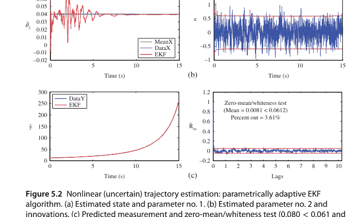

图 5.2 非线性（不确定）轨迹估计：参数自适应 EKF 算法。(a) 估计状态和参数 1。(b) 估计参数 2 和新息。(c) 预测测量和零均值/白度检验（0.080 < 0.061 和 3.6% 超出）。

短暂的瞬态（25 个样本）后，状态估计开始跟踪真实状态，这一点可从图 5.2c 中的新息序列看出。参数估计缓慢收敛到其真实值，这一点可从图和插图中看出。最终估计值为

\hat{\theta}_1 = 0.0470
\hat{\theta}_2 = 0.0395

缓慢收敛问题的一部分源于该问题中测量值或等价地新息对参数变化缺乏敏感性。这可从图 5.2c 中显示的零均值/白度检验中推断出来。新息在统计上是白色的（3.6% 超出），但表明存在轻微偏差（0.080 > 0.061）。滤波后的测量值也在图 5.2c 中显示。这完成了示例。

正如 Ljung 和 Soderstrom [2, 24] 所指出的那样，必须认识到 EKF 作为参数估计器是次优的，与基于 Gauss–Newton（随机）下降算法的递归预测误差（RPE）方法相比（参见第 5.5 节）。在这种情况下比较处理器，我们看到如果梯度项 [∇_θ K(Θ)]e(t) 被纳入 EKF（将此项添加到 A_θ），其收敛性将得到改善，接近 RPE 算法的性能（参见 Ljung [24] 了解详情）。接下来，我们考虑使用第 4 章的无迹卡尔曼滤波器开发“现代”方法的开发。

## 5.3.3 现代联合状态/参数处理器：扩展无迹卡尔曼滤波器

现代无迹处理器提供了与第 5.3.2 节中详细描述的扩展处理器类似的表示。这里，我们简要概述其用于联合问题求解的结构，并将其应用于轨迹估计问题以进行比较。我们再次从初始由 sigma 点定义的扩展状态向量开始，即

𝒳(t) := [ x(t) ; --- ; θ(t) ]  (5.34)
𝒳 ∈ R^(N_x+N_θ)×1 and x ∈ R^N_x×1, θ ∈ R^N_θ×1

将此扩展状态向量代入表 4.8 的 UKF 关系式可得到所需的处理器。我们再次得出等价关系（如前）：
Pr(y(t)|x(t), θ(t)) ~ 𝒩(c[x(t), θ(t)], R_uv(t))
Pr(𝒳(t)|Y_{t-1}) ~ 𝒩(𝒳(t|t-1), 	ilde{P}(t|t-1))
Pr(y(t)|Y_{t-1}) ~ 𝒩(ŷ_θ(t|t-1), 	ilde{R}_{e_θ e_θ}(t))  (5.35)

其中

𝒳(t|t−1) := [x̂(t|t−1)|θ̂(t|t−1)]′
ŷ_θ(t|t−1) := c[x̂(t|t−1), θ̂(t|t−1)]
P̃(t|t−1) := [ P̃_xx(t|t−1) | P̃_xθ(t|t−1) ; − − ; P̃_θx(t|t−1) | P̃_θθ(t|t−1) ]
ℛ_{e_θ e_θ}(t) := C[ X̂(t|t−1)] P̃(t−1)C[X̂(t|t−1)]′ + R_uv(t)

考虑到这一点，可以以类似于 EKF 的方式推导出 UKF 的内部结构。但我们在这里不会追求该推导。我们只是注意到 sigma 点也被扩充以给出

𝒳_i := [ x̂(t|t−1) ; − − − ; θ̂(t|t−1) ] + (N_x + κ)[ P̃_xx(t|t−1) | P̃_xθ(t|t−1) ; − − ; P̃_θx(t|t−1) | P̃_θθ(t|t−1) ]^{1/2} (5.36)

相应的过程噪声协方差被划分为

ℛ_{w w}(t) := [ R_{w_x w_x}(t|t−1) | 0 ; − − ; 0 | R_{w_θ w_θ}(t) ] (5.37)

由此可知预测步骤变为

𝒳_i(t|t−1) = [ a[x̂(t|t−1), θ̂(t|t−1)] + b[θ̂(t|t−1), u(t−1)] ; − − − ; a[θ̂(t|t−1)] ] (5.38)

并且在多通道（向量）测量情况下我们有

𝒴_i(t|t−1) = [ c[x̂(t|t−1), θ̂(t|t−1)] ; − − − ; c[θ̂(t|t−1)] ] (5.39)

使用扩展状态向量，我们将“联合”方法应用于轨迹估计问题 [20] 并将其性能与 EKF 进行比较。

## 示例 5.2 使用前一示例中具有未知系数的离散非线性轨迹估计问题，我们定义上面定义的扩展 sigma 点向量 𝒳(t) 并应用表 4.8 的 UKF 算法。

该问题的过程方程如下：

x(t) = (1 − θ₁△T)x(t−1) + θ₂x²(t−1) + w_x(t−1)

测量和协方差与之前相同。真实参数为 $\Theta_{true} = [0.05\quad 0.04]^T$。可以通过将参数向量定义为由随机游走表征的常数并将其扩充形成新的 sigma 点向量 $\mathcal{X} = [x'\quad \theta_1\quad \theta_2]^T$ 来将 UKF 应用于此问题。因此，过程模型变为

```
$$\begin{bmatrix}x(t)\\\theta(t)\end{bmatrix}=\begin{bmatrix}(1-\theta_1(t-1)\Delta T)x(t-1)+\theta_2(t-1)\Delta T x^2(t-1)\\\theta_1(t-1)\\\theta_2(t-1)\end{bmatrix}+\begin{bmatrix}w_x(t-1)\\w_{\theta_1}(t-1)\\w_{\theta_2}(t-1)\end{bmatrix}$$

$$y(t)=x^2(t)+x^3(t)+v(t)$$
```

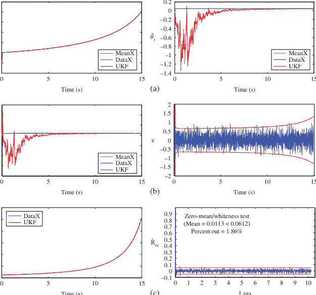

**图 5.3** 非线性（不确定）轨迹估计：参数自适应 UKF 处理器。(a) 估计状态和参数 1。(b) 估计参数 2 和新息。(c) 预测测量和零均值/白度检验（0.0113 < 0.0612 和 1.86% 超出）

为了实现 UKF，sigma 点如前所述为高斯分布选择，使用缩放变换，$\alpha = 1$，$\kappa = 0$，和 $\beta = 2$，初始条件与 EKF 相同。

使用 MATLAB [10]，扩展 UKF 被应用于求解该问题，共 1500 个样本，$\Delta T = 0.01$ 秒。

UKF 运行的结果如图 5.3 所示。我们在图 5.3a 和 b 中看到估计状态和参数估计。经过短暂的瞬态后，状态估计开始跟踪真实状态，这一点可从图 5.3c 中的预测测量和新息序列看出。参数估计收敛到其真实值，这一点可从图中看出。最终估计值为 $\hat{\theta}_1 = 0.05$；$\hat{\theta}_2 = 0.04$。处理器似乎比 EKF 收敛快得多，显示出其改进的能力。这可从图 5.3c 中显示的零均值/白度检验中推断出来。新息在统计上是白色的（1.86% 超出）且无偏（0.0113 < 0.0612）。这完成了示例。

我们还注意到，在结尾处，一种“双”而非“联合”方法已在文献中演变。最初作为自举方法开发，它由两个独立（解耦）的处理器构建：一个用于状态估计器，一个用于参数估计器，它们在估计值可用时相互传递更新的估计值。这是一种次优方法，但在某些应用中似乎表现相当好（参见 [21, 22] 了解更多详情）。这完成了我们对扩展现代 UKF 处理器的讨论。接下来我们研究 PF 方法来解决联合问题。

## 5.4 参数自适应处理器：粒子滤波

在本节中，我们简要开发了求解联合状态/参数处理问题的序贯蒙特卡洛方法。存在多种方法来搜索可行空间以追求参数估计问题的解，但在必须连同参数一起提取状态（或信号）时，则必须遵循之前讨论的联合估计问题的解。其中一个主要问题是如何“建模”参数演化，以便在没有物理模型表征参数的情况下提供有效的前进方式。通常的做法是纳入随机游走模型，如前所述，如果参数缓慢变化。

## 5.4.1 联合状态/参数估计：粒子滤波

这里我们关注由为 $\theta$ 设置先验并扩充状态向量以求解联合


估计问题如上所述定义，从而将参数估计问题转化为最优滤波问题。因此，将讨论限制在状态空间模型和贝叶斯等价性上，我们利用以下关系发展贝叶斯方法：

$$x \sim \Pr(x(t)\mid x(t-1),\theta(t-1))$$

$$\theta \sim \Pr(\theta(t)\mid\theta(t-1),x(t-1))$$

$$y \sim \Pr(y(t)\mid x(t),\theta(t)) \tag{5.40}$$

这里，我们出于说明目的将状态转移函数分离为单个向量，但在现实中（如我们将观察到的），它们可以联合耦合。关键思想是发展 PF 技术来估计联合后验 $\Pr(x(t),\theta(t)\mid Y_t)$，依赖于贝叶斯分解中的参数后验 $\Pr(\theta(t)\mid Y_t)$。我们将遵循 [17, 25] 中概述的方法，从完整后验分布开始，逐步过渡到滤波分布。

假设可以从联合后验分布中采样 $N_p$-粒子，$\{X_t(i),\Theta_t(i)\}$ 对于 $i=1,\ldots,N_p$，其中我们定义 $X_t:=\{x(0),\ldots,x(t)\}$ 和 $\Theta_t:=\{\theta(0),\ldots,\theta(t)\}$。那么联合后验的相应经验近似由下式给出

$$\widehat{\Pr}(X_t,\Theta_t\mid Y_t)\approx\frac{1}{N_p}\sum_{i=1}^{N_p}\delta(X_t-X_t(i),\Theta_t-\Theta_t(i)) \tag{5.41}$$

并且可以直接得出滤波后验为

$$\widehat{\Pr}(x(t),\theta(t)\mid Y_t)\approx\frac{1}{N_p}\sum_{i=1}^{N_p}\delta(x(t)-x_i(t),\theta(t)-\theta_i(t)) \tag{5.42}$$

不幸的是，在任何时间 $t$ 都不可能直接从完整联合后验 $\Pr(X_t,\Theta_t\mid Y_t)$ 中采样。然而，缓解这一问题的一种方法是使用重要性采样方法。

假设我们定义一个（完整）重要性分布，$\mathcal{I}(X_t,\Theta_t\mid Y_t)$ 使得 $\Pr(X_t,\Theta_t\mid Y_t)>0$ 蕴含 $\mathcal{I}(\cdot)>0$，则我们定义相应的重要性权重（同前）为

$$W(X_t,\Theta_t)\propto\frac{\Pr(X_t,\Theta_t\mid Y_t)}{\mathcal{I}(X_t,\Theta_t\mid Y_t)} \tag{5.43}$$

根据贝叶斯法则，后验可以表示为

$$\Pr(X_t,\Theta_t\mid Y_t)=\frac{\Pr(Y_t\mid X_t,\Theta_t)\times\Pr(X_t,\Theta_t)}{\Pr(Y_t)} \tag{5.44}$$

因此，如果 $N_p$-粒子，$\{X_t(i),\Theta_t(i)\};\,i=1,\ldots,N_p$，可以从重要性分布生成

$$\{X_t(i),\Theta_t(i)\}\longrightarrow \mathcal{I}(X_t,\Theta_t\mid Y_t) \tag{5.45}$$

则可以估计经验分布并指定由此产生的归一化权重

𝒲ₜ(i) = W(Xₜ(i), Θₜ(i)) / Σₖ₌₁^{Nₚ} W(Xₜ(k), Θₜ(k)) for i = 1, ..., Nₚ (5.46)

以获得式 (5.41) 所需的经验分布，从而得到式 (5.42) 的相应滤波分布。

如果有状态转移模型可用，则对于固定的参数估计，状态估计问题很容易解决，如第 4 章所述。因此，我们将讨论限制在参数后验分布估计问题上，即对状态（已估计）关于联合分布进行边缘化得到

Pr(Θₜ|Yₜ) = ∫ Pr(Xₜ, Θₜ|Yₜ) dXₜ (5.47)

并且由此可得

𝒲(Θₜ) ∝ Pr(Θₜ|Yₜ) / I(Θₜ|Yₜ) (5.48)

假设可以从重要性分布生成一组粒子作为 Θₜ ∼ I(Θₜ|Yₜ)，则我们有归一化权重集合

𝒲ₜ(Θ(i)) = W(Θₜ(i)) / Σₖ₌₁^{Nₚ} W(Θₜ(k)) for i = 1, ..., Nₚ (5.49)

当与动态状态向量耦合时，这就是联合“批处理”重要性采样解。

该联合公式的序列形式直接如第 4 章所述。我们从重要性分布的因子形式开始，关注完整后验 Pr(Θₜ|Yₜ)，即

考虑到这一点，权重递归变为

W(Θₜ) = W(t) × W(Θₜ₋₁)  (5.53)

对后验应用贝叶斯法则，我们定义

W(t) := [Pr(y(t)|Θₜ, Yₜ₋₁) × Pr(θ(t)|Θ(t−1))] / [Pr(y(t)|Yₜ₋₁) × I(θ(t)|Θₜ₋₁, Yₜ)]
∝ [Pr(y(t)|Θₜ, Yₜ₋₁) × Pr(θ(t)|θ(t−1))] / I(θ(t)|Θₜ₋₁, Yₜ)  (5.54)

同前，在状态估计问题中，我们必须在构造算法之前选择重要性分布。引导方法也可以选作重要性分布，从而得到更简单的替代方案，其中 I(θ(t)|Θₜ₋₁, Yₜ) → Pr(θ(t)|θ(t−1)) 且式 (5.54) 的权重变为似然

W_BS(t) = Pr(y(t)|Θₜ, Yₜ₋₁)  (5.55)

从实用角度来看，我们必须考虑一些实现联合问题处理器的实用方法。第一种方法，当适用时，是在合理时纳入随机游走模型 [17]。另一种变体是使用式 (5.10) 的粗化模型，该模型通过添加指定方差的高斯序列在重采样后“移动”粒子。

这完成了使用 PF 方法对联合状态/参数估计问题的讨论。接下来我们考虑一个示例来说明贝叶斯方法。

## Example 5.3

再次我们考虑轨迹估计问题 [20]，使用粒子滤波技术。首先，我们应用了通常的引导技术，发现了预期结果，参数粒子坍缩，给出不令人满意的结果。接下来我们尝试了“粗化”方法，结果要合理得多。我们使用了粗化因子或 κ = 5 × 10⁻⁵ 以及 Nₚ = 350。结果如图 5.4 所示。我们可以看到估计的状态和测量以及相关的零均值/白度检验。结果虽然不如现代方法好，但合理，最终估计收敛到静态参数值的真实参数：θ₁ = 0.05 (0.034) 和 θ₂ = 0.04 (0.039)。状态和测量估计相当好，这一点从零均值 (0.002 < 0.061) 和白度 (1.76% out) 中可以看出。我们在图 5.5 中展示了状态和参数的估计后验分布，再次证明了解决方案合理。请注意分布最初是多峰的，随着参数估计收敛到其真实值，它们变得单峰，如图 5.5 所示。

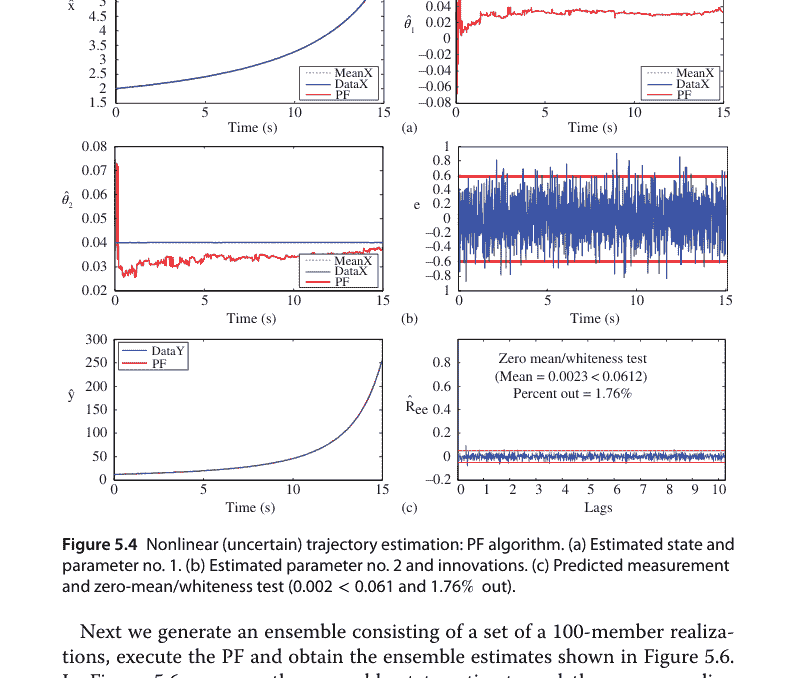

Figure 5.4 Nonlinear (uncertain) trajectory estimation: PF algorithm. (a) Estimated state and parameter no. 1. (b) Estimated parameter no. 2 and innovations. (c) Predicted measurement and zero-mean/whiteness test (0.002 < 0.061 and 1.76% out).

接下来我们生成一个由 100 个成员实现组成的集合，执行 PF 并获得如图 5.6 所示的集合估计。在图 5.6a 中，我们看到集合状态估计和相应的联合参数估计如图 5.6b 和 c 所示。将这些与图 5.4 的进行比较，我们看到在初始瞬态消失后，它们收敛到状态和参数的合理估计。集合处理器给出了合理的零均值/白度（合理性）检验结果：(Z-M: 0.023 < 0.123/W-test: 1.2% out) 以及相对均方根误差 (RMSE: state = 0.0010; parameter no. 1 = 0.0013; and parameter no. 2 = 0.0010)。相应的中位数 Kullback–Leibler 散度/ Hellinger 距离统计为：(KL/HD: state = 0.024/0.077; parameter no. 1 = 1.794/0.629; parameter no. 2 = 2.201/0.642 and measurement = 0.025/0.079)。这些指标也表明状态和测量估计具有合理的性能，而参数估计的性能最多只能算中等。

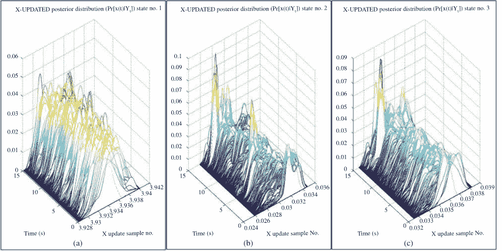

**Figure 5.5** PF posterior distribution estimation. (a) Estimated state posterior. (b) Parameter no. 1 posterior. (c) Parameter no. 2 posterior.

Figure 5.6 PF ensemble estimation for a 100-member realizations. (a) Ensemble state estimate. (b) Ensemble parameter no. 1 estimate. (c) Ensemble parameter no. 2 estimate. (d) Ensemble measurement estimate.

其中 ∇_θ J(Θ) 是 N_θ × 1 梯度向量，∇_{θθ} J(Θ) 是 N_θ × N_θ Hessian 矩阵。作为 RPE 算法的一部分，我们必须在预测器上执行这些操作；因此，我们定义梯度矩阵为

Ψ_θ(t) := [ψ_{θ_1}(t) ⋯ ψ_{θ_{N_θ}}(t)]′ for Ψ ∈ R^{N_θ×N_y}; ψ ∈ R^{N_y×1} (5.61)

使用链式法则¹ 对式 (5.59) 进行微分，我们得到梯度

∇_θ J(Θ) = ∇_θ e'_θ(t) Λ^{-1}(t) e_θ(t) = -Ψ_θ(t) Λ^{-1}(t) e_θ(t) (5.62)

使用上述定义中的梯度矩阵。

将 Hessian 矩阵定义为 R(t) := ∇_{θθ} J(Θ) 并代入式 (5.60) 中的梯度，我们得到参数向量递归

\hat{Θ}(t + 1) = \hat{Θ}(t) + γ(t)[R(t)]^{-1} Ψ_θ(t) Λ^{-1}(t) e_θ(t) (5.63)

其中 γ(t) 是 N_θ-加权向量序列。然而，这确实给出了递归形式，但它可以被转换以产生期望的结果，即在 Gauss–Newton 近似下，已证明 [2] Hessian 可以近似为加权样本方差估计器的形式

R(t) = (1/t) Σ_{k=1}^{t} γ(k) ψ(k) Λ^{-1}(k) ψ′(k) (5.64)

这很容易放在递归形式中得到

R(t) = R(t - 1) + γ(t)[ψ(t) Λ^{-1}(t) ψ′(t) - R(t - 1)] (5.65)

遵循同样的论证，预测误差协方差也可以放在递归形式中得到

Λ(t) = Λ(t - 1) + γ(t)[e_θ(t) e'_θ(t) - Λ(t - 1)] (5.66)

以我们的创新模型表示的 N_θ × N_y-梯度矩阵为

Ψ_θ(t) = ∇_θ e_θ(t) = ∇_θ \hat{y}′(t|t - 1)
= ∇_θ [C(Θ) \hat{x}_θ(t|t - 1)]′ and Ψ_θ ∈ R^{N_θ×N_y} (5.67)

梯度矩阵的矩阵展开以分量方式开发操作为

Ψ_θ(t) = ∇_θ [C(Θ) \hat{x}_θ(t|t - 1)]′
= [ ∂/∂θ_1 ; ⋮ ; ∂/∂θ_{N_θ} ] [ c'_1(Θ) \hat{x}_θ(t|t - 1) ⋯ c'_{N_y}(Θ) x_θ(t|t - 1) ]

> 1 向量微积分中的链式法则定义为 ∇_Θ(a′b) := (∇_Θ a′)b + (∇_Θ b′)a a, b ∈ R^{N_θ×1} 且 a, b 为 Θ 的函数。


将各项定义（\(\mathcal{W}_{\theta_i}, \mathcal{Z}_{\theta_i}, \mathcal{V}_{\theta_i}\)）逐项代入式(5.74)，可得

$$
\mathcal{W}_{\theta_i}(t+1)=[A(\theta)-K(\theta)C(\theta)]\mathcal{W}_{\theta_i}(t)+\mathcal{V}_{\theta_i}(\hat{x}_\theta, u, e_\theta)-K(\theta)\mathcal{Z}_{\theta_i}(\hat{x}_\theta(t\mid t-1)) \tag{5.76}
$$

现对 \(i=1,\dots,N_\theta\) 进行展开，即可得到状态预测器梯度权重矩阵的递推式

$$
\mathcal{W}_\theta(t+1)=[A(\Theta)-K(\Theta)C(\Theta)]\mathcal{W}_\theta(t)+\mathcal{V}_\theta(\hat{x}_\theta(t\mid t-1), u, e_\theta)-K(\Theta)\mathcal{Z}_\theta(\hat{x}_\theta(t\mid t-1)) \tag{5.77}
$$

至此，应用于创新模型的RPE算法推导完毕。为清晰起见，我们在表5.2中采用简化记号对该算法进行总结。即沿用前述高斯–牛顿近似：\(x_\theta(t)\approx x(t)\)，\(\hat{y}_\theta(t)\approx \hat{y}(t)\)，\(\psi_\theta(t)\approx \psi(t)\)，以及 \(e_\theta(t)\approx e(t)\)。

**表5.2** 参数自适应创新模型（RPE）算法。

| 类别 | 步骤 | 方程 |
|---|---|---|
| 预测误差 | 预测误差 | \(e(t)=y(t)-\hat{y}(t\mid t-1)\) |
|  | 预测误差协方差 | \(\Lambda(t)=\Lambda(t-1)+\gamma(t)[e(t)e'(t)-\Lambda(t-1)]\) |
|  | 海森矩阵 | \(R(t)=R(t-1)+\gamma(t)[\psi(t)\Lambda^{-1}(t)\psi'(t)-R(t-1)]\) |
| 参数估计 | 参数更新 | \(\hat{\Theta}(t+1)=\hat{\Theta}(t)+\gamma(t)R^{-1}(t)\psi(t)\Lambda^{-1}(t)e(t)\) |
| 状态预测 | 状态 | \(\hat{x}(t+1\mid t)=A(\Theta)\hat{x}(t\mid t-1)+B(\Theta)u(t)+K(\Theta)e(t)\) |
|  | 量测 | \(\hat{y}(t\mid t-1)=C(\Theta)\hat{x}(t\mid t-1)\) |
| 梯度预测 | 权重 | \(\mathcal{W}(t+1)=[A(\Theta)-K(\Theta)C(\Theta)]\mathcal{W}(t)+\mathcal{U}(\hat{x},u,e)-K(\Theta)\mathcal{Z}(\hat{x})\) |
|  | 梯度 | \(\psi'(t)=C(\Theta)\mathcal{W}(t)+\mathcal{Z}(\hat{x})\) |
|  | 定义 | \(\mathcal{W}(t):=\nabla_\theta\hat{x}(t\mid t-1)\)，\(\mathcal{Z}(\hat{x}):=\nabla_\theta[C(\Theta)\hat{x}(t\mid t-1)]\)，以及 \(\mathcal{U}(\hat{x},u,e):=[\nabla_\theta A(\Theta)]\hat{x}(t\mid t-1)+[\nabla_\theta B(\Theta)]u(t)+[\nabla_\theta K(\Theta)]e(t)\) |
| 加权向量序列 |  | \(\gamma(t)\) |
| 初始条件 |  | \(\hat{x}(0\mid 0)\)，\(\Theta(0)\)，\(\Lambda(0)\)，\(R(0)\) |

现将该算法应用于RC电路问题。

### 例5.4

考虑4.3节的RC电路问题，其中参数\([A, C]\)未知，即其潜在大斯–马尔可夫模型具有如下形式

$$
x(t)=\Theta_1 x(t-1)+u(t-1)+w(t-1)
$$
$$
y(t)=\Theta_2 x(t)+v(t)
$$

因此，相应的创新模型为

$$
\hat{x}(t+1\mid t)=\Theta_1\hat{x}(t\mid t-1)+u(t)+\Theta_3 e(t)
$$
$$
\hat{y}(t\mid t-1)=\Theta_2\hat{x}(t\mid t-1)
$$

我们寻求能够同时估计未知状态和参数的自适应处理器。我们将MATLAB中的RPEM算法[10]应用于仿真数据，其中 \(R_{ww}=10^{-4}\)，\(R_{vv}=4\)，\(x(0)=2.5\)，\(P(0)=10^{-6}\)，以获得自适应解。图中展示了含噪量测数据（细虚线）、真值量测（虚线）以及预测（滤波）量测。该处理器能够较好地估计真实量测并紧密跟踪（见图5.7a）。相应的创新序列如图5.7b所示，其中5.5%的样本超出了预测边界。通过检验创新序列的统计特性验证了其性能。零均值/白噪声检验（0.04 < 0.17/2.35%超限）表明处理器已收敛，如图5.7c所示。

由此可见，自适应创新处理器能够在初始参数误差为5%的情况下估计出未知参数，最终参数估计如下：

- \(\Theta_1 = 0.970 \pm 0.003\)（过程矩阵）
- \(\Theta_2 = 1.987 \pm 0.140\)（量测矩阵）
- \(\Theta_3 = -0.015 \pm 0.011\)（增益矩阵）
- \(\hat{R}_{ee} = 3.371\)

本例到此结束。

在实际应用中，创新模型是线性参数自适应状态空间处理器常用的方法。本节关于参数自适应创新模型的内容到此结束。接下来，我们研究一个关于水下目标合成孔径跟踪的案例。

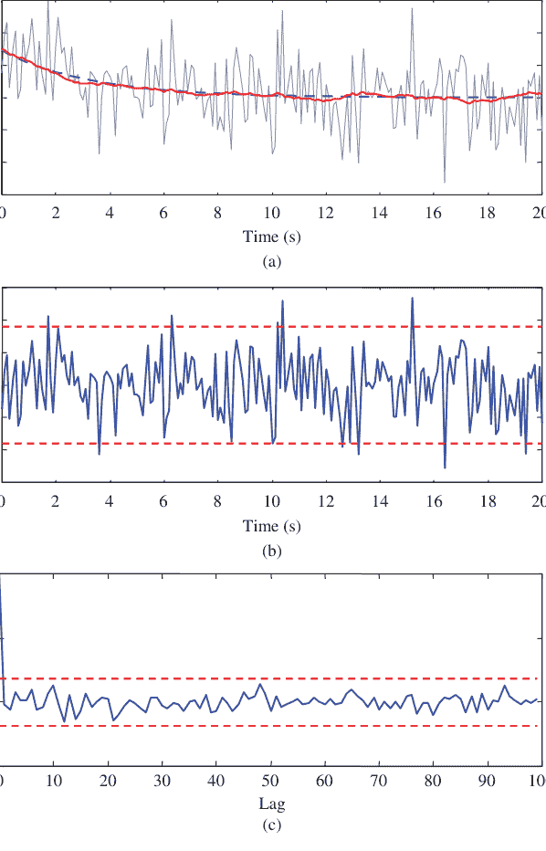

**图5.7** 参数自适应创新状态空间处理器：RC电路问题。(a) 含噪（虚线）、真值（粗虚线）和预测（实线）量测。(b) 创新序列（5.5%超限）。(c) 零均值/白噪声检验（0.04 < 0.17/2.35%超限）。

## 5.6 案例研究：随机目标跟踪

合成孔径处理在机载雷达中广为人知，但在声纳领域中则不那么常见[26–31]。创建合成孔径的基本思想是通过运动来增加阵列长度，从而提高空间分辨率（方位角）和信噪比增益。已有研究表明，对于静止目标，运动引起的方位估计方差小于静止阵列的方差[29, 32]。这里我们研究阵列和目标均运动的情况。我们将声学阵列时空处理问题定义如下：

给定一组来自水平拖曳运动阵列中\(L\)个传感器的含噪声压场测量值，求目标方位的最优（最小误差方差）估计。

我们采用以下非线性声压场测量模型，针对由相应的时频、方位和幅度集合\([\{\omega_m\}, \{\theta_m\}, \{a_m\}]\)表征的\(M\)个单色平面波目标，其表达式为

$$
p(x, t_k)=\sum_{m=1}^{M}a_m e^{j\omega_m t_k-j\beta(x, t_k)\sin\theta_m}+n(t_k) \tag{5.78}
$$

其中 \(\beta(x, t_k):=k_0 x(t_0)+v t_k\)，\(k_0=2\pi/\lambda_0\) 为波数，\(x(t_k)\) 为沿\(x\)轴以米为单位的当前空间位置，\(v\) 为以米/秒为单位的拖曳速度，\(n(t_k)\) 为加性随机噪声。在广义波数\(\beta\)中引入运动对改善处理性能至关重要，因为合成孔径效应实际上是通过运动本身而非简单的位移产生的。

如果我们进一步假设上述单传感器方程扩展为包含\(L\)个传感器的阵列，即 \(x\to x_\ell\), \(\ell=1,\dots,L\)，则可得

$$
p(x_\ell, t_k)=\sum_{m=1}^{M}a_m e^{j\omega_m t_k-j\beta(x_\ell, t_k)\sin\theta_m}+n_\ell(t_k)
$$
$$
=\sum_{m=1}^{M}a_m\cos(\omega_m t_k-\beta(x_\ell, t_k)\sin\theta_m)+n_\ell(t_k) \tag{5.79}
$$

由于我们的水听器传感器测量的是复声压场的实部，系统的最终非线性测量模型可以写成紧凑的向量形式

$$
\mathbf{p}(t_k)=\mathbf{c}[t_k;\boldsymbol{\Theta}]+\mathbf{n}(t_k) \tag{5.80}
$$

其中 \(\mathbf{p},\mathbf{c},\mathbf{n}\in\mathbb{C}^{L\times1}\) 分别为声压场、量测和噪声向量，\(\boldsymbol{\Theta}\in\mathbb{R}^{M\times1}\) 代表目标方位。对应的向量测量模型为

$$
c_\ell(t_k;\boldsymbol{\Theta})=\sum_{m=1}^{M}a_m\cos(\omega_m t_k-\beta(x_\ell, t_k)\sin\theta_m),\quad \ell=1,\dots,L
$$

由于我们将方位建模为模拟随机目标运动的随机游走，则马尔可夫状态空间模型由一阶差分演化而来

$$
\boldsymbol{\Theta}(t_k)=\boldsymbol{\Theta}(t_{k-1})+\mathbf{w}_\theta(t_{k-1}) \tag{5.81}
$$

因此，状态空间模型是线性的，没有显式动态特性；故过程矩阵 \(A=I\)（单位阵），各关系式可大大简化。

现在让我们看看如何根据表4.9的通用算法，采用自助法构建粒子滤波器。对于该问题，我们假设加性噪声源为高斯的，以便将结果与近似处理器的性能进行比较。为便于采样数据表示，我们定义离散记号 \(t_{k+1}\to t+1\)。

让我们将该问题纳入序贯贝叶斯框架；即我们希望估计瞬时后验滤波分布 \(\hat{\Pr}(x(t)\mid Y_t)\)，利用粒子滤波表示进行推断并提取目标方位估计。因此，我们有转移概率为 \((\boldsymbol{\Theta}(t)\to x(t))\)

$$
\Pr(\boldsymbol{\Theta}(t)\mid\boldsymbol{\Theta}(t-1))\sim\mathcal{N}\big(\boldsymbol{\Theta}(t):\mathbf{a}[\boldsymbol{\Theta}(t-1)],\mathbf{R}_{w_\theta,w_\theta}\big)
$$

或者按照我们的状态转移（方位）模型，有

$$
\boldsymbol{\Theta}(t)=\mathbf{a}[\boldsymbol{\Theta}(t-1)]+\mathbf{w}_\theta(t-1)=\boldsymbol{\Theta}(t-1)+\mathbf{w}_\theta(t-1)\quad\text{对于}\quad \Pr(\mathbf{w}_\theta(t))\sim\mathcal{N}(0,\mathbf{R}_{w_\theta w_\theta})
$$

相应的似然函数根据测量模型 \(y(t)\to \mathbf{p}(t)\) 指定为

$$
\Pr(y(t)\mid x(t))\sim\mathcal{N}\big(y(t):\mathbf{c}[\boldsymbol{\Theta}(t)],\mathbf{R}_{vv}(t)\big)
$$

其中我们使用了记号：\(z\sim\mathcal{N}(z:m_z,R_{zz})\) 来表示随机向量\(z\)的高斯分布。对于我们的问题，有

$$
\ln\Pr(y(t)\mid x(t))=\kappa-\frac{1}{2}\left(y(t)-\sum_{m=1}^{M}a_m\cos(\omega_m t-\boldsymbol{\beta}(t)\sin\theta_m)\right)'R_{vv}^{-1}\left(y(t)-\sum_{m=1}^{M}a_m\cos(\omega_m t-\boldsymbol{\beta}(t)\sin\theta_m)\right)
$$

其中 \(\kappa\) 为常数，\(\boldsymbol{\beta}\in\mathbb{R}^{L\times1}\)，且 \(\boldsymbol{\beta}(t):=[\beta(x_1,t)\mid\cdots\mid\beta(x_L,t)]'\)，即在整个阵列上展开的动态波数。因此，粒子滤波SIR算法变为

- 从状态转移分布中抽取样本（粒子）：
  \[
  \boldsymbol{\Theta}_i(t)\sim\mathcal{N}\big(\boldsymbol{\Theta}(t):\mathbf{a}[\boldsymbol{\Theta}(t-1)],\mathbf{R}_{w_{\theta_i},w_{\theta_i}}\big)
  \]
  \[
  \boldsymbol{\Theta}_i(t)=\boldsymbol{\Theta}_i(t-1)+w_{\theta_i}(t-1),\quad w_{\theta_i}(t)\sim\Pr(w(t))\sim\mathcal{N}(0,R_{w_{\theta_i}w_{\theta_i}});
  \]


Figure 5.8 Synthetic aperture sonar tracking problem: simulated target motion from initial bearings of 45°, −10°, 5° and −75° and array measurements (−10 dB SNR).

+   - Estimate the likelihood, \(\Pr(\mathbf{y}(t)\mid\boldsymbol{\Theta}(t))\sim \mathcal{N}(\mathbf{y}(t):\mathbf{c}[\boldsymbol{\Theta}(t)],\mathbf{R}_{\nu}(t))\), with \(c_t(t;\Theta_i)=\sum_{m=1}^{M}a_m\cos(\omega_m t-\beta(\mathbf{x}_t,\mathbf{v}))\sin\Theta_{m,i}(t)\) for \(i=1,\cdots,L\) and \(\Theta_{m,i}\) the ith angle in the mth bearing angle.
+   - Update and normalize the weight: \(\mathcal{W}_i(t)=W_i(t)/\sum_{i=1}^{N_p}W_i(t)\)
+   - Resample: \(\hat{N}_{\mathrm{eff}}(t)\leq N_{\mathrm{thresh}}\).
+   - Estimate the instantaneous posterior: \(\hat{\Pr}(\boldsymbol{\Theta}(t)\mid\mathbf{Y}_t)\approx\sum_{i=1}^{N_p}\mathcal{W}_i(t)\delta(\boldsymbol{\Theta}(t)-\boldsymbol{\Theta}_i(t))\).
+   - Perform the inference by estimating the corresponding statistics:
+   
+     \(\hat{\Theta}_{\mathrm{map}}(t)=\arg\max\hat{\Pr}(\boldsymbol{\Theta}(t)\mid\mathbf{Y}_t)\);
+   
+     \(\hat{\Theta}_{\mathrm{mmse}}(t)=\hat{\Theta}_{\mathrm{cm}}(t)=E\{\boldsymbol{\Theta}(t)\mid\mathbf{Y}_t\}=\sum_{i=1}^{N_p}\Theta_i(t)\hat{\Pr}(\boldsymbol{\Theta}(t)\mid\mathbf{Y}_t)\);
+   
+     \(\hat{\Theta}_{\mathrm{median}}(t)=\mathrm{median}(\hat{\Pr}(\boldsymbol{\Theta}(t)\mid\mathbf{Y}_t))\).

Consider the following simulation of the synthetic aperture using a four-element, linear towed array with “moving” targets using the following parameters:

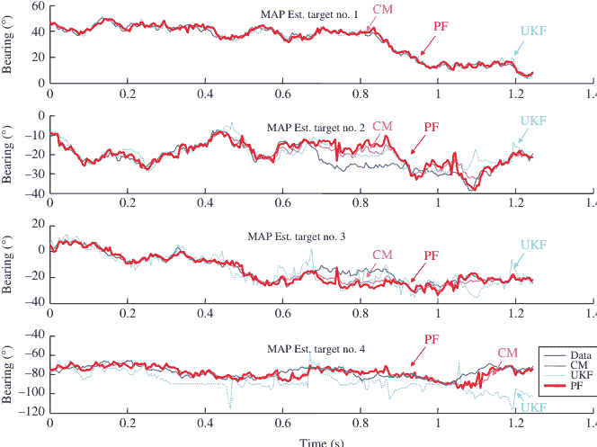

**Figure 5.9** Particle filter bearing estimates for four targets in random motion: PF bearing (state) estimates and simulated target tracks (UKF, conditional mean, MAP).

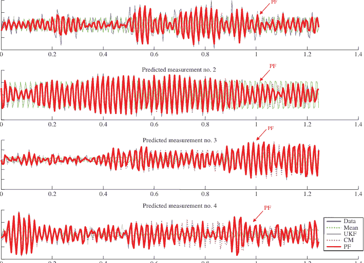

**Figure 5.10** Particle filter predicted measurement estimates for four channel hydrophone sensor array.

Figure 5.11 Particle filter classical "sanity" performance metrics: zero-mean/whiteness tests for 45°, −10°, 5° and 75° targets as well the corresponding ρ(k) test.

Target: Unity amplitudes with temporal frequency is 50 Hz, wavelength = 30 m, tow speed = 5 m s⁻¹ Array: four (4) element linear towed array with 15 m spacing; Particle filter: Nθ = 4 states (bearings), Ny = 4 sensors, N = 250 samples, Np = 250 particles/weights; SNR: is −10 dB; Noise: white Gaussian with Rww = diag [2.5], Rvv = diag [0.1414]; Sampling interval is 0.005 second; Initial conditions: Bearings: Θ0 = [45° − 10° 5° − 75°]; Covariance: P0 = diag (10⁻¹⁰).

The array simulation was executed and the targets moved according to a random walk specified by the process noise and sensor array measurements with −10 dB SNR. The results are shown in Figure 5.8, where we see the noisy synthesized bearings (left) and four (4) noisy sensor measurements at the moving array. The bearing (state) estimates are shown in Figure 5.9 where we observe the targets making a variety of course alterations. The PF is able to track the target motions quite well while we observe the unscented Kalman filter (UKF) [10] is unable to respond quickly enough and finally losing track completely for target no. 4. It should be noted that target no. 2 and target no. 4 “crossover” between 0.8 and 1.0 second. The PF loses these tracks during this time period getting them confused, but recovers by the one-second time step. Both the MAP and CM estimates using the estimated posterior provide excellent tracking. Note that these bearing inputs would provide the raw data for an XY-tracker [10]. The PF estimated or filtered measurements are shown in Figure 5.10. As expected the PF tracks the measurement data quite well, while the UKF is again in small error.

## Table 5.3 PF Performance towed array problem.

| Particle filter performance results |  |  |  |
|---|---|---|---|
| Parameter | RMSE | Median KLD | Median HD |
| Bearing no. 1 | 0.117 | 0.528 | 0.342 |
| Bearing no. 2 | 0.292 | 0.180 | 0.208 |
| Bearing no. 3 | 0.251 | 0.179 | 0.209 |
| Bearing no. 4 | 0.684 | 0.406 | 0.309 |
| Measurements |  | Median KLD | Median HD |
| Sensor no. 1 |  | 0.066 | 0.139 |
| Sensor no. 2 |  | 0.109 | 0.166 |
| Sensor no. 3 |  | 0.259 | 0.275 |
| Sensor no. 4 |  | 0.312 | 0.327 |
| Innovations | Zero-mean < 0.173 | Whiteness | WSSR < 455 |
| Sensor no. 1 | 0.0102 | 5.47% | Below |
| Sensor no. 2 | 0.0136 | 1.56% | Below |
| Sensor no. 3 | 0.0057 | 5.47% | Below |
| Sensor no. 4 | 0.0132 | 2.34% | Below |

Figure 5.12 Particle filter instantaneous posterior bearing estimates: (a) 45° target no. 1 posterior; (b) −10° target no. 2 posterior; (c) 5° target no. 3; and (d) −75° target no. 4.

For performance analysis, we applied the usual “sanity tests.” From this perspective, the PF processor works well, since each measurement channel is zero-mean and white with the WSSR lying below the threshold, indicating white innovations sequences demonstrating the tracking ability of the PF processor at least in a classical sense [10] (see Figure 5.11 and Table 5.3). The corresponding normalized root mean-squared errors RMSE, median Kullback–Leibler divergence/Hellinger distance statistics for the bearing estimates are also shown in the table along with the measurements at each sensor. Estimating the KD/HD metrics for the measurements indicate a reasonable performance for both bearings and measurements.

The instantaneous posterior distributions for the bearing estimates are shown in Figure 5.12. Here we see the Gaussian nature of the bearing estimates generated by the random walk. Clearly, the PF performs quite well for this problem. Note also the capability of using the synthetic aperture, since we have only a four-element sensor array, yet we are able to track four targets. Linear array theory implies with a static array that we should only be able to track L − 1 = three targets!

In this case study, we have applied the unscented Kalman filter and the bootstrap PF to an ocean acoustic, synthetic aperture, towed array, target tracking problem to evaluate the performance of both the parametrically adaptive UKF and particle filtering techniques. The results are quite reasonable on this simulated data set.

## 5.7 Summary

In this chapter, we have discussed the development of joint Bayesian state/parametic processors. Starting with a brief introduction, we defined a variety of problems based on the joint posterior distribution Pr(x(t), θ(t)|Yt) and its decomposition. We focused on the joint problem of estimating both states and parameters simultaneously (on-line) – a common problem of high interest. We then briefly showed that all that is necessary for this problem is to define an “augmented” state consisting of the original state variables along with the unknown parameters typically modeled by a random walk, when a dynamic parametric model is not available. This casts the joint problem into an optimal filtering framework. We then showed how this augmentation leads to a decomposition of the classical EKF processor and developed the “decomposed” form for illustrative purposes. The algorithm was implemented by executing the usual processor with the new augmented state vector embedded. We also extended this approach to both modern “unscented” and “particle-based” processors, again only requiring the state augmentation procedure to implement. All of the processors required a random walk parametric model to function, while the particle filters could be implemented

using the “roughening” (particle random walks) to track the parameters effectively. Next we discussed the recursive prediction error approach (RPE) and developed the solution for a specific linear, time-invariant, state-space model – the innovations model that will prove useful in subsequent subspace realization chapters to follow. Besides applying the nonlinear processors to the parametrically uncertain nonlinear trajectory estimation problem, we developed a case study for a synthetic aperture towed array and compared the modern UKF to the PF processors to complete the chapter [34–46].

## MATLAB Notes

MATLAB has a variety of parametrically adaptive algorithms available in the Controls/Identification toolboxes. The linear Kalman filter (**Kalman**), extended Kalman filter (**extendedKalmanFilter**), and unscented Kalman filter (**unscentedKalmanFilter**) algorithms are available or as a set of commands: (**predict**) and (**correct**). The Identification toolbox has an implementation of the recursive prediction error method for a variety of model sets. The state-space algorithms available are **N4SID** in the **ident** toolbox as well as the **ekf**, **ukf**, and **pf** of the **control** toolbox.

## References

+   1 Ljung, L.J. (1999). *System Identification: Theory for the User, 2e*. Englewood Cliffs, NJ: Prentice-Hall.
+   2 Ljung, L.J. and Soderstrom, T. (1983). *Theory and Practice of Recursive Identification*. Boston, MA: MIT Press.
+   3 Soderstrom, T. and Stoica, P. (1989). *System Identification*. Englewood Cliffs, NJ: Prentice-Hall.
+   4 Norton, J.P. (1986). *An Introduction to Identification*. New York: Academic Press.
+   5 Liu, J. (2001). *Monte Carlo Strategies in Scientific Computing*. New York: Springer.
+   6 Cappe, O., Moulines, E., and Ryden, T. (2005). *Inference in Hidden Markov Models*. New York: Springer.
+   7 Liu, J. and West, M. (2001). Combined parameter and state estimation in simulation-based filtering. In: *Sequential Monte Carlo Methods in Practice*, Chapter 10 (ed. A. Doucet, N. de Freitas, and N. Gordon), 197–223. New York: Springer.
+   8 Doucet, A., de Freitas, N., and Gordon, N. (2001). *Sequential Monte Carlo Methods in Practice*. New York: Springer.


9 Godsill, S. 和 Djuric, P. (2002). 特刊：用于统计信号处理的蒙特卡洛方法。IEEE Trans. Signal Process. 50: 173–499。
10 Candy, J. (2016). 贝叶斯信号处理：经典、现代和粒子滤波方法，2e。Englewood Cliffs, NJ: Wiley/IEEE Press。
11 Cappe, O., Godsill, S., 和 Moulines, E. (2007). 序贯蒙特卡洛现有方法概述及最新进展。Proc. IEEE 95 (5): 899–924。
12 Kitagawa, G. 和 Gersch, W. (1997). 时间序列的光滑性先验分析。New York: Springer。
13 Kitagawa, G. (1998). 自组织状态空间模型。J. Am. Stat. Assoc. 97 (447): 1207–1215。
14 van der Merwe, R., Doucet, A., de Freitas, N., 和 Wan, E. (2000). 无迹粒子滤波器。载于：Advances in Neural Information Processing Systems, 第 16 卷。Cambridge, MA: MIT Press, Cambridge University Engineering Technical Report, CUED/F-INFENG/TR 380。
15 Gordon, N., Salmond, D., 和 Smith, A. (1993). 非线性非高斯贝叶斯状态估计的新方法。IEE Proc. F 140: 107–113。
16 Haykin, S. 和 de Freitas, N. (2004). 特刊：序贯状态估计：从卡尔曼滤波到粒子滤波。Proc. IEEE 92 (3): 399–574。
17 Andrieu, C., Doucet, A., Singh, S., 和 Tadic, V. (2004). 用于变化检测、系统辨识和控制的粒子方法。Proc. IEEE 92 (6): 423–468。
18 Haykin, S. (2001). 卡尔曼滤波与神经网络。New York: Wiley。
19 Simon, D. (2006). 最优状态估计：卡尔曼 H∞ 和非线性方法。Englewood Cliffs, NJ: Wiley/IEEE Press。
20 Jazwinski, A. (1970). 随机过程与滤波理论。New York: Academic Press。
21 van der Merwe, R. (2004). 用于动态状态空间模型概率推理的 Sigma 点卡尔曼滤波器。PhD dissertation。OGI School of Science & Engineering, Oregon Health & Science University。
22 Nelson, A. (2000). 噪声时间序列的非线性估计与建模——双卡尔曼滤波方法。PhD dissertation。OGI School of Science & Engineering, Oregon Health & Science University。
23 Gustafsson, F. (2001). 自适应滤波与变化检测。Englewood Cliffs, NJ: Wiley/IEEE Press。
24 Ljung, L. (1979). 扩展卡尔曼滤波作为线性系统参数估计量的渐近行为。IEEE Trans. Autom. Control AC-24: 36–50。
25 Vermaak, J., Andrieu, C., Doucet, A., 和 Godsill, S. (2002). 用于语音信号贝叶斯建模与增强的粒子方法。IEEE Trans. Speech Audio Process. 10 (3): 173–185。
26 Williams, R. (1976). 在海洋中创建声学合成孔径。J. Acoust. Soc. Am. 60: 60–73。
27 Yen, N. 和 Carey, W. (1976). 合成孔径处理在拖曳阵列数据中的应用。J. Acoust. Soc. Am. 60: 764–775。
28 Stergiopoulos, S. 和 Sullivan, E. (1976). 通过重叠相关器进行扩展拖曳阵列处理。J. Acoust. Soc. Am. 86: 764–775。
29 Sullivan, E., Carey, W., 和 Stergiopoulos, S. (1992). 声学合成孔径处理特刊的社论。IEEE J. Ocean. Eng. 17: 1–7。
30 Ward, D., Lehmann, E., 和 Williamson, R. (2003). 用于混响环境中声源跟踪的粒子滤波算法。IEEE Trans. Speech Audio Process. 11 (6): 826–836。
31 Orton, M. 和 Fitzgerald, W. (2002). 使用传感器阵列和粒子滤波跟踪多个目标的贝叶斯方法。IEEE Trans. Signal Process. 50 (2): 216–223。
32 Sullivan, E. 和 Candy, J. (1997). 空时阵列处理：基于模型的方法。J. Acoust. Soc. Am. 102 (5): 2809–2820。
33 Gelb, A. (1975). 应用最优估计。Boston, MA: MIT Press。
34 Candy, J. (2007). Bootstrap 粒子滤波。IEEE Signal Process. Mag. 24 (4): 73–85。
35 Rajan, J., Rayner, P., 和 Godsill, S. (1997). 使用 Gibbs 采样对时变自回归过程进行参数估计和插值的贝叶斯方法。IEE Proc.-Vis. Image Signal Process. 144 (4): 249–256。
36 Polson, N., Stroud, J., 和 Muller, P. (2002). 序贯参数学习下的实用滤波。University Chicago Technical Report, 1–18。
37 Andrieu, C., Doucet, A., Singh, S., 和 Tadic, V. (2004). 用于变化检测、系统辨识和控制的粒子方法。Proc. IEEE 92 (3): 423–438。
38 Storvik, G. (2002). 状态空间模型中存在未知静态参数时的粒子滤波器。IEEE Trans. Signal Process. 50 (2): 281–289。
39 Djuric, P. (2001). 模型不确定性下的信号序贯估计。载于：Sequential Monte Carlo Methods in Practice, 第 18 章 (ed. A. Doucet, N. de Freitas, 和 N. Gordon), 381–400。New York: Springer。
40 Lee, D. 和 Chia, N. (2002). 用于序贯贝叶斯参数估计和模型选择的粒子算法。IEEE Trans. Signal Process. 50 (2): 326–336。
41 Doucet, A. 和 Tadic, V. (2003). 使用粒子方法对一般状态空间模型进行参数估计。Ann. Inst. Stat. Math. 55 (2): 409–422。
42 Andrieu, C., Doucet, A., 和 Tadic, V. (2005). 一般状态空间模型的在线参数估计。载于：Proceedings of the 44th IEEE Conference on Decision and Control, 332–337。
43 Schoen, T. 和 Gustafsson, F. (2003). 用于在参数或状态上线性状态空间模型系统辨识的粒子滤波器。Linkoping University Report, LITH-ISY-R-2518。
44 Faurre, P.L. (1976). 随机实现算法。载于：System Identification: Advances and Case Studies (ed. R. Mehra 和 D. Lainiotis), 1–23。New York: Academic Press。
45 Tse, E. 和 Wiennert, H. (1979). 多变量系统的结构辨识。IEEE Trans. Autom. Control AC-24: 36–50。
46 Bierman, G. (1977). 离散序贯估计的分解方法。New York: Academic Press。

## 问题

5.1 假设我们给出了以下创新模型（稳态）：
\hat{x}(t) = a\hat{x}(t - 1) + k e(t - 1)
y(t) = c\hat{x}(t) + e(t)
其中 e(t) 是零均值、白噪声创新序列，其协方差为 R_{ee}。

- (a) 使用第 2.4 节的谱分解方法推导维纳解。
- (b) 为此模型建立线性稳态 KF。
- (c) 建立参数自适应处理器以估计 k 和 R_{ee}。

5.2 如本章所述，通过在系统雅可比矩阵中加入增益梯度项可以改善 EKF 收敛，即
A*_θ[x, θ] := A_θ[x, θ] + [∇_θ K_x(Θ)] e(t)  对于  K := [K_x | K_θ]

- (a) 通过对原始 N_x × N_θ 雅可比矩阵 A_θ[x, θ] 进行划分，推导一般的“元素”递归，即证明
A*_θ[i, ℓ] = ∇_{θ_ℓ} a_i[x, θ] + Σ_{j=1}^{N_y} ∇_{θ_ℓ} k_x(i, j) e_j(t); i = 1, ..., N_x;
ℓ = 1, ..., N_θ

- (b) 假设我们希望实现此修改，是否存在可用于的数值解？如果有，请描述它。

5.3 使用以下标量高斯-马尔可夫模型
x(t) = A x(t - 1) + w(t - 1)
y(t) = C \hat{x}(t) + v(t)
具有通常的零均值、R_{ww} 和 R_{vv} 协方差。

- (a) 设 {A, C, K, R_ee} 为标量。建立 EKF 解以从噪声数据中估计 A。
- (b) 这些算法能否结合起来“调谐”所得到的混合处理器？

5.4 假设我们给出了以下结构模型：

m ẍ(t) + c ẋ(t) + k x(t) = p(t) + w(t)
y(t) = β x(t) + v(t)

具有通常的零均值、R_ww 和 R_vv 协方差。

- (a) 使用一阶差分将此模型离散化。使用中心差分创建离散高斯-马尔可夫模型。提示：ẍ(t) ≈ [x(t−2Δt)−2x(t−1)+x(t−2)] / Δ_t²。
- (b) 假设我们希望从噪声位移测量中估计弹簧常数 k，建立 EKF 求解此问题。
- (c) 将离散高斯-马尔可夫模型转换为创新表示。
- (d) 使用创新模型求解参数估计问题；即建立弹簧常数估计器。

5.5 给定 ARMAX 模型

y(t) = −a y(t − 1) + b u(t − 1) + e(t)

创新协方差为 R_ee：

- (a) 写出以 ARMAX 模型表示的 EKF 表达式。
- (b) 写出以状态空间模型表示的 EKF 表达式。

5.6 考虑一个在大气中自由下落的物体 [33]。我们假设它沿直线向下朝向雷达下落。状态向量定义为 x := [z  ż  β] 其中 β ~ N(μ_β, R_ββ) = (2000, 2.5 × 10⁵) 为弹道系数。动力学由状态方程定义

ẋ₁(t) = x₂(t)
ẋ₂(t) = (ρ x₂²(t)) / (2 x₃(t)) − g
ẋ₃(t) = 0
ρ = ρ₀ e^(−x₁(t)/k_ρ)

其中 d 是阻力减速，g 是重力加速度（32.2），ρ 是大气密度（ρ₀ (3.4 × 10⁻³) 为海平面密度），k_ρ 为衰减常数（2.2 × 10⁴）。相应的测量为


由

y(t) = x₁(t) + v(t)

给出

其中 v ∼ 𝒩(0, Rᵥᵥ) = 𝒩(0, 100)。初始值为 x(0) = μ ∼ 𝒩(1065, 500)，ẋ(0) ∼ 𝒩(−6000, 2 × 10⁴) 且 P(0) = diag[p₀(1,1), p₀(2,2), p₀(3,3)] = [500, 2 × 10⁴, 2.5 × 10⁵]。

- (a) 这是一个 EKF 吗？如果是，请用本章的参数自适应算法的术语写出显式算法。
- (b) 为此问题开发 EKF 并使用 MATLAB 进行离散仿真。
- (c) 为此问题开发 LZKF 并使用 MATLAB 进行离散仿真。
- (d) 为此问题开发 PF 并使用 MATLAB 进行离散仿真。

## 5.7 当我们给定非线性测量系统时，可以直接进行参数估计，使得

y = h(θ) + v
其中 y, h ∈ ℝ^{N_y×1} 且 θ ∼ 𝒩(m_θ, R_θθ) 且 v ∼ 𝒩(0, R_vv)。

- (a) 由后验密度 Pr(θ|y) 推导 θ 的 MAP 估计器。
- (b) 将 y = h(θ) 在 θ_o 处展开为泰勒级数，并将一阶近似纳入 MAP 估计器（近似）。
- (c) 将 y = h(θ) 在 θ_o 处展开为泰勒级数，并将二阶近似纳入 MAP 估计器（近似）。
- (c) 开发 (b) 和 (c) 中两个估计器的迭代版本。它们如何比较？
- (d) 假设测量模型时变，采用此问题的参数自适应公式。假设 θ 由随机游走建模，构造 EKF。此处理器与迭代版本相比如何？

## 5.8 假设我们被要求解决一个检测问题，即我们必须根据以下二元假设检验“决定”信号是否存在：

ℋ₀ : y(t) = v(t) 对于 v ∼ 𝒩(0, R_vv)
ℋ₁ : y(t) = s(t) + v(t)

信号由高斯-马尔可夫模型建模
s(t) = a[s(t − 1)] + w(t − 1) 对于 w ∼ 𝒩(0, R_ww)

(a) 计算由下式定义的似然比

\(\mathcal{L}(Y(N)) := \frac{\Pr(Y(N)|\mathcal{H}_1)}{\Pr(Y(N)|\mathcal{H}_0)}\)

其中测量数据集由 Y(N); = {y(0), y(1), ..., y(N)} 定义。计算相应的阈值并构造检测器（二元假设检验）。

(b) 假设信号模型中存在未知但确定的参数，即

\(s(t) = a[s(t-1); \theta(t-1)] + w(t-1)\)

构造此情况下的“复合”似然比。计算相应的阈值并构造检测器（二元假设检验）。（提示：使用 EKF 联合估计信号和参数。）

(c) 通过令批量测量 N → t 计算上述似然比的序列形式。计算相应的阈值并构造检测器（二元假设检验）。注意此类型检测器有两个阈值。

## 5.9 包括调频（FM）和调相（PM）在内的角度调制通信从模型化角度看基本上是非线性系统。它们的特点是带宽需求高，在噪声环境中性能优异。两者都可由发射测量模型捕获：

\(s(t) = \sqrt{2P} \sin[\omega_c t + k_p m(t)]\quad (PM)\)

或

\(s(t) = \sqrt{2P} \sin\left[\omega_c t + 2\pi k_f \int_{-\infty}^{t} m(\tau)d\tau\right]\quad (FM)\)

其中 P 为常数，ωc 为载波频率，kp 和 kf 为各自调制系统的偏差常数，当然，m(t) 为消息模型。解调以从传输中提取消息是通过估计 s(t) 的相位来完成的。对于 FM，恢复的相位经微分并缩放以提取消息，而 PM 只需缩放即可。

假设消息信号由高斯-马尔可夫表示给出

\(m(t) = -\alpha m(t-1) + w(t-1)\)

\(y(t) = s(t) + v(t)\)

其中 w 和 v 均为零均值、高斯，方差分别为 Rww 和 Rvv。

- (a) 使用 EKF 设计构造 PM 系统的接收机。
- (b) 构造 FM 系统的等效接收机。
- (c) 假设消息幅度参数 α 未知。构造 PM 系统的 EKF 接收机以联合估计消息和参数。
- (d) 在与 (c) 相同的假设下，构造 FM 系统的 EKF 接收机以联合估计消息和参数。
- (e) 比较两种系统的接收机。它们的相似性和差异是什么？

## 5.10

我们给出了下面的总体模型，并希望对其“参数化”以设计参数自适应处理器，因为我们知道参数并不十分确定。状态转移和相应的测量模型由下式给出

```
x(t) = 1/2 x(t − 1) + 25x(t − 1)/(1 + x²(t − 1)) + 8 cos(1.2(t − 1)) + w(t − 1)
y(t) = x²(t)/20 + v(t)
```

其中 Δt = 1.0，w ~ N(0, 10) 且 v ~ N(0, 1)。初始状态为高斯分布，x̄(0) ~ N(0.1, 5)。

就非线性状态空间表示而言，我们有

```
a[x(t − 1)] = 1/2 x(t − 10) + 25x(t − 1)/(1 + x²(t − 1))
b[u(t − 1)] = 8 cos(1.2(t − 1))
c[x(t)] = x²(t)/20
```

- (a) 选择模型常数：25、8、0.5 和 1/20 作为未知参数，将状态估计问题重新表述为参数估计问题，具有未知参数向量 Θ 和随机游走模型以及相应的过程噪声方差 Rww = diag[1 × 10⁻⁶]。
- (b) 开发联合 UKF 算法来解决此问题。运行 UKF 算法并讨论性能结果。
- (c) 开发联合 PF 算法来解决此问题。运行 PF 算法并讨论性能结果。
- (d) 选择使用粗糙化方法“移动”粒子。这些结果与标准 bootstrap 算法相比如何？
- (e) 开发联合线性化（UKF）PF 算法来解决此问题。运行此 PF 算法并讨论性能结果。

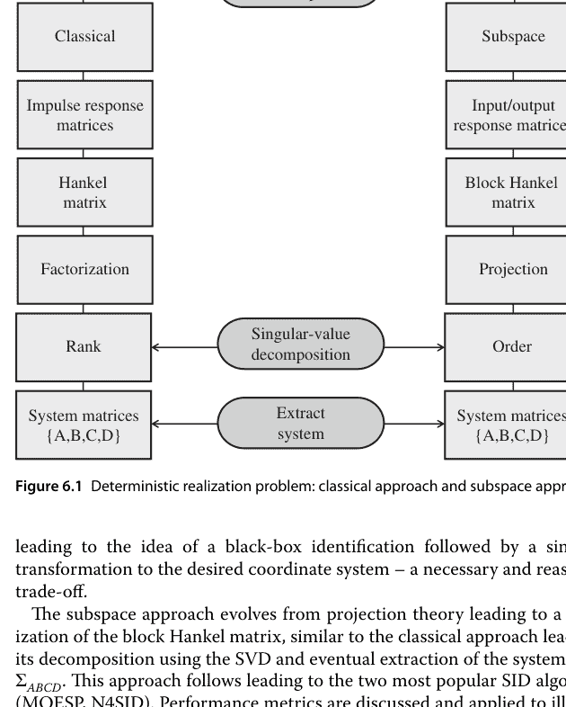

图 6.1 确定性实现问题：经典方法与子空间方法。

从而产生了黑箱辨识后通过相似变换到期望坐标系的思想——一种必要的合理权衡。

子空间方法源于投影理论，导致块汉克尔矩阵的分解，类似于经典方法使用 SVD 对其进行分解并最终提取系统模型 Σ_ABCD。这一方法导致了两种最流行的 SID 算法（MOESP、N4SID）。性能指标被讨论并应用于说明其效用。然后开发示例来演示所有算法，经典和子空间，以及详细的结构振动响应案例研究。

## 6.2.1 实现理论

实现定义为系统传递函数和/或状态空间模型，即矩阵传递函数 H(z) 被定义为“可实现”，如果存在有限维状态空间描述，

\(\Sigma_{ABCD}=\{A,B,C,D\}\)，使得 [10]

\(H(z)=C(zI-A)^{-1}B+D\)  \hfill (6.1)

其中 \(\Sigma_{ABCD}\) 被称为 \(H(z)\) 的 *实现*。这种实现的存在性问题，即“可实现性”，是一个复杂的问题。我们默示假设 \(H(z)\) 是一个真有理矩阵（分子多项式次数小于分母次数）以确保这种可实现性存在（详见 [10]）。

可实现性也源于系统脉冲响应，因为离散传递函数可由幂级数表示 [10]

\(H(z)=\sum_{t=0}^{\infty}H_tz^{-t}\quad\text{for}\quad H_t=CA^{t-1}B+D\delta(t)\)  \hfill (6.2)

且 \(H_t\) 是 \(N_y\times N_u\) 单位脉冲响应矩阵，其中 \(H_0=D\)。因此，由 *马尔可夫参数* 集合组成的无限 *马尔可夫序列* \(\{H_t\}_{t=0}^{\infty}\) 是 *可实现* 的，如果存在有限维 \(\Sigma_{ABCD}\) 满足 \(H_t=CA^{t-1}B+D\delta(t)\)；\(t=0,\ldots,\infty\)。回想一下，传递函数矩阵 \(H(z)\) 可通过 *长除法* 提取马尔可夫参数序列 \(\{H_t\}\)，即 \(H_{ij}(z)=N_{ij}(z)/D_{ij}(z)\)。

既然我们已经建立了系统可实现性的性质，我们关注“极小性”的概念。按定义，在所有可能的实现 \(\Sigma_{ABCD}\) 中，具有“最小”阶数（状态数）的那些被称为 *极小实现*。该性质由矩阵传递函数 \(H(z)\) 的所谓 *麦克米伦次数* 指定，其等价于系统矩阵的维数（阶数），即

\(\dim A=\deg H(z)\)  \hfill (6.3)

由于传递函数是从输入/输出角度对系统的外部描述，只有可控和可观测分量可用（详见 [1]）。考虑到这一点，很明显系统极小性必须与此性质相联系。事实上，它基于 [2] 中证明的事实“\(\Sigma_{ABCD}\) 是 \(H(z)\) 或等价地 \(H_t\) 的极小实现，当且仅当对 \((A,B)\) 和 \((A,C)\) 完全可控和可观测时，分别等价于式 (6.3)。所以我们看到 \(\Sigma_{ABCD}\) 的可控性和可观测性是极小性的必要充分条件！”

这一极小性概念导致了卡尔曼 [3] 证明的有力理论结果。马尔可夫序列 \(\{H_t\}\) 具有 *有限维实现*，当且仅当存在整数 \(N\) 和系数 \(\alpha_1,\ldots,\alpha_N\) 使得

\(H_N=-\sum_{t=1}^{N}\alpha_tH_{N-t}=-\sum_{t=1}^{N}\alpha_t(CA^{N-t-1}B)\)  \hfill (6.4)

该结果源于第 3.6 节的凯莱-哈密顿定理，并基于 \(N\) 阶特征方程 \(\alpha(A)\)。凭借这些系统


牢记这些理论性质，我们现在可以定义确定性实现问题。

提取状态空间系统 Σ_ABCD 的基本问题称为实现问题。简单地说，确定性实现问题是 给定传递函数矩阵 H(z) 或等价地一组脉冲响应矩阵 {H_t} 具有相应的马尔可夫参数，H_t = CA^{t-1}B + Dδ(t); t = 0, …, ∞，求 底层最小状态空间系统，Σ_ABCD := {A, B, C, D}。

这些性质完全源于系统理论中汉克尔矩阵的发展 [2]，它在确定性实现问题的求解中起着内在作用。注意，汉克尔矩阵对于状态空间辨识正如托普利茨矩阵对于信号处理辨识（例如谱估计 [11]）。注意它们通过交换矩阵相关，该矩阵在标量情况下为交叉对角或反对角，由 1 组成，在多变量情况下为单位矩阵 [9]。

我们定义 (K × N_y N_u) × (K × N_y N_u) 块汉克尔矩阵 (K → ∞) 为

ℋ_{K,K} := [ H₁  H₂  ⋯  H_K ; H₂  H₃  ⋯  H_{K+1} ; ⋮   ⋮   ⋯   ⋮ ; H_K  H_{K+1} ⋯ H_{2K-1} ] (6.5)

如果 Σ_ABCD 是 {H_t} 的一个实现，则基于马尔可夫参数，汉克尔矩阵可以分解为能控性和能观测性矩阵的乘积：

ℋ_{K,K} = [ CB  CAB  ⋯ CA^{K-1}B ; CAB  CA²B  ⋯ CA^K B ; ⋮   ⋮   ⋯   ⋮ ; CA^{K-1}B  CA^{K-2}B ⋯ CA^{2K-2}B ] = [ C ; CA ; ⋮ ; CA^{K-1} ] [ B | AB | ⋯ | A^{K-1}B ] (6.6)

或简单地

ℋ_{K,K} = 𝒪_K × 𝒞_K (6.7)

实现算法利用的汉克尔矩阵的另一个有趣性质是其固有的平移不变性，即乘以

还重要的是要认识到，“平移”汉克尔矩阵保持其秩 N_x。如果 H_t = CA^{t-1}B; t = 1, ..., 2N_x，则对应的秩

ρ(ℋ_{N_x,N_x}) = ρ(ℋ_{N_x+1,N_x}) = ρ(ℋ_{N_x,N_x+1}) = N_x (6.12)

成立 [9]。

最后，基于无限马尔可夫序列 {H_t}_0^∞ 的实现问题导致 ℋ_{∞,∞} 具有保持的秩

ρ(ℋ_{∞,∞}) = sup_t ρ(ℋ_{K,K})

即由最小实现以 K = N_x 满足。

另一个源于能观测性、能控性和汉克尔矩阵的有趣系统理论性质是平衡实现的概念。简单地说，平衡实现是指“每个状态的能控性与其能观测性一样” [12]。它是模型阶数约简中的关键属性，表征了唯一捕获底层系统基础的某些特征。

我们知道，如果系统是完全能观测和能控的，则它是最小的且汉克尔矩阵按式 (6.7) 分解。因此，对于稳定系统，能观测性和能控性格拉姆矩阵必须满足以下正定性约束，即格拉姆矩阵 Σ_{AC}, Σ_{AB} 是正定的并满足 Lyapunov 方程：

Σ_{AC} = A'Σ_{AC}A + C'C ≥ 0 （能观测性格拉姆）

Σ_{AB} = AΣ_{AB}A' + BB' ≥ 0 （能控性格拉姆） (6.13)

或者，我们可以用能观测性和能控性矩阵表示这些约束如下：

Σ_{AC}(K) = Σ_{k=0}^{K} (A^k)'C'C A^k = 𝒪_K' 𝒪_K ≥ 0 （能观测性格拉姆）

Σ_{AB}(K) = Σ_{k=0}^{K} A^k B B' (A^k)' = 𝒞_K 𝒞_K' ≥ 0 （能控性格拉姆） (6.14)

对能观测性和能控性矩阵进行奇异值分解 (SVD)，我们得到

𝒪_K = U_𝒪(K)Σ_𝒪(K)V_𝒪'(K) and 𝒞_K = U_C(K)Σ_C(K)V_C'(K) (6.15)

注意，应用 SVD 的正交性性质 (U' U = I, V' V = I)，我们得到格拉姆矩阵为

Σ_{AC}(K)=𝒪'_K𝒪_K=V_o(K)Σ_o^2(K)V'_o(K)

Σ_{AB}(K)=𝒞_K𝒞'_K=U_c(K)Σ_c^2(K)U'_c(K)  (6.16)

从汉克尔矩阵的分解及其奇异值分解，我们有

ℋ_{K,K}=𝒰_K×Σ_K×𝒱'_K
=(U_o(K)Σ_o(K)V'_o(K))×(U_c(K)Σ_c(K)V'_c(K))  (6.17)

建立了汉克尔矩阵的奇异值与所谓的能观测性/能控性乘积值的“二阶模态”奇异值之间的关系（详见 [12] 或 [13]）。

形式上，汉克尔奇异值取为能观测性和能控性格拉姆乘积值的平方根，即汉克尔奇异值由下式给出

σ_{ABC}=√(Σ_{AC}×Σ_{AB})

重要的是要认识到，虽然系统特征值在相似变换下不变，但格拉姆矩阵的特征值不是，但格拉姆矩阵乘积的特征值是相似不变的 [14]。这些值是系统的不变量，并在模型阶数约简中使用 [15]。

## 6.2.2 平衡实现

牢记这些系统理论性质，我们现在可以正式用能观测性、能控性以及同时对角化这些矩阵的过程来表达“平衡实现”的概念。因此，我们定义稳定系统的平衡实现为其格拉姆矩阵相等且为对角，即，[13]

Σ_{AB}(K)=Σ_{AC}(K)=Σ_K  （平衡实现）

其中 Σ_K 是从式 (6.17) 的汉克尔矩阵的 SVD 得到的一个对角矩阵，使得

Σ_K=diag[σ_1,σ_2,…,σ_K] for σ_1≥σ_2≥⋯≥σ_K

且 σ_i 是基于格拉姆矩阵乘积的系统的汉克尔奇异值。这些值在相似变换下不变（详见 [12–15]）。

最大汉克尔奇异值定义了系统的所谓汉克尔范数，是系统输入/输出能量的度量，如 [13, 15]

‖ℋ_{K,K}‖₂ = max{σ_i} for i = 1,⋯, K  (6.18)

所得实现称为平衡实现且是尺度不变的，即平衡系统对幅度缩放是鲁棒的 [12–14]。有趣的是，任何系统的平衡（相似）变换由下式给出

T_bal = Σ_{AB}^{1/2} × V_p × Σ_p^{-1/2} and T_bal^{-1} = Σ_p^{-1/2} × U'_p × Σ_{AC}^{1/2}  (6.19)

其中我们定义乘积矩阵以其 Cholesky 平方根分解以及相应的 SVD 为

𝒫 = Σ_{AC}^{1/2} × Σ_{AB}^{1/2} = U_p × Σ_p × V'_p  (6.20)

其中 Σ_{•}^{1/2} 为能观测性和能控性格拉姆的相应平方根矩阵。

## 6.2.3 系统理论总结

我们总结汉克尔矩阵的这些重要系统理论性质如下：

- 系统 Σ_{ABCD} 定义的系统是最小的，当且仅当它是完全能控且完全能观测的
  （最小阶数）

- 对于最小实现 Σ_{ABCD}，汉克尔矩阵的秩满足：
  ρ(ℋ_{K,K}) = min[ρ(𝒪_K), ρ(𝒞_K)] = N_x  （秩性质）

- 在平移汉克尔矩阵下的恒定秩为
  ρ[ℋ_{K,K}] = ρ[ℋ_{K+1,K}] = ρ[ℋ_{K,K+1}] = N_x  （平移性质）

- 汉克尔矩阵是平移不变的，使得
  ℋ_{K,K}^↑ := 𝒪_K^↑ 𝒞_K ⇔ ℋ_{K,K}^← := 𝒪_K 𝒞_K^←  （平移不变）

- 系统矩阵 A 的特征值位于单位圆内：
  λ[A] ≤ 1  （稳定性）
  或当且仅当 Lyapunov 方程
  P = A' P A + C' C  （Lyapunov 稳定性）
  存在唯一的正定解，P > 0。

## 6.3 经典实现

确定性实现问题的解主要基于汉克尔矩阵的一个基本性质——分解为满秩能观测性和能控性矩阵的最小阶数分解。已证明直接对汉克尔矩阵的行或列进行的操作等同于直接对能观测性矩阵的行或等价地直接对能控性矩阵的列进行独立操作 [18, 19]。因此，最小性意味着汉克尔矩阵的这种唯一分解为其满秩因子。大多数实现算法假设此性质（可实现性）导致多种操作。这一事实导致了不仅“规范实现问题”解的发展，而且相似变换到规范形式 [19] 的内在技术。我们从 Ho 和 Kalman [3] 提出的基本经典算法开始，并展示使用汉克尔矩阵的 SVD 的扩展 [20, 21]。

### 6.3.1 Ho–Kalman 实现算法

求解确定性实现问题的根本方法源于 [3]，称为 Ho–Kalman 算法。假设阶数已知，它按以下步骤进行，从对块汉克尔矩阵执行变换开始，发展出基本矩阵，¹ P ∈ R^{KN_y×KN_y} 和 Q ∈ R^{KN_u×KN_u}，即，

P × H_{K,K} × Q = [ I_{N_x} | 0 ; - - - ; 0 | 0 ] ∈ R^{KN_y×KN_u}  (6.22)

执行此分解后，实现 Σ_{ABCD} 通过从以下提取各个状态空间矩阵获得

P := P × H_{K,K} = [ overbrace{B}^{N_u} | AB | … | A^{K-1} B ] ⇒ B = P(1 : N_x, 1 : N_u)  (6.23)

Q := H_{K,K} × Q = [ N_y { C ; CA ; ⋮ ; CA^{K-1} } ] ⇒ C = Q(1 : N_y, 1 : N_x)  (6.24)


𝒜 := P × ℋ_{K,K}† × Q ⇒ A = 𝒜(1 : N_x, 1 : N_x) (6.25)

其中 recall that ℋ_{K,K}† 是式 (6.10) 中的移位 Hankel 矩阵，N_u 为输入向量 u 的维数，N_y 为输出或测量向量 y 的维数，记号 1 : N → 1, 2, …, N 或等价地选择矩阵的对应行（列）1 到 N。

考虑以下示例来演示这种方法。

## Example 6.1 假设我们有一个已知的 N_y × N_u 传递函数矩阵（不稳定），如 Example 3.1 所示，其中 N_y = N_u = 2 与之前相同。脉冲响应序列由下式给出

H(z) = [1 1; 1 1] z^{-1} + [-2 -4; -3 -1] z^{-2} + [4 10; 7 1] z^{-3} + [-8 -22; -15 -1] z^{-4} + [16 46; 31 1] z^{-5}

构造该问题的相应 Hankel 矩阵和移位 Hankel 矩阵，我们有

H_{2,2} = [1 1 | -2 -4; 1 1 | -3 -1; - - - - -; -2 -4 | 4 10; -3 -1 | 7 1]; H_{2,2}† = [-2 -4 | 4 10; -3 -1 | 7 1; - - - - -; 4 10 | -8 -22; 7 1 | -15 -1]

对 ℋ_{2,2} 执行初等行列变换，我们得到

P = [1 0 0 0; -1 0 -1/2 0; 1 -1 0 0; -2/3 -1/6 -1/6 -1/6]; Q = [1 -1 2 9; 0 1 0 1; 0 0 1 3; 0 0 0 1]

输入 B ⇒ 𝒫(1 : 4, 1 : 2) 和输出 C ⇒ Q(1 : 2, 1 : 4) 矩阵求得为

Pℋ_{2,2} = B { [1 1 | 2 9; 0 1 | 0 1; 0 0 | 1 3; 0 0 | 0 1] } = [B | AB]; ℋ_{2,2}Q = [1 0 0 0; 1 0 -1 0; - - - -; -2 -2 0 0; -3 -2 1 -5] = [C; --; CA] with C overbrace

最后，系统矩阵 A ⇒ A(1 : 4, 1 : 4) 由下式求得

```
PH_{2,2}^† Q = [1 0 0 0; -1 0 -1/2 0; 1 -1 0 0; -2/3 -1/6 -1/6 -1/6] × [-2 -4 | 4 10; -3 -1 | 7 1; - - - - -; 4 10 | -8 -22; 7 1 | -15 -1] × [1 -1 2 9; 0 1 0 1; 0 0 1 3; 0 0 0 1] A = [-2 -2 0 0; 0 -1 0 0; 1 -4 -1 6; 0 1 0 -2]
```

完成了对该 MIMO 问题 Ho–Kalman 算法的应用。作为对实现的检验，我们使用 H_t = C A^{t-1} B; t = 1, …, 5 从提取的模型 Σ_ABCD 重构了脉冲响应序列，与“完全匹配”，因为计算是手工完成的，具有完美精度。

请注意，如果最小阶数如本例中传递函数所示事先未知，则会处理更大的 Hankel 矩阵，直到其秩通过初等变换确定 N_x，如式 (6.22) 所表达。

## 6.3.2 SVD 实现算法

通过对 Hankel 矩阵 [20, 21] H_{m,K} 执行 SVD，得到确定性实现问题的更有效解，其中 m ≥ N_x 且 K ≥ N_x，N_x 为最小实现（系统）的维数，或等价地为底层真实状态数；因此，

```
H_{m,K} = [U_{N_x} | U_N] [Σ_{N_x} | 0; - - -; 0 | 0] [V'_{N_x}; --; V'_N] = U_{N_x} Σ_{N_x} V'_{N_x} (6.26)
```

对于 Σ_{N_x} = diag[σ_1, σ_2, …, σ_{N_x}]

从 Hankel 矩阵的分解及其 SVD，我们有

```
H_{m,K} = O_m × C_K = (U_{N_x} Σ_{N_x}^{1/2}) ((Σ_{N_x}')^{1/2} V'_{N_x}) (6.27) O_{N_x} C_{N_x}
```

其中 Σ_{N_x}^{1/2} 是矩阵平方根，即 R = S^{1/2} × (S')^{1/2} 通过 Cholesky 分解 [22] 得到。

现在从可观测性或可控性矩阵的移位不变性质（参见式 (6.10)）出发，我们可以从以下任一式获得系统矩阵

𝒪_{N_x} × A = 𝒪_{N_x}^†
 或
 A × 𝒞_{N_x} = 𝒞_{N_x}^-
这通过应用伪逆² (Z^# := (Z'Z)^{-1}Z') 得到唯一系统矩阵，因为最小性保证了可观测性和可控性矩阵满秩

A = 𝒪_{N_x}^# × 𝒪_{N_x}^†  或  A = 𝒞_{N_x}^- × 𝒞_{N_x}^#  (6.28)

输入和输出矩阵直接从可控性和可观测性矩阵中提取为

B = 𝒞(1 : N_x, 1 : N_u)  和  C = 𝒪(1 : N_y, 1 : N_x)  (6.29)

然而，从式 (6.27) 的 SVD，我们有

A = 𝒪_{N_x}^# 𝒪_{N_x}^† = (Σ_{N_x}^{-1/2} U_{N_x}') × 𝒪_{N_x}^† 或 A = 𝒞_{N_x}^- 𝒞_{N_x}^# = 𝒞_{N_x}^- × (V_{N_x} (Σ_{N_x}^{-1/2})')  (6.30)

这是一种非常高效的计算伪逆并提取模型的方法。

还值得注意的是，通过 SVD 提取 Σ_{ABCD}，对于 A 和 C 矩阵，所有低阶模型都“嵌套”在这些结构中，并且可以很容易地作为子矩阵提取（参见 [23] 和 Problem 6.6 了解更多细节）。

## Example 6.2  考虑 Example 6.1 并假设我们不知道阶数 N_x。在这种情况下我们会创建一个扩展的 Hankel 矩阵，其中 K = 5 从而得到

H_{3,3} = [ 1 1 | -2 -4 | 4 10 ; 1 1 | -3 -1 | 7 1 ; - - - - - - - - ; -2 -4 | 4 10 | -8 -22 ; -3 -1 | 7 1 | -15 -1 ; - - - - - - - - ; 4 10 | -8 -22 | 16 46 ; 7 1 | -15 -1 | 31 1 ]

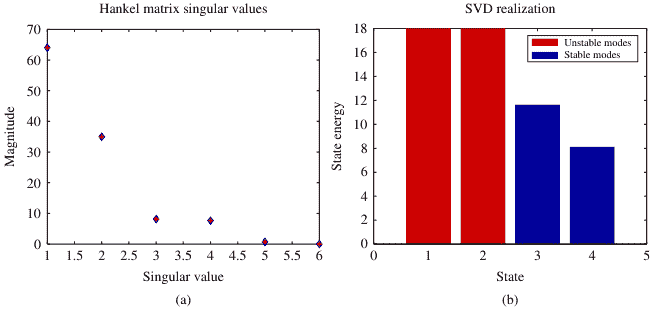

**Figure 6.2** SVD 实现。 (a) Hankel 矩阵的估计奇异值。 (b) 估计的 Hankel 奇异值。

研究 Hankel 矩阵，我们计算了其 SVD 以观察 Figure 6.2 中的秩以及相应的 *Hankel 奇异值*，之前已讨论过。从图中可以清楚地看出阶数（秩）为四（4），因为前四个奇异值相对于最后两个很大，表明是一个四阶系统。Hankel 奇异值表明有两个不稳定极点（特征值）；然而应有四个（-1, -1, -2, -2），但由于识别模型中的不准确性导致变化，如特征值所示：

$\lambda(A_{true}) = \{-1,-1,-2,-2\} \rightarrow \lambda(\hat{A}) = \{-1,0.474,-2,-1.606\}$

表明实现不完美。

我们将 SVD 方法应用于这组脉冲响应矩阵并提取了以下系统 $\Sigma_{ABCD}$：

$$\hat{A}=\begin{bmatrix}-2.095&0.376&-0.448&0.004\\-0.057&-1.884&-0.303&0.064\\0.260&0.756&-0.745&0.344\\0.140&-0.147&-0.418&5.92\end{bmatrix}$$

$$\hat{B}=\begin{bmatrix}-0.873&-0.943\\0.940&-0.235\\0.0526&-2.008\\-0.005&1.930\end{bmatrix};\qquad \hat{C}=\begin{bmatrix}-1.100&-0.0248&1.934&1.989\\-0.657&0.9780&-0.262&0.0463\end{bmatrix}$$

线性时不变多输入/多输出（MIMO）机械系统由向量-矩阵微分方程表征，可表示为

$$M\ddot{\mathbf{d}}(t) + C_d\dot{\mathbf{d}}(t) + K\mathbf{d}(t) = B_p\mathbf{p}(t)\tag{6.31}$$

其中 $\mathbf{d}$ 是 $N_d \times 1$ 位移向量，$\mathbf{p}$ 是 $N_p \times 1$ 激励力，$M$、$C_d$、$K$ 分别是表征振动过程模型的 $N_d \times N_d$ 集中质量、阻尼和弹簧常数矩阵。这些矩阵的结构通常采用以下形式

$$M = \begin{bmatrix} M_1 & 0 & 0 & 0 & 0 \\ 0 & M_2 & 0 & 0 & 0 \\ \vdots & \vdots & \ddots & \vdots & \vdots \\ 0 & 0 & 0 & M_{N_d-1} & 0 \\ 0 & 0 & 0 & 0 & M_{N_d} \end{bmatrix}, \quad C_d = [C_{d_q}], \text{ and }$$

$$K = \begin{bmatrix} (K_1+K_2) & -K_2 & 0 & 0 & 0 \\ -K_2 & (K_2+K_3) & \ddots & 0 & 0 \\ 0 & \ddots & \ddots & -K_{N_d-1} & 0 \\ 0 & 0 & -K_{N_d-1} & (K_{N_d-1}+K_{N_d}) & -K_{N_d} \\ 0 & 0 & 0 & -K_{N_d} & K_{N_d} \end{bmatrix}$$

如果我们定义 $2N_d$ 状态向量为 $\mathbf{x}(t) := [\mathbf{d}(t)\quad|\quad \dot{\mathbf{d}}(t)]'$，则该过程的连续时间状态空间表示可表示为

$$\dot{\mathbf{x}}(t) = \underbrace{\begin{bmatrix} 0 & | & I \\ --- & | & --- \\ -M^{-1}K & | & -M^{-1}C_d \end{bmatrix}}_{A} \mathbf{x}(t) + \underbrace{\begin{bmatrix} 0 \\ --- \\ M^{-1}B_p \end{bmatrix}}_{B} \mathbf{p}(t)\tag{6.32}$$

相应的测量或输出向量关系可表征为

$$\mathbf{y}(t) = \mathbf{C_a}\ddot{\mathbf{d}}(t) + \mathbf{C_v}\dot{\mathbf{d}}(t) + \mathbf{C_d}\mathbf{d}(t)\tag{6.33}$$

其中常数矩阵：$\mathbf{C_a}$、$\mathbf{C_v}$、$\mathbf{C_d}$ 分别是适当维数的加速度、速度和位移加权矩阵。

就式 (6.32) 的状态向量关系而言，我们可以表示加速度向量为

$$\ddot{\mathbf{d}}(t) = -M^{-1}K\mathbf{d}(t) - M^{-1}C_d\dot{\mathbf{d}}(t) + M^{-1}B_p\mathbf{p}(t)\tag{6.34}$$

将加速度项代入式 (6.33)，我们有

$$\mathbf{y}(t) = -\mathbf{C_a}M^{-1}[B_p\mathbf{p}(t) - C_d\dot{\mathbf{d}}(t) - K\mathbf{d}(t)] + \mathbf{C_v}\dot{\mathbf{d}}(t) + \mathbf{C_d}\mathbf{d}(t)$$


或

$$
y(t)=\left[C_d-C_aM^{-1}K \;\middle|\; C_v-C_aM^{-1}C_d\right]
\begin{bmatrix} d(t) \\ \dot d(t) \end{bmatrix}
+ C_aM^{-1}B_p p(t) \tag{6.35}
$$

从而得到振动测量为

$$
y(t)=Cx(t)+Du(t) \tag{6.36}
$$

其中输出或测量向量为 \(y\in\mathbb{R}^{N_y\times1}\)，从而完整地建立了MIMO机械系统模型。

当信噪比（SNR）很高时，可以执行SVD实现并获得合理的结果——尤其是在确定性情况下。接下来，我们研究一个先前在文献[15]中开发的简单机械系统。

### 示例 6.3

考虑一个简单的三质量块（弹簧-阻尼）机械系统³，如图6.3所示，该系统来自文献[15]，其中 \(m_i=1\)，\(k_i=3\)，\(k_4=0\)，\(d_i=0.01k_i\)，\(d_4=0\)；\(i=1,\ldots,3\)。这些参数以及输入/输出传递矩阵，得到如下状态空间表示（\(N_d=3\), \(N_x=6\)）：

$$
\begin{aligned}
\dot{x}(t)&=Ax(t)+Bu(t)\\
y(t)&=Cx(t)+Du(t)
\end{aligned}
$$

$$
A=\begin{bmatrix}
0&0&0&\vert&1&0&0\\
0&0&0&\vert&0&1&0\\
0&0&0&\vert&0&0&1\\
\hline
-6&3&0&\vert&-0.06&0.03&0\\
3&-6&3&\vert&0.03&-0.06&0.03\\
0&3&-3&\vert&0&0.03&-0.03
\end{bmatrix},\quad
B=\begin{bmatrix}0\\0\\0\\0\\0\\1\end{bmatrix},\quad
C=\begin{bmatrix}
1&0&0&\vert&0&0&0\\
0&0&0&\vert&1&0&0\\
0&0&0&\vert&0&0&1
\end{bmatrix}
$$

其中 \(D=0\)。


**图6.3** 所研究的三输出机械系统。

> 3. 该机械系统的详细分析见文献[15]。

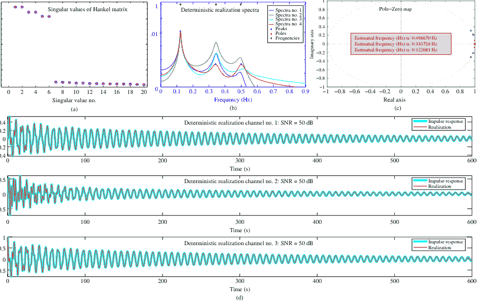

**图6.5** 三输出机械系统的SVD实现。(a) Hankel矩阵的奇异值。(b) 功率谱：输出/平均值及极点（方框）。(c) 含极点/零点的频率。(d) 实现输出通道（数据/实现）叠加。

估计的通道输出与原始脉冲响应数据紧密叠加——再次表明由于高信噪比而获得了准确的实现。

在图6.5b中，我们将模型SVD实现的估计平均功率谱与三输出频谱进行比较，并显示了提取的模态频率的位置。注意所有峰值是如何对齐的，表明基础机械系统的实现是有效的。极点-零点表示以及提取的模态频率如图6.5c所示。示例到此结束。

接下来，我们考虑另一种在由代数群论演变而来的唯一结构描述中估计实现的方法——规范形。

## 6.3.3 规范实现

在本节中，我们考虑在状态空间的规范坐标中求解实现问题。这里，特定的“不变量”实体将直接从Hankel矩阵脉冲响应数据中提取，从而能够深入洞察所辨识系统的内在结构。这种方法有其优势，因为利用所需的最少参数即可在这种状态空间形式下表示复杂系统。规范实现刻画了未知系统的唯一表示。然而，其缺点在于，由于这种形式的唯一性，以该形式实现模型的误差可能表示一个与真实系统完全不同的系统。

### 6.3.3.1 不变系统描述

系统 \(\Sigma_{ABCD}\) 的唯一参数化表示称为规范形[24]。形式上，这种刻画源于代数模论，通过变换群（相似变换）作用于等价类（传递函数/马尔可夫序列）[2]而得到。该作用的结果是一组完整的独立“不变量”，它们唯一地刻画了所研究的系统，并构成了表示该系统的基本实体。这些不变量是系统结构的关键参数，揭示了其在子系统层面的内部互连和耦合。利用这些不变量，我们可以构造一个唯一表示 \(\Sigma_{ABCD}\) 并揭示其内部结构的“规范形”[18,25]。

对于能观对 \((A,C)\)，定义 \(\nu_j\) 为第 \(j\) 个能观性指数。存在唯一一组有序标量 \(\beta_{jk\ell}\) 使得

$$
c'_jA^{\nu_j}
=\sum_{k=1}^{j-1}\sum_{\ell=0}^{\min(\nu_j,\nu_k)-1}\beta_{jk\ell}c'_kA^{\ell}
+\sum_{k=j}^{N_y}\sum_{\ell=0}^{\min(\nu_j,\nu_k)-1}\beta_{jk\ell}c'_kA^{\ell}
\tag{6.37}
$$

其中集合 \(\{\{\nu_j\},\{\beta_{jk\ell}\}\}\)，\(j,k=1,\ldots,N_y\)，\(\ell=0,\ldots,\nu_j-1\)，被定义为能观对 \((A,C)\) 的能观性不变量。

该关系提供了唯一一组基向量 \(c'_jA^{\nu_j}\) 以及相应的线性相关系数 \(\beta_{jk\ell}\)。这里，第 \(j\) 个能观性指数 \(\nu_j\) 是使得向量 \(c'_jA^{\nu_j}\) 为其基向量或*前驱*的线性组合的最小正整数，其中 \(c'_jA^{\nu_j}\) 的一个前驱是任何满足 \(sN_y+r<\nu_jN_y+j\) 的向量 \(c'_rA^s\)。

考虑到这一点，我们将*前驱独立性*定义为：如果矩阵的一个行向量不是其在式(6.37)所给出的*链*中前驱的线性组合，则该行向量是独立的。例如，对于我们的能观性不变量，“能观性”链组装为

$$
\underbrace{
\left[
c'_1\;\;c'_1A\;\;\cdots\;\;c'_1A^{\nu_1-1}
\;\middle|\;
c'_2\;\;c'_2A\;\;\cdots\;\;c'_2A^{\nu_2-1}
\;\middle|\;
\cdots
\;\middle|\;
c'_{N_y}\;\;\cdots\;\;c'_{N_y}A^{\nu_{N_y}-1}
\right]^T
}_{\text{Observability Chain 1}\quad \text{Observability Chain 2}\quad \cdots\quad \text{Observability Chain }N_y}
\tag{6.38}
$$

\(\times N_y\)（行前驱）

这一定义的意义在于，按链 \(\{c'_j\;\;c'_jA\;\;\cdots\;\;c'_jA^{\nu_j-1}\}\) 的“行”前驱顺序依次检查*Hankel矩阵*各行的相关性，等价于以相同顺序检查能观性矩阵的各行。当对这些行进行前驱独立性检查时，相应的指数 \(\{\nu_j\}\) 和线性相关系数 \(\{\beta_{jk\ell}\}\) 便具有特殊含义——它们就是能观性不变量集合。

类似地，对于能控对 \((A,B)\)，定义 \(\mu_i\) 为第 \(i\) 个*能控性指数*；则存在唯一一组有序标量 \(\alpha_{imn}\) 使得

$$
A^{\mu_i}b_i
=\sum_{m=1}^{i-1}\sum_{n=0}^{\min(\mu_i,\mu_m)-1}\alpha_{imn}A^nb_m
+\sum_{m=i}^{N_u}\sum_{n=0}^{\min(\mu_i,\mu_m)-1}\alpha_{imn}A^nb_m
\tag{6.39}
$$

其中集合 \(\{\{\mu_i\},\{\alpha_{imn}\}\}\)，\(i,m=1,\ldots,N_u\)，\(n=0,\ldots,\mu_i-1\)，被定义为能控对 \((A,B)\) 的*能控性不变量*。

该关系提供了唯一一组基向量 \(A^{\mu_i}b_i\) 以及相应的线性相关系数 \(\alpha_{imn}\)。这里，第 \(i\) 个能控性指数 \(\mu_i\) 是使得向量 \(A^{\mu_i}b_i\) 为其前驱线性组合的最小正整数，其中 \(A^{\mu_i}b_i\) 的一个前驱是任何满足 \(sN_u+r<\mu_iN_u+i\) 的向量 \(A^s b_r\)。

如前所述，我们将*前驱独立性*定义为：如果矩阵的一个列向量不是其在式(6.39)所给出的列链中前驱的线性组合，则该列向量是独立的。例如，对于我们的能控性不变量，“能控性”链组装为

$$
\underbrace{
\left[
b_1\;\;Ab_1\;\;\cdots\;\;A^{\mu_1-1}b_1
\;\middle|\;
b_2\;\;Ab_2\;\;\cdots\;\;A^{\mu_2-1}b_2
\;\middle|\;
\cdots
\;\middle|\;
b_{N_u}\;\;\cdots\;\;A^{\mu_{N_u}-1}b_{N_u}
\right]
}_{\text{Controllability Chain 1}\quad \text{Controllability Chain 2}\quad \cdots\quad \text{Controllability Chain }N_u}
\tag{6.40}
$$

\(\times N_u\)（列前驱）

同样，这一定义的意义在于，按链 \(\{b_i\;\;Ab_i\;\;\cdots\;\;A^{\mu_i-1}b_i\}\) 的“列”前驱顺序依次检查Hankel矩阵各列的相关性，等价于以相同顺序检查能控性矩阵的各列。当对这些列进行前驱独立性检查时，相应的指数 \(\{\mu_i\}\) 和系数 \(\{\alpha_{imn}\}\) 就是能控性不变量集合。

能观性和能控性“指数”与系统整体的能观性指数 \(\nu\) 和能控性指数 \(\mu\) 相关，后者分别定义为使 \(\Sigma_{ABCD}\) 完全能观和完全能控的最小整数值。因此，我们有

$$
\nu=\sum_{\ell=1}^{N_y}\nu_\ell=N_x \qquad\text{and}\qquad \mu=\sum_{n=1}^{N_u}\mu_n=N_x \tag{6.41}
$$

有了这些定义，我们可以用能观性指数和能控性指数重新表述秩条件；也就是说，对于最小实现 \(\Sigma_{ABCD}\)，Hankel矩阵的秩满足

$$
\rho(\mathcal{H}_{\nu,\mu})=\min[\rho(\mathcal{O}_\nu),\rho(\mathcal{C}_\mu)]=N_x
\qquad\text{(Rank Property)} \tag{6.42}
$$

利用能观性和能控性不变量集合，我们可以在相似变换群[24,25]下构造相应的规范形（Luenberger）。由式(6.37)和式(6.39)的相关关系可以看出，相应的向量 \(\{c'_jA^{\nu_j-1}\}\)，\(j,k=1,\ldots,N_y\)，张成 \(\mathcal{O}_{\nu+1}\) 的行；类似地，向量 \(\{A^{\mu_i-1}b_i\}\)，\(i,m=1,\ldots,N_u\)，张成 \(\mathcal{C}_{\mu+1}\) 的列。因此，规范形（Luenberger）由行对 \((A_R,C_R)\) 和列对 \((A_C,B_C)\) 定义。

我们得到Luenberger行规范形为

$$
A_R=\begin{bmatrix}
e'_2\\ \vdots\\ e'_{m_1}\\ \beta'_1\\ \hline \vdots\\ \hline e'_{m_{n-1}+2}\\ \vdots\\ e'_{m_n}\\ \beta'_m
\end{bmatrix},\qquad
C_R=\begin{bmatrix}
e'_1\\ e'_{m_1+1}\\ \vdots\\ e'_{m_{n-1}+1}
\end{bmatrix},\qquad
m_i=\sum_{k=1}^{i}\nu_k,\quad i=1,\ldots,n
\tag{6.43}
$$


[c'_1 | c'_2 c'_2 A | c'_3]'

⇓ ⇓ ⇓ ⇓

[β_j10 | β_j20 β_j21 | β_j30]'

for j = 1, 2, 3. 因此，我们有行规范型如下：

A_R = [β'_1; e'_2; β'_2; β'_3] = [β_110 | β_120 β_121 | β_130; 0 | 1 0 | 0; β_210 | β_220 β_221 | β_230; β_310 | β_320 β_321 | β_330]; C_R = [e'_1; e'_2; e'_4] = [1 | 0 0 | 0; 0 | 1 0 | 0; 0 | 0 0 | 1]

列规范型由以下每个能控性链构造而成：

[b_1 A b_1 A^2 b_1 | b_2]'

⇓ ⇓ ⇓ ⇓

[α_i10 α_i11 α_i12 | α_i20]'

for i = 1, 2 且对应的列规范型为

A_C = [e_2 e_3 α_1 | α_2] = [0 0 α_110 | α_210; 1 0 α_111 | α_211; 0 1 α_112 | α_212; 0 0 α_120 | α_220]; B_C = [e_1 e_4] = [1 0; 0 0; 0 0; 0 1]

至此完成了将指标和系数映射到状态空间规范型的示例。

还应理解，后续的来实现算法的开发直接源于状态空间相似变换的构造 [24]。因此，行和列规范型的相似变换矩阵由 [24] 给出

T_R = [T_1^R; ---; T_2^R; ---; :; ---; T_{N_r}^R] and T_C = [T_1^C | T_2^C | ... | T_{N_u}^C] (6.45)

从马尔可夫序列识别规范实现的过程类似于 Ho–Kalman 算法，通过在 Hankel 矩阵上执行相应的初等行 ($P$) 和/或列 ($Q$) 操作来进行。 对可观测矩阵执行行操作，使得 $P O_K$ 的前驱依赖关系与 $\mathcal{O}_K$ 相同，并在能控矩阵上执行列操作，使得 $C_K E$ 和 $C_{K'}$ 具有相同的依赖关系，则可得

$$\mathcal{H}^{*}_{K,K'} = P \times \mathcal{H}_{K,K'} \times E \quad \Longleftrightarrow \quad \mathcal{H}_{K,K'}$$

其中 $\mathcal{H}^{*}_{K,K'}$ 定义为 $\mathcal{H}_{K,K'}$ 的 *结构数组*，揭示了系统的内部耦合，因为其非零元素出现在对应于可观测性和能控性指标的 (行, 列) 位置上，其余元素为 0，即

$$\mathcal{H}^{*}_{K,K'}(i,j)=\begin{cases} H(i,j)=H(\nu_i,\mu_j) & \text{for } i=1,\ldots,N_y;\ j=1,\ldots,N_u\\ 0 & \text{elsewhere}\end{cases}$$

或简单地

(可观测性不变量, 能控性不变量) $\rightarrow$ (行/列指标)。

“前驱为基础”的规范实现算法还给出了更 remarkable 的结果。可以证明，最终初等行变换矩阵 $P$ 的结构成为一个对角线上带 $1s$ 的下三角矩阵，其系数依赖关系在每一行中对应于可观测性指标 $\{\nu_j\}$，而最终初等列变换在每一列中对应于能控性指标 $\mu_i$。事实上，已证明 [19] 不变量集合 $\{\beta_{jke}\}$、$\{\alpha_{im}\}$ 或更紧凑地 $N_x$-向量集合 $\{\beta'_i\}$、$\{\alpha_j\}$ 由 $P$ 的行和 $E$ 的列给出，使得

$$\beta'=-[p_{qr}\ p_{qr+N_y}\ \cdots\ p_{qr+(\nu_j-1)N_y}]';\ \text{for } q=j+\nu_jN_y,\ j,r=1,\ldots,N_y$$

$$\alpha=-[e_{st}\ e_{s+N_u}\ \cdots\ e_{s+(\mu_i-1)N_u}]';\ \text{for } t=i+\mu_iN_y,\ i,s=1,\ldots,N_u$$

其中

$$p_{qr},e_{st}=\begin{cases}1 & q=r;\ s=t\\ 0 & q<r;\ s>t\end{cases}$$

跟踪这些不变量指标的繁琐程度相当大，但幸运的是，为了提取规范实现并非必要，因为算法的步骤要直接得多。只是规范结构 $\Sigma_R$ 和 $\Sigma_C$ 需要这些知识来从已识别的不变量构造这些规范型。存在大量关于这些结果的数学证明，它们导出了随后的规范实现算法，可在 [16] 中找到。接下来我们给出该算法。

# Example 6.5

考虑 Example 6.1 并假设我们不知道阶数 $N_x$。在这种情况下我们将创建一个扩展的 Hankel 矩阵，取 $K=7$ 得到

$$H_{4,4}=\begin{bmatrix}
1&2&|&2&4&|&4&8&|&8&16\\
1&2&|&2&4&|&6&10&|&13&22\\
1&0&|&1&0&|&3&2&|&6&6\\
-&-&-&-&-&-&-&-&-&-&-\\
2&4&|&4&8&|&8&16&|&16&32\\
2&4&|&6&10&|&13&22&|&28&48\\
1&0&|&3&2&|&6&6&|&13&16\\
-&-&-&-&-&-&-&-&-&-&-\\
4&8&|&8&16&|&16&32&|&32&64\\
6&10&|&13&22&|&28&48&|&58&102\\
3&2&|&6&6&|&13&16&|&27&38\\
-&-&-&-&-&-&-&-&-&-&-\\
8&16&|&16&32&|&32&64&|&64&128\\
13&22&|&28&48&|&58&102&|&119&214\\
6&6&|&13&16&|&27&38&|&56&86
\end{bmatrix}$$

+   1. 从 $[I_{12}\mid H_{4,4}\mid I_8]$ 开始并执行初等行操作以得到 $[P\mid Q\mid I_8]$。

$$\left[\begin{array}{cccccccccccc|cccccccc}
1&0&0&0&0&0&0&0&0&0&0&0&1&2&2&4&4&8&8&16\\
-1&1&0&0&0&0&0&0&0&0&0&0&0&0&0&2&2&5&6\\
-3/2&1/2&1&0&0&0&0&0&0&0&0&0&0&-2&-1&-4&0&-5&1/2&-7\\
-2&0&0&1&0&0&0&0&0&0&0&0&0&0&0&0&0&0&0&0&0\\
1/2&-5/2&0&0&1&0&0&0&0&0&0&0&0&0&2&2&0&1&-1/2&1\\
1&1&-1&0&-1&1&0&0&0&0&0&0&0&0&0&0&0&0&0&0&0\\
-4&0&0&0&0&1&0&0&0&0&0&0&0&0&0&0&0&0&0&0&0\\
-3&0&-1&0&-1&0&0&1&0&0&0&0&0&0&0&0&0&0&0&0&0\\
0&1&-2&0&-1&0&0&0&1&0&0&0&0&0&0&0&0&0&0&0&0\\
-8&0&0&0&0&0&0&0&0&1&0&0&0&0&0&0&0&0&0&0&0\\
-8&1&-2&0&-2&0&0&0&0&0&1&0&0&0&0&0&0&0&0&0&0\\
-1&2&-3&0&-2&0&0&0&0&0&0&1&0&0&0&0&0&0&0&0&0
\end{array}\right]$$

$P$ 为左块，$Q$ 为中右块，$I_8$ 为最右的单位块。

+   2. 使用 Eqs. (6.38) 和 (6.40) 的行和列前驱链构造确定可观测性和能控性不变量，即从 $Q$-矩阵的下划线条目我们看到 (独立行/列用括号标注)。

# 可观测性不变量：

Chain No. 1 : $c'_1 \to$ 非零 (1); $c'_1 A \equiv 0$ (第 4 行); $\Rightarrow\quad v_1 = 1$

Chain No. 2 : $c'_2 \to$ 非零 (1); $c'_2 A \to$ 非零 (2); $c'_2 A^2 \equiv 0$ (第 8 行); $\Rightarrow\quad v_2 = 2$

Chain No. 3 : $c'_3 \to$ 非零 (1); $c'_3 A \equiv 0$ (第 6 行); $\Rightarrow\quad v_3 = 1$

# 能控性不变量：

Chain 1 : $b_1 \to$ 非零 (1); $A b_1 \to$ 非零 (2); $A^2 b_1 \to$ 非零 (3); $A^3 b_1 \equiv 0$ (第 7 列) $\Rightarrow\ \mu_1 = 3$

Chain 2 : $b'_2 \to$ 非零 (1); $A b_2 \equiv 0$ (第 4 列) $\Rightarrow\ \mu_2 = 1$

并检查秩条件

$\rho H_{2,3} = \rho H_{3,3} = \rho H_{2,4} = 4$

(3) 从 $P$ 的行和列中提取系数作为

# $\mathbf{A}_R$ :

$\beta'_1 = [\beta_{110}\ |\ \beta_{120}\ \beta_{121}\ |\ \beta_{130}] = -[p_{41}\ |\ p_{42}\ p_{45}\ |\ p_{43}] = -[2\ |\ \ 0\ \ 0\ |\ \ 0]$

$\beta'_2 = [\beta_{210}\ |\ \beta_{220}\ \beta_{221}\ |\ \beta_{230}] = -[p_{81}\ |\ p_{82}\ p_{85}\ |\ p_{83}] = -[3\ |\ \ 0\ \ 1\ |\ \ 1]$

$\beta'_3 = [\beta_{310}\ |\ \beta_{320}\ \beta_{321}\ |\ \beta_{330}] = -[p_{61}\ |\ p_{62}\ p_{65}\ |\ p_{63}] = -[-1\ |\ -1\ \ 1\ |\ \ 1]$

# $\mathbf{C}_R$ :

$\mathbf{e}'_1 = [1\ |\ \ 0\ \ 0\ |\ \ 0]$

$\mathbf{e}'_2 = [0\ |\ \ 1\ \ 0\ |\ \ 0]$

$\mathbf{e}'_4 = [0\ |\ \ 0\ \ 0\ |\ \ 1]$

# $\mathbf{B}_R$ :

$\mathbf{h}'_{1\bullet} = [1\ \ 2]$

$\mathbf{h}'_{2\bullet} = [1\ \ 2]$

$\mathbf{h}'_{5\bullet} = [2\ \ 4]$

$\mathbf{h}'_{3\bullet} = [1\ \ 0]$

Luenberger 行规范型由可观测性不变量构造而成

$A_R = \begin{bmatrix} \beta'_1 \\ \mathbf{e}'_2 \\ \beta'_2 \\ \beta'_3 \end{bmatrix} = \begin{bmatrix} -2 & | & 0 & 0 & | & 0 \\ 0 & | & 1 & 0 & | & 0 \\ -3 & | & 0 & -1 & | & -1 \\ 1 & | & 1 & -1 & | & -1 \end{bmatrix};\quad C_R = \begin{bmatrix} \mathbf{e}'_1 \\ \mathbf{e}'_2 \\ \mathbf{e}'_4 \end{bmatrix} = \begin{bmatrix} 1 & | & 0 & 0 & | & 0 \\ 0 & | & 1 & 0 & | & 0 \\ 0 & | & 0 & 0 & | & 1 \end{bmatrix}$

$A_C=[e_2\ e_3\ \alpha_1\ |\ \alpha_2]=\begin{bmatrix}0&0&-5/4&-1\\1&0&-1/4&1\\0&1&5/2&0\\0&0&-1/8&3/2\end{bmatrix};\quad B_C=[e_1\ e_4]=\begin{bmatrix}1&0\\0&0\\0&0\\0&1\end{bmatrix}$

$C_C=\begin{bmatrix}h_{\bullet1}\\h_{\bullet3}\\h_{\bullet5}\\h_{\bullet2}\end{bmatrix}=\begin{bmatrix}1&2&4&2\\1&2&6&2\\1&1&3&0\end{bmatrix}$

*至此完成了规范实现示例。*

我们在表 6.2 中总结了规范实现算法。

**表 6.2** 规范实现算法。

_Hankel 矩阵初等行 (前驱) 操作_

_可观测性/能控性指标 (秩)_

$[K_{N_y}\mid H_{K,K'}\mid K_{N_u}]\rightarrow[P\mid Q\mid K_{I_{K',N_u}}]$

_行操作_

- 执行前驱链行操作直到 $Q$ 的最后 $N_y$-行变为零 _秩条件满足_。
- 从 $Q$-矩阵的行/列指标中提取 _可观测性_ 和 _能控性指标_ $[\{\nu_j\},\{\mu_i\}]$。

_提取行不变量_

- 从适当的行 $(q=j+\nu_jN_y)$ 中提取集合 $\{\beta_j\};\ j=1,\ldots,N$。

_构造行规范系统: $\Sigma_{A_R,B_R,C_R,D_R}$_

- $A_R$ 基于提取的可观测性指标从 $P$-矩阵的行构造。
- $C_R$ 基于提取的可观测性指标选择单位行向量 $e'_p$。
- $B_R$ 来自 $H_{K,K'}$ 的对应行。
- $D_R$ 来自 $H_0$。

$[P\mid Q\mid K_{I_{K',N_u}}]\rightarrow[P\mid H^*_{K,K'}\mid E]$

_列操作_

- 对 $Q$ 执行列操作以获得剩余行中 0 元素的列前驱链。
- 从 $E$-矩阵的适当列 $(q=i+\mu_iN_u)$ 中提取集合 $\{\alpha_i\};\ i=1,\cdots,N_u$ 以构造 $A_C$。
- 基于提取的能控性指标选择单位列向量 $e'_p$ 构造 $B_C$。
- 从 $H_{K,K'}$ 的对应列中提取 $C_C$。
- 设 $D_C=\tilde H_0$。


在本小节中，我们展示了如何利用规范的状态空间结构从 MIMO 系统演化而来的马尔可夫序列或脉冲响应矩阵中提取唯一的模型。在结束本节之前，重要的是要理解输入/输出数据可以直接用于执行这些操作，如 [27] 中所述，而非先估计脉冲响应然后再应用相似变换。在下一节中，我们将发展子空间技术，该技术可直接从 MIMO 数据中提取状态空间模型，但与此处发展的规范结构不同——它们是“黑箱”模型，可通过相似变换（如 Eq. (6.45) 中用于 Luenberger 规范形式的变换）转换为规范结构。这是子空间实现的基本哲学，“拟合一个黑箱状态空间模型并将其变换到期望的坐标系”（例如规范形式）以进行处理。接下来我们将研究这些子空间方法。

## 6.4 确定性子空间实现：正交投影

在本小节中，我们发展了从输入/输出数据中识别状态空间表示的基本子空间实现方法，将实现从脉冲响应扩展到输入/输出数据——仍假设为确定性。为了理解当演化的是输入/输出序列而非脉冲响应序列时确定性实现问题如何求解，重要的是要理解大多数子空间实现技术首先要求直接从采集数据中提取扩展可观测矩阵，然后第二步提取系统模型。现有方法在可观测矩阵的估计方式及其提取系统模型的方法上有所不同。为了提取状态空间模型 Σ_ABCD，只需获得可观测矩阵的扩展列空间或状态序列的行空间即可，两者都可通过 SVD 轻松获得，即子空间辨识的关键要素基于提取：

𝒪_K = [ C ; CA ; ⋮ ; CA^{K-1} ]_{Column space} ;   𝒳_k = [ x(k)  x(k+1)  …  x(K+k-1) ]_{Row space}

也许经典实现理论采用脉冲响应序列后进行 Hankel 矩阵分解与从输入/输出序列的子空间实现理论之间的主要“联系”在于

内在的系统理论“秩条件”定义了状态空间的最小维数。子空间实现理论主要依赖于输入序列的持续激励概念以及解的最小状态空间维数 [9]，即可观测矩阵张成 $N_x$-维状态空间，该空间包含由于状态而产生的输出部分，不包括输入。为了看到这一点，我们首先构造输入/输出数据矩阵（如前所述）。

回想一下，离散 LTI 解由 Eq. (3.33) 给出

$$x(t)=A^t x(0)+\sum_{\ell=0}^{t-1}A^{t-\ell-1}Bu(\ell),\qquad t=0,1,\ldots,K$$

测量或输出系统由

$$y(t)=CA^t x(0)+\sum_{\ell=0}^{t-1}CA^{t-\ell-1}Bu(\ell)+D\delta(t)$$

给出
将此关系进一步在 $k$-个采样上展开并整理项，我们得到

$$\begin{bmatrix}y(0)\\y(1)\\\vdots\\y(k-1)\end{bmatrix}=\begin{bmatrix}C\\CA\\\vdots\\CA^{k-1}\end{bmatrix}x(0)+\begin{bmatrix}D&0&\cdots&0\\CB&D&\cdots&0\\\vdots&\vdots&\ddots&\vdots\\CA^{k-2}B&\cdots&CB&D\end{bmatrix}\begin{bmatrix}u(0)\\u(1)\\\vdots\\u(k-1)\end{bmatrix}$$

其中 $\mathcal{O}_k\in\mathbb{R}^{kN_y\times N_x}$ 是可观测矩阵，$\mathcal{T}_k\in\mathbb{R}^{kN_y\times kN_u}$ 是脉冲响应矩阵——一个 Toeplitz 矩阵 [4]。

将这些关系在时间上平移 ($0\to t$) 得到

$$\begin{bmatrix}y(t)\\y(t+1)\\\vdots\\y(t+k-1)\end{bmatrix}=\mathcal{O}_k x(t)+\mathcal{T}_k\begin{bmatrix}u(t)\\u(t+1)\\\vdots\\u(t+k-1)\end{bmatrix}$$

导出向量输入/输出关系

$$\mathbf{y}_k(t)=\mathcal{O}_k x(t)+\mathcal{T}_k\mathbf{u}_k(t)$$

其中 $\mathbf{y}\in\mathbb{R}^{kN_y\times1}$，$\mathbf{x}\in\mathbb{R}^{N_x\times1}$，和 $\mathbf{u}\in\mathbb{R}^{kN_u\times1}$。

我们堆叠这些向量以创建批数据（块 Hankel）矩阵以获得随后的“数据方程”。即，定义块输出数据矩阵 $(\mathcal{Y}_{0|k-1})$ 和块输入数据矩阵 $(\mathcal{U}_{0|k-1})^4$ 在 $K$-个采样上为

$$\mathcal{Y}_{0|k-1}:=\begin{bmatrix}\mathbf{y}(0)&\mathbf{y}(1)&\cdots&\mathbf{y}(K-1)\\\mathbf{y}(1)&\mathbf{y}(2)&\cdots&\mathbf{y}(K)\\\vdots&\vdots&&\vdots\\\mathbf{y}(k-1)&\mathbf{y}(k)&\cdots&\mathbf{y}(K+k-2)\end{bmatrix}$$

4 记号“$0|k-1$”定义了 $K$-列数据矩阵的第一行和最后一行元素。

和

𝒰₀|k−1 := [ u(0) u(1) ⋯ u(K−1); u(1) u(2) ⋯ u(K); ⋮ ⋮ ⋮ ⋮; u(k−1) u(k) ⋯ u(K+k−2) ] (6.60)

或更紧凑地

𝒴₀|k−1 = [yₖ(0) ⋯ yₖ(K−1)] ∈ ℝ^{kN_y×K}
𝒰₀|k−1 = [uₖ(t) ⋯ uₖ(K−1)] ∈ ℝ^{kN_u×K} (6.61)

对应的状态向量定义为

𝒳₀ := [x(0) x(1) ⋯ x(K−1)] ∈ ℝ^{N_x×K} (6.62)

因此，我们有向量-矩阵输入/输出方程或数据方程，它将系统模型与数据（输入、状态和输出矩阵）联系起来

𝒴₀|k−1 = 𝒪ₖ𝒳₀ + 𝒯ₖ𝒰₀|k−1 (6.63)

总体目标是从确定性输入/输出数据中提取可观测矩阵并随后提取系统矩阵 Σ_ABCD。也就是说，我们寻求一个解，其列空间（值域）等价于 𝒪_K（例如 range(𝒴₀|k−1) ≡ range(𝒪_K)）。显然，如果脉冲响应矩阵 𝒯_K 已知，除了数据和输入矩阵之外，那么我们可以仅从数据方程中减去最后一项，我们将有

𝒴₀|k−1 = 𝒪ₖ𝒳₀

提供期望的结果，使我们在执行 SVD 以获得等价列空间后能够提取 Σ_ABCD，但不幸的是 𝒯_K 是未知的！因此，我们必须首先以某种方式估计脉冲响应矩阵，以便将其从数据方程中移除。

### 6.4.1 子空间实现：正交投影

提取可观测矩阵的一种方法是最小二乘 [7, 28–31]，即把问题表述为相对于 𝒯_k 最小化代价函数 𝒥

𝒥 = min_{𝒯_k} ‖ 𝒴₀|k−1 − 𝒯_k 𝒰₀|k−1 ‖ (6.64)

以便利用开发一个正交于输入空间 𝒰 的投影算子 𝒫 的思想来消除输入的影响，使得

$\langle \mathcal{U},\mathcal{P}^{\perp}\rangle=\mathbf{0}$。众所周知的方法存在于完成此估计，例如将梯度算子设为零（$\nabla_{\hat{\mathcal{T}}}\mathcal{J}=\mathbf{0}$）并求解 $\hat{\mathcal{T}}_k$ 或配方法 [7, 31]。因此，该问题的最小二乘估计为

$$\hat{\mathcal{T}}_k := \mathcal{Y}_{0|k-1}\mathcal{U}_{0|k-1}^{\prime}(\mathcal{U}_{0|k-1}\mathcal{U}_{0|k-1}^{\prime})^{-1}$$  
(6.65)

从数据方程中移除输入得到

$$\mathcal{Y}_{0|k-1}-\hat{\mathcal{T}}_k\mathcal{U}_{0|k-1}=\mathcal{Y}_{0|k-1}-\mathcal{Y}_{0|k-1}\mathcal{U}_{0|k-1}^{\prime}(\mathcal{U}_{0|k-1}\mathcal{U}_{0|k-1}^{\prime})^{-1}\mathcal{U}_{0|k-1}$$

并因式分解我们有

$$\mathcal{Y}_{0|k-1}-\hat{\mathcal{T}}_k\mathcal{U}_{0|k-1}=\mathcal{Y}_{0|k-1}(\mathbf{I}-\mathcal{U}_{0|k-1}^{\prime}(\mathcal{U}_{0|k-1}\mathcal{U}_{0|k-1}^{\prime})^{-1}\mathcal{U}_{0|k-1})=\mathcal{Y}_{0|k-1}\mathcal{P}^{\perp}_{\mathcal{U}_{0|k-1}}$$

(6.66)

其中

$$\mathcal{P}^{\perp}_{\mathcal{U}_{0|k-1}}=\mathbf{I}-\mathcal{P}_{\mathcal{U}_{0|k-1}}=\mathbf{I}-\mathcal{U}_{0|k-1}^{\prime}(\mathcal{U}_{0|k-1}\mathcal{U}_{0|k-1}^{\prime})^{-1}\mathcal{U}_{0|k-1}$$  
(6.67)

是正交投影 $\langle\mathcal{U}_{0|k-1},\mathcal{P}^{\perp}_{\mathcal{U}_{0|k-1}}\rangle$ 将 $\mathcal{U}_{0|k-1}$ 的（列）空间投影到 $\mathcal{U}$ 的零空间上，使得

$$\mathcal{U}_{0|k-1}\times\mathcal{P}^{\perp}_{\mathcal{U}_{0|k-1}}=\mathcal{U}_{0|k-1}-(\mathcal{U}_{0|k-1}\mathcal{U}_{0|k-1}^{\prime})(\mathcal{U}_{0|k-1}\mathcal{U}_{0|k-1}^{\prime})^{-1}\mathcal{U}_{0|k-1}=\mathbf{0}$$  
(6.68)

这里解依赖于假设 $\mathcal{U}_{0|k-1}$ 是“持续激励”的或等价地它是满秩的，$\rho(\mathcal{U})=kN_u$。

将投影算子应用于 Eq. (6.63) 的数据方程将“过去数据”投影到 $(\perp)$ $\mathcal{U}$ 的零空间，由 $\mathcal{P}^{\perp}_{\mathcal{Y}_{0|k-1}\mid\mathcal{U}_{0|k-1}}$ 定义，从而得到期望的结果

$$\mathcal{P}^{\perp}_{\mathcal{Y}_{0|k-1}\mid\mathcal{U}_{0|k-1}}:=\mathcal{Y}_{0|k-1}\times\mathcal{P}^{\perp}_{\mathcal{U}_{0|k-1}}=\mathcal{O}_k\mathcal{X}_0\mathcal{P}^{\perp}_{\mathcal{U}_{0|k-1}}+\mathcal{T}_k\mathcal{U}_{0|k-1}\mathcal{P}^{\perp}_{\mathcal{U}_{0|k-1}}=\mathcal{O}_k\mathcal{X}_0\mathcal{P}^{\perp}_{\mathcal{U}_{0|k-1}}$$  
(6.69)

从而消除输入并提取可观测矩阵（见图 6.6）。

接下来，我们必须确保数据和可观测矩阵的列空间是相同的，以便提取 $\Sigma_{ABCD}$。

从 Eq. (6.63) 的数据方程，我们可以构造 *增广（输入/输出）数据矩阵*，$\mathcal{D}\in\mathbb{R}^{k(N_u+N_y)\times k}$

$$\mathcal{D}_{0|k-1}:=\begin{bmatrix}\mathcal{U}_{0|k-1}\\\mathcal{Y}_{0|k-1}\end{bmatrix}=\begin{bmatrix}\mathbf{I}_{kN_u}&\mathbf{0}\\\mathcal{T}_k&\mathcal{O}_k\end{bmatrix}\begin{bmatrix}\mathcal{U}_{0|k-1}\\\mathcal{X}_0\end{bmatrix}$$  
(6.70)


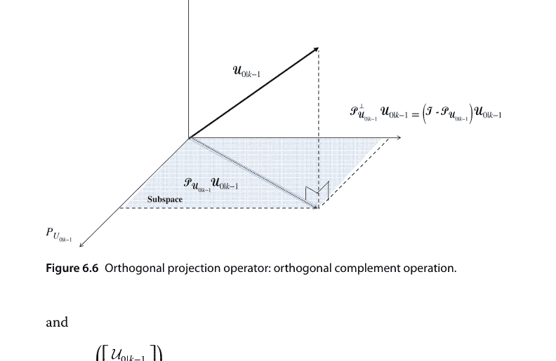

# 图 6.6 正交投影算子：正交补运算。

and

```
ρ( [ U_{0|k-1} -- X_0 ] ) = N_x + k N_u
```

leads to the rank condition

```
ρ( Y_{0|k-1} P_{U_{0|k-1}}^⊥ ) = ρ( O_K X_0 P_{U_{0|k-1}}^⊥ ) = N_x    (Rank Condition)
```

therefore, it follows immediately that

```
range( Y_{0|k-1} ) ≡ range( O_K )
```

the desired condition (see [7] or [9] for proof).

This “rank condition” provides a powerful result for the identification of the system model Σ_ABCD from deterministic input/output data just as the rank condition for impulse response data enabling the Hankel matrix factorization provides for the identification. It leads to pragmatic numerically efficient linear algebraic methods (to follow) providing a robust solution to solve the problem.

However, before we close this discussion, the system model must be extracted from the output data, which can be accomplished using a truncated SVD decomposition – similar to the method of Section 6.3.2, that is, the SVD

partitions the projected data, as

𝒫_{Y_{0|k-1}}^{⊥} = 𝒴_{0|k-1} 𝒫_{U_{0|k-1}}^{⊥} = 𝒪_k 𝒳_0 𝒫_{U_{0|k-1}}^{⊥} = [U_S | U_N] [ Σ_S | 0 ; - - - ; 0 | Σ_N ] [ V_S' ; -- ; V_N' ] = U_S Σ_S V_S' + U_N Σ_N V_N' Signal Subspace Noise Subspace (6.71)

Note that an added benefit of this decomposition is that the system order N_x can be estimated directly from its singular values enabling the partition into signal and noise subspaces (e.g. see Example 6.2). There exists a variety of order estimation criteria to accomplish this choice (see Section 6.6 and [4] for more details).

For a balanced realization choice (see Section 6.2), the observability matrix can be extracted directly through this decomposition as 𝒪_k 𝒳_0 𝒫_{U_{0|k-1}}^{⊥} ≈ (U_S Σ_S^{1/2}) × ((Σ_S')^{1/2} V_S') (6.72) assuming the noise subspace is negligible (Σ_N << Σ_S).

Here unique system matrices can be obtained by applying the pseudo-inverse (Z^# = (Z^T Z)^{-1} Z^T or Z^# = Z^T (Z Z^T)^{-1}), since the input/output rank condition guarantees full rank of the observability matrix to extract⁵ A = 𝒪_{N_x}^# × 𝒪_{N_x}^† = Σ_S^{-1/2} U_S' × 𝒪_{N_x}^† and C = 𝒪_{N_x} (1 : N_y, 1 : N_x) (6.73)

To obtain the input transmission matrix B and the input/output transmission matrix D, we can use the orthogonality of the left-singular matrix, U_N, from the SVD of Eq. (6.71) to isolate (extract) the impulse response matrix 𝒯_k, that is, premultiplying the data equation by U_N gives [9, 32, 33] U_N' × 𝒴_{0|k-1} = U_N' × 𝒪_k 𝒳_0 + U_N' × 𝒯_k U_{0|k-1} = U_N' × 𝒯_k U_{0|k-1} (6.74) since the first term is null, that is, from the SVD we have U_N' × (𝒪_k 𝒳_0 𝒫_{U_{0|k-1}}^{⊥}) = U_N'(U_S Σ_S V_S') = 0

Postmultiplying by the pseudo-inverse 𝒰_{0|k-1}^# = 𝒰_{0|k-1} (𝒰_{0|k-1}^T 𝒰_{0|k-1})^{-1}

yields the relation

$$U'_N\mathcal{V}_{0|k-1}\times\mathcal{U}^{\sharp}_{0|k-1}=U'_N\mathcal{T}_k\mathcal{U}_{0|k-1}\times\mathcal{U}^{\sharp}_{0|k-1}=U'_N\mathcal{T}_k$$

to isolate and extract the impulse response matrix.

Define the following matrices:

$$\mathcal{Z}:=U'_N\mathcal{V}_{0|k-1}\mathcal{U}^{\sharp}_{0|k-1}:=[\mathbf z_1\ \mathbf z_1\ \cdots\ \mathbf z_k]\in\mathbb{R}^{(kN_y-N_x)\times kN_u}$$

$$U'_N:=[\mathbf u^N_1\ \mathbf u^N_2\ \cdots\ \mathbf u^N_k]\in\mathbb{R}^{(kN_y-N_x)\times kN_y}$$

for $\mathcal{T}_k\in\mathbb{R}^{kN_y\times kN_u}$ and $\mathbf z_i\in\mathbb{R}^{(kN_y-N_x)\times N_u}$, $\mathbf u_i\in\mathbb{R}^{(kN_y-N_x)\times N_y}$, $i=1,\ldots,k$.

Therefore, with these definitions, we have

$$\mathcal{Z}=U'_N\times\mathcal{T}_k$$

expanding gives

$$\mathcal{Z}=[\mathbf z_1\ \mathbf z_1\ \cdots\ \mathbf z_k]=[\mathbf u^N_1\ \mathbf u^N_2\ \cdots\ \mathbf u^N_k]\begin{bmatrix}D&\cdots&0\\CB&D&\cdots&0\\\vdots&\ddots&\ddots&\vdots\\CA^{k-1}B&\cdots&CB&D\end{bmatrix}$$

Performing the multiplications to expand, we obtain the following (vector) relations:

$$\begin{aligned}
\mathbf z_1&=\mathbf u^N_1D+\mathbf u^N_2CB+\cdots+\mathbf u^N_kCA^{k-2}B\\
\mathbf z_2&=\mathbf u^N_2D+\mathbf u^N_3B+\cdots+\mathbf u^N_kCA^{k-3}B\\
\vdots&\quad\vdots\qquad\vdots\\
\mathbf z_{k-1}&=\mathbf u^N_{k-1}D+\mathbf u^N_kCB\\
\mathbf z_k&=\mathbf u^N_kD
\end{aligned}$$

resulting in a stacking (reordering) of the $\mathbf z_i$ into a new structure defined by $\widetilde{\mathcal Z}\in\mathbb{R}^{k(kN_y-N_x)\times kN_u}$

$$\widetilde{\mathcal Z}=\begin{bmatrix}\mathbf z_1\\\mathbf z_2\\\vdots\\\mathbf z_{k-1}\\\mathbf z_k\end{bmatrix}=\begin{bmatrix}
\mathbf u^N_1&[\mathbf u^N_2\ \cdots\ \mathbf u^N_k]\times\mathcal O_{k-1}\\
\mathbf u^N_2&[\mathbf u^N_3\ \cdots\ \mathbf u^N_k]\times\mathcal O_{k-2}\\
\vdots&\vdots\\
\mathbf u^N_{k-1}&[\mathbf u^N_k]\times\mathcal O_1\\
\mathbf u^N_k&[0]
\end{bmatrix}\times\begin{bmatrix}D\\B\end{bmatrix}$$

or defining \(\bar{\mathbf{u}}_i^N := [\mathbf{u}_i^N\ \mathbf{u}_{i+1}^N\ \cdots\ \mathbf{u}_k^N]\), we have

```
$$
\widetilde{Z}=\underbrace{\begin{bmatrix}
\mathbf{u}_1^N & \bar{\mathbf{u}}_2^N\times\mathcal{O}_{k-1}\\
\mathbf{u}_2^N & \bar{\mathbf{u}}_3^N\times\mathcal{O}_{k-2}\\
\vdots & \vdots\\
\mathbf{u}_{k-1}^N & \bar{\mathbf{u}}_k^N\times\mathcal{O}_1\\
\mathbf{u}_k^N & [0]
\end{bmatrix}}_{\mathbf{U}}
\times
\begin{bmatrix}D\\--\\B\end{bmatrix}
:=\mathbf{U}\times\begin{bmatrix}D\\--\\B\end{bmatrix}
$$
```

Since U is a full-rank matrix, we obtain a unique *least-squares solution* to extract the \(\hat{B}\) and \(\hat{D}\) input transmission matrices as

```
$$
\begin{bmatrix}\hat{D}\\--\\\hat{B}\end{bmatrix}
=\mathbf{U}^{\#}\times\widetilde{Z}
=(\mathbf{U}'\mathbf{U})^{-1}\mathbf{U}'\times\widetilde{Z}
$$
```

Even though this result is theoretically pleasing and provides insights into the motivation of the subsequent algorithms, it is *not* numerically efficient, leading us to a more robust linear algebraic solution for this state-space identification problem.

## 6.4.2  多变量输出误差状态空间 (MOESP) 算法

A numerically efficient linear algebraic approach to solving these identification problems can be achieved by applying the LQ-decomposition⁶ method to numerically calculate orthogonal projections enabling a reliable “separation” of data into subspaces in order to eliminate disturbances and noise. Therefore, to extract the state-space model, \(\Sigma_{ABCD}\), it is required to obtain the extended column space of the observability matrix that can be obtained using the SVD, that is, one of the key elements of subspace identification is based on extracting:

```
$$
\mathcal{O}_K=\underbrace{\begin{bmatrix}
C\\
CA\\
\vdots\\
CA^{K-1}
\end{bmatrix}}_{\text{Column space}}
$$
```

The MOESP⁷ technique is based on performing an orthogonal LQ-decomposition on the data matrix (see Appendix C), that is, \(D=L\times Q\)

with \(L\) a lower block triangular matrix, \(L\in\mathbb{R}^{K(N_u+N_y)\times K(N_u+N_y)}\) and \(Q\) an orthogonal matrix, \(Q\in\mathbb{R}^{K(N_u+N_y)\times K(N_u+N_y)}\) such that

$$\mathcal{D}_{0|k-1}=\begin{bmatrix}I_{K N_u}&O_{K N_u\times N_x}\\ \hline \mathcal{T}_k&\mathcal{O}_k\end{bmatrix}\begin{bmatrix}\mathcal{U}_{0|k-1}\\ \hline \mathcal{X}_0\end{bmatrix}=\begin{bmatrix}L_{11}&O_{K N_u\times K N_y}\\ \hline L_{21}&L_{22}\end{bmatrix}\begin{bmatrix}Q'_1\\ \hline Q'_2\end{bmatrix}$$ (6.82)

with \(L_{11}\in\mathbb{R}^{K N_u\times K N_u}\), \(L_{21}\in\mathbb{R}^{K N_y\times K N_u}\), \(L_{22}\in\mathbb{R}^{K N_y\times K N_y}\), \(Q'_1\in\mathbb{R}^{K N_u\times K N_x}\) and \(Q'_2\in\mathbb{R}^{K N_y\times K N_x}\).

This operation produces an efficient orthogonal decomposition of the augmented data matrix, \(\mathcal{D}_{0|k-1}\), that is, the LQ-decomposition is a numerical (matrix) version of the *Gram–Schmidt orthogonalization procedure* [22, 29, 30]. Recall that the LQ-decomposition of a matrix contains the set of orthonormal basis vectors in \(Q\) (\(Q'Q=I\)) with \(q_i\in\mathbb{R}^{K\times 1}\) and \(L\) contains the coefficients of linear dependence establishing the relationship the basis vectors of \(\mathcal{D}\) to those of \(Q\). In fact, from this viewpoint, we can think of partitioning \(Q=[Q_D\mid Q_D^\perp]\) such that a rank-deficient data matrix \(D\) can (hypothetically) be decomposed as

$$D=LQ=[L_D\mid 0]\begin{bmatrix}Q_D\\ \hline Q_D^\perp\end{bmatrix}=L_D\times Q_D$$

The *projection matrix* associated with the decomposition is specified by [30]

$$\mathcal{P}=Q\times Q' \qquad\text{(Projection Matrix)}$$

From Eq. (6.70) (assuming full-rank matrices), we have that

$$\mathcal{D}_{0|k-1}=\begin{bmatrix}L_{11}&O\\ \hline L_{21}&L_{22}\end{bmatrix}\begin{bmatrix}Q'_1\\ \hline Q'_2\end{bmatrix}=\begin{bmatrix}\mathcal{U}_{0|k-1}\\ \hline \mathcal{Y}_{0|k-1}\end{bmatrix}=\begin{bmatrix}L_{11}\times Q'_1\\ \hline L_{21}\times Q'_1+L_{22}\times Q'_2\end{bmatrix}$$ (6.83)

Orthogonally projecting \(\mathcal{Y}_{0|k-1}\) onto \(\mathcal{U}_{0|k-1}\) and \(\mathcal{U}_{0|k-1}^{\perp}\) enables the decomposition by applying the projection matrices

$$\mathcal{P}_{\mathcal{Y}_{0|k-1}}\mid\mathcal{U}_{0|k-1}=\mathcal{Y}_{0|k-1}(Q_1Q'_1)=(L_{21}Q'_1+L_{22}Q'_2)Q_1\times Q'_1=L_{21}\times Q'_1$$

$$\mathcal{P}_{\mathcal{Y}_{0|k-1}}\mid\mathcal{U}_{0|k-1}^{\perp}=\mathcal{Y}_{0|k-1}(Q_2Q'_2)=(L_{21}Q'_1+L_{22}Q'_2)Q_2\times Q'_2=L_{22}\times Q'_2$$ (6.84)

where we have applied the orthonormal properties of \(Q\) such that \(Q'_iQ_i=I\) and \(Q'_iQ_j=0'\).


但在对 $\mathcal{U}_{0|k-1}$ 进行代换并应用正交性条件 $U'_{\mathrm{N}}\mathcal{O}_{k}=0$ 和 $U'_{\mathrm{N}}L_{22}=0$ 后，我们有

$U'_{\mathrm{N}}\mathcal{T}_{k}(L_{11}Q'_{1})=U'_{\mathrm{N}}L_{21}Q'_{1}$

在右边乘以 $Q_{1}$ 并利用其正交性质 $(Q'_{1}Q_{1}=I)$ 得到

$Z := U'_{\mathrm{N}}\mathcal{T}_{k}=U'_{\mathrm{N}}L_{21}\times L_{11}^{-1}$ (6.90)

与式 (6.77) 类似，其中 $Z\to\mathcal{Z}$。堆叠并重新排序向量（同前）得到一组超定线性方程组，并用最小二乘解 $\tilde{Z}\to\tilde{\mathcal{Z}}$ 得到

$\begin{bmatrix}\hat{D}\\--\\\hat{B}\end{bmatrix}=\mathcal{U}^{\#}\times\tilde{Z}$ (6.91)

其中 $\mathcal{U}$ 是等价于式 (6.81) 的分块系数矩阵（$\mathcal{U}\to\mathbf{U}$）。

因此，我们得到多变量输出误差状态空间（MOESP⁸）算法如下

+   - 计算式 (6.82) 中 $D$ 的 LQ 分解。
+   - 对式 (6.87) 中的 $L_{22}$ 执行 SVD 以提取 $\mathcal{O}_{k}$。
+   - 由式 (6.89) 得到 $A$ 和 $C$。
+   - 求解最小二乘问题，由式 (6.91) 得到 $B$ 和 $D$。

我们将确定性 MOESP 算法总结在表 6.3 中。

## 6.5 确定性子空间实现：斜投影

最后，对于来自输入/输出数据的确定性实现问题，我们发展了一种替代技术，即基于过去和未来数据的并行或斜投影方法。这种方法与 MOESP 方法不同之处在于，它首先通过对分块 Hankel 矩阵的行空间进行投影，直接从数据中估计状态序列。也就是说，在这种方法中，状态序列的行空间可以通过 SVD 得到；这里斜子空间辨识的关键要素基于提取：

$\mathcal{X}_{k}=[\mathbf{x}(k)\ \mathbf{x}(k+1)\ \cdots\ \mathbf{x}(K+k-1)]$ 状态空间序列

8 注意，如果仪器变量被选为 $\mathcal{U}_{0|k-1}$ 和 $\mathcal{Y}_{0|k-1}$，即过去的输入和输出，则 PO-MOESP 技术演变为 PI-MOESP [28]。

以及

```
U_{k|2k-1} := [ u(k) u(k+1) ... u(K+k-1); u(k+1) u(k+2) ... u(K+k); : : : :; u(2k-1) u(2k) ... u(K+2k-2) ] (6.93)
```

从而得到相应的数据方程

```
Y_{k|2k-1} = O_k X_k + T_k U_{k|2k-1} (6.94)
```

其中分块（Hankel）矩阵定义如下

```
Y_{k|2k-1} = [ y_k(k) y_k(k+1) ... y_k(K+k-1) ] ∈ R^{k N_y × K}
U_{k|2k-1} = [ u_k(k) u_k(k+1) ... u_k(K+k-1) ] ∈ R^{k N_u × K}
X_k = [ x(k) x(k+1) ... x(K+k-1) ] ∈ R^{N_x × K}
```

这里 $U_{0|k-1}, Y_{0|k-1}, X_0$ 定义为过去的输入、输出和状态（$U_p, Y_p, X_0$），而 $U_{k|2k-1}, Y_{k|2k-1}, X_k$ 为未来的输入、输出和状态（$U_f, Y_f, X_f$），它们都是如前所述的分块 Hankel 矩阵，即

```
U_p := U_{0|k-1};    Y_p := Y_{0|k-1};    X_p := X_0
U_f := U_{k|2k-1};    Y_f := Y_{k|2k-1};    X_f := X_k (6.95)
```

与之前式 (6.63) 中发展的输入/输出关系类似，对应的状态方程可通过展开确定性状态空间模型的解得到：

```
x(k+j) = A^k x(j) + Σ_{ℓ=0}^{k-1} A^{k-ℓ-1} B u(ℓ + j) = A^k x(j) + A^{k-1} B u(j) + A^{k-2} B u(j+1) + ... + B u(k+j-1)
```

将该关系在 $K$ 列上展开，取 $j = 0$，则

$$[x(k)\ \cdots\ x(K+k-1)] = A^k[x(0)\ \cdots\ x(K-1)] + C_{AB}^{\leftarrow}(k)[u_k(0)\ \cdots\ u_k(K-1)]$$

即，我们现在有

$$\mathcal{X}_k = A^k\mathcal{X}_0 + C_{AB}^{\leftarrow}(k)\mathcal{U}_{0|k-1}$$

或用我们以上的定义表示，未来状态用过去状态 $\mathcal{X}_p$、输入 $\mathcal{U}_p$ 表示为

$$\mathcal{X}_f = A^k\mathcal{X}_p + C_{AB}^{\leftarrow}(k)\mathcal{U}_p$$

因此，过去/未来输入/输出/状态的“确定性”数据方程集合如下：

$$\mathcal{Y}_p = \mathcal{O}_k\mathcal{X}_p + \mathcal{T}_k\mathcal{U}_p \qquad \text{(Past Outputs)}$$

$$\mathcal{Y}_f = \mathcal{O}_k\mathcal{X}_f + \mathcal{T}_k\mathcal{U}_f \qquad \text{(Future Outputs)}$$

$$\mathcal{X}_f = A^k\mathcal{X}_p + C_{AB}^{\leftarrow}(k)\mathcal{U}_p \qquad \text{(Future States)}$$

其中相应的数据矩阵，过去和未来，由 $D_p := D_{0|k-1}$ 和 $D_f := D_{k|2k-1}$ 定义，其中

$$D_p = \begin{bmatrix}\mathcal{U}_p\\---\\\mathcal{Y}_p\end{bmatrix} \quad\text{and}\quad D_{0|k-1} = \begin{bmatrix}\mathcal{U}_{0|k-1}\\---\\\mathcal{Y}_{0|k-1}\end{bmatrix};$$

$$D_f = \begin{bmatrix}\mathcal{U}_f\\---\\\mathcal{Y}_f\end{bmatrix} \quad\text{and}\quad D_{k|2k-1} = \begin{bmatrix}\mathcal{U}_{k|2k-1}\\---\\\mathcal{Y}_{k|2k-1}\end{bmatrix}.$$

有了这些输入/状态/输出关系，我们看到未来状态向量与相应的过去和未来数据之间的关系为

$$\operatorname{span}\{\mathcal{X}_f\} = \operatorname{span}\{D_p\} \cap \operatorname{span}\{D_f\}$$

在系统持续激励、完全可控和可观测的假设下 $(\rho(\mathcal{O}_k) = \rho(\mathcal{C}_k) = N_x)$ 以及初始

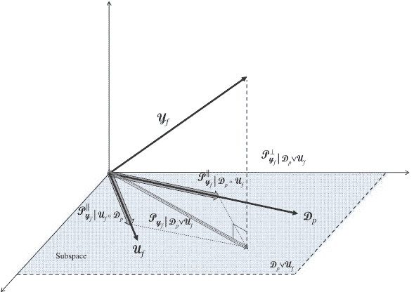

**Figure 6.7** Oblique projections: Projection $\mathcal{P}^{\parallel}_{\mathcal{Y}_f|\mathcal{D}_p\circ\mathcal{U}_f}$ of future outputs $\mathcal{Y}_f$ onto past data $(\mathcal{D}_p)$ along the future inputs $(\mathcal{U}_f)$.

另一种从代数而非几何角度表达这一思想的方式是，“$\mathcal{Y}_f$ 的行空间中的向量是状态 $\mathcal{X}_f$ 行空间中向量的线性组合之和，以及未来输入 $\mathcal{U}_f$ 行空间中向量的线性组合。”

相比之下，斜投影矩阵也可以用正交投影来定义 [6, 8]

$\mathcal{P}^{\parallel}_{\mathcal{Y}_f|\mathcal{D}_p\circ\mathcal{U}_f} := [\mathcal{P}^{\perp}_{\mathcal{Y}_f|\mathcal{U}_f}]\,[\mathcal{P}^{\perp}_{\mathcal{D}_p|\mathcal{U}_f}]^{\#}\mathcal{D}_p = [\mathcal{P}^{\perp}_{\mathcal{Y}_f|\mathcal{U}_f}]\,[\mathcal{D}_p\mathcal{P}^{\perp}_{\mathcal{U}_f}]^{\#}\mathcal{D}_p$  (6.109)

将式 (6.107) 中“未来”输出代入此表达式，我们得到

$\mathcal{P}^{\parallel}_{\mathcal{Y}_f|\mathcal{D}_p\circ\mathcal{U}_f} = [ (\mathcal{O}_k\Theta_p\mathcal{D}_p + \mathcal{T}_k\mathcal{U}_f)\mathcal{P}^{\perp}_{\mathcal{U}_f} ] [\mathcal{D}_p\mathcal{P}^{\perp}_{\mathcal{U}_f}]^{\#}\mathcal{D}_p$
$= \mathcal{O}_k\Theta_p[\mathcal{D}_p\mathcal{P}^{\perp}_{\mathcal{U}_f}][\mathcal{D}_p\mathcal{P}^{\perp}_{\mathcal{U}_f}]^{\#}\mathcal{D}_p$  (6.110)

或简单地由式 (6.106) 得到

$\mathcal{P}^{\parallel}_{\mathcal{Y}_f|\mathcal{D}_p\circ\mathcal{U}_f} = \mathcal{O}_k\Theta_p\mathcal{D}_p = \mathcal{O}_k\mathcal{X}_f$  (6.111)

这是 N4SID 方法应用于确定性实现问题时的基本概念。该关系表明，对未来数据进行斜投影会消除输入，同时能够直接从给定数据中提取可观测性和未来状态。因此，状态向量为过去和未来子空间的交集提供了一个基，可以从该投影中提取。

对式 (6.111) 执行 SVD，我们得到划分的信号和噪声（不确定性）关系为

```
P_{Y_f|D_p}^{\parallel} \circ U_f = [U_S \mid U_N] \begin{bmatrix} \Sigma_S & 0 \\ - - - & - - - \\ 0 & \Sigma_N \end{bmatrix} \begin{bmatrix} V_S' \\ -- \\ V_N' \end{bmatrix} = U_S \Sigma_S V_S' + U_N \Sigma_N V_N' \quad \text{Signal Subspace} \quad \text{Noise Subspace} \quad (6.112)
```

假设不确定性“可忽略”（$\Sigma_N << \Sigma_S$）并选择平衡的确定性实现（$\Sigma_S = \Sigma_S^{1/2} \times (\Sigma_S')^{1/2}$），我们得到关键的 N4SID 子空间关系：

```
P_{Y_f|D_p}^{\parallel} \circ U_f \approx U_S \Sigma_S^{1/2} (\Sigma_S')^{1/2} V_S' \in \mathcal{R}^{kN_y \times K} \quad (Projection) \n\underbrace{O_k}_{O_k} \underbrace{X_f}_{X_f} \nO_k = U_S \Sigma_S^{1/2} \in \mathcal{R}^{kN_y \times N_x} \quad (Observability) \nX_f = (\Sigma_S')^{1/2} V_S' \in \mathcal{R}^{N_x \times K} \quad (States) \quad (6.113)
```

### 6.5.2 子空间状态空间系统辨识（N4SID）算法的数值算法

再次，为从输入/输出数据中提取系统 $\Sigma_{ABCD}$，采用过去 $D_p$ 的分块 Hankel 数据矩阵和未来输入/输出数据矩阵 $\{U_f, Y_f\}$ 的 LQ 分解是一种数值高效的方法，这将引导我们得到 $Y_f$ 对 $D_p$ 沿 $U_f$ 的斜投影 [9, 34]

```
D := \begin{bmatrix} U_f \\ -- \\ D_p \\ -- \\ Y_f \end{bmatrix} = \underbrace{\begin{bmatrix} L_{11} & 0 & 0 \\ -- & -- & -- \\ L_{21} & L_{22} & 0 \\ -- & -- & -- \\ L_{31} & L_{32} & L_{33} \end{bmatrix}}_{L} \times \underbrace{\begin{bmatrix} Q_1' \\ -- \\ Q_2' \\ -- \\ Q_3' \end{bmatrix}}_{Q} \quad (6.114)
```

其中 $L_{11} \in R^{kN_u \times kN_u}$, $L_{21} \in R^{k(N_u+N_y) \times kN_u}$, $L_{22} \in R^{k(N_u+N_y) \times k(N_u+N_y)}$, $L_{31} \in R^{kN_y \times kN_u}$, $L_{32} \in R^{kN_y \times k(N_u+N_y)}$, $L_{33} \in R^{kN_y \times kN_y}$；且 $Q_1' \in R^{kN_u \times K}$, $Q_2' \in R^{k(N_u+N_y) \times K}$, $Q_3' \in R^{kN_y \times K}$。


## 表6.4 子空间状态空间系统辨识（N4SID）数值算法

斜投影（LQ分解）

D = [U_f; D_p; Y_f] = [L11 0 0; L21 L22 0; L31 L32 L33] = [Q1'; Q2'; Q3']

（数据矩阵）

奇异值分解

P_{Y_f|U_f,D_p}^{||} * U_f = [U_S U_N1] [Σ_s | 0; - - -; 0 | Σ_N] [V_S'; V_N'] ≈ U_S Σ_S V_S'

（投影矩阵）

可观性/状态提取

P_{Y_{k|k-1}|P_{k-1}}^{||} * U_{k|k-1} = O_k X_k = Σ_{32} L_{22}^{-1} D_{jk-1}

O_k = U_S Σ_S^{1/2}

X_k = Σ_S^{1/2} V_S'

（斜投影）

（可观性矩阵）

（状态矩阵）

状态矩阵

X̄_k = O_k' * P_{Y_{k|k-1}|D_{k-1}}^{||} * U_{k|k-1} = Σ_S^{1/2} U_S' * P_{Y_{k|k-1}|D_{k-1}}^{||} * U_{k|k-1}

X̄_{k+1} = O_k' * P_{Y_{k+1|k}|D_{k|k-1}}^{||} * U_{k+1|k} = Σ_{S-1}^{-1/2} U_{S-1}' * P_{Y_{k+1|k}|D_{k|k-1}}^{||} * U_{k+1|k-1}

（状态矩阵）

系统矩阵（Σ_{ABCD}）

[A| B; C| D] = ([X̄_{k+1} X̄_k; - - -; Ȳ_k Ū_k] ) ([X̄_k; - - -; Ū_k] [X̄_k; - - -; Ū_k]')^{-1}

其中

X̄_{k+1} = [x(k+1) ... x(k+K-1)]

X̄_k = [x(k) ... x(k+K-2)]

Ȳ_k = [y(k) ... y(k+K-2)]

Ū_k = [u(k) ... u(k+K-2)]

另一方面，我们选择数据长度 $K$ 使得 $K \gg N_x$，以确保充分覆盖数据空间。在任何情况下，只要有这些信息可用，我们就可以进行一些初步的模型“拟合”，并基于某些准则（下文介绍）来估计阶次，从而引出下一个必须回答的相关问题——*验证*问题：模型对数据的预测效果如何？验证基于从所研究过程的精细仿真或受控实验中收集的数据集成进行。如果无法获得数据集成，则需要对数据进行划分，以确保使用*未*用于辨识的数据进行验证。一旦生成了数据集成，就对每个实现执行子空间辨识，以估计模型 $\hat{\Sigma}_{ABCD}$，并评估其对数据的预测效果。

在任何情况下，我们都必须

- 估计系统阶次，即状态数目，使得 $K \gg N_x$；以及
- 在数据的 $N$ 重集成上*验证*估计模型 $\hat{\Sigma}_{ABCD}(n)$（$n = 1, \ldots, N$）的性能。

我们首先讨论阶次估计问题，然后继续评估所辨识模型的集成性能。

## 6.6.1 阶次估计：SVD方法

在这些子空间辨识方案中，一个重要的问题是估计底层系统模型的阶次。事实上，大多数方案都要求在估计模型参数之前“已知”系统阶次。因此，我们必须首先直接从数据中确定要估计的正确状态数目。阶次估计正是从辨识问题[36]中发展而来的，其第一步是估计或猜测系统阶次，然后尝试通过预测误差检验来验证所辨识的模型。人们对这一问题投入了大量精力[36, 37]，其中最重要的成果来自统计情形下信息论的观点[38, 39]。

我们考虑若干等效的阶次估计方法，它们基于对数据应用奇异值分解。该方法是确定性的，基于Hankel奇异值或最佳秩逼近。这些方法对经典辨识和子空间辨识都很方便，因为SVD已成为这些算法不可或缺的一部分，并且奇异值是可用的。

我们从“理论”系统（实现）理论中知道，关键要素是确定所研究底层系统的阶次或状态数目。经典地，阶次估计基于由Hankel矩阵及其可观性/可控性因子导出的秩条件。然而，获得稳健可靠估计的根本在于对Hankel矩阵进行奇异值分解，即

\(\mathcal{H}_{K,K'} = U \Sigma V' = [U_S \mid U_N] \begin{bmatrix} \Sigma_S & 0 \\ - & - \\ 0 & \Sigma_N \end{bmatrix} \begin{bmatrix} V'_S \\ - - \\ V'_N \end{bmatrix}_{Signal}^{Noise} = U_S \Sigma_S V'_S + U_N \Sigma_N V'_N\)
(6.127)

理想情况下，$\Sigma_N << \Sigma_S$，位于$\Sigma_S$中的非零奇异值的数目揭示了底层系统的阶次或状态数目。因此，理论上，只需对$\mathcal{H}_{K K'}$进行SVD并计算非零奇异值的数目即可得到$N_x$，因为$\rho(\mathcal{H}_{K K'}) = \rho(\Sigma) = \rho(\Sigma_S) = N_x$。遗憾的是，即使在数据精度很高的仿真数据中，由于舍入误差和截断误差，也不会出现零奇异值（例如，参见6.3节的例6.2）。规范实现理论提出了一个更难的问题，因为基于所期望的特定规范形的秩决定了Hankel矩阵的分解方式。例如，6.3节中导出Luenberger规范形的前驱求值方案，并不是一种通过提取可观性和可控性不变量（指标）来估计系统阶次的稳健可靠数值方法，因为$N_x = \sum_{i=1}^{N_y} \nu_i = \sum_{i=1}^{N_u} \mu_i$。因此，这为首先采用数值可靠的方法提取一个通用的“黑箱”状态空间系统，然后将其变换到所期望的规范坐标系（参见式(6.45)）提供了有力论据。

考虑到这一点，我们认识到子空间辨识的关键第一步在于提取奇异值，既可以使用6.3节基于SVD的实现算法中的经典Hankel矩阵，也可以使用6.4节基于SVD的投影算法。下一章将证明，这一思想也适用于随机情形，此时脉冲响应矩阵序列被协方差矩阵序列所取代，确定性输入/输出序列被含噪的不确定序列所取代。

接下来，我们考虑Hankel矩阵中有助于阶次估计问题的性质。Hankel矩阵的奇异值使我们能够估计其秩，从而估计底层系统的最小状态数目。然而，当存在噪声或计算误差时，在评估这些奇异值时必须运用判断。一种方法是直接搜索这些值中的显著变化，称为“间隙”或“跳变”，并选择与该突变对应的阶次，如图6.1和图6.2分别针对四阶系统和六阶系统所示。

另一种方法是采用所谓的最佳秩逼近，该逼近通过截至所选阶次的奇异值之和的比值来计算

1. （6.135）的*Hankel阶次估计*（SVD，最佳秩）⇒ \hat{N}_x；
2. *Hankel奇异值*：σ_{ABC} = √{Σ_{AC} × Σ_{AB}}；
3. *Hankel范数*（能量）：|| H_{K,K'} || = max{σ_i}；i = 1, ⋯ , N_x；以及
4. SVD模型误差：\mathcal{M}_ε = 2 Σ_{k=\hat{N}_x+1}^{K} σ_k。
5. SVD模型阶次估计：\hat{N}_x = max{N : log \hat{σ}_N > (log \hat{σ}_{max} + log \hat{σ}_{min})}。

这就完成了基于Hankel矩阵SVD的确定性系统阶次估计的讨论。当我们用子空间实现技术的投影矩阵替换Hankel矩阵时，这些结果同样有效。这些得到的奇异值具有相同的可信度，并以相同的方式进行评估和分析。

## 6.6.2 模型验证

一旦选定阶次、完成子空间辨识并辨识出“黑箱”模型Σ_{ABCD}，就必须回答其有效性的问题，以判断模型对数据的拟合程度究竟“有多好”。对于预测误差方法，存在着大量统计技术，我们将在下一章讨论；然而，对于确定性子空间辨识的情形，我们的手段较为有限，只能依靠将辨识模型的响应与系统响应数据进行比较来计算拟合误差。

辨识模型Σ_M := {A_M, B_M, C_M, D_M}的响应很容易利用从数据中提取该模型时所用的确定性输入来计算。我们将模型响应 y_M(t) 定义为如下状态空间形式：

```
x(t) = A_M x(t − 1) + B_M u(t − 1)      (State Response)

y_M(t) = C_M x(t) + D_M u(t)      (Measurement Response)      (6.132)
```

或等价地，作为卷积响应

```
y_M(t) = C_M A_M^{t} x(0) + Σ_{k=0}^{t−1} C_M A_M^{t−k−1} B_M u(k − 1) + D_M δ(t)      (Convolution Response)      (6.133)
```


and define the model error metric for the ith-measurement channel as

```
ε_i = sqrt( (∑_{t=1}^K e_i^2(t)) / (∑_{t=1}^K y_i^2(t)) ); i = 1, ..., N_y      (Model Error Metric)      (6.136)
```

to evaluate the performance of the model response {y_M(t)} relative to the response data {y(t)} [6, 7].

This metric can also be calculated over an N-ensemble of data for each measurement channel as well to provide statistics enabling a reasonable estimate of model quality. Here we have generated a data ensemble {y_n(t)}; n = 1, ..., N with the corresponding ensemble model error for the nth realization defined by

```
ε_n(t) := y_n(t) - y_M^n(t)      (Ensemble Model Error)      (6.137)
```

Ensemble statistics and confidence intervals can be estimated from the sample mean and variance estimates across the realizations {ε_n(t)}; n = 1, ..., N as

```
μ_e(t) := Ê{ε_n(t)} = (1/N) ∑_{n=1}^N ε_n(t)
σ_e(t) := Ê{(ε_n(t) - μ_e(t))} = (1/N) ∑_{n=1}^N ε_n^2(t) - μ_e^2(t)      (6.138)
```

enabling a confidence interval estimate

```
I_e(t) = μ_e(t) ± 1.96 σ_e(t)      for      N > 30
```

for each measurement channel realization providing another means of validating the identified model.

Another statistic that can be applied to validate the performance of the identified model is the median absolute deviation (MAD) statistic because of its inherent robustness property relative to the usual ensemble mean/standard deviation approach [41]:

Figure 6.9 Pseudo-random response of three-output mechanical system. (a) Synthesized channel pseudo-random responses. (b) Fourier transforms of channel responses.

Figure 6.10b. The corresponding Hankel metrics are as follows:

Hankel order estimation :  \hat{N}_x = 6
Hankel singular values :  \sigma_i = {56.0, 54.7, 7.5, 13.0, 2.5, 4.4}
Hankel norm (energy) :  || H_{K,K'} || = 8.67 × 10^{-4}
SVD model error :  M_e = 8.3 × 10^{-6}

The corresponding output power spectra of each channel and the average power spectrum of the identified model are compared in Figure 6.10a indicating a reasonable realization of the data. Again the “identified” modal frequencies of the system estimated from the “discrete” identified system matrix and transformation from the discrete (Z-domain) to the continuous (S-domain) given by (s = 1/Δ_t ln z) yields p_i = {0.497 Hz, 0.343 Hz, 0.123 Hz} and are shown in Figure 6.10c.

To confirm that the realization matches the modal frequency estimates of the system closely, the estimated channel outputs are overlaid onto the raw impulse response data as well as the random measurement data in Figure 6.11a and b – again indicating an accurate realization due to the high SNR.

Figure 6.10 SVD realization of three-output mechanical system. (a) Power spectra: outputs/average spectra indicated with poles (boxes). (b) Singular values of the Hankel matrix. (c) Frequencies with poles/zeros.

## Figure 6.12 Structural vibrations of eight-mode mechanical system: (a) accelerometer responses of three-output system. (b) Fourier power spectra of channel responses.

and

```
B_p = e_{N_x} ; C_d = [ e'_1 ; e'_4 ; e'_8 ]
```

where e_{N_x} is a N_x-column vector of all 1s and e'_i is a unit row vector with a 1 in the i th column and the excitation p is a unit variance, pseudo-random sequence. Three accelerometer outputs of the synthesized vibrating structure were recorded for 200 seconds with the vibrational responses shown in Figure 6.12 along with their corresponding power spectra where we see a persistently excited system ideal for subspace identification.

The deterministic subspace identification algorithm (N4SID) was applied to the response data, and the results are summarized in Figure 6.13. We observe the estimated power spectra (thin lines) of each channel measurement along with the “average” identified spectra (thick line) in Figure 6.13a as well as the extracted modal frequencies (squares) from the identified model system matrix (A). The SVD-order test is shown in Figure 6.13b. This test reveals a 16th-order (8-mode) representation as adequate with the large gap shown to indicate the proper order. The poles/zeros (discrete) populating the unit circle

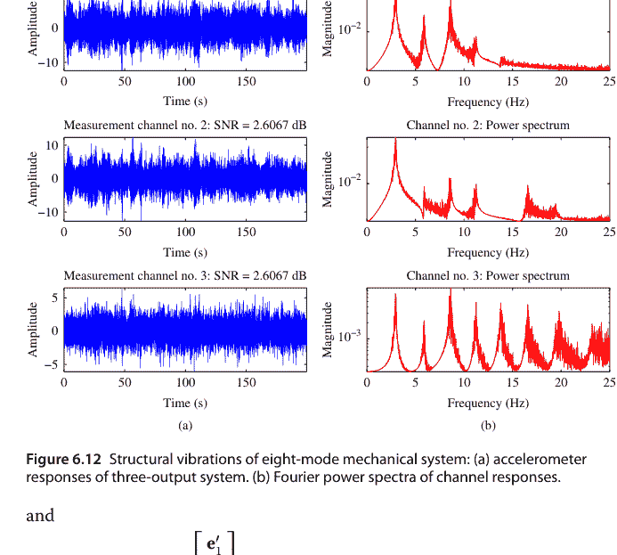

Figure 6.13 Structural vibration subspace identification eight-mode mechanical system. (a) Power spectra: outputs/average with poles (boxes). (b) Singular values of the Hankel matrix. (c) Poles/zeros. (d) Estimated modal frequencies.

are shown in Figure 6.13c with the estimated modal frequencies obtained from the discrete-to-continuous transform ($\mathbb{Z} \to \mathbb{S}$) listed in Figure 6.13d corresponding to those of the simulation.

We show both synthesized data along with their corresponding estimates in Figure 6.14, indicating quite a reasonable “fit” of both the underlying impulse response, synthesized data and their corresponding estimates. The subspace identifier has clearly captured the essence of the signals.

The corresponding Hankel metrics are:

- Hankel order estimation: $\hat{N}_x = 16$
- 
- Hankel singular values: $\sigma_i = \{18.8,\ 17.9,\ 10.4,\ 10.6,\ 6.4,\ \ldots,\ 2.3\}$
- 
- Hankel norm (energy): $\|\mathcal{H}_{K,\kappa}\| = 1.2 \times 10^{-5}$
- 
- SVD model error: $\mathcal{M}_e = 3.0 \times 10^{-5}$

Next we calculate the various validation metrics to observe how well they predict/validate a reasonable realization of this data. The results are shown in Table 6.6. From the table, we examine the average results of each of the statistics. Over an ensemble of 100-realizations and deterministic subspace identifications, the average residual error is $1.3 \times 10^{-11}$ as expected since the

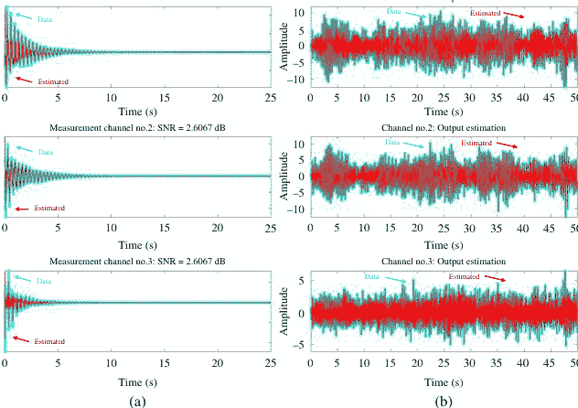

**Figure 6.14** Subspace identification of eight-mode mechanical system. (a) Raw data and estimated impulse responses. (b) Raw and estimated channel measurements.

## Table 6.6 Deterministic subspace identification: eight-mass mechanical system.

|  | Model error/validation results |  |  |  |
| Channel no. | Residual model error | Average model error | Deviation model error | MAD model error |
| 1 | 1.3×10⁻¹¹ | 3.3×10⁻³ | 4.2×10⁻³ | 3.3×10⁻³ |
| 2 | 1.3×10⁻¹¹ | 3.3×10⁻³ | 4.1×10⁻³ | 3.3×10⁻³ |
| 3 | 1.3×10⁻¹¹ | 3.1×10⁻³ | 3.8×10⁻³ | 3.1×10⁻³ |
| Average | 1.3×10⁻¹¹ | 3.2×10⁻³ | 4.0×10⁻³ | 3.2×10⁻³ |

synthesized signal is essentially deterministic (100 dB SNR). The calculated model errors are reasonable for the corresponding average, standard deviation, and MAD statistics on the order of 10⁻³ corresponding to less than 1% error. This completes the case study of a mechanical structure.

## 6.8 Summary

In this chapter, we have discussed solutions to the deterministic realization problem ranging from the classical system theoretic approaches to the modern subspace projection approaches. We have shown that both modern techniques rely on the singular-value decomposition of the Hankel and block Hankel matrices, each with underlying theoretical implications. Once the appropriate Hankel matrix is decomposed, the system order is estimated and the underlying system matrices Σ_ABCD are extracted. This is essentially a “black-box” approach using MIMO embedded state-space models as its inherent model set. The philosophy is that once Σ_ABCD is extracted, it can be transformed to any coordinate system for analysis (e.g. canonical or modal coordinates). Using examples throughout, these approaches were developed from a pragmatic rather than theoretical perspective. It was demonstrated that the numerically superior singular-value decomposition for both classical and subspace methods provides a robust and reliable solution to the deterministic realization problem. SVD-based order estimation was shown to reveal simple metrics (model error, ensemble model error) that can be used to extract the underlying order and state-space system. Validation techniques based on estimated model error evolved leading to pragmatic design solutions. A case study from a well-known structural dynamics problem was investigated to illustrate the approach and solution.

In the next chapter, we discuss the all-important “stochastic” realization problem that accounts not only for noisy, uncertain data, but also inherent parameter uncertainties.


## MATLAB 注释

MATLAB 提供了丰富的线性代数算法，可应用于子空间实现问题，包括创建 Hankel 矩阵和 Toeplitz 矩阵及其分解的命令，使用奇异值分解（svd）、Gram Schmidt 或 QR 分解，该分解可轻松转换为贯穿始终使用的下三角/正交 LQ 变换。其他技术，如协方差矩阵的 Cholesky 分解以及 LDU 分解方法，可进一步扩展这些方法。系统辨识工具箱（ident）提供了大量用于状态空间模型的子空间（n4sid）和预测误差方法，包括黑箱和灰箱表示。分析命令可实现对已辨识模型的性能分析以及完善的验证方法。使用嵌入式 GUI，用户可以轻松导入输入/输出数据，进行初步预处理（例如均值和趋势去除），将数据划分为辨识和验证两部分，并可即时分析结果，进行信号估计绘图、残差分析、频域绘图和瞬态响应分析。这对于该问题集来说是一个非常强大的工具箱。子空间算法的其他实现可从 [6] 和 [9] 的文本中提取。

## 参考文献

- 1 Kalman, R. (1963). Mathematical description of linear dynamical systems. SIAM J. Control 82: 152–192.
- 2 Kalman, R., Falb, P., and Arbib, M. (1969). Topics in Mathematical System Theory. New York: McGraw-Hill.
- 3 Ho, B. and Kalman, R. (1966). Effective reconstruction of linear state variable models from input/output data. Regelungstechnik 14: 545–548.
- 4 Candy, J. (2006). Model-Based Signal Processing. Hoboken, NJ: Wiley/IEEE Press.
- 5 Ljung, L. (1999). System Identification: Theory for the User, 2e. Englewood Cliffs, NJ: Prentice-Hall.
- 6 van Overschee, P. and De Moor, B. (1996). Subspace Identification for Linear Systems: Theory, Implementation, Applications. Boston, MA: Kluwer Academic Publishers.
- 7 Verhaegen, M. and Verdult, V. (2007). Filtering and System Identification: A Least-Squares Approach. Cambridge: Cambridge University Press.
- 8 Tangirala, A. (2015). Principles of System Identification: Theory and Practice. Boca Raton, FL: CRC Press.
- 29 Golub, G. and van Loan, C. (1996). *Matrix Computations*, 3e. Baltimore, MD: Johns Hopkins University Press.
- 30 Bretscher, O. (2015). *Linear Algebra with Applications*, 5e. Upper Saddle River, NJ: Pearson Prentice-Hall.
- 31 Sharf, L. (1991). *Statistical Signal Processing: Detection, Estimation and Time Series Analysis*. Reading, MA: Addison-Wesley.
- 32 Swevers, J., Adams, M., and De Moor, B. (1987). A new direct time domain identification method for linear systems using singular value decomposition. In: *Proceedings of the 12th International Seminar on Modal Analysis, 12-3*, 1–20.
- 33 De Moor, B., Vandewalle, J., Vandenberghe, L., and Mieghem, P. (1988). A geometrical strategy for the identification of state space models of linear multivariable systems with singular value decomposition. *Proc. IFAC 88*: 700–704.
- 34 Van Der Veen, A., Deprettere, E.F., and Swindlehurst, A.L. (1993). Subspace-based methods for the identification of linear time-invariant systems. *Proc. IEEE* 81 (9): 1277–1308.
- 35 Katayama, T. and Picci, G. (1994). Realization of stochastic systems with exogenous inputs and subspace identification methods. *Automatica* 35 (10): 75–93.
- 36 Astrom, K. and Eykhoff, P. (1971). System identification—a survey. *Automatica* 7 (2): 123–162.
- 37 Ljung, L. and Soderstrom, T. (1983). *Theory and Practice of Recursive Identification*. Boston, MA: MIT Press.
- 38 Akaike, H. (1974). A new look at the statistical model identification. *IEEE Trans. Autom. Control* 19 (6): 716–723.
- 39 Sakamoto, Y., Ishiguro, M., and Kitagawa, G. (1986). *Akaike Information Criterion Statistics*. Boston, MA: D. Reidel/Kluwer Academic.
- 40 Bauer, D. (2001). Order estimation for subspace methods. *Automatica* 37: 1561–1573.
- 41 Pham Gia, T. and Hung, T. (2001). The mean and median absolute deviations. *Math. Comput. Model.* 34: 921–936.
- 42 Zoubi, A. and Iskander, D. (2004). *Bootstrap Techniques for Signal Processing*. Cambridge: Cambridge University Press.
- 43 Reynders, E. (2012). System identification methods for (operational) modal analysis: review and comparison. *Arch. Comput. Methods Eng.* 19 (1): 51–124.
- 44 Cara, F., Juan, J., Alarcon, E. et al. (2013). Modal contribution and state space order selection in operational modal analysis. *Mech. Syst. Sig. Process.* 38: 276–298.

## 问题

6.1 经典实现理论基于 MIMO 脉冲响应矩阵的 Hankel 矩阵的分解为满秩、可观测性和可控性矩阵，$\mathcal{H}_{K,K'} = \mathcal{O}_K \times \mathcal{C}_{K'}$，证明 $\mathcal{H}_{K,K'}$ 的每一行（列）是相关的当且仅当它是 $\mathcal{O}_K$（$\mathcal{C}_{K'}$）的相关行（列）。（该结果的证明构成了规范实现理论的基础。）

6.2 假设我们给出了具有 [10] 的连续时间系统的如下状态空间描述

$\dot{x}(t) = \begin{bmatrix} -1 & -4/\theta \\ 4\theta & -2 \end{bmatrix} x(t) + \begin{bmatrix} 1 \\ 2\theta \end{bmatrix} u(t)$
$y(t) = \begin{bmatrix} -1 & 2/\theta \end{bmatrix} x(t)$

连续时间（下标“c”）可观测性和可控性 Gramians 满足以下 Lyapunov 方程：

$A_c' \mathcal{O}_c + \mathcal{O}_c A_c = -C_c' C_c \qquad \text{(Continuous Gramians)}$
$A_c C_c + C_c A_c' = -B_c B_c'$

- (a) 计算可观测性和可控性 Gramians。
- (b) 这是一个平衡实现吗？展示结果。
- (c) 如果是，需要 $\theta$ 的哪些值？

6.3 假设我们给出了传递函数

$H(s) = \frac{4s^2 - 2s - 6}{2s^4 + 2s^3 + 2s^2 + 3s + 1}$

- (a) 这个系统的阶数是多少？验证你的结果。
- (b) 使用 Ho–Kalman 方法求一个平衡实现？

6.4 我们给出了如下连续系统：

$\dot{x}(t) = A x(t)$

其中

$A = \begin{bmatrix} -4 & -4 \\ 2 & -6 \end{bmatrix}$

(a) 建立对应 *Lyapunov 方程* 的解：

\[A'P + PA = -Q\qquad \text{(Lyapunov Equation)}\]

其中 \(Q=I\)。

(b) 这个连续系统稳定吗？展示结果。

(c) 使用计算得到的特征值验证稳定性。

### 6.5

考虑如下标量例子，其脉冲响应为，\(H(k)=\{1,\ 1/2,\ 1/4,\ 1/8,\ 1/16\}\) 且 \(N=5\)。使用 SVD 方法，我们希望提取实现 \(\Sigma=(A,b,c)\)。建立 Hankel 矩阵并应用 SVD–Ho 算法来提取系统。

### 6.6

我们选择 \(K>N_x\)，然后对给定的 \(\mathcal{H}_{K,K}\) 进行 SVD 并选择 *平衡实现* 使得

\[\mathcal{H}_{K,K}=U\Sigma V'=\bigl(U(\Sigma_{N_x}^{1/2})\bigr)\times\bigl((\Sigma_{N_x}^{1/2})V'\bigr)=\mathcal{O}_K\times\mathcal{C}_K\]

其中 \(N_x\) 是 Hankel 矩阵的秩。利用 \(\mathcal{H}_{K,K}\to\mathcal{H}^{\dagger}_{K,K}\) 的平移不变性，证明如果我们选择 \(N_x\) 个奇异值中的前 \(N_1\) 个（\(N_1<N_x\)），则我们可以从 \(N_x\) 次实现中提取 \(N_1\) 维实现 \(\Sigma_{A_1B_1C_1D_1}\)。这是否意味着我们可以从单个 \(N_x\) 实现中作为子矩阵提取 *所有* 低阶系统 \((N<N_x)\)？证明之？这些实现是“嵌套”的吗（\(A_1\in A_{N_x}\)）？

### 6.7

假设我们有如下离散传递函数：

\[H(z)=\frac{z+3}{z^2+3z+2}\]

- (a) 这个系统的脉冲响应是什么？（*提示：* 长除法）
- (b) 由脉冲响应创建 Hankel 矩阵。
- (c) 使用原始 Ho–Kalman 算法，提取系统 \(\Sigma_{ABCD}\)。
- (d) 使用 SVD–Ho–Kalman 算法，也提取系统 \(\Sigma_{ABCD}\)。
- (e) 这些实现等价吗？（*提示：* 特征值？脉冲响应？）

### 6.8

我们给出了如下由传递函数表示的离散系统

\[H(z)=\begin{bmatrix}\dfrac{z-0.5}{z^2-1} & \dfrac{1}{z-1}\\[4pt] \dfrac{z^2}{z^2-1} & \dfrac{2z}{z-1}\end{bmatrix}\]

- (a) 计算这个系统的脉冲响应。
- (b) 创建 Hankel 矩阵。


(c) 应用原始的 Ho–Kalman 算法，提取系统 Σ_ABCD。

(d) 应用 SVD–Ho–Kalman 算法，同样提取系统 Σ_ABCD。

(e) 对 Hankel 矩阵执行第 6.3 节的规范实现算法。可观测性和能控性不变量是什么？

(f) 提取行和列实现 Σ_R 和 Σ_C。

(g) 这些实现等价吗？（提示：特征值？脉冲响应？）

## 6.9 重访例 6.1 中的问题，其中我们有一个已知的 N_y × N_u 传递函数矩阵，且 N_y = N_u = 2 与之前相同。脉冲响应序列由下式给出

H(z) = [ 1 1 ; 1 1 ] z^{-1} + [ -2 -4 ; -3 -1 ] z^{-2} + [ 4 10 ; 7 1 ] z^{-3} + [ -8 -22 ; -15 -1 ] z^{-4} + [ 16 46 ; 31 1 ] z^{-5}

(a) 展示可以执行的初等行和列运算，即开发 P（行）和 Q（列）初等矩阵，从而利用 Ho–Kalman 算法得到结果实现 Σ_ABCD。用示例验证结果。

(b) 执行 SVD–Ho 算法并与示例中的 Σ_ABCD 进行比较。它们等价吗？

(c) 对该脉冲响应数据执行规范实现算法并展示步骤。

## 6.10 由上一问题的提取模型 Σ_ABCD 确定式 (6.45) 的规范相似变换 T_R 和 T_C。将提取的系统矩阵 {A, B, C, D} 变换为 Luenberger 规范形式 {A_R, B_R, C_R, D_R} 和 {A_C, B_C, C_C, D_C}。这些实现与上文 (c) 中得到的结果相比如何？

## 6.11 假设我们给出了以下 MIMO 传递函数矩阵：

H(s) = [ (s+1)/((s+2)(s+4))  (s+4)/(s(s+2)) ; (s+1)/(s^2(s+4))  (s+1)/((s+2)(s+4)) ]

(a) 该系统的脉冲响应是什么？（提示：长除法）

(b) 由脉冲响应创建 Hankel 矩阵。

(c) 使用原始 SVD–Ho–Kalman 算法，同样提取系统 Σ_ABCD。

(d) 该系统稳定吗？

(e) 模型误差是多少？*（提示：比较脉冲响应。）*

## 6.12

给定以下传递函数矩阵，

$$H(s)=\begin{bmatrix}\dfrac{4s-10}{2s+1} & \dfrac{3}{s+2}\\[4pt] \dfrac{2}{2s^2+5s+2} & \dfrac{1}{s^2+4s+4}\end{bmatrix}$$

+   (a) 该系统的脉冲响应是什么？
+   
+   (b) 由脉冲响应创建 Hankel 矩阵。
+   
+   (c) 使用原始 SVD–Ho–Kalman 算法，同样提取系统 $\Sigma_{ABCD}$。
+   
+   (d) 该系统稳定吗？
+   
+   (e) 模型误差是多少？*（提示：比较脉冲响应。）*

## 6.13

我们有一个由正弦波表征的确定性系统，其表达式为

$$y(t)=\sum_{m=1}^{M}\alpha_m\sin(2\pi f_i t+\phi_i)$$

+   (a) 对频率集合 $f_i=\{1,2,5,10,20\}$ Hz 进行仿真，$dt=0.01$ 秒，$N=5000$ 个采样点，$\alpha_i=1$ 且 $\phi_i=0$，$\forall i$。
+   
+   (b) 生成所需的 Hankel 矩阵并使用 MOESP 算法（MATLAB）执行子空间辨识。
+   
+   (c) 基于 SVD 分解，系统的阶数是多少？展示结果。
+   
+   (d) 使用 AIC 和 MDL 以及最佳秩方法重复阶数估计。它们与上文的 SVD 结果相比如何？
+   
+   (e) 提取底层状态空间模型 $\Sigma_{ABCD}$。
+   
+   (f) 计算单次实现对应的模型误差统计量。
+   
+   (g) 添加少量高斯噪声（SNR = 100 dB）并生成 100 次实现的集合。计算如 (f) 中的对应误差统计量并进行比较。它们接近吗？
+   
+   (h) 对 N4SID 算法重复子空间辨识。这些结果与 MOESP 方法相比如何？实现等价吗？

## 6.14

考虑以下离散 Gauss–Markov 系统：

$$x(t)=0.97x(t-1)+0.03u(t-1)+w(t)\qquad\text{for }w\sim\mathcal{N}(0,R_{ww}(i))$$

$$y(t)=2.0x(t)+v(t)\qquad\text{for }v\sim\mathcal{N}(0,R_{vv})$$

其中 $x(0)=2.5$，$R_{ww}=1\times10^{-12}$ 且 $R_{vv}=R_{ww}=1\,10^{-10}$ — 基本上是确定性的。

+   (a) 使用采样间隔 $dt = 0.1sec$ 且 $u(t)$ 为单位阶跃函数，对该过程进行仿真。
+   (b) 使用 MOESP 子空间技术辨识系统 $\Sigma_{ABCD}$ 并计算单次实现的模型误差统计量。
+   (c) 由系统 $\Sigma_{ABCD}$ 生成一个集合，再次应用 MOESP 子空间技术并计算集合上的模型误差统计量。这些统计量与 (b) 的相比如何？
+   (d) 重复 (b) 和 (c)，现在使用 N4SID 子空间技术辨识系统 $\Sigma_{ABCD}$，并计算单次实现和集合的模型误差统计量。统计量相比如何？与 MOESP 方法相比如何？
+   (e) 对系统 $\Sigma_{ABCD}$ 令 $u(t)$ 为单位脉冲并仿真系统响应。使用 SVD–Ho 算法辨识模型并计算单次和集合实现的对应模型误差统计量。这些统计量相比如何？
+   (f) 由计算得到的模型误差统计量总结辨识结果。哪种技术表现最好？

## 6.15 一个 RLC 电路由以下连续时间 Gauss–Markov 系统表征：

$$\dot{x}(t) = \begin{bmatrix} 0 & 1 \\ -4 & -2 \end{bmatrix} x(t) + \begin{bmatrix} 0 \\ -4\theta \end{bmatrix} u(t) + \begin{bmatrix} 0 \\ -4\theta \end{bmatrix} w(t)$$ $$y(t) = \begin{bmatrix} 1 & 0 \end{bmatrix} x(t) + v(t)$$

其中 $x(0)=0$，$R_{ww}=1\times10^{-12}$ 且 $R_{vv}=R_{vww}=1^{1}0^{-12}$ – 基本上是确定性的。

+   (a) 使用采样间隔 $dt = 0.1\ msec$ 且 $u(t)$ 为周期 7 毫秒的单位脉冲串，对该过程进行仿真。（提示：转换为采样数据系统。）
+   (b) 使用 MOESP 子空间技术辨识系统 $\Sigma_{ABCD}$ 并计算单次实现的模型误差统计量。
+   (c) 由系统 $\Sigma_{ABCD}$ 生成一个集合，再次应用 MOESP 子空间技术并计算集合上的模型误差统计量。这些统计量与 (b) 的相比如何？
+   (d) 重复 (b) 和 (c)，现在使用 N4SID 子空间技术辨识系统 $\Sigma_{ABCD}$，并计算单次实现和集合的模型误差统计量。统计量相比如何？与 MOESP 方法相比如何？

(e) 对系统 $\Sigma_{ABCD}$，令 $u(t)$ 为单位脉冲并仿真系统响应。使用 SVD–Ho 算法辨识模型并计算单次和集合实现的对应模型误差统计量。这些统计量相比如何？

(f) 由计算得到的模型误差统计量总结辨识结果。哪种技术表现最好？
