## 7

### 7.1 引言

在本章中，我们从经典和子空间两个角度讨论随机实现问题，如上一章之前所做的那样。我们首先从经典问题开始，该问题模仿确定性方法，用协方差矩阵代替脉冲响应矩阵 [1–10]。底层 Hankel 矩阵现在填充了协方差而非脉冲响应矩阵，允许分解从而得到基本秩条件（与之前相同）；然而，问题有所扩展，增加了必须求解以提供所需辨识的一组额外关系，称为 Kalman–Szego-Popov（KSP）方程 [11–16]。所有这些结果都源于第 3 章的创新（INV）模型或等价的第 4 章稳态 Kalman 滤波器。我们再次从该模型的发展开始，并讨论导致“随机”实现的底层系统理论特性。

子空间方法也遵循与确定性情况相似的发展。 starting with the multivariable output error state-space (MOESP) formulation using orthogonal projections they both, the “past input multivariable output error state-space” (PI-MOESP) and “past input/output multivariable output error state-space” (PO-MOESP) techniques evolve [17–19]. 接下来基于斜投影理论的数值状态空间系统辨识（N4SID）方法出现 [19–27]。我们主要集中于“联合问题”的解决方案，即直接（无需分离）通过嵌入在 INV 表示中的估计状态向量辨识确定性和随机系统。这里输入/输出和噪声数据被纳入“随机”数据模型。

在本节中，我们发展必要的底层关系，以精确定义从


Figure 7.1 Stochastic realization problem: (a) classical and (b) Subspace approaches.

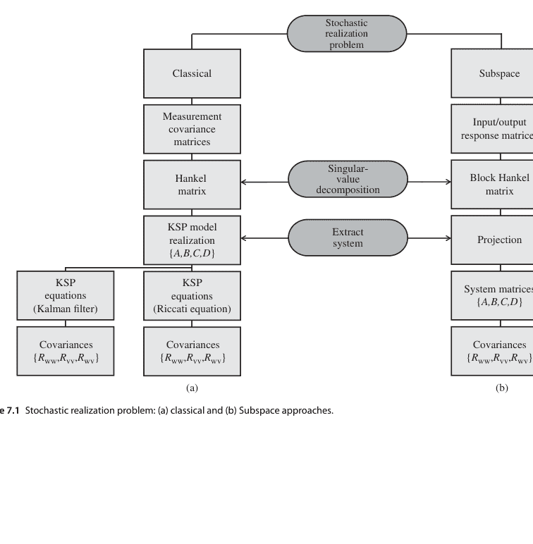

## 7.2 Stochastic Realization Problem

In this section, we develop stochastic realization theory from a deterministic perspective by showing first the relation to a set of Markov parameters evolving from the measurement or output covariance matrix sequence of a stationary stochastic system characterized by the Gauss–Markov model discussed previously in Chapter 3. Once we establish this representation, we show how a set of algebraic equations, that is, the KSP equations solve what are necessary to solve the “stochastic” realization problem. Here we present a brief review of the major results necessary to solve the stochastic realization problem.

Analogous to the deterministic realization problem, there are essentially two approaches to consider: (i) the classical and (ii) subspace. The classical approach for the assumed stationary processes can be developed either in the frequency domain by performing a multichannel spectral factorization or in the time domain from the measurement covariance sequence. Direct factorization of the power spectral density (PSD) matrix is inefficient and may not be very accurate, while realization from the covariance sequence is facilitated by efficient realization techniques and solutions of the KSP relations. Classically, we focus on the minimal stochastic realization from the measurement sequence of a LTI system driven by white noise. The solution to this problem is well known [9, 10] and outlined in Figure 7.1. The measurement covariance sequence from this system is processed by the realization algorithm to obtain a deterministic model followed by the solution of the KSP equations to obtain the remaining parameters that establish a stochastic realization. This approach is complicated by the fact that the matrix covariance sequence must first be estimated from the noisy multichannel measurements.

### 7.2.1 Correlated Gauss–Markov Model

We define the underlying LTI *Gauss–Markov* model (GM) with *correlated noise sources* for stationary processes as

$$x(t)=Ax(t-1)+Bu(t-1)+w(t-1)$$
$$y(t)=Cx(t)+D(t)u(t)+v(t) \tag{7.3}$$

where $x,w\in\mathbb{R}^{N_x\times1}$, $u\in\mathbb{R}^{N_u\times1}$, $y,v\in\mathbb{R}^{N_y\times1}$ with $A\in\mathbb{R}^{N_x\times N_x}$, $B\in\mathbb{R}^{N_x\times N_u}$, $C\in\mathbb{R}^{N_y\times N_x}$, $D\in\mathbb{R}^{N_y\times N_u}$, $w\sim\mathcal{N}(0,R_{ww})$, $v\sim\mathcal{N}(0,R_{vv})$ and the cross-covariance given by $\operatorname{cov}(w,v)=R_{wv}$.

Recursively, the underlying mean and variance statistics follow easily (as before):

$$m_x(t)=E\{x(t)\}=Am_x(t-1)+Bu(t-1)$$
$$P_{xx}(t)=\operatorname{var}(\bar{x}(t))=E\{\bar{x}(t)\bar{x}'(t)\}=AP_{xx}(t-1)A'+R_{ww}(t-1) \tag{7.4}$$

for \bar{x}(t) := x(t) - m_x(t) and therefore
\bar{x}(t) = A \bar{x}(t - 1) + w(t - 1)

The corresponding recursive forms of the measurement statistics are given by
m_y(t) = E{y(t)} = C m_x(t - 1)
\Lambda_{yy}(t) := cov(y(t)) = E{y(t) y'(t)} = C \Pi(t) C' + R_{vv}(t) \quad (7.5)

where the state variance is defined further by \Pi(t) := P_{xx}(t) = P_{xx}(t, t). Also, since w is white Gaussian, the cov(x(t) w(t)) = 0 \forall t, then we have the interesting relation that
P_{xx}(t, k) = \begin{cases} A^{t-k} P_{xx}(k, k) = A^{t-k} \Pi(k) & t \ge k \\ P_{xx}(k, k) (A')^{t-k} = \Pi(k) (A')^{t-k} & t < k \end{cases} \quad (7.6)

### 7.2.2 Gauss–Markov Power Spectrum

For simplicity, in the "stationary" case of interest without loss of generality, we ignore the deterministic inputs, since they are incorporated into the process means and removed. We also assume zero initial conditions. Therefore, performing the Z-transform of the GM model (ignoring convergence issues) and solving for the state X(z) and measurement Y(z), we have
X(z) = (zI - A)^{-1} W(z)
Y(z) = C X(z) + V(z) \quad (7.7)

The corresponding state power spectrum¹ is therefore
S_{xx}(z) = E{X(z) X^{\dagger}(z)} = (zI - A)^{-1} S_{ww}(z) (z^{-1} I - A')^{-1} \quad (7.8)

along with the measurement power spectrum for correlated noise sources given by
S_{yy}(z) = E{Y(z) Y^{\dagger}(z)} = E{[(C X(z) + V(z))(C X(z) + V(z))^{\dagger}]}
= C S_{xx}(z) C' + (zI - A)^{-1} S_{wv}(z) + S_{vw}(z) (z^{-1} I - A')^{-1} + S_{vv}(z) \quad (7.9)

or inserting the expression for the state power spectrum above, we have
S_{yy}(z) = C (zI - A)^{-1} S_{ww}(z) (z^{-1} I - A')^{-1} C' + (zI - A)^{-1} S_{wv}(z)
+ S_{vw}(z) (z^{-1} I - A')^{-1} + S_{vv}(z) \quad (7.10)

Substituting the white noise spectra for each process gives
S_{ww}(z) = R_{ww}; \quad S_{vv}(z) = R_{vv}; \quad S_{wv}(z) = R_{wv}

1 † is the conjugate transpose operation.

enabling a convenient vector–matrix representation with positivity properties as

$$S_{yy}(z)=[C(zI-A)^{-1}\mid I_{N_y}]\begin{bmatrix}R_{ww}&R_{wv}\\R'_{wv}&R_{vv}\end{bmatrix}\begin{bmatrix}(z^{-1}I-A')^{-1}C'\\I_{N_y}\end{bmatrix}\geq 0$$

$$S_{yy}(z)=T_y(z)\times\Lambda\times T'_y(z^{-1})\geq 0$$

### 7.2.3 Gauss–Markov Measurement Covariance

In general, the *measurement covariance* sequence for the correlated GM model can be obtained from the inverse $\mathcal{Z}$-transform of the PSD or directly from the relations developed previously and the whiteness of the noise sources, that is,

$$\Lambda_{yy}(t,\tau)=E\{y(t)y'(\tau)\}=E\{(Cx(t)+v(t))(Cx(\tau)+v(\tau))'\}$$

Using the expression for the LTI solution to the state of the GM model

$$x(t)=A^{t-\tau}x(\tau)+\sum_{n=\tau}^{t-1}A^{t-n-1}w(n)\quad\text{for }t>\tau$$

and substituting, the measurement covariance becomes

$$\Lambda_{yy}(t,\tau)=E\left\{\left(CA^{t-\tau}x(\tau)+C\sum_{n=\tau}^{t-1}A^{t-n-1}w(n)+v(t)\right)(Cx(\tau)+v(\tau))'\right\}$$

Expanding this expression and noting that the state and noise sources are uncorrelated ($E\{xv'\}=E\{vx'\}=E\{wx'\}=0$), therefore, we obtain

$$\Lambda_{yy}(\ell)=CA^{t-\tau}E\{x(\tau)x'(\tau)\}C'+C\sum_{n=\tau}^{t-1}A^{t-n-1}E\{w(n)v'(\tau)\}+E\{v(t)v'(\tau)\}$$

Applying the whiteness property of the GM model noise sources, that is,

$R_{ww}(t,\tau)=R_{ww}(\tau)\delta(t-\tau)\quad\text{and}\quad R_{vv}(t,\tau)=R_{vv}(\tau)\delta(t-\tau)$

and incorporating the shifting property of the Kronecker delta function, we obtain

$\Lambda_{yy}(t,\tau)=\begin{cases}CA^{t-\tau}\Pi(\tau)C'+CA^{t-\tau-1}R_{ww}(\tau),&t>\tau\\ C\Pi(\tau)C'+R_{vv}(\tau),&t=\tau\end{cases}$

For the stationary case with lag $\ell$, we have $t\to\tau+\ell$ and $\Lambda_{yy}(t,\tau)\to\Lambda_{yy}(\ell)$, so that for $t>\tau$,

$\Lambda_{yy}(\ell)=CA^\ell\Pi(\ell)C'+CA^{\ell-1}R_{ww}(\ell)=CA^{\ell-1}(A\Pi(\ell)C'+R_{ww}(\ell))$

and therefore for constant state and noise covariances $(\Pi(\ell)\to\Pi,\ R_{ww}(\ell)\to R_{ww}\text{ and }R_{vv}(\ell)\to R_{vv})$, the stationary measurement covariance at lag $\ell$ is given by

$\Lambda_{\ell}:=\Lambda_{yy}(\ell)=\begin{cases}CA^{\ell-1}(A\Pi C'+R_{ww}),&\ell>0\\ C\Pi C'+R_{vv},&\ell=0\\ \Lambda_{yy}(-\ell),&\ell<0\end{cases}$

enabling us to define the underlying *stochastic realization problem* as

**GIVEN** a set of noisy data, $\{y(t)\}$, $t=1,\ldots,K$, with the measurement covariance sequence $\Lambda_\ell$ of Eq. (7.18) or equivalently the power spectrum $S_{yy}(z)$ of Eq. (7.11), **FIND** the underlying Gauss–Markov model parameter set,

$\Sigma=\{A,B,C,D,\Pi,R_{ww},R_{vv}\}$

such that $\Pi\geq 0$.

### 7.2.4 Stochastic Realization Theory

The major constraint in obtaining a solution to the stochastic realization problem resides in the fact that the realization must provide an estimate not only of the set of $\{A,B,C,D,\Pi\}$ matrices, but also these matrices guarantee that the subsequent realization of the set $\{R_{ww},R_{vv},R_{wv}\}$ satisfies the positive semidefinite property of a covariance matrix, that is,

$\Lambda:=\operatorname{cov}\left(\begin{bmatrix}w_m\\v_m\end{bmatrix}\begin{bmatrix}w'_n&v'_n\end{bmatrix}\right)=\begin{bmatrix}R_{ww}&R_{wv}\\R'_{wv}&R_{vv}\end{bmatrix}\delta_{mn}\geq0$


也就是说，试图通过选择所有可能的正定矩阵 Π 来构造具有相同协方差序列的所有实现，通常不会成功，因为并非所有的 Π 都对应于满足式 (7.19) 半正定性质的所需集合 {R_ww, R_ww, R_vv}。

然而，已有研究表明，如果测量 PSD 在单位圆上是半正定的，并且底层 GM 系统是完全可观测的，那么 Λ ≥ 0 允许进行因式分解，即：

```
Λ = [ W ; - ; V ] [W' | V'] ≥ 0  for  S_yy(e^{jΩ}) ≥ 0;  (A, C)  (Observable)
```

(7.20)

因此，当存在 Π ≥ 0 使得 Λ ≥ 0 时，随机实现问题总有解；这一结论由功率谱在单位圆上的半正定性 (S_yy(z)|_{z=e^{jΩ}} ≥ 0) 保证（证明见文献 [28, 29]）。该结果可见于广义 KSP 引理 [15]，它确保随机实现问题至少存在一个解，即存在如下谱因式分解：

```
S_yy(z) = ([C(zI - A)^{-1} | I_{N_y}] [ W ; - ; V ] ) ( [W' | V'] [ (z^{-1}I - A')^{-1}C' ; - - - ; I_{N_y} ] ) ≥ 0
```

(7.21)

从而得到

```
S_yy(z) = [C(zI - A)^{-1}W + V]_{H_y(z)} × [W'(z^{-1}I - A')^{-1}C' + V']_{H'_y(z^{-1})}
```

(7.22)

或简写为

```
S_yy(z) = H_y(z) × H'_y(z^{-1})          (Spectral Factors)    (7.23)
```

基于上述考虑，并利用马尔可夫参数与协方差序列相对应的特性，理论上，如果我们从式 (7.18) 的测量协方差序列 {Λ_ℓ}（ℓ = 0, 1, ..., ∞）构造汉克尔矩阵，并按照上一章的方法进行确定性实现，就可以得到所谓的 KSP 模型，由 Σ_KSP := {A, B, C, D} 定义，其对应的传递函数为 T_KSP(z) = C(zI - A)^{-1}B + D，使得测量功率谱可以表示为如下和分解：

```
S_yy(z) = S^+(z) + S^-(z^{-1}) - Λ_0 = C(zI - A)^{-1}B + D + D' + B'(Z^{-1}I - A')^{-1}C'
```

(7.24)

其中 $S^{+}(z) = \sum_{j=0}^{\infty} \Lambda_{j} z^{-j}$。因此，从式 (7.18) 出发，利用谱因式分解技术，我们可以得到随机实现问题的一个（但较为困难的）解，即

$S_{yy}(z) = H_{y}(z) \times H_{y}'(z^{-1}) = S^{+}(z) + S^{-}(z^{-1}) - \Lambda_{0}$ \tag{7.25}

先进行和分解，再进行因式分解。

协方差序列的这种实现与随机实现之间的关系由所谓的 KSP 方程定义，这些方程可直接从确定性实现理论获得，或通过将式 (7.21) 的谱因式分解与式 (7.24) 的和分解等同起来得到（证明见文献 [1, 4, 15]），因为

$\Lambda_{\ell} = \begin{cases} \underbrace{C \underbrace{A^{\ell-1}}_{\hat{A}} \underbrace{(A\Pi C' + R_{ww})}_{\hat{B}}}_{\hat{C}} \quad \text{for } \ell > 0 \\ \underbrace{C\Pi C' + R_{vv}}_{\hat{D}+D'} \quad \text{for } \ell = 0 \end{cases}$ \tag{7.26}

其中 $\hat{\Sigma}_{\text{KSP}} = \{\hat{A}, \hat{B}, \hat{C}, \hat{D}\}$ 是底层 KSP 模型。

这一关系可正式表述如下：
给定 $\{\Lambda_{j}\}$ 的一个最小实现 $\hat{\Sigma}_{\text{KSP}}$，则模型集合 $\{\hat{A}, \hat{B}, \hat{C}, \hat{D}, \Pi, R_{ww}, R_{wv}, R_{vv}\}$ 是测量序列的一个随机实现，如果存在 $\Pi \ge 0$ 使得以下 KSP 方程成立（证明见文献 [15, 30]）：

$\Pi - \hat{A}\,\Pi\,\hat{A}' = R_{ww}$
$\hat{D} + D' - \hat{C}\,\Pi\,\hat{C}' = R_{vv}$
$\hat{B} - \hat{A}\,\Pi\,\hat{C}' = R_{wv}$ \tag{7.27}

因此，关键在于研究究竟如何确定这样的 $\Pi$！

至此，经典随机实现理论的章节结束。接下来，我们将研究多种可以用于从含噪测量数据中提取实现的方法。

## 7.3 基于 Riccati 方程的经典随机实现

解决随机实现问题的经典方法直接源于确保此类实现满足多通道功率谱所施加的正定性约束的基本理论。取一个对称的 𝒱 ∈ ℝ^{N_y×N_y} 且 𝒱 ≥ 0，可得如下 KSP 方程的唯一解：

Π* − A Π* A′ = 𝒲 (𝒱 𝒱′) 𝒲′
D + D′ − C Π* C′ = (𝒱 𝒱′)
B − A Π* C′ = 𝒲 (𝒱 𝒱′)
(KSP 方程) (7.32)

在式 (7.32) 的最后一个 KSP 方程中解出 𝒲，并将第二个方程中的 (𝒱 𝒱′) 项代入，可得

𝒲 = (B − A Π* C′) × (D + D′ − C Π* C′)^{−1} (7.33)

将这些表达式代入式 (7.32) 的第一个方程，可以看出 Π* 满足一个离散 Riccati 方程，即：

Π* = A Π* A′ + (B − A Π* C′)(D + D′ − C Π* C′)^{−1}(B − A Π* C′)′
(Riccati 方程) (7.34)

以这种方式获得的实现可以保证是随机实现，但代价是需要求解离散 Riccati 方程。众所周知，Riccati 方程的解已经得到充分研究，并证明存在唯一的 Π*，可产生稳定、最小相位的谱因子（详见文献 [1, 4, 5, 16]）。表 7.1 总结了一种直接利用 KSP 方程迭代求解 Riccati 方程的方法。

一旦使用经典实现算法从协方差序列估计出 Σ̂_KSP 模型，就可以构造 KSP 方程并用于求解 Riccati 方程，得到其唯一的正定解 Π* ≥ 0。

Π* = Â Π* Â′ + (B̂ − Â Π* Ĉ′)(D̂ + D̂′ − Ĉ Π* Ĉ′)^{−1}(B̂ − Â Π* Ĉ′)′ (7.35)

### 表 7.1 迭代 KSP 算法（Riccati 方程）。

协方差
(𝒱 𝒱′)(i) = D + D′ − C Π̂*(i) C′
增益
𝒲(i) = (B − A Π̂*(i) C′)(𝒱 𝒱′)^{−1}(i)
估计协方差
Π̂*(i + 1) = A Π̂*(i) A′ + 𝒲(i)(𝒱 𝒱′)(i) 𝒲′(i)
初始条件
Π̂*(0)
停止准则
|I − Π̂*(i) × (Π̂*)^{−1}(i + 1)| ≤ ε for ε ≪ 1

有了 Π* 后，我们可以利用 Σ̂_KSP 得到

(𝒱 𝒱') = D̂ + D̂' − Ĉ Π* Ĉ'
Ŵ = (B̂ − Â Π* Ĉ') × (𝒱 𝒱')⁻¹ (7.36)

因此，源协方差由下式给出：

R_ww = 𝒲 (𝒱 𝒱') 𝒲'
R_vv = (𝒱 𝒱')
R_wv = 𝒲 (𝒱 𝒱') (7.37)

我们将该方法总结如下：

- 执行一次（确定性）实现，得到 Σ̂_KSP。
- 求解式 (7.35) 的 Riccati 方程，得到 Π*。
- 根据式 (7.36) 的 KSP 方程计算 𝒱𝒱' 和 𝒲。
- 根据式 (7.37) 确定所需的协方差集合 {R_ww, R_vv, R_wv}。

### 表 7.2 随机实现算法：Riccati 方程方法。

确定性实现（Ho–Kalman (SVD) 方法）
Λ_{K,K} = 𝒪_K × C̄_K = (U_{N_s} Σ_{N_s}^{1/2}) × (Σ_{N_s}^{1/2} V_{N_s}')（可观测性/可控性矩阵）
KSP 系统矩阵
A = 𝒪_{N_s}^† × 𝒪_{N_s}^↓ = (𝒪_{N_s}' 𝒪_{N_s})⁻¹ 𝒪_{N_s}' × 𝒪_{N_s}^† = Σ_{N_s}^{-1/2} U_{N_s}' × 𝒪_{N_s}^†（系统/过程矩阵）
KSP 测量（输出）矩阵
Ĉ = 𝒪(1 : N_y, 1 : N_x)（输出矩阵）
KSP 输入传递矩阵
B̂ = C̄(1 : N_x, 1 : N_u)（输入矩阵）
KSP 输入/输出传递矩阵
D̂ + D̂' = Λ_0（输入矩阵）
状态协方差方程
Π* = Â Π* Â' + (B̂ − Â Π* Ĉ')(D̂ + D̂' − Ĉ Π* Ĉ')⁻¹(B̂ − Â Π* Ĉ')'（Riccati 方程）
KSP 方程
(𝒱 𝒱') = D̂ + D̂' − Ĉ Π* Ĉ'
𝒲 = (B̂ − Â Π* Ĉ') × (𝒱 𝒱')⁻¹（KSP 方程）
协方差方程
R_ww = 𝒲 (𝒱 𝒱') 𝒲'
R_vv = (𝒱 𝒱')
R_wv = 𝒲 (𝒱 𝒱')（协方差）

因此我们可以看到，从由协方差序列 {Λ_r} 填充的汉克尔矩阵执行确定性实现，得到模型 Σ̂_KSP，该模型用于从相应的 Riccati 方程估计 Π*，从而能够根据 KSP 关系确定协方差集合 {R_ww, R_vv, R_wv}。我们在表 7.2 中总结了 Riccati 随机实现算法。

至此，关于求解随机实现问题的经典方法的章节结束。然而，在结束这一讨论之前，让我们考虑另一种等价的方法，即利用基于第 4 章开发的底层 INV 模型的著名卡尔曼滤波器来求解该问题。

## 7.4 基于卡尔曼滤波器的经典随机实现

在本节中，我们给出 Riccati 方程解的一个特例来求解随机实现问题。该方法源于第 4 章的因式分解定理，该定理导出了维纳/卡尔曼滤波器等价性，从而得到 Riccati 方程的唯一稳态解。众所周知 [5]，该稳态解唯一地确定了最优卡尔曼增益。通过卡尔曼滤波器获得随机实现的意义有两点。第一，由于卡尔曼增益是唯一的（在相似变换意义下），相应的随机实现也是唯一的。第二，该增益的知识确定了一个稳定、最小相位（零点位于单位圆内）的多通道谱因子 [1, 16]。与前一种方法相比，该方法的重要性在于：一旦确定了增益，就立即保证了随机实现的存在。然而，如此优雅的解所付出的代价仍然是求解 Riccati 方程的计算负担。

### 7.4.1 新息模型

基本的状态估计问题是根据当前可用的测量序列 y(t) 找到 GM 模型状态向量的最小方差估计。我们与前文不同，从新息（INV）模型而非 Gauss–Markov 模型出发，因为对于平稳过程，它实际上等价于稳态卡尔曼滤波器。也就是说，卡尔曼滤波器的“预测形式”的 INV 表示由下式给出（详见文献 [32]）：

```
x̂(t + 1) = A x̂(t) + K_p(t) e(t)                     (State Estimate)
y(t) = C x̂(t) + e(t)                                 (Measurement)
ŷ(t) = C x̂(t)                                        (Measurement Estimate)
e(t) = y(t) − ŷ(t)                                   (Innovation)   (7.38)
```


其中，$e(t)$)为新息序列，$K_p(t)$为针对相关噪声源$\text{cov}(w, v)$的预测卡尔曼增益，状态误差协方差$\tilde{P}(t)$满足

$R_{ee}(t) = C\tilde{P}(t)C' + R_{vv}(t)$  （新息协方差）  
$K_p(t) = (A\tilde{P}(t)C' + R_{wv}(t))R_{ee}^{-1}(t)$  （卡尔曼增益）  
$\tilde{P}(t+1) = A\tilde{P}(t)A' - K_p(t)R_{ee}(t)K_p'(t) + R_{ww}(t)$  （误差协方差）  
(7.39)

并且我们采用了简化记号：$\hat{x}(t+1|t) \rightarrow \hat{x}(t+1)$以及$\tilde{P}(t+1|t) \rightarrow \tilde{P}(t+1)$。

## 7.4.2 新息功率谱

INV模型的“传递函数”定义为

$T(z) := \frac{Y(z)}{E(Z)} = C(zI - A)^{-1}K_p$  (7.40)

当

$y(t) = e(t) + \hat{y}(t)$

时，计算与$\Sigma_{INV}$相对应的测量协方差，得到

$R_{yy}(\ell) = \text{cov}[y(t+\ell)y(t)] = R_{\hat{y}\hat{y}}(\ell) + R_{\hat{y}e}(\ell) + R_{e\hat{y}}(\ell) + R_{ee}(\ell)$  (7.41)

对该关系进行$\mathcal{Z}$变换，可得到用INV模型表示的测量PSD：

$S_{yy}(z) = S_{\hat{y}\hat{y}}(z) + S_{\hat{y}e}(z) + S_{e\hat{y}}(z) + S_{ee}(z)$  (7.42)

利用第2章的线性系统关系，并令

$y(t) = Cx(t) + v(t)$

可得

$S_{yy}(z) = C S_{\hat{x}\hat{x}}(z) C' = T(z) S_{ee}(z) T'(z^{-1}); \quad S_{ee}(z) = R_{ee}$  
$S_{\hat{y}e}(z) = C S_{xe}(z) = T(z) S_{ee}(z) \quad \text{and} \quad S_{e\hat{y}}(z) = S_{ee}(z) T'(z^{-1})$  (7.43)

因此，INV模型的测量PSD为

$S_{yy}(z) = T(z) S_{ee}(z) T'(z^{-1}) + T(z) S_{\hat{y}e}(z) + S_{e\hat{y}}(z) T'(z^{-1}) + S_{ee}(z)$  (7.44)

代入$T(z)$并将$S_{ee}(z) = R_{ee}$，测量功率谱可表示为

$S_{yy}(z) = \left[ C(zI - A)^{-1} \mid I_{N_y} \right] \begin{bmatrix} K_p R_{ee} K_p' & K_p R_{ee} \\ --- & --- \\ (K_p R_{ee})' & R_{ee} \end{bmatrix} \begin{bmatrix} (z^{-1}I - A')^{-1} C' \\ --- \\ I_{N_y} \end{bmatrix}$  (7.45)

由于$R_{ee} \ge 0$，因此以下平方根分解（Cholesky分解）总是存在：

$$R_{ee}=R_{ee}^{1/2}(R_{ee}^{1/2})',$$

所以，式(7.45)存在如下唯一谱分解（Wiener解）：

$$\begin{aligned}
S_{yy}(z)={}&[C(zI-A)^{-1}K_p\mid I_{N_y}]
\begin{bmatrix}R_{ee}^{1/2}\\--\\R_{ee}^{1/2}\end{bmatrix}
\left[(R_{ee}^{1/2})'\mid(R_{ee}^{1/2})'\right]
\begin{bmatrix}K_p'(z^{-1}I-A')C'\\--\\I_{N_y}\end{bmatrix}\\
={}&[C(zI-A)^{-1}K_pR_{ee}^{1/2}+R_{ee}^{1/2}]
\left[(R_{ee}^{1/2})'K_p'(z^{-1}I-A')C'+(R_{ee}^{1/2})'\right]
\end{aligned}$$

$$T_e(z) \qquad\qquad\qquad T_e'(z^{-1})$$

因此，利用式(7.46)以及式(7.44)，有

$$S_{yy}(z)=T_e(z)\times T_e'(z^{-1}) \qquad\text{（谱因子）}$$

这表明INV模型确实存在适当的谱分解。为了证明$T_e(z)$是唯一的、稳定的、最小相位谱因子，需要证明$|T_e(z)|$的所有极点都位于单位圆内（稳定）。已有研究表明（例如[1, 4, 33]），$T_e(z)$确实满足这些约束，因此在平稳情况下，它实际上就是*Wiener解*。接下来，我们必须说明INV模型（卡尔曼滤波器）如何与马尔可夫参数相关联，从而确定一个随机实现。也就是说，我们必须说明$\Sigma_{\mathrm{INV}}$与相应KSP参数集之间的关系。

## 7.4.3 新息测量协方差

在通常的模型构建过程中，我们从模型集$\Sigma_{\mathrm{GM}} := \{A,B,C,D,R_{ww},R_{vv},R_{wv},x(0),\mathcal{P}(0)\}$给出的高斯–马尔可夫表示开始，并在此框架内定义各种状态空间问题（例如状态估计）。同样的问题也可以用该模型来定义。因此，INV模型的模型集定义为$\Sigma_{\mathrm{INV}} := \{A,B,C,D,K_p,R_{ee},x(0),\mathcal{P}(0)\}$。这里唯一的问题是，我们通常“不会”直接获得$\Sigma_{\mathrm{INV}}$，而是获得$\Sigma_{\mathrm{GM}}$。根据这些模型的协方差等价性，即二者都满足测量协方差关系$\Lambda_{\mathrm{GM}}=\Lambda_{\mathrm{INV}}$，很容易证明，如果已知$\Sigma_{\mathrm{GM}}$并希望获得$\Sigma_{\mathrm{INV}}$，就必须建立两个模型集参数之间的等价关系。

该解由INV模型下的KSP方程组给出。在*时不变*情况下，可以通过直接实现INV模型，迭代求解KSP方程，从而获得$(K_p,R_{ee})$[32]。当然，另一种方法是直接执行预测形式的稳态卡尔曼滤波算法，该算法与已知Σ_KSP时的KSP方程等价。

沿用第7.2.4节中的推导，但使用INV模型而不是GM模型，并令测量协方差为：

Λ_yy(t, τ) = E { ( CA^{t-τ} x̂(τ) + C Σ_{n=τ}^{t-1} A^{t-n-1} K_p(n) e(n) + e(t) ) × ( C x̂(τ) + e(τ) )' } (7.49)

展开该表达式，并注意状态与INV不相关（E{ x e' } = E{ e x' } = 0），因此得到

Λ_yy(ℓ) = C A^{t-τ} E{ x̂(τ) x̂'(τ) } C' + C Σ_{n=τ}^{t-1} A^{t-n-1} K_p(n) E{ e(n) e'(τ) } + E{ e(t) e'(τ) } (7.50)

利用INV的新息白噪声性质，即$R_{ee}(t, τ) = R_{ee}(τ) δ(t - τ)$，

并结合克罗内克δ函数的移位性质，可得

Λ_yy(t, τ) = { C A^{t-τ} Π̃(τ) C' + C A^{t-τ-1} K_p(τ) R_ee(τ)  t > τ ; C Π̃(τ) C' + R_ee(τ)  t = τ }

对于具有滞后ℓ的平稳情况，有$t \rightarrow τ + ℓ$以及Λ_yy(t, τ) → Λ_yy(ℓ)，与之前相同。因此，当$t > τ$时，

Λ_yy(ℓ) = C A^{ℓ} Π̃(ℓ) C' + C A^{ℓ-1} K_p R_ee(ℓ) = C A^{ℓ-1} ( A Π̃(ℓ) C' + K_p(ℓ) R_ee(ℓ) )

这种协方差序列实现与随机实现之间的关系，由直接从确定性实现理论获得的KSP方程定义，也可以通过将谱分解与和分解进行等式比较推导得到[4]。该解可正式表述如下：

给定$\{\Lambda_\ell\}$的一个最小实现$\Sigmã_{KSP}$，则模型集$\{Ã, B̃, C̃, D̃, Π̃, R^e_ww, R^e_wv, R^e_vv\}$是测量序列的一个随机实现，当且仅当存在一个Π̃ ≥ 0，使得满足以下KSP方程：

Π̃ − Ã Π̃ Ã′ = K_p R_ee K′_p  
B̃ − Ã Π̃ C̃′ = K_p R_ee  
D̃ + D̃′ − C̃ Π̃ C̃′ = R_ee  
(7.52)

因此，可以根据卡尔曼增益和INV协方差定义唯一的噪声源协方差矩阵集：

R^e_ww := K_p R_ee K′_p  
R^e_wv := K_p R_ee  
R^e_vv := R_ee  
(7.53)

从式(7.52)中的第二个KSP方程求解$K_p$，并代入INV协方差$R_ee$的最后一个方程，得到

K_p = (B̃ − Ã Π̃ C̃′) × (D̃ + D̃′ − C̃ Π̃ C̃′)^−1
(7.54)

将这些表达式代入式(7.52)中的第一个方程，可见状态误差协方差Π̃满足离散黎卡提方程，即

Π̃ = Ã Π̃ Ã′ + (B̃ − Ã Π̃ C̃′)(D̃ + D̃′ − C̃ Π̃ C̃′)^−1 (B̃ − Ã Π̃ C̃′)  
（黎卡提方程）  
(7.55)

从而保证得到适当的随机实现。

与之前一样，KSP方程可以迭代求解：R_ee(i) → R_ee、K(i) → K以及Π̃(i) → Π̃，从而得到使用INV模型的KSP算法，具体见后续表7.4。

此外还应注意，根据规范实现理论，增益和INV协方差构成了一个具有最少参数数量的规范实现：用$(N_x N_y)$个参数描述$K_p$，用$(½ N_y (N_y + 1))$个参数描述$R_{ee}$（详情请参阅[6]）。

## 7.4.4 随机实现：新息模型

如第7.3节所述，任何应用于$\{\Lambda_r\}$的确定性实现算法，只要其汉克尔分解能够生成合理结果，就可以用于提取由INV模型演化而来的KSP实现。假设数据由上一节的相关GM模型生成，其测量协方差用该模型的参数表示，则可以将经典的Ho–Kalman–SVD方法应用于$\bar{B}_e := A\tilde{\Pi}C' + K_p R_{ee}$：

$\Lambda_{K,K} = \mathcal{O}_K \times \bar{C}_K$  
$= \begin{bmatrix} C \\ CA \\ \vdots \\ CA^{K-2} \end{bmatrix}_{\mathcal{O}_K} \begin{bmatrix} A\bar{B}_e \mid A^2\bar{B}_e \mid \cdots \mid A^{K-1}\bar{B}_e \end{bmatrix}_{\bar{C}_K}$ (7.56)

因此，由于$\Sigma_{GM}$和$\Sigma_{INV}$具有协方差等价性，Ho–Kalman算法给出的“估计”KSP模型$\tilde{\Sigma}_{KSP}$为

$\tilde{A} \longrightarrow A$  
$\tilde{B} \longrightarrow A\tilde{\Pi}C' + R_{uv}$  
$\tilde{C} \longrightarrow C$  
$(\tilde{D} + \tilde{D}') \longrightarrow C\tilde{\Pi}C' + R_{uv}$ (7.57)

一旦通过确定性实现算法从协方差序列中估计出$\tilde{\Sigma}_{KSP}$模型，就可以求解KSP方程以完成随机实现，即

$R_{ee} = \tilde{D} + \tilde{D}' - \tilde{C}\,\tilde{\Pi}\,\tilde{C}'$  
$K_p = (\tilde{B} - \tilde{A}\,\tilde{\Pi}\,\tilde{C}') \times R_{ee}^{-1}$ (7.58)

因此，噪声源协方差变为

$R_{ww}^e = K_p R_{ee} K_p'$  
$R_{vv}^e = R_{ee}$  
$R_{wv}^e = K_p R_{ee}$ (7.59)

该方法总结如下：

- *执行*一次确定性实现，以获得$\tilde{\Sigma}_{KSP}$。
- *求解*式(7.55)中的黎卡提方程，以获得$\tilde{\Pi}$。
- *根据*式(7.58)中的KSP方程，*计算*$R_{ee}$和$K$。
- *根据*式(7.59)中的$R_{ee}$和$K$，*确定*所需的协方差集合$\{R_{ww}^e, R_{vv}^e, R_{wv}^e\}$。

同样可以看到，对由协方差序列$\{\Lambda_r\}$填充的汉克尔矩阵执行确定性实现，会得到模型$\tilde{\Sigma}_{KSP}$。该模型用于根据相应的黎卡提方程估计$\tilde{\Pi}$、卡尔曼增益和INV协方差，从而能够确定噪声源集合


# **表7.3** 随机实现算法：卡尔曼滤波方法。

| 确定性实现（Ho–Kalman（SVD）方法） | |
|---|---|
| \(\Lambda_{K,K}=\mathcal{O}_K\times\bar{\mathcal{C}}_K=(U_{N_x}\Sigma_{N_x}^{1/2})\times((\Sigma'_{N_x})^{1/2}V'_{N_x})\) | （可观测性/可控性矩阵） |
| *KSP 系统矩阵*<br>\(\tilde A=\mathcal{O}_{N_x}^{\#}\times\mathcal{O}_{N_x}^{\dagger}=(\mathcal{O}'_{N_x}\mathcal{O}_{N_x})^{-1}\mathcal{O}'_{N_x}\times\mathcal{O}_{N_x}^{\#}=\Sigma_{N_x}^{-1/2}U'_{N_x}\times\mathcal{O}_{N_x}^{\#}\) | （系统/过程矩阵） |
| *KSP 测量（输出）矩阵*<br>\(\tilde C=\mathcal{O}(1:N_y,1:N_x)\) | （输出矩阵） |
| *KSP 输入传递矩阵*<br>\(\tilde B=\bar{\mathcal{C}}(1:N_x,1:N_u)\) | （输入矩阵） |
| *KSP 输入/输出传递矩阵*<br>\(\tilde D=\Lambda_0\) | （输入/输出矩阵） |
| *状态协方差方程*<br>\(\tilde\Pi=\tilde A\tilde\Pi\tilde A'+(\tilde B-\tilde A\tilde\Pi\tilde C')(\tilde D+\tilde D'-\tilde C\tilde\Pi\tilde C')^{-1}(\tilde B-\tilde A\tilde\Pi\tilde C')'\) | （Riccati 方程） |
| *KSP 方程*<br>\(R_{ee}=\tilde D+\tilde D'-\tilde C\tilde\Pi\tilde C'\)<br>\(K_p=(\tilde B-\tilde A\tilde\Pi\tilde C')\times R_{ee}^{-1}\) | （KSP 方程） |
| *协方差方程*<br>\(R^e_{uw}=K_pR_{ee}K_p'\)<br>\(R^e_{vv}=R_{ee}\)<br>\(R^e_{uw}=K_pR_{ee}\) | （协方差） |

从 KSP 关系中得到的源协方差 \(\{R^e_{uw},R^e_{vv},R^e_{uw}\}\)。我们在表7.3中总结了基于卡尔曼滤波器的随机实现算法。

考虑以下例子来说明这种方法。

**例7.1** 假设我们从具有2输入/2输出的未知（内部）系统获取了含噪声的MIMO数据，并估计其输出协方差序列如下：

\(\Lambda=\{\Lambda_0;\ \Lambda_1;\ \Lambda_2;\ \Lambda_3;\ \Lambda_4;\ \Lambda_5;\ \Lambda_6\}\)

或根据测量数据，我们有

\(\Lambda=\left\{\begin{bmatrix}13.73&3\\3&7\end{bmatrix};\begin{bmatrix}-8.73&1\\-2.64&-0.64\end{bmatrix};\begin{bmatrix}6.09&-1.64\\2.31&-0.32\end{bmatrix};\begin{bmatrix}-3.77&1.32\\-1.61&4.64\end{bmatrix};\begin{bmatrix}2.16&-0.86\\0.98&-3.6\end{bmatrix};\begin{bmatrix}-1.18&0.50\\-0.56&0.22\end{bmatrix};\begin{bmatrix}0.63&-0.28\\0.30&-0.13\end{bmatrix}\right\}\)

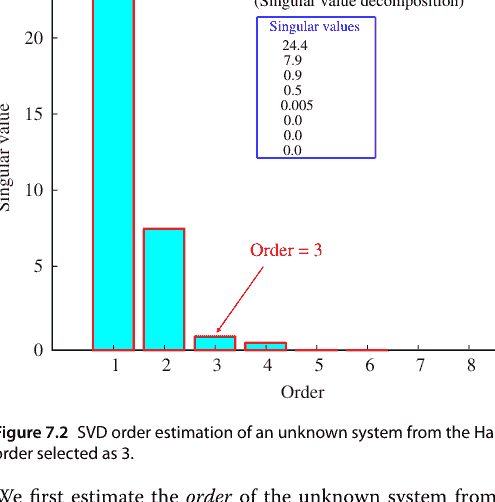

# 图7.2 根据Hankel协方差矩阵对未知系统进行SVD阶次估计：选择阶次为3。

我们首先根据上述输出协方差矩阵 Λₑ 构造的Hankel矩阵估计未知系统的阶次，并执行SVD，得到如图7.2所示的奇异值：

```
Σ = {24.4, 7.9, 0.9*, 0.5, 0.005, 0.0, 0.0, 0.0}
```

并选择一个3阶系统（星号标记）来表示数据。

接下来，我们在Hankel数组上使用第6.3节的正则实现算法，提取以下KSP模型 (Σ_KSP)，可观测性不变量为：v₁ = 1 和 v₂ = 2，得到：

```
A_R = [ -1 | 1 0 ; 0 | 0 1 ; 0.252 | -0.29 -0.083 ] ; B_R = [ -8.73 1 ; -2.64 -0.63 ; 2.32 -0.32 ]
```

```
C_R = [ 1 | 0 0 ; 0 | 1 0 ] ; D_R = [ 6.86 1.5 ; 1.5 3.5 ]
```

我们迭代求解了表7.4中基于卡尔曼滤波器的KSP方程，完成10次迭代，在可接受误差 ε = 10⁻²⁵ 下收敛。

# 7.5 随机子空间实现：正交投影

子空间辨识（SID）算法基于测量数据的INV表示，与基础确定性模型 Σ_ABCD 相结合，模型形式为：

```
x̂(t + 1) = A x̂(t) + B u(t) + K_p e(t)      （状态估计）
y(t) = C x̂(t) + D u(t) + e(t)               （测量）
(7.60)
```

其中 e(t) 是新息序列，K_p(t) 如前所述为预测卡尔曼增益。

如第6.4节所示，利用INV模型状态的LTI解表达式：

```
x̂(t) = A^t x̂(0) + Σ_{n=0}^{t-1} A^{t-n-1} B u(n) + Σ_{n=0}^{t-1} A^{t-n-1} K_p e(n)  for  t > 0  (7.61)
```

并将状态代入测量方程，得到：

```
y(t) = C A^t x̂(0) + Σ_{n=0}^{t-1} C A^{t-n-1} B u(n) + Σ_{n=0}^{t-1} C A^{t-n-1} K_p e(n) + D u(t) + e(t)
(7.62)
```

进一步将该关系扩展到 k 个采样点，并合并各项，我们得到：

```
[y(0); y(1); ⋮; y(k-1)] = [C; CA; ⋮; CA^{k-1}]_{O_k} x̂(0) + [D ⋯ 0; CB D ⋯ 0; ⋮ ⋮ ⋮ ⋮; CA^{k-1}B ⋯ CB D]_{T_k} [u(0); u(1); ⋮; u(k-1)] + [I ⋯ 0; CK_p I ⋯ 0; ⋮ ⋮ ⋮ ⋮; CA^{k-1}K_p ⋯ CK_p I]_{Ξ_k} [e(0); e(1); ⋮; e(k-1)]  (7.63)
```

其中 O_k ∈ R^{kN_y×N_x} 是可观测性矩阵，T_k ∈ R^{kN_y×kN_u} 是脉冲响应矩阵，Ξ_k ∈ R^{kN_y×kN_y} 是噪声（INV）脉冲响应矩阵——两者均为Toeplitz矩阵 [32]。

将这些关系在时间上平移（0 → t），得到：

```
\begin{bmatrix} y(t) \\ y(t+1) \\ \vdots \\ y(t+k-1) \end{bmatrix} = \mathcal{O}_k \hat{x}(t) + \mathcal{T}_k \begin{bmatrix} u(t) \\ u(t+1) \\ \vdots \\ u(t+k-1) \end{bmatrix} + \Xi_k \begin{bmatrix} e(t) \\ e(t+1) \\ \vdots \\ e(t+k-1) \end{bmatrix} \tag{7.64}
```

从而得到向量输入/输出关系：

```
\mathbf{y}_k(t) = \mathcal{O}_k \hat{\mathbf{x}}(t) + \mathcal{T}_k \mathbf{u}_k(t) + \Xi_k \mathbf{e}_k(t) \tag{7.65}
```

其中 $\mathbf{y} \in \mathcal{R}^{kN_y \times 1}$，$\hat{\mathbf{x}} \in \mathcal{R}^{N_x \times 1}$，$\mathbf{u} \in \mathcal{R}^{kN_u \times 1}$，$\mathbf{e} \in \mathcal{R}^{kN_y \times 1}$。

我们首先为样本范围为 $k$-到-$(2k-1)$（未来数据）定义数据矩阵，见 [25]。首先，堆叠这些 $k$ 向量以创建批处理数据（块Hankel）矩阵，从而获得随后的“随机数据方程”。即，定义块输出数据矩阵 $(\mathcal{Y}_{k|2k-1})$、块输入数据矩阵 $(\mathcal{U}_{k|2k-1})$ 和块INV数据矩阵 $(\mathcal{E}_{k|2k-1})^2$ 在 $K$ 个样本上的形式为：

```
\mathcal{Y}_{k|2k-1} := \begin{bmatrix} \mathbf{y}(k) & \mathbf{y}(k+1) & \cdots & \mathbf{y}(K+k-1) \\ \mathbf{y}(k+1) & \mathbf{y}(k+2) & \cdots & \mathbf{y}(K+k) \\ \vdots & \vdots & \vdots & \vdots \\ \mathbf{y}(2k-1) & \mathbf{y}(2k) & \cdots & \mathbf{y}(K+2k-2) \end{bmatrix} \tag{7.66}
```

其中

```
\mathcal{U}_{k|2k-1} := \begin{bmatrix} \mathbf{u}(k) & \mathbf{u}(k+1) & \cdots & \mathbf{u}(K+k-1) \\ \mathbf{u}(k+1) & \mathbf{u}(k+2) & \cdots & \mathbf{u}(K+k) \\ \vdots & \vdots & \vdots & \vdots \\ \mathbf{u}(2k-1) & \mathbf{u}(2k) & \cdots & \mathbf{u}(K+2k-2) \end{bmatrix} \tag{7.67}
```

以及

```
\mathcal{E}_{k|2k-1} := \begin{bmatrix} \mathbf{e}(k) & \mathbf{e}(k+1) & \cdots & \mathbf{e}(K+k-1) \\ \mathbf{e}(k+1) & \mathbf{e}(k+2) & \cdots & \mathbf{e}(K+k) \\ \vdots & \vdots & \vdots & \vdots \\ \mathbf{e}(2k-1) & \mathbf{e}(2k) & \cdots & \mathbf{e}(K+2k-2) \end{bmatrix} \tag{7.68}
```

从而得到相应的随机数据方程：

```
\mathcal{Y}_{k|2k-1} = \mathcal{O}_k \mathcal{X}_k + \mathcal{T}_k \mathcal{U}_{k|2k-1} + \Xi_k \mathcal{E}_{k|2k-1} \tag{7.69}
```

其中块（Hankel）矩阵定义为：

```
\mathcal{Y}_{k|2k-1} = [\mathbf{y}_k(k) \; \mathbf{y}_k(k+1) \; \cdots \; \mathbf{y}_k(K+k-1)] \in \mathcal{R}^{kN_y \times K}
```

```
\mathcal{U}_{k|2k-1} = [\mathbf{u}_k(k) \; \mathbf{u}_k(k+1) \; \cdots \; \mathbf{u}_k(K+k-1)] \in \mathcal{R}^{kN_u \times K}
```

2 记号“k|2k−1”定义了K列数据矩阵的第一行和最后一行的元素。

ℰ_{k|2k−1} = [e_k(k) e_k(k+1) ⋯ e_k(K+k−1)] ∈ ℝ^{kN_x×K}
𝒳_k = [x(k) x(k+1) ⋯ x(K+k−1)] ∈ ℝ^{N_x×K}

这里 𝒰_{0|k−1}、𝒴_{0|k−1}、ℰ_{0|k−1} 被定义为过去的输入和输出（U_p,Y_p,E_p），而 𝒰_{k|2k−1}、𝒴_{k|2k−1}、ℰ_{k|2k−1} 和 𝒳_k 是未来的输入/输出和状态（U_f,Y_f,E_f, X_f），它们都是块Hankel矩阵。

𝒰_p := 𝒰_{0|k−1};   𝒴_p := 𝒴_{0|k−1};   ℰ_p := ℰ_{0|k−1};   𝒳_p := 𝒳_0
𝒰_f := 𝒰_{k|2k−1};   𝒴_f := 𝒴_{k|2k−1};   ℰ_f := ℰ_{k|2k−1};   𝒳_f := 𝒳_k

矩阵输入/输出关系为：

𝒴_p = 𝒪_k 𝒳_p + 𝒯_k 𝒰_p + Ξ_k ℰ_p      （过去）
𝒴_f = 𝒪_k 𝒳_f + 𝒯_k 𝒰_f + Ξ_k ℰ_f      （未来）      (7.70)

数据矩阵，过去和未来，定义为：

𝒟_p := [ 𝒰_p ; − − − ; 𝒴_p ] = [ 𝒰_{0|k−1} ; − − − ; 𝒴_{0|k−1} ];    𝒟_f := [ 𝒰_f ; − − − ; 𝒴_f ] = [ 𝒰_{k|2k−1} ; − − − ; 𝒴_{k|2k−1} ]    (7.71)

总体目标（如前所述）是从含噪声（随机）的输入/输出数据中提取可观测性矩阵，从而提取系统矩阵 Σ_INV。也就是说，我们寻求一个解，其列空间（值域）等价于 𝒪_K（例如 range(𝒴_{k|2k−1}) ≡ range(𝒪_K)）。如果这个性质得到满足，那么在执行SVD以获得等价列空间之后，就可以提取 Σ_INV，但不幸的是 𝒯_K 和 Ξ_K 是未知的。因此，我们必须首先以某种方式估计这两个响应矩阵，以便将它们从数据方程中移除。这将我们直接引向投影理论和INV序列的正交性质。

遵循第6.4节的最小二乘方法，投影算子 𝒫³ 与输入空间 𝒰 正交，使得 ⟨𝒰,𝒫^⊥⟩ = 0，由下式给出 [17, 19, 34]：

𝒫^⊥_{𝒰_{k|2k−1}} = I − 𝒫_{𝒰_{k|2k−1}} = I − 𝒰'_{k|2k−1}(𝒰_{k|2k−1}𝒰'_{k|2k−1})^{-1}𝒰_{k|2k−1}      (7.72)

这是 𝒰_{k|2k−1} 的零（列）空间到 𝒰 零空间上的正交投影，使得：

⟨𝒰_{k|2k−1}, 𝒫^⊥_{𝒰_{k|2k−1}}⟩ ⇒ 𝒰_{k|2k−1} × 𝒫^⊥_{𝒰_{k|2k−1}} = 0      (7.73)

其中假设 𝒰_{k|2k−1} 是持续激励的，或者等价地满秩，ρ(𝒰) = kN_u。


将投影算子应用于式 (7.69) 的随机数据方程，会使输入项为零，即

𝒫_{𝒰_{k|2k-1}^⊥}^{⊥} 𝒴_{k|2k-1} 𝒰_{k|2k-1}^† := 𝒴_{k|2k-1} × 𝒫_{𝒰_{k|2k-1}^⊥} = 𝒪_k \hat{𝒳}_k 𝒫_{𝒰_{k|2k-1}^⊥} + \underbrace{Γ_k 𝒰_{k|2k-1} 𝒫_{𝒰_{k|2k-1}^⊥}}_{0} + Ξ_k ℰ_{k|2k-1} 𝒫_{𝒰_{k|2k-1}^⊥} (7.74)

INV（新息）序列不受投影算子 𝒫_{𝒰_{k|2k-1}^⊥} 的影响，因为它与过去和未来的输入正交，因此 ℰ_{k|2k-1} 𝒫_{𝒰_{k|2k-1}^⊥} = ℰ_{k|2k-1} × (I - 𝒰_{k|2k-1} (𝒰_{k|2k-1} 𝒰_{k|2k-1}^†)^{-1} 𝒰_{k|2k-1}) = ℰ_{k|2k-1}

也就是说，根据 INV 的已知性质，未来 INV 序列与过去输入不相关 [32] ℰ_{k|2k-1} 𝒰_{0|k-1} = 0

因此，将式 (7.74) 右乘 𝒰_{0|k-1} 并利用这一性质，我们可以提取可观测性矩阵 𝒴_{k|2k-1} 𝒫_{𝒰_{k|2k-1}^⊥} 𝒰_{0|k-1} = 𝒪_k \hat{𝒳}_k 𝒫_{𝒰_{k|2k-1}^⊥} 𝒰_{0|k-1} + \underbrace{Ξ_k ℰ_{k|2k-1} 𝒰_{0|k-1}}_{0} = 𝒪_k \hat{𝒳}_k 𝒫_{𝒰_{k|2k-1}^⊥} 𝒰_{0|k-1} (7.75)

已有研究表明，随机实现问题对应的秩条件满足下式（详见 [19]）ρ(𝒳_k 𝒫_{𝒰_{k|2k-1}^⊥} 𝒰_{k|2k-1}) = N_x (7.76)

如果底层随机表示包含过程噪声，例如 INV 和高斯-马尔可夫模型，那么 SID 技术必须同时包含“过去”的输入和输出，从而可以采用 PO-MOESP 或 N4SID 方法 [17, 19, 27]。这些方法在这种情况下为随机实现问题提供了稳健的解决方案。

上一章的“过去”输入 PI-MOESP 方法是从工具变量（IV）的角度发展的，其中 IV 定义为 ℐ_p := 𝒰_{0|k-1}；然而，相比之下，PO-MOESP 和 N4SID 技术都基于增广 IV，该增广 IV 还包含过去输出，即 ℐ_{0|k-1} := [ 𝒰_{0|k-1} ; ; 𝒴_{0|k-1} ] ∈ ℛ^{k(N_u+N_y)×K} (7.77)

回顾：选择工具变量是为了消除噪声项的影响，同时保留关键信息。IV 必须满足以下条件：

- $E\{\mathcal{E}_{0|k-1} \mathcal{I}'_{0|k-1}\}=0$（与噪声不相关）
- $\rho\left(E\{\mathcal{X}'_{0} \mathcal{I}_{0|k-1}\}\right)=N_x$（秩条件）

也就是说，IV 的选择应使其与噪声（INV）不相关并保持秩，以便提取扩展可观测性矩阵 $\mathcal{O}_k$ 或扩展状态 $\mathcal{X}_f$。

同样根据 INV 的正交性，它与过去输出也是正交的。

$E\{\mathcal{E}_{k|2k-1} \mathcal{Y}'_{0|k-1}\}=0$

在如式 (7.74) 那样将投影算子 $\mathcal{P}_{\mathcal{U}_{k|2k-1}^\perp}$ 应用于未来测量值，以消除过去输入的影响之后，我们用增广工具变量 $\mathcal{I}_{0|k-1}$ 替换“工具”，使得 [19]

$\left(\mathcal{Y}_{k|2k-1}\mathcal{P}_{\mathcal{U}_{k|2k-1}^\perp}\right)\mathcal{I}'_{0|k-1}=\left(\mathcal{O}_k\hat{\mathcal{X}}_k\mathcal{P}_{\mathcal{U}_{k|2k-1}^\perp}\right)\mathcal{I}'_{0|k-1}+\underbrace{\left(\Xi_k\mathcal{E}_{k|2k-1}\mathcal{P}_{\mathcal{U}_{k|2k-1}^\perp}\right)\mathcal{I}'_{0|k-1}}_{0}$
(7.78)

已有研究表明，在这些操作下秩条件保持不变 [19]，即

$\rho\left(E\left\{\mathcal{Y}_{k|2k-1}\mathcal{P}_{\mathcal{U}_{k|2k-1}^\perp}\mathcal{I}'_{0|k-1}\right\}\right)=N_x$

因此，采用这种 IV 选择，我们可以从下式恢复可观测性矩阵

$\mathcal{Y}_{k|2k-1}\mathcal{P}_{\mathcal{U}_{k|2k-1}^\perp}\mathcal{I}'_{0|k-1}=\mathcal{O}_k\hat{\mathcal{X}}_k\mathcal{P}_{\mathcal{U}_{k|2k-1}^\perp}\mathcal{I}'_{0|k-1}$
(7.79)

从而为后续 PO-MOESP 算法提供稳健的实现。

## 7.5.1 多变量输出误差状态空间（MOESP）算法

MOESP⁴，或者更恰当地说 PO-MOESP 技术，基于对数据矩阵进行正交 LQ 分解（参见附录 C）[17–23, 25]。即 $\mathcal{D}=L\times Q$，其中 $L$ 是下分块三角矩阵，$L\in\mathcal{R}^{2k(N_u+N_y)\times2k(N_u+N_y)}$，$Q$ 是正交矩阵，$Q\in\mathcal{R}^{2k(N_u+N_y)\times K}$，使得

$\mathcal{D}:=
\begin{bmatrix}
\mathcal{U}_{k|2k-1}\\
---\\
\mathcal{I}_{0|k-1}\\
---\\
\mathcal{Y}_{k|2k-1}
\end{bmatrix}$

并且根据 LQ 分解的上分块行（参见 6.4 节），我们有

$$\begin{bmatrix}\mathcal{U}_{0|k-1}\\\mathcal{I}_{0|k-1}\end{bmatrix}=\begin{bmatrix}L_{11}&0\\L_{21}&L_{22}\end{bmatrix}\begin{bmatrix}Q'_1\\Q'_2\end{bmatrix}$$

由此可得

$$E\{\varepsilon_{k|2k-1}[Q_1\mid Q_2]\}=0$$

这意味着正交矩阵 $Q'_i$（$i=1,2$）与未来噪声 $\varepsilon_{k|2k-1}$ *不相关* [19]。

因此，令新息项为零，式 (7.85) 可简化为

$$\mathcal{Y}_{k|2k-1}\times Q_1=\mathcal{O}_k\mathcal{V}_kQ_1+\mathcal{T}_kL_{11}+\underbrace{\mathcal{E}_k\varepsilon_{k|2k-1}Q_1}_{0}$$

$$\mathcal{Y}_{k|2k-1}\times Q_2=\mathcal{O}_k\mathcal{V}_kQ_2+\underbrace{\mathcal{E}_k\varepsilon_{k|2k-1}Q_2}_{0}$$

从而得到最终的方程组，使得能够提取可观测性矩阵和 KSP 模型，即

$$\mathcal{Y}_{k|2k-1}Q_1=L_{31}=\mathcal{O}_k\mathcal{V}_kQ_1+\mathcal{T}_kL_{11}$$

$$\mathcal{Y}_{k|2k-1}Q_2=L_{32}=\mathcal{O}_k\mathcal{V}_kQ_2$$

对 $L_{32}$ 进行 SVD 分解，即

$$L_{32}=[U_S\mid U_N]\begin{bmatrix}\Sigma_S&0\\0&\Sigma_N\end{bmatrix}\begin{bmatrix}V'_S\\V'_N\end{bmatrix}=U_S\Sigma_SV'_S+U_N\Sigma_NV'_N$$

*信号子空间*  *噪声子空间*

假设噪声分量与信号分量相比可忽略（如前所述），则有

$$L_{32}=\mathcal{O}_k\hat{\mathcal{V}}_kQ_2\approx U_S\times\Sigma_S\times V'_S\approx (U_S\Sigma_S^{1/2})\times((\Sigma'_S)^{1/2}V'_S)$$

从而以平衡随机实现提取可观测性矩阵。

KSP 模型的系统矩阵 $\Sigma_{KSP}=\{A,B,C,D\}$ 现在可以像确定性情形一样，利用平移不变方法确定，得到

$$A=\mathcal{O}^{\#}_{N_x-1}\times\mathcal{O}^{\uparrow}_{N_x}=\left(\Sigma_S^{-1/2}U'_S\right)\times\mathcal{O}^{\uparrow}_{N_x};\quad C=\mathcal{O}(1:N_y,1:N_x)$$

其中 B 和 D 通过直接求解最小二乘问题获得，因为将式 (7.89) 左乘 U′N 可得

U′N−31 = U′N O_k X_k Q1 + U′N T_k L11 = U′N T_k L11
        0

应用正交条件 U′N O_k = 0 后，我们有

U′N L31 = U′N T_k L11
Z := U′N T_k = U′N L31 × L11−1 (7.94)

将向量堆叠并重新排序，会得到一组超定线性方程，并通过最小二乘求解得到

[ D̂ ] = U# × Z̃
[ -- ]       (7.95)
[ B̂ ]

其中 U 是分块系数矩阵（详见 6.5 节）。

利用 ΣKSP = {A, B, C, D}，可以求解相应的基于 INV 的（卡尔曼）Riccati 方程，得到正定解 Π̃ > 0，使得

Π̃ = A Π̃ A′ + (B − A Π̃ C′)(D + D′ − C Π̃ C′)⁻¹(B − A Π̃ C′)′ (7.96)

然后，给出 INV 协方差 Ree 和卡尔曼增益 Kp，从而如下求解随机实现问题：

Ree = (D + D′ − C Π̃ C′)
Kp = (B − A Π̃ C′) × Ree⁻¹ (7.97)

因此，相应的协方差为

Ruw^e = Kp Ree Kp′
Rvv^e = Ree
Rwv^e = Kp Ree (7.98)

至此完成了随机实现。

因此，我们得到 PO-多变量输出误差状态空间（PO-MOESP）[17] 算法，其步骤如下：

-   计算式 (7.80) 中 D 的 LQ 分解。
-   对式 (7.91) 中的 L32 进行 SVD 分解，以提取 O_k。
-   由式 (7.93) 求得 A 和 C。
-   求解最小二乘问题，由式 (7.95) 得到 B 和 D。
-   在得到 ΣKSP 后，求解式 (7.96) 中基于 INV 的（卡尔曼）Riccati 方程，得到正定状态误差协方差 Π̃。
-   由式 (7.97) 计算 INV 协方差 Ree 和卡尔曼增益 Kp。
-   由式 (7.98) 计算相应的噪声协方差集合 {Ruw^e, Rvv^e, Rwv^e}。


# 表 7.5 随机实现算法：过去输出-MOESP（PO-MOESP）方法。

正交投影（LQ-分解）
\mathcal{D} = \begin{bmatrix} \mathcal{U}_f \\ \mathcal{D}_p \\ \mathcal{Y}_f \end{bmatrix} = \begin{bmatrix} L_{11} & 0 & 0 \\ L_{21} & L_{22} & 0 \\ L_{31} & L_{32} & L_{33} \end{bmatrix} \begin{bmatrix} \tilde{Q}_1' \\ \tilde{Q}_2' \\ \tilde{Q}_3' \end{bmatrix} \quad (Data Matrix)

奇异值分解
L_{32} = [U_S U_N] \begin{bmatrix} \Sigma_S & 0 \\ 0 & \Sigma_N \end{bmatrix} \begin{bmatrix} V_S' \\ V_N' \end{bmatrix} \approx \underbrace{U_S \times \Sigma_S \times V_S'}_{\mathcal{O}_s} \approx (U_S \Sigma_S^{1/2}) \times (\Sigma_S^{1/2} V_S') \quad (Observability Matrix)

KSP 系统矩阵
A = (\mathcal{O}_N_s' \mathcal{O}_N_s)^{-1} \mathcal{O}_N_s' \mathcal{O}_N_s = (\Sigma_S^{-1/2} U_S') \mathcal{O}_N_s' \quad (System/Process Matrix)

KSP 测量（输出）矩阵
C = \mathcal{O}(1 : N_y, 1 : N_x) \quad (Output Matrix)

KSP 输入/输入/输出传输矩阵
\begin{bmatrix} \hat{D} \\ -- \\ \hat{B} \end{bmatrix} = \mathcal{U}^\# \times \tilde{Z} \quad (Input Matrices)

状态协方差方程
\bar{\Pi} = A \bar{\Pi} A' + (B - A \bar{\Pi} C')(D + D' - C \bar{\Pi} C')^{-1} (B - A \bar{\Pi} C')' \quad (Riccati Equation)

KSP 方程
R_{ee} = D + D' - C \bar{\Pi} C'
K_p = (B - A \bar{\Pi} C') \times R_{ee}^{-1} \quad (KSP Equations)

噪声协方差方程
R_{ww}^e = K_p R_{ee} K_p'
R_{vv}^e = R_{ee}
R_{wv}^e = K_p R_{ee} \quad (Noise-Covariances)

我们将 PO-MOESP 算法总结在表 7.5 中，并考虑以下噪声中正弦波的示例。

## 示例 7.2

考虑以下正弦系统，其代表了可能发生在航行于海洋的船只上振动机械、飞行于天空的飞机中结构如桥梁或建筑物甚至地震事件中从 0 到 25 Hz 的频率范围。这些事件的信号模型可以很容易地用噪声中的正弦波表示：

$y(t_k) = \sum_{i=1}^{N_i} A_i \sin 2\pi f_i t_k + v(t_k); \quad k = 1, \dots, K$

其中 $v \sim \mathcal{N}(0, \sigma_{vv}^2)$。

数据由六个正弦波在频率 $f_i = \{2, 5, 10, 14, 20, 22\ \text{Hz}\}$ 处合成，所有振幅均为单位振幅，信噪比（SNR）为 0 dB，采样间隔为 $\Delta t = 0.02$ 秒，采样点数为 $K = 10\ 000$。模拟数据如图 7.3 所示，显示了 (a) 中的噪声序列及其使用相关方法得到的对应功率谱 (b)。我们注意到在 0 dB SNR 下正弦频率清晰可辨。

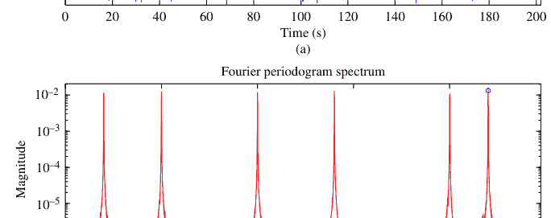

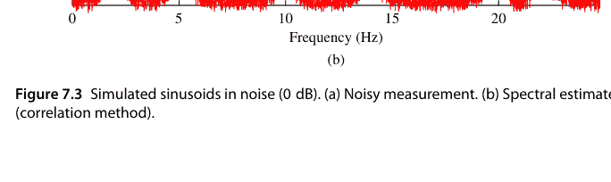

图 7.3 噪声中模拟正弦波（0 dB）。(a) 噪声测量。(b) 谱估计（相关方法）。

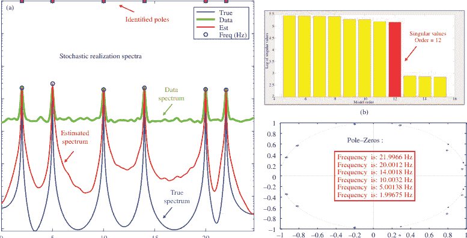

**图 7.4** 噪声中正弦波的子空间辨识（0 dB）。(a) 谱估计：真实、数据和辨识谱。(b) 使用 SVD 的阶数估计：阶数 = 12。(c) 极点-零点图，带辨识频率（连续）。

PO-MOESP 和 N4SID（随后介绍）SID 方法均应用于该数据集，结果非常相似。所得谱估计如图 7.4 所示，估计谱在 (a) 中显示，以及在 (c) 中辨识的频率。通过改变阶数从 5 到 15 应用 SVD 方法进行阶数估计，从奇异值中估计出正确的 12 个状态阶数或等价于 6 个正弦波，如 (b) 所示。估计信号如图 7.5 所示，显示了真实和估计脉冲响应的一个小快照以及对噪声数据的“拟合”。每个都表明对信号和测量的合理估计。验证统计也相当良好，均值零/白度检验结果为 Z-M: 0.003 < 0.022；W-T: 3.3% 超出，带权重的平方和残差（WSSR）统计低于阈值，再次表明对数据的良好拟合。最终估计的正弦频率如表 7.6 所示。在此 SNR 下，我们再次看到两种方法均获得极佳结果，N4SID 的相对误差约为 ~0.5%，MOESP 技术约为 ~1.1%——性能基本相同。

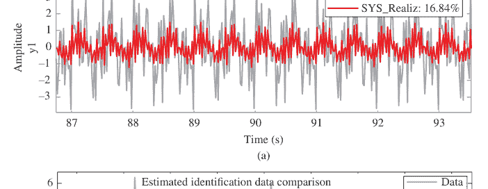

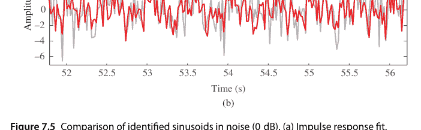

图 7.5 噪声中辨识正弦波的比较（0 dB）。(a) 脉冲响应拟合。(b) 估计数据拟合。

## 表 7.6 随机子空间辨识：六（6）个正弦系统。

| Frequency | N4SID | Relative | MOESP | Relative | Z-Mean | WSSR |
|---|---|---|---|---|---|---|
| Hz | Estimate | Error | Estimate | Error | 3.1 × 10⁻² | Below τ |
| 2 | 1.997 | 1.50 × 10⁻³ | 2.006 | 3.0 × 10⁻³ | 1.6 × 10⁻⁸ | Yes |
| 5 | 5.001 | 0.20 × 10⁻³ | 4.984 | 3.2 × 10⁻³ | 1.6 × 10⁻⁸ | Yes |
| 10 | 10.007 | 0.70 × 10⁻³ | 10.004 | 0.40 × 10⁻³ | 1.6 × 10⁻⁸ | Yes |
| 14 | 14.002 | 0.14 × 10⁻³ | 14.009 | 0.06 × 10⁻³ | 1.6 × 10⁻⁸ | Yes |
| 20 | 20.001 | 0.05 × 10⁻³ | 20.001 | 0.05 × 10⁻³ | 1.6 × 10⁻⁸ | Yes |
| 22 | 21.997 | 0.14 × 10⁻³ | 22.004 | 0.02 × 10⁻³ | 1.6 × 10⁻⁸ | Yes |
| Average | — | 0.46 × 10⁻³ | — | 1.09 × 10⁻³ | — | Yes |

## 7.6 随机子空间实现：斜投影

分解或分离数据空间的替代方法是应用斜投影算子，从而在消除过去输入/输出/噪声数据的同时提取随机状态空间模型。该技术首先通过对输入/输出块汉克尔数据矩阵特定行空间的斜投影，直接从噪声输入/输出估计状态序列，然后通过状态/残差方程的最小二乘解提取底层模型 Σ_INV。在此方法中，状态序列的行空间可使用 SVD 获得，其中斜 SID 的关键要素基于提取：

```
$\mathcal{X}_k = [\,x(k)\ x(k+1)\ \cdots\ x(K+k-1)\,]$ 
```

这是当应用于本章的随机实现问题时，前一章 N4SID 方法的底层概念。

我们从式 (7.70) 的过去和未来输入/输出关系出发，并包含通过展开 INV 状态空间模型而得到的相应状态关系，即

```
$\hat{x}(k)=A^k\hat{x}(j)+\sum_{n=0}^{k-1}A^{k-n-1}Bu(n+j)+\sum_{n=0}^{k-1}A^{k-n-1}K_pe(n+j)$
```

以确定未来状态关于过去状态 $\mathcal{X}_p$、输入 $\mathcal{U}_p$ 和 INV $\mathcal{E}_p$ 的表达式

```
$\mathcal{X}_f=A^k\mathcal{X}_p+C_{AB}^{\leftarrow}(k)\mathcal{U}_p+C_{AK}^{\leftarrow}(k)\mathcal{E}_p \qquad (7.99)$
```

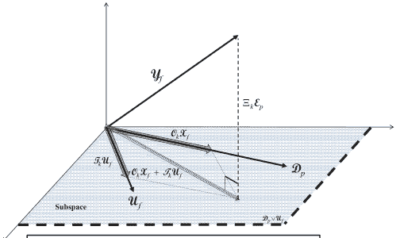

**图 7.6** 投影：$\mathcal{Y}_f$ 在联合子空间 $\mathcal{D}_p \vee \mathcal{U}_f$ 上的正交投影，然后沿未来输入 $\mathcal{U}_f$ 对过去数据 $\mathcal{D}_p$ 的斜投影。

合并项得

$$\mathcal{X}_f = \left[\mathcal{C}_{AB}^{\leftarrow}(k)-A^k\mathcal{O}_k^{\#}\mathcal{T}_k\;\middle|\;A^k\mathcal{O}_k^{\#}\;\middle|\;\mathcal{C}_{AK}^{\leftarrow}(k)-A^k\mathcal{O}_k^{\#}\Xi_k\right]\begin{bmatrix}\mathcal{U}_p\\\mathcal{Y}_p\\\mathcal{E}_p\end{bmatrix}$$

或简写为

$$\mathcal{X}_f=\Theta_p\times\mathcal{D}_p+\underbrace{\left(\mathcal{C}_{AK}^{\leftarrow}(k)-A^k\mathcal{O}_k^{\#}\Xi_k\right)}_{0}\mathcal{E}_p$$

表明未来状态 *仅* 依赖于过去输入、输出和 INV，而不依赖于未来输入 $\mathcal{U}_f$。然而，由于 $\mathcal{X}_f$ 位于 $\mathcal{D}_p \vee \mathcal{U}_f$ 的联合（行）子空间中，且创新与联合空间 $(\mathcal{E}_p,\mathcal{D}_p \vee \mathcal{Y}_f)=0$ 正交，则式 (7.107) 的最后一项为零，从而得到未来状态的最终表达式如下：

$$\mathcal{X}_f=\mathcal{P}^{\perp}_{\mathcal{X}_f\mid\mathcal{D}_p\circ\mathcal{U}_f}=\Theta_p\times\mathcal{D}_p \tag{7.108}$$

如前式 (6.106)⁵ 所示，从而得到未来输出在过去数据上沿未来输入的斜投影的最终表达式：

$$\mathcal{P}^{\parallel}_{\mathcal{Y}_f\mid\mathcal{D}_p\circ\mathcal{U}_f}=\mathcal{G}_k\mathcal{P}^{\parallel}_{\mathcal{X}_f\mid\mathcal{D}_p\circ\mathcal{U}_f}=\mathcal{G}_k\times\mathcal{X}_f=\mathcal{G}_k\times(\Theta_p\times\mathcal{D}_p) \tag{7.109}$$

⁵ 回顾式 (6.109) 中正交到斜投影关系的表达式在该证明中被应用。


该关系表明，对未来数据进行斜投影不仅消除了输入，而且消除了 INV，同时能够直接从给定数据中提取可观测性和估计状态。

因此，状态向量 𝒳_f 为过去和未来子空间相交的基础，如第 6.4.2 节所述，并且可以从该投影中提取。这是一个特殊的 state vector。它实际上是一个“状态估计”——卡尔曼滤波器的输出，提供基于可用数据的状态最佳估计！与第 4.2 节中开发的递归滤波器不同，该滤波器需要整个随机实现 Σ_INV = {A, B, C, D, R^e_ww, R^e_wv, R^e_vv} 以及初始状态和误差协方差 (x̂(0), P̃(0)) 才能应用，使用 SID 技术提取的该实现是数值化的，仅需要输入/输出数据即可进行开发和应用。事实上，它并不是第 4.2 节中所述的稳态卡尔曼滤波器处理器，而是一个以批处理方式并行处理数据矩阵、“逐列”处理数据矩阵的处理器 [27]。这是 SID 方法的一个相当 remarkable 的特性！

数值卡尔曼滤波器⁶ 直接源于斜投影，并且可以置于以下闭式输入/输出结构中，如 [27] 所述

```
x̂(k) = [A^k − Ω_k 𝒪_k | C_AB^−(k) − Ω_k 𝒯_k | Ω_k] ⎡ x̂(0) ⎤ ⎢ --- ⎥ ⎢ u(0) ⎥ ⎢  :  ⎥ ⎢ u(k−1) ⎥ ⎢ --- ⎥ ⎢ y(0) ⎥ ⎢  :  ⎥ ⎣ y(k−1) ⎦ (7.110)
```

其中 Ω_k = (C_AK^−(k) − A^k P̃(0)𝒪'_k) (L_k − 𝒪_k P̃(0)𝒪'_k)。将此表达式在 K 个样本（列）上展开，其中 x̂_f := [x̂(k) x̂(k+1) ⋯ x̂(k+K−1)]'，我们得到

```
x̂_f = [A^k − Ω_k 𝒪_k | C_AB^−(k) − Ω_k 𝒯_k | Ω_k] ⎡ x̂(0) ⎤ ⎢ --- ⎥ ⎢ 𝒰_0|k−1 ⎥ ⎢ --- ⎥ ⎣ 𝒴_0|k−1 ⎦ (7.111)
```

或按之前的方式分组数据，我们有

```
x̂_f = [A^k − Ω_k 𝒪_k | (C_AB^−(k) − Ω_k 𝒯_k | Ω_k)] ⎡ x̂(0) ⎤ ⎢ --- ⎥ ⎣ D_0|k−1 ⎦ (7.112)
```

对于 x̂(0) := [x̂_0(0) x̂_1(0) ⋯ x̂_{K−1}(0)]'

这是数值卡尔曼滤波器的基本结构，其中隐含了初始条件，但算法从未显式计算它们，因为它们不是必需的。主要一点是，估计状态序列 \hat{X}_f 直接从输入/输出数据中提取，并且不需要底层创新模型 \Sigma_{INV}。

数值卡尔曼滤波器的开发相当复杂且冗长；因此，它被排除在本次讨论之外；然而，我们建议感兴趣的读者参考文献 [27] 或论文 [35]，其中所有细节都已仔细阐述。

对式 (7.109) 执行 SVD，我们得到划分的信号和噪声关系为

```
\mathcal{P}_{y_f|D_p u_f} = \mathcal{O}_k \hat{X}_f = [U_S | U_N] \begin{bmatrix} \Sigma_S & 0 \\ 0 & \Sigma_N \end{bmatrix} \begin{bmatrix} V'_S \\ V'_N \end{bmatrix} = U_S \Sigma_S V'_S + U_N \Sigma_N V'_N \tag{7.113}
```

再次假设噪声“可忽略” (\Sigma_N << \Sigma_S) 并选择平衡随机实现⁷ (\Sigma_S = \Sigma_S^{1/2} \times (\Sigma_S')^{1/2})，我们得到关键的 N4SID 子空间关系：

```
\mathcal{P}_{y_f|D_p u_f} \approx U_S \Sigma_S^{1/2} (\Sigma_S')^{1/2} V'_S \in \mathcal{R}^{kN_y \times K} \quad (Projection) 
\mathcal{O}_k = U_S \Sigma_S^{1/2} \in \mathcal{R}^{kN_y \times N_s} \quad (Observability) 
\hat{X}_f = \Sigma_S^{1/2} V'_S \in \mathcal{R}^{N_s \times K} \quad (States) \tag{7.114}
```

因此，斜投影算子能够提取可观测性矩阵以及估计状态，从而提取过程 LQ 分解和第 6.4 节中讨论的洞察的随机实现 \Sigma_{INV}。

## 7.6.1 数值算法用于子空间状态空间系统辨识 (N4SID) 算法

对于来自带噪声输入/输出数据的随机实现问题，我们已开发出基于过去和未来的并行或斜投影方法

> 7 “平衡”随机实现比其确定性对应物更复杂，并且要求最小和最大 Riccati 方程解被对角化（详见 [25]）。

就 LQ 分解矩阵而言，斜投影算子由下式给出（详见 [35]）

$\mathcal{P}_{Y_{k|2k-1}|D_{0|k-1}}^{\parallel} \circ \mathcal{U}_{k|2k-1}$

$= \underbrace{[\mathcal{L}_{\mathcal{U}_{0|k-1}} \mid \mathcal{L}_{\mathcal{U}_{k|2k-1}} \mid \mathcal{L}_{\mathcal{Y}_{0|k-1}}]}_{\text{Unknown}} \times \begin{bmatrix} \mathcal{U}_{0|k-1} \\ --- \\ \mathcal{U}_{k|2k-1} \\ --- \\ \mathcal{Y}_{0|k-1} \end{bmatrix} = L_{5:6,1:4} L_{1:4,1:4}^{-1} \begin{bmatrix} \mathcal{U}_{0|2k-1} \\ --- \\ \mathcal{Y}_{0|k-1} \end{bmatrix}$

(7.116)

其中“记号” $L_{i:j,m:n}$ 定义了从第 i 行到第 j 行、第 m 列到第 n 列提取的 $L$ 的块子矩阵，其中 $\mathcal{L}_{\mathcal{U}_{0|k-1}}$、$\mathcal{L}_{\mathcal{U}_{k|2k-1}}$ 和 $\mathcal{L}_{\mathcal{Y}_{0|k-1}}$ 是未知投影矩阵，通过由于 $L_{ii}$ 矩阵的下三角结构而进行的回代从这组线性方程中获得 [27]。

如式 (6.121) 中所述的第二个所需投影是通过求解以下式获得的

$\underbrace{[\mathcal{L}_{\mathcal{U}_{0|k}} \mid \mathcal{L}_{\mathcal{U}_{k+1|2k-1}} \mid \mathcal{L}_{\mathcal{Y}_{0|k}}]}_{\text{Unknown}} \times \begin{bmatrix} \mathcal{U}_{0|k} \\ --- \\ \mathcal{U}_{k+1|2k-1} \\ --- \\ \mathcal{Y}_{0|k} \end{bmatrix} = L_{6:6,1:5} L_{1:5,1:5}^{-1} \begin{bmatrix} \mathcal{U}_{0|2k-1} \\ --- \\ \mathcal{Y}_{0|k} \end{bmatrix}$

(7.117)

其中 $\mathcal{L}_{\mathcal{U}_{0|k}}$、$\mathcal{L}_{\mathcal{U}_{k+1|2k-1}}$、和 $\mathcal{L}_{\mathcal{Y}_{0|k}}$ 是未知投影矩阵，也通过回代从这组线性方程中获得。

有了解矩阵 $\{\mathcal{L}_{\mathcal{U}_{0|k-1}}, \mathcal{L}_{\mathcal{U}_{k|2k-1}}, \mathcal{L}_{\mathcal{Y}_{0|k-1}}\}$ 和 $\{\mathcal{L}_{\mathcal{U}_{0|k}}, \mathcal{L}_{\mathcal{U}_{k+1|2k-1}}, \mathcal{L}_{\mathcal{Y}_{0|k}}\}$，现在可用，可观测性矩阵可使用 SVD 以 LQ 分解的形式提取为

$\mathcal{P}_{Y_{k|2k-1}|D_{0|k-1}}^{\parallel} \circ \mathcal{U}_{k|2k-1} = [\mathcal{L}_{\mathcal{U}_{0|k-1}} \mid 0 \mid \mathcal{L}_{\mathcal{Y}_{0|k-1}}] L_{1:4,1:4} \times Q'_{1:4} =$

$[U_S \mid U_N] \begin{bmatrix} \Sigma_S \mid 0 \\ --- \\ 0 \mid \Sigma_N \end{bmatrix} Q'_{1:4} \times \begin{bmatrix} V'_S \\ --- \\ V'_N \end{bmatrix} \approx \underbrace{U_S \Sigma_S V'_S}_{\text{Signal Subspace}} = \underbrace{U_S \Sigma_S^{1/2}}_{\mathcal{O}_k} \underbrace{(\Sigma'_S)^{1/2} V'_S}_{\hat{X}_f}$

(7.118)

假设噪声“可忽略” ($\Sigma_N \ll \Sigma_S$) 并选择平衡随机实现 ($\Sigma_S = \Sigma_S^{1/2} \times (\Sigma'_S)^{1/2}$)，我们得到与之前相同的关键 N4SID 子空间关系：

$\mathcal{P}_{Y_{k|2k-1}|D_{0|k-1}}^{\parallel} \circ \mathcal{U}_{k|2k-1}$

$= \mathcal{O}_k \hat{X}_k = \underbrace{[\mathcal{L}_{\mathcal{U}_{0|k-1}} \mid 0 \mid \mathcal{L}_{\mathcal{Y}_{0|k-1}}]}_{\text{Known}} L_{1:4,1:4} \times Q'_{1:4} \quad \text{(Oblique Projection)}$

𝒫_{𝒴_{k+1|2k-1}|D_p}^{||} ∘ u_{k+1|2k-1} = 𝒪_{k-1} × \hat{𝒳}_{k+1} = [ℒ_{u|k} | 0 | ℒ_{y|k}] × L_{1:5,1:5} × Q'_{1:5} (Shifted Projection) (7.119)

其中 𝒪_{k-1} ∈ 𝒪_k 是扩展可观测性矩阵，去除了最后的块行。

从这些投影中，我们现在可以估计两个估计状态序列，\hat{𝒳}_{k+1} 和 \hat{𝒳}_k，以求解最小二乘问题，并提取 Σ_{INV}。从斜投影可以明显看出，这可以很容易地通过 SVD 完成，因为 \hat{𝒳}_k = 𝒪_k^# × 𝒫_{𝒴_{k|2k-1}|D_p}^{||} ∘ u_f = (Σ_{S_k}^{-1/2} U_{S_k}) × 𝒫_{𝒴_{k|2k-1}|D_p}^{||} ∘ u_f \hat{𝒳}_{k+1} = 𝒪_{k-1}^# × 𝒫_{𝒴_{k+1|2k-1}|D_p}^{||} ∘ u_f = (Σ_{S_{k-1}}^{-1/2} U'_{S_{k-1}}) × 𝒫_{𝒴_{k+1|2k-1}|D_p}^{||} ∘ u_f (7.120)

其中 Σ_{S_{k-1}}^{-1/2} ∈ Σ_{S_k}^{-1/2} 和 U_{S_{k-1}} ∈ U_{S_k} 分别是奇异值和正交矩阵，去除了最后的块行（如可观测性矩阵所述）。

因此，就 LQ 矩阵而言，我们有估计状态为 \hat{𝒳}_k = Σ_{S_k}^{-1/2} U'_S_k × [ℒ_{u|k-1} | 0 | ℒ_{y|k-1}] × L_{1:4,1:4} × Q'_{1:4} \hat{𝒳}_{k+1} = Σ_{S_{k-1}}^{-1/2} U'_{S_{k-1}} × [ℒ_{u|k} | 0 | ℒ_{y|k}] × L_{1:5,1:5} × Q'_{1:5} (7.121)

且 \hat{𝒰}_{k|k} = L_{2:2,1:4} × Q'_{1:4} \hat{𝒴}_{k|k} = L_{5:5,1:5} × Q'_{1:5} (7.122)

有了这些来自 SVD 和伪逆的数值卡尔曼滤波器的状态，我们现在可以定义底层“批处理”状态空间 (INV) 模型为 \hat{𝒳}_{k+1} = A \hat{𝒳}_k + B 𝒰_{k|k} + ξ_{ω_k} \hat{𝒴}_{k|k} = C \hat{𝒳}_k + D 𝒰_{k|k} + ξ_{v_k} (7.123)

其中 \hat{𝒳}_{k+1} := [\hat{x}(k+1) ⋯ \hat{x}(k+K-1)] \hat{𝒳}_k := [\hat{x}(k) ⋯ \hat{x}(k+K-2)] \hat{𝒴}_{k|k} := [\hat{y}(k) ⋯ \hat{y}(k+K-2)] 𝒰_{k|k} := [u(k) ⋯ u(k+K-2)] ξ_{ω_k} := [ε_ω(k) ⋯ ε_ω(k+K-2)] ξ_{v_k} := [ε_v(k) ⋯ ε_v(k+K-2)]


+   - 计算式 (7.115) 中增广数据矩阵 \(\mathcal{D}\) 的 LQ 分解。
+   - 求解式 (7.116) 和 (7.117) 中未知的 \(\mathcal{L}\) 矩阵以计算投影。
+   - 对投影进行 SVD：式 (7.113) 中的 \(\mathcal{P}^{\parallel}_{\mathcal{Y}_f|\mathcal{D}_p}\mathcal{U}_f\) 以提取 \(\mathcal{O}_k\) 和 \(\mathcal{O}_{k-1}\)。
+   - 计算式 (7.120) 中的 \(\hat{x}_{k+1}\) 和 \(\hat{x}_{k+1}^{\wedge}\)。
+   - 构造式 (7.125) 中的“平衡”状态空间系统。
+   - 通过式 (7.126) 中的最小二乘问题求解提取 \(A, B, C, D\)。
+   - 根据式 (7.128) 从残差 (INV) 序列估计 \(R_{\omega\omega}^{e}, R_{\omega\omega}^{e}, R_{\nu\nu}^{e}\)。
+   - 根据式 (7.129) 计算残差 (INV) 协方差和卡尔曼增益。

完成对随机实现问题的斜投影求解。

我们将 N4SID 算法总结在表 7.7 中。接下来我们考虑这些算法之间的关系。

## 7.6.2 关系：斜投影 (N4SID) 与正交 (MOESP) 算法

基于斜投影的 N4SID 方法与基于正交投影的 PO-MOESP 方法的关系已在文献 [36] 中得到确立。基本上，两种技术都使用相同的工具变量 \(\mathcal{I}_p\)，如式 (7.77) 所示；因此，它们之间存在明确的关系⁹。这种关系可以通过检查各自的投影来看到，即正交投影算子与斜投影算子之间的关系。

*斜投影算子* \(\mathcal{P}_{\mathrm{oblique}}\) 可以用过去输入和输出的公共工具变量 \(\mathcal{I}_p\) 表示为 [17, 37, 38]

\(\mathcal{P}_{\mathrm{oblique}} = \mathcal{P}_{\mathcal{U}_f}^{\perp}\mathcal{I}_p'(\mathcal{I}_p\mathcal{P}_{\mathcal{U}_f}^{\perp}\mathcal{I}_p')^{-1}\mathcal{I}_p\mathcal{P}_{\mathcal{U}_f}^{\perp}\)  (7.130)

它直接应用于未来数据 \(\mathcal{Y}_f\)，而 *正交投影算子* (\(\mathcal{P}_{\mathrm{orthogonal}}\)) 给出为

\(\mathcal{P}_{\mathrm{orthogonal}} = \mathcal{P}_{\mathcal{U}_f}^{\perp}\mathcal{I}_p'(\mathcal{I}_p\mathcal{P}_{\mathcal{U}_f}^{\perp}\mathcal{I}_p')^{-1}\mathcal{I}_p\mathcal{P}_{\mathcal{U}_f}^{\perp} \times \mathcal{P}_{\mathcal{U}_f}^{\perp}\)  (7.131)

因此，我们看到

\(\mathcal{P}_{\mathrm{orthogonal}} = \mathcal{P}_{\mathrm{oblique}} \times \mathcal{P}_{\mathcal{U}_f}^{\perp}\)  (7.132)

如 [17, 36] 所示。

⁹ *典型相关分析* (CVA) 方法也包含在内，但超出了我们讨论的范围 [36]。细节见 [7, 25]。

## 表 7.7 (随机) 子空间状态空间系统辨识的数值算法 (N4SID)。

### 斜投影 (LQ 分解)

D_{0|2k-1} = [U_{0|k-1}; U_{k|k}; U_{k+1|2k-1}; Y_{0|k-1}; Y_{k|k}; Y_{k+1|2k-1}] = [L_{11} 0 0 0 0 0; L_{21} L_{22} 0 0 0 0; L_{31} L_{32} L_{33} 0 0 0; L_{41} L_{42} L_{43} L_{44} 0 0; L_{51} L_{52} L_{53} L_{54} L_{55} 0; L_{61} L_{62} L_{63} L_{64} L_{65} L_{66}] × [Q'_1; Q'_2; Q'_3; Q'_4; Q'_5; Q'_6] (Data Matrix)

### L 矩阵求解

{ L_{U0|k-1}, L_{U|k2k}, L_{Y0|k-1} }; { L_{U0|k}, L_{U|k+1|2k-1}, L_{Y0|k} } (L-Matrices)

### 奇异值分解

P^||_{Y_{k|2k-1}|D_{0|k-1}} o U_{k|2k-1} = [U_S | U_N] [Σ_S 0; - - ; 0 Σ_N] Q'_{1:4} × [V'_S; --; V'_N] ≈ U_S Σ_S V'_S (Projection Matrix)

### 可观测性/状态提取

P^||_{Y_{k|2k-1}|D_{0|k-1}} o U_{k|2k-1} = O_k X_k = [L_{U0|k-1} | 0 | L_{Y0|k-1}] L_{1:4,1:4} Q'_{1:4} (Oblique Projections)

P^||_{Y_{k+1|2k}|D_{0|k}} o U_{k+1|2k} = O_{k-1} X_{k+1} = [L_{U0|k} | 0 | L_{Y0|k}] L_{1:5,1:5} Q'_{1:5}

O_k = U_S Σ_S^{1/2}; O_{k-1} = U_S Σ_{S_k-1}^{1/2}; (Observability Matrices)

X̂_k = O_k^† × P^||_{Y_{k|2k-1}|D_{0|k-1}} o U_f = (Σ_{S_k}^{-1/2} U_S^†) × P^||_{Y_{k|2k-1}|D_{0|k-1}} o U_f (State Estimates)

X̂_{k+1} = O_{k-1}^† × P^||_{Y_{k+1|2k}|D_{0|k}} o U_f = (Σ_{S_k-1}^{-1/2} U_{S_k-1}^†) × P^||_{Y_{k+1|2k}|D_{0|k}} o U_f

### 系统矩阵

[Â | B̂; Ĉ | D̂] = ([X̂_{k+1}; Y_{k|k}] [X̂_k; U_{k|k}])' ([X̂_k; U_{k|k}] [X̂_k; U_{k|k}])^{-1}

### 协方差方程

R̂_{ξξ} = E{ξ̂ ξ̂'} = [R_{ωω}^e | R_{ωv}^e; R_{ωv}^{e'} | R_{vv}^e] = [K R_{ee} K' | K R_{ee}^{1/2}; (K R_{ee}^{1/2})' | R_{ee}]

### 卡尔曼滤波方程

R̂_{ee} ≈ R_{vv}^e; K̂ ≈ R_{ωv}^e R̂_{ee}^{-1/2} (Innovations Covariance/ Kalman Gain)

在文献中，这种关系也已用满秩 (左) 加权矩阵 W_L 和 (右) 列矩阵 W_R 来发展，使得投影矩阵 P 的秩得以保持，即 ρ(I_p × W_R) = ρ(I_p) = N_x

ρ(I_p × W_R) = ρ(I_p) = N_x

我们首先从阶数估计问题开始，然后再验证所识别模型的性能。

## 7.7.1 阶数估计：随机实现问题

MIMO 系统的阶数估计专门源于辨识问题 [40]，其中第一步是基于物理原理估计或猜测系统阶数，然后尝试通过残差检验估计模型来验证预测误差或 INV。大量工作已致力于此问题 [40–43]，其中最显著的统计结果源于信息论观点 [39, 44, 45]。我们考虑一些基于对数据、协方差或投影矩阵应用 SVD 方法的等价阶数估计方法。这些方法可以是统计性的，遵循 AIC 和 MDL (BIC) 方法，也可以是基于汉克尔奇异值或最佳秩近似的确定性方法 [39, 44, 46]，如前所述。这些方法适用于经典和 SID 对随机实现问题的求解。

我们从“理论”系统 (实现) 理论中知道，关键要素是确定所研究底层系统的阶数或状态数。对于随机问题，阶数估计再次基于从汉克尔协方差数据矩阵 (经典) 或投影矩阵 (子空间) 演化而来的秩条件，其具有可观测性/可控性类因子。然而，实现稳健可靠估计的根源仍然在于协方差数据/投影矩阵的 SVD。经典地，我们有

Λ_{K,K} = [ Λ₁ ⋯ Λ_K ; ⋮ ⋮ ⋮ ; Λ_K ⋯ Λ_{2K-1} ] = [U_S | U_N] {U} [ Σ_S | 0 ; - - - ; 0 | Σ_N ] {Σ} [ V_S' ; -- ; V_N' ] {V} = U_S Σ_S V_S' + U_N Σ_N V_N' Signal Noise (7.134)

其中协方差序列由马尔可夫参数 Λ_ℓ = C A^{ℓ-1} (A Π C' + R_{wv}) 刻画，其中 Π ≥ 0，对应于未知的 Gauss–Markov 或 INV 模型。

理想情况下，Σ_N ≪ Σ_S，且位于 Σ_S 中的非零奇异值的数量揭示了底层系统的阶数或状态数；然而，与确定性情况不同，对于噪声数据，这不再成立。虽然在理论上，执行 Λ_{K,K} 的 SVD 并计数非零奇异值的数量以获得 N_x 是一件简单的事情，因为 ρ(Λ_{K,K}) = ρ(Σ) = ρ(Σ_S) = N_x。因此，SID 中的关键第一步在于提取奇异值，要么采用第 7.4 节的经典汉克尔协方差矩阵的 SVD-based 随机实现算法，要么采用第 7.5 节或 7.6 节的子空间算法的 SVD-based 投影矩阵。

让我们考虑汉克尔协方差矩阵的经典性质，这些性质使得阶数估计问题得以解决。这组协方差矩阵奇异值使我们能够估计其秩，从而估计底层系统的最小状态数。然而，当出现噪声或计算误差时，则需要在评估这些奇异值时加以判断。一种方法是简单地寻找这些值中的有意义变化，称为“间隙”或“跳跃”，选择对应于此突变变化的阶数，如图 6.1 和 6.2 中分别对 4 阶或 6 阶系统所示。

如前所述，另一种方法是采用最佳秩近似，由所选阶数上奇异值之和与所有值之和的比率给出，即基于奇异值比率的 β(%) [47]：

β(Ňₓ) := ( Σₖ=1^Ňₓ σₖ / Σₖ=1^K σₖ ) × 100  (7.135)

模型阶数估计器 (MOE) 给出为 [48]

Ňₓ = max { N : log σ̂_N > (log σ̂_max + log σ̂_min) }  (7.136)

并指定为对应于大于最大和最小奇异值几何均值的奇异值 (σ_Nₓ) 的最大整数。这里的想法是正式地寻找奇异值中的间隙或跳跃。

再次阶数被选定后，此选择的误差可以用 Ňₓ+1 奇异值 σ_Nₓ+1 作为特定度量来指定，或称为截断或 SVD 模型误差度量，由所有剩余奇异值之和定义为 [49, 50]

ℳₑ := 2 Σₖ=Ňₓ+1^K σₖ  (7.137)

还请回忆汉克尔范数是系统存储能量的度量，并由汉克尔矩阵的“最大”奇异值指定：

‖ ℋ_K,K ‖ = max{σ_k} = σ₁;  k = 1, …, K

而 ‖ ℋ_K,K ‖₂ 范数是脉冲响应或协方差序列的 RMS 和 [50]。无论如何，很明显汉克尔数据/协方差或投影矩阵是识别系统的重要实体。

以下的大多数统计验证技术主要建立在“误差-based”度量之上，其中误差在上一章中定义过


也就是说，如果事件 ω_i 在第 k 次测量 y_k 时发生，那么 Pr(m(y_k)) = Pr(m_i) 收敛于平均对数似然。进一步地，如果 k_i 是 ln Pr(m) 取值为 ln Pr(m_i) 的次数，则式 (7.145) 变为模型的对数似然，即：

```
ℒ(m_i) = 1/K Σ_{i=1}^K k_i ln Pr(m_i)  (7.146)
```

并且式 (7.145) 与式 (7.146) 在极限情况下是相同的。因此，从这一讨论得出的结论是：ℒ(m_i) 越大，模型越好。在定义了这些背景信息之后，让我们来推导 AIC。

AIC 的基本概念是：模型关于测量数据取平均的平均对数似然 ℒ(·) 被用作拟合优度的度量，如前面一般情形中所推导的那样。更自然的估计似乎是最大对数似然；然而，对于该问题，它是一个有偏估计量，往往会使统计量偏高 [45]。这种倾向尤其在模型中“自由参数”（或状态）Θ = {θ_1, …, θ_{N_Θ}} 的数量很大时被观察到。Akaike [44] 发现该偏差与自由参数的数量密切相关，并提出了 ℒ(·) 的一个渐近无偏估计量，其文字定义如下：

```
AIC = −2 × (maximum log-likelihood of model)
    + 2 × (number of free parameters)
```

其中因子 2 出于历史原因 [44, 45]。使 AIC 最小的模型被定义为最小 AIC 估计，即 MAICE。该定义意味着，如果有多个模型的 AIC 大致相同，则应选择自由参数（或状态）“最少”的那个。这种选择在辨识文献中称为简约性 [40]。

从基于模型的角度来看，我们将真实模型与估计模型的分布限制为具有相同的内在结构（例如 AR、MA、ARMA、状态空间）。我们假设真实模型参数（或状态）用 Θ_true 表示，而估计模型的参数为 Θ。在这些参数下，相应的分布分别为 Pr(y(t)|Θ_true) 和 Pr(y(t)|Θ)，其中 y(t) 是由真实模型分布生成的离散测量数据。因此，如果我们用对数似然和 N_Θ 参数集 Θ 来定义 AIC，则：

```
AIC(N_Θ) = −2 × ℒ(Θ) + 2 × N_Θ  (7.147)
```

其中 ℒ(Θ) 是平均对数似然。

接下来，让我们考察预测误差或 INV 集合。如果 INV 由 {e(t)} 给出，那么由于 {e(t)} 是独立的，对数似然函数由以下关系式确定。由式 (7.145)，我们有平均对数似然

ℒ(K, Θ) = Eₑ{ln Pr(e(t)|Θ)} = 1/K Σₜ₌₁ᴷ ln Pr(e(t)|Θ) (7.148)

在极限情况下，它趋近于总体平均对数似然函数

limₖ→∞ ℒ(K, Θ) → Eₑ{ln Pr(e(t)|Θ)} (7.149)

对于预测误差（INV）模型，AIC 由下式给出：

AIC(NΘ) = −2 × ℒ(Pr(e(t)|Θ)) + 2 × NΘ (7.150)

但由式 (7.145)，我们有

Eₑ{ln Pr(e(t)|Θ)} ≈ 1/K Σₜ₌₁ᴷ ln Pr(e(t)|Θ) for large K (7.151)

为便于推导，现在引入向量记号，e = [e(1)⋯e(K)]′，并参照 [52]，则对于 AR(Nₐ) 模型，当 NΘ = Nₐ 时，准则变为：

AIC(NΘ) = −2ℒ(Pr(e|Θ)) + 2KΘ = −ln(1/K e′e) + 2 NΘ/K (7.152)

其中 NΘ 是自由参数的数量，K 是数据样本数量，(1/K e′e) 是（估计的）预测误差方差。与之前一样，模型阶数通过选择准则最小值的对应阶数（MAICE）来确定。

在估计问题中，会给定若干族具有不同形式的 Pr(e(t)|Θ) 分布，我们需要从中选出最佳“拟合”。在这种情况下，AIC 仍然能够提供熵函数的有用估计。这里对不同的模型阶数计算 AIC，并选择 AIC 最小的值，即 MAICE。AIC 如表 7.8 所示。

与 AIC 类似的是 MDL 阶数估计器 [53, 54]。对于 AR(NΘ) 模型，我们有：

MDL(NΘ) = −ln(1/K e′e) + NΘ/2 ln K (7.153)

AIC 与 MDL 的区别在于对过高估计阶数的最终自由参数惩罚项。AIC 倾向于过高估计阶数，而 MDL 的参数惩罚项随数据长度 K 和阶数 NΘ 的增大而增大。研究还表明，MDL 是一个更一致的阶数估计器，因为随着测量次数的增加，它会收敛到真实阶数 [54]。

## 表 7.8 随机实现：统计检验。

| 检验 | 准则 | 备注 |
|---|---|---|
| 最佳秩 | $\beta(\hat{N}_x) := \left(\frac{\sum_{k=1}^{\hat{N}_x}\sigma_k}{\sum_{k=1}^{K}\sigma_k}\right)\times 100$ | 选择 $\hat{N}_x$ 值 |
| 模型阶数估计 | $\hat{N}_x = \max\{N : \log \hat{\sigma}_N > (\log \hat{\sigma}_{\max} + \log \hat{\sigma}_{\min})\}$ | 选择 $\hat{N}_x$ 值（间隙） |
| 模型误差拟合 | $\varepsilon_j = \sqrt{\frac{\sum_{i=1}^{K} e_j^{(i)2}}{\sum_{i=1}^{K} y_j^{(i)2}}};\ i = 1, ..., N_y$ | 定位曲线拐点 |
| 模型误差 | $\mathcal{M}_e = 2 \sum_{k=\hat{N}_x+1}^{K} \sigma_k$ | 计算误差值/比较 |
| 均方（预测）误差： | $\text{MSE} = \frac{1}{K}\mathbf{e}'\mathbf{e}$ | 计算 MSE 值/比较 |
| 零均值 | $\hat{\mu}_e(i) \overset{>}{\underset{\text{拒绝}}{<}} 1.96\sqrt{\frac{\hat{R}_{ee}(i)}{K}}\ \text{对于}\ \ i = 1, ..., N_y$ | 对照阈值检查 |
| 白度 | $I_{\rho_{ee}} = \hat{\rho}_{ee}(i,k) \pm \frac{1.96}{\sqrt{K}}\ \text{对于}\ \ K > 30$ | 检查 95% 的协方差是否在界限内 |
| 加权残差平方和 | $\rho_e(\mathcal{L}) \overset{>}{\underset{H_1}{<}} N_e K + 1.96\sqrt{2N_e K} \overset{<}{\underset{H_0}{>}}$ | 检查阈值（低于阈值即为白噪声） |
| 信号误差检验 | $\hat{y}(t) = C\hat{x}(t) + D u(t)$ | 目视检查叠加（$y$ 与 $\hat{y}$）以判断拟合 |
| 最终预测误差 | $\text{FPE}(N_\Theta) = \left(\frac{K + L + N_\Theta}{K - 1 - N_\Theta}\right)\left(\frac{1}{K}\mathbf{e}'\mathbf{e}\right)$ | 过参数化惩罚随 $K$ 增大而减小 |
| 赤池信息准则 | $\text{AIC}(N_\Theta) = -\ln\left(\frac{1}{K}\mathbf{e}'\mathbf{e}\right) + 2\frac{N_\Theta}{K}$ | 过参数化惩罚有偏——改变 $N_\Theta$，取曲线拐点（选择最小值） |
| 最小描述长度 | $\text{MDL}(N_\Theta) = -\ln\left(\frac{1}{K}\mathbf{e}'\mathbf{e}\right) + \frac{N_\Theta}{2}\ln K$ | 过参数化惩罚一致——改变 $N_\Theta$，取曲线拐点（选择最小值） |

阶数估计器种类繁多。例如，还可以证明由 [44] 给出的最终预测误差（FPE）准则

```
FPE(N_Θ) = ( (K + 1 + N_Θ) / (K - 1 - N_Θ) ) ( 1/K e' e )  (7.154)
```

在大 K（数据样本）情况下渐近等价于 AIC(N_Θ)。

其他检验也用于辅助选择过程。表 7.8 中的信号误差检验包括：对一系列递增阶数辨识模型，用外生输入激励每个模型以产生估计响应 ŷ(t)，并将估计响应与实际响应（y(t) 与 ŷ(t)）叠加，从而选择对数据的“合理”拟合。也就是说，这些检验通过生成估计（滤波或平滑）响应来进行：

```
ŷ(t) = C x̂(t) + D u(t)  (signal error test)
```

在结束这一讨论之前，有必要说明信息准则在信源定位问题中的应用，该问题发展了确定状态或信源数量的思想，在此情形中信源入射到传感器阵列 [39]。这种情况下，从传感器采集时间序列数据，并估计多通道协方差矩阵，然后使用 SVD 方法对其进行（秩）评估。基于 SVD 得到的特征值的 AIC 由下式给出：

```
AIC(ŜN_x) = -K ln [ ( ∏_{i=ŜN_x+1}^{N_y} λ_i ) / ( (1/(N_y - ŜN_x) Σ_{i=ŜN_x+1}^{N_y} λ_i )^{N_y - ŜN_x} ) ] + 2 ŜN_x (2 N_y - ŜN_x)  (7.155)
```

其中 ŜN_x 是选定的阶数估计值，N_y 是测量通道的数量，K 是数据样本数量，λ_i 是从 SVD 获得的第 i 个特征值。

MDL 准则与 AIC 类似，只是最后一项对阶数过高估计（简约性）进行惩罚，其表达式为：

```
MDL(ŜN_x) = -K ln [ ( ∏_{i=ŜN_x+1}^{N_y} λ_i ) / ( (1/(N_y - ŜN_x) Σ_{i=ŜN_x+1}^{N_y} λ_i )^{N_y - ŜN_x} ) ] + 1/2 ŜN_x (2 N_y - ŜN_x) ln K  (7.156)
```

这两个指标都可以应用于阶数估计问题，但需要注意，假设输入或激励序列是正弦（平面波）的。

我们在表 7.8 中列出了一些更常用的阶数检验，并请感兴趣的读者参阅 [55] 了解更多细节。我们将说明 MAICE 过程


该指标也可以针对每个测量通道的N个数据集合进行计算，从而提供统计数据，以便合理估计模型质量。这里我们生成了一个数据集合{yₙ(t); n = 1, …, N}，第n次实现对应的集合模型误差定义为

```
eₙ(t) := yₙ(t) − yₘⁿ(t)      (集合模型误差)      (7.162)
```

集合统计量和置信区间可以通过对各次实现{eₙ(t)}；n = 1, …, N的样本均值和方差估计来得到，即

```
μₑ(t) := Ê{eₙ(t)} = 1/N Σₙ=1^N eₙ(t)
σₑ(t) := Ê{eₙ(t) − μₑ(t)} = 1/N Σₙ=1^N eₙ²(t) − μₑ²(t)      (7.163)
```

从而得到置信区间估计

```
Iₑ(t) = μₑ(t) ± 1.96σₑ(t)   ​对于   N > 30
```

对于每个测量通道的实现，这提供了另一种验证所辨识模型的手段。

另一个可用于验证所辨识模型性能的统计量是**中位数绝对偏差**（MAD）统计量，因为它相对于通常的集合均值/标准差方法具有固有的稳健性[56]

```
MAD(t) := γ Mₜ(|eₙ(t) − Mₜ(eᵢ)|)      (7.164)
```

其中eₙ(t) := {eₙ(0) ⋯ eₙ(t)}是截至时刻t的模型误差集合的第n次实现，Mₜ是数据的中位数，γ = 1.4826是一个基于归一化（假设为高斯）数据的常数。可用于异常值检测的置信限也可以计算为

```
Mₜ − β × MAD(t) < eₙ(t) < Mₜ + β × MAD(t)      (7.165)
```

其中β是一个等效于置信限的阈值（例如β = 1, 2）。

如果无法通过仿真或实验创建确定性数据集合，则可以对原始测量数据进行分区以创建集合，或者也可以应用自助法数据重采样技术[57]。

## 7.7.2.1 残差检验

一种非常常见的模型验证方法是对模型误差残差序列进行检验，该序列在式(6.135)中给出。这些检验的理论方面已在4.2节中阐述，这里我们用ε(t) → e(t)对其进行简要总结：

- *零均值检验*：对4.2.4节的残差（INV）进行检验。对每个分量模型残差误差$e_i$的分量式零均值检验由下式给出

  $$\hat{\mu}_e(i) \overset{>}{\underset{<}{\text{拒绝}}}\ 1.96\sqrt{\frac{\hat{R}_{ee}(i)}{N}}\ \text{对于}\ \ i=1,...,N_y$$

  在5%显著性水平下，其中$\hat{\mu}_e(i)$是样本均值，$\hat{R}_{ee}(i)$是样本方差（假设遍历性）。

- *白噪声检验*：对4.2.4节的模型残差误差进行检验。白噪声置信区间估计为

  $$I_{\rho_{ee}} = \hat{\rho}_{ee}(i,k) \pm \frac{1.96}{\sqrt{N}}\ \text{对于}\ \ N > 30$$

  在原假设下，每个分量残差序列的归一化协方差$\hat{\rho}_{ee}(i,k)$值中，95%必须落在该置信区间内，才能被视为统计上不相关，即等价于白噪声。

- *WSSR检验*：对4.2.4节的模型残差（INV）进行检验。加权统计量在长度为$M$的某个有限窗口内聚合所有模型残差误差向量信息，由下式给出

  $$\rho_e(\mathcal{L}) \overset{>}{\underset{<}{\text{$H_1$}}}\ N_e M + 1.96\sqrt{2N_e M}\qquad(7.166)$$

我们总结一下阶次估计和模型验证的步骤：

- *生成*集合数据：通过实验或仿真，如果不可能，则使用分区或自助法技术。
- *构建*Hankel协方差矩阵或输入/输出数据矩阵。
- *执行*Hankel矩阵的SVD，提取可观性矩阵（经典方法）或扩展可观性矩阵（子空间方法）。
- *估计*由提取的奇异值确定阶次，并提取相应的统计量（Hankel阶次、Hankel奇异值、Hankel范数、Hankel SVD模型误差）。
- *辨识*模型$\Sigma_{ABCD}$，使用经典实现或SID技术。
- *估计*模型（仿真）误差及其在集合的每次实现上的统计量。
- *验证*模型性能，使用集合统计量和误差指标。

现在我们具备了进行系统辨识并评估所辨识模型性能的工具。考虑以下示例。

## 示例7.3 重新考虑[50]中图6.2所示的3质量（弹簧-阻尼）机械系统，其中$m_i = 1; k_i = 3, k_4 = 0;$ 且$d_i = 0.01k_i, d_4 = 0; i = 1, ..., 3.$ 这些参数以及输入/输出传输矩阵导出了在示例6.3中建立的状态空间表示（$N_d = 3, N_x = 6$）。

```
ẋ(t) = A x(t) + B u(t)
 y(t) = C x(t) + D u(t)
```

MCK系统被一个高斯白噪声序列以−10 dB的信噪比“随机”激励，产生持续激励，同时模拟典型的振动台实验[58]。用该激励激励系统，得到如图7.7所示的含噪3输出响应及其傅里叶谱。按照前述方法执行N4SID随机实现技术。以Δt = 0.01秒的采样间隔对响应进行离散化，构建输入/输出Hankel矩阵，并按式(7.113)用SVD进行分解，如前所述揭示出一个6阶系统。奇异值图如图7.8b所示。相应的指标如下：

- Hankel阶次估计：  \hat{N}_x = 6
- Hankel奇异值（对数）：  σ_i = {5.8, 5.5, 4.2, 4.1, 3.0, 2.8 − 31}
- Hankel范数（能量）：  || H_{K,K'} || = 164
- SVD模型误差：  M_e = 3.4 × 10^{-14}
- 均方误差：  MSE = 2.1 × 10^{-4}
- 最终预测误差：  FPE = 3.8 × 10^{-23}
- 赤池信息准则：  AIC = −51.0
- 最小描述长度：  MDL = −7.3 × 10^5

图7.8a将每个通道的输出功率谱以及所辨识模型的平均功率谱与真实平均谱进行了比较，表明对数据进行了合理的实现。同样，由“离散”辨识系统矩阵估计的“辨识”模态频率，并通过从离散（Z域）到连续（S域）的变换（s = 1/Δt ln z）得到f_i = {0.497 Hz, 0.343 Hz, 0.123 Hz}，如图7.8c所示。为确认该实现与系统的模态频率估计紧密匹配，进行了表7.8中的信号误差检验。图7.9将估计的通道冲激响应叠加到真实冲激响应数据上——即使在如此低的信噪比下，也直观地显示出合理的实现。

接下来，我们计算各种验证指标，以观察它们对该数据实现的预测/验证效果。结果如表7.9所示。从表中，我们考察每个统计量的平均结果。在100次实现和随机SID的集合上，平均残差误差为8.9 × 10^{-10}，在−10 dB的低信噪比下有点令人惊讶。所计算的模型误差对于相应的平均值、标准差和MAD统计量来说是合理的，数量级为10^{-3}，对应误差小于1%。

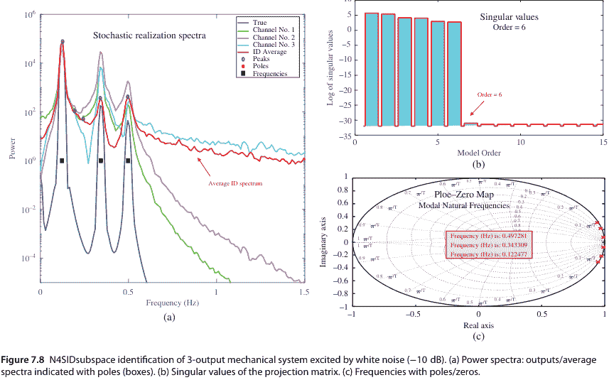

## 随机实现谱

## 奇异值

## 零极点图

模型固有频率

## 图7.10 3输出机械系统的N4SID子空间验证。(a) 通道残差零均值/白噪声检验。(b) WSSR检验。

结果较差，这由图7.9的信号误差检验所证实。图7.10b中的WSSR检验确认了残差序列为白噪声，验证了模型对数据的拟合，并证实了图中所示的“匹配”是可接受的辨识结果。

示例至此结束。

本节关于阶次估计和随机模型验证技术的内容到此结束。接下来，我们考虑一个案例研究，将这些方法应用于一个更复杂机械系统——振动结构的合成数据集。

## 7.8 案例研究：圆柱体的振动响应：辨识与跟踪

在本节中，我们研究由一个LTI、MIMO系统表示的振动圆柱结构的随机SID应用。该结构受到

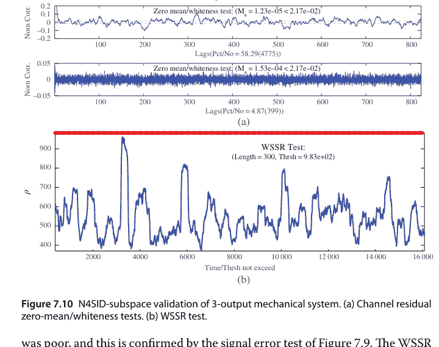


一个随机输入，具体来说是一个冲击装置。对该圆柱形物体在噪声环境（空气中的管道）中对由凸轮驱动的类似锤子的表面提供的冲击激励的振动响应的研究，该表面由电动机随机激励，引起兴趣，以便开发一种能够实现机载性能和监测的实时处理系统。我们将该系统建模为一根杆，并通过三轴加速度计测量其响应，以捕捉一组主导的共振（模态）频率。这些模态频率在运行期间监测底层系统是否存在任何异常时具有关键意义。该物体被选为研究对象，因为它在理论上是众所周知的，并且可以用代表大量简单结构（例如飞行器、导弹）以及其明确定义的模态响应。从 SID 角度来看，我们有一个 Nₓ 阶状态空间系统，其表征了通常的质量-阻尼器-弹簧（MCK）机械结构，可以表示为 MIMO、LTI 系统。在这里，我们关注主导模态以及相应的模态（共振）频率，表示捕捉感兴趣响应信号大部分的前六个（模态）。输入被默示假设为白随机噪声。

理论上，我们将管道建模为自由-自由构型的梁（非固定），从而得到基本模态频率的以下闭式公式，由表达式 [59] 给出

```
f₀ = 1/(2π) [22.373 / L²] √(E × I / ρ)
f₁ = 2.757 × f₀
f₂ = 5.404 × f₀
```

对于圆柱形物体（1.125 in. OD 铜管），我们有：E 为弹性模量（1.6 × 10⁷ N m⁻²），I 为面积惯性矩（0.0244 in.⁴），L 为长度（60 in.），ρ 为密度（1.41 × 10⁻⁴ lb s²）。因此，我们得到以下“理论”模态频率：

```
fᵢ = {51.7, 143.5, 281.3, 465.0, 694.7, 970.2, 1291.7, 1435.3, 2813.1 Hz}
```

我们将用其来比较我们的结果。

本案例研究的简单自由-自由（非固定）实验如图 7.11 所示，其中我们观察到 60 in./1.125 in. OD 铜管以及激励系统（凸轮驱动锤）、信号调理器（10 kHz 滤波器）、加速度计和数字化示波器。数据以 10 kHz 采样并抽取至 5 kHz，得到用于谱分析的 2.5 kHz 奈奎斯特频率。该系统旨在激励圆柱体并测量其响应，采集约 100 万个样本以进行缓冲窗口（分段）处理，合成实时采集系统。

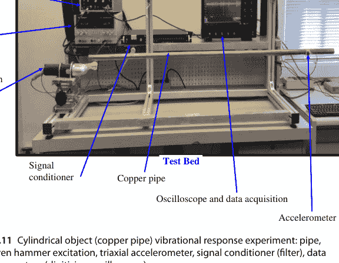

**Figure 7.11** Cylindrical object (copper pipe) vibrational response experiment: pipe, cam-driven hammer excitation, triaxial accelerometer, signal conditioner (filter), data acquisition system (digitizing oscilloscope).

单通道加速度计的基本方法是使用重复的锤击以高速率激励管道并测量其响应。

一旦噪声数据被数字化，就通过带通滤波预处理（8 阶巴特沃斯），带通范围为 40 至 1.25 kHz，然后使用 3 阶均衡（白化）滤波器以增强低频段模态频率。其频谱被估计，并相应地估计谱峰以提取模态频率。由于我们主要对实时应用感兴趣，我们研究了从简单的离散傅里叶变换（DFT）到需要对 Toeplitz 协方差矩阵进行 SVD 的复杂的 MUltiple SIgnal Classification（MUSIC）方法的各种谱估计器 [32]。一旦提取谱峰并定位相应的模态频率，它们要么作为输入提供给频率跟踪器以进行增强，要么简单地存储以用于最终的概率密度函数（PDF）估计，使用直方图或平滑核密度估计器进行监测和最终检测。该方法如图 7.12 所示。

在分析该数据并展示旨在最终实时系统的能力后，在相同条件下进行了 MIMO 实验，并将结果进行比较以验证单通道和多通道结果。进行了多通道系统的完整分析，展示了提取感兴趣的高模态频率的能力。典型的预处理响应数据如图 7.13 所示，其中（a）为采集的信号（XYZ 通道），（b）为相应的功率谱。在此我们观察到模态频率显示在主要谱峰处，捕捉到主导共振，验证了实验目标。再次，我们主要关注前六个（6）主导模态频率以表征圆柱体。

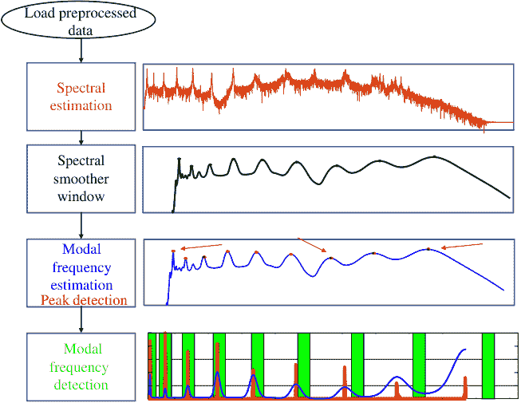

MIMO 随机子空间辨识算法（N4SID）应用于响应数据，结果汇总于图 7.14。在（a）中，我们看到估计的脉冲响应（平均值）及其对应的功率谱（b）。我们观察到（b）中的“平均”辨识功率谱以及从辨识模型系统矩阵（Â）中提取的模态（极点）频率（方块）。SVD 阶数测试显示在（c）。该测试并未显示出明确定义的阶数；然而，基于我们对圆柱体及其模态的先验知识，我们决定选择 28 阶（14 模态）表示为足够。从离散到连续变换（Z → S）得到的估计模态频率也在图中列出。我们注意到它们是相当合理的，并在表 7.9 中给出，并附带相对于理论频率的相对误差。最后，我们通过比较原始、预处理和辨识谱以及相应的（辨识）极点来验证实现，如图 7.15 所示。在此很明显

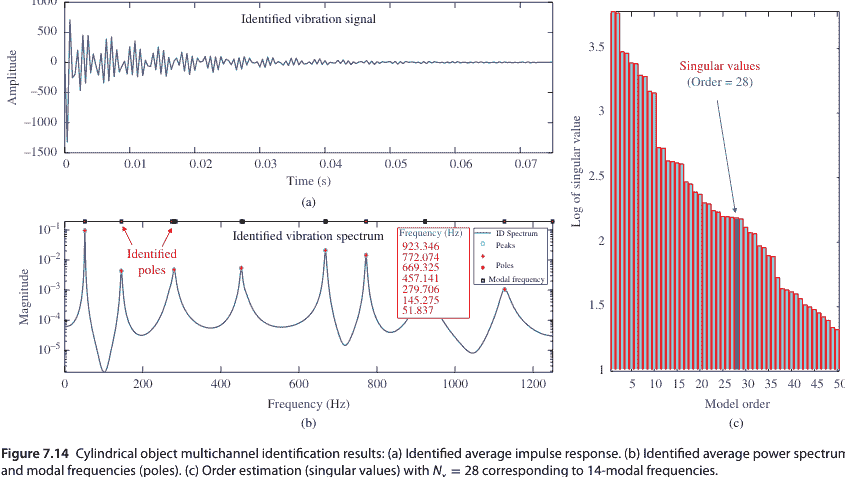

**Figure 7.14** Cylindrical object multichannel identification results: (a) Identified average impulse response. (b) Identified average power spectrum and modal frequencies (poles). (c) Order estimation (singular values) with $N_x = 28$ corresponding to 14-modal frequencies.

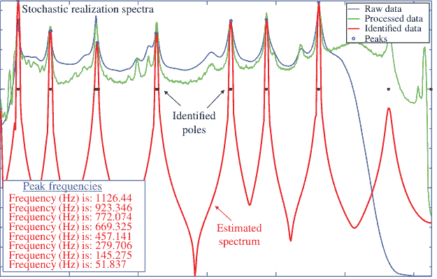

**Figure 7.15** Stochastic realization of cylindrical object (pipe) power spectral: raw, processed, and identified spectra with poles and modal frequencies.

关于平均模态频率的 99.9% 置信区间。显然，如（a）和表 7.9 所示，估计值是相当精确的。在图 7.17b 中，我们观察到相应的模态频率直方图，其中大多数辨识的频率 bin  heavily populated，表明子空间跟踪器估计的“理论”模态频率具有非常高的概率。

跟踪频率的后处理如图 7.18 所示，针对 14 模态跟踪。从图中可以明显看出，通过后处理（离线），模态频率跟踪从在线提供的结果得到改善，主要是因为“批量”统计数据的可用性。也就是说，*batch* 后处理器同时执行离群值校正和跟踪器平滑，其性能优于图 7.18 的在线跟踪，主要是因为现在有 25 个数据窗口的集合统计数据可用以改进估计，如图所示。图中浅色菱形是理论或被认为是极点的“真实”值——位于或接近这些位置的圆圈代表模态频率的极佳估计。深色菱形是批量中值估计，给出了模态频率的视觉精度估计。

接下来我们计算各种验证指标，以观察它们预测/验证该数据的合理实现的效果如何。结果显示在表 7.10 中。从表中，我们检查每个统计量的平均结果。在 25 次实现和随机 SID 的集合上，平均


## 表7.10 随机子空间辨识：六个（6）模态频率

| 通道编号 | 残差误差 | 平均模型误差 | 偏差模型误差 | MAD模型误差 | Z均值 | WSSR低于τ |
|---|---:|---:|---:|---:|---:|---|
| 1 | 1.3 × 10⁻¹¹ | 3.3 × 10⁻³ | 4.2 × 10⁻³ | 3.3 × 10⁻³ | 1.6 × 10⁻⁸ | 是 |
| 2 | 1.3 × 10⁻¹¹ | 3.3 × 10⁻³ | 4.1 × 10⁻³ | 3.3 × 10⁻³ | 4.5 × 10⁻⁹ | 是 |
| 3 | 1.3 × 10⁻¹¹ | 3.1 × 10⁻³ | 3.8 × 10⁻³ | 3.1 × 10⁻³ | 1.1 × 10⁻⁸ | 是 |
| 平均值 | 1.3 × 10⁻¹¹ | 3.2 × 10⁻³ | 4.0 × 10⁻³ | 3.2 × 10⁻³ | 1.2 × 10⁻⁸ | 是 |

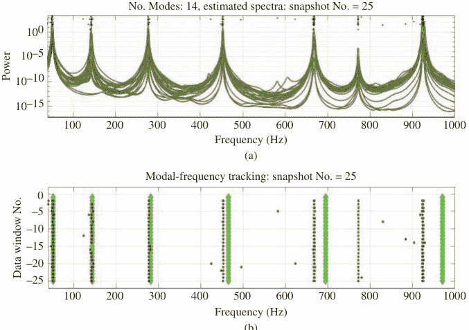

**图7.16** 圆柱体对象的子空间辨识，14模态模型：(a) 辨识模态模型和原始模态频率估计(+)的估计传递函数谱。(b) 模态频率跟踪（原始）结果（内嵌+的圆圈）和“真实”频带（粗条）。

残差误差为 1.3 × 10⁻¹¹，这符合预期，因为合成信号本质上是确定性的（100 dB SNR）。计算得到的*模型误差*对于相应的平均值、标准差和MAD统计量来说是合理的，数量级为 10⁻³，对应误差小于1%。我们还进行了零均值检验，结果相当好，同时WSSR检验也很好，并且再次

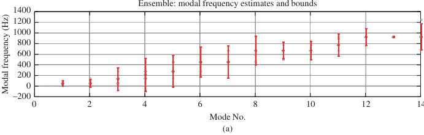

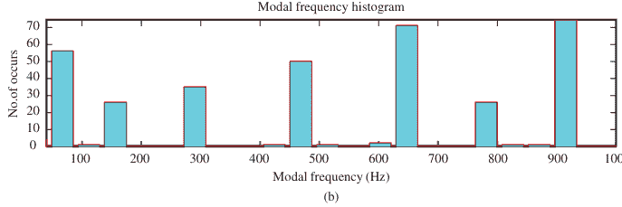

**图7.17** 模态频率跟踪（集成）统计的后处理：(a) 模态频率散点图，带有关于均值的99.9%置信限。(b) 模态频率直方图，显示辨识模态频率区间内的高概率。

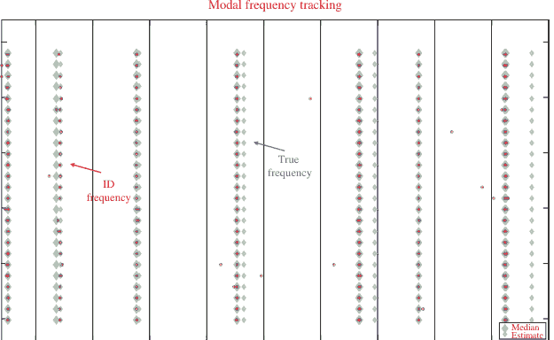

**图7.18** 圆柱体对象数据的后处理模态频率跟踪，对应辨识出的14模态模型：菱形代表理论（浅色）和中值（深色）值。

模型性能。这些技术包括残差分析的白噪声检验（resid），以及将辨识模型与数据进行比较（compare）或与参考信号进行比较（goodnessoffit），并使用预测误差分析（pe）。用于分析/比较拟合的验证命令有 fpe、aic、selstruc (MDL) 和 predict。参数估计及其不确定性（误差界）也可通过（present）命令获得。子空间算法还有其他实现，可从文献[25, 27]（磁盘）中获取。

# 参考文献

1 Faurre, P. (1976). 随机实现算法。载于：《系统辨识：进展与案例研究》（R. Mehra 和 D. Lainiotis 编），第1-23页。纽约：学术出版社。

2 Akaike, H. (1974). 最小实现的随机理论。IEEE自动控制汇刊 19: 667-674。

3 Akaike, H. (1975). 用典型变量对随机过程进行马尔可夫表示。SIAM控制杂志 13(1): 162-173。

4 Denham, M. (1974). 关于离散时间有理谱密度矩阵的因式分解。IEEE自动控制汇刊 AC-19: 535-537。

5 Tse, E. 和 Wiennert, H. (1975). 多变量随机线性系统的结构确定与参数辨识。IEEE自动控制汇刊 20: 603-613。

6 Candy, J., Bullock, T. 和 Warren, M. (1979). 随机实现的不变系统描述。Automatica 15: 493-495。

7 Larimore, W.E. (1990). 典型变量分析在辨识、滤波和自适应控制中的应用。载于：第29届决策与控制会议论文集，美国夏威夷，596-604页。

8 Aoki, M. (1990). 时间序列的状态空间建模，第2版。伦敦：施普林格出版社。

15 Popov, V. (1973). 控制系统的超稳定性。纽约：施普林格出版社。

16 Willems, J. (1971). 最小二乘平稳最优控制与代数Riccati方程。IEEE自动控制汇刊 AC-16: 621-634。

17 Viberg, M. (1995). 基于子空间的线性时不变系统辨识方法。Automatica 31(12): 1835-1851。

18 Soderstrom, T. 和 Stoica, P. (1989). 系统辨识。恩格尔伍德克利夫斯，新泽西州：普伦蒂斯·霍尔出版社。

19 Verhaegen, M. 和 Verdult, V. (2007). 滤波与系统辨识：最小二乘方法。剑桥：剑桥大学出版社。

20 Verhaegen, M. (1994). 由输入输出数据辨识以创新形式给出的MIMO状态空间模型的确定性部分。Automatica 30(1): 61-74。

21 Verhaegen, M. 和 Dewilde, P. (1992). 子空间模型辨识：第一部分：输出误差状态空间模型辨识算法类。Int. J. Control 56(5): 1187-1210。

22 Verhaegen, M. 和 Dewilde, P. (1992). 子空间模型辨识：第二部分：基本输出误差状态空间模型辨识算法分析。Int. J. Control 56(5): 1211-1241。

23 Verhaegen, M. 和 Dewilde, P. (1993). 子空间模型辨识：第三部分：普通输出误差状态空间模型辨识算法分析。Int. J. Control 58: 555-586。

24 Van Der Veen, A., Deprettere, E. 和 Swindlehurst, A. (1993). 基于子空间的线性时不变系统辨识方法。Proc. IEEE 81(9): 1277-1308。

25 Katayama, T. (2005). 系统辨识的子空间方法。伦敦：施普林格出版社。

26 Katayama, T. (2010). 通过LQ分解对确定-随机组合系统进行子空间辨识。载于：2010年美国控制会议论文集，第3卷，2941-2946页。

27 van Overschee, P. 和 De Moor, B. (1996). 线性系统的子空间辨识：理论、实现与应用。波士顿，马萨诸塞州：克鲁维尔学术出版社。

28 Gokberg, I. 和 Krein, M. (1960). 核依赖于自变量差值的半直线上的积分方程组。Uspekh. Mat. Nau. 13: 217-287。

29 Youla, D. 和 Tissi, P. (1966). 通过电抗提取的N端口综合。IEEE国际会议录 14: 183-205。

30 Glover, K. (1984). 线性多变量系统的所有最优Hankel范数逼近及其L∞误差界。Int. J. Control 39: 1115-1193。

31 Glover, K. 和 Willems, J.C. (1974). 线性动力系统的参数化：规范型与可辨识性。IEEE自动控制汇刊 19: 640-646。

32 Candy, J. (2006). *基于模型的信号处理*。霍博肯，新泽西州：约翰·威利/IEEE出版社。

33 Sage, A. 和 Melsa, J. (1971). *估计理论及其在通信与控制中的应用*。纽约：麦格劳-希尔出版社。

34 Sharaf, L. (1991). *统计信号处理：检测、估计与时间序列分析*。阅读，马萨诸塞州：艾迪生-韦斯利出版社。

35 van Overschee, P. 和 De Moor, B. (1994). N4SID：状态空间子空间系统辨识的数值算法。*Automatica* 30: 75-93。

36 van Overschee, P. 和 De Moor, B. (1995). 三种子空间系统辨识算法的统一定理。*Automatica* 31(12): 1853-1864。

37 Behrens, R. 和 Scharf, L. (1994). 斜投影算子在信号处理中的应用。*IEEE信号处理汇刊* 42(6): 1413-1424。

38 Kayalar, S. 和 Weinert, H. (1989). 斜投影：公式、算法与误差界。*数学控制、信号与系统* 2(1): 33-45。

39 Wax, M. 和 Kailath, T. (1985). 基于信息论准则的信号检测。*IEEE声学、语音与信号处理汇刊* 33(2): 387-392。

40 Ljung, L. (1999). *系统辨识：面向用户的理论*，第2版。恩格尔伍德克利夫斯，新泽西州：普伦蒂斯·霍尔出版社。

41 Ljung, L. 和 Soderstrom, T. (1983). *递推辨识的理论与实践*。剑桥：麻省理工学院出版社。

42 Soderstrom, T. 和 Stoica, P. (1989). *系统辨识*。纽约：学术出版社。

43 Norton, J. (1986). *辨识导论*。纽约：学术出版社。

44 Akaike, H. (1974). 统计模型辨识的新审视。*IEEE自动控制汇刊* 19(6): 716-723。

45 Sakamoto, Y., Ishiguro, M. 和 Kitagawa, G. (1986). *Akaike信息准则统计*。波士顿，马萨诸塞州：克鲁维尔学术出版社。

46 Rissanen, J. (1978). 用最短数据描述建模。*Automatica* 14: 465-471。

47 Golub, G. 和 van Loan, C. (1996). *矩阵计算*，第3版。巴尔的摩，马里兰州：约翰斯·霍普金斯大学出版社。

48 Bauer, D. (2001). 子空间方法的阶次估计。*Automatica* 37: 1561-11573。

49 Moore, B. (1981). 线性系统中的主成分分析：可控性、可观测性与模型降阶。*IEEE自动控制汇刊* AC-26(1): 17-32。

50 Gawronski, W. (2004). *高等结构动力学与结构主动控制*。纽约：施普林格出版社。

51 Juang, J. (1994). *应用系统辨识*。上鞍河，新泽西州：普伦蒂斯·霍尔PTR出版社。


52 Kay, S. (1988). *现代谱估计*. Englewood Cliffs, NJ: Prentice-Hall.

53 Hayes, M. (1996). *统计数字信号处理与建模*. New York: Wiley.

54 Haykin, S. (1993). *自适应滤波理论*. Englewood Cliffs, NJ: Prentice-Hall.

55 Jategaonkar, R., Raol, J., and Balakrishna, S. (1982). 动力系统模型阶次的确定. *IEEE系统、人与控制论汇刊* 12 (1): 56–62.

56 Pham Gia, T. and Hung, T. (2001). 平均绝对偏差和中位数绝对偏差. *数学与计算机建模* 34: 921–936.

57 Zoubir, A. and Iskander, D. (2004). *信号处理中的自助法技术*. Cambridge: Cambridge University Press.

58 Reynders, E. (2012). （运行）模态分析的系统辨识方法：综述与比较. *工程计算方法档案* 19 (1): 51–124.

59 Irvine, T. (1999). *牛顿-拉夫森方法在振动问题中的应用*. Vibrationdata Publications.

60 Swevers, J., Adams, M., and De Moor, B. (1987). 利用奇异值分解的线性系统时域直接辨识新方法. 见：*第12届模态分析国际研讨会论文集*, I2-3, 1–20.

61 deMoor, B., Vandewalle, J., Vandenberghe, L., and Miegehem, P. (1988). 利用奇异值分解辨识线性多变量系统状态空间模型的几何策略. 见：*IFAC会议录* 88, 700–704.

62 Mohanty, N. (1986). *随机信号、估计与辨识*. New York: Van Nostrand.

63 Candy, J. (2016). *贝叶斯信号处理：经典、现代与粒子滤波方法*, 第2版. Hoboken, NJ: Wiley/IEEE Press.

## 习题

### 7.1
从相关的Gauss–Markov模型出发，推导式(7.6)的状态协方差方程。

### 7.2
从非平稳测量协方差Λ_yy(t,s)开始：
a) 推导 t ≥ s 以及 t < s 情况下的表达式。
b) 假设潜在过程是“平稳的”，推导滞后ℓ对应的测量协方差Λ_yy(t+ℓ,s)。

### 7.3
对于由下式给出的“相关”Gauss–Markov模型

$$x(t)=Ax(t-1)+w(t-1)$$

$$y(t)=Cx(t)+v(t)$$

- a) 推导状态功率谱 $S_{xx}(z)$ 的表达式。
- b) 推导测量功率谱 $S_{yy}(z)$ 的表达式。

### 7.4
从式(7.27)的KSP方程出发推导Riccati方程，而不像之前那样直接求解$\mathcal{K}$项并回代。

*(提示：$(RR')^{-1}(RR')=I$.)*

### 7.5
假设给定KSP模型$\Sigma_{\mathrm{KSP}}$的一个实现，从表4.1的预测–校正卡尔曼滤波器出发，推导稳态关系并证明

- a) 误差协方差方程满足Riccati方程。
- b) 由这些关系推导卡尔曼滤波器对应的KSP方程。*(提示：使用新息模型。)*

### 7.6
推导包含“相关”噪声源（$E\{wv\}$）的卡尔曼滤波器表达式。*(提示：使用预测形式。)*

### 7.7
假设给定标量协方差序列：

$$\Lambda_{6,6}=\{6.5, 2.5, 0.833, 0.277, 0.0926, 0.0386\}$$

- a) 对该序列执行确定性实现。你识别出的模型$\Sigma_{ABCD}$是什么？
- b) 验证一个特定实现是$\Sigma_{ABCD}=\{1/3, 5/4, 2, 13/4\}$。
- c) 推导KSP方程并求$\hat{\Pi}$。
- d) 计算新息协方差和增益：$R_{ee}$和$K_p$。
- e) 既然$\Sigma_{\mathrm{INV}}$现成可用，验证这是一个可行的随机实现。*(提示：使用该模型计算输出协方差。)*

### 7.8
在一个简单的雷达系统中，天线发射一个大振幅、窄宽度的脉冲正弦波。脉冲以光速（$c=3\times10^8\ \mathrm{m\ s^{-1}}$）在空间中传播，直到击中被跟踪的目标。目标反射部分能量。雷达天线接收部分反射能量。通过定位发射脉冲前沿与接收脉冲前沿之间的时间差$\Delta t$，可以确定距雷达的距离或作用距离$r$；即

$$r=\frac{c\Delta t}{2}.$$

脉冲周期性地发射；即

```
$$r(t) = \frac{c\Delta(t)}{2}$$
```

假设目标以恒定的速度ρ运动，并受到随机扰动w ~ N(0,100 m s⁻¹)。因此，目标在t + 1时的距离为

```
$$r(t + 1) = r(t) + T\rho(t), \quad T = 1\ \text{m s}^{-1}$$
```

其中T是接收距离值之间的采样间隔。测量距离受到噪声污染

```
$$y(t) = r(t) + n(t)\quad\text{for}\quad n \sim N(0,10)$$
```

- a) 建立一个仿真该雷达系统的模型。
- b) 使用MBP设计一个距离估计器，假设初始目标距离为r(0) ≈ 20 ± 2 km。
- c) 使用经典实现方法（协方差矩阵）从该合成数据集中识别随机实现，以获得Σ_INV。
- d) 使用相同的合成数据集，应用子空间方法提取随机实现Σ_INV。
- e) 这些实现相比如何？

### 7.9
我们给定一个未知（黑箱）SISO系统仿真的确定性脉冲响应序列：

```
$$\mathcal{H}_t = \{0,\ 1,\ -1,\ 0,\ 1\};\quad t = 1,\dots,5$$
```

物理系统通过实验测量，输出为

```
$$\mathcal{Y}_t = \{0.141,\ 1.142,\ -0.933,\ -0.121,\ 1.072\}$$
```

已知测量不确定度σ = 0.1。

- a) 对脉冲响应数据ℋ_t进行确定性辨识。
- b) 对实验数据𝒴_t进行确定性辨识。
- c) 从每个辨识模型计算脉冲响应。这些响应相比如何？它们接近吗？
- d) 使用子空间方法从这些数据集中识别随机实现，以获得Σ_INV。
- e) 所有这些实现相比如何？*(提示：从每个辨识模型计算脉冲响应。)*

### 7.10
为阶数为Nₐ的自回归模型推导AIC，该模型由下式给出

y(t) + a₁y(t − 1) + ⋯ + a_{Nₐ}y(t − Nₐ) = e(t)

其中y是输出，e是K个样本数据集上的预测误差。

### 7.11
假设给定以下确定性系统，要求研究其性能：

x(t) = A x(t − 1) + B u(t − 1)
y(t) = C x(t) + D u(t)

其中

A = [ 0 1 ; −0.7 1.5 ];   B = [ 0.25 ; 0.625 ];   C = [0.5 0.5];   D = [1 0]

- a) 生成采样间隔Δt = 0.1秒的脉冲响应数据ℋᵢ，并进行确定性辨识。
- b) 添加σᵥ = 0.001的零均值随机高斯噪声，并令u(t)为单位伪随机噪声序列，以合成含噪实验数据𝒴ᵢ，并进行确定性辨识。
- c) 从每个辨识模型计算脉冲响应。它们与(a)中合成的集合相比如何？是否接近？
- d) 使用子空间方法从这些数据集中识别随机实现，以获得Σ_INV。
- e) 所有这些实现相比如何？*(提示：比较每个辨识模型的脉冲响应。)*

### 7.12
考虑文献[27]中的以下示例问题，其中

x(t) = A x(t − 1) + B u(t − 1)
y(t) = C x(t) + D u(t)

其中

A = [ 0.603 0.603 0 0 ; −0.603 0.603 0 0 ; 0 0 −0.603 −0.603 ; 0 0 0.603 −0.603 ];   B = [ 0.924 ; 2.758 ; 4.317 ; −2.644 ]

且

C = [−0.575 1.075 −0.523 0.183];   D = −0.714

- a) 生成采样间隔$\Delta t = 1$秒的脉冲响应数据 $\mathcal{H}_t$，并进行确定性辨识。
- b) 在合成响应数据中添加σ_v = 0.05的零均值随机高斯噪声，以产生含噪实验数据 $\mathcal{Y}_t$，并用$u(t)$作为单位伪随机噪声序列进行确定性辨识。
- c) 从每个辨识模型计算脉冲响应。它们与(a)中合成的集合相比如何？是否接近？
- d) 使用子空间方法从这些数据集中识别随机实现，以获得 $\Sigma_{INV}$。
- e) 所有这些实现相比如何？*(提示：比较每个辨识模型的脉冲响应。)*

### 7.13
考虑为一个受脉冲串激励的串联RLC电路（二阶系统）设计辨识器和估计器。利用基尔霍夫电压定律，由$i = C(de/dt)$可得电路方程：

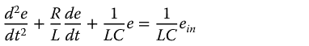

其中$e_{in}$是单位脉冲串。通过选择$x := [e\mid de/dt]'$和$u := e_{in}$，可以将动态方程写成状态空间形式：

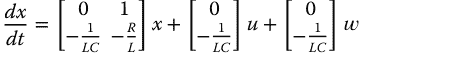

其中$w\sim N(0,R_{ww})$用于对元件不准确性进行建模。在电路中放置一个高阻抗电压表来测量电容电压$e$。我们假设它是一个数字（采样）设备，被方差为$R_{vv}$的噪声污染；即

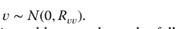

其中$v\sim N(0,R_{vv})$。

对于此问题，我们有以下参数：$R=5\,\mathrm{k}\Omega$，$L=2.5\,\mathrm{H}$，$C=0.1\,\mu\mathrm{F}$，$\Delta t=0.1\,\mathrm{ms}$。我们假设元件不准确性可以用$R_{ww}=0.01$建模，表征电路表示中±0.1 V的偏差不确定性。最后，我们假设电压表测量的精度为（e ± 0.2 V），即两个标准差的值，所以$R_{vv}=0.01\,(V)^2$。总结电路模型，我们得到连续时间表示

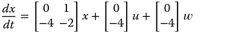

和离散时间测量

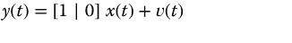


其中  
$R_{ww} = \frac{(0.1)^2}{\Delta t} = 0.1\ (V)^2 \quad \text{and} \quad R_{vv} = 0.01\ (V)^2$

我们首先将系统转换为采样数据（离散）表示，得到如下离散时间高斯-马尔可夫模型：

$x(t) = \begin{bmatrix} 0.98 & 0.09 \\ -0.36 & 0.801 \end{bmatrix} x(t-1) + \begin{bmatrix} -0.019 \\ -0.36 \end{bmatrix} u(t-1) + \begin{bmatrix} -0.019 \\ -0.36 \end{bmatrix} w(t-1)$  
$y(t) = [1 \ |\ 0] x(t) + v(t)$

其中  
$R_{ww} = 0.1 (V)^2 \quad \text{and} \quad R_{vv} = 0.01 (V)^2$

- a) 使用离散模型，对一个单位脉冲串仿真 RLC 电路，并生成测量输出电压 $y(t)$（测量模型）。
- b) 使用这些合成数据，通过子空间方法从这些数据中辨识一个“黑箱”状态空间模型。提取随机实现 $\Sigma_{INV}$。
- c) 使用伪随机序列作为确定性输入重复此辨识。比较这些辨识结果。
- d) 由“已知”离散状态空间模型设计卡尔曼滤波器，并将其应用于(a)中生成的数据。
- e) 由辨识得到的“黑箱”状态空间模型设计卡尔曼滤波器，并将其应用于(a)中生成的数据。
- f) 比较这些卡尔曼滤波器设计。它们的性能是否等效？它们的设计准则（零均值、白噪声）如何比较？

## 7.14 考虑设计一个用于存放硝酸钚[32]的储罐处理器。我们希望设计一个卡尔曼滤波器，能够随时预测罐中钚的量（质量），以便在每天结束时估计总质量。

罐中溶液液位在任何时刻的变化归因于水和硝酸的蒸发动力学以及辐射分解效应。将溶液质量 $m(t)$ 与钚浓度 $P(t)$ 联系起来的过程模型为：
$\frac{d}{dt} m(t) = -K_H - K_r m(t) P(t)$

其中 $m$ 是溶液质量（kg），$K_H$ 是水和酸溶液的蒸发速率（kg d$^{-1}$），$K_r$ 是辐射分解常数（kg（水）/天每 kg（Pu）），$P$ 是钚浓度 kg（Pu）/kg（溶液）。

由于辐射分解效应导致钚浓度变化非常缓慢，我们假设其为常数，$P(t) = P \quad \forall t.$

以及模型参数的精度。测量值可以根据测量仪器的制造商规格来估计，给出如下参数：$K_r = -8.1 \times 10^{-5} \text{ kg Da}^{-1}$，$K_H = 0.5 \text{ kg Da}^{-1}$，$H = 2.5 \text{ m}$，$a = 0.021 \text{ m}^3$，$b = 0.328 \text{ m}^2$，$g = 9.8 \text{ m s}^{-2}$，$P = 0.173$，$m_p = 1448 \text{ kg m}^{-3}$，$m_m = 983 \text{ kg}$。测量中的不确定性根据典型规格进行近似。利用这些模型参数值，我们估计标称 $\Delta P_A$ 和 $\Delta P_B$ 分别为 $3.6 \times 10^4$ 和 $3.0 \times 10^4 \text{ N m}^{-2}$。由这组模型参数，过程模型和测量模型如下：

$\frac{d}{dt}x(t) = \begin{bmatrix} -1.43 \times 10^{-5} & 0 \\ 0 & 0 \end{bmatrix} x(t) + \begin{bmatrix} 1 \\ 0 \end{bmatrix} u(t) + w(t)$

测量模型为

$y(t) = \begin{bmatrix} 29.8 & -0.623 \\ 0 & 24.9 \end{bmatrix} x(t) + v(t)$

对于我们的仪表，测量协方差矩阵为

$R_{vv} = \text{diag} \left[ 5.06 \times 10^4 \; 1.4 \times 10^5 \right] \quad (\text{N}^2 \text{ m}^{-4})$

我们使用矩阵指数级数近似离散时间矩阵来实现离散系统，得到采样间隔为 0.1 天的离散模型如下：

$x(t) = \begin{bmatrix} 0.999 & 0 \\ 0 & 1 \end{bmatrix} x(t-1) + \begin{bmatrix} 1 \\ 0 \end{bmatrix} u(t-1) + w(t-1)$  
$y(t) = \begin{bmatrix} 29.8 & -0.623 \\ 0 & 24.9 \end{bmatrix} x(t) + v(t)$  
$R_{ww} = \text{diag} \left[ 10 \; 10 \right]$，  
$R_{vv} = \text{diag} \left[ 5.06 \times 10^4 \; 1.4 \times 10^5 \right]$，初始条件为 $\hat{x}(0|0) = \begin{bmatrix} 988 & 1455 \end{bmatrix}'$，$\tilde{P}(0|0) = \text{diag} \left[ 0.01 \; 0.01 \right]$。

- a) 使用离散模型，仿真储罐在 25 天内的运行情况，并生成测量输出。
- b) 使用这些合成数据，通过子空间方法从这些数据中辨识一个“黑箱”状态空间模型。提取随机实现 $\Sigma_{INV}$。
- c) 使用伪随机序列作为确定性输入重复此辨识。比较这些辨识结果。
- d) 由“已知”离散状态空间模型设计卡尔曼滤波器，并将其应用于(a)中生成的数据。
- e) 由辨识得到的“黑箱”状态空间模型设计卡尔曼滤波器，并将其应用于(a)中生成的数据。
- f) 比较这些卡尔曼滤波器设计。它们的性能是否等效？它们的设计准则（零均值、白噪声）如何比较？
