## 8

### 面向物理应用的子空间处理器

### 8.1 结构设备的子空间辨识

在噪声环境中运行的机械系统会导致低信噪比（SNR），这给实时监测结构设备带来了具有挑战性的信号处理问题。要从噪声振动数据中检测/分类特定类型的设备，有必要识别使其独特的特征。发射的共振（模态）频率提供了表征其运行的特征。对结构模态进行监测以确定被研究设备的状况至关重要，尤其是当它是运行系统的关键实体时。本文讨论了一种基于模型的方案，该方案能够通过应用系统辨识方法提取模态模型，并应用状态估计方法跟踪其演化，从而实现结构模态频率的在线跟踪。文章讨论了该方法在未知结构设备上的应用，说明了该方法并评估了其性能。

一种方法是认识到，在估计的功率谱中出现的独特模态频率（例如正弦谱线）完全是被研究设备的特征[1]。因此，本研究基于构建设备的“黑箱”模型，该模型捕获这些物理特征，可用于从噪声振动数据中“诊断”特定设备子系统是否正常运行。如果存在噪声，异常度量会显著恶化——这是运行环境中的常见情况。结构中的多个传感器（如用于振动的加速度计、用于声学的麦克风、用于应力的应变片和用于温度的热电偶）为系统的状态和性能提供了额外信息[2]。这意味着需要采用多通道（多输入、多输出）系统表示，这种表示在状态空间形式中最容易处理，且不受单通道谱表示的限制。

在这里，结构未知设备的振动特征被（直接或远程）测量，并作为带噪输入提供给模态子空间辨识器，该辨识器用于跟踪模态频率，进而判断设备是否正常振动。如果是，它将为设备分类器提供输入，以决定特定类别或子系统异常。在此应用中，我们将讨论限于模态频率辨识和跟踪问题（检测细节见文献[3]）。

### 8.1.1 状态空间振动系统

大多数结构振动系统是多输入/多输出（MIMO）系统，易于在状态空间框架内描述。例如，线性时不变机械系统可以表示为如下二阶向量-矩阵微分方程：

```
M d̈(τ) + C_d ḋ(τ) + K d(τ) = B_p p(τ)  (8.1)
```

其中 d 是 N_d × 1 位移向量，p 是 N_p × 1 激振力，M、C_d、K 分别是表征振动过程模型的 N_d × N_d 集中质量矩阵、阻尼矩阵和弹簧常数矩阵。

定义由位移及其导数组成的 2N_d 维状态向量为 x(τ) := [d(τ) | ḋ(τ)]，则该过程的连续时间状态空间表示可表示为

```
ẋ(τ) = [ 0 | I ; --- | --- ; -M⁻¹K | -M⁻¹C_d ]_{A_c} x(τ) + [ 0 ; M⁻¹B_p ]_{B_c} p(t)
```

相应的测量或输出向量关系可表示为

```
y(τ) = C_c x(τ) + D_c u(τ)  (8.2)
```

其中输出或测量向量为 y ∈ R^{N_y×1}，从而构成完整的 MIMO 振动模型。

机械系统最具说明性的表示之一是其模态表示，其中模态和振型揭示了内部结构及其对各种激励的响应[4–8]。这种表征可以很容易地从状态空间系统中获得，方法是通过相似变换形式的特征分解将坐标转换到模态状态空间。这里，系统矩阵 Σ := {A, B, C, D} 通过由底层系统特征向量构成的变换矩阵 T_M 转换到模态坐标，从而产生一个从输入/输出角度“等效”的系统。


perspective; that is, the transfer functions and impulse responses are identical [6–8]。

对于结构动力学中很常见的复模态情况，特征值是复数，但仍然是不同的 [4–8]。系统矩阵可通过特征分解进行分解，这现在会产生复特征对以及相应的复特征向量来指定模态相似变换矩阵 $T_M$。将此变换应用于系统矩阵 $A_c$，可得到复特征系统的模态状态转移矩阵为

$$\Phi_M(\tau,\tau_0)=e^{\Lambda(\tau-\tau_0)}=\exp\left\{\begin{bmatrix}\Lambda_1&&0\\&\ddots&\\0&&\Lambda_{N_d}\end{bmatrix}(\tau-\tau_0)\right\}$$

对于
$$\Lambda_i=\begin{bmatrix}\sigma_i&\omega_i\\-\omega_i&\sigma_i\end{bmatrix}$$

因此，连续时间、复模态状态空间系统由下式给出

$$\dot{x}(\tau)=A_Mx(\tau)+B_Mu(\tau)$$
$$y(\tau)=C_Mx(\tau)+D_Mu(\tau)$$

其中 $A_M\in\mathbb{R}^{N_x\times N_x}$，$B_M\in\mathbb{R}^{N_x\times N_u}$，$C_M\in\mathbb{R}^{N_y\times N_x}$，$D_M\in\mathbb{R}^{N_y\times N_u}$ 且 $N_x=2\times N_d$。

对该系统采样可得到可离散时间状态空间表示，可将其转换回连续时间域以用于我们的应用。

广义线性时不变 *state-space* 模型由其系统矩阵 $A$、输入传输矩阵 $B$、输出或测量矩阵 $C$，以及 *discrete-time* 系统的直接输入前馈矩阵 $D$ 定义为

$$x(t+1)=Ax(t)+Bu(t)\qquad\text{(State)}$$
$$y(t)=Cx(t)+Du(t)\qquad\text{(Output)}$$

对于状态 $x\in\mathbb{R}^{N_x\times1}$，输入 $u\in\mathbb{R}^{N_u\times1}$，以及输出 $y\in\mathbb{R}^{N_y\times1}$。

对应于此表示的是 *impulse response*，称为马尔可夫参数 [4–8]。

$$H_t=CA^{t-1}B+D\delta(t)$$

其中 $\delta$ 为克罗内克 delta 函数。

如同第 3 章所述，展开状态方程，我们有

$$x(t)=A^tx(0)+\sum_{k=0}^{t-1}A^{t-k-1}Bu(k-1);\qquad t=0,1,\ldots,K$$

输出由下式给出

y(t) = CA^t x(0) + Σ_{k=0}^{t-1} CA^{t-k-1} B u(k-1) + D δ(t)  (8.8)

进一步展开此关系并整理项，可得到

[ y(0) ; y(1) ; ⋮ ; y(K-1) ] = [ C ; CA ; ⋮ ; CA^{t-K-1} ]_{𝒪} x(0) + [ D ⋯ 0 ; CB D ⋯ 0 ; ⋮ ⋮ ⋱ ⋮ ; CA^{K-1}B ⋯ CB D ]_{𝒯} [ u(0) ; u(1) ; ⋮ ; u(K-1) ]  (8.9)

其中 𝒪 是第 3.4 节线性系统理论的可观测矩阵 [6–8]。

对这些关系在时间上进行平移可得到向量输入/输出关系：

y_K(ℓ) = 𝒪_K x(ℓ) + 𝒯_K u_K(ℓ)  (8.10)

将式 (8.10) 的这些 m-向量组合以在 K 个采样上创建批数据（块汉克尔）矩阵，我们得到输入/状态/输出块矩阵为

𝒴_{ℓ,m:K} := [ y_m(ℓ) ⋯ y_m(ℓ + K - 1) ]  (8.11)

𝒰_{ℓ,m:K} := [ u_m(ℓ) ⋯ u_m(ℓ + K - 1) ]  (8.12)

𝒳_{ℓ,m:K} := [ x_m(ℓ) ⋯ x_m(ℓ + K - 1) ] = [ x(ℓ) A x(ℓ) ⋯ A^{K-1} x(ℓ) ]  (8.13)

因此，我们有将系统模型与数据（输入和输出矩阵）联系起来的数据方程：

𝒴_{ℓ,m:K} = 𝒪_K 𝒳_{ℓ,m:K} + 𝒯_K 𝒰_{ℓ,m:K}  (8.14)

该表达式代表了线性时不变 (LTI) 状态空间系统输入–状态–输出的基本关系。

## 8.1.1.1 状态空间实现

在本小节中，我们简要回顾基于第 6.2 节讨论的底层汉克尔阵列的系统理论性质的确定性状态空间实现方法。该套技术群的核心建立在根据 LTI 系统的脉冲响应定义的汉克尔矩阵上，其由下式给出

H_t = { C A^{t-1} B for t > 0 ; D for t = 0 }  (8.15)

从而得到 (N_x × 2N_x − 1)-汉克尔矩阵。

因此，*实现问题* 是 给定 一组 MIMO 传递函数矩阵 $\{H_{ij}(z)\}$ 或脉冲响应矩阵 $\{H_k(t)\}$，具有相应的马尔可夫参数，$H_k = CA^tB + D\delta(t);\ t = 0,1,\ldots,K-1$，求 底层状态空间系统，$\Sigma := \{A,B,C,D\}$。

## 8.1.2 确定性状态空间实现

对 *确定性实现问题* 的一种解法是通过对汉克尔矩阵 $\mathcal{H}_{m,K}$ 进行 SVD，其中 $m \geq N_x$ 且 $K \geq N_x$，$N_x$ 为最小实现（系统）的维数，或等价地为底层 *真实* 状态数；因此，

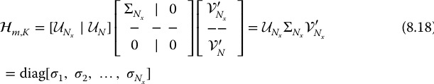

从汉克尔矩阵的分解及其 SVD，我们有

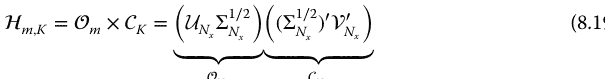

其中 $\Sigma_{N_x}$ 是通过乔列斯基分解得到的矩阵平方根 [9]。

从可观测性（或能控性）矩阵的平移性质（以上）出发，我们可以得到系统矩阵为 [10–15]

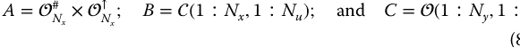

其中 $N_x$ 为状态数，$N_u$ 为输入向量 $u$ 的维数，$N_y$ 为输出或测量向量 $y$ 的维数，记号 $1:N\rightarrow1,2,\ldots,N$，或等价地 *选择* 矩阵的对应行（列）1 到 N。

这完成了开发后续技术所需的基本背景信息。

### 8.1.2.1 子空间方法

基本子空间辨识方法是根据输入/输出数据从状态空间表示中提取，扩展了从脉冲响应数据实现的——仍假设 *确定性*。输入/输出数据可以以与之前讨论的脉冲响应数据类似的方式处理。在这种情况下，我们必须回到数据矩阵。

我们给定对应于 LTI 系统的输入/输出数据，具有向量输入 u ∈ R^{N_u×1} 和向量输出 y ∈ R^{N_y×1} 以及离散时间采样，t = 0, 1, …, K。

假设我们有 k 个数据样本使得 k > N_x，则相应的块汉克尔矩阵可以直接从式 (8.10) 用平移 k 创建以给出向量输入/输出（状态）关系。

y_k(t) = O_k x(t) + T_k u(t) (8.21)

以及相应的矩阵输入/输出（状态）方程为

Y_{k|2k-1} = O_k X_k + T_k U_{k|2k-1} (8.22)

其中矩阵定义在式 (8.10) 中。

初始状态由下式给出

Y_{0|k-1} = O_k X_0 + T_k U_{0|k-1} (8.23)

这里 U_{0|k-1}, Y_{0|k-1} 是过去的输入和输出，而 U_{k|2k-1}, Y_{k|2k-1} 是未来的输入和输出，它们都是块汉克尔矩阵 [10–15]。

增广的输入/输出数据矩阵 D 及其对应的 LQ 分解构造为

D_{0|k-1} = [U_{0|k-1}; Y_{0|k-1}] = [I | 0; - | -; T_k | O_k] [U_{0|k-1}; X_0] = [L11 | 0; - | -; L21 | L22] [Q1'; Q2'] (8.24)

这些表达式使得 Y_{0|k-1} 的正交分解成为可能；因此，由式 (8.24) 可知（详见第 6.4 节）

Y_{0|k-1} Q2 = O_k × X_0 × Q2 = L22 (8.25)

因此，对 L22 进行 SVD，即

L22 = [U1 | U2] [Σ1 | 0; - | -; 0 | 0] [V1'; --; V2'] (8.26)

得到

O_k X0 Q2 = U1 × Σ1 × V1' = (U1 Σ1^{1/2}) × (Σ1^{1/2} V1') with O_k underbrace and C_k underbrace (8.27)

并且如同之前一样，系统矩阵 A, B, C, D 可通过以下方式提取：

A = O_{N_s}^# × O_{N_s}^† ;   C = O(1 : N_y, 1 : N_x) (8.28)

输入传输和直接前馈矩阵 B 和 D 可通过求解以下关系的超定线性方程组（最小二乘）得到：

```
ℒ × [ Ď 
 -- 
 B̂ ] = U₂' L₂₁ L₁₁⁻¹  (8.29)
```

其中 ℒ 是块系数矩阵（详见第 6.4 节）。

因此，我们有如下给出的多变量输出误差状态空间 (MOESP) 算法：

- 计算式 (8.24) 中 D 的 LQ 分解。
- 对式 (8.26) 中的 L₂₂ 进行 SVD 以提取 𝒪ₖ。
- 由式 (8.28) 得到 A 和 C。
- 求解最小二乘问题以从式 (8.29) 得到 B 和 D。

## 8.1.3 振动系统处理

模态频率估计/跟踪的整体方法基于开发可用于尽可能快速地解决该问题的鲁棒子空间辨识技术，以实现潜在的实时应用。主要思想是对数字化数据的一个段或窗口进行预处理并执行系统（振动）辨识，然后从辨识模型中提取底层模态，产生相应模态频率的原始估计。一旦在每个窗口中提取出“原始”模态频率，就应用顺序跟踪算法（卡尔曼滤波器）来“平滑”估计，最终输入到用于性能监控的异常检测算法中。

对所研究系统的典型处理包括以下步骤以：

- 预处理（异常值、 whitening、带通滤波、归一化）数据，相对于目标振动系统信息。
- 从数据集中辨识（子空间）底层振动模型，状态空间形式 Σ = {A, B, C, D}。
- 将辨识模型变换为模态状态空间表示 Σ_M = {A_M, B_M, C_M, D_M}。
- 从模态状态空间模型中提取模态频率和模态振型。
- 跟踪（卡尔曼滤波）原始频率的顺序实时。
- 后处理（异常值/跟踪器）在线跟踪数据。
- 估计模态频率统计以评估性能。


模态频率估计器/跟踪器基于以下高斯-马尔可夫表示，该表示直接源自瞬时频率变化的有限差分表示：

\[
\dot{f}(t) \approx \frac{f(t_{k+1}) - f(t_k)}{\Delta t_k}
\]

重写该表达式得到

\[
f(t_{k+1}) = f(t_k) + \Delta t_k \dot{f}(t_k) \tag{8.30}
\]

假设频率变化在采样间隔内保持恒定（\(\dot{f}(t_{k+1}) \approx \dot{f}(t_k)\)）并且模型不确定性由高斯过程噪声表征，则得到以下离散时间高斯-马尔可夫随机方程组：

\[
\begin{aligned}
f(t_{k+1}) &= f(t_k) + \Delta t_k \dot{f}(t_k) + w_1(t_k) \quad \text{(Frequency)} \\
\dot{f}(t_{k+1}) &= \dot{f}(t_k) + w_2(t_k) \quad \text{(Rate)} \tag{8.31}
\end{aligned}
\]

其中 \(w\) 为零均值高斯，\(w \sim N(0, R_{ww})\)。相应的测量值也受到仪器噪声的污染，该噪声由零均值高斯不确定性表示为

\[
y(t_k) = f(t_k) + v(t_k) \quad \text{(Measurement)}
\]

使得 \(v \sim N(0, R_{vv})\)。过程系统和测量系统的组合可以通过定义状态向量 \(x(t) := [f(t) \mid \dot{f}(t)]'\) 置于离散时间（\(t_k \to t\)）状态空间框架中。

在此频率模型建立后，我们知道状态估计或频率跟踪问题的最优解由第 4.1 节中开发的卡尔曼滤波器提供。我们限制处理器达到稳态；即，卡尔曼增益为常数，可直接从离散 Riccati 方程解中获得，从而给出频率跟踪关系 [9, 16]。

\[
\begin{aligned}
\hat{f}(t+1) &= \hat{f}(t) + K_1 e(t+1) \\
\hat{\dot{f}}(t+1) &= \hat{\dot{f}}(t) + K_2 e(t+1) \\
\hat{y}(t+1) &= \hat{f}(t+1) \tag{8.32}
\end{aligned}
\]

其中 \(K\) 现在是预先计算的常数。经过大量运行后发现，这种方法导致非常稳健的跟踪解，这对于在线操作是理想的。

完成所有操作后，子空间方法本质上已从一组嘈杂的 MIMO 数据演变为在每个数据窗口中识别状态空间模型并提取其模态频率和形状。每个模态模型都可用于归档（如有需要），并且由此产生的模态频率集合可用于后处理。数据由每个 \(N_f\) 个频率的已识别模态频率和形状集合组成，可用于后处理，包括 *outlier* 检测/校正和进一步的 *smoothing* 使用频率跟踪器（如上所述）。

至此，子空间方法的讨论完成，接下来我们将其应用于我们的“未知”设备并评估其性能。

## 8.1.4 应用：振动结构装置

在本节中，我们讨论将子空间方法应用于结构“未知”装置，即一种复杂的、静止的结构（黑箱），无旋转部件，受随机激励作用，加速度传感器放置在其表面及周围。我们确实有一些关于其模态响应的先验信息，来自历史表格，并使用这些信息作为目标模态（频率和形状）来评估这些结果的有效性和性能，以及指导所采集数据的任何预处理。

被测设备通过将撞针或电机驱动杆垂直放置于结构底部而受到随机激励。共 19 个三轴加速度计被策略性地放置在设备表面周围，以及一个传感器用于测量激励时间序列。总共，57 个加速度计通道采集了一组 10 分钟持续时间的数据，采样频率为 6.4 kHz。随后数据被降采样至 0.9 kHz，以便聚焦于目标模态频率（<400 Hz）。从状态空间角度来看，我们有一个目标系统，最多为 14 个模态或 28 个状态，57 个通道的时间序列测量和 1 个激励测量通道。

原始数据（降采样后）代表从实时采集系统获取的预期数据窗口。对窗口化时间序列进行预处理，包括异常值检测/校正、 whitening 滤波器（可选）、带通滤波和归一化，然后再进行系统辨识。预处理后，输入-输出数据被提供给子空间算法，该算法能够识别离散时间状态空间模型，\(\Sigma = \{A, B, C, D\}\)，然后将其变换为模态状态空间，\(\Sigma_M = \{A_M, B_M, C_M, D_M\}\)，提供模态频率和模态振型信息，即模态特征值和特征向量。从这些原始模态频率估计中检测/校正异常值，并将其作为输入提供给频率跟踪器（稳态卡尔曼滤波器 [9]），从而实现实时的“平滑”序列估计。数据集合处理完毕并提取模态频率和模态振型后，数据随后进行后处理，以通过应用“批量”跟踪器（卡尔曼滤波器）并利用改进的集合统计量进一步提高估计，因为整个数据跟踪现在都可用。这些结果随后被分析和提供用于最终的异常检测（见图 8.1）。

**图 8.1.** 结构装置实验设置：电机驱动撞针随机振动，MIMO ADC 测量，子空间辨识：辨识器、跟踪器、检测器系统。

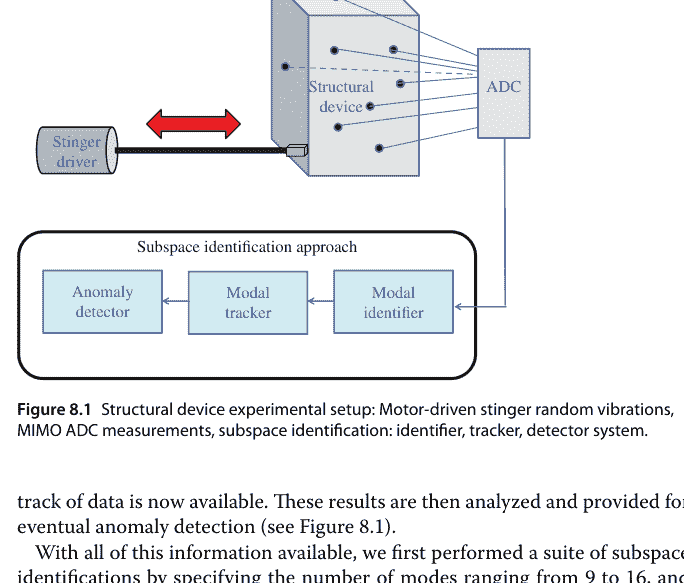

有了所有这些信息，我们首先通过指定模态数量从 9 到 16，以及 20、25，进行了一系列子空间辨识，我们的目标数量为历史表格中的 13/14 个模态频率。对于这些模态的每个数量，我们生成了相应的频率跟踪，每个模态频率一个，如图 8.2 所示，为 13 模态（26 状态）辨识。这里我们观察到每个数据窗口所识别模型的估计功率谱（a）以及识别的模态频率（+），以说明任何聚类。在图 8.2b 中，我们看到每个识别模态频率的在线异常值校正跟踪。因此，每个跟踪都产生了一组频率估计，可用于后处理统计分析。识别模态频率的集合平均值的比较如表 8.1 所示。当选择的模态数量小于或等于 14 时，跟踪相对稳定，但仅有 10-11 个目标频率本质上被子空间辨识器捕获（在合理范围内）。将阶数增加到大于 14 时，能够识别出另一个目标模态（11 → 12），但产生了过多的“多余”模态，其频率跟踪波动很大。表很清楚地表明，阶数小于 12 不足以合理估计 10 个或更多模态，而 12 及以上的阶数可以捕获至少 10 个模态。

**表 8.1.** 模态辨识集合统计：模态频率估计（相对误差（ε））。

| Frequency (Hz) | 12 ± σ(%ε) | 13 ± σ(%ε) | 14 ± σ(%ε) | 15 ± σ(%ε) | 16 ± σ(%ε) |
|---|---|---|---|---|---|
| 190 | 189 ± 0.2 (0.5) | 189 ± 0.2 (0.5) | 189 ± 0.1 (0.5) | 188 ± 0.2 (1.1) | 188 ± 0.1 (1.1) |
| 208 | 207 ± 0.4 (0.5) | 206 ± 0.5 (1.0) | 205 ± 0.4 (1.4) | 204 ± 0.5 (1.9) | 203 ± 0.4 (2.4) |
| 219 | 229 ± 2.3 (4.6) | 223 ± 0.7 (0.5) | 221 ± 1.2 (0.9) | 216 ± 0.8 (1.4) | 213 ± 0.5 (2.7) |
| 242 | 238 ± 0.8 (1.7) | 236 ± 0.8 (2.1) | 241 ± 1.7 (0.4) | 247 ± 1.0 (2.1) | 243 ± 0.7 (0.4) |
| 260 | 260 ± 2.1 (0.0) | 256 ± 0.8 (0.4) | 258 ± 3.5 (0.8) | 254 ± 0.9 (2.3) | 259 ± 1.1 (0.4) |
| 276 | — | 276 ± 2.6 (0.0) | — | 268 ± 3.1 (2.9) | 276 ± 2.1 (0.0) |
| 279 | 281 ± 6.3 (0.7) | — | 279 ± 5.1 (0.0) | 284 ± 3.8 (1.8) | — |
| 344 | 347 ± 0.7 (0.9) | 344 ± 10.8 (0.0) | 346 ± 7.6 (0.6) | 348 ± 1.7 (1.2) | 349 ± 1.4 (1.5) |
| 351 | 353 ± 0.6 (0.6) | 350 ± 0.6 (0.3) | 352 ± 0.6 (0.6) | 353 ± 0.6 (0.6) | 354 ± 0.8 (0.3) |
| 359 | — | 354 ± 1.4 (1.4) | 359 ± 1.9 (0.0) | 359 ± 1.9 (0.0) | 359 ± 1.1 (0.0) |
| 362 | — | — | — | — | 362 ± 0.9 (0.0) |
| 364 | 371 ± 0.3 (0.0) | 372 ± 0.2 (2.4) | 372 ± 0.4 (2.2) | 373 ± 0.1 (2.5) | 373 ± 0.1 (2.5) |
| 377 | 376 ± 0.3 (0.3) | 375 ± 0.3 (0.5) | 377 ± 9.2 (0.0) | 376 ± 0.3 (0.3) | 378 ± 0.4 (0.3) |
| 383 | — | — | — | — | — |
| Average σ(%ε) | ±1.4 (0.98%) | ±1.8 (0.83%) | ±3.00 (0.67%) | ±1.24 (1.55%) | ±0.8 (0.97%) |

3.6–7.1 s/identification，这基于辨识算法所需的样本数量（ID 时间 × 采样间隔）。对于 900 Hz 采样频率和系统的振动监测而言，这一时间是相当合理的。请注意，阶数越高，子空间辨识所需的样本数量就越多。

对跟踪频率的后处理如图 8.3 所示，为 13 模态比较，以及图 8.4 所示，为 12–14 模态跟踪。很明显，从图中可以看出，通过后处理（离线），模态频率跟踪从在线提供的结果得到改善，主要是因为“批量”统计数据的可用性。即，执行异常值校正和跟踪平滑的批量后处理器优于在线跟踪，主要是因为现在有 83 个数据窗口的集合统计数据可用于改进估计。

13 模态辨识的集合统计如图 8.3 所示，其中我们看到散点图以及关于平均模态频率的相应 99.9% 置信区间。显然，如图 8.3a 和表 8.1 所示，估计是相当精确的。在


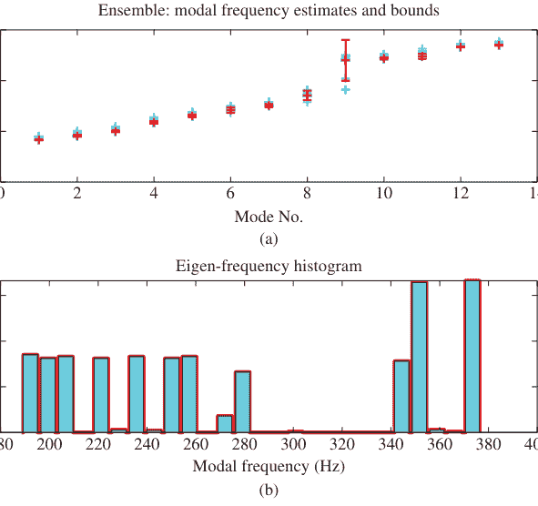

**图 8.3** 后处理模态频率跟踪集合统计：(a) 带有关于均值的 99.9% 置信限的模态频率散点图。(b) 模态频率直方图，表明已识别模态频率区间内的概率很高。

在图 8.3b 中，我们观察到相应的模态频率直方图，大部分已识别的频率区间分布密集，表明子空间跟踪器估计的模态频率具有非常高的概率。

## 8.1.5 小结

本研究阐述了基于模型的模态跟踪方案的发展，该方案能够在线处理结构振动响应。通过同时应用系统辨识方法提取模态模型和状态估计技术跟踪模态频率，随后还开发了一种序贯异常检测器，并成功应用于含噪声的异常数据（详见参考文献 [3]）。

## 8.2 用于闪烁体系统表征的 MBID

图 8.4 (a) 12 阶模态、(b) 13 阶模态、(c) 14 阶模态辨识状态空间模型结果的后处理模态频率跟踪。

闪烁体/光电倍增管系统广泛用于许多测量各种核事件的仪器中。当核事件产生的 γ 能量照射闪烁体时，事件辐射与闪烁体材料相互作用产生光子，这些光子被光电倍增管 (PMT) 检测到

吸收单个光电子，从而将原始光电子逐级放大，典型增益系数为 $10^7$ [18]。这些电子随后在 PMT 阳极被收集，产生输出电压脉冲。正是这个脉冲最受关注，因为它与来自未知源的原始入射光子能量成正比。

PMT 输出电压脉冲的形状由闪烁体晶体在初始激发后时间 $t$ 处的瞬发荧光强度决定，其指数衰减时间为 $\tau_s$，因此强度（简单地）由下式给出

$$i(t)=i_0 e^{-t/\tau_s}$$  (8.33)

这通常是几纳秒。输出脉冲的完整描述还必须考虑阳极处的上升时间，该上升时间通常比其下降时间 $\tau_a$ 大约 3–4 倍（更快）。然后，闪烁体系统的整体电压输出脉冲由下式给出 [17]

$$i(t)=i_0\left(e^{-t/\tau_a}-e^{-t/\tau_s}\right)$$  (8.34)

使用文献 [17] 中塑料闪烁体的参数（$\tau_s=1.7$ ns、$\tau_a=0.2$ ns、$i_0=1$），得到的脉冲如图 8.6 所示。接下来，我们从等效电路表示出发建立式 (8.34) 的模型。

### 8.2.1 闪烁脉冲形状模型

根据 Knoll [17]，事件发生后 PMT 阳极电压脉冲的形状取决于阳极电路的时间常数和闪烁体的衰减时间。对于此应用，我们需要非常快的输出脉冲，因此设计要求阳极电路时间常数远小于闪烁体衰减时间。等效阳极电路（理想）可以实现为并联电阻/电容连接，输入电流将荧光建模为如同式 (8.33) 的简单指数形式。这里，集总电容 ($C$) 表示阳极和电缆连接以及电路输入电容的电容，而电阻 ($R$) 是物理电阻器或电路负载的输入阻抗。到达 PMT 阳极的输入电子电流由式 (8.33) 给出，其中初始电流是所收集总电荷的函数，由下式给出

$$i(t)=\frac{Q}{\tau_s}$$  (8.35)

因此，使用基尔霍夫电流定律写出节点方程，我们得到总输入电流是流过电阻和电容的电流之和，即

$$i(t)=i_R(t)+i_C(t)=C\frac{de(t)}{dt}+\frac{e(t)}{R}$$  (8.36)

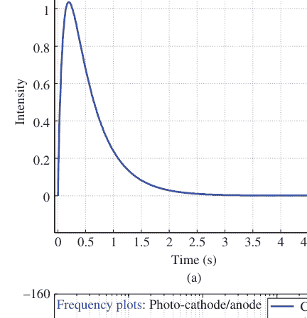

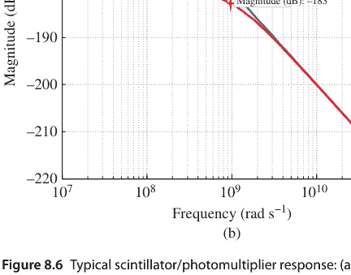

图 8.6 典型闪烁体/光电倍增管响应：(a) 脉冲。(b) 伯德图。

该微分方程的解随后使用拉普拉斯变换得到，从而给出闪烁体的输出电压特征为

$e(t) = K_{as}[e^{-t/\tau_a} - e^{-t/\tau_s}] \quad \text{for} \quad K_{as} = \frac{Q}{C}\left(\frac{\tau_a}{\tau_a - \tau_s}\right)$
(8.37)

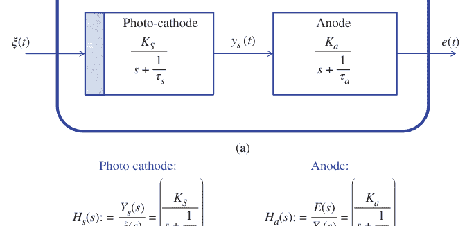

# (a)

# 光电阴极：

# 阳极：

H_s(s):= Y_s(s)/ξ̃(s) = ( K_S / (s + 1/τ_s) )

h_s(t) = K_s e^{-t/τ_s}

H_a(s):= E(s)/Y_s(s) = ( K_a / (s + 1/τ_a) )

h_a(t) = K_a e^{-t/τ_a}

# (b)

图 8.7 级联闪烁体/光电倍增管系统模型：(a) 示意图。(b) 传递函数/冲激响应。

因此，输出电压脉冲 e(t) 具有与式 (8.34) 物理模型相同的形式。

### 8.2.2 闪烁体状态空间模型

为了开发闪烁体的仿真，我们选择使用状态空间表示，通过建立控制式 (8.36) 闪烁体模型的基础微分方程，该方程很容易从图 8.7 所示的子系统级联中获得。

光电阴极系统由从传递函数演化而来的微分方程控制

```
di(t)/dt = -1/τ_s i(t) + K_s ξ̃(t)      (Photoelectron Current)
y_s(t) = i(t)                         (Output Current)      (8.38)
```

其中 ξ̃ 是输入激励（假定为类冲激信号）。

光电倍增管的阳极由 RC 电路建模，并由式 (8.36) 的基尔霍夫电流关系控制

```
de(t)/dt = 1/τ_a e(t) + K_i(t)  for τ_a = RC      (Anode Voltage)
y_a(t) = e(t)                                   (Output Voltage)      (8.39)
```

如果我们定义状态向量 x := [i(t) | e(t)]′，则得到向量–矩阵方程

```
ẋ(t) = [ -1/τ_s | 0 ; - - - ; 0 | -1/τ_a ] x(t) + [ K_s ; - ; K_a/C ] u(t)    (States)
y(t) = [0 | 1] x(t)    (Measurement)    (8.40)
```

或简化为

d x(t)/dt = A_c x(t) + B_c u(t)
y(t) = C_c x(t)    (8.41)

这是 LTI 系统通常的状态空间表示，其中 A_c、B_c、C_c 分别是 N_x × N_x、N_x × N_u、N_y × N_x 的连续时间系统、输入和输出矩阵 [9]，相应的冲激响应为 H_t = C_c e^{A_c (t-τ)} B_c，传递函数由 H(s) = C_c (sI − A_c)^{-1} B_c 给出，从而完成闪烁体–光电倍增管系统的状态空间表示。

### 8.2.3 闪烁体采样数据状态空间模型

采样数据 A/D 转换意味着 t → t_k，因此状态转移矩阵为 Φ(t_k, t_0) = e^{A_c (t_k - t_0)}，状态解为 [19, 20]

x(t_k) = Φ(t_k, t_{k-1}) x(t_{k-1}) + ∫_{t_{k-1}}^{t_k} Φ(t_k, τ) B_c u(τ) dτ    (8.42)

定义采样数据系统，假设输入为分段常数，即 u(t_{k-1}) ≤ u(t) < u(t_k)，且 B := ∫_{t_{k-1}}^{t_k} Φ(t_k, τ) B_c dτ，从而得到离散采样数据系统如下

x(t_k) = A x(t_{k-1}) + B u(t_{k-1})    (8.43)

其中 A := e^{A_c (t_k - t_{k-1})} = e^{A Δt_k}，这里 Δt_k := t_k - t_{k-1}，且 B := ∫_{t_{k-1}}^{t_k} e^{A_c (t_k - τ)} dτ × B_c。

相应的采样测量系统由下式给出

y(t_k) = C x(t_k)    (8.44)

我们对该系统进行了冲激响应仿真，结果如图 8.8 所示，其中我们可以看到状态、电流 i、电压 v 以及输出 y。

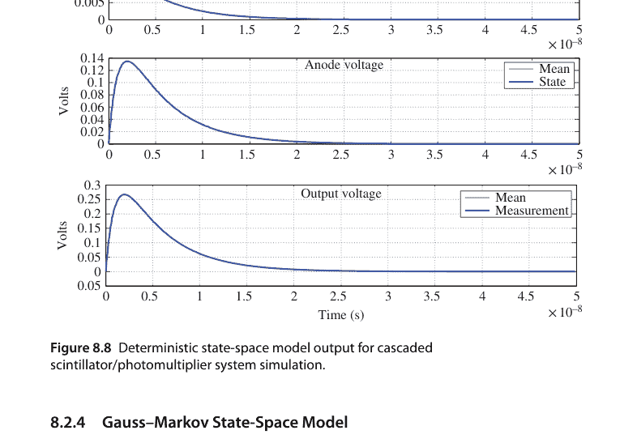

图 8.8 级联闪烁体/光电倍增管系统仿真的确定性状态空间模型输出。

### 8.2.4 高斯–马尔可夫状态空间模型

由于我们使用数字化数据，因此对该连续时间系统采用采样数据表示将是表征该系统的更好方法。因此，使用与上述确定性系统相同的方法，我们得到

**x**(tₖ) = A**x**(tₖ₋₁) + B**u**(tₖ₋₁) + **w**(tₖ₋₁)
**y**(tₖ) = C**x**(tₖ) + v(tₖ)  (8.45)

其中加性过程噪声和测量噪声均为零均值高斯过程，其协方差矩阵分别为 R_ww(tₖ₋₁)、R_vv(tₖ)。相应的统计量由下式给出（更多细节见 [9]）

**m**ₓ(tₖ) = A**m**ₓ(tₖ₋₁) + B**u**(tₖ₋₁)
**P**ₓₓ(tₖ) = A**P**ₓₓ(tₖ₋₁)A' + R_ww(tₖ₋₁)
**m**ᵧ(tₖ) = C**m**ₓ(tₖ)
**R**ᵧᵧ(tₖ) = C**P**ₓₓ(tₖ)C' + R_vv(tₖ)  (8.46)


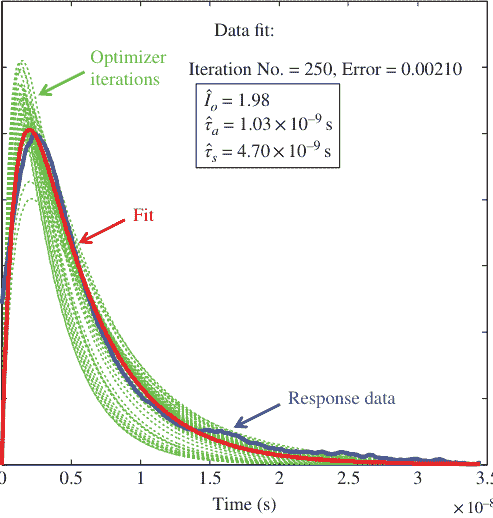

图8.11 闪烁体电压响应的参数估计。

对应(b)中的功率谱。辨识得到的新息序列如图8.10c所示，(d)中给出的零均值/白噪声检验结果（0.000 16 < 0.122/3.5%超出）表明“拟合良好”。因此，子空间辨识器能够很好地捕获模型，可以直接使用这个“黑箱”模型构建卡尔曼滤波器。

另一种方法是使用基于模型的辨识（MBID）技术，该技术嵌入基于物理的模型，需要根据图8.7所示的闪烁体和光电倍增管系统的测量响应（平均）来估计参数(K_ab, τ_a, τ_s)。我们采用了著名的Nelder–Mead算法进行非线性优化。拟合结果如图8.11所示，展示了合理的响应估计。最终的参数估计相当好，提取的真实参数为K_ab = 1.98、τ_a = 1.03 × 10⁻⁹秒、τ_s = 4.7 × 10⁻⁹秒，并被用于每个光电倍增管通道的仿真模型。

## 8.2.6 卡尔曼滤波器设计：闪烁体/光电倍增管系统

既然我们已经为闪烁体/光电倍增管系统建立了随机表示（这在实践中很常见，包含潜在的噪声、参数等不确定性），我们就可以开发一种处理器，利用这些模型从含噪、不确定的测量数据中提取所需信号。在高斯–马尔可夫假设下，存在最优的基于模型的解——即第4章和表4.1中的卡尔曼滤波器 [9]。

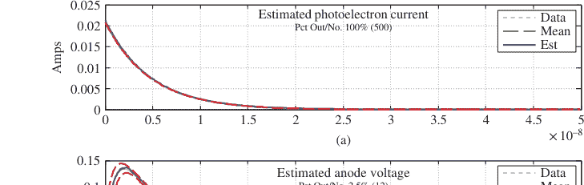

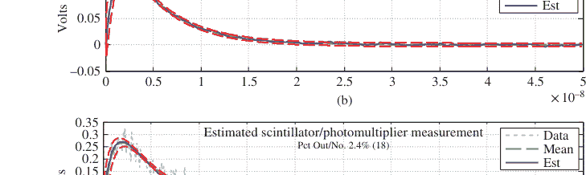

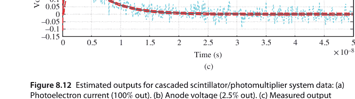

图8.12 级联闪烁体/光电倍增管系统数据的估计输出：(a) 光电子电流（100%超出）。(b) 阳极电压（2.5%超出）。(c) 测量输出电压（2.4%超出）。

使用图8.9所示的合成含噪闪烁体/光电倍增管数据，我们采用了表4.1中的卡尔曼滤波器，结果如图8.12所示。当新息序列在统计上被认为是白噪声时，处理器的性能最优。本次运行的结果是白的，表明达到了期望性能。在图8.12中，我们观察到的估计结果是电流和电压输出。这里我们看到了带预测不确定度的平滑估计。电流值合理，但预测误差界明显被低估，而电压值则完全落在预测不确定度界内。在图8.13中，我们看到了该卡尔曼滤波器实现的基本性能指标：新息序列位于预测界内，最优性检验（零均值/有界协方差）也处于规定界内（0.000 08 < 0.120 00/2.7%超出），加权残差平方和（WSSR）统计量低于阈值——这些都表明该数据实现具有“调谐”的最优处理器（详见第4.2.4节）。

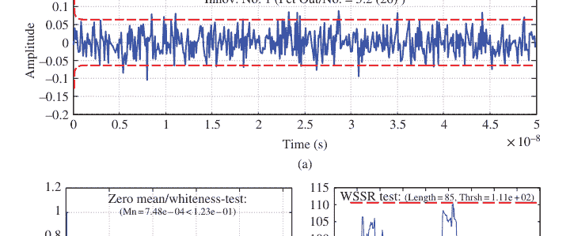

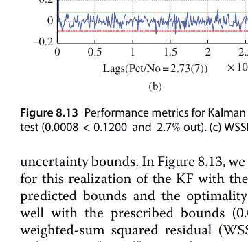

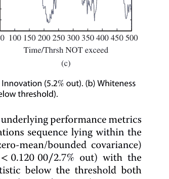

图8.13 卡尔曼滤波器的性能指标：(a) 新息（5.2%超出）。(b) 白噪声检验（0.0008 < 0.1200 且 2.7%超出）。(c) WSSR检验（低于阈值）。

### 8.2.6.1 卡尔曼滤波器设计：闪烁体/光电倍增管数据

在本节中，我们将第8.2.6节辨识出的模型应用于图8.9中的含噪不确定测量数据。这里，卡尔曼滤波器的参数被调整以“跟踪”原始脉冲数据，结果如图8.14和图8.15所示。在图8.14中，我们观察到了对PMT装置的光电子电流、阳极电压和输出电压的估计。估计结果相当合理，预测统计量（在重新调整KF后）也跟踪着估计信号。当然，除非性能指标（零均值/白

图8.15 卡尔曼滤波器对闪烁体电压响应的性能：(a) 新息序列（0.6%超出）。(b) 零均值/白噪声检验（0.0012 < 0.123/4.7%超出）。(c) WSSR统计量（低于阈值）。

噪声测量数据。在这里，我们观察到子空间/MBID如何使得卡尔曼滤波器的设计和应用成为可能（更多细节见 [21]）。

## 8.3 裂变过程的参数自适应检测

随着世界范围内恐怖活动急剧增加，特殊核材料（SNM）的检测越来越受到关注。序列检测技术已被证明能够提供高可靠性、高置信度的检测过程，在最大限度地减少虚警的同时，还能及时做出决策 [22, 23]。我们讨论一种序列贝叶斯方法，将基本决策问题纳入该框架。在此，我们利用威胁物的裂变特性来获取可用于SNM检测的独特特征。

以往在SNM检测领域应用贝叶斯技术的工作已应用于辐射探测问题 [17, 24]，其中将序列算法与参数估计方案相结合，能够基于目标放射性核素发射的γ射线来检测威胁材料 [25–29]。本文则集中于中子发射，这些中子由中子多重性计数器直接测量，该计数器对到达中子进行计数。

如下文所示，对于该问题，实现序列贝叶斯探测器需要关于待检测未知源（一个或多个）的先验信息，这与序列辐射探测方案非常相似 [25–29]。因此，为了成功检测，检测器中必须嵌入估计方案，以提供源的更新参数估计。该参数估计器还包含其自身独立的贝叶斯框架。

为裂变过程开发贝叶斯粒子滤波器（PF）或等效的序列马尔可夫链蒙特卡洛（MCMC）处理器是一项相当具有挑战性的问题，因为其本质是随机的。这项工作基于基础理论和建模 [30–32]。即使基础理论很复杂，仍可以通过随机建模来捕获。本文基于底层时间间隔概率分布 [30] 发展了一种贝叶斯方法来处理该问题。

### 8.3.1 基于裂变的处理模型

以能量水平 α 和到达时间 t_m 到达探测器的中子可以被表征为单个脉冲 α_m δ(t − t_m)。一串中子被定义为在时间上不重叠的一组到达。到达间隔时间定义为 τ_m := t_m − t_{m−1}，其中 m = 0, 1, …, M，完整的到达间隔集为 T_M := {τ_0, τ_1, …, τ_M}。这些到达由中子多重性计数器测量，该计数器本质上是一种精密的中子探测器，用于评估可裂变材料自发发射中子的到达间隔时间概率分布。回想一下，每个不稳定核的放射性衰变会产生多个中子，这些中子可以与其他核相互作用，将它们激发到更高的能级，使它们分裂成更小的不等裂变碎片；这些碎片也不稳定，会进一步衰变（发射中子）趋向于稳定核。对这些能够穿透厚重屏蔽层的中子进行探测，提供了一种检测SNM的方法。威胁材料的关键问题在于，释放的中子数量是由单次衰变产生的，这决定了其增殖系数。这些“关联”中子提供了独特的SNM特征，既表明其增殖系数，也表明自发裂变同位素的质量。因此，中子多重性计数器或中子探测器是一种随机测量系统，它生成估计的到达间隔时间概率分布，用于中子检测过程以发出警报


τ；τ 是时间间隔或到达间隔时间；F_S 是裂变率；e_n(ε) 是从同一裂变链检测到 n 个中子的概率；λ 是扩散时间尺度的倒数；b_0(τ) 是在时间间隔 τ 内无计数的概率。

嵌入式公式 (8.49) 中包含一组各种关系，用于描述时间间隔概率：

F_S = (N_A / A) (ln 2 / t_{1/2}^{SF}) m_S  
R_1 = ε q M \bar{v}_S F_S

其中 m_S 为源的质量；ε 为探测效率；p 为中子引起裂变的概率；q 为逃逸概率 (q = 1 − p)；M 为系统增殖；\bar{v}_S 为自发裂变产生的平均中子数；\bar{v}_I 为诱发裂变产生的平均中子数；N_A 为阿伏伽德罗常数；A 为原子量；t_{1/2} 为半衰期。增殖由下式给出

M = 1 / (1 − p \bar{v}_I) = 1 / (1 − k_eff)

其中 k_eff 为有效增殖，探测效率近似为

ε = a / (b M_e^2 + c M_e);  0 ≤ ε ≤ 0.04;  a, b, c 为拟合参数

其中 M_e = q × M。检测到 n 个中子的概率，其 ν 个中子以概率 P_ν 发射，由下式给出

e_n(ε) = Σ_{ν=n}^{∞} P_ν (ν choose n) ε^n (1 − ε)^{ν−n}

以下概率完成该分布：

r_0 = (F_S / R_1) Σ_{n=1}^{∞} e_n(ε) ( Σ_{k=0}^{n−1} e^{−k λ τ} )

以及

b_0(τ) = exp[ −F_S ∫_0^τ (1 / (1 − e^{−λ t})) (1 − Σ_{ν=0}^{∞} P_ν (1 − ε(1 − e^{−λ t}))^ν ) dt ]  
n_0(τ) = r_0(τ) × b_0(τ)

由于目标是“判断”是否存在裂变源，我们需要事先了解源参数：质量、增殖、探测效率和扩散时间尺度参数。记号上，我们将源参数定义为 m_S、k_eff、ε 和 λ，分别，并注意到它们在整体概率分布函数中的密切关系。

Wald 序贯概率比检验 (SPRT) 为 [22, 23]

ℒ(Tₘ; Θ) > τ₁(m)  接受 ℋ₁  
τ₀(m) ≤ ℒ(Tₘ; Θ) ≤ τ₁(m)  继续  
ℒ(Tₘ; Θ) < τ₀(m)  接受 ℋ₀    (8.53)

其中阈值用虚警概率 (P_FA) 和漏检概率 (P_M) 表示为

τ₀(m) = P_M(m) / (1 − P_FA(m)),   τ₁(m) = (1 − P_M(m)) / P_FA(m)    (8.54)

这些阈值由接收机工作特性曲线 (ROC) (检测率 vs 虚警概率) 确定，可通过仿真或受控实验获得以计算决策函数 [37]。即，从 ROC 中选择一个工作点，对应于特定的检测率 (或等价的漏检率) 和虚警概率，从而指定所需的阈值，这些阈值根据公式 (8.54) 对每个参数更新进行计算。

一种合理的方法来解决这一需要高置信度且及时做出可靠决策的问题，是开发一个序贯检测处理器 (见图 8.16)。在每个中子到达时 (τₘ)，我们依次更新决策函数并将其与阈值比较以进行检测——“逐个中子”。在这里，随着每个中子的监测产生到达间隔序列，处理器取每个到达间隔测量值并尝试“判断”其是否源于威胁或非威胁。对于每个到达间隔，决策函数被“序贯”更新并与从 ROC 曲线工作点获得的检测阈值进行比较，从而实现快速决策。一旦阈值被跨越，就做出决策 (威胁或非威胁) 并处理该到达；然而，如果数据不足以做出决策，则获取另一项测量。

**Sequential detection processor**

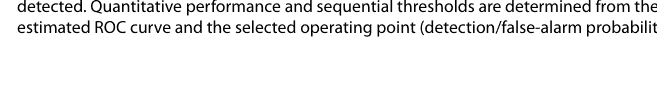

图 8.16 随着每个单独的到达间隔被提取，它会被判别、估计，计算决策函数并与阈值比较以 DECIDE 目标威胁是否被检测到。定量性能和序贯阈值由估计的 ROC 曲线和所选的工作点 (检测/虚警概率) 确定。

对于我们的问题，我们通常有关于背景、扰动和噪声参数的信息，但我们很少有源信息。因此，我们仍然可以做出决策，但需要对未知参数进行估计，即 \hat{\Theta} \to \Theta。在这种情况下，我们必须构造一个复合或广义似然比检验 (GLRT)。因此，从批量似然决策函数出发，我们可以考虑 GLRT 的两种情况：(i) 参数是随机的或 (ii) 参数是确定性的但未知。

这里我们假设 \Theta 是确定性的但未知的。因此，方法是估计每个假设下的未知参数向量 \hat{\Theta} \to \Theta 并进行简单检验。最大似然估计 \hat{\Theta}_{ML} 可用于创建 GLRT，使得

ℒ(T_M; Θ) = [max_{Θ_1} Pr[T_M | Θ_1; ℋ_1]] / [max_{Θ_0} Pr[T_M | Θ_0; ℋ_0]]   (8.55)

这是我们最初采用的方法。GLRT 的批量解也可以像之前一样扩展到序贯情况，通过简单地将 \hat{\Theta}_{ML} \to Θ 替换，即

ℒ(T_m; Θ̂) = ℒ(T_{m-1}; Θ̂) × Pr[τ_m | T_{m-1}, Θ̂_1; ℋ_1] / Pr[τ_m | T_{m-1}, Θ̂_0; ℋ_0],   m = 0,1,…,M   (8.56)

预见到未知参数的 Gaussian 模型 (指数族 [38])，我们开发序贯似然决策函数的对数形式。简单地对公式 (8.56) 取自然对数，即 Λ(T_M; Θ) := ln ℒ(T_M; Θ)，我们得到对数似然序贯决策函数为

Λ(T_m; Θ̂) = Λ(T_{m-1}; Θ̂) + ln Pr[τ_m | T_{m-1}, Θ̂_1; ℋ_1] − ln Pr[τ_m | T_{m-1}, Θ̂_0; ℋ_0]   (8.57)

利用这些公式，我们接下来为我们的问题开发检测算法。我们应注意，本节仅考虑“威胁检测问题”。

## 8.3.5 Sequential Detection for Fission Processes

这里我们从第 8.3.4 节的结果出发并结合裂变过程的物理。对于裂变检测，我们从公式 (8.48) 的简单中子模型出发，在到达间隔时间 τ_m 处导致随后的 (序贯) 假设检验：

ℋ₀ : τ_m = 𝒯_B(m; Θ_b) + 𝒯_V(m)                     (非威胁)  
ℋ₁ : τ_m = 𝒯_S(m; Θ_s) + 𝒯_B(m; Θ_b) + 𝒯_V(m)      (威胁)      (8.58)

具有未知源参数的该问题的序贯检测解可直接从公式 (8.56) 的 GLRT 结果得出。

为了实现处理器，我们必须首先确定所需的条件概率以指定决策函数，即

Pr[τ_m | T_{m-1}, Θ̂, ℋ₁] = Pr[𝒯_S(m; Θ_S) | T_{m-1}, Θ̂_S; ℋ₁]  
                     + Pr[𝒯_B(m; Θ_b) | T_{m-1}, Θ_b; ℋ₁] + Pr[𝒯_V(m)]      (8.59)

以及在原假设下

Pr[τ_m | T_{m-1}, Θ; ℋ₀] = Pr[𝒯_B(m; Θ_b) | T_{m-1}, Θ_b; ℋ₀] + Pr[𝒯_V(m)]      (8.60)

其中高斯到达间隔噪声分布为 𝒯_V ∼ 𝒩(0, σ_vv²) 且已知的背景扰动被忽略，而到达间隔分布由公式 (8.49) 指定 (在 τ_m 处瞬时)，将 τ_m → τ 给出

Pr[𝒯_S(m; Θ_S) | T_{m-1}, Θ̂_S; ℋ₁] = R₁ r₀ n₀  
+ (F_S / R₁) Σ_{n=2}^∞ e_n(ε) ( Σ_{k=1}^{n-1} k e^{-k λ_s τ_m} ) λ_s b₀(τ_m)      (8.61)

Pr[𝒯_V(m)] = 1 / √(2π σ_vv²) exp[ − 𝒯_V²(m) / (2 σ_vv²) ]      (8.62)

因此，对数似然比变为

Λ(T_m; Θ) = Λ(T_{m-1}; Θ) + ln[ R₁ r₀ n₀ + (F_S / R₁) Σ_{n=2}^∞ e_n(ε) ( Σ_{k=1}^{n-1} k e^{-k λ_s τ_m} ) λ_s b₀(τ_m)  
+ 1 / √(2π σ_vv²) exp[ − 𝒯_V²(m) / (2 σ_vv²) ] ] − ln( 1 / √(2π σ_vv²) ) + 𝒯_V²(m) / (2 σ_vv²)   (8.63)

我们也可以将问题扩展到随机情况。假设每个独立的源参数受随机游走/随机常数模型支配，即参数假设为分段常数并受零均值、高斯随机不确定性 w_Θ 驱动，其协方差为 R_{w_Θ w_Θ} [9]，则在这种情况下参数 Θ ∼ 𝒩(Θ₀, P₀ + R_{w_Θ w_Θ})，其中 Θ₀ 为初始均值，P₀ 为其对应协方差。因此，对应的多元先验分布为

Pr[Θ(τ_m)] = (2π)^{−N_Θ/2} |P₀ + R_{w_Θ w_Θ}|^{−1/2}  
× exp{ −1/2 (Θ − Θ₀)ᵀ (P₀ + R_{w_Θ w_Θ})^{-1} (Θ − Θ₀) }      (8.64)


且对数似然比为

```
Λ(T_m; Θ) = Λ(T_{m-1}; Θ) + ln Pr[τ_m, Θ(τ_m) | T_{m-1}; H_1] - ln Pr[τ_m | T_{m-1}; Θ; H_0] (8.65)
```

其中，第二项可通过应用贝叶斯法则进一步展开，得到

```
Pr[τ_m, Θ(τ_m) | T_{m-1}; H_1] = Pr[τ_m | T_{m-1}, Θ(τ_m); H_1] × Pr[Θ(τ_m) | T_{m-1}; H_1] (8.66)
```

将该表达式代入式(8.59)的源分布中，得到

```
Pr[T_S(m; Θ_S) | T_{m-1}, \hat{Θ}_S; H_1] → Pr[τ_m | T_{m-1}, Θ(τ_m); H_1] × Pr[Θ(τ_m) | T_{m-1}; H_1] (8.67)
```

考虑到这一点，通过将规定的分布代入式(8.65)，可以直接计算出序贯对数似然，得到

```
Λ(T_m; Θ) = Λ(T_{m-1}; Θ) + ln( R_1 r_0 η_0 + (F_S / R_1) Σ_{n=2}^∞ e_n(ε) ( Σ_{k=1}^{n-1} k e^{-k λ τ_m} ) λ b_0(τ_m) + (2π)^{-N_θ/2} |P_0 + R_{w_θ w_θ}|^{-1/2} × exp{ -1/2 (Θ - Θ_0)^T (P_0 + R_{t_θ w_θ})^{-1} (Θ - Θ_0) } + 1/√(2π σ_{vv}^2) exp{ -1/2 T_V^2(m)/σ_{vv}^2 } ) + 1/2 ln(2π σ_{vv}^2) - 1/2 T_V^2(n)/σ_{vv}^2 (8.68)
```

这完成了裂变过程序贯贝叶斯检测方法的推导。接下来，我们必须更详细地考虑参数估计问题。

## 8.3.6 贝叶斯参数估计

为了实现8.3.5节的广义似然比检验（GLRT），我们必须在每次到达时估计未知参数Θ。我们首先推导批处理方案，然后推导其序贯版本，类似于上一节的序贯贝叶斯检测器。这里我们推导适用于以下问题的贝叶斯参数估计器：

给定一组不确定的多重性计数器（到达间隔时间）测量值T_M；找出未知裂变源参数Θ的“最佳”估计\hat{Θ}。

从统计学角度来看，我们希望估计在给定整个到达间隔数据集T_M条件下源参数Θ的后验分布，即Pr[Θ|T_M]。应用贝叶斯定理，我们有

```
Pr[Θ|T_M] = Pr[T_M|Θ] × Pr[Θ] / Pr[T_M]    (8.69)
```

由于问题的序贯性，即中子多重性计数器逐个中子地测量每个中子到达时间，我们需要一个序贯版本。

## 8.3.7 序贯贝叶斯处理器

可以证明[39]，可以为后验分布推导出序贯贝叶斯解。从式(8.69)的第一项开始，应用贝叶斯法则，我们有

```
Pr[T_M|Θ] = Pr[τ_m, T_{M-1}|Θ] = Pr[τ_m|T_{M-1}, Θ] × Pr[T_{M-1}|Θ]    (8.70)
```

对于分母项，我们有

```
Pr[T_M] = Pr[τ_m, T_{M-1}] = Pr[τ_m|T_{M-1}] × Pr[T_{M-1}]    (8.71)
```

将式(8.70)和(8.71)代入式(8.69)并分组各项，我们得到

```
Pr[Θ|T_M] = ( Pr[τ_m|T_{M-1}, Θ] / Pr[τ_m|T_{M-1}] )_{W(τ_m)} × ( Pr[T_{M-1}|Θ] × Pr[Θ] / Pr[T_{M-1}] )_{Pr[Θ|T_{M-1}]}    (8.72)
```

或

```
Pr[Θ|T_M] = W(τ_m) × Pr[Θ|T_{M-1}]    (8.73)
```

这就是后验分布的贝叶斯序贯形式。如果我们进一步假设到达间隔具有马尔可夫性，即当前到达仅依赖于前一次到达，即 (τ_m, T_{M-1}) → (τ_m, τ_{m-1})，则我们得到所需的序贯传播后验的表达式：

```
Pr[Θ|τ_m] = W(τ_m) × Pr[Θ|τ_{m-1}]    (8.74)
```

其中

```
W(τ_m) = Pr[τ_m|τ_{m-1}, Θ] / Pr[τ_m|τ_{m-1}]    (8.75)
```

这里我们假设参数向量是一个没有关联动态的随机常数Θ，以构建序贯贝叶斯处理器。然而，在实际情况中，显然当测量来自未知源的中子到达间隔时，每个参数都可能很容易出现变化或不确定性。也许对于这些参数变化，更合理的模型是8.3.6节[39]中引入的随机游走/常数模型。

也就是说，我们知道在连续时间下，游走由 $\frac{d}{dt}\Theta(\tau)=w_{\Theta}(\tau)$ 给出，通过取一阶差分来近似导数，我们可以得到采样数据表示[39]：

$$\Theta(\tau_m)=\Theta(\tau_{m-1})+\Delta\tau_m\ w_{\Theta}(\tau_{m-1})\tag{8.76}$$

其中$\Delta\tau_m := \tau_m - \tau_{m-1}$，用于包含在$\Theta(\tau_m) \sim \mathcal{N}(m_{\Theta}(\tau_m), R_{\Theta\Theta}(\tau_m)+R_{w_{\Theta}w_{\Theta}}(\tau_m))$中的参数不确定性，因为$w_{\Theta} \sim \mathcal{N}(0,R_{w_{\Theta}w_{\Theta}}(\tau_m))$。每个$\Theta$参数的变化可以通过其初始猜测$\Theta(\tau_0)$和方差$R_{\Theta\Theta}(\tau_m)+R_{w_{\Theta}w_{\Theta}}(\tau_m)$来控制。

物理上，我们有 $R_{w_{\Theta}w_{\Theta}}=\operatorname{diag}[\sigma_{MM}^2\ \sigma_{k_{eff}k_{eff}}^2\ \sigma_{ee}^2\ \sigma_{\lambda^{-1}\chi^{-1}}^2]$，后续搜索可以为每个初始值 $\Theta_0=\mathcal{U}[a,b]$ 包含一个有界均匀变量，从而能够以更实用的方式对参数集及其各自伴随的不确定性进行建模。随机游走/常数模型的统计量由序贯高斯-马尔可夫结构给出：

$$\begin{aligned}
\Theta(\tau_m)&=\Theta(\tau_{m-1})+\Delta\tau_m\ w_{\Theta}(\tau_{m-1})\ \text{(State)}\\
m_{\Theta}(\tau_m)&=m_{\Theta}(\tau_{m-1})\qquad\text{(Mean)}\\
R_{\Theta\Theta}(\tau_m)&=R_{\Theta\Theta}(\tau_{m-1})+R_{w_{\Theta}w_{\Theta}}(\tau_{m-1})\ \text{(Variance)}
\end{aligned}\tag{8.77}$$

考虑到这个模型，我们像之前一样从批处理方法开始重新推导序贯贝叶斯处理器。我们希望估计$\Theta(\tau_m)$，完整参数集定义为$\Theta_M := \{\Theta(\tau_0),\Theta(\tau_1),\dots,\Theta(\tau_M)\}$。批处理后验由贝叶斯定理给出，如同之前一样：

$$\Pr[\Theta_M|T_M]=\frac{\Pr[T_M|\Theta_M]\times\Pr[\Theta_M]}{\Pr[T_M]}\tag{8.78}$$

第一项可以通过应用贝叶斯法则分解为

$$\begin{aligned}
\Pr[T_M|\Theta_M]&=\Pr[\tau_m,T_{M-1}|\Theta(\tau_m),\Theta_{M-1}]\\&=\Pr[\tau_m|T_{M-1},\Theta(\tau_m),\Theta_{M-1}]\\&\quad\times\Pr[T_{M-1}|\Theta(\tau_m),\Theta_{M-1}]
\end{aligned}\tag{8.79}$$

到达间隔时间$\tau_m$独立于$\Theta_{M-1}$和$T_{M-1}$，因此式(8.79)中的第一项变为$\Pr[\tau_m|\Theta(\tau_m)]$，而第二项简化为$\Pr[\tau_{M-1}|\Theta_{M-1}]$，因为参数向量$\Theta(\tau_m)$被假设与过去的测量数据无关。因此，我们有

$$\Pr[T_M|\Theta_M]=\Pr[\tau_m|\Theta(\tau_m)]\times\Pr[T_{M-1}|\Theta_{M-1}]\tag{8.80}$$

式(8.78)的第二项可以类似地分解为

$$\Pr[\Theta_M]=\Pr[\Theta(\tau_m),\Theta_{M-1}]=\Pr[\Theta(\tau_m)|\Theta_{M-1}]\times\Pr[\Theta_{M-1}]\tag{8.81}$$

分母中$\Pr[T_M]$的分解由式(8.70)给出。

将这些关系式（式(8.70)、(8.80)和(8.81)）代入式(8.78)，并像之前一样假设马尔可夫过程，我们得到

$$\Pr[\Theta_M\mid T_M]=\bigl(\Pr[\tau_m\mid\Theta(\tau_m)]\times\Pr[T_{M-1}\mid\Theta_{M-1}]\bigr)\\\times\frac{\Pr[\Theta(\tau_m)\mid\Theta(\tau_{m-1})]\times\Pr[\Theta_{M-1}]}{\Pr[\tau_m\mid\tau_{m-1}]\times\Pr[T_{M-1}]}$$

(8.82)

现在对各项进行分组，所需的后验分布变为

$$\Pr[\Theta_M\mid T_M]=\left(\frac{\Pr[\tau_m\mid\Theta(\tau_m)]\times\Pr[\Theta(\tau_m)\mid\Theta(\tau_{m-1})]}{\Pr[\tau_m\mid\tau_{m-1}]}\right)\\\times\left(\frac{\Pr[T_{M-1}\mid\Theta_{M-1}]\times\Pr[\Theta_{M-1}]}{\Pr[T_{M-1}]}\right)$$

(8.83)

或简写为（将$\tau_m\to T_M$替换）

$$\Pr[\Theta_m\mid T_m]=W(\tau_m)\times\Pr[\Theta_{m-1}\mid T_{m-1}]$$

(8.84)

其中

$$W(\tau_m):=\frac{\Pr[\tau_m\mid\Theta(\tau_m)]\times\Pr[\Theta(\tau_m)\mid\Theta(\tau_{m-1})]}{\Pr[\tau_m\mid\tau_{m-1}]}$$

(8.85)

这是动态参数模型（随机游走/常数）的序贯贝叶斯解。粒子滤波器是这种递归的一种实现[39, 40]。

## 8.3.8 裂变过程的粒子滤波器

粒子滤波是一种从数据统计采样的“重要性采样”方法发展而来的技术。其关键思想是从最高概率区域，即最高重要性区域中选择粒子（或我们问题中的参数）。一旦确定了由此产生的重要性权重，所需的后验分布由非参数概率质量函数（PMF）近似为：

$$\hat{\Pr}[\Theta_M\mid T_M]=\sum_i w_i(\tau_m)\,\delta(\Theta(\tau_m)-\Theta_i(\tau_m))$$

(8.86)

其中$\mathcal{W}_i$是归一化加权函数，由到达间隔时间$\tau_m$处的后验分布与设计的重要性分布$q$之比给出：

$$W_i(\tau_m):=\frac{\Pr[\Theta(\tau_m)\mid T_m]}{q[\Theta(\tau_m)\mid T_m]}=\frac{\Pr[\tau_m\mid\Theta(\tau_m)]}{q[\tau_m\mid\Theta(\tau_m)]}\\\times\frac{\Pr[\Theta(\tau_m)]}{q[\Theta(\tau_m)\mid\Theta_{m-1},\tau_m]}$$

(8.87)


归一化权重简单地为

$$\mathcal{W}_i(\tau_m) := \frac{W_i(\tau_m)}{\sum_i W_i(\tau_m)}$$

“bootstrap”处理器是最流行的技术 [39]。这里提议被选为*转移先验*，加权函数则简化为似然

$$W(\tau_m)=W(\tau_{m-1})\times \Pr[\tau_m\mid\Theta(\tau_m)]$$

考虑到这些关系，序贯贝叶斯处理器可为我们的问题开发。我们从基本 bootstrap 技术开始来估计未知源参数，该参数最终将成为对数似然决策函数的一部分。最初，我们假设先验分布在某些实用区间 $\mathcal{U}(a,b)$ 上均匀分布。动态参数更新由 Eq. (8.76) 的随机游走/恒定模型给出，该模型由零均值、高斯噪声驱动，其协方差为 $R_{\omega_\Theta\omega_\Theta}$，初始均值（恒定）为 $\Theta(\tau_0)$，对应的参数协方差为 $R_{\Theta\Theta}(\tau_m)$。似然分布嵌入了 Eq. (8.49) 的“裂变物理”。

测量预测模型基于当前参数估计及其解析时间间隔似然分布。当多重性计数器的输出处出现新的中子到达间隔 $\tau_m$ 时，会做出预测的到达间隔时间估计 $\hat{\Theta}(\tau_m\mid\tau_{m-1})$，并将其作为输入提供给物理似然概率分布 $\mathcal{L}_\Theta(\hat{\Theta}(\tau_m)) := \Pr(\tau\mid\Theta)$ 用于预测。

在预测的到达间隔 $\hat{\tau}_m$ 可用后，执行更新和重采样步骤，然后等待下一个测量。Bootstrap 算法执行表 4.9 中所示的以下步骤。

## 8.3.9 SNM 检测与估计：合成数据

在本节中，我们研究序贯贝叶斯检测器/估计器在模拟数据上的性能。我们假设一组参数来统计合成一组到达，用于计算到达间隔 $\{\tau_m\}$；$m = 0, 1, \ldots, M$。我们从序贯贝叶斯检测算法的结果开始，该算法将贝叶斯参数估计器作为其固有结构的一部分，如图 8.17 所示。请注意，要估计的未知源参数向量具有以下物理参数（来自到达间隔 PDF）：$\Theta := [m_S\ k_{\mathrm{eff}}\ \varepsilon\ \lambda^{-1}]^T$ —— 分别为源的质量、有效增殖系数 ($k_{\mathrm{eff}}$)、探测器效率和扩散时间。

Bootstrap PF 被应用于图 8.17 所示的合成中子到达序列。我们从图中注意到，到达间隔数据为

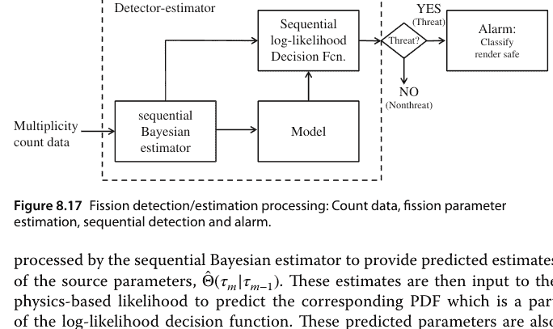

## 图 8.17 裂变检测/估计处理：计数数据、裂变参数估计、序贯检测和报警。

由序贯贝叶斯估计器处理，以提供源参数的预测估计，$\hat{\Theta}(\tau_m | \tau_{m-1})$。这些估计随后输入到基于物理的似然中，以预测相应的 PDF，该 PDF 是对数似然决策函数的一部分。这些预测参数也直接作为单独输入提供给对数似然决策函数。一旦在 $\tau_m$ 处计算出决策函数，它将被与阈值比较以“决定”是否存在威胁。如果是，则启动报警。如果不是，则在到达时处理另一个测量（获取更多数据）。

存在多种可用于评估检测性能的指标，从混淆矩阵到复杂的统计假设检验 [39]，但也许最基本和最稳健的方法是计算 ROC 曲线。ROC 曲线简单地是检测 ($P_{DET}$) 与虚警 ($P_{FA}$) 概率随阈值 $T$ 参数化的图，完美性能发生在 $P_{DET} = 1$ 且 $P_{FA} = 0$ 时。ROC 曲线提供了从中推导出大多数其他指标的所有基本信息。因此，有许多单独的指标可以直接从 ROC 曲线中提取，包括灵敏度、特异性、成本/收益分析以及诸如曲线下面积 (AUC) 和最小错误概率 (MinE) 等特定特征 [39]。

如前所述，有必要计算 ROC 曲线以选择操作点（检测和虚警概率）来计算序贯阈值。为了生成 ROC，我们合成了一个由 30 个成员组成的集合，每个成员包含 100 次到达，这些到达直接从使用以下源（铀）参数的蒙特卡洛模拟数据集选取：$m_S = 25$ kg，$k_{eff} = 0.9$；$\varepsilon = 0.03$；$\lambda^{-1} = 0.01$。我们选择使用 6.9 dB 的 SNR 定义为信号能量与噪声能量（方差）之比的 10 log 比率。每个成员实现的局部 ROC 被估计，然后平均 ROC 用于计算。性能指标如 AUC 也被计算以评估检测性能（AUC = 0.95）。对于“完美”性能，检测概率为 1，虚警概率为 0

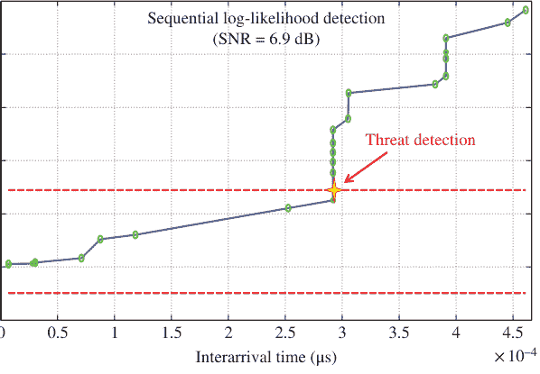

**图 8.18** 序贯贝叶斯（对数似然）威胁检测 $(P_{FA}, P_{DET})=(0.0007, 0.916)$ 且阈值为 $(\ln\tau_0, \ln\tau_1)=(-2.48, 7.23)$。

对应于 AUC 为 1。最优操作点 $(P_{FA}, P_{DET})$ 通过最小化贝叶斯风险计算得出（详见 [39]），在该 SNR 下得到虚警概率为 0.1% 时的检测概率为 92%。将这些值代入 Eq. (8.54) 的阈值计算并取自然对数得到阈值 $(\ln\tau_0, \ln\tau_1)$ 为 $(-2.48, 7.23)$。集合中一个成员的序贯贝叶斯检测结果的典型实现如图 8.18 所示，显示决策函数超过上阈值，从而指示威胁并随后报警。ROC 曲线使我们能够在各种 SNR 下评估序贯检测算法的性能（见图 8.19）。这是在所选阈值下我们期望达到的性能。测试数据用于验证这些预测。因此，我们看到在这些 SNR 下检测性能相当合理，表明贝叶斯检测器设计是可行的。

仅研究了 100 个到达间隔以观察这种方法的可行性。我们观察到由裂变过程随机性引起的到达间隔的不确定性。接下来用图 8.20 所示的结果估计物理参数。再次，对于 6.9 dB 的该实现，参数估计相当合理。对于参数估计性能指标，我们使用每个估计器的平均均方根误差（绝对/相对误差）给出：质量（RMS 误差 = 0.03/0.28% kg）；有效增殖系数（RMS 误差 = 0.0025/0.12%）；效率（RMS 误差 = 0.000 06/0.20%）；和逆扩散时间 ($\lambda$)（RMS 误差 = 0.000 04/0.4% $\mu$s$^{-1}$）。

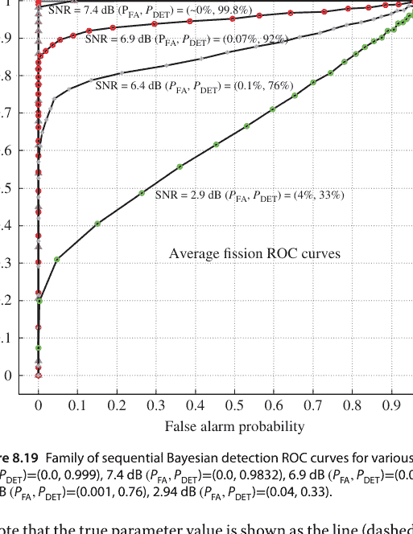

## 图 8.19 各种 SNR 下的序贯贝叶斯检测 ROC 曲线族：8.4 dB ($P_{FA}, P_{DET}$)=(0.0, 0.999)，7.4 dB ($P_{FA}, P_{DET}$)=(0.0, 0.9832)，6.9 dB ($P_{FA}, P_{DET}$)=(0.0007, 0.916)，6.4 dB ($P_{FA}, P_{DET}$)=(0.001, 0.76)，2.94 dB ($P_{FA}, P_{DET}$)=(0.04, 0.33)。

请注意，真实参数值显示为线（虚线），最大后验 (MAP) 和条件均值 (CM) 估计显示为（箭头）于图中。它们似乎很好地跟踪了该实现的物理参数（RMS 误差小）。

我们必须执行至少 100 次实现的序列并计算集合统计量（未显示）。最后，我们在模拟过程中显示在各种到达间隔样本（25、50、75、100）处的四个快照（或切片）。请注意，每个都是所有物理参数的 3D PMF 的切片。还请注意估计粒子如何（预期）关于最高概率区域凝聚，这些区域在图 8.21 中用箭头标注。

## 8.3.10 总结

我们已基于捕获裂变过程底层物理的理论似然 PDF [30] 开发了裂变检测问题的序贯贝叶斯方法。序贯检测处理器被


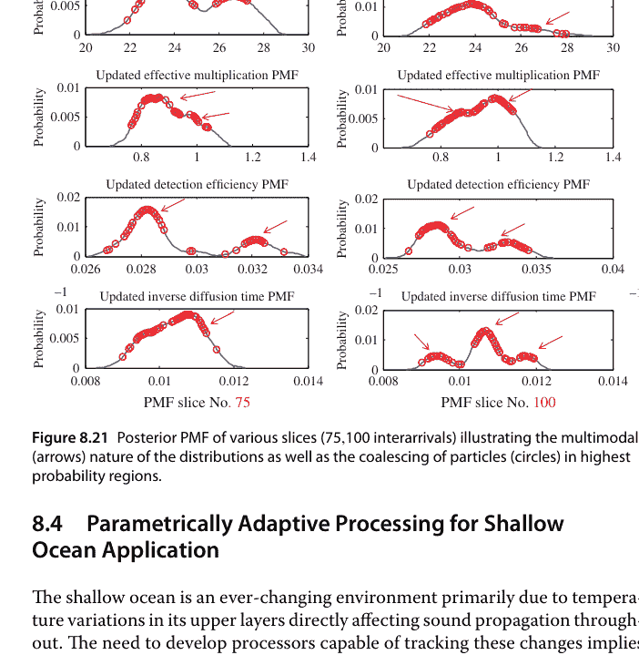

图 8.21 各切片（75,100 间隔）的后验 PMF，说明了分布的多峰（箭头）特性以及粒子（圆圈）在最高概率区域的合并。

## 8.4 浅海应用的参数自适应处理

浅海是一个不断变化的环境，主要是由于其上层温度变化直接影响整个声传播。开发能够跟踪这些变化的处理器的需求意味着需要一种随机且环境自适应的设计。贝叶斯技术已经发展起来，使一类处理器能够在这种不确定、非平稳、非高斯、可变的浅海环境中工作。在这里，我们开发了一种顺序贝叶斯处理器，能够为模态函数跟踪和环境自适应问题提供联合解。重点在于开发粒子滤波器和 UKF，使其能够为该问题提供合理的性能。这些处理器应用于从垂直阵列获得的水听器测量。适应性问题通过允许模态系数和/或波数与噪声测量数据一起联合估计，同时跟踪模态函数并同时增强噪声压力场测量来解决。

for

$$\mathbf{A}_m(z)=\begin{bmatrix}0 & 1\\-k_z^2(m) & 0\end{bmatrix}$$

假设海洋声学噪声可以由加性不确定性表征，我们可以将该确定性状态方程扩展到 $M$ 个模态，即 $\boldsymbol{\Phi}(z):=[\phi_1(z)\ \cdots\ \phi_M(z)]^T$，从而得到模型的以下 $2M$ 维 Gauss–Markov 表示：

$$\frac{d}{dz}\boldsymbol{\Phi}(z)=\mathbf{A}(z)\boldsymbol{\Phi}(z)+\mathbf{w}(z)$$

其中 $\mathbf{w}(z)=[w_1\ w_2\ \cdots\ w_{2M}]^T$ 是加性、零均值随机噪声。系统矩阵 $\mathbf{A}(z)$ 为

$$\mathbf{A}(z)=\begin{bmatrix}\mathbf{A}_1(z)&\cdots&0\\\vdots&\ddots&\vdots\\0&\cdots&\mathbf{A}_M(z)\end{bmatrix}$$

总体状态向量为

$$\boldsymbol{\Phi}(z)=[\phi_{11}\quad\phi_{12}\mid\phi_{21}\quad\phi_{22}\mid\ \cdots\ \mid\phi_{M1}\quad\phi_{M2}]^T$$

该表示导致 *测量方程*，可写为

$$p(r_s,z)=\mathbf{C}^T(r_s,z_s)\boldsymbol{\Phi}(z)+v(z)$$

其中

$$\mathbf{C}^T(r_s,z_s)=[\beta_1(r_s,z_s)\quad 0\mid\ \cdots\ \mid\beta_M(r_s,z_s)\quad 0]$$

随机噪声项 $\mathbf{w}(z)$ 和 $v(z)$ 假定为高斯且零均值，其相应协方差矩阵分别为 $\mathbf{R}_{ww}$ 和 $R_{vv}$。测量噪声 $(v)$ 用于表示近场声场、流噪声对水听器以及电子噪声的“汇总”效应。模态噪声 $(\mathbf{w})$ 用于表示声速误差、远距离船舶噪声、边界条件误差、海况效应以及通过海洋声学系统动力学（正模模型）传播的海洋不均匀性的“汇总”不确定性。

由于阵列在深度上空间采样压力场离散化，我们选择使用 *中心差分* 方法离散化微分状态方程以提高数值稳定性；即假设水听器均匀间隔，由式 (8.90) 得

$$\frac{d^2}{dz^2}\phi_m\approx\frac{\phi_m(z_\ell)-2\phi_m(z_{\ell-1})+\phi_m(z_{\ell-2})}{\Delta z_\ell^2}$$

其中 $\Delta z_\ell:=z_\ell-z_{\ell-1}$。

### Case(i): 模态系数

式 (8.93) 的模态系数可用于捕捉模态函数变化。在此情况下，我们将未知参数向量定义为

θₘ(rₛ, zₛ) := βₘ(rₛ, zₛ);   m = 1, …, M

以及第 m 个模态的新的“增广”状态向量为

Φₘ(zℓ; θₘ) := Φₘ(zℓ) = [φₘ₁(zℓ) φₘ₂(zℓ) | θₘ(zℓ)]ᵀ。

采用该参数选择，第 m 个模态的增广状态方程变为

φₘ₁(zℓ) = φₘ₂(zℓ−1) + wₘ₁(zℓ−1)
φₘ₂(zℓ) = −φₘ₁(zℓ−1) + (2 − Δzℓ² κ_z²(m)) φₘ₂(zℓ−1) + wₘ₂(zℓ−1)
θₘ(zℓ) = θₘ(zℓ−1) + Δzℓ w_{θₘ}(zℓ−1)   (8.107)

其中我们选择了离散随机游走模型（θ̇ₘ(z) = w_{θₘ}(z)）基于一阶差分来捕捉模态系数随深度变化，并加入加性、零均值、高斯噪声，其协方差为 R_{w_{θₘ} w_{θₘ}}。

请注意，当我们将未知参数增广到状态向量以构建参数自适应处理器时，我们假设它们是随机的（游走），其预先计算的初始值指定（初始条件或均值），以及相应的协方差用于限制其不确定性（2σ 置信界限）。

更简洁地，对于第 m 个模态，我们可以写成

Φₘ(zℓ) = Aₘ(zℓ−1; θ) Φₘ(zℓ−1) + wₘ(zℓ−1)   (8.108)

或展开

[ φₘ(zℓ) ]   [ Aₘ(zℓ−1) | 0 ] [ φₘ(zℓ−1) ]
[ ----- ] = [ -----   ----- ] [ -----    ]
[ θₘ(zℓ) ]   [   0   | 1 ] [ θₘ(zℓ−1) ]
          +
          [ W_{φₘ}(zℓ−1) ]
          [ -----       ]
          [ W_{θₘ}(zℓ−1) ]   (8.109)

其中 W_{φₘ} ∼ N(0, R_{W_{φₘ} W_{φₘ}}), W_{θₘ} ∼ N(0, R_{W_{θₘ} W_{θₘ}}), φₘ(0) ∼ N( φ̄ₘ(0), R_{φₘ φₘ}), θₘ(0) ∼ N( θ̄ₘ(0), R_{θₘ θₘ})。

相应的非线性测量模型为

p(rₛ, zℓ) = Σ_{m=1}^{M} θₘ(zℓ) φₘ(zℓ) + v(zℓ);   ℓ = 1, …, L   (8.110)

其中色散（声速）

c(zℓ) = ω / √(κ_z²(m) + κ_r²(m)),   m = 1, …, M; ℓ = 1, …, L   (8.111)

为完成该表示，我们合并所有模态和未知参数，因此状态转移由底层增广状态空间模型表征为

Φ(zℓ) = A(zℓ−1; Θ)Φ(zℓ−1) + w(zℓ−1)

而测量由非线性压力场测量模型确定，

p(rs, zℓ) = c[Φ(zℓ); Θ] + v(zℓ)  (8.112)

请注意，对于此情况，压力场在状态（模态函数）和参数（模态系数）上是非线性的，因为它们是乘数，因此导致非高斯测量。

### Case(ii): 水平波数

式 (8.91) 的水平波数可用于捕捉声速（温度）变化。对于此情况，我们将未知参数向量定义为

θm(z) := κt(m);  m = 1, …, M

以及新的“增广”状态向量为

Φm(zℓ; θm) := Φm(zℓ) = [φm1(zℓ) φm2(zℓ) | θm(zℓ)]T

采用该参数选择（水平波数），第 m 个模态的增广状态方程变为

φm1(zℓ) = φm2(zℓ−1) + wm1(zℓ−1)

φm2(zℓ) = −φm1(zℓ−1) + (2 − Δzℓ² ( ω² / c²(zℓ) − θm²(zℓ−1) )) × φm2(zℓ−1) + wm2(zℓ−1)

θm(zℓ) = θm(zℓ−1) + Δzℓ wθm(zℓ−1)  (8.113)

其中我们再次选择离散随机游走模型（θ̇m(z) = wθm(z)）来捕捉水平波数的变化，并加入加性、零均值、高斯噪声，其协方差为 Rwm wθm。请注意，即使理论上水平波数对每个模态是恒定的，我们仍将该随机表示纳入测量和参数模型本身固有的不确定性中。

更简洁地，对于第 m 个模态我们可以写成

Φm(zℓ) = Am(zℓ−1; θ)Φm(zℓ−1) + wm(zℓ−1)  (8.114)

其中

Am(zℓ−1; θ) = [ 0   1 | 0 ; −1  2 − Δzℓ²( ω² / c²(zℓ) − θm²(zℓ−1) ) | 0 ; −   −   − ; 0   0   | 1 ]

“最佳”（最小误差方差）估计（联合）为模态函数和参数，即 {\hat{\phi}_m(z_\ell)}, {\hat{\theta}_m(z_\ell)}; m = 1, ..., M 以及测量 {\hat{p}(r_s, z_\ell)}。

该问题的解在于联合状态/参数估计问题，即定义增广状态向量，

```
\mathbf{\Phi}(z_\ell; \mathbf{\Theta}) := \begin{bmatrix} \mathbf{\Phi}(z_\ell) \\ - - - \\ \mathbf{\Theta} \end{bmatrix}
```

并从联合分布出发应用贝叶斯定理，我们得到

```
\Pr[\mathbf{\Phi}(z_\ell; \mathbf{\Theta})|P_\ell] = \left( \frac{\Pr[p(r_s, z_\ell)|\mathbf{\Phi}(z_\ell; \mathbf{\Theta})] \times \Pr[\mathbf{\Phi}(z_\ell; \mathbf{\Theta})|\mathbf{\Phi}(z_{\ell-1}; \mathbf{\Theta})]}{\Pr[p(r_s, z_\ell)|P_{\ell-1}]} \right) \times \Pr[\mathbf{\Phi}(z_{\ell-1}; \mathbf{\Theta})|P_{\ell-1}] \tag{8.119}
```

其中我们假设条件独立，并将测量集合定义为 P_\ell := {p(r_s, z_1), ..., p(r_s, z_\ell)}。

定义似然、转移和证据的联合权重函数为（参见第 2.5 节了解详情）

```
W(z_\ell; \mathbf{\Theta}) := \left( \frac{\Pr[p(r_s, z_\ell)|\mathbf{\Phi}(z_\ell; \mathbf{\Theta})] \times \Pr[\mathbf{\Phi}(z_\ell; \mathbf{\Theta})|\mathbf{\Phi}(z_{\ell-1}; \mathbf{\Theta})]}{\Pr[p(r_s, z_\ell)|P_{\ell-1}]} \right) \tag{8.120}
```

得到顺序贝叶斯后验分布为

```
\Pr[\mathbf{\Phi}(z_\ell; \mathbf{\Theta})|P_\ell] = W(z_\ell; \mathbf{\Theta}) \times \Pr[\mathbf{\Phi}(z_{\ell-1}; \mathbf{\Theta})|P_{\ell-1}] \tag{8.121}
```

在本研究中，我们感兴趣的是研究第 4.3.6 节的粒子滤波器（PF）和第 4.3.4 节的 UKF 的适用性，目标是分析其在来自新泽西外海著名的哈德逊峡谷实验[43, 44]获得的压力场数据上的性能。回顾一下，PF 是一种顺序 MCMC 贝叶斯处理器，能够为多峰（多峰值）分布问题提供合理的性能，用于估计后验分布的非参数表示。另一方面，UKF 是一种能够使用基于 sigma 点的确定性表征后验的统计线性化技术来表示任何单峰（单峰值）分布的处理器。

在这里，我们关注的联合估计问题在于为 θ 设置先验并增广状态向量以按上述定义解决该问题，从而将参数估计问题转化为最优滤波问题。因此，粒子滤波器估计指定后验分布所需的权重，经验上为，

```
\hat{\Pr}[\mathbf{\Phi}(z_\ell; \mathbf{\Theta})|P_\ell] \approx \frac{1}{N_p} \sum_{i=1}^{N_p} \hat{W}_i(z_\ell; \mathbf{\Theta}) \times \delta(\mathbf{\Phi}(z_\ell; \mathbf{\Theta}) - \mathbf{\Phi}_i(z_\ell; \mathbf{\Theta})) \tag{8.122}
```


我们针对问题所采用的方法是基于重要性采样（见第4.3节）的概念来估计这些权重。回顾一下，重要性采样是一种利用从某个分布中抽取的随机样本来计算关于另一个分布的统计量的技术。它是一种从提议分布或采样（重要性）分布中模拟样本，并通过适当加权来逼近目标分布（联合后验）的方法。根据这一选择，权重函数定义为：

\[
\mathcal{W}(z_\ell; \Theta) := \frac{\Pr[\Phi(z_\ell; \Theta)|P_\ell]}{q[\Phi(z_\ell; \Theta)|P_\ell]} \tag{8.123}
\]

其中 \(q[\cdot]\) 是提议采样分布或重要性分布。

对于“序贯”情形，我们有如下权重函数：

\[
\mathcal{W}(z_\ell; \Theta) \propto \left( \frac{\Pr[p(r_s, z_\ell)|\Phi(z_\ell; \Theta)] \times \Pr[\Phi(z_\ell; \Theta)|\Phi(z_{\ell-1}; \Theta)]}{q[\Phi(z_\ell; \Theta)|\Phi(z_{\ell-1}; \Theta), P_\ell]} \right) \times \mathcal{W}(z_{\ell-1}; \Theta) \tag{8.124}
\]

其中 \(\propto\) 表示在归一化常数（证据）意义下成比例。

可用的粒子滤波（PF）算法有多种，每种都因采样分布或重要性分布的特定选择而演化，但最简单的是我们应用于问题的自举（bootstrap）技术。在这里，重要性分布被选为转移先验，即：

\[
q[\Phi(z_\ell; \Theta)|\Phi(z_{\ell-1}; \Theta), P_\ell] = \Pr[\Phi(z_\ell; \Theta)|\Phi(z_{\ell-1}; \Theta)] \tag{8.125}
\]

代入式(8.124)，我们得到

\[
\mathcal{W}(z_\ell; \Theta) = \Pr[p(r_s, z_\ell)|\Phi(z_\ell; \Theta)] \times \mathcal{W}(z_{\ell-1}; \Theta) \tag{8.126}
\]

因此，我们可以看到，一旦潜在的后验可用，重要统计量的估计就可以直接推断出来。例如，MAP估计只需通过定位与PMF最大值对应的特定粒子 \(\hat{\Phi}_i(z_\ell)\) 即可找到，即 \(\hat{\Phi}_i(z_\ell; \Theta)_{\mathrm{MAP}}\)，而条件均值估计则通过对后验积分计算得到 \(\hat{\Phi}_i(z_\ell; \Theta)_{\mathrm{CM}}\)。

对于自举实现，我们只需从状态和参数分布中抽取噪声样本，并使用式(8.114)中的上述动态模型（简正波/随机游走）来生成粒子集，\(\{\Phi_i(z_\ell; \Theta)\} \rightarrow \{\Phi_i(z_\ell), \Theta_i(z_\ell)\}\)，其中 \(i = 1, \dots, N_p\)。也就是说，两组粒子都是从每个单独情况（自适应模态系数或自适应波数）的增广模型（线性/非线性）生成的，即

\[
\Phi_i(z_\ell; \Theta) = \begin{cases} \mathbf{A}(z_{\ell-1})\Phi_i(z_{\ell-1}) + \mathbf{w}_i(z_{\ell-1}) & \text{(Case i: modal coefficients)} \\ \mathbf{a}[\Phi_i(z_{\ell-1}; \Theta)] + \mathbf{w}_i(z_{\ell-1}) & \text{(Case ii: wavenumbers)} \end{cases} \tag{8.127}
\]

而似然函数由非线性声压场测量模型确定：

\[
p(r_s, z_\ell) = c[\Phi_i(z_\ell; \Theta)] + v(z_\ell) \tag{8.128}
\]

假设加性高斯噪声，似然概率为：

\[
\Pr[p(r_s, z_\ell)|\Phi_i(z_\ell)] = \frac{1}{\sqrt{2\pi R_{vv}}} \times \exp\left\{ -\frac{1}{2R_{vv}} \left(p(r_s, z_\ell) - c[\Phi_i(z_\ell; \Theta)]\right)^2 \right\} \tag{8.129}
\]

因此，我们使用序贯蒙特卡洛方法估计后验分布，并通过以下步骤构建自举粒子滤波：

- 初始化：\(\Phi_i(0), \mathbf{w}_i \sim \mathcal{N}(0, \mathbf{R}_{ww}), W_i(0) = 1/N_p; \quad i = 1, \dots, N_p\)
- 状态转移：\(\Phi_i(z_\ell; \Theta) = \begin{cases} \mathbf{A}(z_{\ell-1})\Phi_i(z_{\ell-1}) + \mathbf{w}_i(z_{\ell-1}) & \text{(Case i)} \\ \mathbf{a}[\Phi_i(z_{\ell-1}; \Theta)] + \mathbf{w}_i(z_{\ell-1}) & \text{(Case ii)} \end{cases}\)
- 似然概率：式(8.129)的 \(\Pr[p(r_s, z_\ell)|\Phi_i(z_\ell)]\)
- 权重：\(W_i(z_\ell; \Theta) = W_i(z_{\ell-1}; \Theta) \times \Pr[p(r_s, z_\ell)|\Phi_i(z_\ell)];\)
- 归一化：\(W_i(z_\ell; \Theta) = W_i(z_\ell; \Theta) / \sum_{i=1}^{N_p} W_i(z_\ell; \Theta)\)
- 重采样：\(\tilde{\Phi}_i(z_\ell; \Theta) \leftrightarrow \Phi_i(z_\ell; \Theta)\)
- 后验：\(\hat{\Pr}[\Phi(z_\ell; \Theta)|P_\ell] = \sum_{i=1}^{N_p} W_i(z_\ell; \Theta) \times \delta(\Phi(z_\ell; \Theta) - \Phi_i(z_\ell; \Theta))\)
- MAP估计：\(\hat{\Phi}_i(z_\ell; \Theta)_{\mathrm{MAP}} = \arg\max_i \hat{\Pr}[\Phi_i(z_\ell; \Theta)|P_\ell]\)
- MMSE（CM）估计：\(\hat{\Phi}_i(z_\ell; \Theta)_{\mathrm{MMSE}} = \frac{1}{N_p} \sum_{i=1}^{N_p} W_i(z_\ell; \Theta) \times \Phi_i(z_\ell; \Theta)\)

## 8.4.4 基于模型的海洋声学处理

在本节中，我们讨论了1988年在大西洋进行的哈德逊峡谷（Hudson Canyon）实验中传播算子的开发，其主要目标是使用连续波数据研究声传播（透射和衰减）[43, 44]。哈德逊峡谷位于新泽西州海岸外，在大西洋边缘取芯项目钻孔6010区域。地震和取芯数据与该地点测量的沉积物特性相结合。模型与数据之间取得了极好的一致性，表明这是一个已知且记录完整的浅水实验，具有底部相互作用，并为研究MBP（基于模型的处理器）对实测海洋声学数据的适用性提供了理想的数据集。实验在平静海况期间于73米深的浅水中以低频（50–600赫兹）进行。一个校准的声源在大约36米深处沿73米等深线径向拖曳，距离为4–26公里。船速在2到4节之间。固定垂直

对指标进行估计，并对处理器性能进行分析。由于粒子滤波的每一次运行都是随机实现，即过程噪声输入是随机的，因此我们估计了一组集合结果并给出了其统计数据。通过这种方式，我们可以在部署实际版本之前对处理器性能进行详细分析。我们只讨论处理含噪实验声压场测量的结果。

我们对UKF和PF都进行了一系列“调优”运行。这里我们主要调整了每个模态函数的过程噪声协方差矩阵（\(R_{ww}\)），然后使用这些参数执行了100个成员的集合实现。粒子滤波采用相同的参数设计，并使用1500个粒子来表征每个深度处的后验PMF。在粒子滤波的每次迭代中都应用了重采样（见第4.3节），以避免任何潜在的性能退化。

首先，我们研究PF在估计图8.22所示100个成员集合上的声压场增强能力。所得图显示了平均的PF估计。我们观察了原始数据（DATA）以及MAP和条件均值（CM）估计。两种估计器都能很好地跟踪声场，甚至能滤除信道底部附近的不稳定测量值。

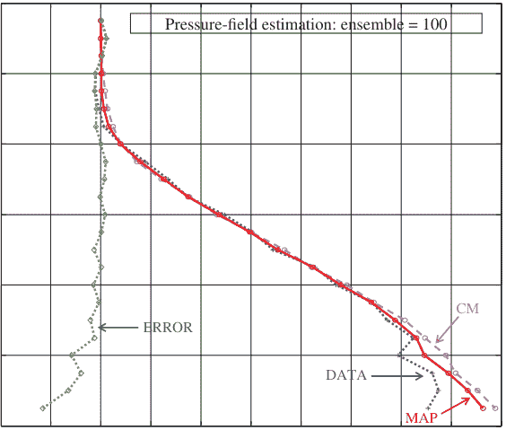

**图8.22** 使用具有自适应模态系数的粒子滤波估计器对哈德逊峡谷实验的原始/增强声压场（DATA）数据：最大后验（MAP）、条件均值（CM）以及相应的新息（ERROR）序列。

图中还显示了新息或残差（ERROR）。两种估计器都能跟踪并增强声压场。使用经典性能（健全性检验）指标对新息序列（ERROR）进行零均值/白噪声检验，两个处理器都满足无偏性准则（\(Z_M\): \(6.2 \times 10^{-4} < 4.9 \times 10^{-1}\)）和不相关新息准则，即超过界限的样本少于5%（6.3%）。第4.2节的加权残差平方和（WSSR）检验也获得了令人满意的结果，即*没有样本超过阈值*，表明处理器在功能上是“已调优”的。UKF处理器也产生了合理的增强声压场结果（未显示）。

图8.23显示了每个模态函数估计器（PF（MAP/CM）和UKF）的集合模式跟踪结果。在图8.23中，我们观察到与UKF相比，PF的性能似乎能很好地跟踪模态。有趣的是，模态系数估计在整个运行过程中不断被处理器自适应（调整），这证明了海洋统计量的非平稳性，如图8.24所示。

至此，完成了哈德逊峡谷实验数据在自适应（模态系数）PF处理性能方面的分析。

### 8.4.4.2 自适应PF设计：波数

与之前的模态系数情形一样，我们研究PF在估算图8.25所示100个成员集合上的声压场增强能力。使用1500个粒子，我们看到了实验的原始水听器数据（虚线）以及MAP估计（圆圈）和条件均值（CM）估计（带圆圈的虚线）。两种估计器似乎都能很好地跟踪声场（真实（均值）解用虚线表示）。相应的新息（残差）序列也用菱形表示。通常，两种估计器都产生了满意的零均值/统计白噪声检验以及WSSR检验，表明处理器是“已调优”的[9]。

图8.26显示了每个模态函数估计器（PF（MAP/CM）和UKF）的集合模式跟踪结果。在图8.26中，我们观察到PF的性能似乎能很好地跟踪模态，并且优于UKF。每个模态的均方根（模态跟踪）误差都在 \(10^{-5}\) 量级，非常合理，再次证实了它们的性能。有趣的是，波数估计在整个运行过程中不断被处理器自适应（调整），这证明了海洋统计量的非平稳性。集合平均波数估计非常合理：（0.206, 0.197, 0.181, 0.173, 0.142；真值 0.208, 0.199, 0.183, 0.175, 0.142）。PF和CM的集合估计非常接近真值，适应不断变化的海洋环境，同时平均而言仍保持波数值。


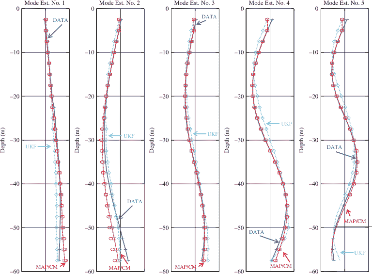

**图 8.23** 具有自适应模态系数估计的模态函数跟踪：原始实验数据（DATA）、无迹卡尔曼滤波器（UKF）、最大后验（MAP）（圆圈）和条件均值（CM）（方块）粒子滤波器。

图 8.24 来自哈德逊峡谷实验的自适应模态系数参数估计数据（MODEL），使用 MAP 粒子滤波器（参数估计）。

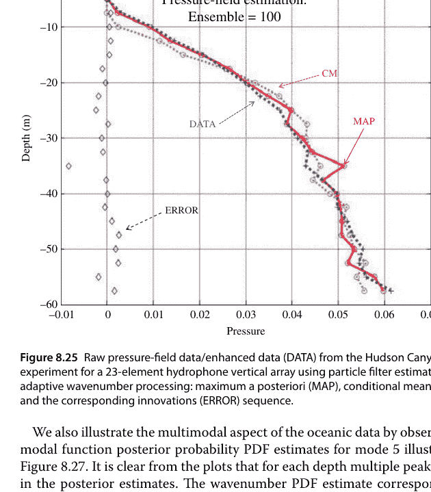

图 8.25 来自哈德逊峡谷实验的 23 元水听器垂直阵列原始压力场数据/增强数据（DATA），使用具有自适应波数处理的粒子滤波器估计器：最大后验（MAP）、条件均值（CM）以及对应的新息（误差）序列。

我们还通过观察图 8.27 中所示的模态 5 的模态函数后验概率 PDF 估计，说明了海洋数据的多模态特性。从图中可以清楚地看出，在每个深度处，后验估计中都会出现多个峰值。与模态 5 对应的波数 PDF 估计如图 8.28 所示。我们再次注意到后验分布中出现了多个清晰明确的峰值，从而得到 MAP 参数估计。

至此，完成了对合成的哈德逊峡谷实验的分析以及 PF 处理性能的评估。

## 8.4.5 小结

在这项研究中，我们讨论了环境自适应处理器的开发，这些处理器能够跟踪模态并增强浅水中垂直水听器阵列获得的原始压力场测量数据。参数自适应基于同时估计以下任一项：

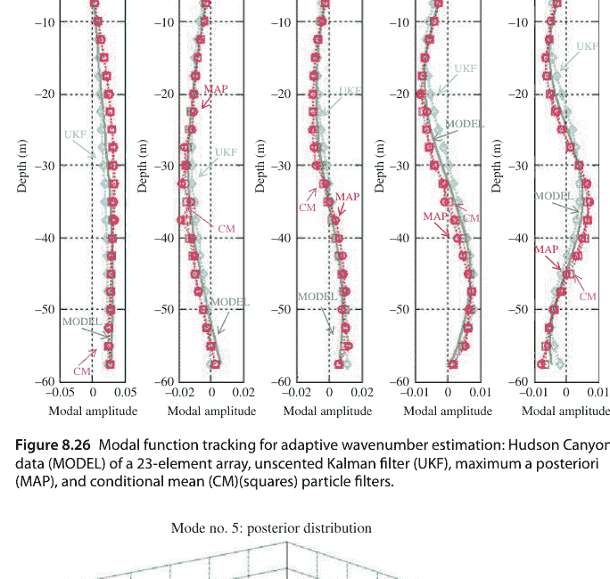

图 8.26 自适应波数估计的模态函数跟踪：哈德逊峡谷 23 元阵列数据（MODEL）、无迹卡尔曼滤波器（UKF）、最大后验（MAP）和条件均值（CM）（方块）粒子滤波器。

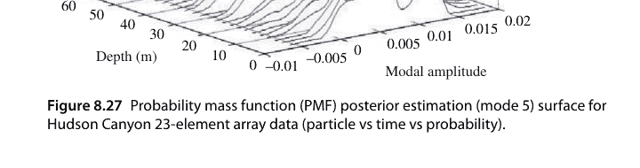

图 8.27 哈德逊峡谷 23 元阵列数据的概率质量函数（PMF）后验估计（模态 5）曲面（粒子 vs 时间 vs 概率）。

## 模态 5：波数后验分布

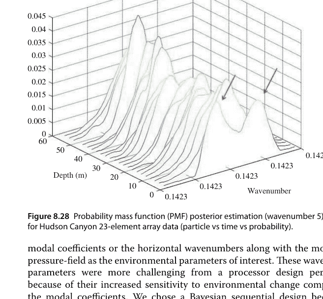

图 8.28 哈德逊峡谷 23 元阵列数据的概率质量函数（PMF）后验估计（波数 5）曲面（粒子 vs 时间 vs 概率）。

模态系数，或水平波数以及模态和压力场，作为关注的环境参数。从处理器设计的角度来看，这些波数参数更具挑战性，因为与模态系数相比，它们对环境变化的敏感性更高。由于浅海环境的时变性，我们选择了贝叶斯序贯设计，并应用状态空间形式的简正波模型来构建前向传播算子。所应用的算法是 UKF 和粒子滤波器，两者都是解决该问题的现代方法（参见第 4 章）。我们比较了它们的性能，发现 PF 在 100 个成员的集合上结果略好。这些结果及更多细节可以在最近的一篇论文 [48] 中找到。

## 8.5 用于 chirp 信号提取的 MBID

Chirp 信号主要源于雷达/声纳信号处理应用，这些应用专门尝试估计监视/跟踪区域中目标的位置 [49, 50]，最近又被引入无损评估（NDE）领域 [51]。Chirp 本质上是一种正弦信号，其相位在每个时间采样点瞬时变化，

它有一个有趣的特性：其相关函数近似于冲激函数 [52, 53]。众所周知，雷达/声纳中的匹配滤波器检测器通过将发射 chirp 的复制信号与目标反射回雷达/声纳接收机的测量数据进行互相关来估计目标距离，产生与回波时间对应的最大峰值，从而实现所需的距离估计。

在此应用中，我们执行与雷达或声纳系统相同的操作，即向目标介质发射“类 chirp 脉冲”，并从含噪测量中提取该脉冲。我们的问题因周围广播电台的干扰信号以及频段内外部干扰源的存在而变得复杂，当然，还有始终存在的随机仪器噪声 [51]。首先，我们对两个高度关注的信号进行建模：chirp 信号和 FSK 信号，然后开发一个基于模型的识别器，以从含噪数据中提取（估计）它们。

### 8.5.1 类 chirp 信号

#### 8.5.1.1 线性 chirp

chirp 信号是一种正弦信号，由其幅度 α 和相位 φ 表征，即：

```
s(t) = α × cos(φ(t))
```

其中瞬时相位定义为

```
φ(t) = 2πf(t) + φ(tₒ)
```

其中 f(t) 为对应的瞬时频率。相位的变化率由其导数定义

```
d/dt φ(t) = 2πf'(t) =: ωᵢ(t)
```

其中 ωᵢ 定义为瞬时角弧度频率。

频率可以通过多种不同关系来表征，其中一种是“线性”关系

```
f(t) = β × t + fₒ
```

其中 fₒ 是时间 tₒ 处的初始（扫描）频率，β 是由下式给出的变化率

```
β = (f_f − fₒ) / t_f
```

其中 f_f 是由最终（扫描）时间 t_f 界定时间窗口内的最终（扫描）频率。

对于线性 chirp，相应的相位通过对式 (8.132) 进行积分得到：

$$\phi(t)=\phi(t_o)+2\pi\int_{t_o}^{t} f(\alpha)\,d\alpha=\phi(t_o)+2\pi\left(f_o t+\frac{\beta t^2}{2}\right)$$ (8.135)

相应的*正弦 chirp*信号随后由下式给出（频谱见图 8.29a）

$$s(t)=\alpha\cos\left(2\pi\left(f_o\cdot t+\frac{\beta}{2}\cdot t^2\right)\right)$$ (8.136)

对于我们的问题，存在污染测量的干扰和噪声，即假设采用采样数据表示 $(t=t_k)$，我们有

$$y(t_k)=s(t_k)+d(t_k)+e(t_k)+v(t_k)$$ (8.137)

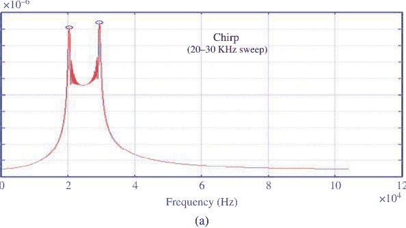

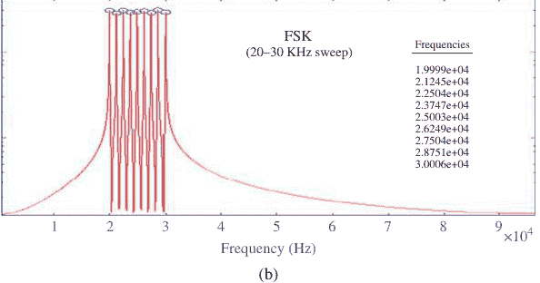

**图 8.29** 真实的 chirp 和 FSK 频谱（20–30 kHz 扫描）：(a) chirp 频谱。(b) FSK 频谱（$\Delta f=1.25$ kHz 步进）。

其中 $s$ 是发射的 chirp，$d$ 是潜在的广播干扰，$e$ 是外部干扰，$v$ 是均值为零、方差为 $R_{vv}(t_k)$ 的高斯随机噪声过程。图 8.30a 显示了在 20 至 30 kHz 之间扫描的 chirp 信号以及带有干扰和噪声的频谱，(b) 中展示了干扰和噪声。

### 8.5.1.2 频移键控（FSK）信号

线性调频（FM）chirp 的一种替代方案是 FSK 调制，它被认为是最简单的 FM 形式 [54]，其频谱如图 8.29b 所示。在 $M$ 进制情况下，使用 $M$ 个不同频率来传输编码信息序列。频率间隔 $\Delta f$ 的选择由 FSK 信号定义

$$s_m(t_k)=\sqrt{\frac{2\mathcal{E}_s}{\mathcal{T}}}\cos 2\pi(f_0+m\Delta f)t_k,\qquad m=0,\ldots,M-1 \tag{8.138}$$

其中 $\mathcal{E}_s=m\times\mathcal{E}_b$ 定义为每符号能量，$\mathcal{T}=m\times\mathcal{T}_b$ 是符号间隔，$\Delta f=f_m-f_{m-1}$，$\mathcal{E}_b$ 是每比特信号能量，$\mathcal{T}_b$ 是比特间隔持续时间。通常，$M$ 进制 FSK 用于传输每信号 $n=\log_2 M$ 比特的块。这里，$M$-FSK 信号具有相等的能量 $\mathcal{E}_s$。

频率间隔 $\Delta f$ 决定了 $M$ 个发射信号可区分的程度。这些信号中的每一个都可以表示为按 $\sqrt{\mathcal{E}_s}$ 缩放的正交单位向量 $\mathbf{u}_m$，即 $\mathbf{s}_m:=\sqrt{\mathcal{E}_s}\mathbf{u}_m$，其中基函数定义为 $b_m(t_k)=\sqrt{\frac{2}{\mathcal{T}}}\cos 2\pi(f_0+m\Delta f)t_k$。信号向量对之间的最小距离由 $d=\sqrt{\mathcal{E}_s}$ 给出。我们将把这种 FSK 表示形式纳入基于模型的识别器的开发中。

为了在时域中表示 FSK 信号，我们必须引入门函数 $G_{t_k}(\Delta\tau)$，其定义为

$$G_{t_k}(\Delta\tau):=\mu(t_k-m\Delta\tau)-\mu(t_k-(m+1)\Delta\tau);\qquad m=0,\ldots,M-1 \tag{8.139}$$

其中 $\mu(\cdot)$ 是单位阶跃函数，$\Delta\tau=\frac{1}{\Delta f}$ 是频率间隔的倒数，等价于比特间隔持续时间 $\mathcal{T}_b$。有了该算子，我们现在可以将时域 FSK 信号表示为

$$\begin{aligned}s(t_k)&=\sum_{m=0}^{M-1}s_m(t_k)\times G_{t_k}(\mathcal{T}_b)\\&=\sqrt{\frac{2\mathcal{E}_s}{\mathcal{T}}}\sum_{m=0}^{M-1}\cos 2\pi(f_0+m\Delta f)t_k\,[\mu(t_k-m\mathcal{T}_b)-\mu(t_k-(m+1)\mathcal{T}_b)]\end{aligned}\tag{8.140}$$

该模型将用于提取 FSK 信号。


Figure 8.30 Chirp data: (a) True chirp signal and disturbance with spectrum. (b) Noisy (−40 dB) chirp signal and disturbance with spectrum.

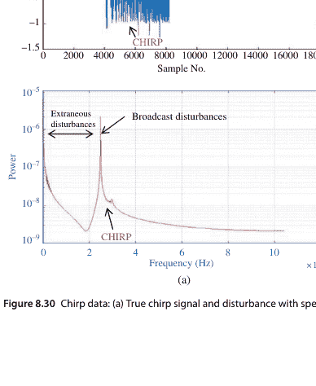

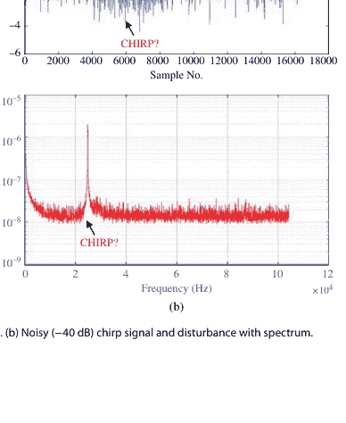

## 8.5.2 Model-Based Identification: Linear Chirp Signals

Thus, the model-based linear *chirp estimation* problem can simply be stated as

**GIVEN** a set of noisy measurement data $\{y(t_k)\}$, $k=0,1,\ldots,K$ contaminated with broadcast disturbances $\{d(t_k)\}$, extraneous audio signals $\{e(t_k)\}$ and Gaussian noise $\{v(t_k)\}$, **FIND** the best estimate of the chirp signal $\hat{s}(t_k)$ or equivalently the parameters $\{\hat{\alpha},\hat{f}_o,\hat{f}_f\}$.

The estimated chirp is obtained directly from its parameter estimates as

$$\hat{s}(t_k)=\hat{\alpha}\cos\left(\hat{f}_o\cdot t+2\pi\left(\frac{\hat{\beta}}{2}\cdot t^2\right)\right)$$  (8.141)

for

$$\hat{\beta}=\frac{\hat{f}_f-\hat{f}_o}{t_f}$$  (8.142)

Thus, the solution to estimating the linear chirp in the midst of these disturbances reduces to a problem of MBID.

### 8.5.2.1 Gauss–Markov State-Space Model: Linear Chirp

We choose to apply the UKF of Section 4.3 as a MBID-technique to solve this nonlinear problem by modeling the parameter variations as *random walks*, that is, in state-space form we have that

$$\mathbf{f}(t_k)=\mathbf{f}(t_{k-1})+\mathbf{w}_f(t_{k-1})$$
$$\alpha(t_k)=\alpha(t_{k-1})+w_\alpha(t_{k-1})$$  (8.143)

where $\mathbf{f}\in\mathbb{R}^{N_f\times1}$ is the vector of frequency parameters, $\alpha$ is the scalar amplitude and $\mathbf{w}\in\mathbb{R}^{N_w\times1}$ a zero-mean, multivariate Gaussian vector process with covariance $\mathbf{R}_{ww}(t_k)$. Here $\mathbf{f}=[f_o\ f_f]^T$ and $\mathbf{w}_f=[w_o\ w_f]^T$. The corresponding measurement model is given in Eq. (8.141).

Generally, the UKF algorithm provides the updated signal (parameter) estimates as²

$$\hat{\mathbf{f}}(t_k|t_k)=\hat{\mathbf{f}}(t_k|t_{k-1})+\mathbf{K}_f(t_k)e(t_k|t_{k-1})$$
$$\hat{\alpha}(t_k|t_k)=\hat{\alpha}(t_k|t_{k-1})+\mathbf{K}_\alpha(t_k)e(t_k|t_{k-1})$$
$$e(t_k|t_{k-1})=y(t_k)-\hat{y}(t_k|t_{k-1})-d(t_k)-e(t_k)$$
$$\hat{y}(t_k|t_{k-1})=\hat{s}(t_k|t_k)=\hat{\alpha}(t_k|t_{k-1})$$
$$\qquad\times\cos\left(2\pi\left(\hat{f}_o(t_k|t_{k-1})\cdot t_k+\frac{\hat{\beta}(t_k|t_{k-1})}{2}\cdot t_k^2\right)\right)$$
$$\mathbf{K}(t_k)=\mathbf{R}_{fe}(t_k|t_{k-1})\mathbf{R}_{ee}^{-1}(t_k|t_{k-1})$$  (8.144)

² The notation $\hat{\theta}(t_k|t_{k-1})$ means the estimate of $\theta$ at time $t_k$ based on all the data up to time $t_{k-1}$, $Y_{k-1}=\{y(t_j)\};\ k=0,\ldots,K$.

with the instantaneous frequency (linear chirp) where the amplitude is estimated by $\hat{\alpha}(t_k|t_k)$ and

$$\hat{f}(t_k|t_{k-1}) := \hat{f}_o(t_k|t_k) \cdot t_k + \frac{\hat{\beta}(t_k|t_k)}{2} \cdot t_k^2$$

$$\hat{\beta}(t_k|t_k) = \frac{\hat{f}_f(t_k|t_k) - \hat{f}_o(t_k|t_k)}{t_f}$$  (8.145)

Since we are transmitting the chirp signal, we have a good estimate of the starting values for $\alpha$, $f_o$, $f_f$, $t_f$ that can be used in the signal estimation problem. An interesting property of the UKF processor is that the innovations (residual errors) should be approximately zero-mean and white (uncorrelated) indicating that the model "matches" the data.

Thus, the received data can be considered to consist of extraneous and broadcast disturbances along with random measurement noise. We developed a set of synthesized measurement data by filtering (low pass) a snip-it of raw measurements to extract the extraneous disturbance with its power spectrum shown in Figure 8.32b. Next we synthesized a unit amplitude ($\alpha = 1$) chirp and broadcast disturbances. That is, we assume a chirp signal was swept over the entire record length sweeping up from $f_o = 20$ kHz to $f_f = 30$ kHz for a period of $t_f = 19.7$ ms at a sampling interval of $\Delta t = 4.8 \mu s$. From the power spectrum of Figure 8.30a, we see that the extraneous disturbance is in the frequency range of 0–19 kHz (Figure 8.32) with the broadcast (sinusoid) disturbance at 2.48 kHz. For our simulation, we chose amplitudes of 0.2 and 0.5, respectively. The simulated data and spectrum (without instrumentation noise) are shown in Figure 8.32a. Note that all of the amplitude data was scaled down from actual measurements. For the simulation, we chose a measurement model of

$$y(t_k) = 1.0 \cos(2\pi(2 \times 10^4 t_k + 3 \times 10^4 t_k^2)) + 0.5 \sin(2\pi 2.48 \times 10^4 t_k)$$
$$+0.25 e(t_k) + v(t_k)$$  (8.146)

for $v \sim \mathcal{N}(0, 1 \times 10^{-1})$. We show the simulated noisy measurement (input to the UKF-processor) and spectrum in Figure 8.32b with instrumentation noise included obscuring the chirp signal completely.

Next we applied the UKF processor to estimate the instantaneous frequency and compared it in steady state ($\tilde{f} = E{\hat{f}(t_k|t_k)}$) dynamically at each instant as shown in Figure 8.31. Here we see that the model can track the parameters as indicated by its estimate of the instantaneous frequency and the resulting chirp with the corresponding error. The UKF processor is "tuned," since the innovations statistics are zero-mean/white using the statistical zero-mean/whiteness test as well as the WSSR test indicating a reasonably tuned processor. The WSSR processor performs a dynamic whiteness test by sliding a finite length (parameter) window through the data and tests for whiteness as long as the statistic lies below the threshold (see Section 4.2 for details).

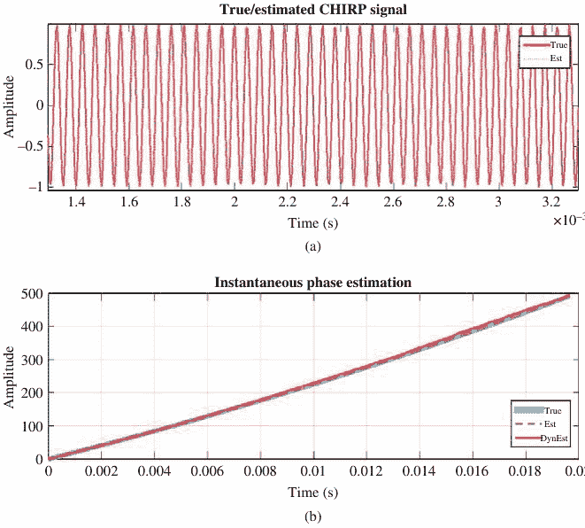

**Figure 8.31** Model-based CHIRP identification: (a) Estimated chirp. (b) Linear chirp: true, steady-state, dynamic.

## 8.5.3 Model-Based Identification: FSK Signals

In this subsection, we develop the model-based identifier for the FSK signal discussed earlier. Recall that the FSK signal can be parameterized as

$$s_m(t_k)=\alpha\cos 2\pi(f_o+m\Delta f)t_k,\qquad m=0,\ldots,M-1$$

(8.147)

where the amplitude is $\alpha=\sqrt{\frac{2\mathcal{E}_s}{\tau}}$, the carrier frequency is $f_o$ and the frequency separation is $\Delta f$. From the signal estimation perspective, we need to estimate only the amplitude and separation, since the carrier is well known as well as the number of transmitted frequencies $M$. Therefore, the model-based FSK *estimation* problem including the disturbances (as before) can be stated as

**GIVEN** a set of noisy measurement data $\{y(t_k)\}$, $k=0,1,\ldots,K$ contaminated with broadcast disturbances $\{d(t_k)\}$, extraneous disturbances $\{e(t_k)\}$, and Gaussian noise $\{v(t_k)\}$, **FIND** the best estimate of the FSK signal $\hat{s}(t_k)$ or equivalently the parameters $\{\hat{\alpha},\Delta\hat{f}\}$.

For this case, the measurement model is

$$y(t_k)=s(t_k)+d(t_k)+e(t_k)+v(t_k)$$

and the estimated FSK signal is obtained directly from its parameter estimates as

$$\hat{s}(t_k)=\hat{\alpha}\sum_{m=0}^{M-1}\cos 2\pi(f_o+m\Delta\hat{f})t_k\times G_{t_k}(\mathcal{T}_b)$$

Thus, the MBID solution to estimating the FSK in the midst of these disturbances again reduces to a problem of parameter estimation as before in the linear chirp case.

### 8.5.3.1 Gauss–Markov State-Space Model: FSK Signals

We perform a MBID applying the UKF (UKF) to this nonlinear problem by modeling the parameter variations as *random walks*, that is, in state-space form we have that

$$\Delta f(t_k)=\Delta f(t_{k-1})+w_f(t_{k-1})$$
$$\alpha(t_k)=\alpha(t_{k-1})+w_\alpha(t_{k-1})$$

where $\Delta f$ is the frequency separation parameter, $\alpha$ is the scalar amplitude, and $\mathbf{w}\in\mathbb{R}^{2\times1}$, a zero-mean, multivariate Gaussian vector process with covariance $\mathbf{R}_{\mathbf{w}}(t_k)$. Here $\mathbf{w}=[w_f\mid w_\alpha]'$. The corresponding measurement model is given in Eq. (8.148).

Generally, the UKF algorithm provides the updated signal (parameter) estimates as

$$\Delta\hat{f}(t_k|t_k)=\Delta\hat{f}(t_k|t_{k-1})+K_f(t_k)e(t_k|t_{k-1})$$
$$\hat{\alpha}(t_k|t_k)=\hat{\alpha}(t_k|t_{k-1})+K_\alpha(t_k)e(t_k|t_{k-1})$$
$$e(t_k|t_{k-1})=y(t_k)-\hat{y}(t_k|t_{k-1})-d(t_k)-e(t_k)$$
$$\hat{y}(t_k|t_{k-1})=\hat{s}(t_k|t_k)=\hat{\alpha}(t_k|t_{k-1})$$
$$\qquad\times\sum_{m=0}^{M-1}\cos 2\pi(f_o+m\Delta\hat{f}(t_k|t_{k-1}))t_k\times G_{t_k}(\mathcal{T}_b)$$
$$\mathbf{K}(t_k)=\mathbf{R}_{fe}(t_k|t_{k-1})\mathbf{R}_{ee}^{-1}(t_k|t_{k-1})$$

Since we are transmitting the FSK signal, we have a good estimate of the starting values for $\alpha$, $f_o$, $M$ that can be used in the signal estimation/detection problem. Recall that the processor is tuned when the innovations are zero-mean/white and not when these statistical conditions are not met. Therefore, the processor can be used as an *anomaly detector* (as before) when these conditions are not satisfied. We discuss this property subsequently.

Thus, the received data can be considered to consist of extraneous and broadcast disturbances along with random measurement noise.


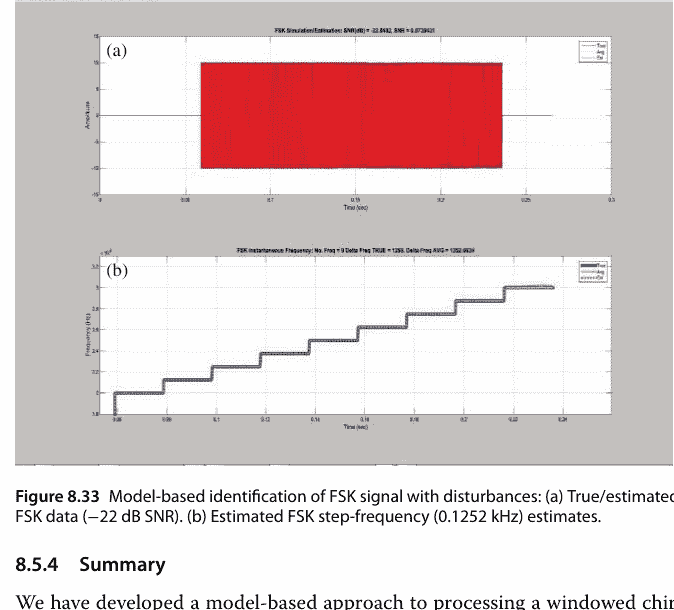

图 8.33 存在干扰的 FSK 信号的基于模型的辨识：（a）真实/估计的 FSK 数据（-22 dB SNR），（b）估计的 FSK 步进频率（0.1252 kHz）估计。

## 8.5.4 总结

我们开发了一种基于模型的窗口化线性调频信号和 FSK 信号在噪声数据中处理的方案。我们应用了第 4.3 节的 UKF 技术来执行来自噪声合成数据的关键线性调频和 FSK 信号参数的 MBID，并证明了 MBID 方法可用于从噪声测量中提取这些信号。
