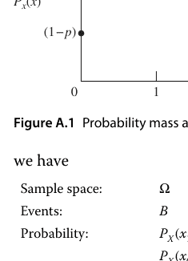
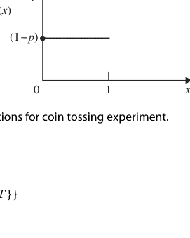

## 附录 A

## 概率与统计概述

### A.1 概率论

定义样本空间（结果）Ω、域（事件）B 以及概率函数（在事件类上）Pr，我们可以将实验构造为三元组 {Ω, B, Pr}。

# 示例 A.1 考虑实验 {Ω, B, Pr} 抛一枚公平硬币，则我们看到

样本空间：Ω = {H, T}
事件：B = {0, {H}, {T}}
概率：Pr(H) = p
Pr(T) = 1 − p

有了样本空间、概率函数和实验的概念，我们现在可以更精确地开始定义离散随机信号的概念。我们将离散随机变量定义为其值由实验结果决定的实函数。它将样本空间 Ω 的每个点映射为一个实数，Ω 由实验的所有可能结果组成。随机变量 X 及其实现 x 写为

```
X(ω) = x    for    ω∈Ω
```

(A.1)

考虑以下简单实验的例子。

# 示例 A.2 我们被要求分析抛一枚公平硬币的实验，则样本空间由正面或反面作为可能结果组成，即

```
Ω = {0 H T} ⇒ X(ω) = x
ω = {H, T}
```


## 附录 A 概率与统计概述

如果我们将正面赋值为 1，背面赋值为 0，则随机变量 $X$ 执行映射

$$X(\omega = H) = x(H) = 1,\qquad X(\omega = T) = x(T) = 0$$

其中 $x(\cdot)$ 被称为随机变量 $X$ 的样本值或实现。

概率质量函数以随机变量为基础定义，即

$$P_X(x_i) = \Pr(X(\omega_i) = x_i) \tag{A.2}$$

而概率分布函数定义为

$$F_X(x_i) = \Pr(X(\omega_i) \le x_i) \tag{A.3}$$

它们之间的关系为

$$p_X(x) = \sum_i P_X(x_i)\,\delta(x - x_i) \tag{A.4}$$

$$F_X(x) = \sum_i P_X(x_i)\,\mu(x - x_i) \tag{A.5}$$

其中 $\delta$ 和 $\mu$ 分别为单位脉冲和阶跃函数。

可以很容易地证明分布函数是一个单调递增函数（详见 Ref. [1]），满足以下性质：

$$\lim_{x_i \to -\infty} F_X(x_i) = 0$$

以及

$$\lim_{x_i \to \infty} F_X(x_i) = 1$$

这些性质可用于证明质量函数满足

$$\sum_i P_X(x_i) = 1$$

分布函数或概率质量函数都可以完整描述随机变量的性质。给定其中任一函数，我们可以计算随机变量取实数线上任意事件集合的值的概率。为了完成我们的抛硬币示例，如果我们将正面出现的概率定义为 $p$，则可以按以下示例所示计算分布和质量函数。

### 示例 A.3

考虑抛硬币实验并计算相应的质量和分布函数。由前一示例可知，

$$P_X(x) = \begin{cases} 1 - p & x = 0 \\ p & x = 1 \\ 0 & \text{otherwise} \end{cases}$$





**图 A.1.** 抛硬币实验的概率质量和分布函数。

我们有

- 样本空间：$\Omega = \{H, T\}$
- 事件：$B = \{\emptyset, \{H\}, \{T\}\}$
- 概率：$P_X(x_1 = H) = p$，$P_X(x_0 = T) = 1 - p$
- 随机变量：$X(\omega_1 = H) = x_1 = 1$，$X(\omega_2 = T) = x_2 = 0$
- 分布：
$$F_X(x_i) = \begin{cases} 1 & x_i \ge 1 \\ 1 - p & 0 \le x_i \le 1 \\ 0 & x_i < 0 \end{cases}$$

该示例的质量和分布函数如图 A.1 所示。注意质量函数值的总和必须为 1，且分布函数的最大值必须为 1，满足前面提到的性质。

如果我们将随机变量扩展为时间的函数，则可以定义随机过程，如第 2 章所述。更正式地，随机或随机过程是 $t$ 和 $\omega$ 的二维函数：

$$X(t, \omega), \qquad \omega \in \Omega,\ t \in T \tag{A.6}$$

其中 $T$ 是索引参数的集合（连续或离散），$\Omega$ 是样本空间。

我们列出概率论中的一些主要定理，并将读者引向更详细的文献 [1, 2]。

- 单变量：$\Pr(X) = P_X(x)$
- 双变量：$\Pr(X, Y) = P_{XY}(x, y)$
- 边际：$\Pr(X) = \sum_y P_{XY}(x, y)$
- 独立：$\Pr(X, Y) = P_X(x)P_Y(y)$
- 条件：$\Pr(X \mid Y) = P_{XY}(x, y) / P_Y(y)$
- 链式法则：$\Pr(X, Y, Z) = \Pr(X \mid Y, Z)\Pr(Y \mid Z)\Pr(Z)$

对于随机变量，我们可以根据概率质量函数定义基本统计量。随机变量 $X$ 的 *期望值* 或 *均值* 由下式给出

$$m_x = E\{X\}$$

并被视为给定数据集的典型或代表性值。因此，均值被称为集中趋势的度量。数值数据围绕期望值扩散的程度通常由 *方差* 或等价地 *自协方差* 衡量，给定为

$$R_{xx} = E\{(X - m_x)^2\}$$

这些基本统计量被称为 *集合统计量*，因为它们是在集合（$i = 1, 2, \ldots$）的数据值上测量的，即期望总是假设在实现集合上。我们总结这些统计量与其质量函数的表达式如下

| Statistic | Definition | Mass-function expression |
|---|---|---|
| Expected value | $m_x = E\{X\}$ | $= \sum_i X_iP_X(x_i)$ |
| Nth moment | $E\{X^n\}$ | $= \sum_i X_i^nP_X(x_i)$ |
| Nth moment about the mean | $E\{(X - m_x)^n\}$ | $= \sum_i (X_i - m_x)^nP_X(x_i)$ |
| Mean squared ($N = 2$) | $E\{X^2\}$ | $= \sum_i X_i^2P_X(x_i)$ |
| Variance | $R_{xx} = E\{(X - m_x)^2\}$ | $= \sum_i (X_i - m_x)^2P_X(x_i)$ |
| Covariance | $R_{xy}$ | $= E\{(X_i - m_x)(Y_i - m_y)\}$ |
| Standard deviation | $\sigma_{xx}$ | $= \sqrt{R_{xx}}$ |
| Conditional mean | $E\{X \mid Y\}$ | $= \sum_i X_iP_X(x_i \mid Y)$ |
| Joint conditional mean | $E\{X \mid Y, Z\}$ | $= \sum_i X_iP_X(x_i \mid Y, Z)$ |
| Conditional variance | $R_{x \mid y}$ | $= E\{(X - E\{X \mid Y\})^2 \mid Y\}$ |

这些基本统计量具有各种性质，使其可用于分析随机变量上的运算；其中较重要的¹有

- 线性：$E\{ax + b\} = aE\{x\} + b = am_x + b$
- 独立性：$E\{xy\} = E\{x\}E\{y\}$
- 方差：$R_{xx}(ax + b) = a^2R_{xx}$
- 协方差：
  - 不相关：$E\{xy\} = E\{x\}E\{y\}$ ($R_{xy} = 0$)
  - 正交：$E\{xy\} = 0$

注意期望值运算意味着对于随机过程，这些基本统计量是 *跨* 集合计算的。例如，如果我们想计算过程的均值，即

$$m_x(t) = E\{X(t, \omega_i)\}, \qquad X(t, \omega_i) = x_i(t)$$

我们只需取 $t = 0, 1, \ldots$ 的值并对每个时间值在集合（$i = 1, 2, \ldots$）上计算均值。处理随机过程与处理随机变量类似，只是我们必须考虑时间索引（详见第 2 章）。

接下来让我们定义随机变量所包含的概率信息的一些概念。我们将随机变量 $X(\omega_i) = x_i$ 出现所包含的（自）*信息* 定义为

$$I(x_i) = -\log_b P_X(x_i) \tag{A.7}$$

其中 $b$ 是对数的底，导致信息度量的单位不同（底 $= 2 \rightarrow$ 位），而 $X(\omega_i)$ 的 *熵* 或 *平均信息* 定义为

$$H(x_i) = -E\{I(x_i)\} = \sum_i P_X(x_i)\log_b P_X(x_i) \tag{A.8}$$

考虑存在多个随机变量的情况。然后我们将 $N$ 维随机变量的 *联合* 质量和分布函数定义为

$$P_X(x_1, \ldots, x_N), \qquad F_X(x_1, \ldots, x_N)$$

所有基本统计定义保持不变，只是将标量替换为联合函数。显然，如果我们把随机过程看作有序随机变量的序列，那么我们就是处理联合概率函数，即一组时间索引的随机变量。假设我们有两个随机变量，$x_1$ 和 $x_2$，并且我们知道后者已经取了一个特定值；那么我们可以定义在 $X(\omega_2) = x_2$ 已发生条件下 $x_1$ 的 *条件* 概率质量函数为

$$\Pr(x_1 \mid x_2) := P_X(X(\omega_1) = x_1 \mid X(\omega_2) = x_2) \tag{A.9}$$

并且可以从基本概率公理证明（见 Ref. [1]）

$$\Pr(x_1 \mid x_2) = \frac{\Pr(x_1, x_2)}{\Pr(x_2)} \tag{A.10}$$

注意该表达式也可以写成

$$\Pr(x_1, x_2) = \Pr(x_2 \mid x_1)\Pr(x_1) \tag{A.11}$$

将该方程代入式 (A.10) 得到贝叶斯法则，即

$$\Pr(x_1 \mid x_2) = \frac{\Pr(x_2 \mid x_1)\Pr(x_1)}{\Pr(x_2)} \tag{A.12}$$

如果我们使用联合质量函数的定义并代入前面的定义，则可以得到概率链式法则 [1–3]，

$$\Pr(x_1, \ldots, x_N) = \Pr(x_1 \mid x_2, \ldots, x_N)\Pr(x_2 \mid x_3, \ldots, x_N)\cdots\Pr(x_{N-1} \mid x_N)\Pr(x_N) \tag{A.13}$$

与这些定义一起出现的是条件期望的概念，即

$$E\{x_i \mid x_j\} = \sum_i X_i\Pr(x_i \mid x_j) \tag{A.14}$$

在条件期望定义后，我们列出其基本性质：

- 1) $E_X\{X \mid Y\} = E\{X\}$，如果 $X$ 和 $Y$ 独立
- 2) $E\{X\} = E_Y\{E[X \mid Y]\}$
- 3) $E_X\{g(Y)X \mid Y\} = g(Y)E\{X \mid Y\}$
- 4) $E_{X,Y}\{g(Y)X\} = E_Y\{g(Y)E\{X \mid Y\}\}$
- 5) $E_X\{c \mid Y\} = c$
- 6) $E_X\{g(Y) \mid Y\} = g(Y)$
- 7) $E_{X,Y}\{cX + dY \mid Z\} = cE\{X \mid Z\} + dE\{Y \mid Z\}$

信息和熵的概念也可以扩展到多个随机变量的情况。我们将两个随机变量 $x_i$ 和 $x_j$ 之间的 *互信息* 定义为

$$I(x_i; x_j) = \log_b\left[\frac{P_X(x_i \mid x_j)}{P_X(x_i)}\right] \tag{A.15}$$

而 $X(\omega_i)$ 和 $X(\omega_j)$ 之间的平均互信息为

$$I(X_i; X_j) = E_{X_i,X_j}\{I(x_i, x_j)\} = \sum_i\sum_j P_X(x_i, x_j)I(x_i, x_j) \tag{A.16}$$

这导致联合熵的定义为

$$H(X_i; X_j) = -\sum_i\sum_j P_X(x_i, x_j)\log_b P_X(x_i, x_j) \tag{A.17}$$

至此概率论部分结束。接下来让我们考虑一个重要的多变量分布及其性质。


# A.2 高斯随机向量

在本节中，我们考虑本教材中大量使用的多变量高斯分布，用于表征高斯随机向量，即 z ~ N(m_z, R_zz) 其中 z ∈ R^{N_z×1} 且定义为

Pr(z) = (2π)^{-N_z/2} |R_zz|^{-1/2} exp( -1/2 (z - m_z)^T R_zz^{-1} (z - m_z) )    (A.18)

其中向量均值和协方差定义为
m_z := E{z}   and   R_zz = Cov(z) := E{(z - m_z)(z - m_z)^T}

高斯向量的某些性质是有用的，例如以下内容：

- 线性变换：高斯变量的线性变换仍为高斯；也就是说，如果 z ~ N(m_z, R_zz) 且 y = A z + b，则
  Y ~ N(A m_z + b, A R_zz A^T)    (A.19)

- 不相关的高斯向量：不相关的高斯向量是独立的。

- 高斯变量之和：独立高斯向量的和产生均值和方差等于相应均值和方差之和的高斯分布向量。

- 条件高斯向量：条件高斯向量服从高斯分布；也就是说，如果 x 和 y 是联合高斯的，且
  m_z = E{ x \ y } = [ m_x \ m_y ] ; 且 R_zz = Cov(z) = [ R_xx R_xy \ R_yx R_yy ]
  则 x 和 y 的条件分布也是高斯的，其条件均值和协方差由下式给出
  m_{x|y} = m_x + R_{xy} R_{yy}^{-1} (y - m_y)
  R_{x|y} = R_{xx} - R_{xy} R_{yy}^{-1} R_{yx}
  且向量 x - E{x|y} 与 y 独立。

- 高斯条件均值：设 x、y 和 z 为联合分布的高斯随机向量且 y 与 z 独立，则
  E{x|y,z} = E{x|y} + E{y|z} - m_x

# A.3 不相关变换：高斯随机向量

假设我们有一个高斯随机向量，x ~ N(m_x, R_xx)，我们希望将其变换为均值
m_x 被移除的归一化高斯随机向量，使得 z ~ N(0, I)。假设均值已被移除（z → z − m_x），则存在一个非奇异变换 T，使得 z = Tx 且因此

R_zz = Cov(z) = Cov((Tx)(Tx)') = T R_xx T' = I  (A.20)

因此，我们必须找到满足关系的变换

R_zz = I = T R_xx T'  (A.21)

由于 R_xx 是一个正半定对称矩阵，它始终可以分解为矩阵平方根（R = U U' = R_xx^{1/2} R_xx^{T/2}）使用 Cholesky 分解 [4]；因此，式 (A.21) 意味着

R_zz = I = (T U) U' T'  (A.22)

或简单地

T = U^{-1} = R_xx^{-1/2}    (逆矩阵平方根)  (A.23)

因此

R_zz = (R_xx^{-1/2} U) U' R_xx^{-T/2} = R_xx^{-1/2} R_xx R_xx^{-T/2} = I  (A.24)

所期望的结果。

# A.4 Toeplitz 相关矩阵

N × N 相关矩阵 R 是一个 Hermitian Toeplitz 矩阵（R^H = (R*)'），具有以下一般性质 [4]：

1) Hermitian 矩阵的不同的特征值集合 {λ_i} 是实数。

2) Hermitian 矩阵对应于不同的特征值 {λ_i} 的特征向量集合 {e_i} 是正交的 → e_i^H e_i = 0 如果 λ_i ≠ λ_j。

3) 任何 Hermitian 矩阵都允许特征分解使得 R = E Λ E^H 且 E 为酉矩阵（E^{-1} = E^H）。

R = E Λ E^H with E unitary (E^{-1} = E^H).

4) Hermitian 矩阵的逆可以通过特征分解得到为

R^{-1} = (E Λ E^H)^{-1} = E^{-H} Λ^{-1} E^{-1} = E Λ^{-1} E^H = Σ_{i=1}^N (1/λ_i) e_i e_i^H.

# A.5 重要过程

我们定义两个重要过程，将被广泛用于建模随机信号。第一个是均匀分布过程，其由质量函数指定

p_X(x_i) = 1/(b - a),   a < x_i < b   (A.25)

- 4. *条件高斯变量*：条件高斯变量服从高斯分布；也就是说，如果 $x_i$ 和 $x_j$ 是联合高斯的，则

$$E\{x_i \mid x_j\} = m_{x_i} + R_{x_i x_j} R_{x_j x_j}^{-1} (x_j - m_{x_j})$$

且

$$R_{x_i|x_j} = R_{x_i x_i} - R_{x_i x_j} R_{x_j x_j}^{-1} R_{x_j x_i}$$

- 5. *正交误差*：估计误差 $\tilde{x}$ 与条件变量正交；也就是说，对于 $\tilde{x} = x - E\{x \mid y\}$，则

$$E\{y\tilde{x}\} = 0$$

- 6. *四阶高斯矩*：零均值高斯变量的四阶矩由下式给出

$$E\{x_1 x_2 x_3 x_4\} = E\{x_1 x_2\}E\{x_3 x_4\} + E\{x_1 x_3\}E\{x_2 x_4\} + E\{x_1 x_4\}E\{x_2 x_3\}$$

本讨论完成了概率和随机变量的介绍性概念，其扩展到第 2 章及全文中的随机过程。

# 参考文献

1 Papoulis, A. (1965). *Probability, Random Variables and Stochastic Processes.* New York: McGraw-Hill.
2 Hogg, R. and Craig, A. (1970). *Introduction to Mathematical Statistics.* New York: MacMillan.
3 Jazwinski, A. (1970). *Stochastic Processes and Filtering Theory.* New York: Academic Press.
4 Bierman, G. (1977). *Factorization Methods for Discrete Sequential Estimation.* New York: Academic Press.

# 附录 B

# 投影理论

# B.1 投影：确定性空间

投影理论在子空间辨识中起重要作用，主要是因为子空间是通过变换或“投影”向量到低维空间——子空间而创建的 [1–3]。我们主要感兴趣的是两种投影算子：（i）正交和（ii）斜或平行。正交投影算子“投影” • 到 𝒴 为 𝒫_{•|𝒴} 或其补集 𝒫_{•|𝒴}^⊥，而斜投影算子“投影” • 到 𝒴 “沿” 𝒵 为 𝒫_{•|𝒴∥𝒵}^∥。例如，正交投影向量 x，我们有 𝒫_{x|𝒴} 或 𝒫_{x|𝒴}^⊥，而沿 𝒵 斜投影 x 为 𝒫_{x|𝒴∥𝒵}。

在数学上，n 维向量空间 ℛ 可以分解为子空间的直和使得

ℛ = ℛ₁ + ℛ₂

(B.1)

则对于向量 r ∈ ℛⁿ，我们有

r = r₁ + r₂ for r₁ ∈ ℛ₁ and r₂ ∈ ℛ₂

(B.2)

其中 r₁ 定义为 r 在 ℛ₁ 上的投影，而 r₂ 定义为 r 在 ℛ₂ 上的投影。

当特定投影被称为平行（∥）或“斜”时，将 r 变换到 ℛ₁ 沿 ℛ₂ 的相应投影算子定义为 𝒫_{r|ℛ₁∥ℛ₂}^∥，则

r₁ = 𝒫_{r|ℛ₁∥ℛ₂}^∥ or r₂ = 𝒫_{r|ℛ₂∥ℛ₁}^∥

(B.3)

其中 r₁ 定义为 r 在 ℛ₁ 上沿 ℛ₂ 的斜投影，而 r₂ 定义为 r 在 ℛ₂ 上沿 ℛ₁ 的投影。

当交集 ℛ₁ ∩ ℛ₂ = 0 时，则直和为

𝒫_{r|ℛ₁∪ℛ₁} = 𝒫_{r|ℛ₁∥ℛ₂}^∥ + 𝒫_{r|ℛ₂∥ℛ₁}^∥

(B.4)

以及相应的投影由下式给出

P_{A|B} = A × P_B = A × B(B'B)^{-1}B' (正交投影) (B.12)

在数值上，这些矩阵运算通过 LQ 分解（见附录 C）得到促进，如

[ B ]   [ L11 | O ] [ Q1' ]
[ -- ] = [ -- | -- ] [ -- ]
[ A ]   [ L21 | L22 ] [ Q2' ] (B.13)

其中投影由下式给出

P_{A|B} = A × P_B = L21 × Q1'
P_{A|B}^⊥ = A × P_B^⊥ = L22 × Q2' (B.14)

# B.3.2 斜（平行）投影

Row(A) 在 Row(C) 上的斜投影（|）沿（°）Row(B) 定义为 P_A | c° B。此投影运算可表示为两个非正交矩阵（B 和 C）及其相应正交补的行。符号上，A 的行在 B 和 C 的联合行空间（B ∨ C）上的投影可表示为两个斜投影和一个正交补。此投影如图 B.1b 所示，其中我们看到 Row(A) 首先正交投影到 B 和 C 的联合行空间（正交补），然后沿 B 和 C 分解，从而提取 Row(A) 在 Row(C) 上沿（°）Row(B）的斜投影。

P_A | B∨C = P_A || B° C + P_A || C° B + P_A^⊥ | B∨C (B.15)

从实用角度来看，该关系可表达为更“操作性”的形式，该形式在第 6.5 节中用于推导 N4SID 算法 [1, 4]，即

P_A || C° B = [A × P_B^⊥][C × P_B^⊥]^# × C (斜投影) (B.16)

其中 # 为伪逆运算（见附录 C）。斜投影还具有在推导中有用的以下性质：

P_B || C° B = 0
P_C || C° B = C (B.17)


类似地，正交补投影可以用斜投影算子表示为

$$P_{A \mid B}^{\perp} = P_{A \mid C\otimes B}^{\parallel} \times P_{B}^{\perp} \quad (B.18)$$

数值上，斜投影同样可以利用 LQ 分解计算（参见附录 C）。

$$
\begin{bmatrix} B \\ --- \\ C \\ --- \\ A \end{bmatrix} = \begin{bmatrix} L_{11} & 0 & 0 \\ --- & --- & --- \\ L_{21} & L_{22} & 0 \\ --- & --- & --- \\ L_{31} & L_{32} & L_{33} \end{bmatrix} \begin{bmatrix} Q'_1 \\ --- \\ Q'_2 \\ --- \\ Q'_3 \end{bmatrix} \quad (B.19)
$$

其中，沿 Row(B) 方向将 Row(A) 投影到 Row(C) 上的斜投影由下式给出

$$P_{A \mid C\otimes B}^{\parallel} = L_{32} \times L_{22}^{-1} \times C = L_{32} \times L_{22}^{-1} \times (L_{21} Q'_1 + L_{22} Q'_2) \quad (B.20)$$

表 B.1 给出了一些斜投影与正交投影矩阵之间的常用关系（更多细节参见文献 [1–3, 5]）。

### 表 B.1 矩阵投影。

| 操作 | 算子 | 投影 | 数值（LQ 分解） |
| --- | --- | --- | --- |
| 正交投影 |  |  |  |
| $P_{A \mid B}$ | $P_{\bullet \mid B} = B'(BB')^{-1}B$ | $A \times B'(BB')^{-1}B$ | $A \times (L_{21} \times Q'_1)$ |
| $P_{A \mid B}^{\perp}$ | $P_{\bullet \mid B}^{\perp} = (I - B'(BB')^{-1}B)$ | $A \times (I - B'(BB')^{-1}B)$ | $A \times (L_{22} \times Q'_2)$ |
| 斜投影 |  |  |  |
| $P_{A \mid C\otimes B}$ | $P_{\bullet \mid C\otimes B}$ | $L_{32} L_{22}^{-1} \times C$ | $L_{32} \times L_{22}^{-1} (L_{21} Q'_1 + L_{22} Q'_2)$ |
| 关系 |  |  |  |
| $P_{\bullet \mid B}$ | — | — | $Q_1 Q'_1$ |
| $P_{\bullet \mid B}^{\perp}$ | — | — | $Q_2 Q'_2$ |
| $P_{A \mid C\otimes B}$ | $P_{\bullet \mid C\otimes B}$ | $[A \times P_{B}^{\perp}] \| [C \times P_{B}^{\perp}]^{\#} \times C$ | — |
| $P_{A \mid B}^{\perp}$ | $P_{\bullet \mid B}^{\perp}$ | $P_{A \mid C\otimes B}^{\parallel} \times P_{B}^{\perp}$ | — |

1 注意投影算子与实际投影之间的区别。
