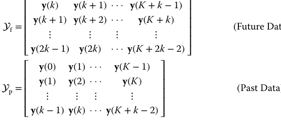

## 附录 D

### 仅输出子空间辨识

在本附录中，我们讨论针对受约束的“仅输出”实现问题的子空间辨识方法，与第 6 章和第 7 章的讨论不同，这里*没有*可用的输入激励数据。仅输出问题在实践中经常出现，尤其是在结构动力学、地震分析、医学诊断等几个重要领域中。例如，在结构动力学中，大型建筑物、桥梁或隧道受到风或日常交通的激励；地震为地震监测提供激励，而医学应用则由未知源驱动。

子空间方法主要源于 Akaike [1, 2] 和 Aoki [3] 在随机实现与投影理论方面的早期工作。应用于“仅输出”问题时，其核心思想是在由随机向量构成的希尔伯特空间中进行正交投影。也就是说，如果 $y_f(t)$ 是*未来*输出的有限随机向量，$y_p(t)$ 是*过去*输出的随机向量，那么将“未来输出数据”投影到“过去输出数据”上的*正交投影*由 $\mathcal{P}_{y_f|y_p}$ 定义。将一个向量投影到由另一个向量张成的子空间中的概念，可以推广为将矩阵的行（列）空间投影到另一个矩阵的行（列）空间上（参见附录 B）。据此，我们为未来和过去数据定义如下分块 Hankel 矩阵：

投影 $\mathcal{T}_k$ 的块 Toeplitz 矩阵为

$\mathcal{T}_k = E\{\mathcal{Y}_p\mathcal{Y}_p'\} = \begin{bmatrix} \Lambda_0 & \Lambda_{-1} & \cdots & \Lambda_{1-k} \\ \Lambda_1 & \Lambda_0 & \cdots & \Lambda_{2-k} \\ \vdots & \vdots & \ddots & \vdots \\ \Lambda_{k-1} & \Lambda_{k-2} & \cdots & \Lambda_0 \end{bmatrix} \in \mathcal{R}^{kN_y \times kN_y}$ (D.5)

利用创新模型，已证明增广状态向量 $\hat{\mathcal{X}}_k := [\hat{x}_k \quad \hat{x}_{k+1} \cdots \hat{x}_{k+k-1}] \in \mathcal{R}^{N_y \times kN_x}$ 满足以下关系 [4, 5] $\hat{\mathcal{X}}_k = \overline{\mathcal{C}}_{AB}^{-}(k) \times \mathcal{T}_k^{-1} \times \mathcal{Y}_p$ (D.6)

因此，将此表达式代入正交投影中，我们得到 $\mathcal{P}_{\mathcal{Y}_i|\mathcal{Y}_p} = \mathbf{T}_k \times \mathcal{T}_k^{-1} \times \mathcal{Y}_p = \mathcal{O}_k \underbrace{\overline{\mathcal{C}}_{AB}^{-}(k) \times \mathcal{T}_k^{-1} \times \mathcal{Y}_p}_{\hat{\mathcal{X}}_k} = \mathcal{O}_k \times \hat{\mathcal{X}}_k$ (D.7)

因此，通过对正交投影矩阵进行奇异值分解，可以提取扩展可观测矩阵和估计状态向量得到 $\mathcal{P}_{\mathcal{Y}_i|\mathcal{Y}_p} = [U_{N_x} \mid U_{\mathcal{N}}] \begin{bmatrix} \Sigma_{N_x} & 0 \\ \hline 0 & \Sigma_{\mathcal{N}} \end{bmatrix} \begin{bmatrix} V'_{N_x} \\ \hline V'_{\mathcal{N}} \end{bmatrix} = U_{N_x} \Sigma_{N_x} V'_{N_x}$ 其中 $\Sigma_{N_x} \gg \Sigma_{\mathcal{N}}$ 且 $\mathcal{P}_{\mathcal{Y}_i|\mathcal{Y}_p} = \mathcal{O}_k \hat{\mathcal{X}}_k = (U_{N_x} \Sigma_{N_x}^{1/2})((\Sigma'_{N_x})^{1/2} V'_{N_x})$ (D.8)

有了奇异值分解，我们利用投影来提取系统和输出测量矩阵，如第 6.2 节所述 $\hat{A} = \mathcal{O}_{N_x}^{\#} \mathcal{O}_{N_x}^{\dagger} = (\Sigma_{N_x}^{-1/2} U'_{N_x} \times \mathcal{O}_{N_x}^{\dagger}); \quad \hat{C} = \mathcal{O}(1 : N_y, 1 : N_x)$ (D.9)

输入传输矩阵 $(\bar{B}_e)$ 可以通过先由式 (D.4) 估计反向可控性矩阵来提取 $\overline{\mathcal{C}}_{AB}^{-}(k) = \mathcal{O}_{N_x}^{\#} \times \mathbf{T}_{k,k} = (\Sigma_{N_x}^{-1/2} U'_{N_x}) \times \mathbf{T}_{k,k}$ (D.10) 并提取最后的 $k$ 列得到 $\hat{B} = \bar{B}_e = \overline{\mathcal{C}}_{AB}^{-}(1 : N_x, (k-1)N_y : kN_y)$ (D.11)

- 5. Katayama, T. (2005). *Subspace Methods for System Identification*. London: Springer.
- 6. Reynders, E. (2012). System identification methods for (operational) modal analysis: review and comparison. *Arch. Comput. Methods Eng.* 19 (1): 51–124.
- 7. Juang, J. (1994). *Applied System Identification*. Upper Saddle River, NJ: Prentice-Hall PTR.
