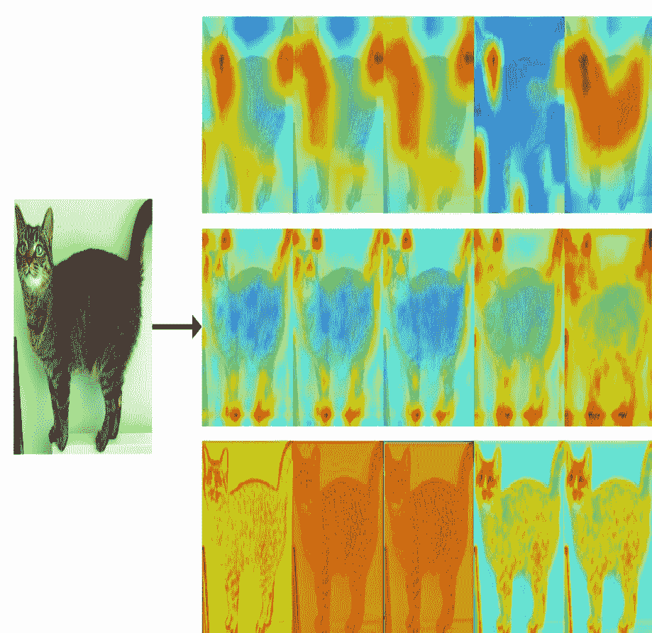

# 第 2 章 可解释人工智能

可解释人工智能（XAI）是一种旨在创建在很大程度上可被人类解释和/或理解的机器学习模型的人工智能形式。XAI 源于打破人工智能模型黑箱的需要，使其可被人类解释，目的是最大限度地降低这些模型产生未知或不可预测结果的风险。XAI 不仅与监管和法律原因相关，而且是监控和管理模型性能的重要工具。

在本章中，我们将讨论贵公司内部（或外部）的谁可能想要了解模型预测的解释，您可能希望模型可解释和/或可解释的众多原因，以及不同类型的模型如何被解释。重点将放在可解释性如何用于理解并从而改进机器学习模型的性能。

## 可解释性背景

在探索 XAI 之前，让我们简要讨论一下人工智能是什么以及它与负责任人工智能的关系。人工智能是一种由机器展示的智能形式，与动物和人类展示的自然智能相似，但没有表现出情感或意识的能力。你可能听说过一些先进的人工智能系统，例如飞机上的自动驾驶仪功能或汽车的自动驾驶能力，在过去十年中一直是人工智能社区的焦点。

人工智能系统可以像你走进房间时自动打开灯的设备一样简单，也可以像可以探索外星球的自主漫游车一样复杂。将 iPhone 上的 FaceID 视为一种用于验证你身份的人工智能形式，或一种旨在捕获你银行账户上欺诈交易的欺诈检测模型。人工智能的使用已扩展到以前所未有的方式触及日常生活几乎每个方面。

## XAI 如何融入负责任人工智能？

我们将在第 6 章更深入地讨论负责任人工智能，但在讨论 XAI 如何融入其中时，让我们在此简要介绍一下。负责任人工智能是人工智能的一个分支，旨在确保所有人工智能系统在设计和构建时都考虑到公平性、隐私、安全性和可解释性。如果你的模型很复杂，它们可能需要由你的数据科学团队解释，以了解（并尝试消除或减少）任何潜在的偏差。如果你在银行、保险或其他高合规行业运营，你的模型也可能因监管原因需要被解释。

XAI 与负责任人工智能对确保公平性和限制偏差的关注相辅相成。XAI 可用于检测模型中权重更高的特征，并完全将其移除或通过负偏差降低其权重。减少数据中的偏差或噪声可以使模型更容易解释或理解。

## 谁需要 XAI？

有许多利益相关者可能希望你解释模型的输出。这些利益相关者可分为三大类：

- 内部技术和业务利益相关者，如数据科学家、机器学习工程师、产品负责人或高管
- 人工智能系统或产品的终端用户
- 公共利益相关者，如监管机构或投资者

内部团队有兴趣通过了解模型为何做出某些预测来持续改进模型的性能。从管理层到低级开发人员，在让模型自由运行之前，了解你的模型在做什么以及它在现实世界中将如何表现非常重要。模型可解释性技术可以帮助利益相关者了解每个输入对输出的影响（其权重）以及不同类别的数据如何表现。模型有多种形式，本章后面我们将讨论不同模型类型（包括处理文本、图像和表格数据的模型）的不同可解释性形式。

终端用户也可能想了解模型为何对他们做出特定预测。根据你的用例，你可能希望透明地公开此解释。在争议的情况下，解释可用于证明或仲裁模型的结果；它在高风险模型中尤其重要，例如医疗保健领域，模型的决策可能意味着生死攸关。

最后，我们有公共利益，如监管机构和投资者。这些利益相关者有兴趣确保你的模型符合可能适用于你的公司或行业的全部规则和法规。在第 6 章中，我们将更详细地讨论负责任人工智能整体如何用于管理这些利益相关者的利益。

## XAI 如何用于管理模型性能

下一节讨论的不同类型的解释提供了对 XAI 实际应用的洞察。本节将介绍 XAI 如何在 MPM 的背景下使用。

## 可解释性与可解释性

人工智能系统通常涉及机器学习模型，本质上是预测结果或推荐决策的决策算法。这些预测可能对人类完全可解释或可解释，也可能不可解释。可解释性和可解释性在人工智能的背景下经常被互换使用，但让我们简要介绍一下两者之间的细微差别。

可解释性是指因果关系能够被映射的能力——也就是说，一组定义的输入每次都会产生一组定义且确定的输出，而不一定知道为什么会这样。将其置于机器学习背景下，模型的

output can be predicted from the inputs, but there is no explanation as to why this output may have been produced. For example, a model that predicts your income based on your age group alone will be fully interpretable, since for the same age it will always yield the same result.

Explainability, on the other hand, is the ability for the effect of each of a model’s inputs on its output or prediction to be explained. Such explanations are important for complicated models such as neural networks where there are multiple inputs fed into a black box, with little insight into its inner workings. In one approach to explain a model’s predictions, the input values are perturbed slightly to see if there’s an effect on the model’s output. Using such techniques, we can gain insight into why the model is behaving the way it is. An example of an explainable model would be a loan default prediction algorithm based on a number of inputs, such as debt-to-income ratio and credit score. With this model, it will be hard to map the inputs to outputs, since that would yield too many combinations. In this case, it might be difficult to *interpret* the model, but the model can be *explained* by using XAI techniques to determine how much each input contributes to the output.

## Models That Are Interpretable by Design Versus Explainable After

With the slew of machine learning frameworks and toolsets to choose from, generating model interpretations and/or explanations becomes a nontrivial task. Not all tools are created equal, and not all models are built for explainability or interpretability. Depending on the type of model or framework used, the outputs or predictions may be fully explainable and/or interpretable from the get-go (as is the case with simpler models like logistic regressions or decision trees), or they may need to have someone explain them post-training (as is the case with deep learning models or pretrained models). Models that are interpretable by design are often viewed as the least risky, since they are easier to explain. So where possible, you might decide to stick with these simpler models that your stakeholders can understand rather than invest resources into building a more advanced model that might not fully be explainable or interpretable and thus harder to get buy-in on.

## Understanding Model Predictions

Understanding why different models are predicting what they are predicting is very important in order to analyze model behavior, debug issues, track performance, and understand bias. If you suddenly notice a dip in your model’s performance, the first place to look is the prediction outputs. If there is a problem with the model itself, then model explanations can be used to debug it or to account for how it deals with new data in the system. Often models experience what is known as data drift (or model drift), where over time the data provided to the model changes slightly (or new data emerges), causing its performance to degrade if it is not updated. It’s important to observe model predictions after deployment and check that they remain understandable and do not deviate from expectations.

## Offline Versus Online Explainability

Model explanations can be generated either offline or online. As the name suggests, offline explanations are typically used during the development cycles of a model in order to understand the model better and hopefully build the best version for production use. In contrast, online explanations are based on the model’s predictions after it goes into use. Generating spot online explanations can help you debug and find the root cause of operational issues by providing an additional layer of model understanding, while generating them continuously can help you monitor how model behavior is changing (for example, how the top three most important features change over time). This is why it is vital to have a robust MPM process in place that can flag events as abnormal or track model confidence in order to alert the team when certain thresholds are passed.

## XAI in Different Domains

XAI is used in many different domains, and it is used in different ways to explain models across these domains. This section will discuss the three main types of explainable models that you might encounter—models for text, images, and tabular/structured data—and the different ways they might be explained.

## Tabular/Structured Data Models (Highest Contributing Features)

Structured data models are typically opaque and are not easy to interpret if there are more than one or two inputs. As these models become more complex and involve more variables, they become harder and harder to explain. But since they output predictions based on a series of inputs, it can be beneficial to know which inputs are contributing the most to the model’s output.

To explain a structured or tabular data model, the inputs are sorted in terms of their weight contribution to the model’s prediction, and color coding can be applied to help visualize what is happening and to pinpoint outliers or abnormalities.

Once a model explanation is available, the team can use it to understand what factors are contributing to the model’s predictions, whether it has any bias, or if any features can be removed without impacting the model’s output.

Suppose we have a model that works by analyzing a combination of features about a financial transaction with the intent of detecting fraud. These features might include some information about the customer, describing their typical behavior. The output of this model predicts how likely a transaction is to be fraudulent. Once a transaction is flagged, precautionary measures can be taken, such as locking the account until the user either calls the bank or visits a branch. If a transaction is incorrectly flagged as fraud, it is possible that the model doesn’t have enough features to understand the full context or was not trained on similar examples. In either case, a model explanation can be used to figure out which features contributed to the model underperforming or not behaving as expected, and new models can be trained to address this issue.

## Text/Speech Models (Sentiment)

The majority of text models perform some form of natural language processing (NLP) and involve a corpus or dictionary of words that are used to generate a score for the provided text. This score can be used in many ways to create a picture of the sentiment or emotion in a given piece of text. Sentiment analysis is the most commonly used form of NLP, and these models usually display a binary positive or negative sentiment along with a score.

In order to explain such models, we attempt to identify the words in the text that contributed most to the text’s sentiment score. This can help pinpoint words that are missing from the corpus used to train the model to produce the scores, or words that are misclassified. Being able to understand the model’s output will allow your team to easily identify issues and work to constantly improve its performance.

Suppose we have a corpus that produces the following sentiment mapping: {“love”: +1}. Now let’s assume we provide the model with the following text: “I love how much you hate this subject.” If I were to ask you if that statement was negative or positive, what would you say? To me, that sentence is pretty neutral: love and hate effectively cancel each other out. If we were to ask our model, however, it would think that the sentence was positive since it only knows that “love” has a score of +1. An explanation of the model’s output might look something like this: “I love+1 how much you hate this subject.” To fix this issue, we would want to modify our corpus to look something like this: {“love”: +1, “hate”: −1}. This would result in a total score of 0 and a model explanation that might look like the following: “I love+1 how much you hate−1 this subject.”

This oversimplified example is essentially how NLP models work at scale, but models are usually trained on huge corpora and might have custom domain-specific scores.

一个真实的例子是用于监控特定话题标签或账号整体情感和/或情绪的 Twitter 分析工具。为了确保模型按预期运行，可以将预测样本通过 XAI 运行，以突出对给定分数贡献最大的词语。让我们现在假设 QA 团队中的某人发现了一个情感上非常负面的词语，但并未被突出显示。该词语可以被标记为需要连同负面情感一起添加到语料库中。由于 Twitter 世界变化迅速，语言不断演变，新缩写和俚语不断出现，因此这种适应通常是必需的。

## 图像/视频模型（热力图）

图像模型通常分为两大类：图像分类，其中模型输出可能是一个或多个标签；以及目标检测，其中图像中的物体通常会被框出并附带标签。在任何一种情况下，其底层算法通常是同一类型——一种称为神经网络的深度学习算法——并且可以以类似的方式进行解释。

卷积神经网络（CNNs）是图像模型中常用的神经网络类型。无需深入细节，这些模型会将图像分解为更小的块，然后根据这些块判断哪些像素重要或不重要。

与文本模型中对模型预测贡献最大的词语被突出显示类似，在图像模型中，像素会被突出显示，以展示模型决定关注而非忽略的图像区域。模型的实际层可能并不直接可解释，因为这些模型通常是复杂的神经网络。

图 2-1 说明了对于识别猫的模型，这种叠加层可能是什么样子。

图 2-1. 热力图显示不同模型迭代关注的像素

正如你所见，热力图突出了对模型最重要的或最相关的像素，以及可能被赋予更高权重的像素。这可以帮助你的团队分析模型在图像中的关注点，以及它是否捕捉到了不必要的特征或图像区域。

在视频上运行的模型的工作方式与图像模型类似，但会为每一帧生成预测。因此，解释将包括在视频上叠加显示模型感兴趣的区域。当观察到意外行为时，可以暂停或减慢视频，并分析感兴趣的帧以调整模型的性能。

让我们回顾一下 XAI 如何应用于制造缺陷模型，该模型用于从工厂装配线上移除有缺陷的零件。模型将使用零件的图像作为输入，输出将仅是一个标签，有缺陷或无缺陷，以及一个分数，显示模型对其预测的置信度。这些分数可以随时间监控，以查看置信度是否突然下降，或模型的置信度是否 misplaced（例如，如果有缺陷零件的数量突然大幅增加，而后来被判定为无缺陷）。在这种情况下，如前所述，模型可能正在经历漂移，需要更新或调优。使用 XAI，团队可以分析模型关注图像的哪些部分，以及它是否捕捉到了图像中的不必要特征，或未能捕捉到重要特征。
