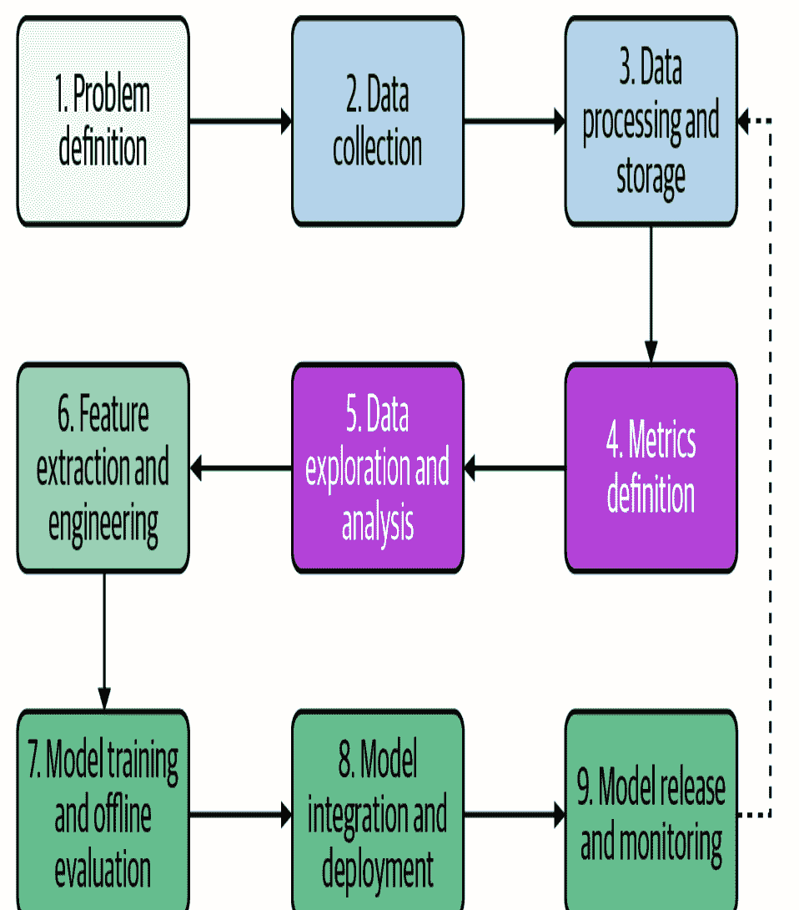
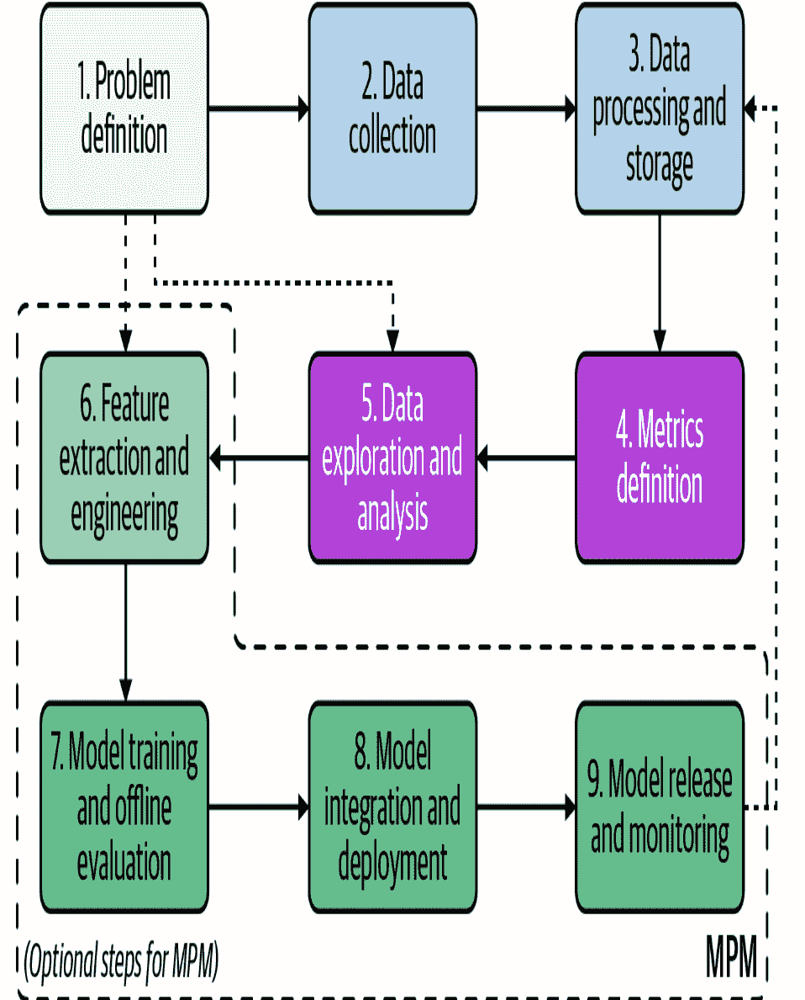

# 第 3 章. 机器学习生命周期

现在我们已经讨论了可解释性的重要性，让我们深入了解机器学习生命周期，阐明模型从构想到投产的旅程中经历了什么。ML 生命周期中有多个阶段，根据你的领域复杂性和/或系统的成熟度，你可能已经将其中许多阶段纳入了工作流程。取决于团队规模和团队成员的资历，每个阶段可能由一个团队负责，也可能由一个团队管理整个生命周期，或介于两者之间。MPM 很好地契合模型开发、部署和监控阶段，并可以帮助监控和管理正在部署的模型。我们将在第 4 章更详细地讨论这一点；目前，我们将专注于 ML 生命周期中的各个阶段以及每个阶段的内容。首先，我们将简要介绍不同类型的分析，以说明机器学习是如何随时间演变的。

## 三种类型的分析

如你在图 3-1 所见，有三种类型的分析：描述性分析、预测性分析和规范性分析。机器学习模型可用于全部三种。

描述性分析顾名思义，通常以报告或图表的形式出现，人类可以从中得出洞察。这是三种类型中最常用的，你的公司可能已经在使用。描述性分析的目的是告诉你过去发生了什么，而不是为未来提供超出人类从数据中解读的建议。机器学习模型也可以用于描述数据；这种类型的分析不仅限于图表和报告。

### 规范性分析
我们如何实现？

### 预测性分析
会发生什么？

### 描述性分析
发生了什么以及为什么？

未来

现在

过去

价值和难度

采用

图 3-1. 三种数据分析类型

更进一步，机器学习模型可以构建来预测某些情况的结果，也称为预测性分析。这通常在描述性分析之后进行，其中可以对特定场景进行建模，并将输入映射以创建该现实世界场景的虚拟表示，以便预测特定输出。未来的结果可以根据任何时间点进入的数据进行预测。然而，任何以前未见过的场景可能无法准确预测，这也是当今机器学习的一个不足之处。这也是为什么 MPM 对于跟上数据或模型的变化至关重要。

分析的最后一种形式称为规范性分析，它是使用最少的，因为它是最难实现的。然而，它可能为你的业务提供最大的价值。规范性模型将为实现期望结果或目标提供一套行动方案。此类模型可用于自动化决策或改善客户体验，通常需要多个输入才能提供方案。想象一个多步骤的场景，规范性模型告诉你在每一步该做什么。根据每个阶段的结果，模型可以重新调整并预测新的最优路径。

## 生命周期阶段

现在你了解了机器学习可应用的不同类型的分析，让我们将其与机器学习生命周期和 MPM 联系起来。图 3-2 说明了将 ML 应用于新问题时的不同阶段。请注意，不同的模型涉及不同复杂程度，可能不需要经过所有这些步骤。

图 3-2. ML 生命周期中的阶段

正如你所见，有九个阶段，可总结为：

- 1. 问题定义
- 2. 数据收集
- 3. 数据处理和存储
- 4. 指标定义
- 5. 数据探索和分析
- 6. 特征提取和工程
- 7. 模型训练和离线评估
- 8. 模型集成和部署
- 9. 模型发布和监控

生命周期始于问题的识别，然后反馈到自身。这是模型开发迭代本质的体现。一旦你或你的团队经历了这个循环几次，可能需要分析或收集的数据已经可用，并且可以跳过某些步骤。循环不断重复以跟上不断变化的数据和需求。正如我们将看到的，MPM 在机器学习模型的训练、部署和监控之间形成了闭环，可以帮助检测这些变化和漂移，并使你的团队能够快速迭代。

在考虑其如何契合之前，让我们更详细地了解 ML 生命周期的每个阶段。

## 问题定义

任何机器学习模型生命周期中的第一个阶段都是识别和定义其旨在解决的问题。该问题可能有多种形式，可能与内部或外部利益相关者的兴趣或需求相关。问题需要定义得足够详细，以便你的工程和数据科学团队能够理解。诸如“客户不满意”之类的说法不是一个定义良好的问题，但诸如“客户在查找最近查看的商品时遇到困难”之类的说法就是。取决于你的团队或公司的目标，问题可以像改善团队协作一样简单

或像预测客户流失并制定措施避免流失那样复杂。

让我们考虑一个示例问题，在其中我们可以贯穿 ML 生命周期中的不同阶段。假设你是某家电商初创公司的老板，你意识到除了最终的营收和一些基本的流量指标之外，你对客户在网站上的行为没有任何洞察。你注意到整体同比销售额出现下滑，你认为查看客户提供的任何反馈是个好主意。你看到很多用户评论说，他们很难找到最近浏览过的产品，并且希望能根据他们正在浏览的产品提供某种推荐，以便轻松找到其他相关商品。因此问题是，你的公司由于缺乏用户追踪和智能功能而导致销售额下降。你心想：“这应该不难。我只要让我的团队把它集成到应用中就行。”

此时，你去找你的团队，问他们为了更好地理解客户行为并通过推荐和个性化提供更好的体验，需要做哪些工作。他们说需要更多数据才能为你提供洞察并构建模型以改善客户体验，从而希望提高销售额。这就是数据收集发挥作用的地方。

## 数据收集

现在你已经定义了问题并确定了需要收集的数据，是时候实施所有必要的组件来开始收集、处理和存储数据了。在开始收集任何数据之前，重要的是要制定一些关于数据将如何使用、谁可以访问以及数据的哪些部分可访问的政策。这通常是 CIO 或数据治理官的职责。这些政策需要透明，以便让用户对你的业务如何使用他们的个人数据建立信心。

你的数据收集和隐私政策可能包括对任何个人身份信息（PII）进行混淆的强制要求，使其对分析团队不可见，或仅允许特权用户（如团队负责人或主管）访问生产数据。一旦所有政策都到位，就可以选择并实施必要的工具以开始收集数据用于分析和建模。这通常涉及对应用程序进行一些更改，例如添加前端和后端组件来追踪用户在做什么，或添加功能以将任何未来的模型集成到工作流程或网站中（例如使用存储的 cookie 或其他唯一标识符识别用户）。

让我们回到电商初创公司的例子。你的团队现在需要实现一个前端追踪器，每当用户在网站上执行某些操作时，就向后端服务发送一个事件。这可能是搜索、点击产品，或点击离开网站。不管用户在做什么，都应该能够追踪并存储该信息。可以在用户浏览器上存储一个 cookie，以便在后端跨多个事件追踪同一用户。

假设为了本例的缘故，平均每天的每秒都有 100 人在线点击你的网站或应用。这意味着你必须处理和存储每秒大约 100 个事件。假设每个事件大约为 10 KB 大小，流量将产生 10 × 100 = 1 MB 的数据每秒。鉴于一天有 86,400 秒，这意味着你每天需要处理 1 × 86,400 = 86.4 GB。 如果你试图将它存储在电脑上的 Excel 文件中，你可能在一周内就会用完空间。你可以看到这样的数据量很容易累积起来，变得越来越难以管理。这就是数据处理和存储解决方案发挥作用的地方，将云的强大功能和可扩展性带到你的手中。

## 数据处理和存储

你可能听说过“数据仓库”或“数据湖”这些术语——它们是数据存储解决方案的例子。数据仓库是结构化的数据存储（想想 SQL 数据库），而数据湖是无结构的文件存储，通常以文件系统式服务的形式存在，称为 blob 存储。数据仓库用于分析目的，例如销售报告。传入的数据可能是无结构的，但会被转换为结构化形式，然后存储在数据仓库中。数据湖对于存储图像或原始文本文件等文件很有用，这些文件可以用作机器学习管道的一部分。

为了处理大量数据，或俗称的“大数据”，可以使用云计算工具，如批处理或流处理框架，将数据摄取到仓库或湖中。*批处理*是在固定间隔或基于批大小时分批处理数据（想想只能一次放 10 块饼干的烤箱）。*流处理*是在数据到来时即时处理数据，通常在需要实时分析数据时实现（想想用于大规模生产的传送带上烘烤的饼干）。流处理的一种变体是微批处理，其中事件以非常短的间隔（比如每隔几秒）分小批处理。

对于流处理和批处理的数据摄取，有两种常见模式：提取、转换、加载（ETL）和提取、加载、转换（ELT）。在 ETL 中，数据在飞行中被转换（流处理系统中的常见模式），然后加载到其最终存储位置，即数据仓库或数据湖。另一方面，ELT 更倾向于以原始形式加载数据，然后使用内置或第三方工具对其进行转换并插入到最终位置。

根据你的需求和数据需要使用的速度，ETL 和 ELT 都可以使用。以原始形式加载数据可以保留数据，以防转换过程中出现错误。某些数据可能不需要实时聚合或分析，而其他类型的数据可能需要实时聚合或分析以用于追踪或合规目的。（在数据世界中，冗余总是有好处的；你也可以对同一数据使用两种方法。）

让我们把这一点联系回我们的电商示例。你大约每秒摄取 1 MB 的数据，每天约 86 GB。为此，你需要一个 ETL 或 ELT 处理系统（或两者结合！），并进行某种混淆（删除任何个人信息）以及一些数据质量检查。任何未通过检查的数据都应分叉到另一个位置以供分析或重新处理。一旦好的数据被处理并存储，它就准备好进行分析、探索，以及（令人兴奋的部分）构建一些机器学习模型！

实时处理的数据可以输入到分析引擎，供数据科学和分析团队使用。从原始数据每隔几小时、几天或几周聚合的数据可供业务用于追踪整体健康状况和不同业务线的关键绩效指标（KPI）。但在开始做所有这些之前，你最好先为团队将要构建或开发的任何分析和潜在模型定义一些需求。

## 指标定义

现在你已经开始收集数据以更好地理解你的业务或问题，让我们谈谈指标的需求。提前定义良好的指标以应对任何不可预见的情况是良好的实践。这些指标也可能作为部署到生产环境的任何模型的准确性或性能衡量标准。这不仅有助于选择部署哪些模型、搁置哪些模型，还为你和你的团队提供了一种比较不同模型的方式。它们为任何基准或评估提供了基础，可以采用业务指标的形式，如收入或客户满意度（通常基于调查分数），或技术指标，如模型准确度。根据你的用例，你应该在早期花一些时间与团队一起定义这些指标，以帮助大家在分析和模型的目标上保持一致。

为了将其与电商示例联系起来，让我们回顾一下手头的问题。你注意到由于缺少一些客户体验功能，总销售额出现下滑。任何旨在改善

客户体验反过来也应该能带来更多的销售。将其作为衡量模型变更的指标，可以很好地衡量客户对新模型的响应情况。这是一个有用的业务指标，但它并不能帮助团队离线开发模型（他们无法判断哪个模型会带来更多销售）。

为了解决这个问题，另一个需求是能够衡量推荐引擎的准确性。这可以用来预测如果存在推荐引擎，用户点击推荐产品的可能性。这是一个很好的离线使用指标：你的团队可以研究真实的用户流程，并衡量有多少用户会因引入推荐或个性化模型而受益。这是一个技术指标，可以在模型部署并衡量销售产生之前，帮助离线开发和评估模型。

## 数据探索

现在业务方和技术团队都有了一些指标，是时候开始探索数据了。在此阶段也可以开始为预测或规范模型制定假设，以验证或否定使用收集的数据构建特定模型的可行性。这通常由主题专家完成，例如专门的数据分析师或数据科学家，并且不同数据点之间的关系可以被映射出来，以更好地描绘系统。

在生命周期的这个阶段，描述性分析通常是最有用的，因为这样更容易将技术方面的发现转化为业务方面（想想仪表板和报告）。可以生成报告来了解不同类型的数据组（例如客户类型）及其固有特征。描述性分析还可以为可改进领域提供信息，这些领域可以通过了解该领域的机器学习模型来解决，并且最终可以从描述发展到做出预测甚至提供规定性行动。

在我们电商初创公司的背景下，为了向用户展示他们最近查看的商品，可以根据其标识符查找每个用户的数据。一旦你了解了少数几个用户各自的行为，就可以尝试在不同用户之间建立关系，以挖掘出一些模式。

你可以根据用户查看和购买的产品以及其他特征（例如频率和位置，仅举几例）为使用你网站的不同类型用户生成用户*画像*。这些信息随后可用于为不同用户提供更量身定制的体验。这里的“特征”一词用于描述一个人在网站上购物的特征，在机器学习模型的上下文中，其含义几乎相同。模型特征是在模型训练时已知的、可以用来表示模型在做出预测时输入会是什么样的数据点。（想想知道一个新用户的画像——这不可能，所以这会是模型的一个好特征吗？）这就引出了下一步，特征提取和工程。

## 特征提取和工程

输入到机器学习模型中的特征（例如用户画像）可以根据领域的固有性质由数据科学团队选择，也可以由旨在最大化特定目标结果（例如准确性或性能）的某些优化自动生成。这就是特征选择、提取和工程的作用。

一旦你确定了特征和/或目标，下一步就是设置一种自动生成这些特征并存储它们的方式。这可以在数据到来时实时完成，也可以在每隔几小时、几天或几周进行批量回溯处理。这取决于你的领域以及对所使用模型类型而言合理的节奏。如果特征是某类客户的平均月支出，那么只需要在每个月生成一次该特征才有意义。如果相反，你想查看每日支出，那么该特征就需要每天提取一次。

特征通常是机器学习模型的输入，具体取决于系统的复杂程度，你可能只有少数几个（比如 5–10 个）或难以理解的数量（比如几百万个）不同类型的特征。

如前一章所述，这些特征可能事先已知，也可能由模型本身确定，并在模型训练后需要一些解释或解读。不管你的模型多么复杂或简单，你都需要训练和评估不同的假设以产生尽可能好的模型。对于高级模型，如深度神经网络，特征可能是带标签的图像，或带标签的文本体。这些被输入到模型中，以便向其展示一些示例，使其能够形成对系统的理解。模型可以使用提供的示例来选择最佳特征，以识别目标标签是什么。想想一个识别图片中猫的模型，其中耳朵的形状可以被提取为识别特征。这就是模型训练和离线评估发挥作用的地方，可以帮助构建有望有一天进入生产环境的模型。

## 模型训练和离线评估

一旦你大致了解了数据并拥有代表系统的一些特征，你就可以构建和评估一些可以帮助你预测结果或分析数据的模型。为此，你需要建立一个协作环境，让你的数据科学和分析团队能够共同合作，创建尽可能好的模型。

模型训练的第一步是将数据拆分为训练集和测试集（80/20 和 70/30 是常见的训练/测试分割比例）。这可以通过随机将部分数据分离到模型在训练期间不会看到但目标输出已标记以便衡量模型性能的测试集中来完成。目标可以是标签的形式或预测的形式。一旦训练集和测试集准备就绪，你就可以开始训练模型并将其与测试集进行评估。需求阶段定义的指标可用于

比较不同模型或框架的性能。生成多个训练和测试拆分，这通常被称为*cross-validation*，可以帮助测试模型敏感性或识别模型中可能因数据过度或代表不足而产生的偏差。一旦在离线环境中开发出具有理想结果的稳定模型，它就可以进入集成和部署阶段。

让我们以为我们的假设电商初创公司构建推荐系统模型为例。推荐系统通常是一个横幅，位于页面上的某个位置（或沿着用户旅程），显示用户可能感兴趣的、最近查看过的，或其他人也查看过或购买过的其他产品。创建推荐系统常用的方法之一是协同过滤——不用过多细节，这种方法通过创建一种群体智慧来理解网站上不同商品之间的模式和关系，这些关系基于用户的行为。

为了简化，假设只有三种产品（A、B 和 C）列出，只有两位客户（1 和 2）在购物。如果客户 1 查看产品 A 和 B，但客户 2 只查看 B，那么客户 2 将被推荐产品 A，因为客户 1 也查看了 A。现在如果客户 2 也查看了产品 C，那么客户 1 也会被推荐产品 C。你可以看到，随着几百万用户和几百甚至上千种产品，模型将开始仅凭用户行为就理解哪些产品本质上相关。

回到我们的电商示例，使用我们迄今为止从用户那里收集的数据，我们可以将用户拆分为训练集和测试集。模型可以在训练集上训练，并根据推荐的项目中有多少被该用户实际采取行动来在测试集上进行评估。利用这一基准，模型可以进行训练和调优，以达到理想的准确度水平。如前所述，并非所有指标都可以在离线环境中评估（例如，在这种情况下，销售产生），有些则需要进行在线测试，这就是

通常通过 A/B 测试或冠军/挑战者测试来完成。这意味着进入模型集成和部署阶段。

## Model Integration and Deployment

一旦模型经过开发并通过离线指标评估以证明其可行性，就需要将其集成或部署到你的应用程序、工作流程或网站中。集成涉及添加代码或支持，使模型能够在你的网站、应用程序或工作流程中运行。部署涉及以可发布的状态启动模型。根据系统的架构以及模型将被调用的位置（例如边缘与云），具体操作方式可能会有所不同。在某些情况下，此集成和部署过程也可能被称为持续集成/持续部署（CI/CD）管道。

在某些情况下，模型集成和部署就像将一个拉取请求（CI）合并到存储库的一个分支中一样简单，这将触发部署作业（CD），前提是某些自动化测试通过。它也可以像在你的云提供商或服务提供商的控制台中按一个按钮一样简单（例如 AWS SageMaker 或 Google AI Platform），通过 UI 更新参数或版本号。在其他情况下，模型部署可能涉及向你的用户或设备群发布新版本的软件。如果下载不是自动的，那么一些用户可能会在他们决定手动在设备上更新应用程序之前被排除在更新之外。

让我们看看我们将如何集成和部署我们刚刚为电子商务初创公司示例构建的闪亮新推荐系统。首先，我们需要为前端添加支持，以便与后端上的模型通信。我们还需要一种机制来在用户之间拆分流量，以便进行 A/B 测试或挑战者/冠军实验。我们需要测试是否有推荐横幅可以帮助增加销售额，甚至只是用户对商品的浏览量。一旦集成准备就绪，我们就可以部署我们的模型并将其分阶段发布和监控，这是进入生产旅程的最后阶段。

## Model Release and Monitoring

在模型集成和部署后，它可以被发布和监控。发布过程可能涉及更改其配置以指向模型的最新部署，或简单地按一个按钮更新到该版本。无论此过程有多复杂或多简单，都应由有权执行此任务并对其负责的人来完成。

在机器学习模型发布后，并不能保证其所代表的底层系统不会发生变化或不会出现需要考虑的新行为。这就是监控发挥作用的地方，并且与 MPM 相关联。MPM 可以提供大量关于模型性能如何以及哪些模型需要更新的见解。模型版本、参数和目标用户群都可以在发布阶段根据之前阶段确定的拆分进行修改。由于模型可以针对不同群体进行实验，因此可以根据它们的标识符对这些不同的集合应用监控，以便监控每个集合的性能。实验可以帮助验证或否定你的领域专家关于你的领域的某些理论。

假设你希望增加组织的销售额，并想测试不同的模型，看看哪个模型能产生最多的利润。监控将是该实验中最重要的部分，因为它有助于跟踪不同的模型以及用户对它们的反应。

为了结束 ML 模型的生命周期，让我们谈谈一旦你在电子商务网站上部署了推荐系统会发生什么。一旦模型发布给部分用户，你开始注意到带有推荐横幅的用户与网站的互动更多，并且作为其群体的百分比，最终购买了更多产品。这是个好消息！你已经验证了推荐系统会增加你的销售额。

但旅程还没有结束。现在是时候将模型推广给其他所有人，并开始思考更好的版本——也许是挑战此模型的 2.0 版本，或者是一个更个性化的版本，比如使用深度神经网络。在任何给定时间，此生命周期的多个并行迭代都可能正在进行中，这是一个数据驱动型组织健康的良好迹象。

## How MPM Fits into the Life Cycle

让我们通过讨论 MPM 在 ML 生命周期中如何契合以及它能做什么和不能做什么来结束本章。MPM 是一种哲学以及一套工具和框架（类似于 DevOps 中的 APM），旨在以性能为衡量标准来衡量模型。管理体现在干预的形式，例如构建新模型，或停用模型并将其发送到模型墓地。如图 3-3 所示，MPM 从 ML 生命周期的第 6 阶段或第 7 阶段开始，具体取决于特征是否与模型的性能相关。如“数据处理和存储”小节所述，任何数据质量问题都应在数据到达模型训练阶段之前很久就被捕获。

Figure 3-3. The stages in the ML life cycle

如果用于预测结果的数据导致模型出现问题，则 MPM 建议将传入的数据存储起来供团队分析

并深入挖掘。此分析可能包括考虑诸如谁是模型的用户或调用者、输入数据是什么以及模型预测了什么等参数。使用 XAI 技术，可以解释模型以了解任何不良行为，以便修复或纠正它。

不良的模型性能通常源于用户层面，在那里你的 QA 团队标记了错误或问题，或自动检测到。一旦发生这种情况，负责模型的团队可能需要根据其任务关键程度升级并修复问题。如果问题似乎不是由模型引起的，他们可以沿着管道向上追溯，直到检测到并解决该问题。如果问题恰好是模型已过时或未考虑新的数据类型，则可能需要重新训练或更新模型。随着越来越多的模型开始进入生产环境，你可以看到管理和监控它们变得越来越困难。

拥有 MPM 解决方案可以帮助监控和跟踪模型性能，并让你几乎完全可观察到野外的模型。将 MPM 与之前讨论的 XAI 相结合，你就可以全面了解模型的运行情况以及原因。这永远无法取代领域专家的知识和专业知识，但它可以作为一个有用的工具，帮助他们高效地大规模管理模型，并帮助你确保模型负责任地构建。
