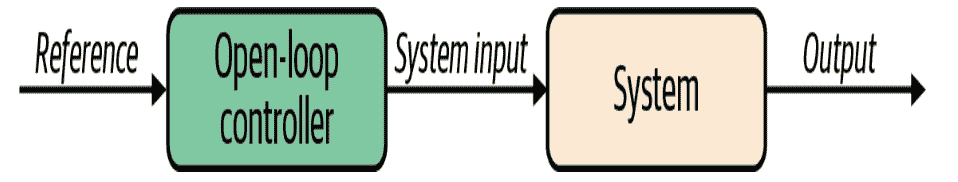
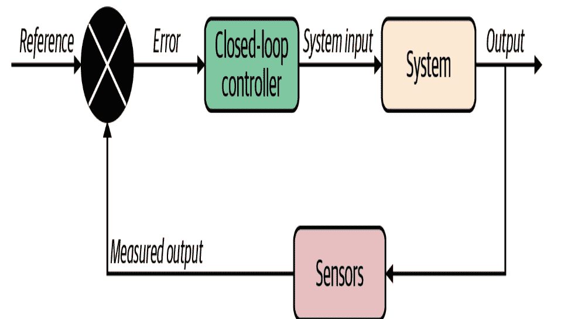
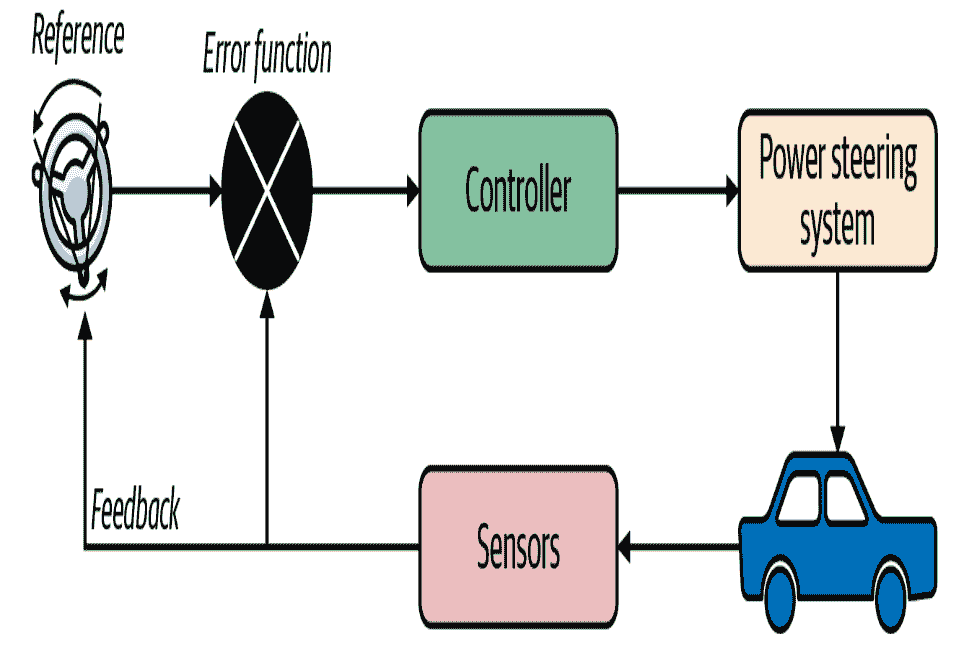

# Chapter 4. MPM in the ML Life Cycle

MPM 充当将模型训练、部署和监控阶段粘合在一起的胶水。如果没有 MPM 流程或系统，你的团队将很难找到模型性能问题的根本原因。无论问题是由不良数据引起还是由模型过时引起，你的团队都应该能够确定其来源。在本章中，我们将研究 MPM 如何帮助提供对在训练、部署和监控模型时可能出现的任何问题的完全可见性。

## The ML Feedback Loop

机器学习生命周期是循环的，这是由于世界的不断变化的性质。由于模型作为现实世界情况或场景的一般表示，它们需要不断被监控和更新，以处理新的或以前未见过的数据和情况。*关闭反馈循环* 是从控制理论中借用的概念，其中系统的预期输出和测量输出进行比较，以便调整系统的性能并以最小或零误差实现最佳结果。为了进一步探索这一概念，让我们先快速了解一下控制理论是什么。

## Brief on Control Theory

控制理论是关于使用反馈机制控制动态（工程）系统以实现最优性的理论。最优性基于被控制系统的上下文，可以是确定性和精确的，也可以是在可接受的误差范围内。有两种类型的控制器，开环和闭环。为了将其与 MPM 相关联，模型的预期输出和指标需要与其

随着时间的推移跟踪实际输出和指标，以确保模型实现最佳结果。

MPM 闭合了输出回路，以便在未来纠正任何错误并维持最佳状态（我们在本章后面会讨论这一点）。在控制系统中，分析通常是在频域中进行，而不是在时域中进行。这意味着控制系统分析的不是某件事何时发生，而是某件事发生的频率和强度如何。模型误差是一个很好的衡量指标，因为它可以显示某件事与预期不符的频率，而不是显示何时发生。这种测量有助于确定需要修复的最高优先级问题（即对业务影响最大的问题）。

## 开环与闭环控制器

开环控制器是指不依赖于测量输出进行常规操作的控制器。这在高度可预测的系统中很常见，该系统具有基于输入的离散输出集合。查看图 4-1，我们可以看到输入到输出的流程是线性的，易于跟踪。

图 4-1. 开环控制器

想想微波炉上的定时器，它加热食物。它只知道需要运行多长时间，并且不需要检测食物内部的温度来调整该时间。这里的参考值就是食物需要加热的时间，系统输入则是根据剩余时间来打开或保持微波炉开启。一旦参考信号耗尽（计时器结束），控制器就会关闭微波炉。

闭环控制器，如图 4-2 所示，是指系统依赖输出来实现其期望状态的控制器。参考信号和测量输出进行比较，以便调整控制器的输出（即系统输入），并尝试最小化参考值与测量输出之间的误差。误差函数用于比较这两个信号，并将误差作为输入发送到控制器。然后控制器利用其内部模型，调整系统输入以尝试实现期望输出。

图 4-2. 闭环控制器

在图 4-3 中，我们看到一个闭环控制器的例子：汽车上的动力转向系统。汽车期望行驶的方向由方向盘的转动方向暗示，任何不期望的阻力都会以方向盘向不期望运动方向旋转的形式反馈给用户。控制器具有一个内部模型，将方向盘的旋转距离映射到车轮期望转向的方向以转向汽车。

图 4-3. 汽车动力转向系统中的闭环控制器

可能会有一些背景噪声导致方向盘在没有驾驶员输入的情况下转动，也许是由于颠簸或道路上的坑洞。动力转向系统接收参考信号（在这种情况下，是驾驶员转动方向盘）以及来自汽车传感器的信号（测量输出），并利用这些信号确定如何转向汽车以实现用户的期望结果，并在检测到任何不期望的运动时向驾驶员提供反馈。

## 控制理论与 MPM

与控制理论通过传感器操作反馈类似，MPM 充当您 ML 系统的反馈机制。在机器学习的上下文中，负责向您的 ML 团队提供反馈的传感器是跟踪模型输出的 MPM 框架。用户（或人工在环）是不断监控并尝试更新模型的数据科学家或机器学习工程师。反馈是模型收集到的所有数据以及一些元数据。误差函数将是 MPM 系统的一部分，可以根据团队或系统的参考输入标记任何错误。如果误差函数显示模型产生不期望的结果，则可以对 ML 系统进行调查，旨在提高性能。

将机器学习生命周期视为动态系统使我们能够理解闭合反馈回路和跟踪误差（与期望参考的偏离）的必要性。机器学习世界中的参考通常是用于训练模型的标签，可能不存在于传入数据中，因为在预测时模型的预期预测是未知的。跟踪变化的频率以及模型输出的偏差可能有助于揭示任何模型漂移或数据漂移问题。然后这些问题可以触发团队进行调查并尝试纠正系统中的错误。通常，验证模型性能的过程依赖于一些用户输入，例如真实标签或预期输出。可以通过对数据的一小部分进行采样并应用这些标签，然后将模型输出与此期望或真实情况进行比较来实现此验证过程。

## MPM 在训练和部署阶段

现在您了解了模型性能是什么，让我们谈谈 MPM 如何融入 ML 生命周期阶段，并提供一种轻松管理流程以持续监控和改进模型性能的方法。MPM 可以从提取或构建特征时开始，也可以从模型训练时开始。这取决于输入数据的复杂性以及数据漂移对模型性能的影响：一个输入很少且很少偏离常态的模型不需要跟踪其特征，因为输入将始终可预测且风险较低，而一个具有多个输入的复杂模型，这些输入完全可变且可能随时间变化，则需要进行跟踪。

## 使用 XAI 来理解模型偏差

在模型的训练阶段，如果不尝试理解模型可能如何表现以及是否存在固有偏差，则偏差可能很难检测或预防。为了减轻可能的偏差，可以使用 XAI（在第 2 章中讨论）来解释为什么结果可能对数据的某个子集存在偏差。这可能是由训练数据不平衡或模型本身设置了固有偏差引起的。检测训练数据不平衡可以通过分析不同标签和输入数据点的分布来检测任何代表不足或过度代表的数据。然后可以对数据进行欠采样或过采样以减少或消除任何偏差。然而，如果偏差是由于模型本身存在偏差，则在测试模型并使用 XAI 来理解模型的预测时会出现这种情况。

一旦偏差减少到可忽略的程度或完全消除，候选模型就可以根据目标标签进行评估，以找到最佳的发布模型。有时表现最好的模型也是最有偏见的，使用 XAI 与 MPM 结合是及早发现这些问题的关键。（当您开发对偏差不敏感的模型时，当然不必太担心检测偏差。）

## 选择最佳模型发布

在优化性能并处理偏差后，选择将哪个模型集成到您的应用程序或工作流程中并发布给用户可能是最困难的决定，因为模型有时可能是不可预测的，任何不可预测的行为都可能转化为业务风险和可能的责任（取决于您的业务领域）。离线表现最好的模型可能在在线上并非表现最好。这可能是由于敏感度高——因此您选择的任何要发布的模型都应分析其对训练数据和任何未见预测数据的敏感度。如前所述，这是通过将历史数据拆分为训练集和测试集来完成的，其中测试集在训练期间对模型不可见，但预期预测会与测试数据一起存储。

一旦模型被认为已准备好投入生产，它就可以进行版本控制、集成和发布。这种版本控制将有助于许多依赖于跟踪模型血缘及其输出的下游分析。然后可以识别模型在离线和在线环境中的任何差异，并可以优化模型的性能以实现所需的结果。

## MPM 在发布和监控阶段

在模型获得发布批准后，需要采取一系列措施以确保它可以自信地推广给所有用户。MPM 建议模型记录所有预测和输入数据以及模型版本和其他元数据，以便团队能够对其进行监控。通过跟踪所做的预测以及它们是否开始偏离常态而足以触发调查（称为模型漂移），可以检测模型中发生的任何问题，并且可以使用 XAI 调查根本原因。模型也可以在实时环境中进行比较（称为 A/B 测试或挑战者/冠军测试）。更先进的模型可能需要比较多于两个变体，以确保性能最高的模型得到推广；这种形式的测试称为多变量测试。

## 检测模型漂移

模型漂移发生在输入模型的数据开始发生变化或偏离模型预期时，导致模型输出发生变化。当这种情况发生时，可能很难检测，因为模型输出通常不会与用于分析的某些元数据一起存储。使用 MPM 系统或流程可确保模型输出被存储并可供您的数据科学或运营团队访问。在平均的一天里，不同输入组之间分布的预期应处于可接受的误差范围内。如果这些值开始随时间推移而偏离，输出的分析可以显示任何漂移，并允许您的团队找出并修复任何问题。

一个问题可能是由于业务的季节性，模型需要进行季节性更新。另一种情况是模型本身在训练时未考虑所有场景，因此对未见数据产生意外的输出。这可能是由数据某些子集的代表性不足或过度代表造成的。为了解决这个问题，您的团队可以为未见数据添加路径，例如触发客户支持工单或将用户引导至文档以尝试解决问题。无论问题是由系统检测到还是由用户联系支持团队发现，MPM 系统都可用于重放和分析预测，以便更新模型以解决问题。

## 使用 MPM 和 XAI 查找根本原因

一旦问题被 MPM 系统、客户或您的 QA 团队识别出来，就该找到根本原因并解决它了。您的团队可能会被诱惑匆忙地尝试通过在应用层应用快速修复或补丁来补救问题，而不去探究机器学习模型这个黑盒。但使用 MPM，他们可以通过隔离问题并确定适当的补救措施来识别和修复问题的根本原因，而不会对系统的其他部分产生影响。

为了降低客户满意度或合规性问题的风险，您的团队可以在数据的一小部分上测试更改或修复，或在模拟环境中重放过去几天的值班数据，以检查更改是否会产生预期行为。如果没有 MPM 系统来存储所有预测以及元数据，重放数据并对任何补丁或修复进行历史测试将很困难。一旦修复在历史数据上得到验证，就可以将其发布给您的用户。为了降低任何不可预见的风险，可以先将模型发布给您用户的一小部分，并监控结果以确保修复可以安全地推广给其余用户。

## 实时实验

验证新模型（或更新的模型）是否会实现预期结果可能很难实现，除非有机制来降低不可预见的风险。您可以使用许多方法来及早发现潜在问题或缺陷。私人测试人员或 QA 团队可以捕获这些问题并记录下来供您的工程团队处理。没有流程是 100% 完美的，总会有未知因素。因此，为了进一步降低风险，可以进行实时实验，通过针对特定子集的传入数据来最小化任何损害，使其接收新模型。通过这种方式拆分数据，跟踪实验的人员可以监控结果以验证可能已应用的任何假设或修复。一旦模型在数据的一小部分上得到验证，比例就可以增加，要么直接增加到 100%，要么逐步增加以考虑边缘情况或低量数据点。

## 随机采样与有针对性的拆分

进行实验时，重要的是要记住将进行的拆分，以实现所需的比例。有时您可能需要验证非常特定的边缘情况是否已修复，并且该修复不会引起任何其他问题。在这些情况下，您可能希望将修复针对符合该边缘情况的用户，并验证其有效，然后再验证它不会对其他用户造成任何问题。随机采样可用于通过确保在两个（或更多）实验目标之间均匀分配样本来测试所有用户。

有许多方法可以随机拆分数据以确保不会出现有偏的目标。常见的方法是使用数据中非识别字段（元数据）的哈希值，并将该哈希集随机拆分为目标组。由于用于生成哈希的数据并不唯一于该行，样本将在各组中随机分布。这确保了目标组选择过程的“随机性”不会因任何识别特征而偏向选择某一特定组而不是另一组。此方法适用于单个预测与特定用户无关的情况，但有时您可能希望将用户拆分为组。

如果您想针对用户而不是数据点，可以首先为每个用户分配一个随机的通用唯一标识符（UUID），然后使用前面提到的方法对 ID 进行采样。您可能需要为每个用户生成这些 UUID，或者您可能能够使用现有字段（例如用户 ID 字段）。在任何一种情况下，这些 ID 通常存储在用户的设备上或附加到其登录信息中，以便更好地跟踪不同模型在不同目标用户组中的性能。

## A/B 测试

现在我们已经了解了如何将模型拆分为目标组，让我们谈谈我们可以执行的<|message|>最简单的实时实验类型：A/B 测试或挑战者/冠军测试。A/B 测试中的 A 和 B 只是指两个模型；它们可以是两个完全不同的模型，也可以是同一模型的略有修改版本。在任何一种情况下，通常都有一个已经在生产中的模型（假设这不是您运行的第一个实验），它将是挑战者/冠军测试中的冠军。挑战者的任务是超越冠军并接替其作为冠军模型的角色。一旦被证明优于冠军的挑战者被提升到该角色，它就会等待来自未来模型的挑战。

## 多变量测试

有时您可能需要同时测试许多不同的变量，或者您想要尝试许多不同的模型变体。在这些情况下，您需要有多个目标组来争夺冠军的荣耀。一旦不同的组和变量发布，如果没有就位的 MPM 系统来跟踪同时发生的所有不同事情，分析结果可能会变得极其困难。确保 MPM 系统也跟踪每个模型版本的元数据以及用户的 UUID，这成为一项全栈工作，需要将这些指标跟踪器集成到您的应用程序或系统中。

