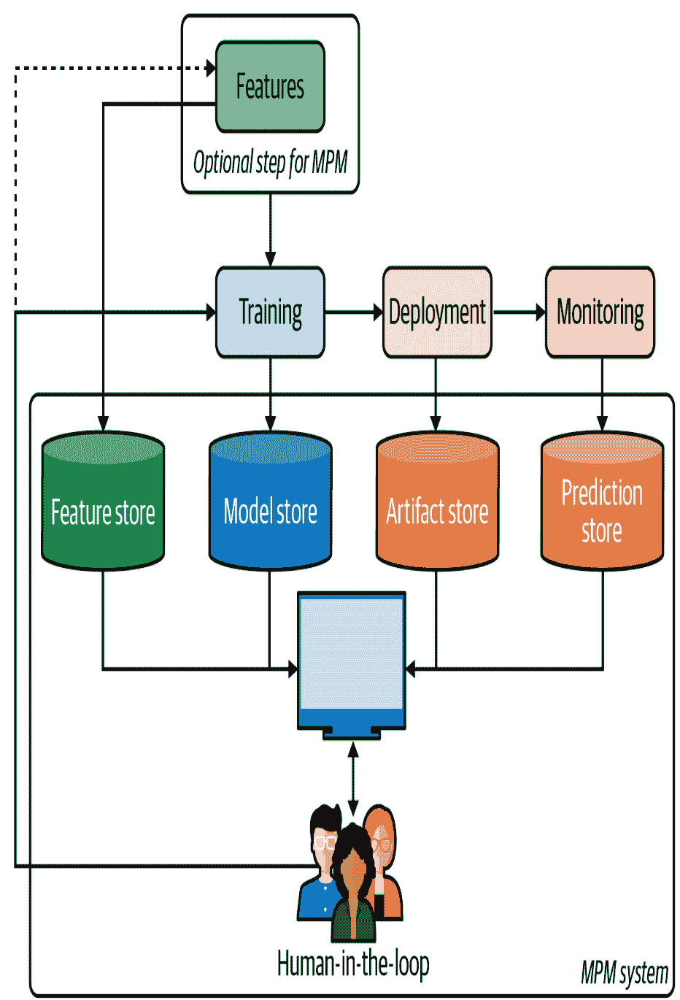

# 第5章 在实践中实施 MPM

使用 MPM 关闭机器学习的反馈回路，是确保对 AI 系统进行持续监控和改进的重要步骤。可以使用多种方法或工具来实施 MPM 系统或框架以在实践中实现这一目标。在查看不同选项之前，让我们先讨论一下构成一个良好的 MPM 框架的条件。

## 暂存环境与生产环境中的模型性能（离线与在线）

如图 5-1 所示，MPM 可作为一种方式，确保您对模型有完全的可见性，并且其所做的任何预测都与输入数据和模型版本一起存储。这使您能够稍后重放预测，以便尝试修复任何性能问题，可能使用 XAI 来帮助理解这些问题。

图 5-1. 模型训练、部署和监控阶段中的 MPM

## 模型训练与离线性能

在离线训练模型时，如前几章所述，数据会被拆分为训练集和测试集，并通过性能测量来调优以实现最佳模型。在训练期间，使用目标目标（标签或预期输出）来衡量模型的准确性或精确度，从而衡量其性能。这些目标指标通常在机器学习生命周期早期就被确定并设定。离线评估可作为衡量模型在现实世界中表现如何的估计。

然而，离线指标只能显示模型在历史数据上的表现如何，可能不是衡量模型在线表现如何的良好指标。历史数据中存在的偏差可能未被考虑，问题可能只有在模型部署后才会显现。这可能会对您的业务产生重大影响。为了防止此类情况发生，在训练期间持续监控模型性能问题并对模型进行压力测试以在上线前发现任何问题非常重要。

## 在线模型性能

一旦模型上线，由于模型的预测标签或输出事先未知，跟踪其性能变得更加困难。一种跟踪性能的方法是衡量预测的变化以及它们是否突然超出正常范围。如果确实发生了这种情况，可能就会触发模型性能问题。另一种在实时环境中监控性能的方法是使用间接指标，例如销售额或客户满意度的提升。这些代理指标可能无法揭示模型中的任何直接问题，但对于跟踪非性能关键的复杂模型来说是一种很好的方法。对于性能关键的模型，可以抽取 QA 样本，并由人工评估员衡量模型的准确性或性能

并跟踪任何问题，供数据科学和机器学习团队调查。问题也可能因客户报告错误或要求解释为何给出特定结果而产生。

## 理想的 MPM 框架

在思考理想的 MPM 框架以帮助管理模型时，我们需要从将帮助我们跟踪性能的 KPI 和指标开始。MPM 框架实施 MPM 流程，以便为团队提供持续反馈并允许对流程进行透明化。该框架应从模型训练到部署和发布期间跟踪模型的性能。

理想的 MPM 框架需要能够帮助确定模型性能问题的根本原因。因此，它需要对系统及其产生的输出有足够的可见性。以下是定义良好 MPM 框架的一些标准：

- 它会跟踪 *模型版本* 以及使用的 *训练数据*。
- 它会将预测本身旁边的所有 *元数据* 与 *预测* 一起存储。
- 当达到设定的 *阈值* 时，它会提供 *自动警报*。
- 它具有 *重放预测* 的能力以便 *比较模型*。
- 它具有 *图形界面* 以允许监控系统的健康状况。
- 它允许团队 *分析原始数据和元数据* 以发现未检测到的问题。
- 它 *利用 XAI* 来 *揭示数据中的隐藏偏差*。

这个列表远非详尽，可以根据您的需求进行扩展。一旦为您的团队和/或组织确定了 MPM 系统需求，就该选择工具来实施此类框架了。以下各节提供了一些可在实践中实施 MPM 的工具、框架和平台示例。

## 云平台提供的集成工具

如今有许多大型云提供商和平台提供数据科学和数据工程领域的一系列产品和服务。云计算领域三大主要参与者——Amazon Web Services（AWS）、Microsoft Azure 和 Google Cloud Platform（GCP）——都将其产品中内置了一些模型跟踪和性能管理功能，或作为补充附加组件提供。用于跟踪模型性能的系统通常集成到其 AI 或机器学习服务中，并为用户提供对模型性能的先进可见性。如果您已有云提供商，使用他们提供的工具和服务将使您的团队能够以几乎为零的开销将其集成到 MPM 框架中。

如果您的团队正在考虑迁移到云端（或更换提供商），您应根据特定的需求和用例评估不同的平台和工具集。一个平台可能在模型跟踪方面优于另一个，每个平台都应根据其优点进行评估。采用多云方法也可能有益，因为它可以提供各方面的最佳选择，并直接比较哪个平台最符合您的需求。该行业仍在发展，每年都会有竞争对手推出新产品，因此最好保持敏捷，并在需要时具备转换的能力。

## 专业的 MPM 软件

如果您尚未准备好迁移到云端，或云提供商的服务无法满足您团队的需求，那么采用一些专业的 MPM 软件可能是一个合适的选择。如果您的系统位于私有网络或防火墙之后，无法访问互联网，那么与通过互联网运行的一些服务集成可能会很困难。既有开源的，也有软件即服务（SaaS）的 MPM 方案。开源方案可以在您的基础设施内运行，并提供更高的可配置性；示例包括 MLFlow 和 Seldon。另一方面，SaaS 方案依赖于活跃的互联网连接，以便与提供商的服务或您在其环境中的账户进行交互。Fiddler 是一个功能齐全的 SaaS MPM 解决方案的示例，该系统允许用户从训练一直跟踪其模型的性能，直到部署、重新部署，最后退役。它允许在训练和验证阶段尽早发现模型偏差，以防止部署后出现不期望的行为。可以跟踪和分析模型的各个版本，并且可以重放模型预测以模拟流量。

您团队选择本地部署还是云原生解决方案将取决于多种因素。如果延迟和规模是您业务的关注点，那么采用云原生系统可能有益。如果成本和安全对您更重要，那么使用开源方案的本地部署解决方案可能是正确的选择。这一决定会影响系统在生产环境中的性能，应谨慎做出选择。如果您所在行业或业务需要数据驻留，也可以使用混合方法。

## 自定义构建的系统

如果您评估的任何云平台或专业工具都无法满足您团队的需求，考虑构建自己的 MPM 框架可能是值得的。有许多开源工具和框架可以用于此任务。可以满足 MPM 需求的一个软件堆栈是 Elasticsearch ELK 堆栈（Elasticsearch、Logstash 和 Kibana），它是一套完整的日志、存储和分析工具和服务，可用于多种用例和不同的配置。这是一款开源软件，许多供应商（包括 Elasticsearch 本身）提供托管服务选项。这意味着您可以选择自行管理基础设施，或允许供应商或服务提供商为您管理基础设施。管理

你自己的基础设施在维护 MPM 系统所需资源方面会带来很多开销，但能为你提供完全的可配置性。

ELK 只是能够满足 MPM 需求的堆栈的一个例子。在可能的情况下，使用预包装的解决方案或服务可能会减少开销和周转时间，并且具有优势，即有专门的团队（供应商或服务提供商）可用于处理任何缺陷或问题。使用服务还允许你的团队专注于构建工作流或模型性能检查，而不是解决跟踪模型性能的问题。

你可能已经拥有一套工具和服务，可以用作 MPM 框架的构建模块，但缺乏端到端覆盖。在这种情况下，在团队流程中实现 MPM 的工作流可能是最佳解决方案。将各个步骤的数据馈送集成到中央数据存储中将允许在该数据之上构建分析层。将分析层集成到界面中将为你的团队提供一个集中性能跟踪的 MPM 框架。还可以实施自动警报和模型标记，以便集成到 PagerDuty 等工具中或直接集成到你的消息平台（例如 Slack）中。
