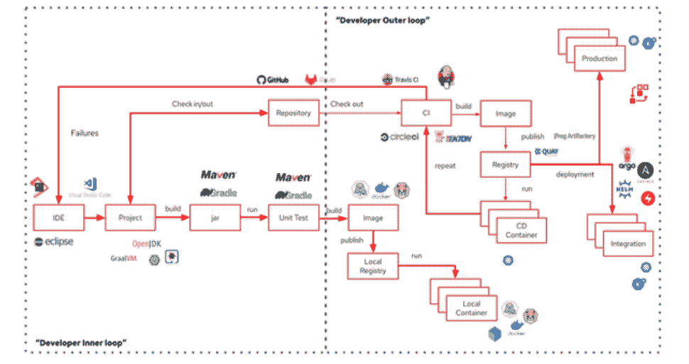
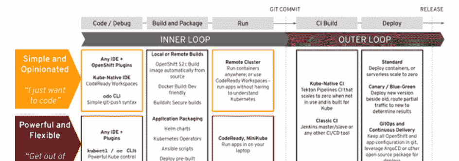
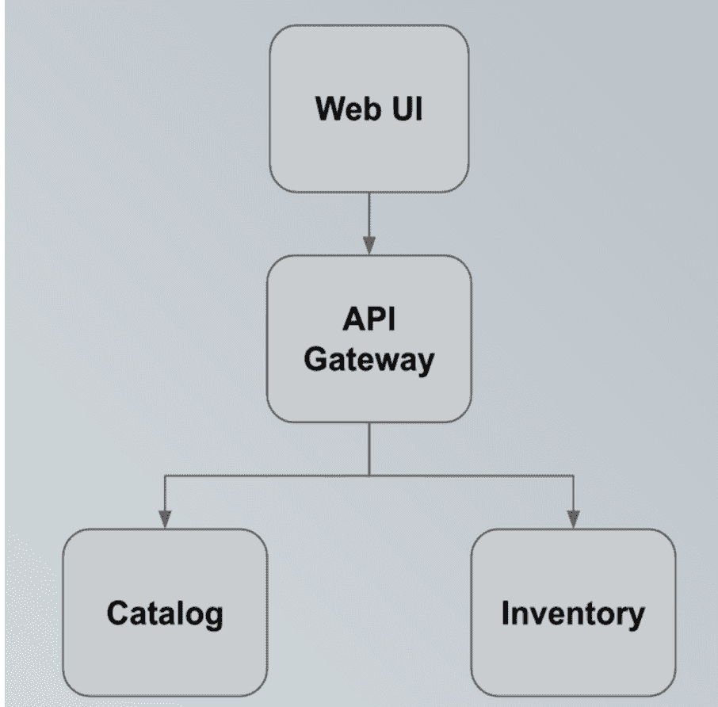
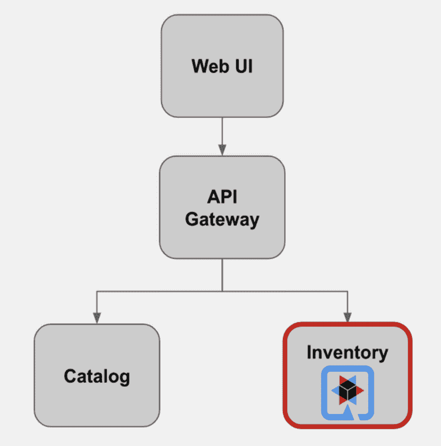
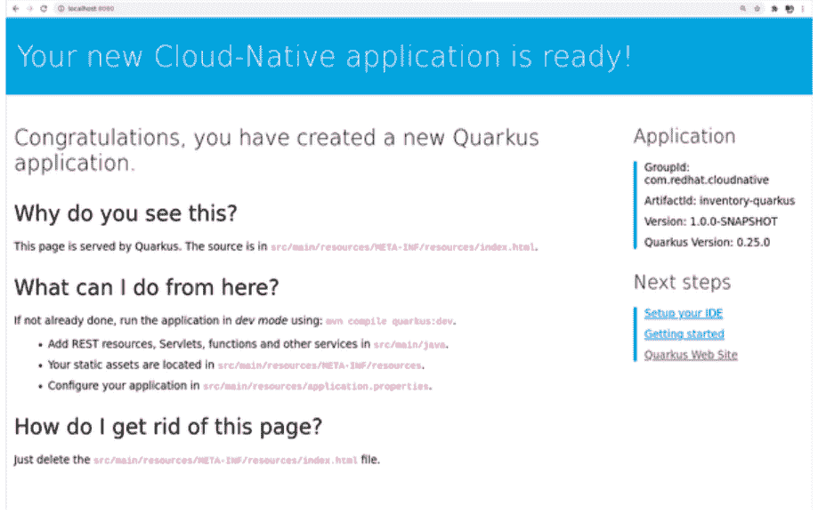
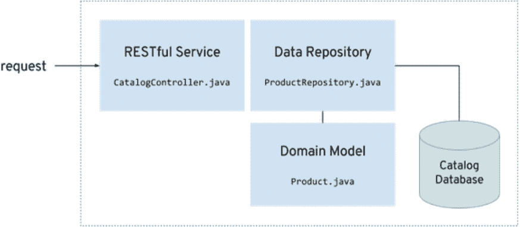
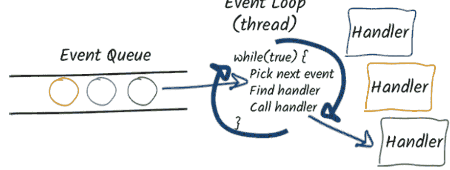
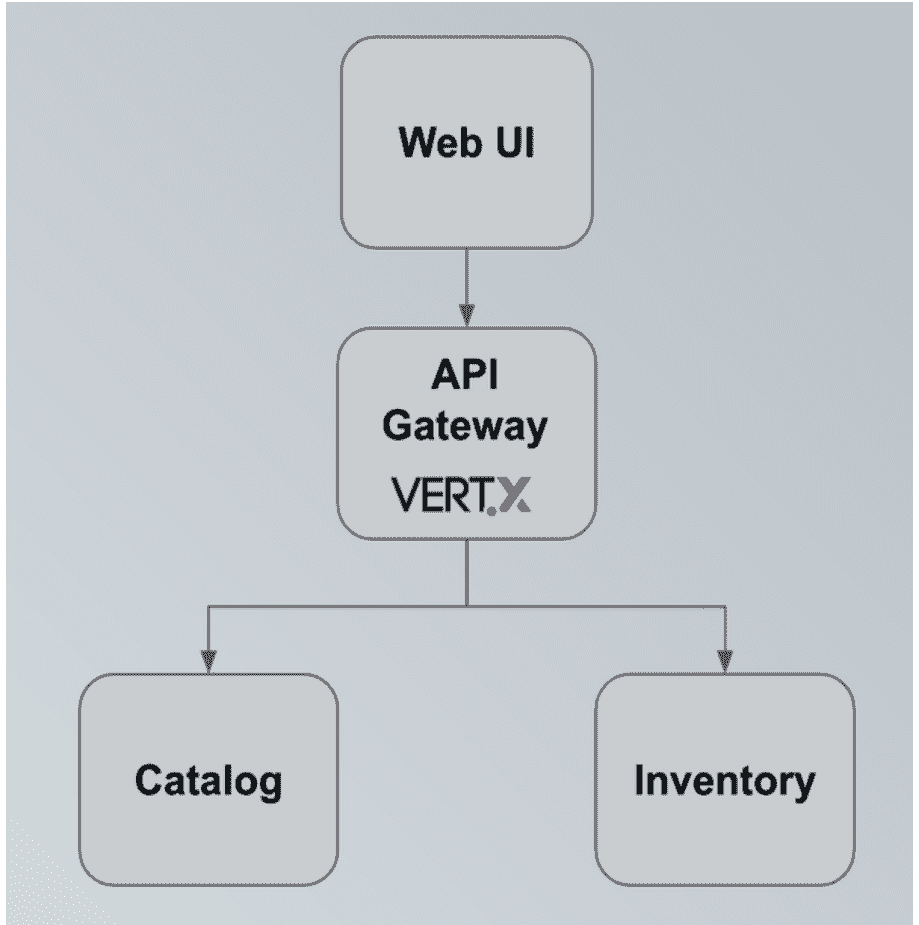
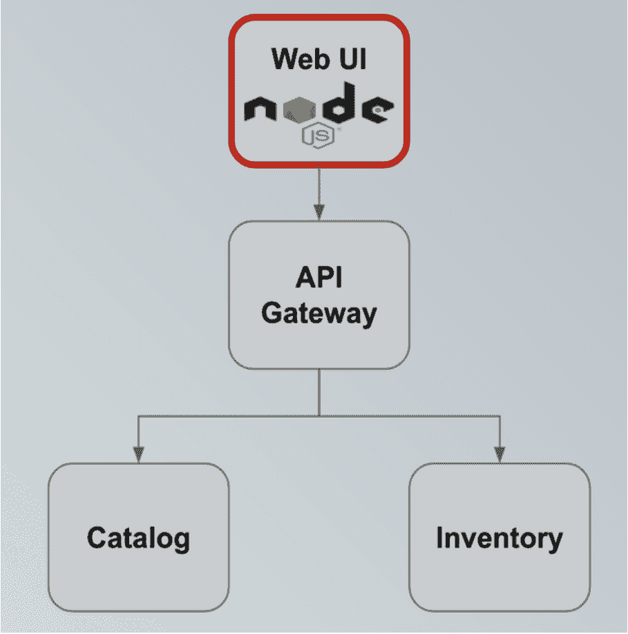
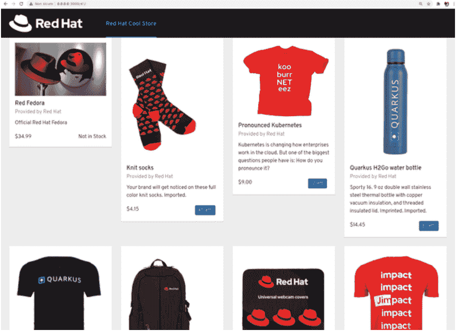

# 第 1 章 重新审视企业开发

### 致早期发布读者的说明

通过早期版本电子书，你可以在图书正式发布之前就获得其最早形态的内容——作者写作时的原始未编辑内容——从而尽早利用这些技术。

这将是最终图书的第 1 章。请注意，GitHub 仓库将在稍后激活。

如果你对本书内容或示例的改进有任何评论，或者你发现本章有缺失内容，请通过 eisele.markus@gmail.com 和 NVinto@redhat.com 联系作者。

企业开发一直是软件工程中最激动人心的领域之一，而过去十年尤其引人入胜。2010年代，高度分布式的微服务逐渐取代了经典的三层架构，基于云的几乎无限的基础设施资源推动重量级应用服务器走向过时。当开发者面临将分布式世界的碎片重新拼合的挑战时，许多声音质疑这个复杂的微服务世界的必要性。现实情况是，大多数应用仍然是精心构建的、遵循传统软件开发流程的单体应用。

然而，我们部署和运维软件的方式也同样飞速变化。我们看到 DevOps 发展成 GitOps，将开发者的责任从应用代码扩展到所需的基础设施。基于 Markus 的著作 [《现代 Java EE 设计模式》](Modern Java EE Design Patterns)，本书将更多视角放在现代化而非仅仅模块化上。我们希望帮助你理解构成现代 Kubernetes 原生开发平台的各个部分，以及如何在其之上构建和维护应用程序。

本书旨在退后一步，评估应用现代化和云原生架构的成功因素与驱动力。我们专注于现代化基于 Java 的企业应用，包括为哪些应用适合现代化提供选择流程，以及帮助你管理现代化工作的工具和方法论概览。本书不局限于讨论模式，而是提供了一组示例，帮助你应用所学的一切。也就是说，本书不会广泛讨论单体与分布式应用的对比。相反，我们的目标是帮助你理解如何无缝地将应用迁移到云端。你可以将本书作为参考，按任意顺序阅读章节。不过，我们按从高层概念到迭代实现的顺序组织了内容。首先，重要的是从云的不同定义以及我们如何为其构建应用开始。

### 从私有到公有。为什么需要云？

公有云、私有云、混合云和多云之间的差异曾经可以简单地由地理位置和所有权来定义。如今，这两者不再是云分类的唯一相关驱动力。让我们从对不同目标环境及其用途的更全面定义开始。

公有云环境通常由最终用户不拥有的资源创建，这些资源可以重新分配给其他租户。私有云环境仅将其资源专供最终用户使用，通常位于用户的防火墙、数据中心内，有时也在本地部署。具有一定工作负载可移植性、编排和管理能力的多个云环境称为混合云。彼此解耦、独立且不连接的云通常称为多云。混合云和多云方法是互斥的；你不能同时拥有两者，因为云要么是互联的（混合云），要么不是（多云）。

无论云的类型如何，将应用部署到云端在企业中正变得越来越普遍，因为企业希望通过更多样的环境组合来提高安全性和性能。但安全性和性能只是将工作负载迁移到混合云或多云环境的众多原因中的两个。对许多人来说，主要动机是按使用付费的模式。与投资在昂贵且难以扩展的本地硬件上不同，云在你需要时提供资源。你不必投资设施、公用事业或建设自己的数据中心。你甚至不需要专门的 IT 团队来处理云数据中心运营，因为你可以享受云提供商员工的专业知识。

对于开发者来说，云意味着自助服务和灵活性。你无需等待环境配置，并且可以在需要时选择基础设施组件（例如数据库、消息代理等），从而摆脱不必要的等待时间，最终加快开发周期。除了这些主要优势之外，你还可以在某些云环境中找到面向开发者的定制功能。例如，OpenShift 有一个集成开发控制台，允许开发者直接编辑其应用拓扑的所有细节。基于云的 IDE（例如 Eclipse Che）提供基于浏览器的开发工作区访问，并消除了团队对本地环境配置的需求。

此外，云基础设施鼓励你自动化部署流程。部署自动化使你只需点击按钮即可将软件部署到测试和生产环境——这是敏捷开发和 DevOps 团队的必备要求。当你阅读微服务架构时，已经看到了对 100% 自动化的需求。但自动化远不止于应用部分。它延伸到基础设施和下游系统。


[Ansible](), [Helm](), 和 [Kubernetes Operators]() 帮助你。我们在第四章更详细地谈论自动化，并且你将在第七章使用一个 Operator。

## “云原生”是什么意思

你可能已经听说过用于开发应用程序和服务的 *云原生* 方法，自从 Cloud Native Computing Foundation（CNCF）于 2015 年成立并发布 Kubernetes v1 以来，这种方法更是备受关注。Bill Wilder 在他的书 [Cloud Architecture Patterns]() 中首次使用了云原生这一术语。根据 Wilder 的说法：云原生应用程序旨在充分利用云平台，通过使用云平台服务并自动扩展来构建。Wilder 在对开发和部署云原生应用程序的兴趣日益增长的时期撰写了他的书。开发人员可以选择各种公共和私有平台，包括 Amazon AWS、Google Cloud、Microsoft Azure 以及许多较小的云提供商。但在那个时候，混合云部署也变得越来越普遍，这带来了挑战。

CNCF 对云原生的定义是：

> *云原生技术使组织能够在现代动态环境（如公共、私有和混合云）中构建和运行可扩展的应用程序。容器、服务网格、微服务、不可变基础设施和声明式 API 体现了这种方法。*

> *这些技术使松耦合系统能够实现弹性、可管理性和可观察性。结合强大的自动化，它们使工程师能够频繁且可预测地进行高影响力的更改，同时将人工操作降至最低。*

—CNCF Cloud Native Definition v1.0,
https://github.com/cncf/toc/blob/master/DEFINITION.md[github]

与云原生技术类似的是 [The Twelve-Factor Apps]()。十二要素应用宣言定义了在云上交付应用程序的模式。虽然这些模式与 Wilder 的云架构模式重叠，但十二要素方法可以应用于任何编程语言编写的应用程序，并使用任何组合的后端服务（数据库、队列、内存缓存等）。

## Kubernetes 原生开发

对于部署到混合云的开发人员来说，将重点从云原生转向 Kubernetes 原生是有意义的。最早提及“kubernetes-native”可追溯到 2017 年。Medium 上的一篇博文描述了 [Kubernetes-native](#) 与云原生之间的区别，将其描述为针对 Kubernetes 优化的一组技术。关键要点是 Kubernetes 原生是云原生的专业化，而不是与云原生定义分离的。云原生应用程序旨在用于云，而 Kubernetes 原生应用程序是为 Kubernetes 设计和构建的。

在云原生开发的早期，编排差异阻碍了应用程序真正实现云原生。Kubernetes 解决了编排问题，但 Kubernetes 并未涵盖云提供商服务（例如角色和权限）或提供事件总线（例如 Kafka）。Kubernetes 原生是云原生的专业化这一观点意味着它们之间有很多相似之处。主要区别在于云提供商的可移植性。充分利用混合云并使用多个云提供商需要应用程序能够部署到任何云提供商。如果没有这样的功能，你就会被绑定到单一的云提供商，并依赖其 100% 的正常运行时间。为了充分利用混合云的好处，应用程序必须以 Kubernetes 原生方式构建。Kubernetes 原生是解决云可移植性问题的方案。我们将在第二章更详细地讨论 Kubernetes 原生。

## 面向开发人员的容器和编排

可移植性的一个关键要素是 *容器*。容器代表主机系统资源的一部分以及应用程序。容器的起源可以追溯到 Linux 早期的 chroots 引入，并随着 Google 的进程容器而成为主流，最终演变为 cgroups。它们的使用在 2013 年因 Docker 而爆炸式增长，使其对许多开发人员来说变得易于访问。Docker 公司、Docker 容器、Docker 镜像和我们熟悉的 Docker 开发工具之间存在区别。虽然一切都始于 Docker 容器，但 Kubernetes 更喜欢通过任何支持其容器运行时接口（CRI）的容器运行时（例如 containerd 或 CRI-O）来运行容器。许多人所称的 Docker 镜像实际上是采用 Open Container Initiative（OCI）格式打包的镜像。

### 容器原生运行时

容器提供了精简到基本要素的 Linux 操作系统用户空间的轻量级版本。然而，它仍然是一个操作系统，容器的质量与主机操作系统一样重要。支持容器镜像需要大量的工程、安全性分析和资源。它需要测试不仅是基础镜像，还需要它们在给定容器主机上的行为。依赖经过认证且符合 OCI 的基础镜像可以消除在不同平台间迁移应用程序时的障碍。理想情况下，这些基础镜像已经附带了你需要的语言运行时。对于基于 Java 的应用程序，Red Hat Universal Base Image 是一个不错的起点。我们将在第四章了解更多关于容器以及开发人员如何使用它们的内容。

## Kubernetes 版本

到目前为止，我们将 Kubernetes 作为一个通用概念来讨论。我们继续使用 Kubernetes 一词来谈论为容器编排提供动力的技术。Kubernetes（有时简称为 K8s）这个名字指的是被广泛理解为容器编排核心功能标准机构的开源项目。如果我们指的是 Kubernetes 内部的标准功能，我们在整本书中都使用“plain”Kubernetes 这一术语。Kubernetes 社区创建了不同的发行版甚至 Kubernetes 的不同风格。CNCF 运营着 Certified Kubernetes Conformance Program，该计划在撰写本文时列出了来自 108 家厂商的 138 多种产品。该列表包含完整的发行版（例如 MicroK8s、OpenShift、Rancher）、托管服务（例如 Google Kubernetes Engine、Amazon Elastic Kubernetes Service、Azure AKS Engine）以及安装程序（例如 MiniKube、VanillaStack）。它们都共享共同的核心，但在供应商认为有需要或机会的情况下，会在其之上添加额外的功能或集成。我们在这本书中不会对使用哪种 Kubernetes 风格提出任何建议。你必须自行决定生产工作负载的方向。为了帮助你在本地运行本书中的示例，我们使用 Minikube，并且不需要你在云中进行完整的安装。

## 管理开发复杂性

Kubernetes 原生开发中最关键的领域之一是开发环境的管控。成功部署或在多个环境中进行分阶段所需的任务数量呈指数级增长。一个原因是单个应用程序部分或微服务的数量不断增加。另一个是必要的应用程序特定基础设施配置。图 1-1 简要概述了一个示例开发环境以及实现完全自动化开发所需的工具。我们将在本书中讨论其中一小部分，以便你在新环境中轻松入门。核心开发任务并没有改变。你仍然会使用合适的框架（如本书中使用的 Quarkus）编写应用程序或服务。这部分开发工作流程通常被称为“内循环”开发。

我们将在本书的大部分时间里介绍“外循环”的变化和机会。外循环将你构建和测试过的应用程序通过各种机制投入生产。必须理解的是，我们在这本书中表达了一些非常强烈的观点。它们反映了我们通过使用我们推荐的工具和技术，使 Java 开发人员更高效、更快、甚至更快乐而学到的经验。如图 1-1 所示，你在某些地方只有一个或两个选择。我们选择了 Java 的更传统方式


本书中的开发者。我们使用 Maven 而不是 Gradle 来构建应用程序，使用 podman 而非 docker 来构建容器镜像。我们还使用 OpenJDK 而不是 GraalVM，并在示例中坚持使用 JUnit 而不是 [Testcontainers](Testcontainers)。

但云原生生态系统，如 [CNCF landscape](CNCF landscape) 所映射的那样，为您提供了更多可供选择的工具。将本书视为企业 Java 开发人员的路线图。



图 1-1. 内外循环开发及作者推荐的工具。

除了技术选择之外，您还必须决定如何使用这个新生态系统。随着可用工具的多样化，您可以选择与 Kubernetes 参与程度的另一个维度。我们在 [Figure 1-2](Figure 1-2) 中概述了意见化与灵活性的区别。作为一个对细节痴迷的开发者，您可能希望从一线学习所有示例并使用纯 Kubernetes，同时制作自己的 YAML 文件。

> **NOTE**
> 
> 最初 YAML 被说成是 Yet Another Markup Language 的缩写。这个名字本意是对其作为标记语言用途的戏谑引用。但后来被重新解释为 YAML Ain’t Markup Language，这是一个递归缩写，用以区分其作为数据导向的用途。

您可能会决定完全专注于源代码，并且不想因实现业务逻辑而分心。这可以通过某些发行版提供的开发者工具来实现。根据您在开发流程中最看重的内容，有各种选择。您可以使用主要的 Kubernetes 命令行界面 CLI `kubectl`，而不是像 OpenShift 的 CLI `oc` 这样的产品特定工具。如果您希望更接近完整产品，我们建议您尝试 [CodeReady Containers](https://developers.redhat.com/products/codeready-containers/overview)。它是在您笔记本上运行的 OpenShift 集群，具有轻松的入门体验。但是，选择权在您。另一个我们会推荐的优秀工具是 [odo](https://odo.dev/)，它是一个通用的面向 Kubernetes 项目的开发者 CLI。现有的工具如 `kubectl` 和 `oc` 更侧重于运维，需要对底层概念有深入理解。Odo 为开发者抽象掉了复杂的 Kubernetes 概念。外层开发循环中的两个示例选择是持续集成 CI 解决方案。本书中使用了 [Tekton](https://tekton.dev/)，您可以在 [Chapter 6](#) 中使用它。也可能在 Kubernetes 上使用 Jenkins，并使用 [Jenkins Operator](https://jenkins-x.io/) 或甚至 Jenkins X。无论您做出什么选择，您最终都将成为自己 Kubernetes 原生之旅的主人。



图 1-2. 意见化 vs 灵活 - 内外开发循环中的技术选择

## DevOps 和敏捷

在现代化您的企业 Java 应用时，下一个关键变化是创建跨职能团队，共享从想法到运营的责任。虽然有人说 DevOps 仅专注于运维方面并与开发者自助服务配对，但我们坚信 DevOps 是一种专注于持久影响的团队文化。“DevOps”一词是“development”和“operations”的混合，但它代表的是一组远比两者简单相加更重要的思想和实践。DevOps 包括安全、协作工作方式、数据分析等许多其他内容。DevOps 描述了加速新业务需求从开发代码到生产环境部署的流程的方法。这些方法要求开发团队和运维团队频繁沟通，并对队友怀有同理心。还需要可扩展性和灵活的资源配置。开发者通常在熟悉的开发环境中编码，与 IT 运维密切合作，以加快软件构建、测试和发布的速度

而不牺牲可靠性。所有这些共同带来了更频繁的代码变更和更动态的基础设施使用。将传统 IT 组织从传统方法转变为 DevOps 方法通常被描述为 *transformation*，远超本书范围。然而，它是一个必不可少的要素，您会看到这种转变在书籍、文章和演示中被优美地描述为“教大象跳舞”。

## 摘要

在本章中，您学习了一些基本定义，并听说了我们将在本书中使用的最重要的技术和概念。下一章将带您进入第一个应用现代化的源代码。

- 数据层：存储所有交易和商品记录的数据库

这些组件的成果是一个在线商店，具有产品目录和库存，我们可以用图 2-1 所示的架构来组织



图 2-1. Coolstore 架构

我们将前面提到的三个组件映射为多个微服务，每个服务负责其所在层。

- **Catalog Service** 通过 REST API 公开存储在关系数据库中的目录内容
- **Inventory Service** 通过 REST API 公开存储在关系数据库中的库存
- **Gateway Service** 以高效的方式调用 **Catalog Service** 和 **Inventory Service**
- **WebUI Service** 调用 **Gateway Service** 以检索所有信息。

表示层和模型层由此类微服务表示，后者通过某些 DBMS 将接口委托给数据层。

我们的 e-store 实现称为 Coolstore，它看起来像图 2-2 中的图片

图 2-2. Coolstore 仪表板

## 使用 Quarkus 创建库存微服务

Quarkus 是一个全栈、Kubernetes 原生的 Java 框架，适用于 Java 虚拟机 JVM 和原生编译，专门为容器优化 Java，使其成为无服务器、云和 Kubernetes 环境的有效平台。

它旨在与流行的 Java 标准、框架和库一起工作，如 Eclipse MicroProfile 和 Spring，以及 Apache Kafka、

RESTEasy (JAX-RS)、Hibernate ORM (JPA)、Infinispan、Camel 等。它还为 GraalVM（一种用于运行多种语言编写的应用程序的通用虚拟机，包括 Java 和 JavaScript）提供正确的信息，以便对您的应用程序进行原生编译。

Quarkus 是实现微服务架构的良好选择，并提供了一套帮助开发者轻松调试和测试的工具。对于我们的电子商务商店，我们将开始使用 Quarkus 来实现 **Inventory** 微服务（如 [Figure 2-3](#) 所示）。



*图 2-3. Inventory Quarkus 微服务*

您可以在 [book’s GitHub repository](...) 中找到此示例的所有源代码。

### 创建 Quarkus Maven 项目

使用 Quarkus，您可以使用 *Maven* 而不是 *Gradle* 来搭建新项目。

> **TIP**
> 
> Maven 和 Gradle 都是设置 Java 项目和管理所有依赖项的流行方式。它们在依赖管理策略上有所不同，并且配置格式不同（XML 与 Kotlin DSL），但在功能上大致等价。在本书中我们将使用 Maven，因为它通过 IDE 和工具获得了更广泛的支持。

我们使用 `quarkus-maven-plugin` 创建一个新的 Maven 项目，使用以下命令：

```
mvn io.quarkus:quarkus-maven-plugin:2.1.4.Final:create \
    -DprojectGroupId=com.redhat.cloudnative \
    -DprojectArtifactId=inventory-quarkus \
    -DprojectVersion=1.0.0-SNAPSHOT \
    -DclassName="com.redhat.cloudnative.InventoryResource" \
    -Dextensions="quarkus-resteasy,quarkus-junit5,rest-assured,\
    quarkus-resteasy-jsonb,quarkus-hibernate-orm-panache,quarkus-\
    jdbc-h2" \
```

> **TIP**
> 
> 您也可以使用在线配置器在 [https://code.quarkus.io/](https://code.quarkus.io/) 处引导 Quarkus 应用

这将创建一个骨架项目，其中包含一个 `InventoryResource` 类，我们将用它来实现我们的电子商务 Inventory 微服务。

让我们看一下生成的 `pom.xml` 文件：


<?xml version="1.0" encoding="UTF-8"?>
<project>
    <modelVersion>4.0.0</modelVersion>
    <groupId>com.redhat.cloudnative</groupId>
    <artifactId>inventory-quarkus</artifactId>
    <version>1.0.0-SNAPSHOT</version>
    <properties>
        <quarkus-plugin.version>2.1.4.Final</quarkus-plugin.version>
        <quarkus.platform.artifact-id>quarkus-bom</quarkus.platform.artifact-id>
        <quarkus.platform.group-id>io.quarkus</quarkus.platform.group-id>
        <quarkus.platform.version>2.1.4.Final</quarkus.platform.version>
        <compiler-plugin.version>3.8.1</compiler-plugin.version>
        <surefire-plugin.version>3.0.0-M5</surefire-plugin.version>
        <project.build.sourceEncoding>UTF-8</project.build.sourceEncoding>
        <maven.compiler.source>11</maven.compiler.source>
        <maven.compiler.target>11</maven.compiler.target>
    <maven.compiler.parameters>true</maven.compiler.parameters>
    </properties>
    <dependencyManagement>
        <dependencies>
            <dependency>
                <groupId>io.quarkus</groupId>
                <artifactId>quarkus-bom</artifactId>
                <version>${quarkus.platform.version}</version>
                <type>pom</type>
                <scope>import</scope>
            </dependency>
        </dependencies>
    </dependencyManagement>
    <dependencies>
        <dependency>
            <groupId>io.quarkus</groupId>
            <artifactId>quarkus-resteasy</artifactId>
        </dependency>
        <dependency>
            <groupId>io.quarkus</groupId>
            <artifactId>quarkus-junit5</artifactId>
            <scope>test</scope>
        </dependency>
        <dependency>
            <groupId>io.rest-assured</groupId>
<artifactId>rest-assured</artifactId>
<scope>test</scope>
</dependency>
<dependency>
<groupId>io.quarkus</groupId>
<artifactId>quarkus-resteasy-jsonb</artifactId>
</dependency>
<dependency>
<groupId>io.quarkus</groupId>
<artifactId>quarkus-hibernate-orm-panache</artifactId>
</dependency>
<dependency>
<groupId>io.quarkus</groupId>
<artifactId>quarkus-jdbc-h2</artifactId>
</dependency>
</dependencies>
...
<build>
<plugins>
<plugin>
<groupId>io.quarkus</groupId>
<artifactId>quarkus-maven-plugin</artifactId>
<version>${quarkus-plugin.version}</version>
<executions>
<execution>
<goals>
<goal>native-image</goal>
</goals>
<configuration>
<enableHttpUrlHandler>true</enableHttpUrlHandler>
</configuration>
</execution>
</executions>
</plugin>
...
</profiles>
</project>

1 在这里设置 groupId、artifactId 和 version。有关可用选项的完整列表，请参阅表 2-1

2

在这里可以找到 Quarkus BOM 的导入，这样你就可以在不同的 Quarkus 依赖项上省略版本号。

在这里可以找到项目的所有依赖项，我们将其表达为要添加的扩展。对于我们的目的，我们包含了：

- [JSON REST 服务](#)：它允许你开发 REST 服务以消费和生产 JSON 负载。
- [Hibernate ORM Panache](#)：事实上的 JPA 实现，并为你提供完整的对象关系映射器功能。Hibernate ORM with Panache 专注于简化基于 Hibernate 的持久层，使你的实体更易于编写和维护。
- [数据源 (H2)](#)：数据源是获取数据库连接的主要方式，在此示例中，我们将使用 H2，一个可用于 Java 应用的内存数据库。

负责应用程序打包并提供开发模式的 `quarkus-maven-plugin`

表

2-1. Quarkus Maven 项目

| 属性 | 默认值 | 描述 |
|---|---|---|
| projectGroupId | org.acme.sample | 创建项目的 group id |
| projectArtifactId | *mandatory* | 创建项目的 artifact id。不传递它会触发交互模式。 |
| projectVersion | 1.0-SNAPSHOT | 创建项目的版本 |
| platformGroupId | io.quarkus | 目标平台的 group id。鉴于所有现有平台都来自 io.quarkus，这个选项实际上不会被显式使用。但它仍然是一个选项。 |
| platformArtifactId | quarkus-universe-bom | 目标平台 BOM 的 artifact id。为了使用本地构建的 Quarkus，它应该是 quarkus-bom。 |
| platformVersion | 如果未指定，将解析最新版本。 | 你希望项目使用的平台版本。它也可以接受版本范围，在这种情况下将使用指定范围内的最新版本。 |
| className | *Not created if omitted* | 生成资源的完全限定名称 |
| path | /hello | 资源路径，仅在设置 className 时相关。 |
| extensions | [] | 要添加到项目的扩展列表，以逗号分隔 |

> TIP
> 
> 要检查所有可用的扩展，请从项目目录使用此命令：`./mvnw quarkus:list-extensions`

## 创建领域模型

现在是时候编写一些代码并创建一个 *领域模型* 以及一个 RESTful 端点来创建库存服务。领域模型是软件工程中流行的模式，在云原生世界中也非常契合。该模式提供的抽象级别使其仍然作为一种面向对象的方式来建模微服务业务逻辑有效。

你可以在本 [书籍的 GitHub 仓库](book’s GitHub repository) 中的 *Inventory* 类找到领域模型定义。

我们的领域模型实现由一个映射到持久层的实体组成，表示商品库存。

```
package com.redhat.cloudnative;

import javax.persistence.Entity;
import javax.persistence.Table;

import io.quarkus.hibernate.orm.panache.PanacheEntity;

import javax.persistence.Column;

@Entity ①
@Table(name = "INVENTORY") ②
public class Inventory extends PanacheEntity{ ③

    @Column
    public int quantity; ③

    @Override
    public String toString() {
        return "Inventory [Id='" + id + '\'' + ", quantity=" + quantity + ']';
    }
}
```

- ① @Entity 将类标记为 JPA 实体
- ② @Table 通过定义表名和数据库约束来自定义表创建过程，在此情况下为 INVENTORY

当使用公共属性并扩展 PanacheEntity 时，Quarkus 会为你生成 getter/setter。此外，你会自动添加一个 `id` 属性。

一旦我们定义了模型，我们就可以更新 `application.properties` 文件中表达的属性，以便为我们的微服务提供填充数据的说明。

```
quarkus.datasource.jdbc.url=jdbc:h2:mem:inventory;\
DB_CLOSE_ON_EXIT=FALSE;DB_CLOSE_DELAY=-1
quarkus.datasource.db-kind=h2
quarkus.hibernate-orm.database.generation=drop-and-create
quarkus.hibernate-orm.log.sql=true
quarkus.hibernate-orm.sql-load-script=import.sql
%prod.quarkus.package.uber-jar=true
```

- 1. 内存 DB 的 JDBC 路径，这可以更改为其他类型的 DB，如任何 RDBMS。
- 2. 我们将用于为 Coolstore 填充一些数据的 SQL 脚本
- 3. uber-jar 包含运行应用程序所需打包在 jar 中的所有依赖项，以便使用 java -jar 运行应用程序。默认情况下，在 Quarkus 中，uber-jar 的生成是禁用的。使用 %prod 前缀，此选项仅在构建用于部署的 jar 时激活。

## 创建 RESTful 服务

Quarkus 使用 JAX-RS 标准来构建 REST 服务。当我们之前搭建新项目时，会在我们定义的 *className* 路径中创建一个 *hello* 示例服务。现在我们想要公开 REST 服务以从库存中检索商店中可用商品的数量，定义如 [表 2-2](#table-2-2) 所示。

| 路径 | HTTP 方法 | 描述 |
|---|---|---|
| /api/inventory/{item} | GET | 返回库存数据库中存在的给定 item id 的数量 |

让我们按如下方式更改 InventoryResource 类定义。

```
package com.redhat.cloudnative;

import javax.enterprise.context.ApplicationScoped;
import javax.ws.rs.GET;
import javax.ws.rs.Path;
import javax.ws.rs.PathParam;
import javax.ws.rs.Produces;
import javax.ws.rs.core.MediaType;

@Path("/api/inventory")
@ApplicationScoped
public class InventoryResource {

    @GET
    @Path("/{itemId}")
    @Produces(MediaType.APPLICATION_JSON)
    public Inventory getAvailability(@PathParam("itemId") long itemId) {
        Inventory inventory = Inventory.findById(itemId);
        return inventory;
    }
}
```

① 通过扩展 PanacheEntity，我们使用的是 Active Record 持久化模式而不是 DAO。这意味着所有持久化方法都与我们自己的实体混合在一起。


我们刚刚为微服务实现了一个参数化 REST 端点，用于提供 CoolStore 所含物品的 JSON 表示。通过这种方式，我们提供了一个层，可以通过 HTTP GET 请求查询我们在上一步中实现的 `Inventory` 数据模型。

> **提示**
>
> 使用 Quarkus 时，无需创建 `Application` 类。它受支持，但不是必需的。此外，只会创建资源的一个实例，而不是每个请求创建一个实例。你可以使用不同的 Scoped 注解（`ApplicationScoped`、`RequestScoped` 等）对此进行配置。

## 在开发模式下运行应用

Quarkus 的开发模式是目前云原生 Java 开发中最酷的功能之一。它支持带有后台编译的热部署，这意味着当你修改 Java 文件或资源文件，然后刷新浏览器时，更改会自动生效。这对诸如配置属性文件之类的资源文件同样有效。除此之外，刷新浏览器会触发工作区扫描，如果检测到任何更改，Java 文件就会被重新编译，应用也会被重新部署；随后，你的请求由重新部署后的应用提供服务。如果编译或部署出现任何问题，错误页面会让你知道。

你可以使用名为 `quarkus:dev` 的内置 Maven 目标在开发模式下启动应用。它支持带有后台编译的热部署，这意味着当你修改 Java 文件或资源文件并刷新浏览器时，这些更改会自动生效。这对诸如配置属性文件之类的资源文件也有效。

```
./mvnw compile quarkus:dev
```

在开发模式下启动应用后，你应该会看到类似如下的输出：

> **注意**
>
> 在本章开头搭建项目时，我们加入了一系列依赖，如 Panache，并使用它们将数据模型作为实体映射到数据库中。

我们还可以看到应用已经启动并运行，正在监听 8080 端口。如果你现在在浏览器中打开 http://localhost:8080，你会看到一个 Quarkus 欢迎页面（如图 2-4 所示）。



图 2-4. Quarkus 欢迎页面

> **提示**
>
> 你可以在启动应用所在的终端中使用 CTRL-C 停止运行于开发模式下的应用。

你现在可以尝试查询我们从 `import.sql` 文件中插入的某个物品，以测试我们的微服务是否运行正常。

只需访问 http://localhost:8080/api/inventory/329299

你应该会看到以下输出：

```
{
  "id":"329299",
  "quantity":35
}
```

REST API 返回了一个 JSON 对象，表示该产品的库存数量。恭喜你使用 Quarkus 完成了第一个云原生微服务！

> **注意**
>
> 我们现在将开发使用此服务的其他微服务，因此请保持此应用运行，以便在本章结束时让 CoolStore 启动并运行。

## 使用 Spring Boot 创建 Catalog 微服务

Spring Boot 是一个约定优先的框架，可以轻松创建独立的、基于 Spring 的应用，这些应用带有嵌入式 Web 容器，如 Tomcat（或 JBoss Web Server）、Jetty 和 Undertow，你可以使用 java -jar 直接在 JVM 上运行。Spring Boot 还允许生成 WAR 文件，该文件可以部署到独立的 Web 容器上。

这种约定优先的方式意味着，关于 Spring 平台和第三方库的许多选择已经由 Spring Boot 做出，因此你可以用最少的精力和配置上手。

Spring Boot 在云原生 Java 开发中非常流行，因为，引用官方网站的话说，它可以轻松创建独立的、生产级的、基于 Spring 的应用，你可以“直接运行”1。

我们将在架构中为 Catalog 微服务加入 Spring Boot（如图 2-5 所示）。

Spring Initializr 是一个在线配置器，可帮助生成包含所有所需依赖的项目结构。

在本例中，我们将使用来自 Red Hat Maven 仓库、由 Red Hat 支持的 Spring Boot 版本，并使用表 2-3 中定义的这些项目元数据。

**表 2-3. Spring Boot Maven 项目**

| 键 | 值 | 描述 |
|---|---|---|
| modelVersion | 4.0.0 | POM 模型版本（始终为 4.0.0）。 |
| groupId | com.redhat.cloudnative | 项目所属的组或组织。通常表示为反转的域名。 |
| artifactId | catalog | 要赋予项目库构件的名称（例如，其 JAR 或 WAR 文件的名称）。 |
| version | 1.0-SNAPSHOT | 正在构建的项目的版本 |
| name | CoolStore Catalog Service | 应用的名称 |
| description | CoolStore Catalog Service with Spring Boot | 应用的描述 |

让我们看一下我们的 pom.xml 文件：

```
<?xml version="1.0" encoding="UTF-8"?>
<project
    xmlns="http://maven.apache.org/POM/4.0.0"
    xmlns:xsi="http://www.w3.org/2001/XMLSchema-instance"
    xsi:schemaLocation="http://maven.apache.org/POM/4.0.0 http://maven.apache.org/xsd/maven-4.0.0.xsd">
    <modelVersion>4.0.0</modelVersion>
    <groupId>com.redhat.cloudnative</groupId>
    <artifactId>catalog</artifactId>
    <version>1.0-SNAPSHOT</version>
    <name>CoolStore Catalog Service</name>
    <description>CoolStore Catalog Service with Spring Boot</description>
    <properties>
        <spring-boot.version>2.1.6.SP3-redhat-00001</spring-boot.version>
        <spring-boot.maven.plugin.version>2.1.4.RELEASE-redhat-00001</spring-boot.maven.plugin.version>
        <spring.k8s.bom.version>1.0.3.RELEASE</spring.k8s.bom.version>
        <fabric8.maven.plugin.version>4.3.0</fabric8.maven.plugin.version>
    </properties>
    <repositories>
        <repository>
            <id>redhat-ga</id>
            <url>https://maven.repository.redhat.com/ga/</url>
        </repository>
    </repositories>
    <pluginRepositories>
        <pluginRepository>
            <id>redhat-ga-plugins</id>
            <url>https://maven.repository.redhat.com/ga/</url>
        </pluginRepository>
    </pluginRepositories>
    <dependencyManagement>
        <dependencies>
            <dependency>
                <groupId>me.snowdrop</groupId>
                <artifactId>spring-boot-bom</artifactId>
                <version>${spring-boot.version}</version>
                <type>pom</type>
                <scope>import</scope>
            </dependency>
            <dependency>
                <groupId>org.springframework.cloud</groupId>
                <artifactId>spring-cloud-kubernetes-dependencies</artifactId>
                <version>${spring.k8s.bom.version}</version>
                <type>pom</type>
                <scope>import</scope>
            </dependency>
        </dependencies>
    </dependencyManagement>
    <dependencies>
        <dependency>
            <groupId>org.springframework.boot</groupId>
            <artifactId>spring-boot-starter-web</artifactId>
        </dependency>
        <dependency>
            <groupId>org.springframework.boot</groupId>
            <artifactId>spring-boot-starter-data-jpa</artifactId>
        </dependency>
        <dependency>
            <groupId>org.springframework.boot</groupId>
            <artifactId>spring-boot-starter-actuator</artifactId>
        </dependency>
        <dependency>
            <groupId>org.springframework.cloud</groupId>
            <artifactId>spring-cloud-starter-kubernetes-config</artifactId>
        </dependency>
        <dependency>
            <groupId>com.h2database</groupId>
            <artifactId>h2</artifactId>
        </dependency>
    </dependencies>
    ...
</project>
```

- ① 我们通过 Initializr 或手动生成的项目元数据
- ② 使用的 Spring Boot 版本
- ③ 我们需要的依赖：
  - JPA：Spring Data JPA
  - Spring Cloud：Spring 为云原生 Java 应用提供的支持和工具
  - H2：我们将为此使用的内存数据库
- ④ TK

这是一个最小的 Spring Boot 项目，支持 RESTful 服务以及用于连接数据库的 Spring Data JPA。任何新项目除了主类之外不包含任何代码；在本例中，这个主类就是 *CatalogApplication* 类，它用于引导 Spring Boot 应用。

你可以在本书的 GitHub 仓库中找到它。


```java
package com.redhat.cloudnative.catalog;

import org.springframework.boot.SpringApplication;
import org.springframework.boot.autoconfigure.SpringBootApplication;

@SpringBootApplication
public class CatalogApplication {

    public static void main(String[] args) {
        SpringApplication.run(CatalogApplication.class, args);
    }
}
```

① 这是一个便捷注解，它添加了自动配置、组件扫描，并允许定义额外配置。它等同于使用默认属性的 `@Configuration`、`@EnableAutoConfiguration` 和 `@ComponentScan`。

## 创建领域模型

接下来，我们需要为我们的微服务提供一些数据，这些数据代表我们 Coolstore 电商网站的目录。同样，这里我们定义一个领域模型，用于与持久层进行高层交互，并定义一个接口，使 REST 端点能够与服务和数据模型之间进行通信（如图 2-6 所示）。



数据库使用 Spring 应用程序配置文件进行配置，该文件位于属性文件 `application.properties` 中。让我们看一下这个文件，了解数据库连接详情。

您可以在本书的 [GitHub 仓库](#) 中找到该文件。

```properties
spring.application.name=catalog
server.port=8080
spring.datasource.url=jdbc:h2:mem:catalog;DB_CLOSE_ON_EXIT=FALSE
spring.datasource.username=sa
spring.datasource.password=
spring.datasource.driver-class-name=org.h2.Driver
```

- 1. H2 数据库的 JDBC URL
- 2. 使用 H2 内存数据库

让我们创建领域模型，这与之前为 Inventory 微服务创建的模型类似。

您可以在本书的 [GitHub 仓库](#) 中找到该文件。

```java
package com.redhat.cloudnative.catalog;

import java.io.Serializable;

import javax.persistence.Entity;
import javax.persistence.Id;
import javax.persistence.Table;

@Entity ①
@Table(name = "PRODUCT") ②
public class Product implements Serializable {

    private static final long serialVersionUID = 1L;

    @Id ③
    private String itemId;

    private String name;

    private String description;

    private double price;

    public Product() {
    }

    public String getItemId() {
        return itemId;
    }

    public void setItemId(String itemId) {
        this.itemId = itemId;
    }

    public String getName() {
        return name;
    }

    public void setName(String name) {
        this.name = name;
    }

    public String getDescription() {
        return description;
    }

    public void setDescription(String description) {
        this.description = description;
    }

    public double getPrice() {
        return price;
    }

    public void setPrice(double price) {
        this.price = price;
    }

    @Override
    public String toString() {
        return "Product [itemId=" + itemId + ", name=" + name + ", price=" + price + "]";
    }
}
```

- 1. `@Entity` 将该类标记为 JPA 实体
- 2. `@Table` 通过定义表名和数据库约束来定制建表过程，此处表名为 *CATALOG*
- 3. `@Id` 标记表的主键

## 创建数据仓库

Spring Data 仓库抽象通过减少为各种持久化存储实现数据访问层所需的样板代码数量，简化了在 Spring 应用程序中处理数据模型的方式。`Repository` 及其子接口是 Spring Data 的核心概念，它是一个标记接口，为被管理的实体类提供数据操作功能。当应用程序启动时，Spring 会查找所有标记为仓库的接口，并为找到的每个接口配置所需的持久化技术，同时为该仓库接口提供实现。

我们现在在 *com.redhat.cloudnative.catalog* 包中创建一个名为 *ProductRepository* 的新 Java 接口，并扩展 `CrudRepository` 接口，以向 Spring 表明我们希望暴露一整套操作实体的方法。

您可以在本书的 [GitHub 仓库](...) 中找到该文件。

```java
package com.redhat.cloudnative.catalog;

import org.springframework.data.repository.CrudRepository;

public interface ProductRepository extends CrudRepository<Product, String> { }
```

> ① [CrudRepository](...)：用于向 Spring 表明我们希望暴露一整套操作实体的方法的接口。

## 创建 RESTful 服务

Spring Boot 在 Spring 应用程序中默认使用 Spring Web MVC 作为 RESTful 技术栈。我们现在在 *com.redhat.cloudnative.catalog* 包中创建一个名为 *CatalogController* 的新 Java 类，并暴露一个符合 [表 2-4](...) 定义的 REST 端点。

### 表 2-4. Catalog REST API 端点

| 路径 | HTTP 方法 | 描述 |
|---|---|---|
| /api/catalog/ | GET | 返回商店中所有可用商品的目录，将 Inventory 服务中的商品与 Catalog 服务中的数据进行匹配。 |

您可以在本书的 [GitHub 仓库](book's GitHub repository) 中找到该文件。

```java
package com.redhat.cloudnative.catalog;

import java.util.List;
import java.util.Spliterator;
import java.util.stream.Collectors;
import java.util.stream.StreamSupport;

import org.springframework.beans.factory.annotation.Autowired;
import org.springframework.http.MediaType;
import org.springframework.web.bind.annotation.GetMapping;
import org.springframework.web.bind.annotation.RequestMapping;
import org.springframework.web.bind.annotation.ResponseBody;
import org.springframework.web.bind.annotation.RestController;

@RestController
@RequestMapping(value = "/api/catalog") ①
public class CatalogController {

    @Autowired ②
    private ProductRepository repository; ③

    @ResponseBody
    @GetMapping(produces = MediaType.APPLICATION_JSON_VALUE)
    public List<Product> getAll() {
        Spliterator<Product> products = repository.findAll().spliterator();
        return StreamSupport.stream(products, false).collect(Collectors.toList());
    }
}
```

① `@RequestMapping` 表明上述 REST 服务定义了一个可通过 HTTP GET 在 `/api/catalog` 访问的端点

② Spring Boot 在运行时自动为 *ProductRepository* 提供实现，并使用 [@Autowired](https://...) 注解将其注入控制器

③ 控制器类上的 `repository` 属性用于从数据库检索产品列表

现在一切已就绪，可以启动我们的第二个微服务，它将监听 9000 端口以避免与另一个微服务冲突。

```bash
mvn spring-boot:run
```

您应该会看到类似如下的输出：

```text
[INFO] --- spring-boot-maven-plugin:2.1.4.RELEASE-redhat-00001:run (default-cli) @ catalog ---
[INFO] Attaching agents: []
2020-12-02 17:12:18.528  INFO 61053 --- [           main] trationDelegate$BeanPostProcessorChecker : Bean 'org.springframework.cloud.autoconfigure.ConfigurationPropertiesRebinderAutoConfiguration' of type [org.springframework.cloud.autoconfigure.ConfigurationPropertiesRebinderAutoConfiguration$$EnhancerBySpringCGLIB$$e898759c] is not eligible for getting processed by all BeanPostProcessors (for example: not eligible for auto-proxying)

  ____             _                 ____              _
 /\\ / ___'_ __ _ _(_)_ __  __ _    / ___|  ___   ___ | |_
( ( )\___ | '_ | '_| | '_ \/ _` |   \___ \ / _ \ / _ \| | |
 \\/  ___)| |_)| | | | | || (_| |    ___) | (_) | (_) | | |
  '  |____| .__|_| |_|_| |_\__, |   |____/ \___/ \___/|_| |_|
 =========|_|==============|___/================================
 :: Spring Boot ::        (v2.1.6.RELEASE)

StandardService : Starting service [Tomcat]
2020-12-02 17:12:20.064  INFO 61053 --- [           main] org.apache.catalina.core.StandardEngine : Starting Servlet Engine: Apache Tomcat/9.0.7.redhat-16
2020-12-02 17:12:20.220  INFO 61053 --- [           main] o.a.c.c.C.[Tomcat].[localhost].[/] : Initializing Spring embedded WebApplicationContext
```


2020-12-02 17:12:20.220  INFO 61053 --- [        main]
...

你的应用现在已在端口 9000 上监听我们配置的端点，你可以通过导航到 http://localhost:9000/ 来验证它。

你应该能从 REST API 看到以下输出，返回一个表示产品列表的 JSON 对象：

```
[
  {
    "itemId":"100000",
    "name":"Red Fedora",
    "description":"Official Red Hat Fedora",
    "price":34.99
  },
  {
    "itemId":"329299",
    "name":"Quarkus T-shirt",
    "description":"This updated unisex essential fits like a well-loved favorite, featuring a crew neck, short sleeves and designed with superior combed and ring-spun cotton.",
    "price":10.0
  },
  {
    "itemId":"329199",
    "name":"Pronounced Kubernetes",
    "description":"Kubernetes is changing how enterprises work in the cloud. But one of the biggest questions people have is: How do you pronounce it?",
    "price":9.0
  },
  {
    "itemId":"165613",
    "name":"Knit socks",
    "description":"Your brand will get noticed on these full color knit socks. Imported.",
    "price":4.15
  },
  {
    "itemId":"165614",
    "name":"Quarkus H2Go water bottle",
    "description":"Sporty 16. 9 oz double wall stainless steel thermal bottle\ with copper vacuum insulation, and threaded insulated lid. Imprinted. Imported.",
    "price":14.45
  },
  {
    "itemId":"165954",
    "name":"Patagonia Refugio pack 28L",
    "description":"Made from 630-denier 100% nylon (50% recycled/50% high-tenacity)\ plain weave; lined with 200-denier 100% recycled polyester. ...",
    "price":6.0
  },
  {
    "itemId":"444434",
    "name":"Red Hat Impact T-shirt",
    "description":"This 4. 3 ounce, 60% combed ringspun cotton/40% polyester\ jersey t- shirt features a slightly heathered appearance. The fabric\ laundered for reduced shrinkage. Next Level brand apparel. Printed.",
    "price":9.0
  },
  {
    "itemId":"444435",
    "name":"Quarkus twill cap",
    "description":"100% cotton chino twill cap with an unstructured, low-profile,\ six-panel design. The crown measures 3 1/8 and this features a Permacurv\ visor and a buckle closure with a grommet.",
    "price":13.0
  },
  {
    "itemId":"444437",
    "name":"Nanobloc Universal Webcam Cover",
    "description":"NanoBloc Webcam Cover fits phone, laptop, desktop, Pc,\ MacBook Pro, iMac, ...",
    "price":2.75
  }
]
```

> NOTE

本书代码列表中输出已在 `pretty` 模式下格式化。你会注意到我们来自 Quarkus Inventory 微服务的商品与来自 Spring Boot Catalog 微服务的描述和价格的组合。如果回忆起之前对商品 329299 的测试信息，它就是一个 `Quarkus T-shirt`。

恭喜你创建了第二个微服务，现在是时候为我们的后端连接一个前端了。为此，我们将在下一节中使用具有 Reactive Java 的软件 API 网关。

## 使用 Vert.x 创建网关服务

[Eclipse Vert.x](Eclipse Vert.x) 是一个用于在 Java 虚拟机 JVM 上构建响应式应用的事件驱动工具包。Vert.x 不强制特定框架或打包模型，它可以在现有应用和框架中使用，只需将 Vert.x jar 文件添加到应用类路径即可添加响应式功能。

Eclipse Vert.x 实现了 [The Reactive Manifesto](The Reactive Manifesto) 定义的响应式系统，并构建服务使其具备：

+   - Responsive: 以合理时间处理请求
+   - Resilient: 在出现故障时保持响应
+   - Elastic: 在各种负载下保持响应并能够水平伸缩
+   - Message-driven: 组件通过异步消息传递进行交互

它被设计为事件驱动且非阻塞，事实上事件被传递到绝不能被阻塞的事件循环中。与传统应用不同，Vert.x 使用很少的线程负责将事件分派给事件处理器。如果事件循环被阻塞，事件将不再被传递，因此代码需要留意这种执行模型（如图 2-7 所示）。



图 2-7. Vert.x 事件循环

在我们的架构中，此微服务将充当异步软件 API 网关，作为一个响应式 Java 微服务开发，高效地将流量路由和分发到云原生电子商务网站的 Inventory 和 Catalog 组件。



图 2-8. API 网关 Vert.x 微服务

你可以在此 [book’s GitHub repository](book’s GitHub repository) 找到此微服务的源代码。

## 创建 Vert.x Maven 项目

Vert.x 同时支持 *Maven* 和 *Gradle*，创建新 Vert.x Maven 项目最简单的方式是通过 Vert.x 社区提供的模板项目结构，可在 https://github.com/vert-x3/vertx-maven-starter 获取。

在我们的案例中，我们使用 Red Hat Maven 仓库并添加了 [Table 2-5](Table 2-5) 中所示的设置。

Table 2-5. Vert. x Maven Project Opti

```
<version>${slf4j.version}</version>
</dependency>
<dependency>
    <groupId>org.slf4j</groupId>
    <artifactId>slf4j-jdk14</artifactId>
    <version>${slf4j.version}</version>
</dependency>
</dependencies>
...
</project>
```

+   1. 项目元数据
+   2. 使用的 Vert.x 版本
+   3. `GatewayVerticle`：主 Verticle 的名称，它是我们应用的入口点
+   4. 依赖列表：
+      - Vert.x 库：vertx-core, vertx-config, vertx-web, vertx-web-client
+      - Vert.x 的 Rx 支持：vertx-rx-java2

## 创建 API 网关

接下来，我们要创建一个 API 网关作为我们网站 Web 前端的入口点，以从单一位置访问所有后端服务。这种模式可预测地称为 API 网关，是微服务架构中的常见做法。

Vert.x 中的部署单元称为 Verticle。一个 verticle 在事件循环上处理传入事件，其中事件可以是任何内容，如接收网络缓冲区、计时事件，或由其他 verticle 发送的消息。

我们将主 Verticle 定义为 GatewayVerticle，如我们在 pom.xml 中之前声明的那样，并暴露将路由到 Catalog /api/catalog 的 REST 端点，如 Table 2-6 所示。

| Path | HTTP Method | Description |
|---|---|---|
| /api/catalog/ GET |  | 路由流量到 Catalog 并返回包含商店中所有商品的 JSON 对象，将 Inventory 服务中的商品与 Catalog 服务中的数据进行匹配。 |

你可以在此 [book’s GitHub repository](book’s GitHub repository) 找到它。

```
package com.redhat.cloudnative.gateway;

import io.vertx.core.http.HttpMethod;
import io.vertx.core.json.JsonArray;
import io.vertx.core.json.JsonObject;
import io.vertx.ext.web.client.WebClientOptions;
import io.vertx.reactivex.config.ConfigRetriever;
import io.vertx.reactivex.core.AbstractVerticle;
import io.vertx.reactivex.ext.web.Router;
import io.vertx.reactivex.ext.web.RoutingContext;
import io.vertx.reactivex.ext.web.client.WebClient;
import io.vertx.reactivex.ext.web.client.predicate.ResponsePredicate;
import io.vertx.reactivex.ext.web.codec.BodyCodec;
import io.vertx.reactivex.ext.web.handler.CorsHandler;
import io.vertx.reactivex.ext.web.handler.StaticHandler;
import org.slf4j.Logger;
import org.slf4j.LoggerFactory;
import io.reactivex.Observable;
import io.reactivex.Single;

import java.util.ArrayList;
import java.util.List;

public class GatewayVerticle extends AbstractVerticle { ①
    private static final Logger LOG =
    LoggerFactory.getLogger(GatewayVerticle.class);

    private WebClient catalog;
```

```
```java
private WebClient inventory;

@Override
public void start() {
  Router router = Router.router(vertx);
  router.route().handler(CorsHandler.create("*")
    .allowedMethod(HttpMethod.GET));
  router.get("/*").handler(StaticHandler.create("assets"));
  router.get("/health").handler(this::health);
  router.get("/api/products").handler(this::products);

  ConfigRetriever retriever =
      ConfigRetriever.create(vertx);
  retriever.getConfig(ar -> {
    if (ar.failed()) {
      // Failed to retrieve the configuration
    } else {
      JsonObject config = ar.result();

      String catalogApiHost =
          config.getString("COMPONENT_CATALOG_HOST", "localhost");

      Integer catalogApiPort =
          config.getInteger("COMPONENT_CATALOG_PORT", 9000);

      catalog = WebClient.create(vertx,
          new WebClientOptions()
            .setDefaultHost(catalogApiHost)
            .setDefaultPort(catalogApiPort));

      LOG.info("Catalog Service Endpoint: " +
          catalogApiHost + ":" + catalogApiPort.toString());

      String inventoryApiHost =
          config.getString("COMPONENT_INVENTORY_HOST", "localhost");

      Integer inventoryApiPort =
          config.getInteger("COMPONENT_INVENTORY_PORT", 8080);

      inventory = WebClient.create(vertx,
          new WebClientOptions()
            .setDefaultHost(inventoryApiHost)
            .setDefaultPort(inventoryApiPort));

      LOG.info("Inventory Service Endpoint: ");
```


```
+ inventoryApiHost + ":" +
inventoryApiPort.toString();

    vertx.createHttpServer()
        .requestHandler(router)
        .listen(Integer.getInteger("http.port",
8090)); ⑦

        LOG.info("Server is running on port "
        + Integer.getInteger("http.port", 8090));
    }
    });
}

private void products(RoutingContext rc) {
...
}

private Single<JsonObject>
getAvailabilityFromInventory(JsonObject product) {
...
}

private void health(RoutingContext rc) {
...
}
}
```

① A Verticle is created by extending from AbstractVerticle class

② The start() method creates an HTTP server

③ A Router is retrieved for mapping the REST endpoints

④ A REST endpoint is created for mapping /api/catalog Catalog endpoint through a product() function that will retrieve the content

⑤ An HTTP Server is created which listens on port 8090

⑥ Give Inventory microservice hostname and port to connect to

The microservice supports ENV vars to change its hostname and port from Properties, this is important for the portability of our architecture across clouds.

> **NOTE**
> 
> We use port 8090 to avoid conflict while running it in local development. The port number can be changed also with a property file like described in [Vert.x Config doc](#). When developing with Microservices, the use of environment variables to map hosts and ports is highly encouraged, we use them to map Inventory and Catalog endpoints dynamically.

We are now ready to start our API Gateway:

```
```bash
mvn compile vertx:run
```
```

The output should be similar to this:

```
```text
[INFO] Scanning for projects...
[INFO]
[INFO] --------------------< com.redhat.cloudnative:gateway >-----
--------------
[INFO] Building CoolStore Gateway Service 1.0-SNAPSHOT
[INFO] ------------------------------[ jar ]----------------------
--------------
[INFO] --- vertx-maven-plugin:1.0.15:initialize (vmp) @ gateway ---
[INFO]
[INFO] --- maven-resources-plugin:2.6:resources (default-resources) @ gateway ---
[WARNING] Using platform encoding (UTF-8 actually) to copy filtered resources,
i.e. build is platform dependent!
[INFO] Copying 3 resources
[INFO]
[INFO] --- maven-compiler-plugin:3.6.1:compile (default-compile) @ gateway ---
[INFO] Changes detected - recompiling the module!
[WARNING] File encoding has not been set, using platform encoding UTF-8,
i.e. build is platform dependent!
```
```

```
```text
[INFO] Compiling 1 source file to
/home/bluesman/git/cloud-native-java2/
labs/gateway-vertx/target/classes
...
com.redhat.cloudnative.gateway.GatewayVerticle$
lambda$start$0
[INFO] INFO: Catalog Service Endpoint: localhost:9000
[INFO] dic 02, 2020 6:56:56 PM
com.redhat.cloudnative.gateway.GatewayVerticle$
lambda$start$0
[INFO] INFO: Inventory Service Endpoint: localhost:8080
[INFO] dic 02, 2020 6:56:56 PM
com.redhat.cloudnative.gateway.GatewayVerticle$
lambda$start$0
[INFO] INFO: Server is running on port 8090
[INFO] dic 02, 2020 6:56:56 PM
```
```

Let’s verify it is up and running and correctly routing traffic navigating to

[http://localhost:8090](http://localhost:8090)

You should get the JSON object from Catalog’s endpoint, in the pretty format:

```
```json
[
  {
    "itemId": "165613",
    "name": "Knit socks",
    "description": "Your brand will get noticed on these full color knit socks.\nImported.",
    "price": 4.15,
    "availability": {
      "quantity": 45
    }
  }, {
    "itemId": "165614",
    "name": "Quarkus H2Go water bottle",
    "description": "Sporty 16.9 oz double wall stainless steel thermal bottle\nwith copper vacuum insulation, and threaded insulated lid.\nImprinted. Imported.",
    "price": 14.45,
    "availability": {
      "quantity": 87
    }
  }, {
    "itemId": "329199",
```

```
"name" : "Pronounced Kubernetes",
"description" : "Kubernetes is changing how enterprises work in the cloud.\n    But one of the biggest questions people have is: How do you pronounce it?",
"price" : 9.0,
"availability" : {
    "quantity" : 12
}
}, {
    "itemId" : "100000",
    "name" : "Red Fedora",
    "description" : "Official Red Hat Fedora",
    "price" : 34.99,
    "availability" : {
        "quantity" : 0
    }
}, {
    "itemId" : "329299",
    "name" : "Quarkus T-shirt",
    "description" : "This updated unisex essential fits like a well-loved favorite,\n    featuring a crew neck, short sleeves and designed with superior combed and ring-\n    spun cotton.",
    "price" : 10.0,
    "availability" : {
        "quantity" : 35
    }
}, {
    "itemId" : "165954",
    "name" : "Patagonia Refugio pack 28L",
    "description" : "Made from 630-denier 100% nylon (50% recycled/50% high-tenacity)\n    plain weave; lined with 200-denier 100% recycled polyester. ...",
    "price" : 6.0,
    "availability" : {
        "quantity" : 43
    }
}, {
    "itemId" : "444434",
    "name" : "Red Hat Impact T-shirt",
    "description" : "This 4. 3 ounce, 60% combed ringspun cotton/40% polyester\n    jersey t- shirt features a slightly heathered appearance. The fabric laundered\n    for reduced shrinkage. Next Level brand apparel. Printed.",
```

```
```json
"price": 9.0,
"availability": {
  "quantity": 32
}
}, {
  "itemId": "444437",
  "name": "Nanobloc Universal Webcam Cover",
  "description": "NanoBloc Webcam Cover fits phone, laptop, desktop, Pc, MacBook Pro, iMac, ...",
  "price": 2.75
}, {
  "itemId": "444435",
  "name": "Quarkus twill cap",
  "description": "100% cotton chino twill cap with an unstructured, low-profile, six-panel design. The crown measures 3 1/8 and this features a Permacurv visor and a buckle closure with a grommet.",
  "price": 13.0,
  "availability": {
    "quantity": 53
  }
}]
```
```

Our Backend is now complete. We are ready to provide some data to show from a nice Frontend.

## Create a Frontend with NodeJS and AngularJS

[NodeJS](https://nodejs.org) is a popular open source framework for asynchronous event-driven JavaScript development. Even if this is a book about Modern Java development, in Microservices architecture it is common to have a heterogeneous environment with multiple programming languages and frameworks involved. The challenge here is how to let them communicate efficiently - one solution is having a common interface like API Gateway exchanging messages via REST calls or queue systems.

AngularJS is a JavaScript-based front-end web framework whose goal is to simplify both the development and the testing of such applications by

providing a framework for client-side model–view–controller (MVC) and model–view–viewmodel (MVVM) architectures. When used with NodeJS, it provides a fast way to easily bootstrap a frontend.



*Figure 2-9. NodeJS + AngularJS Dashboard*

You find the source code of this microservice in this [book’s GitHub repository](https://github.com/).

## Run the Frontend

Table 2-7. Frontend environment variable

| ENV | Value | Description |
|---|---|---|
| PORT | 3000 | Global env for NodeJS to map the port to use for starting the process, we use 3000 in this case |
| COOLSTORE_GW_ENDPOINT | `http://localhost:8090` | Environment variable defined in the frontend to map the API Gateway service hostname |

Start the app with this command:

```
COOLSTORE_GW_ENDPOINT=http://localhost:8090 PORT=3000 npm start
```

Navigate to the address where we exposed our NodeJS app at
[http://localhost:3000](http://localhost:3000)

Congratulations! Your Cloud Native Coolstore e-commerce website is up and running now, you can verify it from Figure [Figure 2-10](#figure-2-10)



## Summary

In this chapter we walked through a complete Microservices-based architecture implementation, using different Java frameworks for different components. We gave an overview on how to split the typical monolithic approach, into a more diverse and heterogeneous environment, lightweight and ready to run in multiple contexts such as local development or production system. This is an example of what we call Cloud Native development.

Figure 2-10. Coolstore Demo Complete

1  [https://spring.io/projects/spring-boot](https://spring.io/projects/spring-boot)


