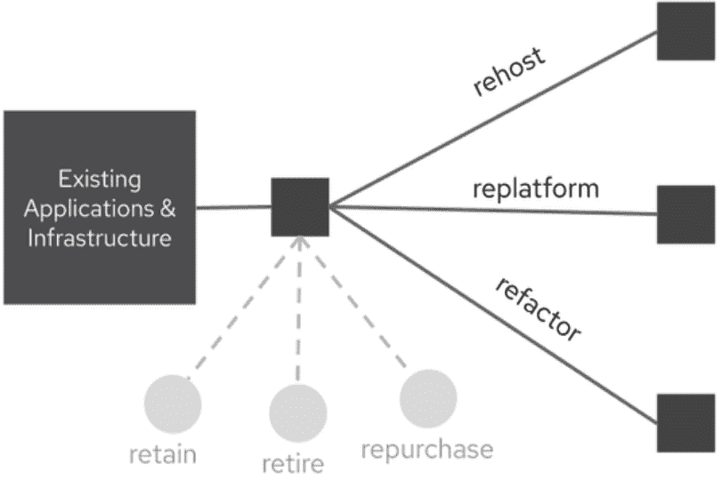
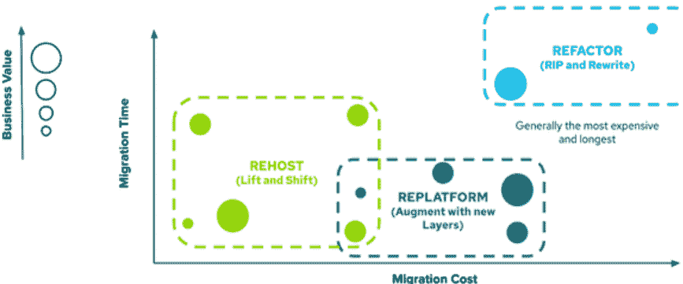
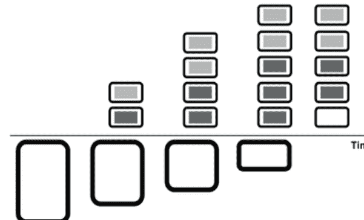

# 第 3 章 轻装上路

## 给早期版本读者的一则说明

通过早期版本电子书，你可以在书籍处于最早形态时（即作者写作时的原始未编辑内容）就获得它们，从而在这些技术正式发布之前就能加以利用。

这将是最终书籍的第 3 章。请注意，GitHub 仓库将稍后激活。

如果你对如何改进本书的内容和/或示例有任何评论，或者发现本章有缺失的材料，请通过 [eisele.markus@gmail.com](mailto:eisele.markus@gmail.com) 和 [NVinto@redhat.com](mailto:NVinto@redhat.com) 联系作者。

> *想要快乐旅行的人必须轻装上路。*
> ——安托万·德·圣埃克苏佩里

在上一章中，你构建了一个基于微服务的系统，并且我们还向你展示了一些从现有应用迁移的步骤。但所有示例面临的挑战是，它们为了更容易理解而移除了复杂性。在小示例中看似清晰的内容，在真实的业务系统中会变得具有挑战性。尤其是考虑那些复杂的遗留系统。如第一章所述，技术和方法论经过多年发展，为我们带来了当今开发现代企业系统的最佳实践和工具。仅仅因为我们的行业现在有了更丰富的工具箱，里面装满了闪亮的新事物，并不意味着你应该总是使用它们。如果你思考这一点，以及我们日益增多的框架、方法论和技术，一个

问题就变得更加紧迫：我应该为我的下一个系统使用哪些工具和架构？以及我该如何、在何处运行它们？在你做出决定之前，你需要稍微思考一下过去几年中企业应用涌现出的最显著的架构风格（三层架构、企业集成、面向服务架构、微服务和事件驱动架构）。

### 三层架构或分布式系统

企业 Java 世界以单体应用为主。它们通常被设计为单一执行单元，通过服务器实例和集群功能进行扩展。它们也常被称为“三层系统”，以反映其组成的三个主要部分：客户端用户界面、服务器端业务逻辑实现，以及服务器端数据持久化或集成层。服务器端部分被称为“单体”，因为它们被打包为单个大型可执行文件。对系统的任何更改通常都涉及构建和部署新版本。

> 提示
> 了解更多关于构建微服务的内容，请参阅[山姆·纽曼的佳作《构建微服务》](https://)，其第二版现已出版。

基于微服务的架构是一种将单个应用程序开发为一系列小型服务的方法，每个服务在自己的进程中运行，并使用轻量级机制进行通信，通常是 HTTP 资源 API 或作为事件驱动架构（EDA）的一部分。这些服务围绕业务能力构建，并可通过完全自动化的部署机制独立部署。对这些服务的集中管理极少，它们可以用不同的编程语言编写，并使用不同的数据存储技术。

Java 虚拟机（JVM 版本或供应商）、各个依赖项、外部接口和服务。

在这里，区分现代化的三个不同角度至关重要。虽然现有流程和边界内的*技术更新*对于软件项目来说是一个熟悉且成熟的挑战，但现代化指的是另外一回事。*现代化*一词常与“数字化”搭配，指的是采用新技术。它涉及用新功能升级系统、平台和软件。它可以简单到将现有的纸质流程通过新软件和硬件转化为数字流程，也可以复杂如逐步淘汰现有基础设施并迁移到云端。有时，当人们谈论现代系统时，你还会听到*转型*。数字化转型意味着利用现代技术重新构想组织的流程、文化、人员和客户体验。它可能带来新的业务模式、收入来源、政策和价值观。转型某种程度上是以一种整体视角审视组织，并明确聚焦于从根本上改变业务绩效。现代化嵌入其中，并成为软件开发人员和架构师需要驾驭的核心内容。

尽管你有基于项目特定原因而迈出现代化应用的第一步，但请务必记住，现代化本身并不对特定目标环境或技术提出任何特别要求。它是一个不断变化和增长的技术候选集，使公司能够在所在行业中竞争和成长。你可以在技术趋势报告中（例如 [ThoughtWorks 技术雷达](https://)）或炒作周期中（[Gartner 炒作周期](https://)）找到其中的一些技术。但正如你在第一章中所看到的，持续创新的两个最强动机是速度和成本压力。这两者都可以通过现代的、云原生的、基于微服务的架构来解决。

## 6 个 R

现在你了解了应用现代化背后的动机，你想确定现代化的通用方法，并定义一个

*图 3-1. 六种现代化方法——6 个 R 概览*

### 保留 - 暂不现代化或永不现代化

每个人都听说过一个刻板故事：某家非常知名的公司地下室里有一台大型机，里面存储着其所有商业机密。很多时候，这些大型机使用 CICS（客户信息控制系统，是一个混合语言应用服务器家族，为 IBM 大型机系统上的应用提供在线事务管理和连接）编程，数据存储在 IMS（IBM 信息管理系统，一种早期数据库）中。这未必是坏事。也许现有系统非常适合业务需求，不需要参与现代化项目。为了正确界定你的转型和现代化工作范围，你需要识别这些系统，并将其从现代化过程中剔除。具有此分类的系统需要一种专门设计的特定集成方法。想象一个高度可扩展

并确保遵循供应商建议。这一步针对的是基础设施现代化，并不直接涉及应用代码。符合这种方法的现有应用是那些需要在重构之前迁移到容器运行时，或作为切换数据中心概念的过渡步骤的应用。

### 重新平台化 - 做一些微调

> 注意
> “绞杀者模式”一词由马丁·福勒提出，指的是从单体应用中提取功能的一种方式。其命名源于澳大利亚的绞杀榕，这种榕树的种子在上部枝条中生根，直至触地。

作为重新托管的延伸，重新平台化归类了在切换运行时同时经历概念或功能变化的应用。它也可以被称为“提升”名称的变体，“提升并调整”。它可能与被绞杀的功能相关，该功能可能在新技术栈上实现，或者涉及数据存储或集成系统的变更。我们建议将此方法作为重构和解耦单体应用的初始步骤。将该步骤前置，可以使后续扩展和解耦阶段的执行更加顺畅。通过选择重新平台化，你可以让应用现代化温和起步，并以务实的方式演进它们。

### 重构 - 重新构建

重构是一种严谨的技术，用于重组现有代码主体，在不改变其外部行为的情况下改变其内部结构。重构是将现有应用迁移到新运行时或平台的最耗时、成本最高的方式。它可能包含也可能不包含切换到不同的架构风格或本地或云托管。

### 拆分并容器化

现在我们已经研究了现有应用程序的不同现代化策略，并且知道如何以及何时应用它们。是时候思考我们目标平台的其他先决条件了。

## Kubernetes 作为新的应用服务器？

在企业 Java 世界中，平台一词通常指的是应用服务器。应用服务器遵循有 guard-railed 的软件开发方法，并提供标准化的 API。垂直层由通常称为 3 层系统的技术层定义。最上层是表示层，其上是业务层，其上是数据访问和/或集成层。在此水平方向上，我们通常会找到业务组件或域。虽然垂直层通常是分离且解耦的，但在水平组件之间找到共享类和违反访问规则的情况相对常见。如果这种情况在代码库中频繁发生，我们就会谈到纠缠的设计，随着时间的推移会变成难以维护的单体。但无论应用程序代码纠缠到何种程度，它仍然受益于标准的应用服务器功能，这些功能解决非功能性和功能性需求，如安全、隔离、容错、事务管理、配置管理等。

如果我们快进到当今的分布式架构，应用程序由许多小型服务组成，我们会观察到两件事。设计良好的组件设计不再有捷径，而且标准的应用服务器功能对我们的组件不再可用。

第一个观察结果导致了一个强制性要求。分布式服务必须是设计良好的、松耦合的、强封装的组件。我们将在 [Chapter 5](#) 中更详细地讨论现代化学单体的设计原则和方法。第二个观察结果列出了云原生运行时中缺失的功能。如果应用服务器不再提供我们上面提到的常用功能的支持，那么只剩下两个地方。一个可以是所选的微服务框架（例如 Quarkus），另一个可以是 Kubernetes 之上的附加框架或产品。

额外的 UI 或 CLI 可以让 DevOps 团队更容易分担责任。

## 基本调用

在容器内运行的应用程序通过 Ingress 控制器访问。Ingress 将 HTTP 和 HTTPS 路由从集群外部暴露到集群内部的服务。流量路由由 Ingress 资源上定义规则控制。传统上，这可以与基于 Apache httpd 的负载均衡器相比较。其他替代方案包括 [HAProxy](HAProxy) 或 Nginx 等项目。您可以使用路由功能进行滚动部署，作为复杂 CI/CD 策略的基础。对于一次性作业，例如批处理，Kubernetes 提供了 job 和 cron-job 功能。

## 弹性

Kubernetes 的 ReplicaSets 控制 Pod 的扩缩容。这是一种协调期望状态的方式：你告诉 Kubernetes 系统应该处于什么状态，以便它可以弄清楚如何达到该结果。ReplicaSet 控制任何时候应运行的容器的副本数，或精确副本数。听起来像是相当静态的操作，但可以实现自动化。Horizontal Pod Autoscaler 根据观察到的 CPU 利用率调整 Pod 数量。可以使用自定义指标或几乎任何其他应用程序提供的指标作为输入。

## 日志记录

分布式应用程序的更具挑战性的方面之一是相关联每个活动部分的日志。传统应用服务器与新世界之间的差异在此变得非常明显，因为以前它如此简单，而在新世界中却不是这样。将它们单独存储，按容器存储是不推荐的，因为你会失去对大局的把握，并且很难调试副作用和问题的根本原因。对此有各种方法，其中大多数都大量使用 [ELK](ELK)（[Elasticsearch](Elasticsearch)、[Logstash](Logstash)、[Kibana](Kibana)）堆栈或其变体。在这些堆栈中，Elasticsearch 是对象存储，所有日志都存储在其中。Logstash 从节点收集日志并将其馈送到 Elasticsearch。Kibana 是 Elasticsearch 的 Web UI，用于搜索来自各种来源的聚合日志文件。

## 监控

监控是分布式应用程序的重要组成部分，以确保所有组件继续正常工作。与日志记录不同，监控是一种主动观察，通常与警报配对，而不是简单地记录事件。[Prometheus](https://prometheus.io/) 是存储生成信息的事实标准。本质上，它是一个完整的开源监控系统，其中包含时序数据库。Prometheus 的 Web UI 为你提供指标查询、警报和可视化访问，并帮助你深入了解系统。

## 构建和部署管道

CI/CD（持续集成/持续交付）对企业 Java 应用程序或分布式应用程序来说并不是什么新鲜事。作为良好的软件开发实践，每一个生产代码都应遵循严格且自动化的发布周期。随着构成应用程序的服务数量可能非常庞大，自动化至少应达到 100% 覆盖率。传统上这是开源工具 [Jenkins](https://www.jenkins.io/) 的工作，现代容器平台已远离集中式构建系统，并采用分布式 CI/CD 方法。一个例子是 [Tekton](https://tekton.dev/)。目标是通过构建、测试和部署创建可靠的软件发布。我们将在 [Chapter 4](#) 中更深入地探讨这一点。

## 弹性和容错

心理学家将弹性定义为在逆境、创伤、悲剧、威胁或重大压力源面前良好适应的过程。在分布式应用程序中，它是指在没有人工干预的情况下从故障或负载场景中恢复的概念。Kubernetes 为集群本身提供了弹性选项，但对应用程序的弹性和容错支持有限。例如，应用程序级的弹性可以通过支持复制卷的 PersistentVolumes 或通过 ReplicaSets 确保集群中 Pod 副本数量一致来实现。在应用程序级别，弹性和容错支持可通过 Istio 或各种框架如 [Cloudstate] 实现。你想要使用诸如重试规则、断路器和池驱逐等功能。

> **NOTE**
> 
> [Istio] 是一个开源服务网格，可透明地层叠在现有的分布式应用程序之上。它也是一个平台，包括可集成到任何日志平台、遥测或策略系统中的 API。

## 安全

服务之间的身份验证或授权不是 Kubernetes 本身的一部分。有两种方法可以实现它。使用 Istio，每个服务都提供一个代表其角色的强身份，并在集群和云之间实现互操作性。它保护服务到服务通信，同时提供密钥管理以自动化密钥和证书的生成、分发、轮换和撤销。更以应用程序为中心的替代方案可以是使用单点登录组件如 [Keycloak] 或依赖 [Eclipse MicroProfile JSON-Web-Token]（JWT）。

## 追踪

追踪让你能够在整个系统、跨单个应用程序部分跟踪请求路径和事件，同时仍能追溯到源头。你可以在社区中找到不同的做法。无论你打算使用何种语言、框架或技术，Istio 都可以启用分布式追踪。还有其他商业和开源项目可帮助你在应用程序组件之间进行分布式追踪。[Zipkin] 和 [Jaeger] 是两种可能的解决方案。

## 定义你的目标平台

需要注意的是，上面提到的九个要素侧重于应用程序开发，并不能涵盖现代容器平台的所有必要性。仅从这个狭窄的焦点来看，仍有重要领域未得到解决。容器平台需要提供

features and capabilities for the complete team from Dev to Ops. Depending on specific needs, there is no one size fits all solution. A comprehensive way to define your target platform is to start with the 3 main layers: Core, Customer Experience, and Integration, then build your application landscape on an optimized technology stack. What sounds like a ready-to-use check-list is anything but. Companies are different in culture, technologies, and requirements, and the following lists are a recommended starting point without any claim to comprehensiveness. We recommend using the bullet points as evaluation categories and define the individual functional and non-functional requirements underneath with a fulfillment score from zero (not available) to three (fully supported) with a middle score of two (can make it work) as a medium evaluation. Finally, add weighting logic to it to reach a complete evaluation based on a product comparison. It can be the core framework for a direct product vs. do-it-yourself (DIY) comparison and also the starting point for the platform documentation.

## Define the Core

Start with evaluating the core part of the platform. This category includes basic capabilities like container orchestration, storage mapping, rolling-upgrades, site reliability engineering (SRE) requirements, out-of-the-box support for the desired deployment models, and might even include further support for virtual machines. This category represents the technical foundation for your target platform.

- Existing Core Capabilities
- Functional Gap Assessment
- Hybrid-cloud support
- Security integration
- Managed Services Support
- Operators/Marketplace available (e.g., [Operatorhub](https://operatorhub.io), Red Hat [Marketplace](https://marketplace.redhat.com))
- Available Support levels
- Target Deployment Model
- Core Modernization Approach

## Define the Customer Experience Layer

When thinking about platforms, one part gets too little attention, which is the customer experience layer. It contains a technical definition for the customer channels to the platform. A channel can be one of the B2X (business to something) portals or various other specific frontends. To achieve a cohesive platform that can host various applications also includes a clear definition for the technical composition of the individual services.

- Define Customer-Centric requirements
- Assess Existing CX Framework vs. Build
- Micro Frontends (e.g., Entando)
- Integration Requirements
- Data Gap Analysis
- Mobile Support

## Define the Integration

In a containerized world, integration becomes a new challenge. Coming from a traditional enterprise landscape, it has either been a centralized solution (Enterprise Service Bus or similar) or been part of the individual applications using some common integration framework like Apache Camel. Neither approach fits perfectly into a stateless container-oriented platform. What you are looking for in a target platform is the smooth integration between messaging components, data transformation logic, and service integration. All the relevant parts need to scale well in a stateless environment for distributed systems, and it should be easy to extend a composed application with new capabilities.

## Mandatory migration steps and tools

Following the basic assumption that you have an existing application landscape in place and cannot start everything as a green-field project, we emphasize moving existing applications into containers. Coming back to the 6 Rs from above, the first application you are taking a look at should fall into one of the following Rs: Rehost, Replatform, and Refactor (Figure 3-3). While they look similar in their description, the most significant difference between the three approaches is business value vs. migration time and cost.

*Figure 3-3. Workload migration pattern*

Which action to take and where to start modernizing depends on the application. While the concrete steps may vary, the first thing to identify are the correct candidates. Therefore we need to analyze the existing applications, catalog them and group them to assign them to the final migration pattern. The last step is to execute the individual migration projects.

### Create an application portfolio

There are many ways to create such an application catalog or portfolio. And you most likely already have a way to select applications relevant for a certain business domain. If not, feel free to fast forward to Chapter 5 where I talk about the Konveyor project.

## Prepare for big things

The most prestigious process in modernization is refactoring existing applications. For coverage of a proven method on transitioning an existing monolithic system to a microservice architecture, we recommend Monolith to Microservices by Sam Newman. While he walks you through a lot of different approaches and created a detailed process for various situations, there are also simpler approaches. Like the one outlined by Brent Frye, from the Software Engineering Institute at the Carnegie Mellon University. His approach to modularization of existing applications is a lot more generic. He recommends 8 simple steps to break down the monolith. He focuses on components and component groups. Components are logical sets of data objects and the actions that the system performs on those objects. Component groups become what he calls macroservices. A macroservice is similar to a microservice with two primary differences. First, a macroservice may share the datastore with the legacy monolithic system or other macroservices. Second, unlike a microservice, a macroservice may provide access to multiple data objects. In the last step, the macroservices are decomposed further.

The logical steps to breaking down your monolith according to Frye:

- 1. Identify logical components.
- 2. Flatten and refactor components.
- 3. Identify component dependencies.
- 4. Identify component groups.
- 5. Create an API for a remote user interface.
- 6. Migrate component groups to macroservices
  a. Move component groups to separate projects
  b. Make separate deployments
- 7. Migrate macroservices to microservices.
- 8. Repeat steps 6-7 until complete.

This is also the more general recommendation from Chris Richardson. As he outlined in his [O'Reilly SACON London keynote](https://) and many times after, he is looking for an incremental approach starting with the most promising functionality.

Figure 3-4. Do it incrementally

And repeat the extraction steps until the monolith is finally eliminated or the initial software delivery problems are solved as illustrated in Figure 3-4.

The three approaches differ in depth, angle and details. While Richardson talks about the most valuable functionality and focusses on extracting it first, Frey created a simple methodology which can be applied in all situations. Newmann finally, developed the most detailed handbook for various situations in a modernization journey. All three will be helpful on your personal journey. We are convinced though, that the approach Richardson takes is the best starting point. What Thomas Huijskens said for data scientists is something we also strongly believe in.

> *...the code you write is only useful if it is production code.*
> 
> —Thomas Huijskens

Every modernization effort has to follow business requirements and support production functionality. Following this thought the entire modernization project can only be successful if you identify the correct candidates.

## Summary

This chapter walked you through some basic definitions for migration strategies and showed you an evaluation path for the target development platform. We’ve looked at technical recommendations, and you now know how to assess existing applications for re-hosting, re-platforming, and refactoring.

