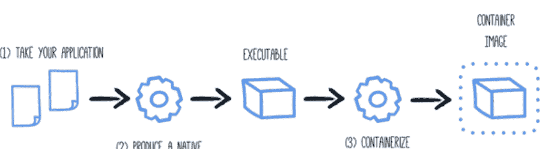
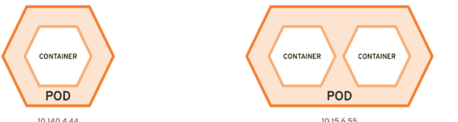
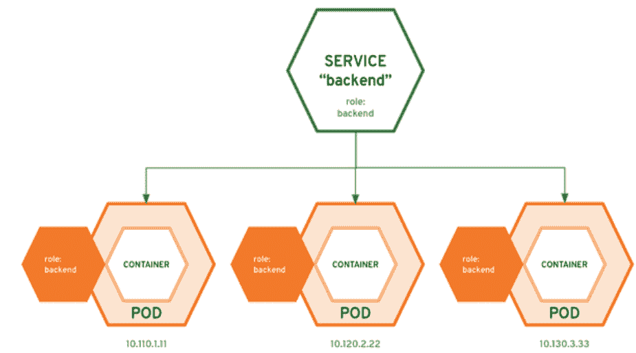

# 第4章 基于 Kubernetes 的软件开发平台

### 致早期发布读者

通过 Early Release 电子书，你可以在图书正式发布之前就接触到这些技术——作者写作时的原始未编辑内容。

这将是最终图书的第4章。请注意，GitHub 仓库稍后将会激活。

如果你对本书内容和/或示例的改进有想法，或者发现本章有缺失的材料，请通过 eisele.markus@gmail.com 和 NVinto@redhat.com 联系作者。

在上一章中，我们概述了围绕现代化转型的方法论，以及设计和开发现代架构所需的步骤。我们提到了需要像 Kubernetes 这样的平台来满足你的需求，使你的应用程序云原生，并能够根据业务需求按比例扩展。

我们还展示了基于微服务的架构通常使用容器技术实现，这使得应用具有可移植性和一致性。现在让我们详细了解 Kubernetes 如何帮助我们现代化 Java 应用程序，以及如何通过其丰富的 API 集使用声明式方法来实现这一目标。

### 开发人员与 Kubernetes

部署更容易，这样开发人员可以只专注于最重要的部分：编码。Kubernetes 为你提供“一个弹性运行分布式系统的框架”¹。

实际上，这意味着在以下方面你无需重新实现自定义解决方案：

- **服务发现**：Kubernetes 使用内部 DNS 解析来暴露你的应用，这是自动分配的，也可以用于将流量发送到应用的多个实例。
- **负载均衡**：Kubernetes 负责管理工作负载，平衡流量，并相应地分发用户请求。
- **自愈**：Kubernetes 自动发现并替换失败的容器，开箱即用地提供健康检查和自愈机制。
- **滚动发布和回滚**：Kubernetes 确保你的应用始终按期望状态一致运行，并提供对工作负载进行伸缩的控制。此外，它还提供了滚动发布或回滚到应用程序特定版本的能力。

### Kubernetes 不能做什么

开发人员在生产环境中通常需要处理的许多棘手问题已经得到解决，并委托给平台，其主要目标是确保应用程序运行。但这能满足我们现代化应用所需的全部需求吗？可能不行。

正如我们在上一章讨论的，走向云原生方法的现代化步骤更多地与方法论相关，而不是特定技术。一旦你从构建单体应用的思维转变为创建微服务，我们就处于一个可以开始放眼长远的好位置。如今，许多应用运行在面向 Kubernetes 的云平台上，而这些正是运行全球规模工作负载的应用。无论如何，这里有一些考虑：

- Kubernetes 不知道如何处理我们的应用。它可以在应用失败时重启，但无法理解为什么会失败，因此我们需要确保对基于微服务的架构有完全的控制，并且能够调试每个容器。这在大型部署中尤其重要。
- Kubernetes 不提供中间件或应用级服务。细粒度的发现服务需要通过 Kubernetes API 交互或依赖 Kubernetes 之上的某些服务（例如服务网格框架）来解决。Kubernetes 没有开箱即用的开发者生态系统。
- Kubernetes 不会构建我们的应用。你需要自己负责提供编译并打包为容器镜像的应用，或依赖 Kubernetes 之上的附加组件。

考虑到这一点，让我们开始深入 Kubernetes 的开发之旅，迈出将应用带入下一个云原生生产环境的第一步。

### 基础设施即代码

Kubernetes 提供了一组 API 来管理应用以及整个平台的期望状态。Kubernetes 中的每个组件都有一个可供使用的 API 表示。Kubernetes 提供了一种声明式部署模式，允许你自动化一组 Pod² 的升级和回滚过程。声明式方法粒度较细，也用于通过 *自定义资源* 的概念扩展 Kubernetes API。

### 注意

自定义资源是 Kubernetes API 的扩展。*自定义资源* 代表了对特定 Kubernetes 安装的自定义，带来额外的对象来扩展集群能力。你可以从官方 Kubernetes 文档获取更多信息。

在 Kubernetes 中管理应用程序所需的一些核心对象包括：

**Pod**：部署到 Kubernetes 集群中的一个或多个容器组。这是 Kubernetes 管理和编排的实体，因此任何打包为容器的应用都需要被声明为 Pod。

**Service**：该资源负责服务发现和负载均衡。任何 Pod 要被发现和消费，都需要映射到一个 Service。

**Deployment**：它允许描述应用的生命周期，驱动 Pod 的创建，包括应用使用哪些镜像、应该有多少个 Pod，以及如何更新它们。此外，它还有助于定义健康检查和应用的资源约束。

这些对象以及集群中的所有其他资源都可以通过 YAML 表示或 Kubernetes API 进行定义和控制。还有其他有用的 API 对象，例如与存储相关的对象（PersistentVolume），或专门用于管理有状态应用的对象（StatefulSet）。在本章中，我们将重点介绍将应用在 Kubernetes 平台内启动并运行所需的基本对象。

### 容器镜像

在这个旅程中，你的第一步是将微服务容器化，以便它们可以作为 Pod 部署到 Kubernetes 中，并通过 YAML 文件、调用 API 或使用 Kubernetes Java 客户端进行控制。

你可以使用 Coolstore 中的 Inventory Quarkus 微服务作为示例来创建你的第一个容器镜像。容器由 Dockerfile 定义：

### 表 4-1. Dockerfile 指令

| 指令 | 描述 |
|---|---|
| FROM | 用于从基础镜像继承。例如，可以是诸如 `fedora,centos,rhel,ubuntu` 的 Linux 发行版。 |
| ENV | 为容器设置环境变量。这些变量对应用可见，并可在运行时设置。 |
| RUN | 在当前层执行命令，如安装软件包或运行一个应用。 |
| ADD | 将文件从你的工作站复制到容器层，如 JAR 文件或配置文件。 |
| EXPOSE | 如果你的应用正在监听某个端口，你可以将其暴露给容器网络，以便 Kubernetes 可以将其映射到 Pod 和 Service。 |
| CMD | 用于启动应用的命令，是容器镜像构建过程的最后一步，此时所有依赖都已在各层中，你可以安全地运行应用。 |

从你的 Dockerfile 创建容器的过程也可见于图 4-3。



图 4-3. 构建容器镜像

下面是我们第2章中创建的 Inventory Quarkus Java 微服务的 Dockerfile 示例，你也可以在本书的 GitHub 仓库中找到它。

docker.io/modernizingjavaappsbook/inventory-quarkus:latest。你将看到类似如下的输出：

```
STEP 1: FROM registry.access.redhat.com/ubi8/openjdk-11
Getting image source signatures
Copying blob 57562f1b61a7 done
Copying blob a6b97b4963f5 done
Copying blob 13948a011eec done
Copying config 5d89ab50b9 done
Writing manifest to image destination
Storing signatures
STEP 2: ENV PROFILE=prod
STEP 3: ADD target/*.jar app.jar
STEP 4: EXPOSE 8080
STEP 5: CMD java -jar app.jar
STEP 6: COMMIT inventory-quarkus:latest
Getting image source signatures
Copying blob 3aa55ff7bca1 skipped: already exists
Copying blob 00af10937683 skipped: already exists
Copying blob 7f08faf4d929 skipped: already exists
Copying blob 1ab317e3c719 done
Copying config b2ae304e3c done
Writing manifest to image destination
Storing signatures
--> b2ae304e3c5
b2ae304e3c57216e42b11d8be9941dc8411e98df13076598815d7bc376afb7a1
```

你的容器镜像现在存储在 Docker 或 Podman 的本地存储中，称为 *Docker 缓存* 或 *容器缓存*，并且可以在本地使用。

### 运行容器

运行容器是指从容器缓存中拉取容器镜像来运行应用程序。此过程将由容器运行时（如 Docker 或 Podman）与工作站上的其他进程隔离，从而提供一个可移植的应用，所有依赖都管理在容器内，而不是在工作站中。

要开始测试现在打包为容器镜像的 Inventory 微服务，你可以直接运行以下命令：


```
docker run -ti docker.io/modernizingjavaappsbook/inventory-quarkus:latest
```

你会看到 Quarkus 微服务已在容器中启动并运行，监听 8080 端口。Docker 或 Podman 会负责将容器网络映射到你的工作站，打开浏览器访问 http://localhost:8080，你将看到 Quarkus 欢迎页面（见图 2-4）。

> TIP
> 
> Docker Network 文档包含有关如何在运行 Docker 的容器和主机中映射端口和网络的更多信息。

## Registry

正如我们在上一节所述，容器镜像存储在本地缓存中。然而，如果你想将其在工作站之外可用，我们需要以某种便捷的方式发送它们。容器镜像的大小通常在数百兆字节左右。这就是为什么你需要一个容器镜像仓库。

仓库本质上充当存储容器镜像并通过上传（推送）和下载（拉取）的过程共享它们的地方。一旦镜像在另一系统上，该系统也可以运行其中包含的原始应用程序。

仓库可以是公共的或私有的。流行的公共仓库包括 DockerHub 或 Quay.io。它们作为互联网上的 SaaS 提供，允许镜像在有或无身份验证的情况下公开可用。私有仓库通常专用于特定用户，不可供公众使用。但是，你可以将其提供给私有环境，例如私有 Kubernetes 集群。

在此示例中，我们在 DockerHub 为本书创建了一个组织，名为 modernizingjavaappsbook，它映射到我们想要推送容器镜像的该公共仓库的存储库中。

首先，你需要登录到仓库。你需要对其进行身份验证才能推送新内容，然后你将使容器镜像公开可用。

```
docker login docker.io
```

成功登录后，你可以开始将 Inventory 容器镜像上传到仓库。

```
docker push docker.io/modernizingjavaappsbook/inventory-quarkus:latest
```

此命令将镜像推送到仓库，你应会看到类似以下内容的输出作为确认：

```
Getting image source signatures
Copying blob 7f08faf4d929 done
Copying blob 1ab317e3c719 done
Copying blob 3aa55ff7bca1 skipped: already exists
Copying blob 00af10937683 skipped: already exists
Copying config b2ae304e3c done
Writing manifest to image destination
Storing signatures
```

打包为容器镜像的 Quarkus 微服务现在已准备好部署到任何地方！

## Deploying to Kubernetes

将应用程序部署到 Kubernetes 是通过与 Kubernetes API 交互来创建代表应用程序在 Kubernetes 集群中期望状态的对象来完成的。如我们所讨论的，Pods、Services 和 Deployments 是创建的最小对象，以便 Kubernetes 管理整个应用程序生命周期和连接。

> **NOTE**
> 
> 如果你还没有 Kubernetes 集群，你可以下载并使用 [Minikube](https://minikube)，一个专为本地开发设计的独立 Kubernetes 集群。

Kubernetes 中的每个对象都包含以下值。

- **apiVersion**：用于创建此对象的 Kubernetes API 版本
- **kind**：对象类型（例如 Pod、Service）
- **metadata**：有助于唯一标识对象的信息片段，例如名称或 UID
- **spec**：对象的期望状态

我们在本节中定义了任何 Kubernetes 对象的<|message|> 结构。现在让我们探索在 Kubernetes 之上运行应用程序的基本对象。

## Pod

Pod 是一组一个或多个容器，共享存储和网络资源，并有一个运行容器的规范³。在 [Figure 4-4](Figure 4-4) 中，你可以看到 Kubernetes 集群中两个 Pod 的表示，以及 Kubernetes 分配给每个 Pod 的示例 IP 地址。



*Figure 4-4. Pods and container*

将你的第一个微服务作为单个 Pod 部署。你可以在此 [book’s GitHub repository](#) 中找到它。

```bash
kubectl create -f pod.yaml
```

检查它是否在 Kubernetes 上运行：

```bash
kubectl get pods
```

你应该得到类似以下的输出：

```text
NAME                READY   STATUS    RESTARTS   AGE
inventory-quarkus   1/1     Running   0          30s
```

如果查看 STATUS 列，它显示 Pod 正在正确运行，并且所有默认健康检查都已正确满足。

> **TIP**
> 
> 如果你想进一步了解如何进行更细粒度的健康检查，请参阅官方 Kubernetes 文档中关于 [liveness and readiness probes](#) 的内容。

## Service

Kubernetes Services 用于公开在 Pod 集合上运行的应用程序⁴。这很有用，因为 Pod 从 Kubernetes 网络获取随机 IP 地址，如果它被重启或移动到 Kubernetes 集群中的另一个节点，该地址可能会更改。Services 提供了一种更一致的方式与 Pod 通信，充当 DNS 服务器和负载均衡器。

Service 映射到一个或多个 Pod，它使用内部 DNS 将易记的短主机名（例如 `inventory-quarkus`）解析为内部 IP，并在 [Figure 4-5](#) 中所示的 Pod 之间平衡流量。每个 Service 从专用 IP 地址范围获取自己的 IP 地址，该范围与 Pod IP 地址范围不同。

### NOTE

Kubernetes Services 提供的负载均衡方法是第 4 层（TCP/UDP）。唯一可用的两种策略是：轮询和源 IP。对于应用层负载均衡（例如 HTTP），有 Ingress 等其他对象，本书未涵盖，但你可以在此处找到它们的文档。



Figure 4-5. Kubernetes Service

让我们看一下可以映射我们的 Pod 的 Service：

```
apiVersion: v1
kind: Service
metadata:
  name: inventory-quarkus-service ①
spec:
  selector:
    app: inventory-quarkus ②
  ports:
  - protocol: TCP ③
    port: 8080 ④
    targetPort: 8080 ⑤
```

① Service 对象的名称。

- ② Pod 暴露以匹配 Service 的标签。
- ③ 使用的 L4 协议，TCP 或 UDP。
- ④ 此 Service 使用的端口。
- ⑤ Pod 使用的端口并映射到 Service。

要创建你的 Service，请运行以下命令。你也可以在本书的 [GitHub 仓库](https://github.com/) 中找到它。

```
kubectl create -f service.yaml
```

检查它是否在 Kubernetes 上运行：

```
kubectl get svc
```

你应该得到类似以下的输出：

```
NAME                         TYPE        CLUSTER-IP      EXTERNAL-
IP   PORT(S)   AGE
inventory-quarkus-service    ClusterIP   172.30.34.73    <none>
8080/TCP   6s
```

> **NOTE**
> 
> 你刚刚定义了一个映射到 Pod 的 Service。这只能从内部 Kubernetes 网络访问，除非你使用可以接受集群外部流量的对象（如 Ingress）将其公开。

## Deployment

Deployment 是为管理应用程序生命周期而创建的 Kubernetes 对象。Deployment 描述了期望状态，Kubernetes 将使用 *Rolling* 或 *Recreate* 部署策略来实现它。滚动生命周期包括进行中、完成和失败状态。A

- **Recreate：** 它在创建新 Pod 之前删除所有现有 Pod。Kubernetes 首先终止当前版本的所有容器，然后在旧容器消失后同时启动所有新容器。这为应用程序提供了停机时间，但确保同时没有多个版本运行。

驱动 Pod 在 Kubernetes 上部署的 Deployment 对象在下面的示例中列出：

```
apiVersion: apps/v1
kind: Deployment
metadata:
  name: inventory-quarkus-deploy ①
  labels:
    app: inventory-quarkus ②
spec:
  replicas: 1 ③
  selector:
    matchLabels:
      app: inventory-quarkus ④
  template: ⑤
    metadata:
      labels:
        app: inventory-quarkus
    spec:
      containers:
      - name: inventory-quarkus
        image: docker.io/modernizingjavaappsbook/inventory-quarkus:latest ⑥
        ports:
        - containerPort: 8080
        readinessProbe: ⑦
          httpGet:
            path: /
            port: 8080
            scheme: HTTP
          periodSeconds: 10
          successThreshold: 1
          failureThreshold: 3
        livenessProbe: ⑧
          httpGet:
            path: /
            port: 8080
            scheme: HTTP
          periodSeconds: 10
```


```yaml
successThreshold: 1
failureThreshold: 3
```

1. Deployment 对象的名称。
2. 此对象的标签。
3. 所需的 Pod 副本数量。
4. 用于通过标签查找要管理的 Pod 的选择器。
5. 要使用的 Pod 模板，包括要继承的标签或要创建的容器。
6. 要使用的容器镜像。
7. Kubernetes 使用就绪探针来知道容器何时准备好开始接收流量，并且当其所有容器都就绪时 Pod 被视为就绪。在这里我们将根路径上的 HTTP 健康检查定义为就绪探针。
8. Kubernetes 使用存活探针来知道何时重启容器。在这里我们将根路径上的 HTTP 健康检查定义为存活探针。

运行以下命令来创建你的部署。你也可以在本书的 GitHub 仓库中找到它。

```
kubectl create -f deployment.yaml
```

运行以下命令以验证 Deployment 是否已创建，并获取状态：

```
kubectl get deploy
```

你应该得到类似如下的输出：

## Kubernetes 和 Java

Kubernetes 在管理应用程序生命周期方面具有巨大的潜力，并且有许多研究探讨开发者和架构师如何最好地融入其架构，例如模式。Kubernetes 模式是面向容器化应用程序和服务的可重用设计模式。

从 Java 开发者角度来看，第一步是从单体方法迁移到基于微服务的方法。一旦完成，下一步就是进入 Kubernetes 上下文并最大化该平台提供的优势：API 可扩展性、声明式模型，以及 IT 行业正在趋同的标准化的流程。

有一些 Java 框架可以帮助开发者连接到 Kubernetes 并将他们的应用转换为容器。你已经使用 Dockerfile 将 Inventory Quarkus 微服务容器化了。现在让我们从 Java 驱动这种容器化，使用 Maven 和 Gradle 为 Catalog Spring Boot 微服务生成容器镜像。

## Jib

Jib 是 Google 制作的开源框架，用于构建符合开放容器镜像格式（OCI）的容器镜像，而无需 Docker 或任何容器运行时。你甚至可以从 Java 代码库创建容器，因为它提供了 Maven 和 Gradle 插件。这意味着 Java 开发者可以在不编写和/或维护任何 Dockerfiles 的情况下容器化他们的应用，将这种复杂性委托给 Jib。

我们认为这种方法的好处如下：

- **纯 Java：** 无需 Docker 或 Dockerfile 知识，只需添加 Jib 作为插件，它就会为你生成容器镜像。生成的镜像通常被称为无发行版，因为它不继承任何基础镜像。
- **速度：** 应用程序被划分为多个层，将依赖项与类分开。无需像 Dockerfile 那样重建容器镜像，Jib 会负责部署已更改的层。
- **可重复性：** 不必要的更新不会被触发，因为相同的内容始终会生成相同的镜像。

在现有 Maven 上启动容器镜像构建的最简单方法是通过命令行添加插件：

```
mvn compile com.google.cloud.tools:jib-maven-plugin:2.8.0:build -Dimage=<MY IMAGE>
```

或者，你也可以通过在 pom.xml 中添加 Jib 作为插件来实现：

```xml
<project>
    ...
    <build>
        <plugins>
            ...
            <plugin>
                <groupId>com.google.cloud.tools</groupId>
                <artifactId>jib-maven-plugin</artifactId>
                <version>2.8.0</version>
                <configuration>
                    <to>
                        <image>myimage</image>
                    </to>
                </configuration>
            </plugin>
            ...
        </plugins>
    </build>
    ...
</project>
```

这样你也可以管理其他设置，例如身份验证或构建参数。如果想构建 Catalog 服务并直接推送到 Docker Hub，运行以下命令：

```
mvn compile com.google.cloud.tools:jib-maven-plugin:2.8.0:build\
-Dimage=docker.io/modernizingjavaappsbook/catalog-spring-boot:latest\
-Djib.to.auth.username=<USERNAME>\
-Djib.to.auth.password=<PASSWORD>
```

这里的身份验证以命令行选项的方式管理，但 Jib 能够管理 Docker CLI 的现有身份验证，或从你的 settings.xml 读取凭据。

构建需要几分钟时间，结果是一个在本地构建的无发行版容器镜像并直接推送到镜像仓库，在此例中为 Docker Hub。

```
[INFO] Scanning for projects...
[INFO]
[INFO] ----------------------< com.redhat.cloudnative:catalog >------
----------------------
[INFO] Building CoolStore Catalog Service 1.0-SNAPSHOT
[INFO] --------------------------------[ jar ]--------------------------------
----------------------
[INFO]
[INFO] --- maven-resources-plugin:2.6:resources (default-resources) @ catalog ---
[INFO] Copying 4 resources
[INFO]
[INFO] --- maven-compiler-plugin:3.6.1:compile (default-compile) @ catalog ---
[INFO] Nothing to compile - all classes are up to date
[INFO]
[INFO] --- jib-maven-plugin:2.8.0:build (default-cli) @ catalog ---
[INFO]
[INFO] Containerizing application to
modernizingjavaappsbook/catalog-spring-boot...
[WARNING] Base image 'gcr.io/distroless/java:11' does not use a specific image digest\
- build may not be reproducible
[INFO] Using credentials from <to><auth> for
modernizingjavaappsbook/catalog-spring-boot
[INFO] Using base image with digest:\
sha256:65aa73135827584754f1f1949c59c3e49f1fed6c35a918fadba8b4638ebc9c5d
[INFO]
[INFO] Container entrypoint set to [java, -cp,
/app/resources:/app/classes:/app/libs/*,
com.redhat.cloudnative.catalog.CatalogApplication]
[INFO]
[INFO] Built and pushed image as modernizingjavaappsbook/catalog-
spring-boot
[INFO] Executing tasks:
[INFO] [==============================] 100,0% complete
[INFO]
[INFO] ------------------------------------------------------------
------------
[INFO] BUILD SUCCESS
[INFO] ------------------------------------------------------------
------------
[INFO] Total time: 27.817 s
[INFO] Finished at: 2021-03-19T11:48:16+01:00
[INFO] ------------------------------------------------------------
------------
```

> **NOTE**
> 
> 你的容器镜像不会出现在本地缓存中，因为你不需要任何容器运行时即可使用 Jib 构建镜像。你不会通过 `docker images` 命令看到它，但之后你可以从 Dockerhub 拉取它，它将被存储在你的缓存中。如果也想从一开始就将其存储在本地，Jib 也可连接到 Docker 主机并为你完成此操作。

## JKube

[Eclipse JKube](https://www.eclipse.org/jkube/) 是一个由 Eclipse 基金会和 Red Hat 支持的社区项目，是另一个开源 Java 框架，可帮助从 Java 开发者角度与 Kubernetes 交互。它支持使用 Docker/Podman、Jib 和 Source-2-Image 构建容器镜像。Eclipse JKube 还提供了一套工具，可自动部署到 Kubernetes，并通过调试和日志记录的助手来管理应用程序。它源自 Fabric8 Maven Plugin，作为一个重新品牌化并增强的项目，目标是 Kubernetes。

**TIP**

JKube 支持 Kubernetes 和 OpenShift。OpenShift 在 Kubernetes 之上提供了 [Source-2-Image](Source-2-Image)，一种从源代码自动编译容器镜像的机制。这样构建也在 Kubernetes 上进行，因此开发者可以直接在目标平台上测试和部署他们的应用。

与 Jib 一样，JKube 提供了 *零配置* 模式以便快速上手，其中会预先选择有主见的默认值。它提供了使用 XML 语法在插件配置中进行 *内联配置*。此外，它还提供了 *外部配置* 模板，即由插件丰富真实的部署描述符。

JKube 以三种形式提供：

- **Kubernetes 插件：** 它可在任何 Kubernetes 集群中工作，提供无发行版和 Dockerfile 驱动的构建。
- **OpenShift 插件：** 它可在任何 Kubernetes 或 OpenShift 集群中工作，提供无发行版、Dockerfile 驱动的构建或 Source-to-Image（S2I）构建。
- **JKube Kit：** 一个工具包和 CLI 用于与 JKube Core 交互，也充当 Kubernetes 客户端，并提供 Enricher API 以扩展 Kubernetes 清单。

JKube 提供的功能比 Jib 更多，实际上可以被视为一个超集。你可以进行无发行版的 Jib 构建，但也可以使用 Dockerfile 并从 Java 部署 Kubernetes 清单。在这种情况下我们不需要编写 Deployment 或 Service，JKube 将负责构建容器并将其部署到 Kubernetes。

让我们在 Catalog POM 文件中包含 JKube，并将其配置为执行 Jib 构建和部署到 Kubernetes。这样做将使插件持久化。你也可以在本书的此 [GitHub 仓库](book’s GitHub repository) 中找到源代码。

首先我们需要添加 JKube 作为插件：


<project>
    ...
    <build>
        <plugins>
            ...
            <plugin>
                <groupId>org.eclipse.jkube</groupId>
                <artifactId>kubernetes-maven-plugin</artifactId>
                <version>1.1.1</version>
            </plugin>
            ...
        </plugins>
    </build>
    ...
</project>

之后，你可以使用属性驱动容器镜像构建。在这种情况下，你可能希望使用 Jib 来构建镜像并将其推送到 Docker Hub。之后你将部署到 Kubernetes。

```
...
<properties>
    ...
    <jkube.build.strategy>jib</jkube.build.strategy>

<jkube.generator.name>docker.io/modernizingjavaappsbook/catalog-spring-boot:${project.version}</jkube.generator.name>
</properties>
...
```

让我们构建镜像：

```
mvn k8s:build
```

你应该会看到类似的输出：

```
JIB>... modernizingjavaappsbook/catalog-spring-boot/1.0-SNAPSHOT/build/deployments/catalog-1.0-SNAPSHOT.jar
JIB>  :
JIB>... modernizingjavaappsbook/catalog-spring-boot/1.0-SNAPSHOT/build/Dockerfile
...
JIB> [==================== ] 80,0% complete > building image to tar file
JIB> Building image to tar file...
JIB> [====================] 80,0% complete > writing to tar file
JIB> [=======================] 100,0% complete
[INFO] k8s: ... modernizingjavaappsbook/catalog-spring-boot/1.0-SNAPSHOT/tmp/docker-build.tar,
successfully built
[INFO] ------------------------------------------------------------
[INFO] BUILD SUCCESS
[INFO] ------------------------------------------------------------
[INFO] Total time: 36.229 s
[INFO] Finished at: 2021-03-19T13:03:19+01:00
[INFO] ------------------------------------------------------------
```

JKube 使用 Jib 在本地创建了容器镜像，现在它已准备好推送到 Docker Hub。你可以通过以下三种方式之一指定凭据：

- **Docker login**：你可以登录到你的注册表，在本例中为 Docker Hub，JKube 将读取 `~/.docker/config.json` 文件以获取身份验证详细信息。
- **在 POM 中提供凭据**：将注册表凭据作为 XML 配置的一部分提供。
- **在 Maven Settings 中提供凭据**：你可以在 `~/.m2/settings.xml` 文件中像这样提供注册表凭据，插件将从那里读取它。

在本例中你使用第三种选项并将凭据设置到 Maven Settings，因此你可以使用你的凭据复制此文件。你也可以在本書的 GitHub 仓库中找到源代码。

```xml
<?xml version="1.0" encoding="UTF-8"?>
<settings xmlns="http://maven.apache.org/SETTINGS/1.0.0" xmlns:xsi="http://www.w3.org/2001/XMLSchema-instance" xsi:schemaLocation="http://maven.apache.org/SETTINGS/1.0.0 http://maven.apache.org/xsd/settings-1.0.0.xsd">
<servers>
  <server>
    <id>https://index.docker.io/v1</id>
    <username>USERNAME</username>
    <password>PASSWORD</password>
  </server>
</servers>
</settings>
```

要将其推送到 Docker Hub，只需运行此 Maven 目标：

```bash
mvn k8s:push
```

你应该会看到类似的输出：

```text
JIB> [==========================    ] 81,8% complete > scheduling pushing manifests
JIB> [==========================    ] 81,8% complete > launching manifest pushers
JIB> [==========================    ] 81,8% complete > pushing manifest for latest
JIB> Pushing manifest for latest...
JIB> [==========================    ] 90,9% complete > building images to registry
JIB> [==========================    ] 90,9% complete > launching manifest list pushers
JIB> [==============================] 100,0% complete
[INFO] ------------------------------------------------------------
[INFO] BUILD SUCCESS
[INFO] ------------------------------------------------------------
[INFO] Total time:  01:08 min
[INFO] Finished at: 2021-03-19T13:21:28+01:00
```

现在是时候将 Catalog 部署到 Kubernetes 了。JKube 将连接到你的 Kubernetes 集群，读取工作站上的 `~/.kube/config` 文件。

```bash
mvn k8s:resource k8s:apply
```

你应该会得到类似的输出：

```
[INFO] Scanning for projects...
[INFO]
[INFO] --------------------< com.redhat.cloudnative:catalog >--------------------
[INFO] Building CoolStore Catalog Service 1.0-SNAPSHOT
[INFO] -----------------------------[ jar ]-----------------------------
[INFO]
[INFO] --- kubernetes-maven-plugin:1.1.1:resource (default-cli) @ catalog ---
[INFO] k8s: Running generator spring-boot
...
[INFO] k8s: Creating a Service from kubernetes.yml namespace default name catalog
[INFO] k8s: Created Service:
target/jkube/applyJson/default/service-catalog.json
[INFO] k8s: Creating a Deployment from kubernetes.yml namespace default name catalog
[INFO] k8s: Created Deployment:
target/jkube/applyJson/default/deployment-catalog.json
[INFO] k8s: HINT: Use the command `kubectl get pods -w` to watch your pods start up
[INFO] ------------------------------------------------------------------------
[INFO] BUILD SUCCESS
[INFO] ------------------------------------------------------------------------
[INFO] Total time: 7.464 s
[INFO] Finished at: 2021-03-19T13:38:27+01:00
[INFO] ------------------------------------------------------------------------
```

该应用已成功部署到 Kubernetes，使用生成的清单：

```
kubectl get pods
```

| NAME | READY | STATUS | RESTARTS | AGE |
|------|-------|--------|----------|-----|
| catalog-64869588f6-fpjj8 | 1/1 | Running | 0 | 2m2s |

```
kubectl get deploy
```

| NAME | READY | UP-TO-DATE | AVAILABLE | AGE |
|------|-------|-----------|----------|-----|
| catalog | 1/1 | 1 | 1 | 3m54s |

要测试它，让我们看看 Service：

```
kubectl get svc
```

| NAME | TYPE | CLUSTER-IP | EXTERNAL-IP | PORT(S) | AGE |
|------|------|------------|-------------|---------|-----|
| catalog | ClusterIP | 10.99.26.127 | `<none>` | 8080/TCP | 4m44s |

> **TIP** 默认情况下，Kubernetes 仅使用 ClusterIP Service 类型在集群内部公开应用程序。你可以使用 Service Type NodePort 或使用 Ingress 在外部公开它。在本示例中，你将使用 `kubectl port-forward` 将 Kubernetes 暴露的端口映射到我们工作站的端口。

让我们尝试使用 kubectl port-forward 命令来使用我们的应用：

```
kubectl port-forward deployment/catalog 8080:8080
```

如果你现在在浏览器中打开 http://localhost:8080/api/catalog，你将看到 Coolstore 的 Catalog JSON 输出。

## Summary

在本章中，我们讨论了 Java 开发者如何从 Kubernetes 能力中受益，以现代化并增强他们的应用，展示了使用 Kubernetes 环境的开发者的内部循环。我们演示了如何创建容器镜像以及如何将其部署到 Kubernetes。我们还逐步介绍了如何借助 Jib 和 JKube 通过 Maven 直接从 Java 驱动容器创建并部署。

现代化对于开发者来说很重要，以便使应用成为云原生且可移植，准备好为高可用的生产环境和服务提供支持。在下一章中，我们将更深入地探讨现有 Java 应用的现代化，以及实现它所需的步骤。

1. https://kubernetes.io/docs/concepts/overview/what-is-kubernetes/
2. https://www.redhat.com/en/topics/containers/what-is-kubernetes-deployment
3. https://kubernetes.io/docs/concepts/workloads/pods/
4. https://kubernetes.io/docs/concepts/services-networking/service/
5. https://speakerdeck.com/coolog/build-containers-faster-with-jib-a-google-image-build-tool-for-java-applications?slide=36
