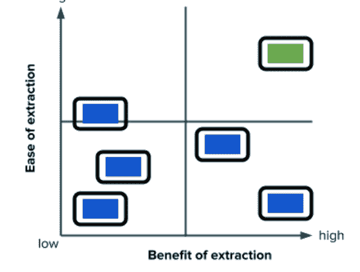
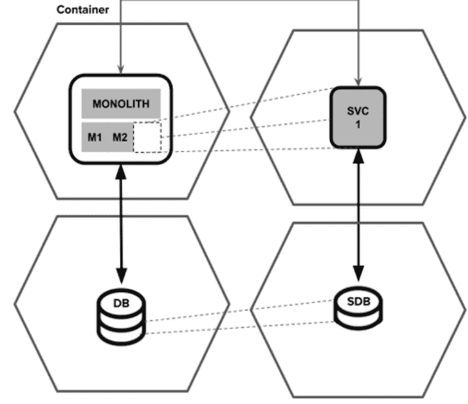

# Chapter 5. Beyond Lift and Shift: Working with Legacy

### A NOTE FOR EARLY RELEASE READERS

对于早期发布读者的一则说明

使用 Early Release 电子书，你可以在这些技术正式发布之前很久就获得书籍的早期形式——作者在撰写时的原始未编辑内容——从而利用这些技术。

这将是最终书籍的第 5 章。请注意，GitHub 仓库将在稍后激活。

如果你对如何改进本书的内容和/或示例有任何评论，或者如果在本章中发现缺少材料，请联系作者 eisele.markus@gmail.com 和 NVinto@redhat.com。

> Legacy is not what I did for myself. It’s what I’m doing for the next generation.
>
> —Vitor Belfort

许多组织在努力保持现有业务运营的同时，也面临着创新的挑战。通常对更快交付新功能和降低成本的期望会增加，而当查看现有应用格局和遗留系统的普遍存在时，这似乎具有挑战性。

我们经常使用“遗留系统”一词来描述一种旧的方法、技术或应用程序，它不是按照最新方法编写的或使用过时的技术栈。坦率地说，我们职业生涯早期创建的许多系统都属于这一类。我们确实知道其中大多数仍在使用。有些甚至为新


approaches or even standards that followed them. We usually also imply that those systems would need a replacement, which ultimately contributes to the perceived negative connotation. Thankfully, this isn’t always true. Legacy also is a beautiful word to describe achievements and heritage. Calling something “legacy” doesn’t automatically make it outdated and unusable. There are plenty of reasons to keep the legacy systems in place, including:

- The system works as designed, and there is no need to change.
- Business processes implemented are no longer known or documented, and replacing them is expensive.
- The cost for replacing a system is higher than the benefit of keeping it unchanged.

The book “Working Effectively with Legacy Code” by Michael Feathers provides programmers with techniques to cost-effectively handle common legacy code problems without having to go through the hugely expensive task of rewriting all existing code.

Michael Feathers said: “To me, legacy code is simply code without tests.” If I read the term “legacy” today, it primarily refers to monolithic applications. There are various approaches to handle legacy applications in a modern enterprise landscape, and picking the right one is the first and most crucial part of the modernization journey.

We’ve only talked about individual systems so far. And developers usually only care about this specific system scope. Modernization plans should follow overarching company goals and should also take the company-wide IT strategy into account. A particular exciting approach for cloud migration is presented in Gregor Hohpe’s book “Cloud Strategy - A Decision-based Approach to Successful Cloud Migration”. It is a must-read if you want to know more about building the abstraction above individual migration efforts.

## Managing Legacy

Every successful journey begins with a first step. The first step for an application migration journey is the assessment of the existing applications. We assume that you know the company-wide goals and directives. We can map them into assessment categories now. Another source for assessment categories is technical requirements—for example, existing blueprints or recommended master solutions or framework versions. Building and updating this list of assessment categories should be a recurring task that becomes part of your governance process. Ultimately you can derive migration criteria from these assessment criteria and use them as decision-making cornerstones for your modernization journey.

## Assessing Applications for Migration

When assessing a migration or modernization effort, it is essential to consider the specific challenges that motivate or influence your organization. Some examples of challenges that organizations might face:

### Limited budgets for development

Development teams need to become more efficient, and their velocity has to increase. Instead of working with complex specifications, they aim to switch to lightweight frameworks and pre-built functionalities. Modernizations usually should be scheduled as part of an ongoing development or maintenance project.

### Lack of in-house skills

The team skills for existing in-house technologies are decreasing. Examples for this can be host programming or even earlier versions of Enterprise Java specifications that are no longer taught or state of the art. Changing existing systems that use older technologies might need to add specific skills for the development project.

### Perceived risks

Following a famous proverb popularized around 1977: “if it ain’t broken, don’t fix it”, we do see a lot of perceived risks to change well-established and running software. The reasons for this can be plentiful and range from knowledge issues about the system to fear of stopped production in factories. These risks need to be addressed individually and mitigated through suitable actions in the migration plan.

### No known predictable process

This book helps you with this particular point. Navigating the unknown can be a considerable challenge. Having a proven and repeatable process for modernization efforts in place that all parties respect and follow is critical for success.

### Real effort estimation

Estimating migration efforts should not be magic. Unfortunately, many companies have a minimal idea about the genuine efforts to modernize Enterprise Java applications. Following a predictable and optimized approach will remove this challenge.

Turning the above challenges into actionable items for your assessment can look like this:

- Predicting the level of effort and cost
- Scheduling application migrations and handling conflicts
- Identifying all potential risks at a code, infrastructure, process, or knowledge level
- Predicting the return on investment to make the business case
- Identifying and mitigating risks to the business
- Minimizing disruption to existing business operations

It is sufficient to do this in a spreadsheet or document if you are only looking at a single application. However, every mid to large-scale effort needs a better solution. Large-scale efforts need automated routines and rules to assess an install base and link applications to business services to plan the next steps reliably. An open-source and straightforward way of gathering and managing all relevant information comes from the Konveyor project. It combines a set of tools that aim at helping with modernization and migration onto Kubernetes.

The Konveyor subproject Forklift provides the ability to migrate virtual machines to KubeVirt with minimal downtime. The subproject Crane concentrates on migrating applications between Kubernetes clusters. Also part of the suite is Move2Kube to help accelerate the re-platforming of Swarm and Cloud Foundry-based applications to Kubernetes.

For application modernization, in particular, Konveyor offers the Tackle project. It assesses and analyzes applications for refactoring into containers and provides a standard inventory.

### Tackle Application Inventory

Allows users to maintain their portfolio of applications, link them to the business services they support, and define their interdependencies. The Application Inventory uses an extensible tagging model to add metadata which is a great way to link migration categories, as discussed earlier. The Application Inventory is used to select an application for an assessment by Pathfinder.

### Tackle Pathfinder

It is an interactive, questionnaire-based tool that assesses the suitability of applications for modernization so that they can be deployed in containers on an enterprise Kubernetes platform. Pathfinder generates reports about an application’s suitability for Kubernetes, including the associated risk, and creates an adoption plan. Pathfinder does this based on the information present in the application inventory and additional assessment questions. If a fictitious application depends on a direct host system connection, it might disqualify this particular application for a migration to Kubernetes because it would overload the host parts. Some examples of assessment questions are:

- Are third-party vendor components supported in containers?
- Is the application under active development?
- Does the application have any legal requirements (e.g. PCI, HIPAA)?
- Does the application provide metrics?

We strongly recommend looking at Pathfinder to manage large-scale modernization projects across complete landscapes. It will help you categorize and prioritize applications in your scope today and continuously track your migration assessment for future changes.

### Tackle Controls

Controls are a collection of entities that add different values to the Application Inventory and the Pathfinder assessment. They comprise business services, stakeholders, stakeholder groups, job functions, tag types, and tags. In addition, you can capture company or project-specific attributes by implementing your own entities. This will filter your application inventory by for example all applications used by a certain “job function”. E.g. to identify all applications used by the human resources department.

### Tackle DiVA

Finally, DiVA is a data-centric application analysis tool. As a successor to the project WindUp, it is the most exciting project to look at if you want to assess individual applications. It focuses on the traditional monolithic application and currently supports Servlets and Spring Boot applications. You can import a set of application source files (Java/XML) and DiVA then provides the following:

- Service entry (exported API) inventory
- Database inventory
- Transaction inventory
- Code-to-Database dependencies (call graphs)


- 数据库到数据库依赖
- 事务到事务依赖
- 事务重构建议。

DiVa 目前仍在积极开发中，原 WindUp 项目的整合尚未完成。然而，它仍然为你的现代化工作提供了坚实的基础。此外，它也提供了一个绝佳的机会，让你贡献自己的发现，并成为致力于自动化迁移的更大社区的一员。

## 应用迁移工具包

在等待 WindUp 完全集成到 DiVA 期间，你仍然可以通过使用 [应用迁移工具包 (MTA)](https://access.redhat.com/products/migration-toolkit-for-applications) 对基于企业 Java 的应用进行自动化迁移评估。

MTA 汇集了支持大规模企业 Java 应用现代化与迁移项目的工具，涵盖多种转换和用例。你可以将应用二进制文件或归档导入其中，它会自动执行代码分析，包括应用组合、应用依赖、迁移挑战，以及以故事点形式呈现的迁移工作量估算。最初它旨在支持 Java EE 服务器迁移（例如从 WebSphere 或 Weblogic 到 JBoss EAP）。不过，它具有高度可扩展的规则集机制，允许开发者创建自己的规则集，甚至根据需要调整现有规则。今天它也涵盖了 Spring Boot 到 Quarkus 的迁移。以下是一个 Java 示例规则的片段：

```
```java
//
JavaClass.references("weblogic.servlet.annotation.WLServlet")
    .at(TypeReferenceLocation.ANNOTATION)
    )
        .perform(
            Classification.as("WebLogic @WLServlet")
                .with(Link.to("Java EE 6 @WebServlet",
                    "https://some.url/index.html"))
                .withEffort(0)
                .and(Hint.withText("Migrate to Java EE 6
```
```

```
@WebServlet.""))
.withEffort(8))
);
//...
```

该规则扫描 Java 类中是否存在 @WL Servlet 注解，并为此发现添加工作量（故事点）。你可以在 [WindUp 文档](WindUp documentation) 中了解更多关于规则以及如何开发它们的信息。

除此之外，它还可以通过构建过程（通过 [Maven 插件](Maven plugin) 或 [命令行界面](Command Line Interface)）支持非迁移用例，要么定期根据组织标准验证代码，要么确保应用的可移植性。

MTA 可以检测到的一些模式包括以下内容：

- 专有库
- 专有配置
- 服务定位器
- Web 服务
- EJB 描述符
- 已弃用的 Java 代码
- 事务管理器
- 注入框架
- 线程池机制
- 定时器服务
- WAR/EAR 描述符
- 静态 IP 地址

MTA 和 DiVa 是两种强大的工具，有助于我们识别整体技术债务，从而对迁移需求和风险进行分类。然而，它们并不能帮助我们识别应优先迁移或现代化的功能。为此，我们需要更深入地审视应用设计和功能。

## 评估迁移功能

传统的单体应用有各种形状、形式和规模。当有人使用“单体”一词时，他们通常指的是部署产物本身。在企业 Java 中，这传统上是企业归档（EAR）或 Web 归档（WAR）。你也可以将它们视为单进程应用。它们可以按照 OSGi（开放服务网关倡议）等模块化建议进行设计，也可以遵循更技术性的方法，如三层设计，而没有显著的业务模块。你现代化工作的整体方向在很大程度上取决于你处理的单体类型。经验法则是：现有应用越模块化，现代化就越容易。在理想世界中，模块直接转化为服务边界。但这种情况很少发生。

如果单体看起来像一个巨大的盒子，我们必须对其应用逻辑模型。我们意识到在这个盒子内部，按业务和技术组件组织，例如订单管理、PDF 渲染、客户端通知等。虽然代码可能不是围绕这些概念组织的，但从业务领域模型角度来看，它们存在于代码库中。这些业务领域边界在领域驱动设计（DDD）中通常被称为“有界上下文”，成为新的服务。

> **注意**
> 
> 许多人认为 Eric Evans 的书籍 [“领域驱动设计：软件核心复杂性应对之道”](https://domainlanguage.com/ddd/) 是如果你想了解更多，DDD 的“事实标准”入门读物。

一旦你识别出模块和功能，你就可以开始思考现代化的顺序。但首先，请确保权衡每个模块的成本与收益，并从最佳候选者开始。

图 5-1 给出了一个示例应用中六个模块的非常高层次的概述。在本例中，我们假设这是一个虚构的在线商店。对于高度相互依赖的模块，例如订单和客户，将其单独提取会很复杂。如果你还考虑到可扩展性的必要性以及由此带来的从单体中移除它们的收益，可能不会很高。这两个模块位于图表的左下侧。相反，我们可能会找到目录服务。它列出可用的产品，并且是一个只读服务，相互依赖性非常小。在网站高峰需求期间，这是请求最多的模块，并且从被提取中获益最大。图表的右上侧。对应用中的所有模块进行类似的练习，以评估成本与收益。



图 5-1. 成本与收益

你现在已经到达验证之前战略应用评估的最后一个检查点。预计的现代化收益是否超过预计的现代化成本？不幸的是，没有普遍适用的示例可以分享，因为它在很大程度上取决于应用本身、业务需求以及整体公司目标和挑战。记录你的决策和结论，因为现在是决定现代化工作未来方向的时候。还记得第三章的 6R 吗？保留（不做任何更改）、退役（关闭）、重新购买（新版本）、重托管（放入容器）、再平台化（做一些轻微调整）或重构（构建新事物）。

我们现在已经评估了应用的迁移性，并评估了功能的迁移性。我们知道应用的哪些方面已准备好进行现代化。你已经得出结论，你不想构建一个新应用，而是温和地现代化现有遗留系统。在下一节中，我们将更深入地研究一些迁移方法。

## 迁移方法

上述工具和评估将帮助你在旅程中识别最合适的应用和服务。现在是时候深入挖掘单个应用的策略和挑战了。

### 保护遗留系统（再平台化）

仅有一两个模块需要业务刷新或添加功能时，最直接的方法是专注于这两个模块，并尽可能保留现有应用，使其能在现代基础设施上运行。除了相关模块的更改外，这还涉及对运行时、库甚至目标基础设施的重新评估，同时尽可能少地触及代码。

这可以通过简单地将应用和数据库容器化并修改结构良好的单体的相关模块来实现，或完全提取某些功能并将其重新集成到部分分布式系统中，如图 5-2 所示。




Figure 5-2. Putting the pieces back together

说起来容易做起来难。仍有大量非功能性需求需要从应用服务器平台重新分配到外部架构。我们将在下一章重点关注其中更关键的部分。在本章中，我们希望聚焦于应用本身和数据库的迁移。

## Service to Application

一旦你提取了某些功能，最紧迫的问题是如何将剩余的单体与新提取的服务集成。假设你切换到容器运行时，你应该使用 API 网关按 URL 基础进行负载均衡和流量切换。我们将在第六章更详细地介绍这一点。

另一种方法是使用 HTTP 代理。在你尝试提取单体部分之前，必须先在生产环境中部署代理。确保它不会破坏现有的单体，并在新服务尚未被终端用户使用时，也要定期将其推送到生产环境。逐渐切换，通过重定向流量，如果一切看起来良好。

对于更简单的服务到单体交互，甚至可以考虑实现简单的 JAX-RS 直接通信。这种方法仅适用于服务数量非常少的情况。确保从单体的角度将提取的服务视为集成系统。

所有三种方法（API、网关、HTTP 代理和 JAX-RS 接口）都是通往你第一个成功微服务的途径。它们都实现了绞杀者模式（参见第 3 章），并帮助你将单体重构为独立系统作为第一步。

拦截是一个潜在危险的路径：如果开始构建一个由多个服务共享的自定义协议转换层，你就冒着给共享代理添加过多智能的风险。这种设计方法会偏离独立的微服务，成为在路由层拥有过多智能的更具服务导向的架构。更好的替代方案是所谓的 Sidecar 模式，它基本上描述了 Pod 中的一个额外容器。与其将自定义代理逻辑放在共享层中，它成为新服务的一部分。作为 Kubernetes sidecar，它成为运行时绑定，可以为遗留客户端和新客户端服务。

> NOTE
> A sidecar is just a container that runs on the same Pod as the application container. It shares the same volume and network as the application container and can “help” or enhance application behaviour with this. Typical examples are logging, or more generally agent functionality.

## Database to Databases

一旦我们确定了功能边界和集成方法，就需要决定如何进行数据库分离。虽然单体应用通常依赖于单一的大型数据库，但每个提取的服务都应在其自己的数据上运行。解决这个难题的正确方法再次取决于现有的数据布局和事务。

相对容易的第一步是将服务所需的表分离为只读视图和写表，并调整单体的流程以使用接口进行读写操作。这些接口可以在后续步骤中更轻松地抽象为服务访问。此选项仅需要对单体应用进行更改，并且对现有代码库的影响应最小。我们可以在下一步将表移至单独的数据库并调整依赖查询。

所有这些仅在旧单体中作为准备工作进行。将现有代码演进为更模块化的结构作为准备可能存在风险。特别是，随着数据模型复杂度的增加，风险也会增加。在最后一步，我们可以将提取的表分离到新数据库，并调整单体以使用新创建的服务与业务对象交互。这在纸面上相对容易，随着数据访问需要在表之间进行大量连接，实用性会迅速达到极限。简单的候选对象是主数据对象，如“User”。更复杂的对象可能是组合对象，如“Order”。关于应用代码模块化的说法，对数据库来说更是如此。设计和模块化越好，将功能和数据提取到独立服务就越容易。会出现你找不到从数据模型中提取对象的优秀解决方案的情况。或者你可能会看到不同的方法不再提供合适的性能。这就是重新审视你选择的现代化路径的时候。

继续沿着快乐的道路，你现在有两个独立的数据库和两个非常不平等的“服务”组成一个系统。现在是时候思考服务之间的数据同步策略了。大多数数据库都实现了在数据更改时执行行为的功能。简单情况支持在更改的行上触发功能，以将副本添加到其他表，甚至在更改时调用更高级别的功能（例如 WebServices）。这通常是专有功能，并且在很大程度上取决于所使用的数据库。如果公司范围内有使用某些功能的指令，或者你对进一步更改原始遗留数据库有足够的信心，这可能是一个选项。

如果不可能，还有基于批处理的同步。更改的时间戳、版本或状态列指示需要复制。你可以依靠它作为一种非常成熟且众所周知的版本的数据同步，你可以在许多遗留系统中找到它。主要的缺点是无论实现如何，目标系统的数据准确性总会存在差异。更高的复制间隔也可能导致事务的额外成本或对源系统的额外负载。这种方法仅适用于不频繁的更新，最好在中间有一个非时间敏感的处理步骤。它不适用于实时或接近实时的更新需求。

解决数据同步挑战的现代方法依赖于日志读取器。作为第三方库，它们通过扫描数据库事务日志文件来识别更改。这些日志文件用于备份和恢复操作，并提供可靠的方式捕获所有更改，包括 DELETES。这个概念也称为变更数据捕获。其中最著名的项目之一是 [Debezium](https://debezium.io)。使用日志读取器是同步数据库之间更改的破坏性最小的选项，因为它们不需要对源数据库进行修改，并且不会对源系统产生查询负载。变更数据事件在 Outbox 模式的帮助下为其他系统生成通知。

## Build something new (Refactor)

如果由于某种原因，你到达了分叉路口，在那里决定重新实现并将完整的系统重构为新的分布式架构，你很可能在思考协同效应以及如何保持工作量小且可预测。鉴于完整微服务栈的复杂性，这不是一项简单的任务。这种方法的一个关键因素是团队知识。在企业 Java 应用服务器上开发多年后，团队应从持续的 API 和标准知识中受益。在 JVM 上实现服务有多种方式，所有这些都有助于团队重用我们所有人已从企业 Java/Jakarta EE 标准中了解的最关键功能。让我们讨论在 JVM 上实现服务的这些方法。

> **NOTE**
> 
> Jakarta EE is a set of specifications that enables Java developers to work on Java enterprise applications. The specifications are developed by well-known industry leaders that instill confidence in technology developers and consumers. It is the open-source version of the Java Enterprise Edition.

## MicroProfile

MicroProfile 于 2016 年创建并迅速加入 Eclipse 基金会。MicroProfile 的主要目的是以厂商中立的方式创建用于实现可移植微服务的 Java 企业框架。MicroProfile 由厂商无关的编程模型和配置以及诸如追踪、容错、健康和指标等服务组成。MicroProfile API 组件建立在 Jakarta EE 模型之上，使得 Java 开发人员向微服务的过渡更加自然。你可以重用你在职业生涯中已积累的 Jakarta EE 现有知识。MicroProfile 定义了如图 5-3 所示的 12 项规范，其组件模型之下使用的是现有 Jakarta EE 标准的子集。与完整的 Jakarta EE 规范相比，更重量级的规范缺失了。对于较大的单体应用最相关的是企业 Java Beans（EJB）和 Jakarta XML WebServices。


## 组件模型到服务

开发人员最常见的问题之一是如何将企业 Java 应用的现有组件模型迁移到微服务。通常，这个问题指的是企业 Java Bean 或 CDI Bean。尤其是容器管理的持久化 Bean（EJB3 之前）需要在 Java 持久化 API（JPA）基础上重新创建。我们强烈建议检查底层数据/对象映射是否仍然准确且适合新需求，并完全重新创建它。这并不是现代化中最耗时耗力耗费的部分。通常更具挑战性的是编码的业务需求。虽然 CDI Bean 在技术上是 MicroProfile 兼容实现的一部分，但是否适合进行简单的代码迁移取决于新的业务需求。必须寻找现有代码中的事务边界，以确保没有下游资源需要参与。一般建议是尽可能少地重用源代码。其原因主要是两种技术在系统设计上的不同方法。虽然我可以用半模块化的单体架构应付过去，但这在微服务中已不再可能。花额外的时间仔细定义有界上下文，将为最终解决方案的性能和设计带来回报。

## Spring 应用到服务

我们可以用类似的方法处理遵循不同编程框架如 Spring 的应用。虽然在技术上很容易更新并复制现有实现，但缺点依然存在。特别是，对于基于 Spring 的开发团队来说，使用 Quarkus 等不同框架中的兼容性 API 可能会有所帮助。

Quarkus 的 Spring API 兼容性包括 Spring DI、Spring Web 和 Spring Data JPA。额外的 Spring API 部分受支持，如 Spring Security、Spring Cache、Spring Scheduled 和 Spring Cloud Config。Quarkus 中的 Spring API 兼容性并非旨在成为一个完整的 Spring 平台来重新托管现有 Spring 应用。其意图是提供

## 分布式事务

在微服务架构中，服务间通信问题不足以解决更复杂、长时间运行的分布式业务事务用例。后者需要在多个服务之间执行多个操作并具有一致的全部成功或全部失败语义。每个跨多个服务拆分的复杂业务流程都可能是这种用例的例子。购物车应用需要在库存中生成确认邮件并打印运单标签。所有操作必须一起执行或完全不执行。在传统世界或单体架构中，你可能意识不到这个问题，因为模块间的协调是在单一进程和单一事务上下文中完成的。分布式世界需要不同的方法。

Saga 模式通过将一个整体的业务事务拆分为多个本地数据库事务来提供解决方案，这些事务由参与服务执行。一般来说，实现分布式 Saga 有两种方式：

- **编排 Choreography：** 在这种方法中，一个参与服务在执行完其本地事务后向下一个服务发送消息。
- **编排 Orchestration：** 在这种方法中，一个中央协调服务协调并调用参与服务。参与服务之间的通信可以是同步的，通过 HTTP 或 gRPC，也可以是异步的，通过 Apache Kafka 等消息系统。

## 过早移除旧代码

一旦我们提取出一个服务，我们就想摆脱旧的源代码、维护成本和重复开发。但要小心。你可以将旧代码视为参考，并在两个代码库之间测试行为变更。有时检查新创建服务的时序也可能有所帮助。建议是在一段定义好的时间内并行运行并比较结果。之后，你可以移除旧实现。这已经足够早了。

## 集成方面

传统的单体应用与复杂的集成逻辑有着牢固的关系。这主要通过会话外观代理或与数据同步逻辑集成。每单个集成到整体业务流程中的系统都需要被视为一个单独的服务。你可以应用相同的原则来逐步从现有数据模型中提取部分数据。另一种方法是自始就将集成逻辑视为一个服务。一种主要为支持微服务而设计的方法是 Camel K。它建立在知名 Apache Camel 集成库的基础上，并将集成路由封装到容器中或更好的独立服务中。这样，你就可以将单体应用和服务的完整集成逻辑分离。

## 总结

现代企业 Java 系统就像家族的世代：它们在遗留系统之上演进。使用经过验证的模式、标准化工具和开源将帮助你创建能够随需求成长和变化的持久系统。从根本上说，你的迁移方法直接与你今天和明天试图解决的问题相关。你试图实现什么目标，而你的当前架构无法扩展到该目标？也许微服务是答案，也许是其他东西。你必须理解你试图实现的目标，因为在没有这种理解的情况下，很难确定如何迁移现有系统。理解你的最终目标将改变你如何分解系统以及如何优先安排这项工作。
