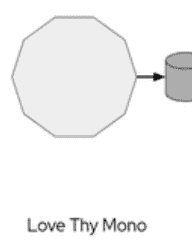
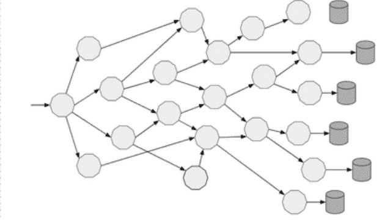
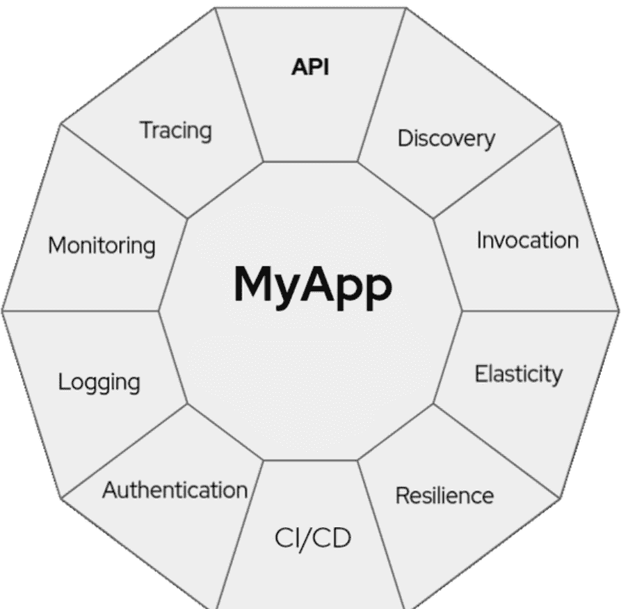
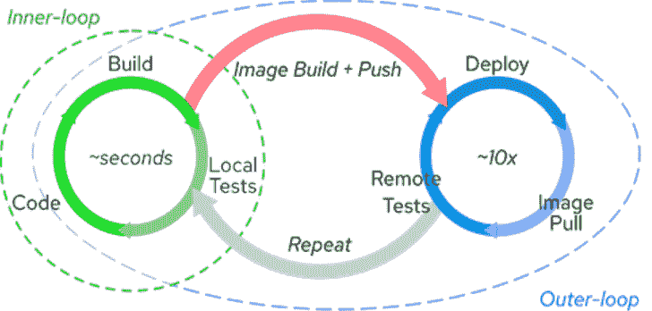

# 第 6 章. 构建 Kubernetes 原生应用

## 致早期发布读者的说明

使用 Early Release 电子书，你可以在这些标题正式发布之前很久就利用这些技术——作者在写作时提供的原始未编辑内容。

这将是最终书籍的第 6 章。请注意 GitHub 仓库将在稍后激活。

如果你对如何改进本书的内容和/或示例有任何评论，或者如果你注意到本章中缺少材料，请联系作者 eisele.markus@gmail.com 和 NVinto@redhat.com。

在上一章中，我们概述了如何从传统的 Java 企业模式迁移到以容器为中心的方案。在本章中，我们将介绍迁移到基于微服务的架构所需的组件，以及 Kubernetes 如何将各部分连接起来。

我们在前几章中也了解到，基于微服务的方法在多大程度上有助于使我们的软件可靠、可移植并能够按需扩展。现代架构从一开始就将可扩展性纳入规划范围，这既带来机遇也带来挑战。企业 Java 开发者知道他们的代码通常是业务逻辑的一部分，依赖框架使其健壮并与公认的软件设计模式保持一致。今天更常见的是，同一个应用可能在公有云上为数百万请求提供服务，甚至在地理上分布。要做到这一点，它

必须被设计成适合这种模式，解耦功能，避免单点故障并将负载分配到架构的各个部分以避免服务中断。

## 在可扩展性和复杂性之间找到正确的平衡

在理想世界中，所有应用都是无状态的，可以独立扩展。它们不会崩溃，网络链路总是可靠的。现实看起来不同。从单体迁移到基于微服务的架构实现了云原生部署，我们已经介绍了它带来的一些好处。然而，这也带来了一些挑战：管理应用的多个入口点，保持多个微服务之间关系的一致性，管理分布式数据库和模式。在图 6-1 中，你可以看到从单体到基于微服务的应用程序的转变带来了新的方法，具有多个互连甚至多个数据库可供使用。

## 老派

## 新派





Love Thy Mono

图 6-1. 从单体到微服务架构


与 CAP 定理<sup>1</sup>类似，同时提供可扩展性而不增加系统的复杂性是非常困难的。这就是 Kubernetes 如此有用的原因，因为它无处不在，它运行在任何云上，并且你可以将大部分这种复杂性委托给该平台。这让你可以专注于“仅”应用开发。另一方面，我们需要在云原生世界中也为*有状态*应用找到解决方案，我们将看到 Kubernetes 在这一方面也提供了帮助。

## 现代架构的功能需求

Kubernetes 在定义分布式应用程序方面非常有帮助，如 [Figure 3-1](Figure 3-1) 所示。任何 Java 开发者都应该非常熟悉 Gang of Four<sup>2</sup> 的 [Design Patterns](Design Patterns)，这是软件工程的杰作，作者在其中定义了最常用的软件设计模式。Kubernetes 扩展了这一模式集合，创建了一套新的云原生特定需求，以使应用程序能够抵御各种负载，如 [Figure 6-2](Figure 6-2) 所示。让我们在接下来的章节中深入探讨其中一些内容。



*Figure 6-2. Functional requirements for Modern Architectures*

## API 驱动

微服务的*信条*是 API-first。如果你再次查看 Figure 6-1，你会注意到将单体应用拆分为一堆微服务会导致第一个挑战：如何让这些软件片段相互通信？在单体应用中，你依赖于模块、包的应用作用域。微服务通常通过 REST 调用相互通信，其中每个服务都可以是服务的生产者或消费者。这并不是连接微服务的唯一方式，使用队列、消息或缓存也是常见用例。但总的来说，每个微服务都通过一组 API 暴露其原语或函数，这也可以由 API 网关中介，正如我们在 [Chapter 2](Chapter 2) 的 Coolstore 示例中所讨论的。

Kubernetes 本身就是 API 驱动的软件。平台的所有核心组件，如 Pods、Services、Deployments 都是通过 REST API 操作的。组件之间以及外部用户命令之间的所有操作和通信都是 API Server 处理的<sup>3</sup> REST API 调用。当我们通过 `kubectl` 或 JKube 与 Kubernetes 交互时，我们只是通过 HTTPS 调用 API 发送和接收 JSON 内容。这个 API 生态系统是 API 驱动架构的完美环境，例如使用微服务的架构。现在我们知道了微服务如何通信，我们如何发现新服务？

## Discovery

使用 REST 调用让微服务相互通信是相当直接的。除此之外，能够轻松地调用其他组件和函数会很不错，就像将模块或包导入我们的应用一样。在现代架构中，需要调用和连接的微服务数量可能相当高，因此仅仅存储网络端点（如 IP 地址或主机名）可能不够。正如我们在 [Chapter 4](Chapter 4) 中讨论的，Kubernetes 通过 *Service* 对象简化了网络，允许两个或多个 Pods 在平台的内部网络中相互通信。Kubernetes 还提供了从应用程序中列出集群内对象的能力，这要归功于其 API。Java 开发者可以使用 JKube 等框架来实现此目的的 Java Kubernetes 客户端。

列出代表某些微服务的 Kubernetes Services 和 Pods，是我们软件栈组件实时清单的第一步，这也有助于在运行时维护和扩展应用程序。此外，Kubernetes 能够与外部工具或框架集成，例如 Service Mesh，它提供服务发现协议以在服务启动时检测服务。

> **TIP**
>
> [Service Mesh](Service Mesh) 是微服务架构中越来越受欢迎的选择。它提供了一个控制平面，该平面还与 Kubernetes 交互，以开箱即用地管理服务发现、相互认证、A/B 测试、路由和断路器模式。更多细节可在网上找到<sup>4</sup>。

## Security and Authorization

现代应用开发者需要考虑的另一个挑战是整个栈的安全性。从应用到平台，最佳实践也适用于现代架构，并且当有许多服务需要连接、许多数据库需要查询以及许多端点需要提供服务时，复杂性和所需的工作量可能会显著增加。再次，Kubernetes 来帮忙。

Kubernetes 为整个生态系统提供安全保障。基于角色的访问控制（RBAC）和细粒度的权限规则是可行的。此外，Pods 由一个名为 *Service Account* 的特殊用户运行，该用户可以访问 Kubernetes API Server，通常其范围仅限于用户的 Namespace。除此之外，Kubernetes 提供了一个名为 *Secret* 的特殊 API 来管理密码和证书。Secret 是平台在运行时挂载到 Pod 中的一个卷，其值存储在 Kubernetes 的数据库 etcd 中，与集群状态和配置一起存储。

> **NOTE**
>
> [etcd](etcd) 是 Kubernetes 用于存储集群状态的分布式键值数据库。数据库的内容也可以被加密，并且只有集群管理员可以访问其内容。

正如我们所讨论的，微服务之间的通信通常通过 HTTPS REST 调用进行，其证书通过 Secrets 管理。容器和 Kubernetes 为确保应用安全提供了良好的起点，Java 开发者可以从此开始实施应用安全最佳实践。

[Jaeger](Jaeger) 是一个流行的开源工具，可连接到 Kubernetes 以提供可观测性。它使用分布式追踪来跟踪请求通过不同微服务的路径。它提供了一个调用流程的可视化表示，通过仪表板显示，并且通常也与 Service Mesh 集成。Jaeger 对开发者监控分布式事务、优化性能和延迟以及进行根本原因分析非常有帮助。

## Logging

正如我们所讨论的，你的微服务应用中的一次调用，例如 Coolstore 示例，可能会调用相互交互的不同服务。监控和观察应用很重要，但也需要将相关信息存储在日志中。你的应用程序的日志方法随着现代应用而改变。虽然在单体应用中我们通常依赖存储在磁盘不同路径上的多个日志文件，通常由应用服务器管理，但分布式应用会*流式传输*日志。随着你的应用可以快速扩展并移动到不同的节点甚至云，访问单个实例来检索日志是没有意义的；需要分布式日志系统。

Kubernetes 也让日志变得简单。默认情况下，它提供通过读取应用程序的标准流（如 STDOUT（标准输出）和 STDERR（标准错误））来访问 Pod 日志的能力。因此，应用不应将日志写入某个路径，而应发送日志到标准流。

> **NOTE**
>
> 仍然可以在 Kubernetes 中将日志存储在特定的路径中，这些路径也可以是持久的，但这被认为是一种反模式。

Kubernetes 还与分布式日志系统交互，例如 [Elasticsearch](Elasticsearch)，这是一个基于 Apache Lucene<sup>7</sup> 的开源文档导向 NoSQL 数据库，用于存储日志和事件。Elasticsearch 通常附带转发器，例如 FluentD，以及用于可视化日志的仪表板，例如 Kibana。合在一起，这就形成了 EFK 栈（Elasticsearch、Fluentd、Kibana）。通过此日志栈，开发者可以通过 Kibana 仪表板以聚合视图咨询来自多个微服务的日志，并且他们还能够使用一种称为 Kibana Query Language（KQL）的查询语言进行查询。

分布式日志是云原生应用的事实标准，Kubernetes 连接并与许多产品（如 EFK）交互，为整个集群提供集中式日志。

## CI/CD

持续集成（CI）是软件开发周期中的一个阶段，在此阶段，不同团队成员或不同功能的代码被集成。这通常涉及合并代码（集成）、构建应用程序（容器），并在临时环境中进行基本测试。

持续交付（CD）是指自动化软件交付各个方面的实践集合。其中一种实践称为交付管道，它是一个自动化流程，用于定义代码或配置的更改需要经过哪些步骤才能到达上层环境并最终到达生产环境。

合在一起，它们通常被称为 CI/CD，并且是 DevOps 方法论的关键技术推动者之一。

现代服务需要快速响应变化或问题。正如我们可以监控、追踪和记录分布式架构一样，我们也应该能够更快地更新基于微服务的应用程序。管道是按照 Figure 6-3 所示的阶段在生产中部署应用的最佳方式。


Java 开发者也可以使用 Fabric8 Tekton Java 客户端直接从代码中创建和控制 Tekton Pipelines 和 Tasks。这种方式提供了一个单一的控制点，你无需维护 YAML 文件等外部清单。

首先在 POM 文件中导入 Maven 依赖。

```
<dependencies>
    <dependency>
        <groupId>io.fabric8</groupId>
        <artifactId>tekton-client</artifactId>
        <version>${tekton-client.version}</version>
    </dependency>
</dependencies>
<properties>
    <tekton-client.version>4.12.0</tekton-client.version>
</properties>
```

然后你可以使用 Tekton Java API 来创建 Tasks 或 Pipeline：

```java
package io.fabric8.tekton.api.examples;

import io.fabric8.tekton.client.*;
import io.fabric8.tekton.resource.v1alpha1.PipelineResource;
import io.fabric8.tekton.resource.v1alpha1.PipelineResourceBuilder;

public class PipelineResourceCreate {
    public static void main(String[] args) {
        try ( TektonClient client = ClientFactory.newClient(args) ) {
            String namespace = "coolstore";
            PipelineResource resource = new PipelineResourceBuilder()
                .withNewMetadata()
                .withName("client-repo")
                .endMetadata()
                .withNewSpec()
                .withType("git")
                .addNewParam()
                .withName("revision")
                .withValue("v4.2.2")
                .endParam()
                .addNewParam()
                .withName("url")
                .withValue("https://github.com/modernizing-java-applications-book/inventory-quarkus.git")
                .endSpec()
                .build();

                System.out.println("Created: " +
                    client.v1alpha1().pipelineResources().inNamespace(namespace).create(resource).getMetadata().getName());
        }
    }
}
```

## 调试微服务

虽然分布式架构有很多好处，但也带来了一些挑战。

即使你最终在 Kubernetes 集群中运行代码，你通常仍在本地开发，拥有 IDE、编译器等。有几种方式可以解释开发周期。有两个循环，一个更接近开发者，称为 Inner-Loop：你在其中迭代地编码、测试和调试。另一个离开发者更远，称为 Outer-Loop：你的代码在你需要构建、推送和部署的容器镜像中运行，这需要更长的时间。



虽然 Outer Loop 是 CI/CD 世界的一部分，但 Inner Loop 是你在启动 Tekton Pipeline 将应用程序部署到 Kubernetes 之前开始编码和测试软件的地方。调试微服务也是 Inner Loop 的一部分。

开发者可以采用不同的方法来开始调试微服务：

- 使用 [Docker Compose](Docker Compose) 并在本地部署所有服务
- 使用 [minikube](minikube)，或任何本地 Kubernetes 集群并在其中部署所有服务
- 模拟你交互的所有服务

> **NOTE**
>
> Docker Compose 有助于在任何 Docker 主机上创建容器，而无需 Kubernetes。它用于在本地开发中管理多个容器，但它不会映射到任何目标 Kubernetes 集群，因此保持本地开发环境与目标环境分离可能很困难。

它们都是有效的方法，但在某些情况下，服务是外部的且只能从远程 Kubernetes 集群访问，或者模拟代码的该部分很困难或不可能。

[Microcks](Microcks) 是一个开源的 Kubernetes 原生调试工具，用于 API 模拟和测试。它有助于将 API 契约、集合或 SoapUI 项目转换为实时模拟。它可以是一种在没有依赖的情况下更快地在 Kubernetes 上开发的便捷方式。

让我们看看 Kubernetes 中微服务调试的一些额外选项。

### Port-forwarding

Kubernetes 提供对 Pod 的远程 shell 以进行快速调试任务，例如文件系统检查。此外，你可以在连接到 Kubernetes 集群的本地机器与在 Pod 中运行的应用程序之间设置端口转发⁹。此选项在你想要连接到 Pod 中运行的数据库、附加你不想公开的管理员 Web 界面时很有用，或者，在本例中，将调试器附加到运行应用程序服务器的 JVM。

通过端口转发应用程序服务器的调试端口，你可以从 IDE 附加调试器，实际上可以在 Pod 中实时逐步执行代码。请记住，如果你的应用程序未处于调试模式，你首先需要打开调试端口。

要开始调试，你需要公开调试端口。例如，要调试 Inventory 微服务，你需要访问调试端口 5005。

```bash
kubectl port-forward service/inventory-quarkus 5005:5005
```

现在当我们连接到 `localhost:5005` 时，它将被转发到 Pod 中运行的 Inventory 实例。

> **NOTE**
>
> 端口转发仅在 `kubectl port-forward` 命令被允许运行时才处于活动状态。由于我们将其在前台运行，我们可以通过按 `[CTRL+C]`（或 Mac 上的 `[CMD+C]`）来停止端口转发

为了调试源代码，你可以使用你选择的 IDE，或者你可以从控制台按如下方式调试：

```bash
jdb -sourcepath $(pwd)/src/main/java -attach localhost:5005
```

### Quarkus Remote Development Mode

Quarkus 提供了一个 [Remote Development Mode](https://quarkus.io/)，允许你在诸如 Kubernetes 之类的容器环境中运行 Quarkus，并使对本地文件的更改立即生效。这允许你使用 Quarkus 将来自本地机器的实时编码功能连接到诸如 Kubernetes 之类的远程容器环境。

### Telepresence

[Telepresence](#) 是一个开源工具，可帮助在 Kubernetes 中调试微服务。它在本地运行单个服务，同时将该服务连接到远程 Kubernetes 集群。Telepresence 与编程语言无关，提供了一种将本地环境连接到 Kubernetes 上运行的任何工作负载以进行调试的便捷方式。

使用 Telepresence 在 Kubernetes 上调试应用程序非常容易。首先要做的是下载并安装 [Telepresence CLI](#)¹⁰ 并拥有到集群的活动会话，因为 Telepresence 将读取 `~/.kube/config` 文件以连接到 Kubernetes。

> **NOTE**
>
> Telepresence 将修改 Kubernetes 中的网络，以便服务可以从你的笔记本电脑访问，反之亦然。

一旦 CLI 在你的工作站上安装并配置好，你可以运行此命令使用 Telepresence 初始化并测试到集群的连接：

```bash
$ telepresence connect
```

你应该会得到类似以下的输出：

```
Connected to context minikube (https://192.168.39.69:8443)
```

我们可以开始调试你在之前步骤中部署的 Inventory 微服务。在此之前，让我们列出可调试的应用程序：

```bash
$ telepresence list
```

你应该会得到类似以下的输出：

```
inventory-quarkus-deploy: ready to intercept (traffic-agent not yet installed)
```

要开始调试此微服务，你需要让 Telepresence 拦截由 Service 表示的内部 Kubernetes 流量。

Inventory 的 Kubernetes Service 使用端口 8080，你可以使用以下命令查看：

```bash
$ kubectl get svc inventory-quarkus-service
```

你应该会得到类似以下的输出：

| NAME | TYPE | CLUSTER-IP | EXTERNAL-IP | PORT(S) | AGE |
|------|------|------------|-------------|---------|-----|
| inventory-quarkus-service | ClusterIP | 172.30.117.178 | <none> | 8080/TCP | 84m |

现在你可以开始拦截连接到你的 Deployment 的流量，使用 Service 使用的端口。你还可以指定 Telepresence 应该将你的服务当前运行的环境变量写入到的文件路径：

```bash
$ telepresence intercept inventory-quarkus-deploy --port 8080:http --env-file inventory.env
```

你应该会得到类似以下的输出：

```
Using Deployment inventory-quarkus-deploy
intercepted
  Intercept name      : inventory-quarkus-deploy
  State               : ACTIVE
  Workload kind       : Deployment
  Destination         : 127.0.0.1:8080
  Service Port Identifier: http
  Volume Mount Point  : /tmp/telfs-844792531
  Intercepting        : all TCP connections
```


许多组件可扩展应用能力。Kubernetes 的 API 驱动、可插拔架构，使得外部工具能够轻松提供软件和实用工具的生态系统，这些工具让人想起 Java 企业应用服务器模型，但也对其进行了扩展。诸如日志、监控或调试应用等基本任务以适应云原生模型的方式提供，在该模型中，应用无处不在，并且可以同时在多处和多个云中运行。

在下一章中，我们将讨论一种新的服务和交付企业应用的概念，该概念节省资源且面向云：无服务器方式。

- 1 https://en.wikipedia.org/wiki/CAP_theorem
- 2 0-201-63361-2
- 3 https://kubernetes.io/docs/reference/using-api/
- 4 https://en.wikipedia.org/wiki/Service_mesh
- 5 https://prometheus.io/docs/prometheus/latest/querying/basics/
- 6 https://micrometer.io/
- 7 https://lucene.apache.org/
- 8 https://github.com/tektoncd/catalog
- 9 https://kubernetes.io/docs/tasks/access-application-cluster/port-forward-access-application-cluster/
- 10 https://www.telepresence.io/docs/latest/howtos/intercepts/
