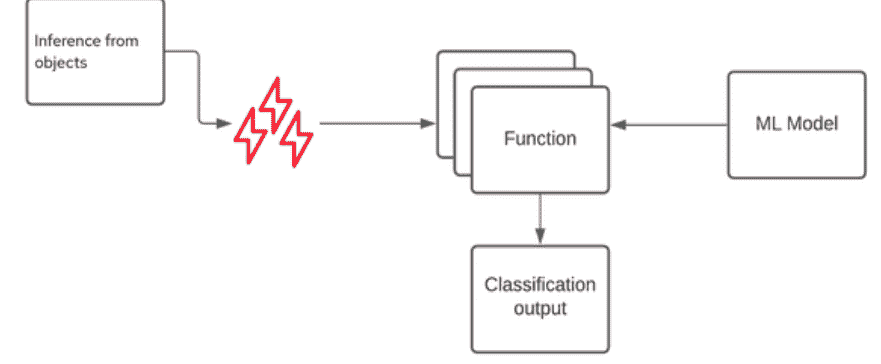
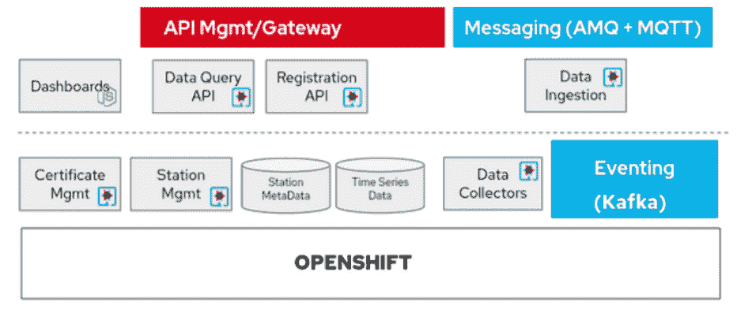
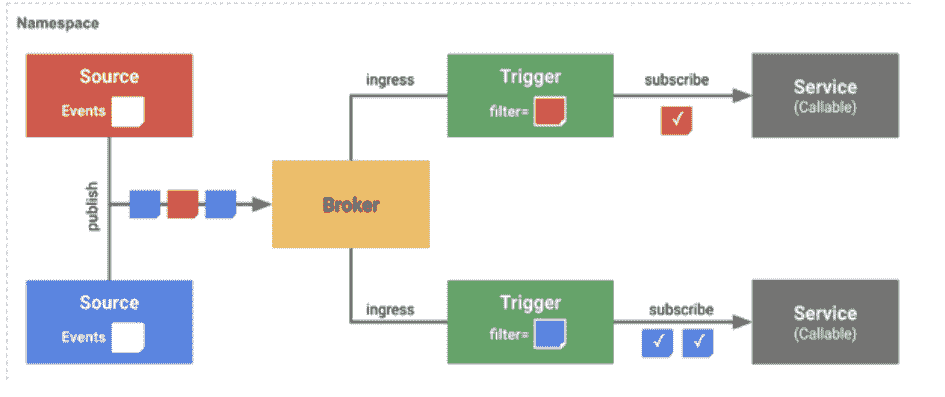
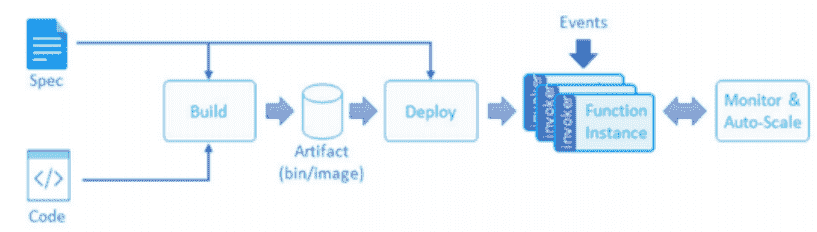

# Chapter 7. Tomorrow’s Solutions: Serverless

### A NOTE FOR EARLY RELEASE READERS

With Early Release ebooks, you get books in their earliest form—the author’s raw and unedited content as they write—so you can take advantage of these technologies long before the official release of these titles.

This will be the 7th chapter of the final book. Please note that the GitHub repo will be made active later on.

If you have comments about how we might improve the content and/or examples in this book, or if you notice missing material within this chapter, please reach out to the authors at eisele.markus@gmail.com and NVinto@redhat.com.

> The second industrial revolution, unlike the first, does not present us with such crushing images as rolling mills and molten steel, but with “bits” in a flow of information traveling along with circuits in the form of electronic impulses. The iron machines still exist, but they obey the orders of weightless bits.

—Italo Calvino

The Serverless computing model has great momentum with public cloud offerings, and recently also within the open-source community thanks to many projects that enable it for any platform. But, what is Serverless exactly? What are some use cases for Serverless? And, how can it be used for modern Java applications?

## What is Serverless?

The best definition of Serverless comes from the CNCF Serverless Whitepaper:

> “Serverless computing refers to the concept of building and running applications that do not require server management. It describes a finer-grained deployment model where applications, bundled as one or more functions, are uploaded to a platform and then executed, scaled, and billed in response to the exact demand needed at the moment.”¹

Running an application that “does not require server management” is the most relevant part of that definition. In the previous chapters, we explored how Kubernetes helps with functional requirements for modern architectures, and how container images represent a convenient way to package and ship applications to any cloud platform. There are still servers in Serverless, however, they are abstracted away from app development. While a third party handles the complexity of maintaining and managing such servers, developers can simply package their code in containers for deployment.

The main differentiator between the deployment model that we discussed in Kubernetes and the Serverless model, is the so-called scale-to-zero approach. With this approach, an application is automatically launched on demand when called, and idle when not used. This execution model is also called event-driven, and it is the core foundation of Serverless. We discuss event-driven serverless architectures later in this chapter.

Typically, a series of events can trigger the launch of the application, which will produce an outcome as you can see in Figure 7-1. This can be a single action or can be a chain of actions where the output of one app is the input of the subsequent app. And the event can be anything such as an HTTP request, a Kafka message, or a database transaction. The application can be auto-scaled to multiple replicas proportional to the needed amount to handle the traffic load, and then scaled down when there isn’t any activity.

Figure 7-1. Serverless execution model

## Architectural evolution

The Serverless model is not good for all use cases. In general, any asynchronous, concurrent, easy-to-parallelize-into-independent-units-of-work application it’s a good fit for this model. If you look at the diagram shown in Figure 7-2, you can see how the microservices-based architectures evolution started from a monolithic applications approach using Service Oriented Architectures (SOA) model, and it is now evolving again into a new model of functions.

Figure 7-2. Architectural evolution

These functions represent a minimal computing unit that accomplishes a specific scope or task. Examples are:

- Processing Web Hooks
- Data Transformation (image, video)
- PDF generation
- Single-page apps for mobile devices
- Chatbots

With this approach, you can focus on convenience, as it is generally offered as *best-effort*. Failures are tolerated and short actions are preferred. That’s why the serverless model is not good for use cases such as real-time applications, long-running tasks, contexts where reliability and/or atomicity are key. It’s up to the developer to take care of verifying that inputs and outputs have been successfully processed by any serverless function involved. This gives great flexibility and high scalability to at least some part of the overall architecture.

## Use cases: Data, AI and Machine Learning

The Serverless model helps avoid common headaches for capacity planning for projects, as it mitigates over-provisioning and under-provisioning, thereby reducing IT cost of idle resources. With Serverless, all of the resources consumed are tailored to the actual usage as the applications start only when invoked, and there’s no need to pre-allocate or *measure-and-update* hardware resources.

This is very important when you have to analyze, in real-time, a large amount of data, and that’s why Serverless is gaining lots of attention from data scientists and ML experts, as the functions that can process data for analysis are flexible and leave a minimal footprint. On the other hand, Serverless doesn’t pair well with all of the design principles of existing ML frameworks. A certain amount of tolerance is also required, in particular for processes that may take longer such as model training.

If you look at Figure 7-3, we see an example of a Serverless-driven architecture for Machine Learning for classification and prediction. The process starts with a trigger to get an inference of a group of objects from a
trained model. This starts a sequence of asynchronous functions that run in parallel, used to predict the class of the object based on its characteristics and return the classification as output. The tolerance we expect is that one of these functions may fail or not complete the task in time. However, those are all independent workloads. It’s important to have workloads that can run in parallel without a specific order so that any failure to a single function is not affecting the whole system. In addition to that, the auto-scaling component of the Serverless architecture will make sure that any high data load will be processed faster on-demand than with traditional approaches.



Figure 7-3. Machine Learning with Serverless

## Use cases: Edge Computing and IoT

Edge and IoT devices are everywhere. From vocal assistants to home automation, nowadays nearly every item in our house can be connected to the Internet, talking to some controller application. As a developer, you may be responsible for either the backend logic or the device application logic.

An example of this scenario for Java developers comes from the Quarkus for IoT² project, which aims to collect pollution data from sensors with Raspberry Pi³ devices using Quarkus and containers both on the device and the server-side backend. The latter is running a Serverless application to provide on-demand high-scalability of the huge amount of sensor data that


可能以某种突发的方式到来。该项目还提供了一个很好的参考，说明如何基于Red Hat OpenShift实现物联网架构，如图7-4所示。Serverless用于根据设备消息扩展Quarkus微服务，使用MQTT协议进行数据接入，同时架构中也使用了Kafka流来处理数据收集器。这使得架构既完整可靠，又经济高效，因为只有在需要时才会分配资源。



图7-4. Quarkus物联网项目架构

## Knative：面向Kubernetes的Serverless

Serverless可被视为函数即服务（FaaS）的引擎，它为开发者打包和部署应用提供了一种更便捷的方式。通常，尤其是在公有云中，Serverless和FaaS是结合在一起的，因为将应用打包到容器中也是自动化的。然而，一个缩容到零的应用不一定是一个函数。正如我们之前所讨论的，Serverless并非公有云的专属权利。例如，得益于一个名为Knative的开源项目，任何人都可以在任何Kubernetes集群上采用这种模型。

> 注意
> 我们将在本章后面更详细地讨论FaaS。

Knative在Kubernetes上实现了Serverless，支持事件驱动的*缩容到零*应用。它为常见的应用用例提供了更高层次的抽象。

> 提示
> 通过OperatorHub.io⁴中的Operator，可以轻松地在Kubernetes上安装Knative。

Knative有两个主要组件：

- **Knative Serving**：负责缩容到零，创建所有所需的Kubernetes资源（例如Pod、Deployment、Service、Ingress）
- **Knative Eventing**：一个用于处理集群内和集群外事件（例如Kafka消息、外部服务）的订阅、交付和管理组件

使用Knative可以轻松地在Kubernetes中让应用实现Serverless。下面列出了你在第2章中创建的Inventory Quarkus微服务的Knative Service示例，你可以在本书的GitHub仓库中找到它。

```
apiVersion: serving.knative.dev/v1
kind: Service ①
metadata:
  name: inventory-svc
spec:
  template:
    spec:
      containers:
      - image: docker.io/modernizingjavaappsbook/inventory-quarkus:latest ②
```

在这种情况下，无需维护它们，因为你可以依靠一个控制部署和网络的对象。

```
kubectl get deploy,pod,svc

NAME                                      READY   UP-TO-DATE
AVAILABLE   AGE
deployment.apps/inventory-svc-00001-deployment   1/1     1
1           58m

NAME                                      READY
STATUS    RESTARTS   AGE
pod/inventory-svc-00001-deployment-58485ffb58-81h9b   2/2
Running   0          13s

NAME                                      TYPE          CLUSTER-IP
EXTERNAL-IP                              PORT(S)
AGE
service/inventory-svc                    ExternalName   <none>
↳
kourier-internal.kourier-system.svc.cluster.local   80/TCP
58m
service/inventory-svc-00001                ClusterIP      10.109.47.140
<none>                                     80/TCP
58m
service/inventory-svc-00001-private        ClusterIP      10.101.59.10
<none>
```

在底层，发往Knative Service的流量会通过Knative网络被路由到集群中。如果应用处于空闲状态，调用Inventory微服务还会触发Pod的创建。

```
curl http://inventory-svc.coolstore.192.168.39.69.nip.io/api/inventory/329299
```

你应该会得到类似如下的输出：

```
{"itemId":"329299","quantity":35}
```

在一段时间没有新请求后，缩容到零模型将生效，Pod数量将缩减为零。

```
kubectl get deploy
NAME                          READY   UP-TO-DATE   AVAILABLE   AGE
inventory-svc-00001-deployment 0/0     0            0           75m
```

## 事件驱动的Serverless架构

事件无处不在。正如我们在前一节所讨论的，HTTP请求可以触发一个应用的启动，该应用在不使用时可以处于空闲状态，这与图7-1所示的Serverless执行模型是一致的。但是，现实世界中有大量事件，例如Kafka消息、数据库流或来自Kubernetes的任何事件，应用可能希望订阅这些事件。

在这种情况下，一种流行的模式是发布-订阅消息模式⁶，其中许多发送者可以向服务器上的一个实体（通常称为主题）发送消息，接收者可以订阅该主题来获取消息。根据Serverless模型，你的应用可以被注册并连接以处理传入的事件。对于Kubernetes，一个示例是Knative Eventing组件，它实现了CloudEvents——一种以统一的方式描述来自多种协议和格式（如Kafka、AMQP、MQTT）的事件数据的规范⁷。

使用Knative Eventing，事件生产者和事件消费者是相互独立的。如图7-5所示，Knative Service通过Broker由事件源触发。事件框架的目标是将一切解耦。发送者不会直接调用订阅者，甚至不知道有多少个订阅者。相反，Broker和触发器负责处理通信。



图7-5. Knative Eventing架构

与其依赖入站请求在所有微服务中级联传播，你可以使用一个任意的HTTP事件作为示例，来唤醒Inventory服务。

首先，我们需要创建一个Knative Broker。下面是我们在第2章中创建的Inventory Quarkus微服务的一个Knative Broker示例，你可以在本书的GitHub仓库中找到它。

```
apiVersion: eventing.knative.dev/v1
kind: Broker
metadata:
  name: default
  namespace: coolstore
```

### 创建Broker

```
kubectl create -f kubernetes/kbroker.yaml
```

你应该会得到类似如下的输出：

```
NAME    URL    AGE    READY    REASON
default http://broker-ingress.knative-eventing.svc.cluster.local/coolstore/default
1s    True
```

### 注意

在这一部分我们使用的是Kubernetes内部网络，因此我们使用的任何端点都是Kubernetes Service，采用完全限定域名（FQDN）格式，只能在集群内访问。

现在让我们创建一个Trigger来唤醒Inventory微服务。它可以是任何符合CloudEvents规范的事件。在这种情况下，你可以使用来自另一个Pod的HTTP请求。

下面是你在第2章中创建的Inventory Quarkus微服务的一个Knative Trigger示例，你可以在本书的GitHub仓库中找到它。

```
apiVersion: eventing.knative.dev/v1
kind: Trigger
metadata:
  name: inventory-trigger
spec:
  broker: default ①
  filter:
    attributes:
      type: web-wakeup ②
  subscriber:
    ref:
      apiVersion: serving.knative.dev/v1 ③
      kind: Service
      name: inventory
```

- ① Broker的名称
- ② 属性类型。这可以用来筛选在哪个事件上唤醒。
- ③ 要连接并唤醒以处理事件的Knative Service的名称。

让我们按如下方式创建Knative Trigger：

```
kubectl create -f kubernetes/ktrigger.yaml
```

你应该会得到类似如下的输出：

```
NAME            BROKER    SUBSCRIBER_URI    AGE    READY    REASON
inventory-trigger  default
http://inventory.coolstore.svc.cluster.local/  10s  True
```

现在你可以模拟一个可以唤醒微服务的外部事件。本例中它是一个简单的HTTP调用，但也可以是像使用Debezium的数据库流或Kafka消息这样的事件。

> **提示**
> 
> [Debezium.io](https://debezium.io)是一个开源数据捕获平台，支持从PostgreSQL、MySQL等流行的数据库进行流式传输。请查看在线文档以了解更多信息⁸。

运行以下命令下载一个包含`curl`命令的最小容器镜像，该命令可直接作为Pod运行在Kubernetes上，向Knative Broker发送HTTP POST以触发微服务启动。

```
kubectl run curl --image=radial/busyboxplus:curl -ti --\
curl -v "http://broker-ingress.knative-eventing.svc.cluster.local/coolstore/default" \
  -X POST \
  -H "Ce-Id: wakeup" \
  -H "Ce-Specversion: 1.0" \
  -H "Ce-Type: web-wakeup" \ ①
  -H "Ce-Source: web-coolstore" \ ②
  -H "Content-Type: application/json"
  -d ""
```

- ① 我们之前在Knative Broker中定义的属性。
- ② 事件的名称。

你应该会得到类似如下的输出：


> POST /coolstore/default HTTP/1.1
> User-Agent: curl/7.35.0
> Host: broker-ingress.knative-eventing.svc.cluster.local
> Accept: */*
> Ce-Id: wakeup
> Ce-Specversion: 1.0
> Ce-Type: web-wakeup
> Ce-Source: web-coolstore
> Content-Type: application/json
> 
< HTTP/1.1 202 Accepted
< Date: Wed, 16 Jun 2021 11:03:31 GMT
< Content-Length: 0
<

您现在应该可以看到 Inventory Pod 已经启动：

```
NAME                          READY   STATUS
RESTARTS   AGE
curl                         1/1     Running
1            30m
inventory-svc-00001-deployment-58485ffb58-kpgdt   1/2     Running
0            7s
```

## Java 应用程序的函数即服务

我们之前讨论了 Knative Serving 如何帮助降低维护多个 Kubernetes 对象的复杂性，以及 scale-to-zero 如何通过按需缩容和扩容应用来优化资源使用。但还有另一层抽象可以帮助按照 Serverless 模式自动构建和部署应用程序：即我们之前介绍的 FaaS 模型。

FaaS 是一种事件驱动的计算执行模型，开发者编写的应用程序会自动部署在由平台完全管理的容器中，然后按照 scale-to-zero 模型按需执行。作为开发者，使用这种模型无需编写任何类似 Kubernetes 清单（manifest）的文件。您只需编写应用程序逻辑，让平台将应用程序打包为容器，并以支持 scale-to-zero 的 Serverless 应用形式部署到集群上。

流行的公有云 Serverless 解决方案，如 AWS Lambda、Azure Functions 或 Google Cloud Run，提供了便捷的 SDK 来开发用最流行的编程语言编写的函数，并以 FaaS 模型进行打包和部署。还有一些开源解决方案，如 [Apache OpenWhisk](Apache OpenWhisk) 或 [Fn project](Fn project)，使用 Docker 实现了 FaaS。在接下来的章节中，我们将重点讨论 Knative 和 Kubernetes，因为我们在本书中一直讨论 Kubernetes 如何提供一个完整的生态系统，帮助简化 Java 企业应用程序向云原生范式的迁移。

## Java 应用程序的函数部署

函数是根据 Serverless 模型交付的一段代码，并且可以在不同的基础设施配置之间移植。函数的生命周期如 [图 7-6](Figure 7-6) 所示，从代码编写以及规范和元数据开始。构建阶段随后自动进行，部署将函数发布到平台上。这提供了一种更新机制，当需要新的变更时，会触发新的构建和新的发布。



图 7-6. 函数部署模型

## Boson Function CLI (func)

[Boson Function CLI](https://) 是一个开源 CLI 和框架，它连接到 Knative，为 Kubernetes 提供 FaaS 能力。使用此工具，您无需自行编写 Kubernetes 清单或构建容器镜像，因为这些操作将自动完成。

> **提示**
> 从官方网站⁹下载最新的 `func` CLI，并将其配置到您的系统中。

```
$ func
...
Available Commands:
  build      Build a `function` project as a container image
  completion Generate completion scripts `for` bash, fish and zsh
  create     Create a `function` project
  delete     Undeploy a `function`
  deploy     Deploy a `function`
  describe   Show details of a `function`
  emit       Emit a CloudEvent to a `function` endpoint
  help       Help about any command
  list       List functions
  run        Run the `function` locally
  version    Show the version
...
```

函数可以部署到任何已配置为支持 Serverless 工作负载（例如使用 Knative）的 Kubernetes 集群。

目前 `func` CLI 支持以下编程语言和框架：

- Golang
- Node.js
- Python
- Quarkus
- Rust

让我们在您之前章节创建的 `coolstore` 命名空间内创建一个 Quarkus 函数。

下面列出了一个 Quarkus 函数示例，您可以在本书的 [GitHub 仓库](book’s GitHub repository) 中找到它。

要创建一个新的 Quarkus 函数，请运行此命令并指定 -l 选项来选择语言，如下所示：

```
$ func create -l quarkus quarkus-faas
```

您应该会看到类似以下的输出：

```
Project path: /home/bluesman/git/quarkus-faas
Function name: quarkus-faas
Runtime: quarkus
Trigger: http
```

这创建了一个 Quarkus 的 Maven 项目骨架，其中包含一个包含所有必需依赖项的 POM 文件。

```
$ tree
.
├── func.yaml ①
├── mvnw
├── mvnw.cmd
├── pom.xml ②
├── README.md
└── src
    ├── main
    │   ├── java
    │   │   └── functions
    │   │       ├── Function.java ③
    │   │       ├── Input.java
    │   │       └── Output.java
    │   └── resources
    │       └── application.properties
    └── test
        └── java
            └── functions
                ├── FunctionTest.java
                └── NativeFunctionIT.java
8 directories, 11 files
```

- ❶ 此文件包含函数项目的配置信息
- ❷ 此 Quarkus 项目的 POM 文件
- ❸ 包含注解和运行函数所需代码的 Java 类

让我们为 `func.yaml` 函数配置文件添加一些内容，以便将您的函数转换为可在 Kubernetes 上运行、可部署的容器镜像。

```
name: quarkus-faas
namespace: "coolstore"
runtime: quarkus
image: "docker.io/modernizingjavaappsbook/quarkus-faas:latest"
imageDigest: ""
trigger: http
builder: quay.io/boson/faas-quarkus-jvm-builder
builderMap:
  default: quay.io/boson/faas-quarkus-jvm-builder
  jvm: quay.io/boson/faas-quarkus-jvm-builder
  native: quay.io/boson/faas-quarkus-native-builder
env: {}
annotations: {}
```

- ❶ 函数名称。
- ❷ 函数将部署到的 Kubernetes 命名空间。
- ❸ 创建函数时声明的语言运行时。
- ❹ 函数构建后所使用的镜像名称。
- ❺ 触发函数的事件类型。例如，`http` 表示普通 HTTP 请求（如本例），而 `event` 表示由 CloudEvent 触发的函数。
- ❻ 指定构建函数时要使用的 buildpack 构建器镜像。

- 7. 引用函数在运行时可用到的任何环境变量。
- 8. 用于标记项目的函数注解。

> **提示**
> 
> func 使用 [Buildpack](#) 将函数构建并转换为容器镜像，这是一个流行的开源项目，用于将源代码构建为可运行的应用程序容器镜像。

让我们查看一下 POM 文件：

```xml
<?xml version="1.0"?>
<project xsi:schemaLocation="http://maven.apache.org/POM/4.0.0 https://maven.apache.org/xsd/maven-4.0.0.xsd"
    xmlns="http://maven.apache.org/POM/4.0.0"
    xmlns:xsi="http://www.w3.org/2001/XMLSchema-instance">
  <modelVersion>4.0.0</modelVersion>
  <groupId>org.acme</groupId>
  <artifactId>function</artifactId>
  <version>1.0.0-SNAPSHOT</version>
  <properties>
    <compiler-plugin.version>3.8.1</compiler-plugin.version>
    <maven.compiler.parameters>true</maven.compiler.parameters>
    <maven.compiler.source>1.8</maven.compiler.source>
    <maven.compiler.target>1.8</maven.compiler.target>
    <project.build.sourceEncoding>UTF-8</project.build.sourceEncoding>
    <project.reporting.outputEncoding>UTF-8</project.reporting.outputEncoding>
    <quarkus-plugin.version>1.13.0.Final</quarkus-plugin.version>
    <quarkus.platform.artifact-id>quarkus-universe-bom</quarkus.platform.artifact-id>
    <quarkus.platform.group-id>io.quarkus</quarkus.platform.group-id>
    <quarkus.platform.version>1.13.0.Final</quarkus.platform.version>
    <surefire-plugin.version>3.0.0-M5</surefire-plugin.version>
  </properties>
  <dependencyManagement>
    <dependencies>
```


```
<dependency>
    <groupId>${quarkus.platform.group-id}</groupId>
    <artifactId>${quarkus.platform.artifact-id}</artifactId>
    <version>${quarkus.platform.version}</version>
    <type>pom</type>
    <scope>import</scope>
</dependency>
</dependencies>
</dependencyManagement>
<dependencies>
    <dependency>
        <groupId>io.quarkus</groupId>
        <artifactId>quarkus-funqy-knative-events</artifactId>
    </dependency>
...
</dependencies>
...
<profiles>
    <profile>
        <id>native</id>
        <activation>
            <property>
                <name>native</name>
            </property>
        </activation>
        <build>
            <plugins>
                <plugin>
                    <artifactId>maven-failsafe-plugin</artifactId>
                    <version>${surefire-plugin.version}</version>
                    <executions>
                        <execution>
                            <goals>
                                <goal>integration-test</goal>
                                <goal>verify</goal>
                            </goals>
                            <configuration>
                                <systemPropertyVariables>
<native.image.path>${project.build.directory}/${project.build.finalName}-runner</native.image.path>
<java.util.logging.manager>org.jboss.logmanager.LogManager</java.util.logging.manager>
                                    <maven.home>${maven.home}</maven.home>
                                </systemPropertyVariables>
                            </configuration>
                        </execution>
                    </executions>
                </plugin>
            </plugins>
        </build>
    </profile>
</profiles>
```

```
```xml
</execution>
</executions>
</plugin>
</plugins>
</build>
<properties>
  <quarkus.package.type>native</quarkus.package.type>
</properties>
</profile>
</profiles>
</project>
```
```

- 1. Quarkus 版本
- 2. Quarkus Funqy 依赖项，用于 FaaS 环境的 Java API。
- 3. Native 配置文件，用于构建 Quarkus 原生应用

[Quarkus Funqy](https://quarkus.io/guides/funqy) 是 Quarkus 对无服务器工作负载支持的一部分，旨在提供一个可移植的 Java API 来编写可部署到各种 FaaS 环境的函数，例如 AWS Lambda、Azure Functions、Knative 和 Knative Events（Cloud Events）。¹¹ Funqy 是一个跨多个不同 FaaS 提供商和协议的抽象，针对小型工作负载和更快的执行进行了优化，同时提供一个简单且无开销的框架。

让我们查看在 `src/main/java/functions/Function.java` 路径下生成的 Java 函数的源代码：

```
```java
package functions;
import io.quarkus.funqy.Funq;
public class Function {
    @Funq
    public Output function(Input input) {
        return new Output(input.getMessage());
    }
}
```
```

要启用一个函数，你只需使用来自 Quarkus Funqy API 的 @Funq 注解来注解你的方法即可。

2 Java 类也可以用作输入和输出。它们必须遵循 Java Bean 规范并具有默认构造函数。这里我们使用 Input 和 Output Bean。

让我们查看在 src/main/java/functions/Input.java 路径下生成的 Input Java Bean 的源代码，它将用于表示函数的输入消息。

```
package functions;

public class Input {
    private String message;

    public Input() {}
    public Input(String message) {
        this.message = message;
    }
    public String getMessage() {
        return message;
    }

    public void setMessage(String message) {
        this.message = message;
    }
}
```

让我们查看在 src/main/java/functions/Output.java 路径下生成的 Output Java Bean 的源代码：

```
package functions;

public class Output {
    private String message;

    public Output() {}

    public Output(String message) {
```

```
```java
this.message = message;
}

public String getMessage() {
    return message;
}

public void setMessage(String message) {
    this.message = message;
}
}
```
```

我们现在准备构建该函数。默认情况下，Boson CLI 将连接到本地 Docker 实例以使用 buildpacks 创建容器，然后推送到你在 `func.yaml` 配置文件中声明的容器注册表。

```
```shell
$ func build
```
```

> **提示**
> 
> 在未来的版本中，Boson CLI 还将通过 Tekton 将构建阶段委托给 Kubernetes。

几分钟后，你应该会看到类似的输出：

```
```text
Function image built: docker.io/modernizingjavaappsbook/quarkus-
faas:latest
```
```

函数构建完成后，你可以在部署到 Kubernetes 之前将其作为运行中的容器镜像在本地进行测试。

```
```shell
$ func run
```
```

你应该会得到类似如下的输出：

```
```text
exec java -Dquarkus.http.host=0.0.0.0 -
Djava.util.logging.manager=org.jboss.logmanager.LogManager -
XX:+ExitOnOutOfMemoryError -cp . -jar /layers/dev.boson.qua
rkus-jvm/app/app.jar
```
```

```
```text
 __  __   ___  ___  ____  ____  _   _  ____  ____
|  \/  | / _ \/ _ \/ ___||  _ \| | | |/ ___||  _ \
| |\/| || | | | | | \___ \| |_) | | | |\___ \| | | |
| |  | || |_| | |_| |___) |  __/| |_| | ___) | |_| |
|_|  |_| \___/\___/|____/|_|    \___/ |____/|____/

2021-06-25 16:51:24,023 INFO [io.quarkus] (main) function 1.0.0-SNAPSHOT on JVM (powered by Quarkus 1.13.0.Final) started in 1.399s. Listening on: http://0.0.0.0:8080
2021-06-25 16:51:24,027 INFO [io.quarkus] (main) Profile prod activated.
2021-06-25 16:51:24,028 INFO [io.quarkus] (main) Installed features: [cdi, funqy-knative-events]
```
```

在另一个终端中，验证进程是否正在运行：

```
```bash
$ docker ps | grep modernizingjavaappsbook/quarkus-faas:latest
cd1dd0ccc9b2  modernizingjavaappsbook/quarkus-faas:latest
"/cnb/process/web"      3 minutes ago   Up 3 minutes   5005/tcp,
127.0.0.1:8080->8080/tcp
    musing_carson
```
```

尝试访问它：

```
```bash
$ curl \
  -X POST \
  -H "Content-Type: application/json" \
  -d '{"message":"Hello FaaS!"}' \
  http://localhost:8080
```
```

你应该会得到类似如下的输出：

```
```json
{"message":"Hello FaaS!"}
```
```

现在让我们将其部署到 Kubernetes 并让 Knative 将其用作可缩减至零的应用。当我们通过 HTTP 调用函数时，Knative 会自动启动它，并在未使用时将其缩减至零。

```
```bash
$ func deploy
```
```

几秒钟后，你应该会看到类似如下的输出：

Deploying function to the cluster
Function deployed at URI: http://quarkus-faas.coolstore.192.168.39.69.nip.io

## 最后在 Kubernetes 上启动你的 Quarkus 函数！

```
```bash
$ curl \
  -X POST \
  -H "Content-Type: application/json" \
  -d '{"message":"Hello FaaS on Kubernetes!"}' \
  http://quarkus-faas.coolstore.192.168.39.69.nip.io
```
```

你应该会得到类似如下的输出：

```
```json
{"message":"Hello FaaS on Kubernetes!"}
```
```

你可以在 `coolstore` 命名空间中验证 Kubernetes 集群中是否已启动新的 Pod：

```
```text
kubectl get pods -n coolstore
NAME                                      READY   STATUS    RESTARTS   AGE
curl                                      1/1     Running   3          9d
quarkus-faas-00001-deployment-5b789c84b5-kc2jb  2/2     Running   0          80s
```
```

并且，你应该会看到已创建新的 Knative Service：

```
```text
kubectl get ksvc quarkus-faas -n coolstore
NAME           URL
LATESTCREATED  LATESTREADY       READY  REASON
... 
quarkus-faas   http://quarkus-faas.coolstore.192.168.39.69.nip.io
quarkus-faas-00001  quarkus-faas-00001  True
```
```

你现在可以使用以下命令查看新部署函数的全部详细信息：

```
```bash
kubectl describe ksvc quarkus-faas -n coolstore
```
```

你应该会得到类似如下的输出：

```
Name:          quarkus-faas
Namespace:     coolstore
Labels:        boson.dev/function=true
               boson.dev/runtime=quarkus
Annotations:   serving.knative.dev/creator: minikube-user
               serving.knative.dev/lastModifier: minikube-user
API Version:   serving.knative.dev/v1
Kind:          Service
Metadata:
  Creation Timestamp: 2021-06-25T17:14:12Z
  Generation:         1
....
Spec:
  Template:
    Metadata:
      Creation Timestamp: <nil>
    Spec:
      Container Concurrency: 0
      Containers:
        Env:
          Name:  BUILT
          Value: 20210625T171412
        Image:  docker.io/modernizingjavaappsbook/quarkus-faas@sha256:a8b9cfc3d8e8f2e48533fc885c2e59f6ddd5faa9638fdf65772133cfa7elac40
        Name:  user-container
        Readiness Probe:
          Success Threshold: 1
          Tcp Socket:
            Port: 0
        Resources:
      Enable Service Links: false
      Timeout Seconds:      300
  Traffic:
    Latest Revision: true
    Percent:         100
Status:
  Address:
    URL: http://quarkus-faas.coolstore.svc.cluster.local
  Conditions:
    Last Transition Time:   2021-06-25T17:14:22Z
    Status:                 True
    Type:                   ConfigurationsReady
    Last Transition Time:   2021-06-25T17:14:22Z
    Status:                 True
```


Type:                         Ready
Last Transition Time:        2021-06-25T17:14:22Z
Status:                       true
Type:                         RoutesReady
Latest Created Revision Name: quarkus-faas-00001
Latest Ready Revision Name:   quarkus-faas-00001
Observed Generation:          1
Traffic:
  Latest Revision:            true
  Percent:                    100
  Revision Name:              quarkus-faas-00001
URL:                          http://quarkus-faas.coolstore.192.168.39.69.nip.io
Events:
  Type    Reason   Age    From              Message
  ----    ------   ----   ----              -------
  Normal  Created  4m15s  service-controller Created Configuration "quarkus-faas"
  Normal  Created  4m15s  service-controller Created Route "quarkus-faas"

## Summary

在本章中，我们分析了 Java 开发者如何遵循 Serverless 执行模型创建现代应用。我们概述了一些 Java 开发者今天以及明天可能处理的常见用例和架构。边缘计算、物联网、数据摄取和机器学习都是事件驱动架构是自然选择的环境，也是 Serverless 和 Java 可以发挥战略和支持作用的地方。我们讨论了 FaaS，它代表了软件开发的最新演进，以及 Kubernetes 如何自动化作为解耦、异步、易于并行化的进程即函数部署的应用的整个生命周期。

通过本章，我们完成了这本“面向开发者的简明云原生指南”。从微服务到函数，今天的 Java 开发者拥有完整的框架、工具和平台集合，如 Kubernetes，可以帮助他们现代化架构、创新解决方案，并展望解决当今 IT 环境中的下一个挑战。这个环境是日益异构、普遍存在、大规模且云原生的。

> *To you I have given wings, on which you may fly aloft*
> 
> *Above the boundless sea and all the earth [...]*
> 
> *To all who care for them, even to those who are not yet born, you will be*
> 
> *Alike a theme of song, so long as Earth and Sun exist.*
> 
> —Theognis of Megara

- 1 https://github.com/cncf/wg-serverless/tree/master/whitepapers/serverless-overview
- 2 https://qiots-project.github.io/
- 3 https://www.raspberrypi.org/
- 4 https://operatorhub.io/operator/knative-operator
- 5 https://knative.dev/v0.22-docs/client/install-kn/
- 6 https://en.wikipedia.org/wiki/Publish%E2%80%93subscribe_pattern
- 7 https://github.com/cloudevents/spec
- 8 https://debezium.io/documentation/reference/1.5/
- 9 https://github.com/boson-project/func/releases/tag/v0.15.1
- 10 https://buildpacks.io/
- 11 footnote:[https://quarkus.io/guides/funcy
