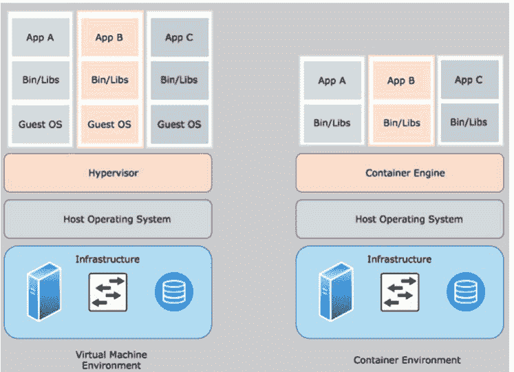
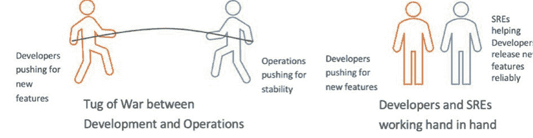
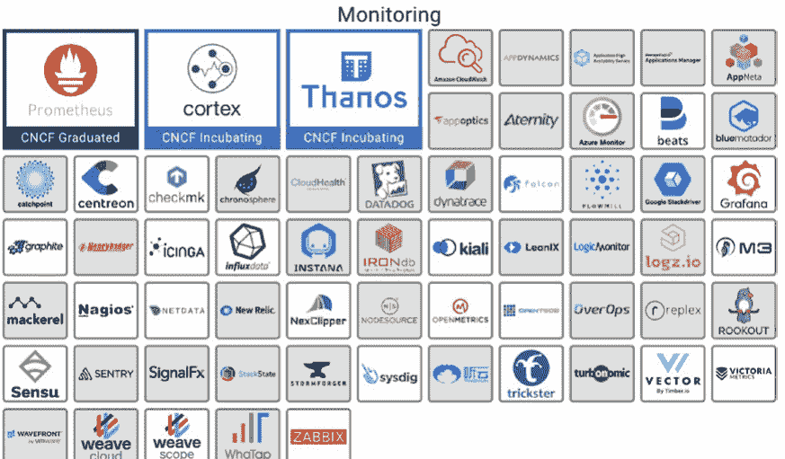
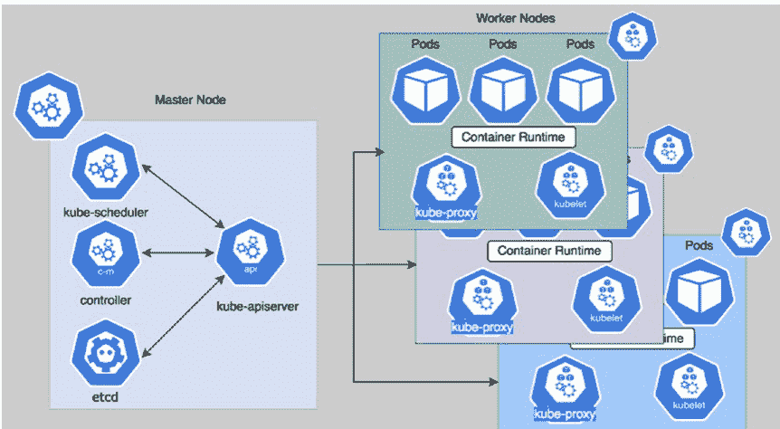

## Introduction

When I was growing up, I was very fond of solving puzzles and reading detective stories. I would spend hours scratching my head about hidden treasure troves or solving a murder mystery on a lazy summer afternoon. I would picture myself inside the scene of action trying to catch the culprit red-handed from a vantage point in the attic. The characters would stay with me as I juggled around with the various possible scenarios and their equally plausible outcomes. Sometimes I would deduce the correct answer, mostly when I could see a pattern (or a motive), and be overjoyed with my feat. However, there were times when I would simply fail to come up with any solution and those were the times when I wished I had some superpowers.

Fast-forward to today where I am working on keeping a critical business application alive when suddenly all hell breaks loose. The application is down, customers are not able to access anything and the business is incurring losses by the second. What went wrong?

Don the detective’s hat, get your spy glasses, and try to find out the answer. This is similar to searching for the missing necklace from the queen’s jewelry box, albeit infinitely more complex. There are many characters involved, some with motives and even some with no motive at all. Finding a pattern or juggling scenarios in your head may not be the right start to your investigations. What you need is a superpower. Voila!

This book is an exercise to provide you with that superpower to accurately find answers to the most critical questions when things start to go haywire with your application. You no longer need to rely on guesswork to find out what went wrong, nor do you need to use trial and error to fix a problem. We will help you get started with the concepts of monitoring, introduce you to popular open source monitoring tools, and help with finding the correct set of use cases for their implementation. The book covers in-depth technical details of open source software used in modern monitoring systems that are tailor-made for environments running microservices.

This book is divided into two parts. Part 1 starts with an introduction to cloud native applications and the foundational concepts of monitoring. It then walks you through the various aspects of monitoring containerized workloads using Kubernetes as the de facto orchestration platform. We will dive deep into the architecture of a modern monitoring system and look at its individual components in detail. Part 2 will introduce you to

In this particular chapter, we will introduce you to two fundamental changes in modern software development, the advent of microservices and containers and their impact on application deployment and performance. Then we will talk about monitoring and discuss the influence of modern applications on traditional monitoring. We will also learn about the various terminologies and roles which have evolved to support this new paradigm of cloud native applications. In addition to that, we will look at the various types of monitoring, the difference between reactive and proactive monitoring and the difference between push and pull monitoring. We will also discuss Kubernetes, its various components, and their respective functions. By the end of this chapter, you would have a good overview of modern monitoring and the associated concepts.

### Microservices

Traditionally, applications were monolithic in nature. They were built on a single code base and deployed in a three-tier architecture of UI (Web), logic (app), and database (storage). In order to change an existing feature, introduce a new feature, or fix a bug, the complete code would need to be redeployed in production after fixing only that small portion of code which warranted changes. This would usually result in planned downtime for code redeployment, unplanned downtime if the code breaks in production and a massive effort between the development and operations teams to get it off the ground. This would lead to inevitable delays and subsequent revenue loss for the business. In fact, at one time, a release cycle of more than six months was considered as standard in the industry.

As a direct result of digital transformation, businesses today want a quicker release cycle, which would mean rolling out newer features and capturing market share before the competition does. In order to speed up the release cycle, it became obvious to break the single monolithic application code block into smaller chunks of code, which can be worked upon more easily than the entire code base. The application functionality is split into several independent services called microservices, which provide particular functionalities within the overall application.

### Containers

Containers provide an abstraction layer that helps developers and DevOps teams to develop, deploy, and run applications on common underlying resources, while still keeping them isolated. This means that an application can be packaged as a container along with its runtime environment such as libraries, binaries, configuration files, and other dependencies. Containers help developers to be more agile as they can now focus on the business logic rather than thinking about the environmental dependencies of their code.

Figure 1-2. Difference between VMs and containers

As shown in Figure 1-2, with regards to providing abstraction and isolation, containers closely resemble virtual machines (VMs); however unlike VMs, in a container the application is packaged with only the essential elements for it to run and not the entire guest OS. This allows containers to have unique capabilities when compared with VMs like quick spin-up, minimum overhead, miniscule footprint, and high portability. More and more developers today are consuming cloud-based container services, either

managed or unmanaged, to test and deploy their applications. This has given rise to the concept of “cloud native,” which is a term that broadly encompasses containerized environments that are run natively in cloud.

As per the Cloud Native Computing Foundation (CNCF):

> Cloud native technologies empower organizations to build and run scalable applications in modern, dynamic environments such as public, private, and hybrid clouds. Containers, service meshes, microservices, immutable infrastructure, and declarative APIs exemplify this approach. These techniques enable loosely coupled systems that are resilient, manageable, and observable. Combined with robust automation, they allow engineers to make high-impact changes frequently and predictably with minimal toil.

Containers have been around for some time but have really gained traction now along with the shift to microservices architecture. Companies who want to migrate their workloads easily from one environment to another can rely on containers to provide a logical abstraction of the application from the environment underneath, therefore supporting the use case of easy migration.

Running servers (or VMs) is akin to having pets where each server is given a unique name and taken care of (manually managed). It is of grave concern if one server stops working and all necessary steps are taken to ensure that the server is healthy again (patching, updating, etc.). On the other hand, containers are ephemeral and in contrast to the philosophy of having pets, they are treated as cattle, raised to fulfill certain functions. If they were not to run anymore, nobody would care. They can simply be killed and replaced with another container. The important thing to note here is that containers are created keeping failure scenarios in mind.

A microservices implementation doesn’t demand the exclusive use of containers; however, using them is the easiest way to run a microservices architecture on the cloud. Since containers can share resources in the same operating system instance with other application components, they can help in achieving better server utilization rates. Containers also spin up quickly and hence are better suited to respond to increasing demands from erratic workloads. The key attributes of elastic infrastructure and highly distributed application components are fueling the journey toward cloud native. However, these same attributes pose a unique challenge as containers can add significant operational complexity due to their short lifespan and highly dynamic nature. The network flow and routing in between the microservices needs to be configured and controlled.

在容器数量较少的场景中，可以手动执行这些运维任务，但随着容器的快速采用，生产环境中的容器数量迅速增长，对容器编排的需求开始变得明显。容器编排器提供资源分配与管理、自动化、伸缩、健康检查、网络、负载均衡等管理任务。像 Kubernetes 这样的容器编排工具可帮助跨云环境自动化部署、伸缩和管理容器化工作负载。我们将在本章后面详细介绍 Kubernetes。

### 监控

监控是指获取系统状态可见性和有意义洞察的完整过程。它包括构建一套定义良好的度量体系，以验证实体的预期行为，并在行为出现任何偏差时快速通知相关管理员。它有助于识别异常行为的原因并纠正这些问题，以避免任何潜在的再次发生。

正如 Rob Ewaschuk 在《*站点可靠性工程：谷歌如何运行生产系统*》（O'Reilly，2016）中所定义：

> 监控意味着收集、处理、聚合和显示关于系统的实时定量数据，例如查询计数和类型、错误计数和类型、处理时间和服务器生命周期。

#### 监控的重要性

监控对于识别特定时间段内的容量使用情况和性能趋势非常重要。它有助于了解资源的历史利用率，从而为未来的容量采购提供明智决策依据；同时，它也是架构重新设计的输入，最重要的是，它能深入洞察系统的运行机制。它还有助于在异常行为演变成棘手问题之前抢先发现它们，从而帮助维持可用性和服务质量。

系统会按固定时间间隔自动发出数据，或在事件发生时发出数据。借助合适的监控系统利用这些数据，我们可以——

- 1. 主动收到系统中潜在问题的警报；
- 2. 快速分析和修复已经发生的问题；
- 3. 确定环境的整体健康状况。

因此，捕获这些数据对系统和应用的高效运行至关重要。监控的主要用例是及时识别问题的根源。在宕机期间，时间至关重要，因为每个人都致力于让系统恢复，但没有太多时间进行详细分析。为了解决这个问题，监控系统需要处理复杂信息的大量数据集，并将其有效地呈现为易于记忆的数据点。基于这种分析，运维人员才能追根究底，快速纠正问题。

现代监控中使用的技术多种多样，涉及实时数据处理和统计数据分析领域。数据可视化也扮演着重要角色，因为处理后的数据必须以人类可读的格式有意义地显示。解读数据的方法有很多种，而监控数据能让你从同一数据集中看到底层问题的许多不同视角。

### DevOps——角色与用户画像

在 DevOps 时代之前，开发人员通常很少关心代码在生产环境中的表现，就把代码扔给运维团队。负责保持应用持续运行的运维团队，在代码于生产环境中出问题时，总会把矛头指向开发人员。DevOps 的诞生正是为了化解这两个群体之间优先级错位的冲突，并提出了一系列新实践来弥合软件开发团队与软件运维团队之间的鸿沟。DevOps 的这一演变过程如图 1-3 所示。

#### 图 1-3. DevOps 的演变

为了与 DevOps 和敏捷方法论的原则保持一致，公司在其组织内部创建了特定角色。其中一个起源于谷歌的角色是站点可靠性工程师（SRE），负责保持系统持续运行。SRE 通过以下方式监控系统，以确保满足预定义的服务级别目标（SLO）：

- 提供系统行为信息
- 识别系统使用和性能的趋势
- 通知并预警异常值和异常情况
- 诊断问题

SRE 的职责是保证生产系统的可靠性，因此需要扎实理解生产环境中运行的服务及其监控方式。如果没有合适的工具和信息，即使识别出异常行为，SRE 也无法快速定位重要信息。图 1-4 展示了 DevOps 的五大支柱及其对应的 SRE 实践：

| DevOps 五大支柱 | DevOps | SRE |
|---|---|---|
| 协作文化 | DevOps 专注于减少开发团队与运维团队之间的壁垒 | SRE 专注于与开发人员合作，通过共享相同的工具来解决问题 |
| 精益 | 系统为故障而构建，故障机制经过深思熟虑 | 对每个新版本使用不同的发布机制，以在可用性与故障之间取得平衡 |
| 度量 | 通过精心定义的检测手段衡量一切 | 定义衡量可用性、正常运行时间和宕机的规范化方法 |
| 自动化 | DevOps 鼓励使用工具实现自动化，减少固定的手动工作 | 专注于通过最大限度减少手动任务来为系统增值 |
| 文化变革 | 倡导对当前流程进行渐进式改变 | 鼓励变革以降低故障成本 |

**图 1-4.** *DevOps 的五大支柱*

### 监控领域

不同环境在范围及其可被监控的机制上各不相同。组织中的不同角色负责监控与应用相关的不同领域，因此他们会根据不同优先级来设计和配置这些监控，大致可以分为以下几类，如图 1-5 所示：

**容器：** SRE 的任务是确保容器的可用性。SRE 监控容器的特定利用率参数以及容器内运行的进程。这些信息有助于完善系统设计，例如引入排队机制，从而确保请求不需要被限流。一些指标可以是容器的正常运行时间百分比、队列中的请求数量，或请求处理线程繁忙的平均时间百分比。容器性能不是一项孤立的活动；相反，它与跟踪容器所部署的云基础设施及其运行应用的性能密切相关。

**服务：** 服务是应用的抽象，构成微服务的一部分，运行在可跨多个集群追踪的容器中。跟踪服务的健康和性能信息，类似于关注应用组件的应用性能和延迟。允许客户端查找并访问其依赖服务的机制称为服务发现。将传入请求分发到一组实例的过程称为动态路由。在决定是否将流量路由到某个实例时，服务网格将健康信息置于服务的邻近性之上。

**应用：** 开发人员和 DevOps 管理员更关心响应时间和故障率，这可以是应用中单个服务的，也可以是整个应用的。他们关注数据库的响应情况、每分钟响应多少查询、堆内存使用量随时间的变化等等。这些信息有助于开发人员持续改进应用，从而带来更好的用户体验。

**用户体验：** Web 分析是一个专门监控用户行为的领域，对于理解用户如何与应用交互、什么让他们保持参与，以及他们如何使用应用提供的服务非常重要。

Clickstream monitoring 指的是使用 Web 服务器日志文件跟踪用户访问网站的情况。它有助于衡量用户的粘性、用户行为和访问位置，这有助于开展数字营销和定向广告活动。公司感兴趣的信息包括每个用户在其 Web/移动应用程序上花费的平均时间，以及新用户与回访用户的人数比例。用户体验数据可以包括页面加载时间、移动崩溃信息、JavaScript 错误等。Synthetic monitoring 是另一种流行的技术，通过在应用程序内部模拟用户行为来监控应用程序。用户体验是驱动客户满意度、从而影响业务成果的最重要因素。

**Business KPI (Key Performance Indicators)：** 过去，开发人员通常负责技术栈，而运维团队负责应用程序的正常运行时间，但两者都未对相应的业务影响负责。然而，随着 DevOps 的发展，越来越多的团队开始关注量化业务影响，因为它为新功能发布提供了重要的反馈，最重要的是，它们是否成功或失败。这可以帮助组织将举措导向具有更多业务潜力的领域。添加业务 KPI 监控确实可以作为一个良好的检查点，以跟踪您的应用程序是否正在为客户创造价值。KPI 可以包括移动应用启动次数、从登录到购买的端到端用户故事、收入处理、展示次数和广告点击次数，所有这些都是业务团队识别表现良好领域并纠正表现不佳领域的重要衡量指标。

现在我们了解了可以进行监控的领域、可监控内容的范围以及监控数据的含义。这里需要注意的重要一点是，监控并不局限于前面提到的领域，还可以扩展到其他领域。

### Monitoring System

监控系统是一组不同的模块集合，有助于数据采集、处理、存储和可视化，从而深入了解应用程序、服务和基础设施的可用性和性能。监控宇宙中有多种监控系统，其中一些是开源的。图 1-6 列出了主要的监控系统¹，我们将在本书第 2 部分介绍其中最受欢迎的开源系统。

¹ 灰色显示的标志不是开源的。来源：https://landscape.cncf.io/。根据 Apache License 2.0 许可。

图 1-6. 主流监控系统

#### Need for a Monitoring System

在前面章节中，我们了解了监控的重要性，在本节中，我们将探讨监控系统的需求。大多数组织使用监控系统的用例有多种，其中一些详细说明如下：

- **Detecting problems early：** 有效监控系统的目标是快速识别问题。当问题在动态环境中存在多个变动部分时，很难快速找出停机事件的真正原因。这时有效的监控系统可以帮助我们快速识别阈值已被突破并通知相关管理员，以便对问题进行调查和解决。
- **Ensuring availability：** 可用性是 SRE 的一个重要 SLO，它指的是尽可能减少停机时间。停机意味着应用程序对终端用户部分或完全不可用，这也可能意味着业务收入和客户满意度的损失。一般来说，这是组织试图通过部署监控系统来避免的最重要标准之一。如果配置得当，监控系统可以通过仔细研究从系统中接收到的数据，预先告知您未来可能受影响的区域。这种数据通常用于系统的预测性维护。此外，随着 AI/ML 的使用，一些系统可以进入自愈模式并自动纠正问题。请参阅本章最后一节，我们在其中简要讨论了基于 AI 的运维（AIOps）和代码化运维。
- **Measuring performance：** 有效监控系统的目标是帮助开发人员随着时间的推移改进应用程序性能。这只有在他们能够可视化性能趋势和模式以找出需要调查的领域时才能实现。例如，通过分析随时间的存储 I/O 模式，我们可以了解应用程序在一天中的不同时间或促销活动期间的行为。

监控系统并不是仅供运维团队和 SRE 管理的孤立设置。任何监控系统的好处在基础设施团队、产品工程团队、应用程序开发人员和运维团队协作、交换观察结果并分配责任区域时更为明显。所有团队的单一参考点通过快速检测和缓解问题显著提高了整个系统的效能。

#### Push vs. Pull Monitoring

在传统的监控系统中，有一个中央组件用于轮询系统以获取可用性数据，位于系统外部。当需要轮询的系统数量有限时，这可以正常工作。当系统和服务数量开始增长时，中央组件必须扩展以满足不断增长的需求。这可能持续几个月或几年，之后整个监控系统必须重新设计。运维团队最终花费更多时间专门管理他们的监控系统，而不是管理业务关键型应用程序和其主要目标所依赖的基础设施。

时至今日，相当多的监控系统仍然依赖于基于拉取的轮询机制。这些系统向被监控的组件发送查询以检查可用性。当需要查询的组件数量有限时，这效果很好。您添加的主机和服务越多，监控环境就需要扩展得越多。在基于推送的架构中，所有组件——无论是主机、服务还是应用程序——都将数据发送到中央收集器。收集完全分布在发出数据的各个主机、服务和应用程序上。这意味着监控不再是一个单一的中央功能，我们也不需要在随着更多端点添加时垂直扩展或分割该单体。

在推送模型中，推送数据的组件称为发射器。它们在数据可用时以及生成后立即发送数据。它们可以使用自己选择的传输机制发送数据，而不是被监控工具强制选择特定机制。这使我们能够构建模块化、功能隔离、有效的监控解决方案，而不是单体式孤岛。

在基于拉取的架构中，首先需要为要监控的目标进行集中配置，指定需要监控的内容；而在基于推送的架构中，监控目标会将数据推送到您配置的目的地。这在动态环境中很相关，因为短暂的活动可能不会被基于拉取的监控自动发现并纳入配置。而在基于推送的架构中，这不是问题，因为发射器控制何时以及将数据发送到何处。

### Kubernetes

Kubernetes 最初由 Google 从其内部容器管理平台 Borg 开发而来；从生产环境中运行 Borg 所学到的经验极大地影响了 Kubernetes。Google 每周运行 200 亿个容器，为了运行如此庞大的环境，他们使用了声明式构造，它定义了系统的最终一致性，并让编排器自行实现。这种设计既可重复又易于升级，本质上是一种“设置一次然后忘记”的现代系统运行理念。

Kubernetes 是第一个毕业的 CNCF 项目，现在是一个流行的行业标准开源容器编排平台，管理容器化应用程序的复杂性。其主要目的是跟踪容器利用率、基于利用率进行扩缩容、持续检查健康状况、负载均衡，并在需要时通过重启容器实现自动自愈。Kubernetes 可以在公有云上运行，也可以作为托管服务从所有领先的云提供商处使用。

我们在这本书中讨论 Kubernetes 是因为它已成为运行容器集群的主流，而您的基于微服务的应用程序将部署在这些集群上。整本书中，我们不仅会部署应用程序，还会将我们的监控系统部署在 Kubernetes 集群之上。因此，在下一章开始使用它们之前，有必要快速浏览一下 Kubernetes 的组件并了解其功能。请注意，本节并非 Kubernetes 入门或学习指南。

#### Figure 1-7. Kubernetes architecture

图 1-7 显示了 Kubernetes 集群内各个组件的架构。Master 节点是集群的单一中央单元，负责管理、规划、调度以及监控多个 worker 节点，并以容器形式运行以下组件：

- kube-apiserver：控制平面的前端；管理并编排 master 节点上的所有内容
- etcd：键/值数据存储，保存了哪些容器运行在哪些 worker 节点上的元数据
- kube-scheduler：负责决定哪些容器进入哪些 worker 节点
- kube-controller-manager：通过运行控制器进程来调节集群状态，例如
  - Node controller：负责跟踪节点状态
  - Replication controller：负责维护精确的 Pod 数量
- Endpoints controller：将服务与 Pod 关联
- Service account and token controllers：负责为新命名空间创建账户和 API 访问令牌

Worker 节点负责接收 master 服务器的请求并运行工作负载：

- kubelet：与 kube-apiserver 交互以获取指令和心跳，创建 Pod
- kube-proxy：将请求转发到容器
- Pod：共享相同主机、IP地址、存储的容器的最小可部署单元
- Container runtime：运行容器的软件

这是对 Kubernetes 概念的简要介绍，我们假设读者已熟悉 Kubernetes 构造。如有需要，请在继续阅读下一章之前参考 www.kubernetes.io 上的文档。

### Summary

在本章中，我们探讨了云原生应用的动态世界，了解了微服务和容器以及它们如何影响现代应用开发领域。我们还总体讨论了监控以及随着 DevOps 的出现其如何随时间演进。随后我们讨论了监控系统，并研究了容器编排平台 Kubernetes。本章应为读者提供了现代监控世界的概览。在下一章中，我们将在本章学到的监控概念的基础上向读者介绍可观测性，并讨论它与监控有何不同。我们还将深入探讨可观测性的三大支柱：指标、日志和追踪。
