## CHAPTER 2

## Observability

当环境复杂如今日般时，仅仅监控已知问题并不能解决随着服务扩展以满足需求而出现的新问题的日益增长的数量。很难一开始就确定会出什么问题。在大多数场景中，标准工具甚至不足以开始分析。等到开始时，系统可能已经随着波动的需求模式而发生变化，有时旧系统会被新系统取代。这种不断升级的复杂性正是为什么可观测性对于构建和运行当今按需云原生应用是必要的。可观测性在运维团队中获得的关注是对其有效性的证明，使 IT 团队能够在底层资源和系统复杂的情况下仍提供卓越的客户体验。

在本章中，我们将学习可观测性以及它与监控有何不同。我们还将详细讨论可观测性的三大支柱及其重要性。此外，我们将探讨如何将可观测性的学习扩展到 Kubernetes 集群。到本章结束时，读者应对可观测性的概念及其如何应用于运行云原生工作负载的 Kubernetes 集群有良好的理解。

### Observability

可观测性是一个借自控制论的概念，专注于从系统可用的外部参数解释系统内部工作机制的研究。它被定义为通过对系统进行仪器化以获取细粒度洞察数据，从而收集系统关于每片信息的一种机制，以便实时重建系统内部状态的完整图景。它提供上下文丰富的數據，可以帮助我们深入了解那些不那么明显的故障并利用可用信息进行调试。它专注于回答在系统投入生产之前尚未形成的问题。

可观测性平台有两个主要目标。第一个是识别基线性能。一旦基线性能被识别，开发人员希望改进它以提高客户满意度或用户体验。第二个目标是在问题开始影响用户体验时恢复基线性能。可观测性是关于生成在生产环境中调试时所需的有用信息集。由于我们仍未达到工具可以自动解决 100% 问题的程度，可观测性可以帮助缩小需要调查的范围。

### Three Pillars of Observability

指标（连同事件）、日志和追踪通常被称为可观测性的三大支柱。将这三者结合起来，可观测性解决了在高度分布式环境中监控云原生应用的挑战。在本节中，我们将详细了解这些支柱。

指标是可观测性的基础支柱，因为它是最容易收集且存储成本最低的。指标是数值性的，因此很容易对其进行分析。它们可以为特定维度或属性标记，并在聚合时呈现整体系统健康的多个维度。收集指标有多种方式，其中最突出的是为从应用收集指标而进行代码仪器化，或为从基础设施收集指标而运行代理。有多个流行的开源工具可以帮助指标收集，例如 Prometheus、StatsD 和 Telegraf。我们将在本章详细介绍指标及其类型，并在第 3 章详细介绍指标收集和存储。

以规律时间间隔收集的测量值（2,4,6,8,10,12）称为指标，而以不规律时间间隔收集的测量值（2,3,6,7,10,11,12）称为事件（图 2-1）。

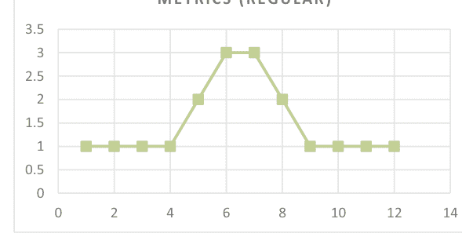

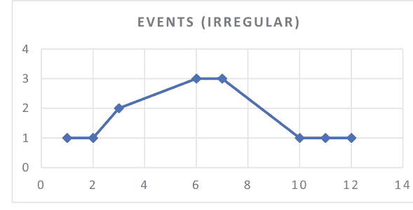

#### Figure 2-1. Metrics and events

事件是另一个重要的子支柱，通常与指标捆绑在一起，但应绝对成为任何健全可观测性策略的一部分。指标与事件的区别在于指标是在规律时间间隔收集的，而事件是来自同一观测系统的重要发生的记录。事件如警报触发、部署失败和事务完成都是在不规律时间间隔发生的重要事件。事件包含元数据以增强上下文并提供进行实时细粒度分析的能力。

日志是系统内发生的一切的详细日志，以结构化文本格式记录，对于执行根本原因分析至关重要。它们可以帮助重现过去，因为这些是提供高保真数据和围绕发生事件的详细上下文的全面记录。日志要么在事件发生时打印出来，要么存储以供将来分析。虽然日志有标准模式（例如在

该系统的一部分的单个资源的情况下。工作指标包括吞吐量、成功、错误和延迟，而资源指标包括错误、饱和、利用率和可用性。工作指标和资源指标结合起来可以帮助您轻松可视化服务的健康状况并诊断问题。让我们详细了解每一个：

### Work Metrics

**Throughput**：组件每单位时间内完成的工作量的绝对度量。对于应用而言，吞吐量是每秒管理的并发进程数量的度量。同样，对于数据库而言，它是每秒执行的查询数量。对于 Web 服务器，吞吐量是每秒处理的 HTTP 请求数量。它有助于量化系统所承受的需求。

**Success**：每单位时间内导致成功的请求速率的度量。

**Error**：每单位时间内导致错误的请求速率的度量。它也可以按吞吐量归一化后以每单位工作量的错误数来衡量。错误指标通常针对所有可能产生错误的来源进行捕获，以便跟踪并相应采取行动。协议响应代码可能不足以涵盖所有故障场景；因此，可能需要其他次要协议来涵盖部分故障情况。

**Latency**：完成单位工作所需时间的度量。建议对所有请求，无论成功还是失败，都测量延迟。导致错误的事务的延迟通常有助于跟踪问题。它可以表示为平均值或百分位，例如 97% 的请求在 0.5 秒内返回。


**错误：** 错误代表系统内部错误，这些错误可能无法在资源产生的输出中直接观察到。

**可用性：** 可用性是对资源可供执行工作的简单检查，以这些资源响应请求的时间百分比来表示。

常见资源的示例资源指标：

| 资源 | 饱和度 | 利用率 | 错误 | 可用性 |
|---|---|---|---|---|
| 微服务 | 排队请求数 | 每个处理请求的线程忙碌的平均时间百分比 | 内部错误、异常数 | 服务可访问的时间百分比 |
| 内存 | 交换使用量 | 已用内存占总内存的百分比 | - | - |
| 数据库 | 排队查询数 | 每个连接处于忙碌状态的平均时间百分比 | 内部错误、复制错误数 | 数据库可访问的时间百分比 |
| 磁盘 I/O | 等待队列长度 | 设备忙碌的时间百分比 | 设备错误数 | 磁盘可写的时间百分比 |

现在我们理解了，指标既可以与工作负载/应用程序相关联（工作指标），也可以与驱动该工作负载的资源相关联（资源指标）。观察和跟踪工作指标非常重要，因为它们直接影响客户满意度；而监控资源指标同样至关重要，因为它们直接影响工作指标，因此对用户体验也有影响。

### 测量方法

#### USE 方法[^1]

利用率（Utilization）、饱和度（Saturation）和错误（Errors）方法（简称 USE 方法）用于通过测量系统资源的利用率、饱和度和错误来分析系统性能，例如内存利用率、CPU 运行队列长度（饱和度）以及设备错误。当资源的容量达到 100% 利用率时，它要么将工作排队（饱和度），要么返回错误，这些也可以使用 USE 方法识别。由于 USE 方法聚焦于数量较少但关键的指标，因此可以快速检查所有系统资源。USE 指标通常表示如下：

- **利用率：** 以百分比表示；例如，CPU 利用率为 90%
- **饱和度：** 以等待队列长度表示；例如，CPU 的平均运行队列长度为四
- **错误：** 以报告的错误数量表示；例如，网络接口出现了 50 次晚期冲突

错误至关重要，因为它们会降低性能，并且可能不会立即被注意到。例如，失败后重试的操作，以及在冗余系统池中发生故障的系统，都可能被忽略并隐藏更大的潜在问题。错误被放在利用率和饱和度检查之前，如果先调查错误再检查其他指标，可以节省关键时间。

值得注意的是，利用率的短暂峰值可能会导致饱和及性能问题，即使较长时间段（例如 5 分钟）内的总体利用率可能仍然很低。一些监控工具报告 5 分钟平均利用率，这将导致该峰值被忽略。例如，CPU 利用率可能在每秒之间剧烈波动，因此 5 分钟平均值可能掩盖 100% 利用率的短暂时期以及由此产生的饱和。USE 方法可能不是这些用例的理想选择。USE 方法在聚焦基础设施方面有其局限性。例如，很难测量内存的饱和度，或者说已使用的内存量。此外，错误计数可能存在问题，尤其是 I/O 错误和内存带宽。还有另一种流行的方法称为 RED 方法，它采用不同的方式来审视上述问题。

[^1]: 由 Brendan Gregg 提出

#### RED 方法[^2]

如图 2-4 所示，RED 方法监控请求速率（Rate，R）、错误率（Error，E）和请求持续时间（Duration，D），这些是监控请求驱动的应用级指标所必需的。使用 RED 方法为微服务添加可观测性最直接的好处是，它为开发人员提供了一套标准的工具来诊断和解决问题。

[^2]: 由 Tom Wilkie 提出

#### 四个黄金信号

监控的四个黄金信号是延迟、流量、错误和饱和度，这一概念最早在《站点可靠性工程：Google 生产系统的运维之道》（O’Reilly, 2016）中提出。在图 2-5 中，展示了这四个黄金信号，每一个信号都对客户体验有直接影响。

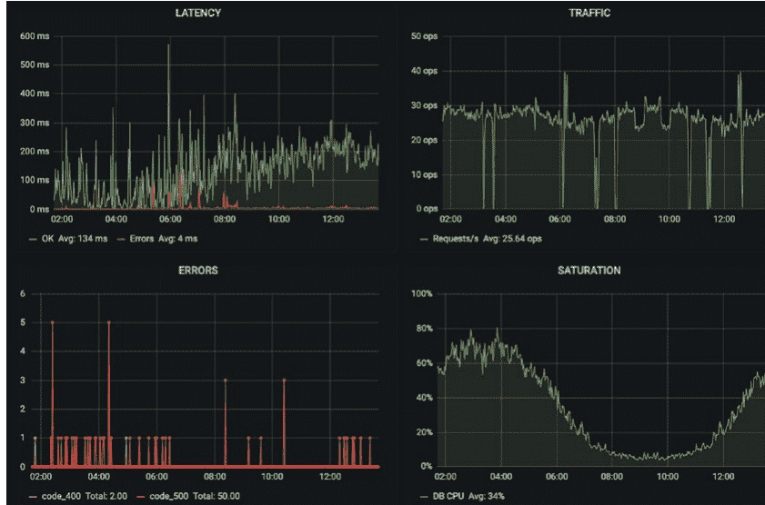

*图 2-5. 四个黄金信号*

**延迟：** 延迟是完成一个请求所需时间的度量。仔细审视失败请求的延迟更为重要。这与我们之前学到的 RED 方法中的持续时间相同。如图所示，建议同时跟踪成功和失败请求的延迟。成功请求的平均延迟为 134 毫秒，而失败请求的平均延迟约为 4 毫秒。

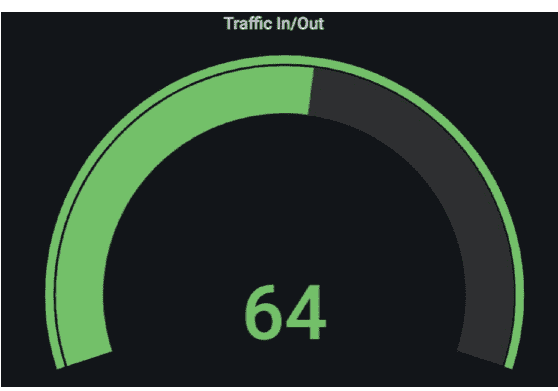

图 2-6. 仪表盘（Gauge）

#### 计数器

计数器是另一种常见的表示方式，其数值随时间增加，且永远不会下降。不过，它可以被重置为零，然后再次开始递增。应用程序或基础设施的系统正常运行时间通常用计数器来表示。由于计数器本质上是递增的，你可以计算某个指标在特定时间段内的变化速率。通过理解两个数值之间的变化速率，可以获取大量有用的信息。例如，登录应用程序的用户总数很少有用；但通过速率，你可以查看每秒登录次数，这有助于识别用户活动增加的时间段。

图 2-7 显示了 kube-apiserver 观看的事件总数这一时间序列指标的计数器。

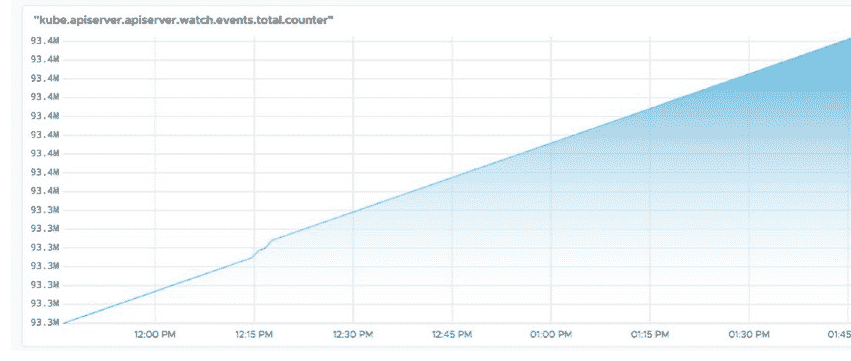

图 2-7. 计数器示例

如图 2-7 所示，可以注意到整体平滑上升的曲线中存在波动。让我们进一步调查，以确定这段时间发生了什么。图 2-8 显示了前述时间序列的每秒变化速率，表明在中午 12:15 左右事件数量出现了峰值，从而验证了我们的假设。

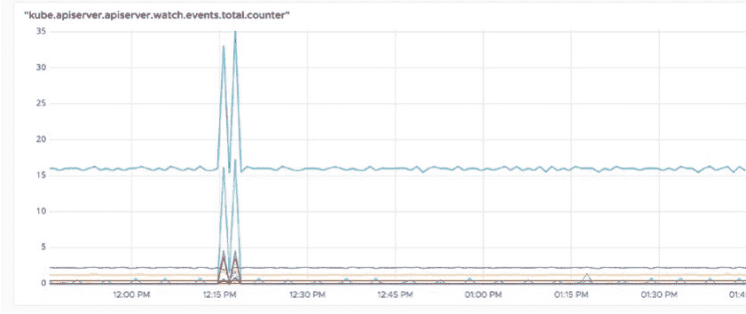

图 2-8. 计数器的变化速率

这两张图对于突出以下观点至关重要：从某个角度查看数据集时可能并不明显的细节，在从另一个角度观察时可能会变得有趣。这正是指标非凡的能力所在——讲述隐藏在数值数据层之下的故事。

#### 计时器

如图 2-9 所示，计时器表示一个请求完成所需的时间。它们用于应用程序监控中的延迟测量。

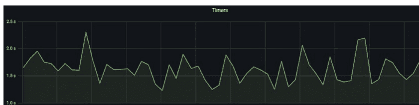

图 2-9. 计时器示例

#### 直方图

容器高度分布式，并且能够以高速度生成极其大量的监控指标。为了跟上监控数据的洪流，SRE 使用直方图和汇总。直方图提供了来自事件或样本流的个体观测值（通常是请求持续时间或响应大小之类的数据）在可配置桶中的分布近似表示。它还提供了所有观测值的计数和总和。

一个指标名为 `<basemetric>` 的直方图在抓取时会公开多个时间序列：

- 观测桶的累积计数器将公开为 `<basemetric>_bucket{le="<上包含界限>"}`
- 所有观测值的总和将公开为 `<basemetric>_sum`
- 已观测事件的数量将公开为 `<basemetric>_count`

如图 2-10 所示，直方图为 DevOps 团队提供了跨环境的全面视图和事件早期指示，同时保留了细粒度的历史可见性。直方图可以帮助你


- 衡量并聚合来自多个来源的高速度指标的分位数/百分位数
- 衡量并聚合高速度指标（如应用响应时间和 SLO）的分位数/百分位数

创建直方图时，从一开始就考虑桶应该是什么非常重要。在大多数场景中，相关指标的 SLO 可以作为一个良好的起点。

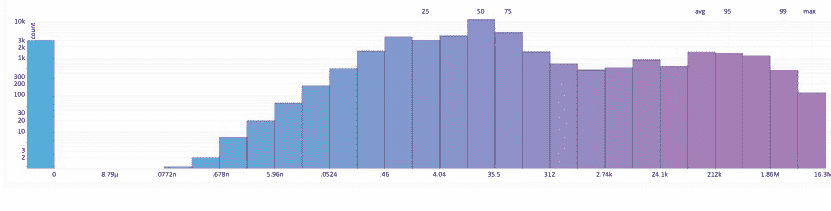

图 2-10. 直方图示例

### Summary

如图 2-11 所示的汇总统计，提供了一种汇总请求持续时间、响应大小等一组观测值的方法。它们还可以提供可配置时间段内所有观测值的总计数和总和。具有基础指标名称为 <basemetric> 的 summary 在一次抓取期间会公开多个时间序列：

- 观测事件的流式 φ-分位数（0 ≤ φ ≤ 1），以 <basemetric>{quantile="<φ>"} 的形式公开
- 所有观测值的总和，以 <basemetric>_sum 的形式公开
- 已观测事件的计数，以 <basemetric>_count 的形式公开

由于其简单性以及仅使用总计和计数器即可计算，使用平均值来计算服务的请求延迟是可行的；然而，它们有一个巨大的缺点，即隐藏分布并阻止异常值显示出来。分位数更适合此类指标，因为它们使我们能够理解分布。例如，如果请求延迟 0.95-分位数（第 95 百分位）为 4 s，则意味着 5% 的请求响应时间超过 4 s。

超过 10 毫秒。百分位数非常适合识别异常值。如果在你的移动应用上获得良好的体验意味着响应时间小于 10 毫秒，那么 99% 的用户体验良好，但 1% 的用户体验不佳。然后你可以专注于解决导致这 1% 用户出现问题的性能问题。

- **变化率：** 变化率显示时间序列中数据之间的变化程度。

### Events

除了捕获以固定间隔收集的指标外，捕获不频繁发生的事件也很重要——例如代码更改、内部警报和扩缩容事件——这些事件可以为理解系统行为的变化提供关键上下文。

一些事件示例 -

- **更改：** 内部代码发布、构建和构建失败
- **警报：** 内部生成的警报或第三方通知
- **扩缩容事件：** 添加或删除主机

由于事件捕获了发生的每个单独操作的历史记录，因此它们可以汇总到聚合中，并有助于确认特定操作是否在给定时间发生。因此，工程师可能希望始终收集发生的每个事件，这是不切实际的，因为每个事件都需要一定的计算和存储空间来收集，这会产生成本。因此，有意义的是捕获不频繁但至关重要的事件。如果某人希望持续收集某个事件及其上下文，那么应考虑捕获指标代替。

例如：

| Event | Timestamp | Additional attribute |
|---|---|---|
| Hotfix no. ### released to production | 2020-05-15 04:13:25 UTC | Time elapsed: 2.8 seconds |
| Pull request ## merged | 2020-05-19 14:22:20 UTC | Commits: io911e7 |
| Nightly backup failed | 2020-05-27 00:01:18 UTC | Link to logs of failed backup |

事件还用于生成警报，因为其中一些可能是极其罕见但关键的事件，需要操作员进行干预；例如，夜间备份失败。然而，更常见的是事件仅用于调查特定事件的发生并关联可能在系统间发生的 issue。

事件日志是随时间发生的离散事件的不可变、带时间戳记录。每个事件条目按类型分类以识别事件的严重性。如下所述：

| Event Type | Description |
|---|---|
| Information | 描述任务（如应用程序、驱动程序或服务）成功运行的事件。 |
| Warning | 描述任务以不推荐的方式成功运行的事件。 |
| Error | 不一定重要的事件，但可能表明未来问题的可能发生。 |
| Success Audit (Security log) | 描述已审计安全事件成功完成的事件。 |
| Failure Audit (Security log) | 描述未成功完成已审计安全事件的事件。 |

### Observability of Kubernetes

传统上，公司只监控两个栈：应用程序和运行它们的<|message|>基础设施。随着容器然后 Kubernetes 的出现，现在还有其他组件需要监控。监控 Kubernetes 有助于识别 Kubernetes 环境——集群、节点、Pod、容器和应用程序工作负载——是否按预期运行。Prometheus 是监控 Kubernetes 最受欢迎的开源解决方案，为现代云原生应用程序提供实时监控、警报和时间序列数据库功能，如图 2-12 所示。它是一个简单而强大的监控工具，可以帮助你识别症状并在出现问题时进行纠正。我们将在本书第 2 部分更详细地学习 Prometheus。

### Sources of Metrics in Kubernetes

Kubernetes 组件，无论是主节点还是工作节点，都生成大量指标，而且格式为 Prometheus 格式。这些指标可以帮助我们了解 Kubernetes 系统的内部工作原理以及对应用程序的影响。Prometheus 格式的输出是结构化纯文本，可以被人类阅读或用作其他监控引擎的输入。有各种内部来源，如 Container Advisor (cAdvisor)、Kubernetes API Server 和 Metrics Server，可以获取系统级指标。还有像 kube-state-metrics 和 Prometheus Node Exporter 这样的来源可以获取应用程序级指标。本节将介绍指标来源以及它们产生的指标概述。

以下步骤假设 Kubernetes 集群已经设置好。建议读者使用 Minikube 或 Kind 根据 https://kubernetes.io/docs/tasks/tools/ 上提供的说明设置 Kubernetes 集群。一旦 Kubernetes 集群启动并运行，并且 kubectl 已成功安装，第一步是使用以下命令列出集群中的所有 Pod：

```
$ kubectl get pods -all-namespaces
```

该命令应产生与图 2-13 中类似的输出。需要关注的重要组件是 kube-apiserver（如果你使用 Minikube 设置集群，则为 kube-apiserver-minikube），它应该处于运行状态。

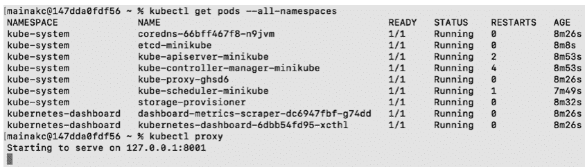

图 2-13. Pod 列表

### Kubernetes API Server

kube-apiserver 是 Kubernetes 的中央管理平面，与整个集群通信。所有用户请求在客户端请求验证后都通过 API Server，并且它与 etcd 交互以持久化集群状态。Kube-apiserver 提供 Kubernetes API，工作节点在内部用于通信，以及 kubectl 在外部使用。

它为 Kubernetes 资源提供了一系列关键指标——请求率、错误率和持续时间（RED 指标）。它还发出与 Pod、节点和其他 Kubernetes 对象的计数、健康状况和可用性相关的数据。为了查看此信息，我们需要在本地机器和 kube-apiserver 之间代理请求。要在后台启动代理服务器，请使用以下命令：

```
$ kubectl proxy
```

这应该启动一个代理，你可以从 http://localhost:8001/metrics 查看 kube-apiserver 的所有指标，如图 2-14 所示：

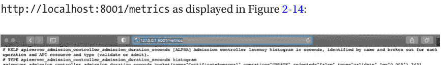

图 2-14. 来自 kube-apiserver 的指标

指标采用 Prometheus 文本格式，并在前面加上 # HELP 和 # TYPE 以解释指标和相关格式以提高可读性。图 2-15 显示了从 kube-apiservers 捕获的其他一些指标。

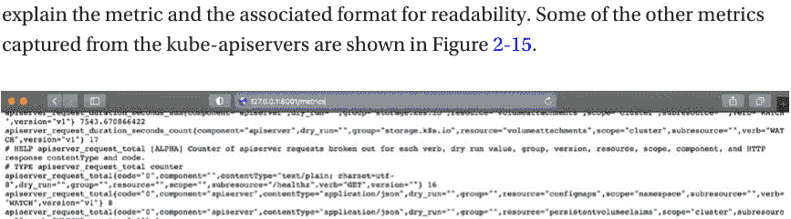

图 2-15. 来自 kube-apiserver 的更多指标


### Kubernetes 内部指标

主节点负责运行 Kubernetes 控制平面，后者反过来监控集群、做出调度决策并确保集群处于期望状态。因此，收集关键指标并监控控制平面组件（如 API Server、调度器、控制器和 etcd）至关重要，并将它们可视化到一个地方。这些指标提供了集群性能的详细视图，也有助于排查问题。由于所有组件都作为容器运行，让我们先来看最重要的容器指标：

| Category | Container Metrics | Description |
| --- | --- | --- |
| Summary | Containers running | Total number of containers running |
| Usage | Host CPU usage | CPU usage of the host on which container runs |
|  | Host storage usage | Storage usage of the host on which container runs |
|  | Host memory usage | Memory usage of the host on which container runs |
| CPU | CPU usage by container | CPU usage of the container under observation |
|  | Total container and system CPU usage | CPU usage of the container and the system |
| Memory | Memory usage by container in bytes | Memory usage of the container under observation measured in bytes |
|  | Memory usage % | Memory usage % of the container under observation |
| Networking | Bytes received by container | Bytes received over the network by the container |
|  | Bytes transferred by container | Bytes transmitted over the network by the container |
|  | Networking errors by container | Network errors, connection resets by container |
| Storage | Total disk usage | Disk usage by the container |
|  | Disk I/O | Disk IOPS by the container |

| Category | Kubernetes Metrics | Description |
| --- | --- | --- |
| **Summary Usage** | Nodes | Total no. of nodes in a Kubernetes cluster |
|  | Pods | Total no. of pods in a Kubernetes cluster |
|  | Pod containers | Total no. of pod containers in a Kubernetes cluster |
|  | Namespaces | Total no. of namespaces in a Kubernetes cluster |
|  | Average node CPU utilization | Average CPU utilization % by node |
|  | Average node memory utilization | Average memory utilization % by node |
|  | Average node storage utilization | Average storage utilization % by node |
|  | Cluster memory usage | Memory usage of the Kubernetes cluster |
| **Namespaces** | Pod count by namespaces | Total no. of pods in a namespace |
|  | Pod container count by namespaces | Total no. of pod containers in a namespace |
|  | Memory usage by namespaces | Total memory usage in a namespace |
| **Node** | CPU utilization by node | CPU utilization % of a node |
|  | CPU usage by node | CPU usage by a node |
|  | Memory utilization by node | Memory utilization % of a node |
|  | Memory usage by node | Memory usage by a node |
|  | Bytes received rate by node | Rate of bytes received over the network by the node |
|  | Bytes transferred rate by node | Rate of bytes transferred over the network by the node |
|  | File system usage % | File system usage % by node |
|  | File system usage by node | File system used by node in bytes |
|  | File system available storage by node | File system available in node in bytes |
| Pod | CPU usage rate by pod | CPU utilization % of a pod |
|  | Memory usage by pod | Memory usage by a pod |
|  | Bytes received rate by pod | Rate of bytes received over the network by the pod |
|  | Bytes transferred rate by pod | Rate of bytes transferred over the network by the pod |
|  | File system usage by pod | File system usage % by pod |

### Kubernetes 环境中的运维

由于 Kubernetes 本身并不直接优化性能，开发人员必须在整个技术栈中识别并调整各个资源，如主机、集群、容器和应用程序。每个容器和 Pod 都是不同的；有些可能是 CPU 密集型，而另一些可能运行的是 I/O 密集型工作负载。为了理解 Kubernetes 环境中的性能参数，运维人员必须提出以下问题：

- CPU 和内存的利用率水平如何？是否有节点面临资源争用？
- Pod 经历了怎样的延迟？某些 Pod 是否比集群中的其他 Pod 延迟更高？
- 为什么在启动自动扩缩容时会出现性能下降？自动扩缩容是否导致性能滞后？多租户是否带来性能影响？
- 底层依赖是否会阻碍应用程序的性能？

开发团队和 SRE 团队都有整体责任去关注应用程序的性能并确保整体 SLO 得到满足：

- 开发人员使用页面加载时间、缓存行为和事务时间等指标来定义 SLO，以提高软件质量。
- SRE 负责对应用程序和服务至关重要的平台服务。他们使用 SLO 来支持高速软件发布生命周期的质量。

决策是基于将开发人员和 SRE 的 SLO 与业务 SLO 进行关联得出的。在对环境进行更改后，开发人员和 SRE 会将应用程序数据与 Kubernetes 控制平面数据关联起来，以了解这些更改对整体环境的影响。此过程揭示了 Kubernetes 组件与其运行的工作负载之间的依赖关系。

例如，如果 Kubernetes 集群中的某些 Pod 过载或配置错误，集群内的其他所有操作以及部署的应用程序也可能受到影响。虽然 SRE 和平台工程师需要操作 Kubernetes  orchestration 层，但开发人员必须了解 Kubernetes orchestration 层对其应用程序和微服务的影响。因此，他们的挑战不同，如下表所示。

| Developers’ Challenges | SREs’ Challenges |
| --- | --- |
| - Resolve mismatch between desired and actual state (applications/workloads, container images, number of replicas, network and disk resources) for better resource usage and application performance<br>- Operate workloads within specified resource limits for their applications or microservices (e.g., increased number of pods per node can lead to service latencies)<br>- Take care of upstream and downstream dependencies<br>- Prevent pod failures | - Ensure that the Kubernetes components operate as expected (e.g., over- or underallocated resources may cause nonstarting or crashing pods under high workloads)<br>- Run within cloud provider limits (e.g., if a container exceeds its memory limit, Kubernetes might terminate it)<br>- Understand etcd load per object because major etcd failure will cripple or take down the container infrastructure<br>- Avoid node hotspots (e.g., nodes with low memory or disk capacity) |

尽管他们的挑战不同，但开发人员和 SRE 都需要摄取、观察、警惕并理解 Kubernetes 中暴露的数据流和指标。他们还需要共同协作，才能在 Kubernetes 平台上有效运行容器化应用程序。
